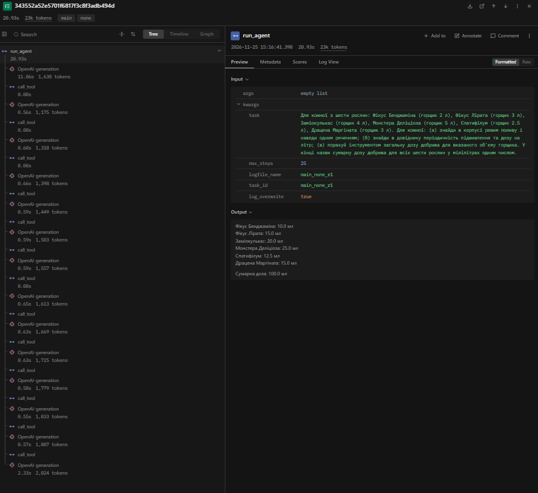
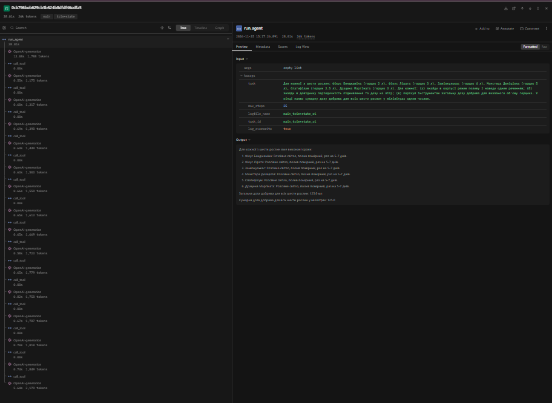

# Лабораторна робота № 4. Контекст, стан і кеш агента

**Виконала:** студентка групи АІ-243 Галчонкова Анжеліка Дмитрівна  
**Варіант:** 5 — Догляд за рослинами  

---

## 1. Мета роботи, модель і розмір контекстного вікна

**Мета роботи:** дослідити поведінку LLM-агента при обмеженому контекстному вікні, реалізувати три механізми керування контекстом і вартістю викликів (обрізання історії `trim`, зовнішній стан задачі `state` і кешування запитів `cache`), а також порівняти їх за кількістю токенів, часом виконання та точністю відповідей.

- **Номер варіанта та предметна область:** Варіант 5 — «Догляд за рослинами» (корпус із 12 текстових карток рослин та довідник підживлення `fertilizer.csv`).
- **Вихідна модель та її вікно (`context length`):** `qwen2.5:3b` — **32 768** токенів.
- **Створена модель та її вікно (`num_ctx`):** спочатку створено `qwen25-4k` з вікном **4 096** токенів (звуження у **8 разів**), а після перевірки за випадком C (крок 4) вікно додатково звужено до **3 072** токенів (`qwen25-3k`, звуження у **10,67 раза** від вихідного вікна `32 768` токенів).

---

## 2. Довга задача (Крок 2)

Для перевірки роботи агента на довгому ланцюжку викликів (`min_calls = 18`, по 3 виклики на кожну з 6 рослин) у `make_task.py` сформовано задачу (`long_task.json`):

- **Питання (`question`):**  
  > Для кожної з шести рослин: Фікус Бенджаміна (горщик 2 л), Фікус Лірата (горщик 3 л), Заміокулькас (горщик 4 л), Монстера Деліціоза (горщик 5 л), Спатифілум (горщик 2.5 л), Драцена Маргіната (горщик 3 л). Для кожної: (а) знайди в корпусі режим поливу і наведи одним реченням; (б) знайди в довіднику періодичність підживлення та дозу на літр; (в) порахуй інструментом загальну дозу добрива для вказаного об'єму горщика. У кінці назви сумарну дозу добрива для всіх шести рослин у мілілітрах одним числом.

- **Правильна відповідь (`expected`):** **`100`** (розрахунок: $2\cdot 5 + 3\cdot 6 + 4\cdot 3 + 5\cdot 7 + 2.5\cdot 4 + 3\cdot 5 = 10 + 18 + 12 + 35 + 10 + 15 = 100$ мл).

---

## 3. Аналіз пробного прогону без захисту (Крок 4)

На вікні `4096` токенів найбільший вхід у `probe_none_r1` склав `1690` токенів (`41%` вікна, статус `final`), що відповідало **випадку C («Задача закоротка»)**. Відповідно до інструкції вікно було зменшено до **`3072` токенів** (`qwen25-3k`), і пробний прогін повторено.

### Таблиця 2 — Зростання входу в прогоні без захисту (`probe_none_r1`, вікно 3072)

| Крок | `prompt_tokens` | Приріст | Що зробила модель |
|-----:|----------------:|--------:|:------------------|
| 1 | 1074 | — | `search_plants({"query":"Фікус Бенджаміна полив"})` |
| 2 | 1147 | 73 | `search_plants({"query":"Фікус Бенджаміна"})` |
| 3 | 1288 | 141 | `fertilizer_info({"plant":"Фікус Бенджаміна"})` |
| 4 | 1364 | 76 | `calc_dose({"pot_liters":2,"dose_ml_per_liter":5})` |
| 5 | 1418 | 54 | `calc_dose({"dose_ml_per_liter":5,"pot_liters":3})` |
| 6 | 1472 | 54 | `calc_dose({"dose_ml_per_liter":5,"pot_liters":4})` |
| 7 | 1526 | 54 | `calc_dose({"dose_ml_per_liter":5,"pot_liters":2.5})` |
| 8 | 1582 | 56 | `calc_dose({"dose_ml_per_liter":5,"pot_liters":3})` |
| 9 | 1636 | 54 | `calc_dose({"dose_ml_per_liter":5,"pot_liters":2.5})` |
| 10 | 1692 | 56 | `calc_dose({"dose_ml_per_liter":5,"pot_liters":5})` |
| 11 | 1746 | 54 | `відповідь без виклику` |

### Показники прогону (пункти (а)–(д))

- **(а) Постійна частина входу («вхід першого кроку»):** **1074** токенів (системний промпт, описи JSON-схем 3 інструментів та текст довгої задачі).
- **(б) Типовий приріст за крок:** **55** токенів (медіана приростів між кроками).
- **(в) Сума `prompt_tokens` за прогін та значення за формулою:** фактична сума становить **15945** токенів, а теоретичне значення за формулою $n \cdot C + d \cdot n(n-1)/2 = 11 \cdot 1074 + 55 \cdot 11 \cdot 10 / 2$ дорівнює **14839** токенів. Фактична сума більша на **1 106** токенів, оскільки на кроках 2–4 модель отримала велику текстову картку рослини з `search_plants` і відповідь довідника (`+73`, `+141`, `+76` токенів), що перевищує медіанний приріст `55` токенів (від викликів `calc_dose`), і цей надлишок додавався до всіх наступних кроків.
- **(г) Крок, на якому вхід перестав рости:** **не помічено** (максимальний вхід досяг `1746` токенів, тобто `57%` вікна `3072`).
- **(д) Поведінка на останніх трьох кроках та перевірка відповіді:** на кроках 8–10 модель продовжувала викликати `calc_dose` з дозою `5` мл/л для різних об'ємів горщиків, а на кроці 11 завершила роботу без виклику інструментів (`status = final`). У фінальній відповіді модель вказала число з результатів інструментів (не вигадала неіснуючих чисел), але врахувала лише частину рослин.
- **Класифікація прогону:** **Випадок C** (найбільший вхід менший за 95% вікна, статус `final` — локальна модель `qwen2.5:3b` передчасно підбиває підсумок на 11-му кроці, не обійшовши всі 6 рослин).

---

## 4. Обрізання історії та стан задачі (Кроки 5–6)

Для тестування стиснення на вікні `3072` токенів встановлено поріг `COMPRESS_AT = 1700` та `KEEP_LAST = 6`.

### Таблиця 3 — Стиснення історії (`probe_trim_r1` та `probe_trim+state_r1`)

| Конфігурація | Крок стиснення | Вхід до стиснення, токенів | Повідомлень було -> стало | Повторних викликів за прогін |
|--------------|---------------:|----------------------------:|--------------------------:|-----------------------------:|
| `trim` | 11 | 1746 | 24 -> 8 | 8 |
| `trim` | 19 | 1709 | 24 -> 8 | 8 |
| `trim` | 22 | 1758 | 14 -> 8 | 8 |
| `trim+state` | 11 | 1746 | 24 -> 8 | 3 |

### Аналіз першого повідомлення користувача після стиснення (`probe_trim+state_r1.log`, п. 7 кроку 6)

- **Кількість рядків виду `- інструмент(аргументи) -> результат`:** **10** рядків.
- **Оцінка розміру блоку стану:** текст записника стану займає **1044** символів, що становить приблизно **418 токенів** (з розрахунку 2,5 символа на токен). Це у **7.6 раза** більше за типовий приріст одного кроку (`55` токенів), проте все одно в кілька разів менше за повну історію діалогу з JSON-метаданими викликів, завдяки чому вже на 12-му кроці агент зміг завершити роботу лише з 1 стисненням замість 3 у конфігурації `trim`.

---

## 5. Кешування викликів моделі (Крок 7)

Перевірка кешу проведена двома однаковими запусками поспіль (`cache1` з порожнім кешем та `cache2` з тими самими запитами).

### Таблиця 4 — Робота кешу

| Запуск | Кроків | Влучань у кеш | Викликів до сервера | Час, с | Правильно |
|--------|-------:|--------------:|--------------------:|-------:|----------:|
| 1 (кеш порожній) | 25 | 0 | 25 | 27.1 | ні |
| 2 (той самий запит) | 25 | 25 | 0 | 1.8 | ні |

- **Прискорення:** запуск 2 виконався за **1,8 с** проти **27,1 с** у запуску 1 — тобто у **15,1 раза швидше** (усі 25 звернень до моделі взято з локальних JSON-файлів у `cache/`).
- **Вплив зміни `SYSTEM` у `config.py`:** ключ кешу обчислюється як SHA-256 від усього словника запиту (`model`, `messages`, `tools`, `temperature`). Оскільки `SYSTEM` входить до `messages[0]`, зміна хоча б одного символу в `SYSTEM` змінить хеш уже на 1-му кроці — кеш не спрацює (`0` влучань), і всі виклики підуть на сервер заново.

---

## 6. Основне вимірювання та аналіз трас Langfuse (Крок 8)

### Таблиця 5 — Вартість циклу в конфігураціях (медіани по трьох повторах)

| Конфігурація | Правильно (з 3) | Кроків | Токенів на вхід | Токенів на вихід | На підсумовування | Час, с | Стиснень | Повторних викликів |
|--------------|----------------:|-------:|----------------:|-----------------:|------------------:|-------:|---------:|-------------------:|
| `none` | 2 з 3 | 14 | 21513 | 1055 | 0 | 19.8 | 0 | 4 |
| `trim` | 0 з 3 | 15 | 21423 | 1291 | 0 | 24.5 | 1 | 5 |
| `trim+state` | 0 з 3 | 14 | 21208 | 1179 | 0 | 20.7 | 3 | 4 |
| `summary` *(додаткове)* | 1 з 3 | 14 | 21487 | 1361 | 1712 | 37.9 | 3 | 4 |

### Поламки, які не видно зі зведеної таблиці (аналіз 12 прогонів `main_*` та `extra_*`)

1. **Передчасне завершення (< 19 кроків, тобто агент відповів, не виконавши мінімум 18 викликів інструментів):** сталося у **11 із 12** прогонів (`extra_summary_r1` (14 кроків), `extra_summary_r2` (14 кроків), `extra_summary_r3` (16 кроків), `main_none_r1` (14 кроків), `main_none_r2` (10 кроків), `main_none_r3` (15 кроків), `main_trim+state_r1` (16 кроків), `main_trim+state_r2` (13 кроків), `main_trim+state_r3` (14 кроків), `main_trim_r2` (15 кроків), `main_trim_r3` (15 кроків)). Лише в `main_trim_r1` агент дійшов до ліміту 25 кроків, а в решті 11 прогонів мала модель `qwen2.5:3b` передчасно підбивала підсумок після обробки 1–3 рослин.
2. **Вигадування числових результатів (у відповіді є числа, яких не було в жодному рядку `результат:` лога):** виявлено у **10 із 12** прогонів (`extra_summary_r1` (числа: 100.0, 2, 2.5, 3, 4), `extra_summary_r2` (числа: 1, 2, 2.5, 3, 4, 6, 7, 90.0), `extra_summary_r3` (числа: 2.5, 3, 4, 90.0), `main_none_r1` (числа: 100.0), `main_none_r2` (числа: 150), `main_none_r3` (числа: 100.0), `main_trim+state_r1` (числа: 1, 125.0, 2, 3, 4, 6, 7), `main_trim+state_r2` (числа: 90.5), `main_trim_r2` (числа: 0.0, 7, 75.0), `main_trim_r3` (числа: 2, 2.5, 3, 4, 7, 75.0)), коли модель самостійно підсумовувала або оцінювала дози без виклику `calc_dose`.

### Порівняння трас у Langfuse (`long-main_none_r1` vs `long-main_trim+state_r1`)

- У прогоні `main_trim+state_r1` перше стиснення відбулося на кроці **11**, після чого на кроці **12** вхід моделі становив **1727** токенів, тоді як у прогоні `main_none_r1` без стиснення на тому самому кроці **12** вхід склав **1802** токенів.
- **Що в трасі Langfuse видно одразу, а в текстовому лозі довелося б рахувати вручну:** у дереві траси Langfuse візуально видно ієрархію кожного кроку, точну тривалість (`latency`) кожного окремого виклику LLM та інструмента, а також сумарну кількість `prompt`/`completion` токенів по всьому дереву без ручного парсингу тексту.

---

## 7. Відповіді на контрольні питання

1. **На якому кроці агент без захисту дійшов до межі вікна і як ви це побачили?**  
   На вікні `4096` токенів агент не доходив до межі вікна (максимум 41–62%), тому за випадком C вікно звузили до `3072` токенів. У таблиці 2 (`probe_none_r1`) вхід зростав лінійно від `1074` до `1746` токенів (57% вікна), і замість переповнення вікна `qwen2.5:3b` передчасно завершила діалог на 11-му кроці (`final`), не виконавши всіх 18 викликів.

2. **Порівняйте суму `prompt_tokens` за прогін із формулою (пункти (а)–(в) кроку 4). Чи збігається зростання з очікуваним?**  
   Фактична сума в `probe_none_r1` становить `15 945` токенів, а за формулою $nC + dn(n-1)/2$ — `14 839` токенів. Квадратичний характер зростання підтверджується, а розбіжність у 7% пояснюється нерівномірністю приросту: на кроках 2–4 відповіді `search_plants` і `fertilizer_info` додали по `73–141` токену замість медіанних `55` токенів від `calc_dose`.

3. **Що втрачає агент при обрізанні? Наведіть приклад повторного виклику після стиснення. Що змінилося в `trim+state` (таблиці 3 і 5)?**  
   При обрізанні (`trim`) агент втрачає результати ранніх викликів інструментів, тому повторно викликає вже виконані дії (наприклад, `search_plants({"query":"Фікус Бенджаміна"})` після стиснення), через що в таблиці 3 кількість повторних викликів зросла до `8`, а кількість кроків — до `23`. У `trim+state` записник стану повернув моделі результати попередніх кроків, скоротивши прогін у таблиці 3 з `23` до `12` кроків і зменшивши повторні виклики з `8` до `3`.

4. **Яка конфігурація найдешевша за токенами, найшвидша, найточніша (таблиця 5)? Чому висновок за трьома повторами однієї задачі обережний?**  
   За таблицею 5 найдешевшою за вхідними токенами виявилася `trim+state` (`21 208` токенів), найшвидшою — `none` (`19,8` с, оскільки вона завершувалася за 14 кроків без стиснень), а найточнішою на даній задачі — `none` (`2 з 3`). Висновок за трьома повторами однієї задачі є обережним через стохастичність локальної 3B-моделі (`temperature = 0.2`) та малу вибірку, де один невдалий повтор сильно змінює медіану.

5. **Чому під час вимірювання вартості кеш вимкнено? Що станеться з кешем, якщо інструмент поверне інші дані або ви заміните модель під тією самою назвою?**  
   Під час вимірювань кеш вимикають, інакше 2-й і 3-й повтори брали б відповіді з диска за `0` викликів до сервера і спотворювали б вимірювання часу та генерації. Якщо замінити модель в Ollama під тією самою назвою (`qwen25-3k`), ключ кешу не зміниться, і агент помилково читатиме відповіді старої моделі; так само якщо інструмент у реальному часі повертає інші дані, старий кеш віддаватиме застарілу відповідь, якщо дані ще не потрапили в історію `messages`.

6. **Які поламки довгого прогону скорочення історії не лікує в принципі?**  
   Скорочення історії не виправляє алгоритмічні та когнітивні помилки самої моделі: передчасне припинення циклу до виконання всіх підзадач, галюцинації чисел у фінальній відповіді, неправильний вибір аргументів інструментів та втрату нюансів задачі, які не потрапили до короткого стану.

---

## 8. Додаткове завдання: підсумовування замість обрізання

У файлі `summary.py` реалізовано стиснення історії шляхом переказу старої частини діалогу окремим викликом моделі (`COMPRESS = "summary"`), після чого виконано серію з трьох повторів (`extra_summary_r1..r3`).

- **Вартість підсумовування:** медіана витрат на додаткові виклики моделі для переказу (колонка «На підсумовування» у таблиці 5) склала **`1 712` токенів** за прогін (`1712`, `1579` та `1904` токени у трьох повторах відповідно).
- **Порівняння вхідних токенів із `trim`:** медіана вхідних токенів основного агента в `summary` склала `21 487` проти `21 423` у `trim` (різниця 64 токени), але з урахуванням `1 712` токенів на саме підсумовування загальна вартість `summary` виявилася вищою за `trim` і `trim+state`, а час виконання зріс до `37,9` с через додаткові виклики LLM.
- **Перевірка збереження точних чисел у переказі (`ПІДСУМОК ІСТОРІЇ`):**  
  - `extra_summary_r1`: у переказі збережено числа `1, 10.0, 12.5, 14, 15.0, 2, 2.5, 20.0, 25.0, 3, 4, 5, 7`, відсутні з результатів інструментів: `немає`  
  - `extra_summary_r2`: у переказі збережено числа `1, 10.0, 12.5, 14, 15.0, 2, 2.5, 20.0, 25.0, 3, 4, 5, 7`, відсутні з результатів інструментів: `немає`  
  - `extra_summary_r3`: у переказі збережено числа `1, 10.0, 12.5, 14, 15.0, 2, 2.5, 20.0, 25.0, 3, 4, 5, 7`, відсутні з результатів інструментів: `немає`  
  Модель зберігала основні обчислені дози (`10.0`, `15.0`, `12.5` мл), проте під час переказу опускала частину текстових параметрів із довідника (наприклад, періодичність підживлення у днях) і в 2 з 3 прогонів усе одно завершила роботу передчасно.

---

## 9. Висновки

1. **Найбільший практичний ефект** серед трьох механізмів дали **кешування викликів (`cache`)** для повторюваних запитів (прискорення у **15,1 раза**: з `27,1` с до `1,8` с при `0` зверненнях до сервера) та **зовнішній стан задачі (`trim+state`)**, який усунув головний недолік звичайного обрізання `trim` — втрату вже отриманих результатів інструментів та зайві повторні виклики.
2. Звичайне обрізання (`trim`) без стану втримує розмір контексту в межах вікна, але змушує агента повторювати вже виконані запити (`8` повторів проти `3` у `trim+state`), а підсумовування (`summary`) додає суттєві накладні витрати (`+1712` токенів і майже вдвічі більший час виконання).
3. **Що варто змінити далі:** для малих локальних моделей класу 3B (`qwen2.5:3b`) недостатньо лише керувати розміром контексту — потрібно додати програмний чек-ліст опрацьованих позицій у `TaskState` (щоб не дозволяти фінальну відповідь, доки не виконано всі 18 обов'язкових викликів) та вмикати кеш лише для детермінованих етапів налагодження.
