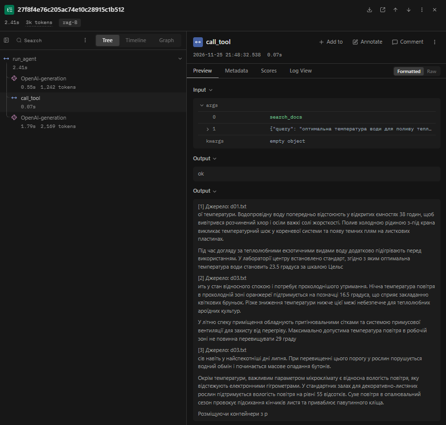
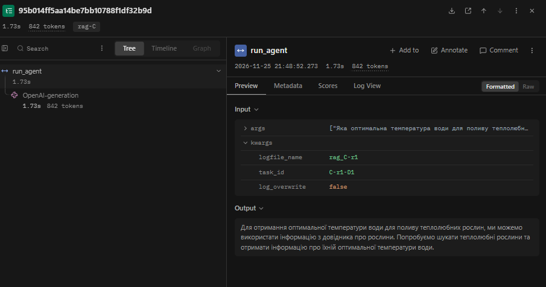

# Лабораторна робота № 5. RAG-агент: пошук по документах як інструмент

**Навчальний заклад:** Національний університет «Одеська політехніка», Інститут комп'ютерних систем  
**Виконала:** студентка групи АІ-243 Галчонкова Анжеліка Дмитрівна  
**Рік:** 2026  
**Варіант:** 5 (Догляд за кімнатними рослинами — ботанічний центр «ФлораЛаб»)  
**Модель чату (LLM):** `qwen2.5:7b` (`temperature=0`, контекстне вікно `NUM_CTX = 4096`)  
**Модель ембедингів:** `bge-m3` (розмірність `1024`, L2-нормалізація)  
**Параметри пошуку за замовчуванням:** `TOP_K = 3`, `MIN_SCORE = 0.56`  

---

## 1. Мета роботи

Замінити пошук підрядком на векторний пошук по локальному корпусу документів, під'єднати його до агента як інструмент `search_docs`, перевірити якість пошуку окремо від агента для різних способів нарізання на чанки, підібрати поріг схожості `MIN_SCORE`, порівняти три варіанти опису інструмента (`A`, `B`, `C`) за кілька повторів і проаналізувати причини помилок за логами, трасами Langfuse та базовими задачами.

---

## 2. Дані та перевірка без документів

### 2.1. Документи і набір питань (`rag_cases.json`)
Корпус містить **17 текстових файлів** загальним обсягом **18 543 символи** (~**7 417 токенів** при оцінці 2,5 символа на токен), що значно перевищує розмір вікна `4096`:
* **5 документів (`data/docs/d01.txt` – `d05.txt`):**
  1. Полив (`d01.txt`);
  2. Ґрунт і пересадка (`d02.txt`);
  3. Освітлення й температура (`d03.txt`);
  4. Хвороби та шкідники (`d04.txt`);
  5. Сезонний догляд (`d05.txt`).
* **12 файлів (`data/corpus/*.txt`)** з карток рослин попередніх робіт (фоновий корпус).

| ID | Вид | Питання | `must_contain` | `expected` |
| :--- | :--- | :--- | :--- | :--- |
| **D1** | direct | Яка оптимальна температура води для поливу теплолюбних рослин? | `температура води становить 23.5 градуса` | `23.5` |
| **D2** | direct | Якої товщини формується дренажний шар на дні горщика? | `дренажний шар завтовшки 3.5 сантиметра` | `3.5` |
| **D3** | direct | Яка освітленість підтримується для світлолюбних субтропічних культур? | `освітленість не нижче 2400 люксів` | `2400` |
| **D4** | direct | На скільки днів хвору рослину поміщають на карантин при виявленні інфекції? | `поміщають на карантин на 19 днів` | `19` |
| **P1** | paraphrase | Скільки годин має відстоюватися рідина з-під крана перед зволоженням субстрату? | `відстоюють у відкритих ємностях 38 годин` | `38` |
| **P2** | paraphrase | Скільки діб після пересадки рослину не можна підживлювати? | `внесення добрив заборонено протягом 26 днів` | `26` |
| **P3** | paraphrase | На якій відстані в сантиметрах над верхівкою крони розміщують штучне підсвічування? | `фітолампи закріплюють на висоті 44 сантиметри` | `44` |
| **P4** | paraphrase | На скільки сантиметрів углиб горщика замінюють стару землю навесні? | `оновлюють верхній шар ґрунту на 4.5 сантиметра` | `4.5` |
| **N1** | none | Скільки коштує виклик фітодизайнера додому для пересадки пальми? | `null` | `null` |
| **N2** | none | Який об'єм резервуара автоматичного зволожувача повітря в літрах використовують в оранжереї? | `null` | `null` |

*(Примітка: у `P4` значення `must_contain` містить 7 слів замість рекомендованих 3–6, щоб зберегти точний контекст вимірювання з `d02.txt` без зміни зафіксованих прогонів.)*

### 2.2. Перевірка без документів
При зверненні до моделі без документів на питання `D1`–`D3` вона не назвала внутрішні регламентні норми центру (`23.5 °C`, `3.5 см`, `2400 люксів`): на `D1` назвала загальноприйняту кімнатну температуру (`20–22 °C`), на `D2` замість товщини в сантиметрах вигадала пояснення про «запобігання ерозії поверхні горщика під впливом води», а на `D3` попросила уточнити конкретний вид рослини.

---

## 3. Перевірка моделі ембедингів (`embed_check.py`)

* **Довжина вектора:** `1024`
* **Довжина (норма) першого вектора:** `1.000`
* **Запит — «Тариф на доставку»:** `0.731`
* **Запит — «Графік роботи кур'єрів»:** `0.568`

Запит виявився суттєво ближчим за косинусною подібністю до фрази про тариф (`0.731`), ніж до фрази про графік роботи кур'єрів (`0.568`).

---

## 4. Нарізання на чанки та пошук без агента

### Таблиця 1 — Нарізання одного документа (`data/docs/d01.txt`)

| Спосіб | Чанків | Закінчуються посеред речення | Довжина найбільшого, символів |
| :--- | :---: | :---: | :---: |
| `fixed`, 200, перекриття 0 | 16 | 14 | 200 |
| `fixed`, 500, перекриття 100 | 8 | 7 | 500 |
| `paragraphs`, 800 | 5 | 0 | 775 |

**Приклад розрізаного факту (`fixed 200 0`, чанки № 10 і № 11):**
* **Чанк 10:** `"…Доросла рослина в стандартному керамічному контейнері отримує не більше 140 "`
* **Чанк 11:** `"мілілітрів води за один підхід. Між поливами земляна грудка у таких видів повинна просихати повністю до самого дна горщика.…"`

Число `140` виявилося відокремленим від одиниці вимірювання та об'єкта (`мілілітрів води за один підхід`). Коли число та умова або одиниця вимірювання розходяться по різних чанках, пошук може не знайти потрібний фрагмент за змістом, а агент — отримати обрізаний факт без одиниць вимірювання та дати хибну відповідь.

### Таблиця 2 — Пошук при різному нарізанні

| Конфігурація | Чанків | Сер. довжина | `hit@1` | `hit@3` | `hit@5` | `hit@3` прямі | `hit@3` перефр. | Токенів (`k=3`) |
| :--- | :---: | :---: | :---: | :---: | :---: | :---: | :---: | :---: |
| `fixed-200-0` | 103 | 180 | 0.62 | 0.75 | 0.75 | 0.50 | 1.00 | 216 |
| `fixed-500-0` | 47 | 395 | 0.75 | 1.00 | 1.00 | 1.00 | 1.00 | 473 |
| `fixed-500-100` | 52 | 424 | 0.62 | 1.00 | 1.00 | 1.00 | 1.00 | 509 |
| `fixed-1500-0` | 27 | 687 | 0.75 | 0.75 | 0.75 | 0.75 | 0.75 | 824 |
| `paragraphs-800` | 37 | 500 | 0.75 | 0.75 | 0.75 | 0.75 | 0.75 | 600 |
| `paragraphs-800+title` | 37 | 522 | 0.62 | 0.75 | 0.88 | 0.75 | 0.75 | 627 |

**Вибір конфігурації:** обрано `fixed-500-0` (`CHUNK_METHOD="fixed"`, `CHUNK_SIZE=500`, `CHUNK_OVERLAP=0`, `WITH_TITLE=False`), оскільки в цьому прогоні воно дає найвищий `hit@3` (`1.00`) при меншому розмірі результату (`473` токени проти `509` у `fixed-500-100`) і вищому `hit@1` (`0.75`).

### Таблиця 3 — Схожість першого результату (`fixed-500-0`)

| id | Вид | Схожість | Перший результат містить потрібну фразу |
| :--- | :--- | :---: | :---: |
| **D1** | direct | 0.679 | так |
| **D2** | direct | 0.621 | так |
| **D3** | direct | 0.667 | НІ (у top-3) |
| **D4** | direct | 0.685 | так |
| **P1** | paraphrase | 0.608 | НІ (у top-3) |
| **P2** | paraphrase | 0.693 | так |
| **P3** | paraphrase | 0.628 | так |
| **P4** | paraphrase | 0.596 | так |
| **N1** | none | 0.465 | — |
| **N2** | none | 0.530 | — |

Вибрано **`MIN_SCORE = 0.56`** (середина зазору між `0.530` і `0.596`).

---

## 5. Перевірка інструмента `search_docs` без моделі (`try_tool.py`)

**Вивід `python try_tool.py D1`:**
```text
ПИТАННЯ: Яка оптимальна температура води для поливу теплолюбних рослин? 

рівень: ok
[1] Джерело: d01.txt
ої температури. Водопровідну воду попередньо відстоюють у відкритих ємностях 38 годин, щоб вивітрився розчинений хлор і осіли важкі солі жорсткості. Полив холодною рідиною з-під крана викликає температурний шок у кореневої системи та появу темних плям на листкових пластинах.

Під час догляду за теплолюбними екзотичними видами воду додатково підігрівають перед використанням. У лабораторії центру встановлено стандарт, згідно з яким оптимальна температура води становить 23.5 градуса за шкалою Цельс

[2] Джерело: d03.txt
ить у стан відносного спокою і потребує прохолоднішого утримання. Нічна температура повітря в прохолодній зоні оранжереї підтримується на позначці 16.5 градуса, що сприяє закладанню квіткових бруньок. Різке зниження температури нижче цієї межі небезпечне для теплолюбних ароїдних культур.

У літню спеку приміщення обладнують притінювальними сітками та системою примусової вентиляції для захисту від перегріву. Максимально допустима температура повітря в робочій зоні не повинна перевищувати 29 граду

[3] Джерело: d03.txt
сів навіть у найспекотніші дні липня. При перевищенні цього порогу у рослин порушується водний обмін і починається масове опадання бутонів.

Окрім температури, важливим параметром мікроклімату є відносна вологість повітря, яку відстежують електронними гігрометрами. У стандартних залах для декоративно-листяних рослин підтримується вологість повітря на рівні 55 відсотків. Сухе повітря в опалювальний сезон провокує підсихання кінчиків листя та приваблює павутинного кліща.

Розміщуючи контейнери з р

Занадто короткий запит -> рівень: schema
Помилка: аргументи не пройшли перевірку.
Поле query: String should have at least 3 characters
Виправ аргументи і виклич інструмент ще раз.
```

**Вивід `python try_tool.py N1`:**
```text
ПИТАННЯ: Скільки коштує виклик фітодизайнера додому для пересадки пальми? 

рівень: ok
У документах нічого схожого не знайдено.

Занадто короткий запит -> рівень: schema
Помилка: аргументи не пройшли перевірку.
Поле query: String should have at least 3 characters
Виправ аргументи і виклич інструмент ще раз.
```

---

## 6. Агент з трьома описами інструмента

### Таблиця 4 — Варіанти опису інструмента `search_docs` у `schemas.py`

| Назва | Опис `search_docs` | Нарізання, `TOP_K`, `MIN_SCORE` |
| :---: | :--- | :--- |
| `A` | *«Шукає рослини за назвою, умовами догляду або симптомом проблеми. Повертає картки знайдених рослин. Використовуй, коли користувач описує рослину або проблему з нею.»* (копія опису `search_plants`) | `fixed-500-0`, `TOP_K = 3`, `MIN_SCORE = 0.56` |
| `B` | *«ЄДИНЕ джерело даних про догляд за рослинами та правила ботанічного центру ФлораЛаб. Викликай ЗАВЖДИ, коли питання стосується будь-якої рослини, норми, температури, вологості, терміну, дозування, кількості чи правила догляду, навіть якщо тема здається незвичною. Ніколи не відповідай «немає інформації» чи «немає інструмента», не викликавши спершу цей інструмент. Документи охоплюють: регламент поливу кімнатних рослин; підготовку ґрунту та правила пересадки; вимоги до освітлення та мікроклімату; діагностику хвороб та карантин; календар сезонного догляду. Запит формулюй повним реченням. Відповідай лише за знайденими фрагментами; якщо потрібного там немає, так і скажи користувачу.»* | Ті самі |
| `C` | *«Шукає інформацію.»* | Ті самі |

### Таблиця 5 — Агент з трьома описами інструмента (24 прогони з відповіддю на опис)

| Опис | Правильно (з 24) | Викликав пошук (з 24) | Кроків, медіана | Токенів входу, медіана | Час, с, медіана |
| :--- | :---: | :---: | :---: | :---: | :---: |
| **A** | 0 | 0 | 1.0 | 767 | 1.4 |
| **B** | 15 | 18 | 2.0 | 2610 | 1.8 |
| **C** | 5 | 6 | 1.0 | 708 | 1.1 |

### Таблиця 6 — Куди ламається відповідь (30 прогонів на опис: 24 з відповіддю, 6 без відповіді)

| Категорія | A | B | C |
| :--- | :---: | :---: | :---: |
| Правильно | 0 | 15 | 5 |
| Не шукав і відповів неправильно | 24 | 6 | 18 |
| Шукав, але потрібного фрагмента в результаті немає | 0 | 3 | 1 |
| Фрагмент був у результаті, відповідь неправильна | 0 | 0 | 0 |
| Питання без відповіді: визнав, що не знає | 3 | 6 | 6 |
| Питання без відповіді: вигадав відповідь | 3 | 0 | 0 |

*(Примітка: при `temperature=0` повтори в межах опису `B` дають однакові значення на тих самих кейсах, тож у цьому прогоні лічильники кратні 3 — фактично це 5 із 8 питань, повторених тричі.)*

---

## 7. Розбір у логах і трасах Langfuse

1. **Агент не шукав (`no_search` в описах `C` і `B`):**
   * У `logs/rag_C-r1.log` (`C-r1-D1`) модель не викликала `search_docs`, а відповіла текстом без регламентного числа:
     ```text
     ##### C-r1-D1
     ЗАДАЧА: Яка оптимальна температура води для поливу теплолюбних рослин?
     --- крок 1 | помилок поспіль=0 | prompt_tokens=693 | completion_tokens=149
     ВІДПОВІДЬ: Для отримання оптимальної температури води для поливу теплолюбних рослин, ми можемо використати інформацію з довідника про рослини. Попробуємо шукати теплолюбні рослини та отримати інформацію про їхньої оптимальної температури води.
     ```
   * У `logs/rag_B-r1.log` 6 прогонів `no_search` розпалися на два різні випадки:
     * `B-r1-D4` (3 повтори): модель згенерувала `23` `completion_tokens`, але повернула порожні `msg.tool_calls` і `msg.content=""` (та сама технічна поломка, що й у Таблиці 7).
     * `B-r1-P4` (3 повтори): модель замість `search_docs` викликала `calc_dose({"dose_ml_per_liter":100,"pot_liters":1})`, отримала помилку валідації `schema` (`Input should be less than or equal to 50`), а на кроці 2 дала відповідь із загальних знань (*«При заміні старої землі в горщикі на нову, не потрібно замінювати її навесні…»*) без звернення до пошуку.

2. **Порівняння питання, `query` і `top_score` (`results/rag.csv`):**
   * **`B-r1-D1`:** питання *«Яка оптимальна температура води для поливу теплолюбних рослин?»* (повне питання в табл. 3 давало `0.679`) → `query`: `"оптимальна температура води для поливу теплолюбних рослин"` → `top_score = 0.676` (вище порогу `0.56`, потрібний фрагмент знайдено).
   * **`B-r1-P1`:** питання *«Скільки годин має відстоюватися рідина з-під крана перед зволоженням субстрату?»* (повне питання давало `0.608`) → `query`: `"рідина з-під крана перед зволоженням субстрату годин"` (агент скоротив запит до набору ключових слів) → `top_score = 0.524` (нижче порогу `0.56`, пошук повернув порожній результат).
   * **`B-r1-N2`:** питання *«Який об'єм резервуара автоматичного зволожувача повітря в літрах використовують в оранжереї?»* (повне питання давало `0.530`) → `query`: `"об'єм резервуара автоматичного зволожувача повітря в літрах"` → `top_score = 0.442` (нижче порогу `0.56`, нерелевантний фрагмент відсіяно).

3. **Шукав, але не знайшов (`miss`):** у `B-r1-P1` агент скоротив запит до ключових слів, схожість впала нижче `0.56`, і поріг відсіяв чанк.
4. **Знайшов, але не використав (`ignored`):** у цьому прогоні `0` таких випадків (усі 15 знахідок в описі `B` дали правильну відповідь).
5. **Питання без відповіді (`none`):** у `results/rag.csv` в описі `B` агент викликав пошук для `N2` (`searches = 1`) і не викликав для `N1` (`searches = 0`): для `N2` поріг `MIN_SCORE = 0.56` відсіяв нерелевантний чанк (`0.442`), а для `N1` модель відмовилася відповідати без виклику інструмента (разом `6` відмов і `0` вигаданих відповідей у `B`). В описі `C` агент на обох питаннях (`N1`, `N2`) не викликав пошук (`searches = 0`, `cat = refused`), тож відмови там зумовлені поведінкою самої моделі. В описі `A` пошук теж не викликався (`searches = 0`), але в `3` прогонах модель вигадала відповідь (`cat = invented`, зокрема через `calc_dose` у `A-r1-N1`).
6. **Траси Langfuse (`rag-B` та `rag-C`):** у трасі `rag-B` видно розгорнутий опис `search_docs` у вході моделі та дерево з `call_tool` (запит і 3 чанки у виході), а в `rag-C` — короткий опис *«Шукає інформацію.»* і відсутність `call_tool`. У трасі одразу видно ієрархію кроків, таймінги, токени та вхід/вихід кожного вузла без ручного перегляду текстового логу.





---

## 8. Звичайні задачі після зміни пошуку

*(Примітка: у лабораторній № 4 використовувалися модель `qwen2.5:3b`, вікно `NUM_CTX = 3072` і `temperature = 0.2`, а в цьому прогоні — `qwen2.5:7b`, `NUM_CTX = 4096` і `temperature = 0`. У `config.py` (`ALLOWED = ["search_docs", "fertilizer_info", "calc_dose"]`) інструмент `search_plants` вилучено відповідно до методички.)*

### Таблиця 7 — П'ять задач до і після заміни пошуку

| Задача | Відповідь у лабораторній № 4 | Відповідь тепер (`logs/run_rag.log`, `agent.py`) | Чи викликав `search_docs` | Що змінилося |
| :--- | :--- | :--- | :---: | :--- |
| **1 (`Z1`)** | Пояснив причини пожовтіння листя після `search_plants` | Статус `final`: `msg.tool_calls` порожній, `msg.content=""` (`completion_tokens=28`) | ні | `search_plants` вилучено з `ALLOWED`; модель згенерувала 28 токенів без розпізнаного виклику чи тексту |
| **2 (`Z2`)** | Звернувся до `fertilizer_info("фікус")` і підказки пошуку | Статус `final`: `msg.tool_calls` порожній, `msg.content=""` (`completion_tokens=23`) | ні | Зупинився на 1-му кроці без виклику інструмента й тексту відповіді |
| **3 (`Z3`)** | Викликав `fertilizer_info("фікус")`, попросив уточнити вид | Викликав `fertilizer_info("фікус")`, попросив уточнити вид | ні | Поведінка не змінилася |
| **4 (`P1`)** | Викликав `search_plants("сагуаро")`, повідомив про відсутність | Статус `final`: `msg.tool_calls` порожній, `msg.content=""` (`completion_tokens=25`) | ні | `search_plants` вилучено з `ALLOWED`; модель не перейшла на `search_docs` і повернула порожній `content` |
| **5 (`P2`)** | Відмовився від фізичної дії та уточнив запит | Статус `final`: `msg.tool_calls` порожній, `msg.content=""` (`completion_tokens=23`) | ні | Завершив на 1-му кроці з порожнім `content` замість текстової відмови |

---

## 9. Відповіді на питання

1. **Нарізання за символами vs за абзацами (`Табл. 1`):** `fixed 200 0` дав `16` чанків і `14` обривів посеред речення, `fixed 500 100` — `8` чанків і `7` обривів, а `paragraphs 800` — `5` чанків, `0` обривів і найбільший чанк `775` символів (різниця в кількості чанків — від `3` до `11`). У чанках № 10–11 (`fixed 200 0`) число `140` виявилося відокремленим від `мілілітрів води за один підхід`: коли факт розрізано між чанками, модель або пошук втрачають цілісність умови й норми, що підвищує ризик пропустити факт чи вигадати відповідь.
2. **Найкраща конфігурація за `hit@3` (`Табл. 2`):** у цьому прогоні найкращою є `fixed-500-0` (`hit@3 = 1.00`, `hit@1 = 0.75`, `473` токени), бо вона поєднує повне влучання в top-3 із компактнішим контекстом, ніж `fixed-500-100` (`509` токенів). Збільшення розміру чанка до `1500` знизило `hit@3` до `0.75` і збільшило контекст до `824` токенів (ціна більшого чанка — більше шуму та токенів у вікні); перекриття (`500` з `100`) зберегло `hit@3 = 1.00`, але знизило `hit@1` до `0.62`, а додавання заголовка у `paragraphs-800+title` порівняно з `paragraphs-800` знизило `hit@1` з `0.75` до `0.62`, підвищило `hit@5` з `0.75` до `0.88` і залишило `hit@3 = 0.75` (`627` проти `600` токенів).
3. **Прямі vs перефразовані питання (`Табл. 2`):** у `fixed-500-0` обидва типи показали `hit@3 = 1.00`, тоді як різниця `0.50` проти `1.00` у `fixed-200-0` є статистичним шумом на малому наборі (у кожній групі лише 4 питання, тому одне питання зсуває `hit@3` на `0.25`). Загалом векторний пошук здатний знаходити відповідь за змістом навіть при зміні формулювання (хоча в питаннях `P1`, `P3` та `P4` залишилися спільні слова з `must_contain`, як-от «годин» чи «сантиметр», тоді як чистий пошук за підрядком на перефразованих реченнях не спрацював би).
4. **Поріг `MIN_SCORE = 0.56` (`Табл. 3`):** у цьому наборі він розділяє питання з відповіддю (мінімум `0.596`) і без неї (максимум `0.530`). Занадто високий поріг призведе до пропусків (`miss`) при перефразованих або скорочених запитах, а занадто низький — пропустить нерелевантні чанки на питаннях `none` і спровокує вигадування (`invented`).
5. **Описи інструмента (`Табл. 4`, `Табл. 5` і `Табл. 6`):** найбільше правильних відповідей дав опис `B` (`15/24`, проти `0/24` у `A` і `5/24` у `C`). Пошук на питаннях з відповіддю викликався у `0/24` (`A`), `18/24` (`B`) і `6/24` (`C`). Опис `B` змінив поведінку тим, що прямо вказав на обов'язковість виклику, перелічив теми документів і заборонив відповідати без пошуку.
6. **Найчастіша помилка в `B` (`Табл. 6`):** формально це `no_search` (`6` прогонів з 24 на питаннях з відповіддю), але аналіз `logs/rag_B-r1.log` показує два різні механізми: у `3` прогонах (`D4`) модель згенерувала `23` `completion_tokens` із порожніми `msg.tool_calls` та `msg.content=""` (технічний збій розпізнавання відповіді моделі, як і в табл. 7), а ще у `3` (`P4`) — помилково викликала `calc_dose` замість `search_docs` і після помилки схеми відповіла без пошуку. Описом інструмента та системним промптом можна зменшити вибір хибного інструмента (`P4`), але не технічний збій генерації порожньої відповіді (`D4`), і це розрізнення важливе, щоб не змінювати індекс там, де причина на рівні агента чи моделі.
7. **Питання без відповіді (`none`):** агент вигадав відповідь у `3` прогонах (усі в описі `A`, `0` у `B` і `C`). У системі є два захисти — поріг `MIN_SCORE` у `search_docs` та текст опису інструмента: у `B` для `N2` (`searches = 1`) спрацював поріг схожості (`0.56`), відсіявши нерелевантні фрагменти (`0.442`). Натомість у `B` для `N1` (`searches = 0`) агент відмовив без виклику інструмента, хоча текст опису `B` прямо забороняє відповідати «немає інформації» без пошуку — отже, у цьому випадку текстовий захист в описі не спрацював.
8. **Витрата токенів та вікно `4096`:** у прогоні `B-r1-D1` приріст `prompt_tokens` між кроками склав `2028 - 1199 = 829` токенів. Системні й інструментальні токени вже входять у базові `1199` і не додаються щокроку, а основний приріст дає текст трьох знайдених чанків (~`1500` символів): розбіжність з оцінкою `473` токени з табл. 2 виникла через формулу `2.5` символа/токен, бо український текст токенізується щільніше (~`2` символи на токен, тобто ~`770` токенів за три чанки плюс ~`60` токенів на виклик інструмента). За формулою з лекції 7 (п. 7.5) для вікна `4096` (при базовому контексті ~`1200` і прирості ~`830` за крок) без переповнення вміщується до `3` пошуків, тобто `4` виклики моделі (`1200 + 3 * 830 = 3690 <= 4096`, тоді як 5-й виклик дав би `4520 > 4096`).
9. **П'ять звичайних задач (`Табл. 7`):** так, у цьому прогоні 4 з 5 задач погіршилися (`Z3` зберіг попередню поведінку). Згідно з `config.py`, `ALLOWED = ["search_docs", "fertilizer_info", "calc_dose"]` — інструмент `search_plants` вилучено, тому для `Z1` і `P1`, які в лабораторній № 4 викликали `search_plants`, регресія очікувана. Крім того, у `Z1`, `Z2`, `P1` і `P2` модель згенерувала `23–28` `completion_tokens`, але в `agent.py` (рядки 81–83) `msg.tool_calls` виявився порожнім і `msg.content` повернувся як `""` (статус `final`), що також пов'язано зі зміною моделі (`qwen2.5:7b`, `temperature=0`) та системних інструкцій відносно лабораторної № 4.
10. **Поломка, яку не вилікує лише опис інструмента:** це `miss` через невдале переписування запиту моделлю: опис `B` уже містить пряму вказівку *«Запит формулюй повним реченням»*, але в `B-r1-P1` агент усе одно скоротив запит до набору ключових слів, через що `top_score` впав з `0.608` до `0.524` (нижче порогу `0.56` і навіть нижче за `0.530` повного питання `N2`). Щоб виправити це на рівні системи, потрібно передавати в `search_docs` початкове питання користувача (окремо або разом із запитом агента), підбирати `MIN_SCORE` за фактичними `top_score` із `rag.csv` або збільшити `TOP_K`.

---

## 10. Висновок

У цьому прогоні найбільший вплив на якість відповідей агента мав опис інструмента `search_docs` (`B`), який дозволив підняти точність з `0.0 %` (`A`) і `20.8 %` (`C`) до `62.5 %` (`15/24`, тобто 5 із 8 питань, повторених тричі) і досягти того, що у цьому прогоні на питаннях без відповіді (`none`) модель жодного разу не вигадала відповідь. Із `6` прогонів `no_search` в описі `B` половина (`3` на `D4`) спричинена порожнім `msg.content` без виклику інструмента, а ще `3` (`P4`) — помилковим вибором `calc_dose` замість `search_docs`; менша частка помилок припала на `miss` (`3` прогони на `P1`), а помилок ігнорування знайденого фрагмента не було (`0`). Конфігурацію `ALLOWED = ["search_docs", "fertilizer_info", "calc_dose"]` перевірено (`search_plants` вилучено згідно з методичкою); для подальшого покращення потрібно передавати в пошук початкове питання користувача (оскільки сама інструкція в описі не заважає моделі скорочувати запит), калібрувати поріг `MIN_SCORE` за реальними запитами агента з `rag.csv` та узгодити системний промпт для сумісності зі звичайними задачами.