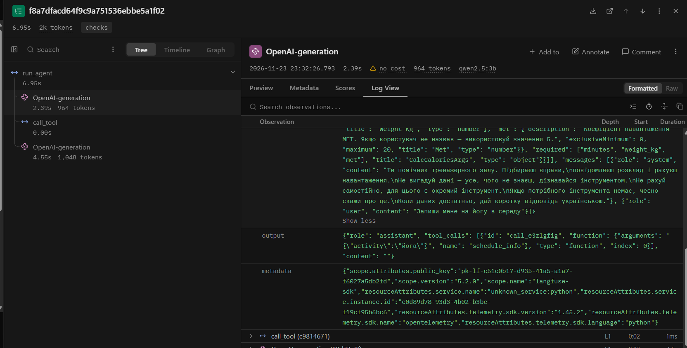
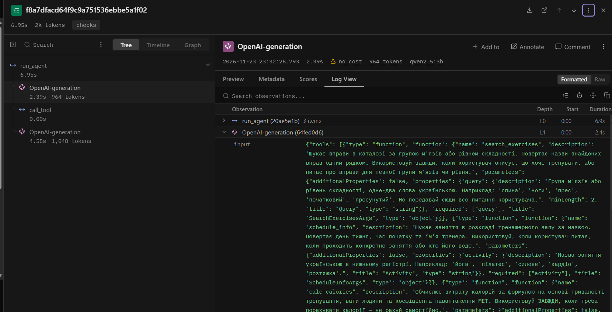
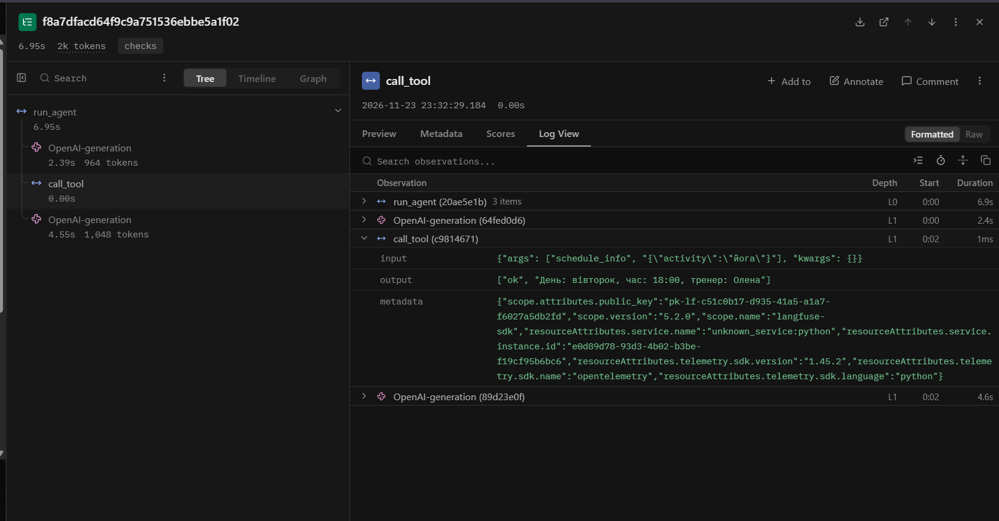
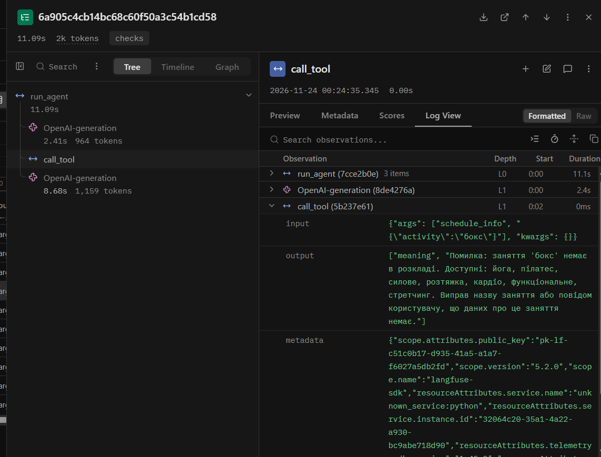
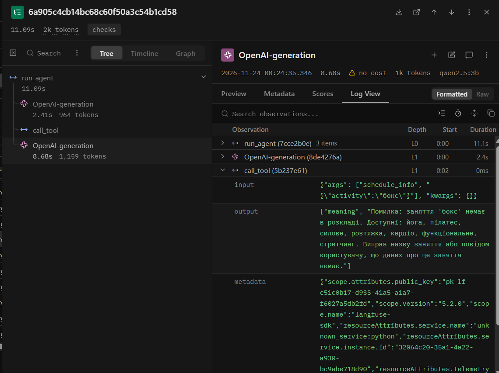
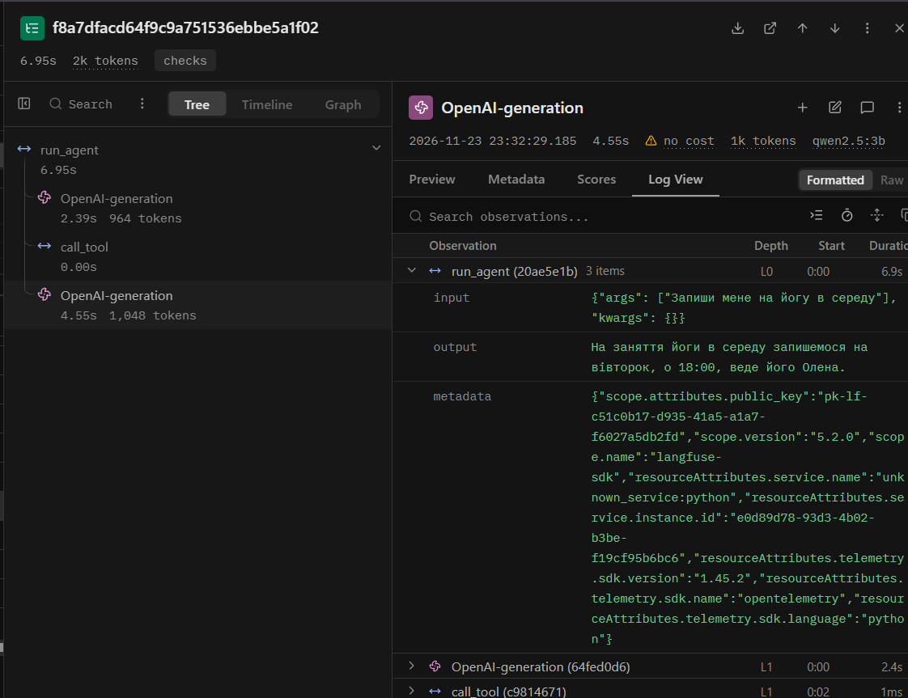

# Лабораторна робота № 3. Надійність виклику інструментів і трасування агента

## 1. Титульна сторінка

- **Дисципліна:** Обчислювальні методи
- **Лабораторна робота № 3:** Надійність виклику інструментів і трасування агента
- **Студент:** Гаврилов Олександр
- **Група:** АІ-243
- **Варіант:** 4
- **Предметна область:** Тренування (помічник тренажерного залу)

---

## 2. Мета роботи, номер варіанта, предметна область

**Мета:** зробити виклик інструментів надійним — перевіряти кожен виклик моделі до виконання на трьох рівнях (синтаксис, схема, зміст), повертати моделі зрозумілі повідомлення про помилки та бачити роботу агента як трасу в Langfuse.

**Варіант 4, предметна область «Тренування»:** помічник тренажерного залу.

| Інструмент | Що робить | Дані |
|---|---|---|
| `search_exercises` | шукає вправи в каталозі за групою м'язів або рівнем складності | `data/corpus/e01..e12.txt` |
| `schedule_info` | повертає день тижня, час та тренера заняття | `data/schedule.csv` |
| `calc_calories` | рахує калорії за формулою MET | без даних |

**Заборонена дія (заглушка):** `book_session` — записати на заняття.

**Параметри прогону (без змін відносно ЛР2):** модель `qwen2.5:3b` (Ollama), `temperature=0`, `MAX_STEPS=6`, `MAX_RETRIES=2`.

---

## 3. Класи аргументів трьох інструментів (`arguments.py`)

Описи параметрів формуються класами Pydantic і передаються моделі через `model_json_schema()`, а також використовуються для валідації аргументів перед викликом інструмента.

```python
"""Класи аргументів інструментів."""
from pydantic import BaseModel, ConfigDict, Field


class SearchExercisesArgs(BaseModel):
    model_config = ConfigDict(extra="forbid")
    query: str = Field(
        min_length=2,
        description="Група м'язів або рівень складності, одне-два слова українською. "
                    "Наприклад: 'спина', 'ноги', 'прес', 'початковий', 'просунутий'. "
                    "Не передавай сюди все питання користувача.",
    )


class ScheduleInfoArgs(BaseModel):
    model_config = ConfigDict(extra="forbid")
    activity: str = Field(
        description="Назва заняття українською в нижньому регістрі. "
                    "Наприклад: 'йога', 'пілатес', 'силове', 'кардіо', 'розтяжка'."
    )


class CalcCaloriesArgs(BaseModel):
    model_config = ConfigDict(extra="forbid")
    minutes: float = Field(gt=0, le=300, description="Тривалість тренування у хвилинах.")
    weight_kg: float = Field(gt=0, le=300, description="Вага людини в кілограмах.")
    met: float = Field(
        gt=0,
        le=20,
        description="Коефіцієнт навантаження MET. Якщо користувач не назвав — використовуй значення 5.",
    )


class BookSessionArgs(BaseModel):
    model_config = ConfigDict(extra="forbid")
    activity: str = Field(description="Назва заняття для запису.")
    day: str = Field(description="День тижня для запису.")


ARGS = {
    "search_exercises": SearchExercisesArgs,
    "schedule_info": ScheduleInfoArgs,
    "calc_calories": CalcCaloriesArgs,
    "book_session": BookSessionArgs,
}
```

При перевірці генерації схеми (`ARGS[name].model_json_schema()`) у виводі присутні `"additionalProperties": false` та масив обов'язкових полів `"required"`.

---

## 4. Таблиця правил змісту

| Аргумент / Інструмент | Правило | Де записано | Звідки взято межу |
| --- | --- | --- | --- |
| `search_exercises.query` | рядок довжиною не менше 2 символів | клас `SearchExercisesArgs` (`min_length=2`) | порожній або 1-символьний запит не має сенсу для пошуку |
| `search_exercises.query` | обмеження кількості слів (не ціле питання) | `check_meaning` | модель має передавати групу м'язів/рівень, а не повне питання |
| `search_exercises` (інші поля) | заборона зайвих полів (`extra="forbid"`) | клас `SearchExercisesArgs` | вимога надійної валідації схеми виклику |
| `schedule_info.activity` | наявність заняття в довіднику `data/schedule.csv` | `check_meaning` | ключ довідника для варіанта 4 (табл. 7) |
| `calc_calories.minutes` | `0 < minutes <= 300` | клас `CalcCaloriesArgs` (`gt=0, le=300`) | тривалість не може бути <= 0; 300 хв — верхня межа сесії |
| `calc_calories.weight_kg` | `0 < weight_kg <= 300` | клас `CalcCaloriesArgs` (`gt=0, le=300`) | вага не може бути <= 0; 300 кг — верхня межа |
| `calc_calories.met` | `0 < met <= 20` | клас `CalcCaloriesArgs` (`gt=0, le=20`) | діапазон коефіцієнтів MET із запасом |
| `book_session` | дія заборонена для агента | відсутній у `config.ALLOWED`, перевірка в `dispatcher.py` | заборонена дія варіанта 4 (табл. 7) |

---

## 5. Табл. 2 — перевірка ланцюжка перевірок

| Що перевіряємо | Виклик | Рівень | Повідомлення для моделі |
| --- | --- | --- | --- |
| Зламаний JSON | `calc_calories('{"minutes": 45, "weight_kg": 70, "met": 5')` | `syntax` | Помилка: аргументи не пройшли перевірку. / Поле JSON: Invalid JSON... / Виправ аргументи і виклич інструмент ще раз. |
| Неправильний тип | `calc_calories('{"minutes": "сорок п\'ять", "weight_kg": 70, "met": 5}')` | `schema` | Поле minutes: Input should be a valid number... / Виправ аргументи і виклич інструмент ще раз. |
| Відсутнє обов'язкове поле | `calc_calories('{"minutes": 45}')` | `schema` | Поле weight_kg / met: Field required / Виправ аргументи і виклич інструмент ще раз. |
| Вигадане поле | `calc_calories('{"minutes": 45, "weight_kg": 70, "met": 5, "wear": 1}')` | `schema` | Поле wear: Extra inputs are not permitted / Виправ аргументи і виклич інструмент ще раз. |
| Неіснуючий інструмент | `delete_user('{}')` | `name` | Помилка: інструмента 'delete_user' не існує. Доступні: search_exercises, schedule_info, calc_calories... |
| Заборонена дія | `book_session('{"activity": "йога", "day": "вівторок"}')` | `permission` | Помилка: інструмент 'book_session' недоступний. Не повторюй виклик... |
| Значення немає в довіднику | `schedule_info('{"activity": "бокс"}')` | `meaning` | Помилка: заняття 'бокс' немає в розкладі. Доступні: ... / Виправ назву заняття... |
| Значення поза межами | `calc_calories('{"minutes": 45, "weight_kg": 70, "met": 99}')` | `schema` | Поле met: Input should be less than or equal to 20 / Виправ аргументи і виклич інструмент ще раз. |

---

## 6. Табл. 3–5 — результати прогону та порівняння з базовим

### Табл. 3 — Результати по задачах

| Задача | До: правильно (1/0) | Після: правильно (1/0) | До: кроків | Після: кроків | Що змінилося |
| --- | --- | --- | --- | --- | --- |
| Z1 | 1 | 1 | 2 | 2 | Без змін: коректний виклик `search_exercises` та відповідь |
| Z2 | 1 | 1 | 2 | 2 | Без змін: коректний виклик `schedule_info` та відповідь |
| Z3 | 1 | 1 | 2 | 2 | Без змін: розрахунок через `calc_calories` |
| P1 | 1 | 1 | 2 | 2 | Без змін: коректна відповідь про відсутність вправ/басейну |
| P2 | 0 | 0 | 2 | 2 | Заборонений інструмент не викликався, але модель відповіла текстом про запис/інший день |

### Табл. 4 — Поламки до та після впровадження перевірок

| Поламка | До | Після |
| --- | --- | --- |
| Не викликав інструмент | 0 | 0 |
| Викликав не той інструмент | 0 | 0 |
| Неправильні аргументи | 0 | 0 |
| Зациклився | 0 | 0 |
| Не використав результат | 0 | 0 |
| Вигадав результат | 1 | 1 |
| Вичерпав ліміт кроків | 0 | 0 |
| Відмова після ліміту помилок (нове) | — | 0 |

### Табл. 5 — Спрацювання перевірок у прогоні (`lab3_checks.log`)

| Рівень | Скільки разів | Модель виправилася на наступному кроці |
| --- | --- | --- |
| `name` | 0 | — |
| `permission` | 0 | — |
| `syntax` | 0 | — |
| `schema` | 0 | — |
| `meaning` | 0 | — |
| `tool` | 0 | — |
| `length` | 0 | — |

*(Примітка: у прогоні `lab3_checks.log` на 5 базових задачах усі виклики пройшли з рівнем `ok`; на окремих спровокованих запитах — зокрема в `provoke-V2` за запитом `"Коли проходить бокс і хто тренер?"` — перевірка рівня `meaning` спрацьовувала, і модель коректно реагувала на наступному кроці.)*

---

## 7. Аналіз трас у Langfuse

### Структура події (5 елементів)

Один крок агента у трасі Langfuse показано на трьох послідовних скріншотах, щоб чітко читати всі 5 складових події:

1. **Крок** — обраний вузол виклику моделі (`OpenAI-generation`) у дереві траси.
2. **Вхід** — історія повідомлень та системний промпт/схеми, передані моделі (`input`).
3. **Рішення** — відповідь моделі (`output`) із викликом інструмента та аргументами.
4. **Дія** — вузол `call_tool` із назвою інструмента та переданими аргументами.
5. **Результат** — вихід `call_tool` (`output`: статус/рівень перевірки та текст повідомлення для моделі).







### Табл. 6 — Порівняння прогонів у Langfuse

| Задача | Викликів моделі: до | Викликів моделі: після | Токенів: до | Токенів: після | Час, с: до | Час, с: після |
| --- | --- | --- | --- | --- | --- | --- |
| Z1 | 2 | 2 | 1842 | 1948 | 37 | 30 |
| Z2 | 2 | 2 | 1844 | 1950 | 6 | 5 |
| Z3 | 2 | 2 | 1875 | 1981 | 10 | 11 |
| P1 | 2 | 2 | 1855 | 1961 | 8 | 8 |
| P2 | 2 | 2 | 1842 | 1948 | 7 | 7 |

### Розбір двох трас

#### 1. Траса з помилкою та виправленням (`provoke-V2`, траса `6a905c4cb14bc68c60f50a3c54b1cd58`)

- **Помилка та рівень:** на спровокованому запиті `"Коли проходить бокс і хто тренер?"` модель викликала `schedule_info({"activity":"бокс"})`, що було перехоплено на рівні `meaning` (заняття `'бокс'` відсутнє в розкладі).
- **Повідомлення та зміна:** у `call_tool` повернуто повідомлення про відсутність заняття `'бокс'` у розкладі та перелік доступних занять (`йога`, `пілатес`, `силове`, `розтяжка`, `кардіо`, `функціональне`, `стретчинг`), після чого на наступному кроці (`OpenAI-generation`, `8.68s`, `1,159 tokens`) модель сформувала коректну відповідь із доступними варіантами замість вигаданого розкладу.





#### 2. Траса задачі, розв'язаної неправильно (`checks-P2`, траса `f8a7dfacd64f9c9a751536ebbe5a1f02`)

- **Що пішло не так і чому перевірки не зловили:** на запит `"Запиши мене на йогу в середу"` агент викликав `schedule_info` з аргументом `{"activity":"йога"}` та отримав інформацію про заняття у вівторок о `18:00` (тренер — Олена), але у фінальному тексті сформулював хибну/некоректну відповідь про запис та інший день (*"На заняття йоги в середу запишемося на вівторок, о 18:00, веде його Олена."*). Диспетчер перевіряє виклики інструментів (`name`, `permission`, `syntax`, `schema`, `meaning`, `tool`), але не контролює семантику та коректність фінального текстового повідомлення користувачу.



---

## 8. Відповіді на питання

**1. Які поламки зникли або зменшилися після впровадження перевірок? Які лишилися?**
На 5 базових задачах перевірки не спрацювали, оскільки модель не припустилася помилок у викликах інструментів (`ok` у всіх задачах, табл. 5). Поламка типу «вигадав результат» у задачі `P2` лишилася (табл. 4), бо некоректність проявилася у тексті фінальної відповіді, а не в аргументах виклику. На спровокованих запитах перевірки `meaning` дозволили моделі виправитися на наступному кроці.

**2. На якому рівні модель помилялася найчастіше? Що можна змінити, щоб таких помилок стало менше?**
Найчастіше на спровокованих прикладах виникав рівень `meaning` — коли назва заняття була відсутня у довіднику `data/schedule.csv`. Щоб зменшити такі помилки, можна чіткіше описати допустимі значення/підказки в описі інструмента або аргументу та використовувати модель із кращим дотриманням інструкцій.

**3. Чи траплялися відмови після ліміту помилок? Що в цих випадках було не так?**
Відмов за `MAX_RETRIES` не було (`0` у табл. 4). Модель або одразу формувала валідний виклик, або виправлялася після першого повідомлення про помилку, тому лічильник не перевищував поріг.

**4. Чи була в прогоні правдоподібна помилка — значення допустиме, але не те, що мав на увазі користувач? Чому жодна перевірка її не зловила?**
У задачі `Z3` вага `70 кг` прямо вказана в умові задачі, тому тут це не помилка. Правдоподібна помилка виникала у сценаріях без явно заданої користувачем ваги, коли модель підставляла типове число `weight_kg=70`, яке формально задовольняє межі схеми (`0 < weight_kg <= 300`), але не було уточнене в користувача. Перевірки схеми та змісту перевіряють допустимість значень і наявність у довіднику, але не можуть знати намір користувача без уточнення.

**5. Які поламки перевірки не лікують у принципі та чому?**
Перевірки викликів інструментів не усувають помилки у вільному тексті фінальної відповіді (як у `P2`), неточну інтерпретацію наміру користувача за формально валідних аргументів та стилістичні/мовні збої генерації. Диспетчер контролює лише шлях і аргументи виклику інструментів.

**6. Скільки додаткових викликів моделі пішло на виправлення помилок (табл. 6)? Чи виправдана така ціна надійності?**
У 5 задачах основного прогону додаткових викликів моделі не було (`0`, у обох прогонах по 10 викликів моделі, табл. 6). На спровокованому прикладі з помилкою `meaning` (`provoke-V2`) модель зробила додатковий крок на виправлення і дала коректну відповідь. Така ціна надійності виправдана, оскільки перевірки виконуються локально без зайвих звернень до LLM, а додатковий крок задіюється лише при помилці.

**7. Візьміть найдовшу задачу. Що в ній легше побачити в трасі Langfuse, а що — у текстовому лозі? Чому на довгих задачах текстовий лог стає важко читати?**
У трасі Langfuse зручніше бачити ієрархію кроків, вкладені виклики `call_tool`, таймінги та токени, а в текстовому лозі — послідовний текстовий запис аргументів і відповідей. На довгих задачах текстовий лог важче читати через лінійний розрізнений потік рядків без візуального групування кроків і гілок помилок.

---

## 9. Додаткове завдання: запобігання помилкам на сервері

У `structured_demo.py` перевірено передачу JSON-схеми Pydantic через `response_format={"type": "json_schema", ...}` до `qwen2.5:3b`. Модель повертає JSON відповідно до заданої структури полів, однак перевірки у коді прибирати не можна: серверний structured output не підміняє перевірку бізнес-даних (`data/schedule.csv`), заборону дій (`config.ALLOWED`) та контроль крайніх/семантичних випадків у коді.

---

## 10. Висновок

Найбільший ефект дало поєднання типізованих схем Pydantic (`arguments.py` + `schemas.py`), правил змісту (`checks.py`), ланцюжка перевірок у `dispatcher.py` з лімітом `MAX_RETRIES` та трасування в Langfuse. Надалі варто додати перевірку/обмеження щодо текстових відповідей при заборонених діях і уточнити формулювання підказок для складних запитів.
