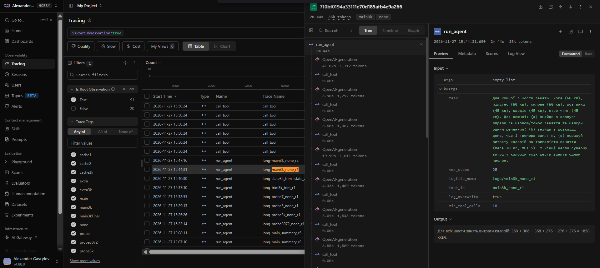
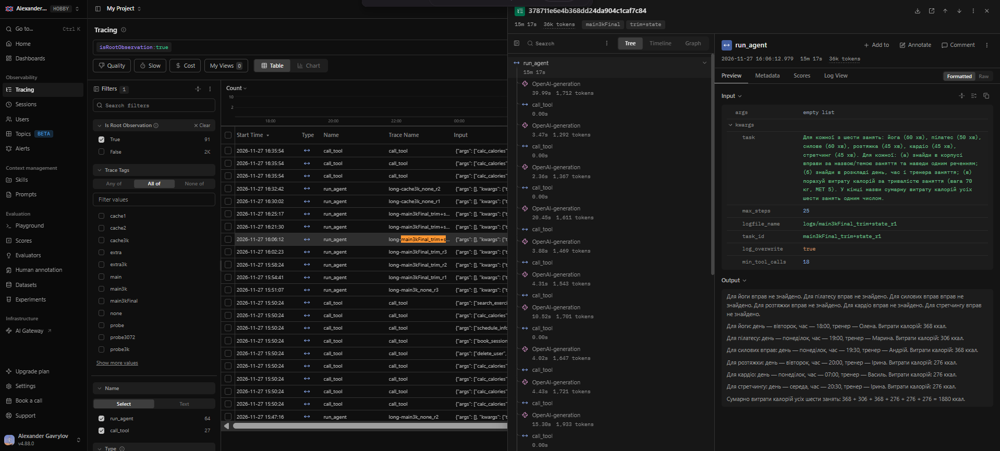

# Лабораторна робота № 4. Контекст, стан і кеш агента

## 1. Вихідні дані та мета

- **Дисципліна:** Обчислювальні методи
- **Студент:** Гаврилов Олександр, група АІ-243
- **Варіант:** 4
- **Предметна область:** тренування, помічник тренажерного залу
- **Дата актуальних прогонів:** 2026-11-27

**Мета:** дослідити зростання історії агента, порівняти режими без стиснення, з обрізанням і зі збереженням стану, а також перевірити кешування повторних запитів до моделі.

### Параметри запуску

Модель запуску — `qwen25-3k`, створена з `qwen2.5:3b`. У `Modelfile` задано `num_ctx = 3072`; конфігурація задає `temperature = 0`, `MAX_STEPS_LONG = 25`, `MAX_RETRIES = 2`, `COMPRESS_AT = 2150` і `KEEP_LAST = 6`. Локальні метадані базової моделі (`ollama show qwen2.5:3b`) вказують на контекстне вікно 32768 токенів; налаштоване вікно становить приблизно у 10,67 раза менше.

**Таблиця 1 — Конфігурації агента та прапорці експериментів.**

| Режим / серія | `COMPRESS` | `USE_STATE` | `USE_CACHE` | Призначення |
|---|---|---:|---:|---|
| `none` | `none` | `False` | `False` | Контрольний прогін без керування історією |
| `trim` | `trim` | `False` | `False` | Обрізання старих повідомлень |
| `trim+state` | `trim` | `True` | `False` | Обрізання зі збереженням результатів інструментів у стані |
| `summary` | `summary` | `False` | `False` | Додаткова серія `extra3k`, окремо від основної матриці |
| Серія `cache3k` (`none`) | `none` | `False` | `True` | Два повтори: спочатку заповнення кешу, потім повторне читання |

У `long_task.json` визначено 18 мінімально необхідних викликів: по одному `search_exercises`, `schedule_info` та `calc_calories` для кожного із шести занять.

## 2. Задача та еталонний результат

Задача охоплює йогу (60 хв), пілатес (50 хв), силове заняття (60 хв), розтяжку (45 хв), кардіо (45 хв) і стретчинг (45 хв). Для кожного заняття агент має знайти вправи, отримати розклад і порахувати витрату калорій за параметрів `weight_kg = 70`, `met = 5`.

> Для кожної з шести занять: йога (60 хв), пілатес (50 хв), силове (60 хв), розтяжка (45 хв), кардіо (45 хв), стретчинг (45 хв). Для кожної: (а) знайди в корпусі вправи за назвою/темою заняття та наведи одним реченням; (б) знайди в розкладі день, час і тренера заняття; (в) порахуй витрату калорій за тривалістю заняття (вага 70 кг, MET 5). У кінці назви сумарну витрату калорій усіх шести занять одним числом.

Формула з `tools.py`:

```text
round(met * 3.5 * weight_kg / 200 * minutes)
```

| Тривалість | Результат `calc_calories` |
|---:|---:|
| 60 хв | 368 ккал |
| 50 хв | 306 ккал |
| 60 хв | 368 ккал |
| 45 хв | 276 ккал |
| 45 хв | 276 ккал |
| 45 хв | 276 ккал |
| **Сума** | **1870 ккал** |

Значення `expected` у `long_task.json` — **1870**. Воно збігається з сумою шести відповідей інструмента; попереднє значення 1854 у звіті було помилковим.

## 3. Фактичні відповіді інструментів

| Заняття | `search_exercises` | `schedule_info` | `calc_calories` |
|---|---|---|---:|
| Йога, 60 хв | За запитом `йога` нічого не знайдено | вівторок, 18:00, Олена | 368 ккал |
| Пілатес, 50 хв | За запитом `пілатес` нічого не знайдено | понеділок, 19:00, Марина | 306 ккал |
| Силове, 60 хв | За запитом `силове` нічого не знайдено | понеділок, 19:30, Андрій | 368 ккал |
| Розтяжка, 45 хв | За запитом `розтяжка` нічого не знайдено | вівторок, 20:00, Ірина | 276 ккал |
| Кардіо, 45 хв | За запитом `кардіо` нічого не знайдено | понеділок, 07:00, Василь | 276 ккал |
| Стретчинг, 45 хв | За запитом `стретчинг` нічого не знайдено | середа, 20:30, Ірина | 276 ккал |

Усі шість пошукових відповідей відповідають поведінці `search_exercises`: це буквальний пошук підрядка в текстах 12 файлів `data/corpus/`. Назв занять у корпусі не знайдено. Розклад наведено за першими відповідними рядками `data/schedule.csv`, які повертає інструмент.

## 4. Аналіз контексту, таблиця 2 та випадки A–D

Перший пробний лог `probe_none_r1.log` із попередньою конфігурацією `num_ctx = 4096` закінчився `final` за 2 кроки: 1129 токенів на першому, 1954 на другому (48% вікна); в одному пакеті було заплановано 18 викликів інструментів, але в лог потрапило 16 фактичних викликів. Він назвав 1854 ккал і заявив про вправи, яких пошук не знайшов. Це випадок **C — задача закоротка** відносно тодішнього вікна. Після звуження вікна до 3072 і серіалізації викликів окремий повтор `probe7_none_r1.log` виконав 18 інструментальних викликів упродовж 18 кроків, а на 19-му відповів. Саме його покроковий вивід `analyze.py ... steps` наведено в таблиці 2.

**Таблиця 2 — Зростання входу в повторному пробному прогоні без стиснення (`probe7_none_r1`).**

| Крок | `prompt_tokens` | Приріст | Що зробила модель |
|---:|---:|---:|---|
| 1 | 1212 | — | `search_exercises({"query":"йога"})` |
| 2 | 1269 | 57 | `schedule_info({"activity":"йога"})` |
| 3 | 1333 | 64 | `calc_calories({"weight_kg":70,"met":5,"minutes":60})` |
| 4 | 1388 | 55 | `search_exercises({"query":"пілатес"})` |
| 5 | 1447 | 59 | `schedule_info({"activity":"пілатес"})` |
| 6 | 1511 | 64 | `calc_calories({"minutes":50,"weight_kg":70,"met":5})` |
| 7 | 1566 | 55 | `search_exercises({"query":"силове"})` |
| 8 | 1625 | 59 | `schedule_info({"activity":"силове"})` |
| 9 | 1689 | 64 | `calc_calories({"minutes":60,"weight_kg":70,"met":5})` |
| 10 | 1744 | 55 | `search_exercises({"query":"розтяжка"})` |
| 11 | 1801 | 57 | `schedule_info({"activity":"розтяжка"})` |
| 12 | 1866 | 65 | `calc_calories({"minutes":45,"weight_kg":70,"met":5})` |
| 13 | 1921 | 55 | `search_exercises({"query":"кардіо"})` |
| 14 | 1980 | 59 | `schedule_info({"activity":"кардіо"})` |
| 15 | 2043 | 63 | `calc_calories({"minutes":45,"weight_kg":70,"met":5})` |
| 16 | 2098 | 55 | `search_exercises({"query":"стретчинг"})` |
| 17 | 2157 | 59 | `schedule_info({"activity":"стретчинг"})` |
| 18 | 2221 | 64 | `calc_calories({"minutes":45,"weight_kg":70,"met":5})` |
| 19 | 2276 | 55 | Фінальна відповідь без виклику |

Для `probe7_none_r1`: вхід першого кроку — 1212 токенів; типовий додатний приріст — 59; фактична сума prompt — 33147, completion — 1449, оцінка за формулою — 33117; застою немає. Фінальна відповідь — `3378`, якого немає серед результатів інструментів і який не дорівнює їх сумі 1870.

Класифікація випадків за критеріями методички:

- **A — помилка сервера про довжину:** не спостерігалась у повторному `probe7`.
- **B — ознака зупинки/обрізання входу:** в окремому `probe5_none_r1` метрика `analyze.py` виявила зупинку росту на кроці 24; максимум — 3070/3072, статус `step_limit`. Це класифікація за метрикою, а не підтвердження серверного truncation: у журналі є відхилені перевіркою відповіді. На єдиному наступному кроці (25) модель знову не пройшла перевірку й не дала фінальної відповіді; до трьох наступних кроків ліміт 25 кроків не дозволив дійти.
- **C — задача закоротка:** початковий `probe_none_r1` завершився `final` з максимумом 1954; повтор після переходу на `num_ctx = 3072` (`probe7_none_r1`) теж завершився `final`, максимум 2276/3072 (74%). Отже, зменшення вікна не спричинило переповнення в цьому повторі.
- **D — інша поломка:** серед розглянутих probe-логів не зафіксована як окремий фінальний статус.

Для `probe5_none_r1`: 25 кроків, 51487 prompt-токенів, 1344 completion-токени, типове зростання 64, оцінка формули 49500; `stall` — крок 24. Це stress-прогін, окремий від чистого повтору випадку C.

## 5. Метрики основної серії

Показники нижче отримані з дев'яти актуальних логів `main3k_none_*` та `main3kFinal_*` через `logparse.py` і `metrics.describe()`. Усі дев'ять логів мають статус `final`; `extra_tokens` — токени на підсумовування історії.

**Таблиця 3 — Стиснення історії у пробних запусках.**

| Конфігурація | Крок стиснення | Вхід до стиснення, токенів | Повідомлень було → стало | Повторних викликів за прогін |
|---|---:|---:|---:|---:|
| `trim3k_trim_r1` | 17 | 2157 | 36 → 8 | 3 |
| `state3k_trim+state_r1` | 17 | 2157 | 36 → 8 | 2 |

У `trim+state` на першому стисканні в стані було 17 рядків збережених результатів. Блок мав 1850 символів, тобто приблизно 740 токенів за оцінкою 2,5 символа/токен; це приблизно у 12,5 раза більше за типовий приріст 59 токенів. Перший виклик моделі після стиснення був на кроці 18: у `main3kFinal_trim+state_r1` він мав 2005 prompt-токенів; відповідний крок 18 у `main3k_none_r1` мав 2221 токен.

Після `trim` повторно з'явився, зокрема, `calc_calories({"minutes":45,"weight_kg":70,"met":5})` на кроці 18 — такий самий підпис був у кроках 12 і 15. Лічильник `repeats` рахує однакові аргументи; оскільки три заняття мають однакову тривалість 45 хв, повтор цього розрахунку не сам по собі доводить втрату знань.

### Деталізація дев'яти логів основної серії

Ці рядки показують розкид відповідей за повторами; зведена медіана для таблиці методички наведена далі.

| Конфігурація / прогін | Статус | Кроків | Prompt tokens | Completion tokens | Максимум входу | Стиснень | Повторні виклики інструментів | Відповідь правильна |
|---|---|---:|---:|---:|---:|---:|---:|---|
| `none` r1 | final | 19 | 33147 | 1549 | 2276 | 0 | 2 | Ні: 1858 |
| `none` r2 | final | 19 | 33147 | 1947 | 2276 | 0 | 2 | Ні: 1962 |
| `none` r3 | final | 19 | 33147 | 1947 | 2276 | 0 | 1 | Ні: 1962 |
| `trim` r1 | final | 21 | 34540 | 2166 | 2157 | 1 | 2 | Ні: 1810 |
| `trim` r2 | final | 21 | 34540 | 2166 | 2157 | 1 | 3 | Ні: 1810 |
| `trim` r3 | final | 21 | 34540 | 2166 | 2157 | 1 | 3 | Ні: 1810 |
| `trim+state` r1 | final | 19 | 32715 | 3230 | 2157 | 1 | 2 | Ні: 1880 |
| `trim+state` r2 | final | 19 | 32715 | 1848 | 2157 | 1 | 2 | Ні: у відповіді наведено лише 276 ккал |
| `trim+state` r3 | final | 19 | 32715 | 2032 | 2157 | 1 | 2 | Так: 1870 |

Для контрольного `none` метрика формули з `metrics.py` дорівнює 33117 токенам (`n=19`, `first_tokens=1212`, типовий додатний приріст `59`), тоді як сума фактичних `prompt_tokens` — 33147. Це наближена формула на основі медіанного приросту, а не точний прогноз кожного кроку. Після стиснення така формула тим більше не є прямою оцінкою: історія має стрибкоподібно менший розмір. Усі основні прогони нижче фізичної межі завершилися; близько до неї дійшов окремий `probe5_none_r1`.

## 6. Результати кешування

**Таблиця 4 — Робота кешу.**

| Запуск | Кроків | Влучань у кеш | Викликів до сервера | Час, с | Правильно |
|---|---:|---:|---:|---:|---|
| 1 (`cache3k_none_r1`, перший прохід) | 19 | 0 | 19 | 160,0 | Ні: 1858 |
| 2 (`cache3k_none_r2`, той самий запит) | 19 | 19 | 0 | 0,1 | Ні: 1858 |

За виміряними, округленими до десятої секунди значеннями, повтор був приблизно у 1600 разів швидший (0,1 с — практично миттєво). Якщо змінити `SYSTEM`, текст запиту зміниться, отже SHA-256 ключ кешу буде іншим і серверний виклик повториться. Зміна відповіді інструмента також змінює історію наступного запиту; натомість заміна ваг моделі під тією самою назвою не обов'язково змінить ключ і може повернути застарілу відповідь. Кеш вимкнений в основній серії, щоб вимірювати реальну вартість викликів, а не відтворення збережених відповідей.

### Основна серія: таблиця 5

Медіани `table.py` за трьома конфігураціями та трьома повторами:

**Таблиця 5 — Вартість циклу в трьох конфігураціях (медіани по трьох повторах).**

| Конфігурація | Правильно (з 3) | Кроків | Токенів на вхід | Токенів на вихід | Час, с | Стиснень | Повторних викликів |
|---|---:|---:|---:|---:|---:|---:|---:|
| `none` | 0 з 3 | 19 | 33147 | 1947 | 201.2 | 0 | 2 |
| `trim` | 0 з 3 | 21 | 34540 | 2166 | 227.5 | 1 | 3 |
| `trim+state` | 1 з 3 | 19 | 32715 | 2032 | 226.2 | 1 | 2 |
| `summary` (додаткова `extra3k`) | 0 з 3 | 19 | 32299 | 1809 | 265.3 | 1 | 3 |

Рядок `summary` — окрема додаткова серія `extra3k`, не одна з трьох обов'язкових конфігурацій. Повторний виклик у метриках — це повтор уже баченого підпису виклику інструмента; він не є кількістю запитів моделі.

### Додаткове завдання: підсумовування замість обрізання

Три актуальні прогони `extra3k_summary_r1..r3` усі завершилися `final` з одним стисненням на кроці 17 (вхід 2157 токенів, 36 → 8 повідомлень). Вартість підсумовування становила 1494, 1395 і 1609 токенів; медіана — 1494. Медіана prompt — 32299 токенів, на 2241 (6,5%) менше за `trim` (34540). Після додавання медіанної вартості підсумовування до prompt це на 747 токенів менше; з урахуванням completion повна медіана токенів на запуск — 35341 проти 36706 у `trim` (економія 1365).

Переказ не зберіг усі результати точно: у `extra3k_summary_r1` він пропустив дані стретчингу та калорій кардіо/стретчингу, хоча вони були в попередніх результатах. Фінальні суми трьох запусків — 1800, 1626 і 1804 ккал; правильних — 0/3. Отже, менша prompt-історія коштувала токенів на summary і не забезпечила точності.

## 7. Підсумок якості відповідей

Результати інструментів дають 1870 ккал, проте фінальна відповідь моделі не завжди коректно підсумовує їх:

- `none`: відповіді — 1858, 1962 і 1962 ккал; 0/3 правильних.
- `trim`: у всіх трьох відповідях сума 1810 ккал і є непідтверджені назви вправ; 0/3 правильних.
- `trim+state`: відповіді — 1880 ккал, лише «276 ккал» без коректної загальної суми та 1870 ккал; 1/3 правильних.
- Кешований контроль: та сама неправильна відповідь 1858 ккал у двох повторах.

Отже, статус `final` та відсутність помилок інструментів самі по собі не гарантують правильності змісту. `trim+state` зберігає результати виконаних викликів і в цій серії дав нижчу медіану prompt-токенів, ніж `none`, але точність лишилася нестабільною.

За методичним критерієм кількості кроків жоден із дев'яти актуальних основних логів не завершився раніше 19 кроків. За ручною перевіркою фінальної відповіді проти правильного результату й відповідей інструментів 8/9 прогонів були помилковими або неповними; один правильний — `main3kFinal_trim+state_r3`. Окремо перевірено 12 архівних `main_*.log` старої 4k-серії: усі 12 завершилися за 2 кроки (менше 19), зі статусом `final`, без стиснення та з однаковою неправильною відповіддю 1938 ккал. Їх не додаємо до актуальної матриці, щоб не змішувати різні налаштування. Число-підсумок закономірно не є окремим рядком `результат:` (інструменти повертають значення для кожного заняття), тому правильність сум перевірено окремо за шістьма результатами.

## 8. Траси Langfuse

Методичка просить скриншоти дерев трас без стиснення та з `trim+state`. Нижче наведено два актуальні прогони 3k: `main3k_none_r1` і `main3kFinal_trim+state_r1`. На знімках видно вибрану трасу, дерево викликів і фінальну відповідь.


*Рис. 1. Актуальна траса `main3k_none_r1`; фінальна відповідь — 1858 ккал.*


*Рис. 2. Актуальна траса `main3kFinal_trim+state_r1`; фінальна відповідь — 1880 ккал.*

Скріншоти підтверджують потрібні актуальні траси. Перехід після стиснення (2157 токенів на кроці 17 до 2005 на кроці 18) окремо підтверджується логами.

## 9. Відповіді на запитання до звіту

Відповіді подані за шістьма запитаннями методички.

1. **На якому кроці агент без захисту дійшов до межі вікна і що змінилося після цього?**

   У початковому `probe_none_r1` межі не досягнуто: відповідь `final` з'явилася на кроці 2 при 1954 токенах. Після виправлення пакетної обробки `probe7_none_r1` провів 18 інструментальних кроків і завершився на 19-му при 2276/3072; у `probe5_none_r1` метрика позначила `stall` на кроці 24, але фінальної відповіді не було.

2. **Чи збігається сума `prompt_tokens` із формулою?**

   Для початкового probe сума становила 3083 і збіглася з формулою (`n=2`, `C=1129`, `d=825`). Для повтору `probe7` метрика дала 33117 проти фактичних 33147 (`n=19`, `C=1212`, типовий приріст 59); різниця 30 виникає тому, що формула апроксимує весь ріст одним типовим приростом.

3. **Що втрачається при обрізанні та що змінює `trim+state`?**

   `trim` видаляє старі повідомлення з результатами інструментів; у probe після обрізання повторився виклик `calc_calories` на 45 хв. `trim+state` додав 17 збережених рядків результатів (близько 740 токенів), але це не гарантувало правильну фінальну суму: у трьох повторах правильним був один.

4. **Яка конфігурація найдешевша за токенами, найшвидша та найточніша? Чому висновок обережний?**

   Серед трьох обов'язкових конфігурацій найменше prompt+completion використав `trim+state` (34747 токенів), найшвидшим був `none` (201,2 с), а найточнішим — `trim+state` (1/3 правильних). Додатковий `summary` після врахування ціни переказу має медіану 35341 токен на запуск, тож не дешевший за `trim+state`; три повтори однієї задачі все одно залишають висновки попередніми.

5. **Чому кеш вимкнений у вимірюванні вартості та що станеться при зміні запиту/моделі?**

   У головній серії кеш вимкнено, щоб усі повтори реально зверталися до моделі й показували вартість циклу. Зміна `SYSTEM` змінює ключ; зміна результату інструмента змінить ключ наступного запиту після внесення цього результату в історію, але незмінний запит до цього моменту ще може отримати стару кешовану відповідь. Зміна ваг під тією самою назвою моделі також може залишити ключ незмінним і віддати застарілу відповідь.

6. **Які поломки довгого прогону скорочення історії не лікує?**

   Воно не додає вправ, яких немає в корпусі, і не виправляє помилкову арифметику, пропущені позиції, некоректні аргументи чи неповну відповідь. Логи `trim` і `trim+state` це підтверджують: стиснення відбулося, але більшість підсумків усе одно була неправильною.

## 10. Питання для захисту

1. **Чому вартість усього прогону зростає швидше, ніж вартість одного кроку?** На кожному наступному виклику модель повторно обробляє накопичений контекст: у `probe7` prompt зріс із 1212 до 2276 токенів за 19 кроків, а сумарно склав 33147 токенів.
2. **Що відбувається, коли історія не вміщується у вікно, і як це помітили?** У stress-прогоні вхід дійшов до 3070/3072 токенів, а `analyze.py` позначив stall на кроці 24; лог не містить `server_error`, а фінальна відповідь не сформувалася. Ці дані показують наближення до межі, але самі по собі не доводять, що сервер мовчки обрізав контекст.
3. **Чому `COMPRESS_AT` менший за `NUM_CTX`?** Щоб скорочувати історію до фізичної межі й залишити запас на системні інструкції, відповіді інструментів і коливання токенізації. Тут поріг 2150 нижчий за вікно 3072.
4. **Навіщо цикл `while` у `trim`?** Він прибирає з початку залишеної частини історії осиротілі повідомлення `tool`, для яких уже відкинуто відповідний виклик; без цього діалог міг би містити некоректну послідовність повідомлень.
5. **Що втрачає агент при обрізанні, як допомагає стан і чого він не компенсує?** Стан зберігає результати лише успішних викликів (`level == "ok"`) і додає їх після обрізання; він не відновлює міркування та не гарантує правильного підсумку. Помилки не записуються, бо їхній результат не підтверджений як успішний.
6. **З чого складається ключ кешу, коли він корисний і коли його не можна вмикати?** Ключ — SHA-256 від JSON запиту, серіалізованого з відсортованими ключами, тож зміна тексту, історії чи назви моделі зазвичай створює інший ключ. Кеш корисний для точного повтору, але його не слід використовувати для вимірювання вартості чи коли потрібні свіжі відповіді після зміни даних.
7. **Чому кожну конфігурацію проганяли тричі й брали медіану?** Медіана зменшує вплив випадкового повільного/швидкого запуску; однак три повтори однієї задачі залишають висновки попередніми, особливо коли якість відповіді змінюється між повторами.
8. **Покажіть у трасі Langfuse місце, де стиснення зменшило вхід моделі.** У поточних логах це перехід від кроку 17 до кроку 18 у `main3kFinal_trim+state_r1`: вхід зменшився з 2157 до 2005 токенів; відповідний крок `none` мав 2221 токен. На рисунку 2 показано дерево актуальної траси, а значення `prompt_tokens` підтверджуються логами.

## Висновок

Актуальна серія підтверджує роботу трьох режимів керування історією, кешування та додаткового `summary` на конфігурації з контекстом 3072 токени. `trim` і `trim+state` справді скорочують історію з 36 до 8 повідомлень; `trim+state` додатково зберігає результати інструментів. Кеш прискорює точний повтор, але не усуває помилки моделі. `summary` заощаджує prompt-токени відносно `trim`, однак коштує додаткових токенів і в цих трьох прогонах не дав правильної відповіді. Еталонна сума з фактичних відповідей інструментів і `long_task.json` — 1870 ккал; у головній матриці лише один із дев'яти прогонів дав правильне число.

Додано скриншоти обох потрібних актуальних трас Langfuse. Порівняння розміру входу до та після стиснення підтверджено логами.
