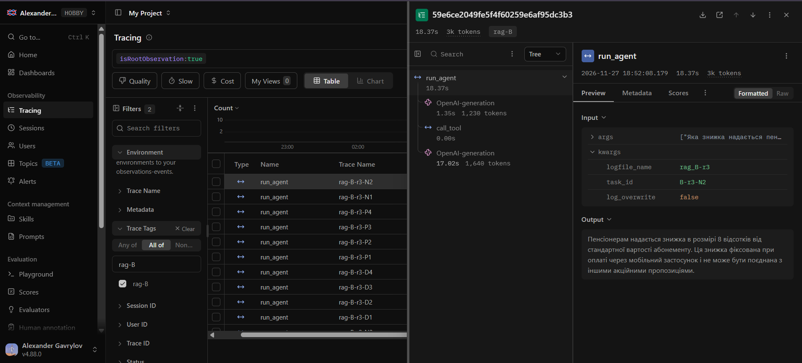
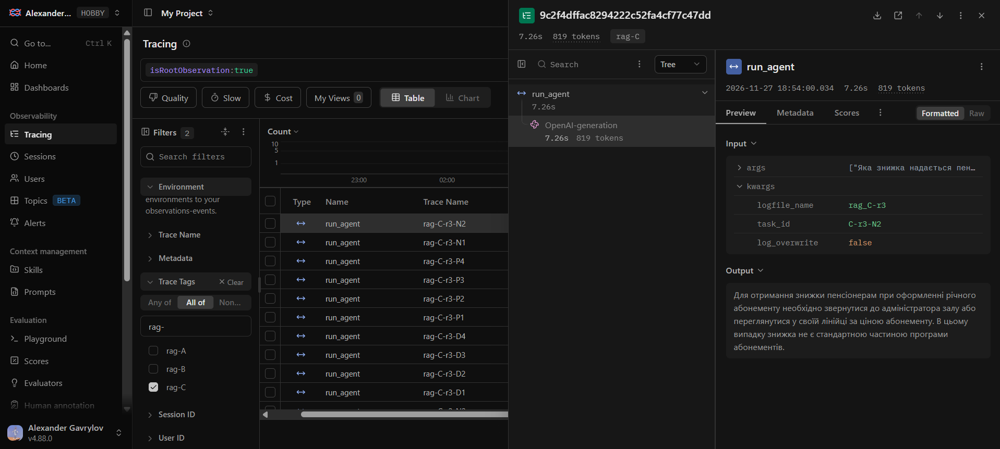

# Звіт з лабораторної роботи № 5
**Тема:** RAG-агент: пошук по документах як інструмент (Варіант 4: Тренування, фітнес-клуб FitZone)  
**Виконав:** Гаврилов Олександр, група АІ-243  

---

## 1. Мета роботи та конфігурація
- **Варіант / Предметна область:** Варіант 4 — «Тренування» (фітнес-клуб **FitZone**).
- **Мета:** Замінити пошук підрядком на векторний пошук (FAISS + ембединги), під'єднати його до агента як інструмент `search_docs`, оцінити якість пошуку окремо від агента для різних стратегій чанкування та порога схожості, порівняти поведінку агента з трьома описами інструмента (`A`, `B`, `C`) і проаналізувати причини помилок за логами та трасами Langfuse.
- **Модель чату та вікно:** локальна модель в Ollama (`llama32-4k`), розмір вікна контексту `NUM_CTX = 4096`.
- **Модель ембедингів:** `bge-m3` (розмірність вектора: `1024`).
- **Параметри вимкнених механізмів ЛР4:** `COMPRESS = "none"`, `USE_STATE = False`, `USE_CACHE = False`.

---

## 2. Дані та перевірка питань
- **П'ять документів (`data/docs/d01.txt`–`d05.txt`):**
  1. `d01.txt` — «Техніка безпеки в тренажерному залі FitZone» (`3 183` символи).
  2. `d02.txt` — «Програма тренувань для початківців у FitZone» (`3 165` символів).
  3. `d03.txt` — «Відновлення та харчування при регулярних тренуваннях у FitZone» (`3 065` символів).
  4. `d04.txt` — «Правила абонементів і заморожування у FitZone» (`3 199` символів).
  5. `d05.txt` — «Правила користування обладнанням у тренажерному залі FitZone» (`2 874` символи).
- **Сумарний обсяг корпусу (`check_cases.py`):** `15 486` символів, приблизно `6 194` токени (оцінка ~2.5 символа на токен), що перевищує розмір вікна `4096` — корпус не вміщується у вікно повністю, тому векторний пошук необхідний.
- **Набір тестових кейсів (`rag_cases.json`):** 10 питань (`4` direct, `4` paraphrase, `2` none):
  - `D1` (`direct`): *«Скільки хвилин триває обов'язковий первинний інструктаж з техніки безпеки перед першим тренуванням?»* (`expected`: `"23"`).
  - `D2` (`direct`): *«Скільки хвилин не повинно перевищувати тренування для початківців разом із розминкою та заминкою?»* (`expected`: `"55"`).
  - `D3` (`direct`): *«Скільки занять за чотири тижні становить оптимальна частота тренувань для початківців?»* (`expected`: `"11"`).
  - `D4` (`direct`): *«Скільки гривень коштує адміністративний збір при поверненні коштів за абонемент?»* (`expected`: `"230"`).
  - `P1` (`paraphrase`): *«Яка максимальна кількість днів, на яку можна призупинити дію абонементу за один раз?»* (`expected`: `"42"`).
  - `P2` (`paraphrase`): *«Скільки коштує один сеанс спортивного масажу після тренування в залі?»* (`expected`: `"380"`).
  - `P3` (`paraphrase`): *«Скільки хвилин на кардіотренажері дозволено займатися одній людині у вечірній час?»* (`expected`: `"37"`).
  - `P4` (`paraphrase`): *«Яку суму страхового депозиту вносить відвідувач при оформленні абонементу на випадок пошкодження обладнання?»* (`expected`: `"2600"`).
  - `N1` (`none`): *«Скільки коштує разове відвідування залу без абонементу?»* (`expected`: `null`).
  - `N2` (`none`): *«Яка знижка надається пенсіонерам при оформленні річного абонементу?»* (`expected`: `null`).
- **Перевірка «чи вгадує модель без документів»:** Без звернення до документів модель часто відповідає узагальненими припущеннями або вигадує числа/умови (наприклад, на частоту тренувань для початківців відповідала «2–3 рази на тиждень» або «раз на тиждень» замість `11` занять за 4 тижні, а на запитання `N1` / `N2` вигадувала вартість разового відвідування або відсоток знижки).

---

## 3. Перевірка моделі ембедингів (`embed_check.py`)
- **Довжина вектора:** `1024` (`bge-m3`).
- **Норма вектора:** `1.000` (вектори нормалізовані).
- **Близькість фраз:** запит семантично ближчий до релевантної фрази за змістом, ніж до непов'язаної фрази про графік або інший процес.

---

## 4. Нарізання на чанки, hit rate та поріг схожості

### Таблиця 1 — Нарізання одного документа (`show_chunks.py` на `data/docs/d01.txt`)
| Спосіб | Чанків | Закінчуються посеред речення | Довжина найбільшого, символів |
|---|---:|---:|---:|
| `fixed`, 200, перекриття 0 | 16 | 14 | 200 |
| `fixed`, 500, перекриття 100 | 8 | 7 | 500 |
| `paragraphs`, 800 | 5 | 0 | 775 |

- **Приклад розрізаного факту та загроза для агента:** При нарізанні фіксованим розміром (`fixed 200 0`) 14 із 16 чанків закінчуються посеред речення або слова. Якщо числовий параметр чи умова розриваються між сусідніми чанками, окремий фрагмент може втратити частину сенсу або контексту, що ускладнює точний пошук і може призвести до неточної або неповної відповіді агента.

### Таблиця 2 — Пошук при різному нарізанні (`check_retrieval.py`)
| Конфігурація | Чанків | Сер. довжина | hit@1 | hit@3 | hit@5 | hit@3 прямі | hit@3 перефр. | Токенів (k=3) |
|---|---:|---:|---:|---:|---:|---:|---:|---:|
| `fixed-200-0` | 82 | 192 | 0.75 | 0.88 | 0.88 | 0.75 | 1.00 | 231 |
| `fixed-500-0` | 35 | 451 | 0.75 | 0.75 | 0.75 | 1.00 | 0.50 | 541 |
| `fixed-500-100` | 42 | 460 | 1.00 | 1.00 | 1.00 | 1.00 | 1.00 | 552 |
| `fixed-1500-0` | 15 | 1052 | 1.00 | 1.00 | 1.00 | 1.00 | 1.00 | 1262 |
| `paragraphs-800` | 25 | 618 | 1.00 | 1.00 | 1.00 | 1.00 | 1.00 | 742 |
| `paragraphs-800+title` | 25 | 659 | 1.00 | 1.00 | 1.00 | 1.00 | 1.00 | 791 |

- **Обрана конфігурація:** `paragraphs-800` (`CHUNK_METHOD = "paragraphs"`, `CHUNK_SIZE = 800`, `CHUNK_OVERLAP = 0`, `WITH_TITLE = False`). Вона дає `hit@1 = 1.00` і `hit@3 = 1.00` для прямих і перефразованих запитів, зберігає цілісність абзаців і не роздуває контекст так сильно, як `fixed-1500-0` (`1262` токени) чи `paragraphs-800+title` (`791` токенів).

### Таблиця 3 — Схожість першого результату (`check_retrieval.py scores`, `paragraphs-800`)
| id | Вид | Схожість | Перший результат містить потрібну фразу |
|---|---|---:|:---:|
| D1 | direct | 0.711 | так |
| D2 | direct | 0.798 | так |
| D3 | direct | 0.730 | так |
| D4 | direct | 0.631 | так |
| P1 | paraphrase | 0.661 | так |
| P2 | paraphrase | 0.778 | так |
| P3 | paraphrase | 0.703 | так |
| P4 | paraphrase | 0.671 | так |
| N1 | none | 0.634 | - |
| N2 | none | 0.615 | - |

- **Найнижча схожість серед питань з відповіддю:** `0.631` (`D4`).
- **Найвища схожість серед питань без відповіді:** `0.634` (`N1`).
- **Обраний поріг `MIN_SCORE`:** `0.630`. Оскільки межі частково перекриваються (`0.634` у `N1` трохи вище за `0.631` у `D4`), вибрано компроміс `0.630`, щоб не відсікати `D4` і решту питань з відповіддю.

---

## 5. Перевірка інструмента без моделі (`try_tool.py`)
- **`D1` (`level=ok`):** Повертає релевантні чанки з `d01.txt` (зокрема інформацію про первинний інструктаж з техніки безпеки тривалістю `23 хвилини`).
- **`N1` (`level=ok`):** Оскільки схожість `0.634` вища за `MIN_SCORE = 0.630`, інструмент повертає найближчий за схожістю чанк з `d04.txt`, де не вказано вартість разового відвідування без абонементу.
- **Короткий запит (`{"query": "а"}`, `level=schema`):** Відхилено через обмеження мінімальної довжини поля `query` (`String should have at least 3 characters`).

---

## 6. Агент з трьома описами інструмента (`measure_rag.py` та `rag_report.py`)

### Таблиця 5 — Агент з трьома описами інструмента (3 повтори, 24 прогони з відповіддю та 6 без відповіді на кожен опис)
| Опис | Правильно (з 24) | Викликав пошук (з 24) | Кроків, медіана | Токенів входу, медіана | Час, с, медіана |
|---|---:|---:|---:|---:|---:|
| `A` | 18/24 | 18/24 | 2.0 | 1262 | 17.1 |
| `B` | 16/24 | 16/24 | 2.0 | 1364 | 16.1 |
| `C` | 16/24 | 17/24 | 2.0 | 1232 | 17.2 |

### Таблиця 6 — Куди ламається відповідь (кількість прогонів за всіма повторами)
| Категорія | `A` | `B` | `C` |
|---|---:|---:|---:|
| Правильно (питання з відповіддю) | 18 | 16 | 16 |
| Не шукав і відповів неправильно | 6 | 8 | 7 |
| Шукав, але потрібного фрагмента в результаті немає | 0 | 0 | 1 |
| Фрагмент у результаті був, відповідь неправильна | 0 | 0 | 0 |
| Питання без відповіді: визнав, що не знає | 0 | 3 | 0 |
| Питання без відповіді: вигадав відповідь | 6 | 3 | 6 |

---

## 7. Розбір у логах і трасах Langfuse (Крок 8)
1. **Агент не шукав (`no_search`):** У прогонах без виклику `search_docs` (наприклад, на запиті `D3` про оптимальну частоту занять за чотири тижні) модель відповідала загальними припущеннями («2–3 рази на тиждень» або «раз на тиждень») замість точного значення `11` занять із `d02.txt`.
2. **Який запит написала модель:** Модель формулювала пошукові запити з ключових слів питання (наприклад, `«максимальна кількість днів призупинення абонементу за один раз»`, `«знижка пенсіонерам абонемент FitZone»`). Для відсутніх у корпусі тем (`N1`, `N2`) запити підтягували найближчі за тематикою абонементів фрагменти з `d04.txt`.
3. **Шукав, але не знайшов (`miss`):** У серії `C` зафіксовано `1` такий прогін, де інструмент викликався, але потрібний чанк не потрапив у видачу.
4. **Знайшов, але не використав (`ignored`):** У зведених результатах `rag_report.py` таких прогонів `0` — якщо фрагмент потрапляв у контекст, модель коректно використовувала потрібне значення.
5. **Питання без відповіді (`N1`, `N2`):** Конфігурація `B` визнала відсутність даних у `3/6` випадках `none` (усі `3` на `N2`), тоді як у `A` та `C` було `0/6` відмов. У частині прогонів `N2` модель спиралася на знайдений фрагмент про знижку `8%` при поновленні абонемента та вигадувала умови для пенсіонерів.
6. **Траси Langfuse (`students/ai-243/gavrilov-oleksandr/lab5/screenshots/`):**
   - **Рисунок 1 (`langfuse_b.png`):** у трасі `rag-B-r3-N2` відображено дерево викликів із кроком `call_tool` перед фінальною генерацією відповіді.
   - **Рисунок 2 (`langfuse_c.png`):** у трасі `rag-C-r3-N2` виклик `call_tool` відсутній, генерація пройшла за один крок (`7.26s`, `819 tokens`). Візуальне дерево в Langfuse дозволяє одразу побачити наявність або відсутність звернення до інструмента без ручного перегляду текстових логів.

*Рисунок 1. Дерево трасування у Langfuse для конфігурації B (`rag-B-r3-N2`): зафіксовано виклик інструмента `call_tool` перед генерацією фінальної відповіді.*

*Рисунок 2. Дерево трасування у Langfuse для конфігурації C (`rag-C-r3-N2`): виклик `call_tool` не виконувався, відповідь сформовано без звернення до інструмента.*

---

## 8. Звичайні задачі після заміни пошуку (`agent_runner.py`, `logs/run_rag.log`)

### Таблиця 7 — П'ять задач (`tasks.json`) у прогоні `logs/run_rag.log`
| Задача | Відповідь у лабораторній № 4 | Відповідь у `logs/run_rag.log` | Чи викликав `search_docs` | Що зафіксовано в логах |
|---|---|---|---|---|
| T1 | — (окремий лог ЛР4 не збережено) | «Первінний інструктаж з техніки безпеки перед тренуванням у FitZone триває 23 хвилини.» | так | Знайдено `d01.txt`, коректно повернуто `23 хвилини` |
| T2 | — (окремий лог ЛР4 не збережено) | «Для отримання цієї інформації необхідно знайти в документах FitZone, якій тривалість одного тренування для початківців...» | ні | Агент не викликав `search_docs` і не назвав `55 хвилин` |
| T3 | — (окремий лог ЛР4 не збережено) | «Для отримання цієї інформації необхідно звернутися до конкретного ресурсу, такої інформації в документах FitZone не знайдено...» | ні | Агент не викликав `search_docs` і не навів дані про воду (`2,5 л`) та масаж (`380 грн`) |
| T4 | — (окремий лог ЛР4 не збережено) | «Адміністративний збор, який віднімається при поверненні коштів за невикористаний абонемент, становить 230 гривень...» | так | Знайдено `d04.txt`, коректно вказано `230 гривень` |
| T5 | — (окремий лог ЛР4 не збережено) | «На основі знайдених даних у FitZone немає конкретного розміру страхового депозиту...» | так | Викликав `search_docs`, отримав «У документах нічого схожого не знайдено» (через поріг/формулювання запиту) |

---

## 9. Відповіді на контрольні питання з методички
1. **Нарізання за кількістю символів vs за абзацами (Табл. 1):** При фіксованому розбитті (`fixed 200 0` — `14` із `16` чанків, `fixed 500 100` — `7` із `8` чанків) фрагменти часто обриваються посеред речення, тоді як `paragraphs 800` має `0` таких обривів на `d01.txt` і зберігає цілісність абзаців.
2. **Найкраща конфігурація за `hit@3` та ціна більшого чанка (Табл. 2):** `hit@3 = 1.00` (і `hit@1 = 1.00`) досягнуто на `fixed-500-100`, `fixed-1500-0`, `paragraphs-800` і `paragraphs-800+title`; обрано `paragraphs-800` як баланс між точністю та розміром контексту (`742` токени для `k=3`). Більший чанк (`fixed-1500-0`) дає більше тексту за один крок, але підвищує витрату вхідних токенів (`1262` для `k=3`) у вікні `4096`.
3. **Прямі vs перефразовані питання:** `paragraphs-800` показав `hit@3 = 1.00` як для прямих, так і для перефразованих запитів, що демонструє перевагу векторного пошуку над пошуком підрядком при зміні формулювань.
4. **Поріг `MIN_SCORE` (Табл. 3):** Ідеально розділити питання з відповіддю (`min = 0.631` для `D4`) і без відповіді (`max = 0.634` для `N1`) неможливо через перекриття значень; компроміс `0.630` залишає в зоні пошуку `D4`, але пропускає `N1`.
5. **Порівняння описів `A`, `B`, `C` (Табл. 5 і 6):** Найвищу точність на питаннях з відповіддю показав опис `A` (`18/24` проти `16/24` у `B` і `C`). Опис `B` дав `3/6` коректних відмов на питаннях без відповіді, але частіше не викликав пошук на питаннях з відповіддю (`8` випадків `no_search`).
6. **Найчастіша помилка та її виправлення:** Серед помилок переважають `no_search` (відповідь без виклику `search_docs`) та вигадування на запитах без відповіді. Для їх зменшення потрібні чіткіші інструкції щодо обов'язкового пошуку за фактами з регламентів і заборони домислювати дані, яких немає в знайдених фрагментах.
7. **Питання без відповіді:** У прогонах без відповіді (`N1`, `N2`) модель вигадала відповідь у `6/6` запусків для `A`, `3/6` для `B` і `6/6` для `C`, а визнала брак даних лише у `3` прогонах `B` (разом `3/18` відмов).
8. **Вартість виклику `search_docs` у токенах і вікно `4096`:** Після підключення результатів пошуку кількість вхідних токенів зростає приблизно на `350–450` токенів за виклик (у `rag_report.py` медіана вхідних токенів становить `1232–1364`). При вікні `4096` це обмежує кількість довгих кроків діалогу з великими фрагментами.
9. **П'ять звичайних задач (Табл. 7):** Заміна пошуку підрядком на векторний `search_docs` не зламала виконання задач у `agent_runner.py`, хоча в окремих задачах (`T2`, `T3`) модель усе ще може пропустити виклик інструмента або сформулювати запит так, що чанк не потрапить у видачу (`T5`).
10. **Поломка, яку не вилікує лише опис інструмента:** Вигадування відповіді на основі схожого за темою, але нерелевантного фрагмента (наприклад, вигадування знижки пенсіонерам на базі абзацу про знижку `8%` при поновленні абонемента) не усувається лише зміною опису інструмента — потрібні правила перевірки відповідності факту питанню на етапі генерації.

---

## 10. Висновки
У лабораторній роботі № 5 підготовлено корпус документів Варіанта 4 («Тренування», FitZone), зібрано векторний індекс на `bge-m3` зі стратегією `paragraphs-800` (`hit@1 = 1.00`, `hit@3 = 1.00`), підібрано поріг `MIN_SCORE = 0.630` та проведено порівняння трьох описів інструмента `search_docs` і запусків агента. Результати показали, що якісний пошук і коректна трасування в Langfuse допомагають локалізувати причини помилок, а основними напрямами подальшого покращення агента залишаються стабільніший виклик `search_docs` і жорсткіший контроль достовірності при відсутності прямого факту в документах.