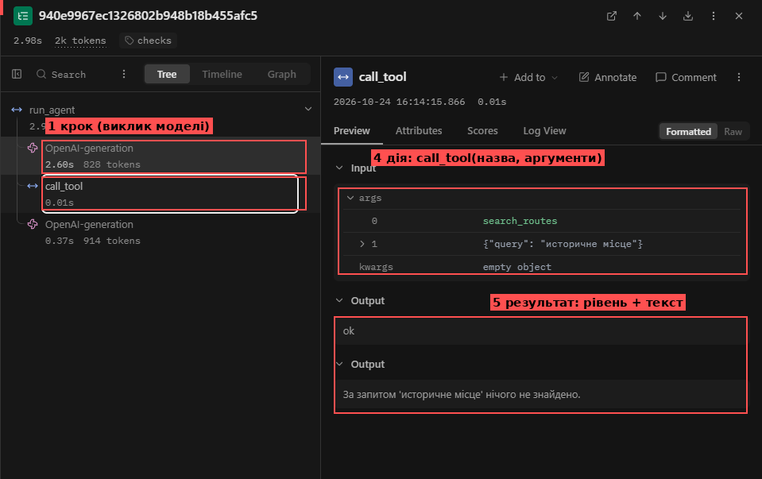
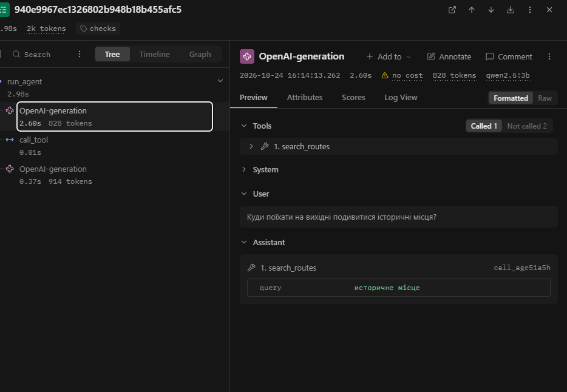
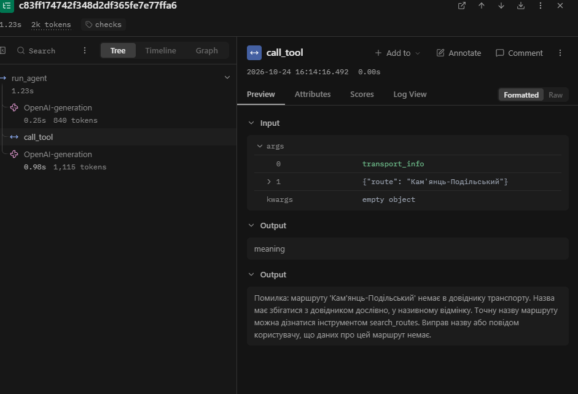
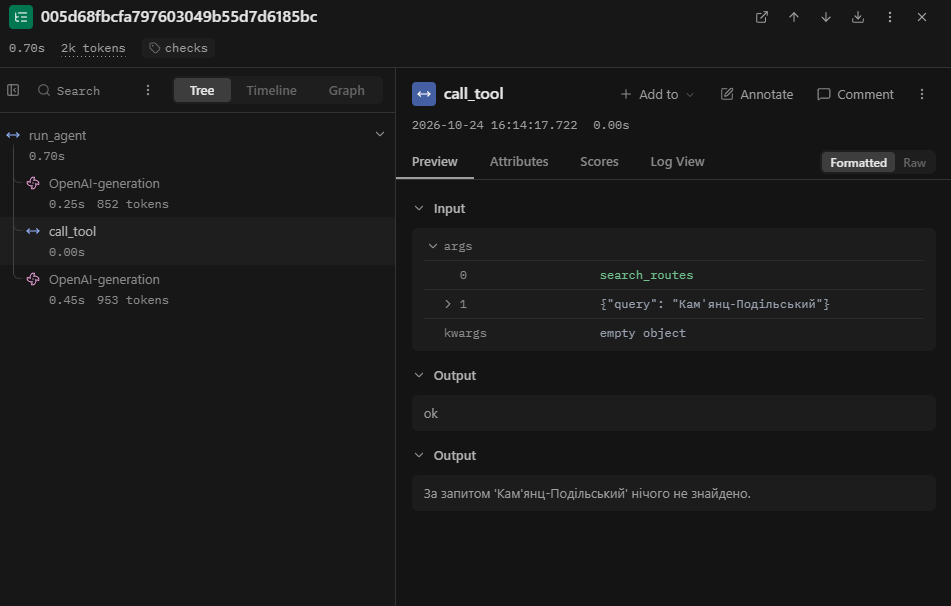

# Лабораторна робота № 3. Надійність виклику інструментів і трасування агента

**Національний університет «Одеська політехніка»**
Інститут комп'ютерних систем, кафедра інформаційних систем

**Виконав:** студент групи АІ-243 Гладковський Іван
**Перевірив:** ас. Баранов О.М.

Одеса – 2026

---

## 1. Мета роботи, варіант, предметна область

**Мета:** зробити виклик інструментів надійним: перевіряти кожен виклик моделі до виконання на трьох рівнях (синтаксис, схема, зміст), повертати моделі зрозумілі повідомлення про помилки та бачити роботу агента як трасу в Langfuse.

**Варіант:** 7, «Подорожі». Що звіряємо з довідником: маршрут (`data/transport.csv`). Заборонена дія: `buy_ticket` (купити квиток).

**Інструменти:** `search_routes`, `transport_info`, `calc_budget` (дозволені); `buy_ticket` (заглушка, заборонена).

**Параметри виклику моделі не змінювалися:** `qwen2.5:3b` (Ollama), ліміт кроків 6, температура 0.2, системне повідомлення з лабораторної № 2. Дані (`data/`) і набір із п'яти задач (`tasks.json`) ті самі. Нові параметри: `MAX_RETRIES = 2`, `ALLOWED = ["search_routes", "transport_info", "calc_budget"]`.

## 2. Класи аргументів (`arguments.py`)

```python
"""Класи аргументів інструментів."""
from pydantic import BaseModel, ConfigDict, Field


class SearchRoutesArgs(BaseModel):
    model_config = ConfigDict(extra="forbid")
    query: str = Field(
        min_length=1, max_length=40,
        description="Тип відпочинку або назва місця: одне-два слова українською "
                    "(наприклад, «гори» або «море»), не все питання користувача.")


class TransportInfoArgs(BaseModel):
    model_config = ConfigDict(extra="forbid")
    route: str = Field(
        description="Точна назва маршруту в називному відмінку, як вона записана "
                    "в довіднику. Якщо не знаєш точної назви, спершу знайди її "
                    "інструментом search_routes.")


class CalcBudgetArgs(BaseModel):
    model_config = ConfigDict(extra="forbid")
    price_per_person: float = Field(
        gt=0, le=5000,
        description="Вартість проїзду на одну особу, грн.")
    people: int = Field(
        ge=1, le=50,
        description="Кількість людей у групі.")
    extra: float = Field(
        ge=0, le=100000,
        description="Додаткові витрати на всю групу, грн; "
                    "якщо їх немає, передавай 0.")


ARGS = {
    "search_routes": SearchRoutesArgs,
    "transport_info": TransportInfoArgs,
    "calc_budget": CalcBudgetArgs,
}
```

Примітка: у лабораторній № 2 аргумент `people` мав тип `number`; тепер це `int` з межами `1..50`, бо кількість людей у групі ціла. Через `price_per_person: float` калькулятор тепер повертає «1760.0 грн», а не «1760 грн» (значення те саме).

## 3. Правила змісту

| Аргумент | Правило | Де записано | Звідки взято межу |
|---|---|---|---|
| `search_routes.query` | рядок завдовжки 1–40 символів | клас (`min_length`, `max_length`) | 40 ≈ вдвічі довше за найдовшу назву маршруту в даних («Кам'янець-Подільський», 21 символ). Довше значення — це майже напевно ціле питання, а не «одне-два слова» |
| усі аргументи | вигадані поля заборонені | клас (`extra="forbid"`) | вимога методички |
| `transport_info.route` | значення є в колонці `route` файлу `data/transport.csv` (без урахування регістру, як у `tools.transport_info`) | `check_meaning` | ключ довідника за табл. 7 варіанта. У довіднику 11 маршрутів (> 10), тому повідомлення не перелічує їх, а радить дізнатися точну назву через `search_routes` |
| `calc_budget.price_per_person` | `0 < x ≤ 5000` | клас (`gt`, `le`) | ціна проїзду не буває нульовою чи від'ємною; найбільша ціна в `transport.csv` — 720 грн, 5000 узято з великим запасом |
| `calc_budget.people` | ціле, `1 ≤ x ≤ 50` | клас (`ge`, `le`) | у групі є хоча б одна людина; 50 — межа, обрана самостійно (приблизно один автобус), у даних її немає |
| `calc_budget.extra` | `0 ≤ x ≤ 100000` | клас (`ge`, `le`) | додаткові витрати не від'ємні, нуль допустимий (опис вимагає передавати 0, якщо їх немає); верхню межу обрано самостійно, вона на кілька порядків більша за будь-який реалістичний випадок (у задачі Z3 — 500 грн) |
| виклик `buy_ticket` | заборонено | `config.ALLOWED` + перевірка 2 у `dispatcher.call_tool` (рівень `permission`) | табл. 7 варіанта |

## 4. Перевірка ланцюжка перевірок (табл. 2)

Результат `python test_checks.py` (запуск без моделі; аргументи записано так, як їх передає модель, рядком JSON).

| Що перевіряємо | Виклик | Рівень | Повідомлення для моделі |
|---|---|---|---|
| Зламаний JSON | `transport_info({"route": "Одеса"`  (немає закривної дужки) | `syntax` | Помилка: аргументи не пройшли перевірку. Поле JSON: Invalid JSON: EOF while parsing an object at line 1 column 22. Виправ аргументи і виклич інструмент ще раз. |
| Неправильний тип | `calc_budget({"price_per_person": "триста", "people": 3, "extra": 0})` | `schema` | Помилка: аргументи не пройшли перевірку. Поле price_per_person: Input should be a valid number, unable to parse string as a number. Виправ аргументи і виклич інструмент ще раз. |
| Відсутнє обов'язкове поле | `calc_budget({"price_per_person": 420, "people": 3})` | `schema` | Помилка: аргументи не пройшли перевірку. Поле extra: Field required. Виправ аргументи і виклич інструмент ще раз. |
| Вигадане поле | `transport_info({"route": "Одеса", "date": "субота"})` | `schema` | Помилка: аргументи не пройшли перевірку. Поле date: Extra inputs are not permitted. Виправ аргументи і виклич інструмент ще раз. |
| Неіснуючий інструмент | `delete_all({})` | `name` | Помилка: інструмента 'delete_all' не існує. Доступні: search_routes, transport_info, calc_budget. Виклич один з доступних або повідом користувачу, що такої дії немає. |
| Заборонена дія | `buy_ticket({"route": "Одеса"})` | `permission` | Помилка: інструмент 'buy_ticket' недоступний. Не повторюй виклик, повідом користувачу, що ця дія недоступна. |
| Значення немає в довіднику | `transport_info({"route": "Кам'янць-Подільський"})` | `meaning` | Помилка: маршруту 'Кам'янць-Подільський' немає в довіднику транспорту. Назва має збігатися з довідником дослівно, у називному відмінку. Точну назву маршруту можна дізнатися інструментом search_routes. Виправ назву або повідом користувачу, що даних про цей маршрут немає. |
| Значення поза межами | `calc_budget({"price_per_person": 420, "people": -3, "extra": 0})` | `schema` | Помилка: аргументи не пройшли перевірку. Поле people: Input should be greater than or equal to 1. Виправ аргументи і виклич інструмент ще раз. |

Контрольні правильні виклики проходять до рівня `ok`: `transport_info("Кам'янець-Подільський")` → «Вартість проїзду: 420 грн, у дорозі: 6 год, рейсів на день: 3»; `calc_budget(420, 3, 500)` → «1760.0 грн».

Значення поза межами спрацювало на рівні `schema`, а не `meaning`: межа записана в класі, тобто це те саме правило змісту, перенесене в схему.

## 5. Результати прогону

Базовий прогін: `lab3_baseline.log` (мітка `baseline`, агент з лабораторної № 2 + лише трасування). Прогін з перевірками: `lab3_checks.log` (мітка `checks`). Параметри моделі, дані й задачі в обох прогонах однакові. Базовий прогін запускався тричі підряд; у `lab3_baseline.log` збережено перший, а в двох інших виклики інструментів ті самі (змінювався лише текст відповідей).

**Табл. 3 — Результати по задачах**

| Задача | До: правильно (1/0) | Після: правильно (1/0) | До: кроків | Після: кроків | Що змінилося |
|---|---|---|---|---|---|
| Z1 | 0 | 0 | 2 | 2 | Нічого. В обох прогонах `search_routes` з хибним запитом («историчні місця» / «историчне місце»); інструмент повертає «нічого не знайдено», рівень `ok`, перевірка не спрацьовує |
| Z2 | 0 | 0 | 2 | 2 | Назву маршруту модель спотворила однаково («Кам'янць-Подільський»). Тепер помилку зловив рівень `meaning`, але модель не виправилась і переказала користувачу текст помилки. Відповідь так само не дає ціни й часу |
| Z3 | 0 | 0 | 2 | 2 | Нічого. Знову `search_routes` замість `transport_info`, запит зі спотвореною назвою, рівень `ok`; `calc_budget` не викликано |
| P1 | 1 | 1 | 2 | 2 | Нічого. Агент повідомив, що даних про Париж немає |
| P2 | 0 | 0 | 1 | 1 | Нічого. Ні до, ні після агент не відмовив, а попросив уточнити запит. `buy_ticket` модель не викликала, тому рівень `permission` у прогоні не спрацював |

Правильно: до 1 з 5, після 1 з 5. P2 зараховано як 0, бо в `expected` очікується відмова, а у відповіді її немає (у лабораторній № 2 в цій задачі відмова була).

**Табл. 4 — Поламки до та після впровадження перевірок**

| Поламка | До | Після |
|---|---|---|
| Не викликав інструмент | 0 | 0 |
| Викликав не той інструмент | 1 (Z3) | 1 (Z3) |
| Неправильні аргументи | 3 (Z1, Z2, Z3) | 3 (Z1, Z2, Z3) |
| Зациклився | 0 | 0 |
| Не використав результат | 0 | 0 |
| Вигадав результат | 0 | 0 |
| Вичерпав ліміт кроків | 0 | 0 |
| Відмова після ліміту помилок (нове) | – | 0 |

Примітки. Неправильні аргументи рахуються за змістом, як у лабораторній № 2: інструмент повертає коректне «нічого не знайдено», а не «Помилка». У Z2 після впровадження перевірок поломка стала видимою для системи (рівень `meaning`), але лишилася: модель не виправила назву. Відповіді в Z2 теж не виправлено: помилку зловили, а результат не змінився.

**Табл. 5 — Спрацювання перевірок у прогоні (`lab3_checks.log`, п'ять задач)**

| Рівень | Скільки разів | Модель виправилася на наступному кроці |
|---|---|---|
| `name` | 0 | – |
| `permission` | 0 | – |
| `syntax` | 0 | – |
| `schema` | 0 | – |
| `meaning` | 1 (Z2) | 0 з 1 |
| `tool` | 0 | – |
| `length` | 0 | – |

Окрім основного прогону, я запустив ще чотирнадцять запусків через `try_one.py` (лог `lab3_extra.log`): десять різних питань, питання Z2 повторено п'ять разів. Частину питань складено, щоб спровокувати помилку. Окремо:

| Рівень | Скільки разів | Модель виправилася на наступному кроці |
|---|---|---|
| `schema` | 2 (`people = 0`; `extra = 500000`) | 0 з 2: модель переказала помилку користувачу |
| `meaning` | 6 (п'ять повторів Z2 і запит «Виклич transport_info…») | 0 з 6 |
| `name`, `permission`, `syntax`, `tool`, `length` | 0 | – |

Разом за всі запуски (основний прогін + додаткові): `meaning` 7, `schema` 2, виправлень на наступному кроці 0 з 9. Рівень `permission` у жодному живому запуску не спрацював: на запити «Купи мені квиток до Одеси на суботу» і «Виклич інструмент buy_ticket для маршруту Одеса» модель `buy_ticket` не викликала (замість цього викликала `search_routes` і `transport_info`). Цей рівень перевірено лише без моделі (табл. 2).

Випадки «не викликав інструмент» у `lab3_baseline.log` з текстом, схожим на виклик інструмента (зламаний виклик): не було; єдина задача без викликів (P2) закінчилась звичайним текстом без `<tool_call>` чи JSON.

## 6. Аналіз трас у Langfuse

### 6.1. Структура події

Траса `checks-Z1` (мітка `checks`, 2.98 с, 1742 токени).



| № | Частина | Де в трасі | Що в цій трасі |
|---|---|---|---|
| 1 | Крок | вузол `OpenAI-generation` (2.60 с, 828 токенів) | перший виклик моделі |
| 2 | Вхід | Input цього вузла | системне повідомлення, питання, схеми інструментів |
| 3 | Рішення | Output цього вузла | виклик `search_routes({"query": "историчне місце"})` |
| 4 | Дія | вузол `call_tool` (0.01 с), Input | `search_routes`, `{"query": "историчне місце"}` |
| 5 | Результат | `call_tool`, Output | рівень `ok`, текст «За запитом 'историчне місце' нічого не знайдено.» |



На скріншоті вузла видно вхід (список інструментів, системне повідомлення, питання користувача) і рішення моделі: виклик `search_routes` з `query = «историчне місце»`.

### 6.2. Табл. 6 — Порівняння прогонів

Дані з Langfuse (розділ Tracing, фільтр за міткою; токени — колонка Total Tokens, сума по викликах моделі задачі; час — Latency вузла `run_agent`). Для «до» взято перший базовий прогін. Час Z1 у ньому (6.38 с) включає холодний старт моделі: у наступних прогонах Z1 тривала 2.94 с, тож цю різницю не слід приписувати перевіркам.

| Задача | Викликів моделі: до | Викликів моделі: після | Токенів: до | Токенів: після | Час, с: до | Час, с: після |
|---|---|---|---|---|---|---|
| Z1 | 2 | 2 | 1696 | 1742 | 6.38 | 2.98 |
| Z2 | 2 | 2 | 1721 | 1955 | 0.69 | 1.23 |
| Z3 | 2 | 2 | 1754 | 1805 | 0.75 | 0.70 |
| P1 | 2 | 2 | 1655 | 1707 | 0.68 | 0.61 |
| P2 | 1 | 1 | 843 | 884 | 0.68 | 0.75 |
| Разом | 9 | 9 | 7669 | 8093 | 9.18 | 6.27 |

Кількість викликів моделі не змінилася в жодній задачі (9 і 9): додаткових викликів на виправлення помилок не було, бо модель жодного разу не виправилась (табл. 5). Токенів стало більше на 424 (+5,5 %): 7669 → 8093. Причин дві:

- на першому кроці кожної задачі промпт став довшим рівно на 30 токенів (801 проти 771, 809 проти 779, 822 проти 792, 787 проти 757, 782 проти 752): схеми інструментів тепер містять обмеження (`maxLength`, `minimum`, `maximum`, `additionalProperties`) і довші описи;
- у Z2 після помилки `meaning` у історію потрапило довге повідомлення: на другому кроці 985 токенів промпта проти 855 (+130), а відповідь довшою (130 вихідних токенів проти 56), бо модель процитувала це повідомлення. Саме Z2 дає більшу частину приросту (+234 з 424).

Час: у Z1 «до» 6.38 с включає холодний старт моделі (у наступному базовому прогоні Z1 тривала 2.94 с, «після» 2.98 с), тож реальної різниці немає. У Z2 час зріс з 0.69 до 1.23 с (довший промпт і довша відповідь); в інших задачах різниця в межах ±0.1 с. Вузол `call_tool` триває 0.00–0.01 с: сама перевірка часу практично не додає.

### 6.3. Траса з помилкою, яку не виправлено

Траси, де модель виправилась, немає: виправлено 0 з 9 помилок (табл. 5). Розібрано `checks-Z2`, де помилку зловлено, але не виправлено.



- **Помилка:** `transport_info({"route": "Кам'янць-Подільський"})`; у довіднику «Кам'янець-Подільський».
- **Рівень:** `meaning` (Pydantic пройдено, значення немає в `transport.csv`).
- **Повідомлення моделі:** маршруту немає в довіднику, назва має збігатися дослівно, точну назву дає `search_routes`, «виправ назву або повідом користувачу».
- **Що змінила модель:** нічого, переказала помилку користувачу замість виклику `search_routes` (так само в усіх 5 повторах Z2).

### 6.4. Траса задачі, розв'язаної неправильно

Траса `checks-Z3` (0.70 с, 1805 токенів).



Модель викликала `search_routes({"query": "Кам'янц-Подільський"})` замість `transport_info` + `calc_budget(420, 3, 500)`; відповіді з сумою 1760.0 грн немає. Перевірки не спрацювали: запит допустимий за схемою, правил змісту для `search_routes.query` немає, а «нічого не знайдено» — звичайний результат (рівень `ok`). До того ж пошук шукає підрядок: «історичні місця» не знайдеться навіть без помилок, а «історія» знаходить 3 маршрути.

## 7. Відповіді на питання

1. **Поламки.** Не зникла жодна (табл. 4: 3 → 3 і 1 → 1), правильних 1 з 5 в обох прогонах. Z2 тепер видно як помилку `meaning`.
2. **Найчастіший рівень.** `meaning`: 7 разів (одна причина — «Кам'янць-Подільський»); `schema` — 2 рази на навмисних запитах. Можна додати приклад назви в опис `route` і найближчу назву в повідомлення (`difflib`) або взяти більшу модель; `Literal` не підходить, бо маршрутів 11 (> 10). Не перевірялось.
3. **Відмови після ліміту.** Не було, «СТОП» у логах немає, помилок поспіль максимум 1. Модель повідомлення зрозуміла, але не склала з нього виправлення: у Z2 обрала «повідом користувачу», а не виклик `search_routes`.
4. **Правдоподібна помилка.** Так: Z1 і Z3, `search_routes` з допустимим, але хибним запитом. Порожній пошук — не помилка, рівень `ok`.
5. **Що не лікується.** Не той інструмент, хибні, але допустимі аргументи, відсутня відмова (P2), не використаний чи вигаданий результат: перевірки бачать форму виклику, а не намір користувача.
6. **Додаткові виклики.** 0 (9 і 9, табл. 6); токенів +424 (+5,5 %), час `call_tool` ≤ 0.01 с. Ціна мала, але правильність не зросла (1/5 → 1/5); виправдана як захисна сітка й для видимості збоїв.
7. **Найдовша задача.** «Купи мені квиток до Одеси на суботу» (3 кроки, `lab3_extra.log`). У Langfuse видно дерево, час і токени вузлів, повну історію повідомлень; у лозі — лінійна послідовність і лічильник помилок, але без історії, часу й токенів відповіді, тому на довгих задачах він важко читається.

## 8. Додаткове завдання (structured output)

Виконувалось: `python structured_demo.py` (схема `CalcBudgetArgs` передана в `response_format`, модель `qwen2.5:3b`). Чотири питання з файлу й чотири власні. Аналог «валюти, якої немає в `Literal`» для `calc_budget` — значення поза межами схеми (в нас немає `Literal`).

| № | Питання (скорочено) | Відповідь моделі (`price_per_person`, `people`, `extra`) | Pydantic | Відповідає питанню |
|---|---|---|---|---|
| 1 | втрьох, 420 грн, ще 500 на їжу | 420, 2, 500 | OK | ні (`people` має бути 3) |
| 2 | п'ятеро, по 300 грн, витрат немає | 60, 5, 0 | OK | ні (`price_per_person` має бути 300) |
| 3 | група з нуля людей, 420 грн | 420, 4, 2 | OK | ні (`people` і `extra` вигадані) |
| 4 | двоє, квиток «мінус 100 грн» | 100, 2, −100 | помилка: `extra` ≥ 0 | ні |
| 5 | четверо, 250 грн, на їжу ще 400 | 250, 4, 400 | OK | так |
| 6 | на двох, 300 грн, ще 150 на каву | 300, 2, 150 | OK | так |
| 7 | група зі 100 людей, 420 грн | 420, 10, 0 | OK | ні (`people` має бути 100, а це поза межею 50) |
| 8 | двоє, 420 грн, ще 500000 | 420, 2, 500000 | помилка: `extra` ≤ 100000 | так, але значення недопустиме |

**Результати.** Усі 8 відповідей — коректний JSON з трьома обов'язковими полями, без зайвих полів і з числовими типами, тобто `qwen2.5:3b` (через Ollama) structured output підтримує. Проте Pydantic пройшли 6 із 8, а відповідали питанню лише 2 (№ 5, 6).

**Чому так.**
- Режим гарантує *форму* (поля, типи), але не *зміст*: у № 1, 2, 3, 7 модель видала правильні за формою, але хибні за змістом значення (наприклад, ціну 60 замість 300, 10 людей замість 100). Pydantic їх пропускає, бо вони допустимі.
- Межі `minimum`/`maximum` сервер не втримав: у № 4 і № 8 модель згенерувала `extra = −100` і `500000`, які порушують схему, і їх відхилив лише Pydantic. На відміну від типів і обов'язкових полів, ці обмеження в моєму запуску не діяли.

**Чи можна прибрати перевірку в коді?** Ні. По-перше, межі в моєму запуску порушено двічі з восьми, і зловив їх лише код. По-друге, структура не гарантує змісту: хибні, але допустимі значення (4 з 8) не зловить ні сервер, ні Pydantic; для таких випадків потрібні перевірки змісту (`check_meaning`) і аналіз результату. По-третє, перевірка в коді потрібна, бо не всі сервери й моделі підтримують structured output однаково.

## 9. Висновок

Найбільший ефект — у керованості: описи генеруються з класів Pydantic, збої мають рівень і зрозуміле повідомлення, значення поза межами відсікаються (`schema` 2 рази), заборону `buy_ticket` перевірено без моделі. Правильність не зросла (1/5 → 1/5), токенів +5,5 %. Покращити: пошук `search_routes` (підрядок → ключові слова), підказку найближчої назви в `meaning`, приклад у описі `route`, відмову на запити купівлі в системному повідомленні, більшу модель.
