# Лабораторна робота № 4. Контекст, стан і кеш агента

**Національний університет «Одеська політехніка»**  
Навчально-науковий інститут комп’ютерних систем, кафедра інформаційних систем  
**Виконав:** студент групи АІ-243 Гладковський Іван  
**Перевірив:** ас. Баранов О.М.  
**Одеса — 2026**

---

## 1. Мета роботи, середовище та об’єкт дослідження

**Мета роботи.** Дослідити обмеження контекстного вікна мовної моделі під час виконання довгої задачі агентом; реалізувати скорочення історії, збереження стану та кешування викликів; порівняти витрати токенів, час і правильність відповідей.

**Об’єкт роботи.** Агент для планування маршрутів вихідного дня (варіант 7 — «Подорожі»), створений на основі лабораторної № 3. Дозволені інструменти: `search_routes`, `transport_info`, `calc_budget`. Інструмент `buy_ticket` залишається забороненим. Корпус містить 12 текстових описів маршрутів, довідник `data/transport.csv` — 11 транспортних позицій.

**Середовище.** Windows, Python, Ollama (локальна модель `qwen2.5:3b`, 3,1 млрд параметрів, Q4_K_M), OpenAI-сумісний API `http://localhost:11434/v1`, Langfuse для трасування. Температура генерації — 0,2.

| Параметр | Значення |
| --- | --- |
| Контекст вихідної моделі (`context length`) | 32 768 токенів |
| Початкове експериментальне вікно | `qwen25-4k`: 4 096 токенів (менше у 8 разів) |
| Зменшене вікно для основних тестів | `qwen25-3k`: 3 072 токени (менше у 10,67 раза) |
| Поріг стискання (`COMPRESS_AT`) | 2 150 токенів для 3k |
| Обсяг збереженого хвоста (`KEEP_LAST`) | 6 повідомлень |
| Ліміт кроків довгої задачі | 25 |

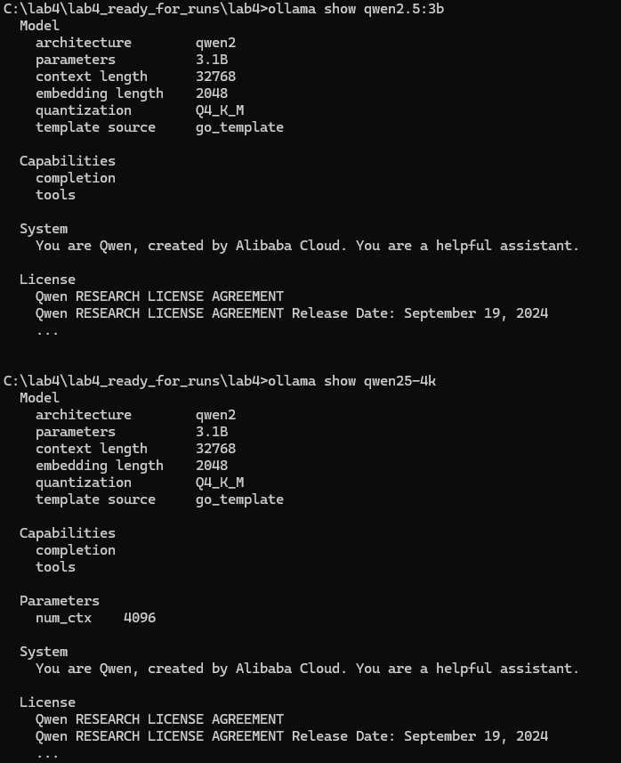

*Рисунок 1 — Параметри вихідної моделі та моделі з вікном 4096 токенів.*

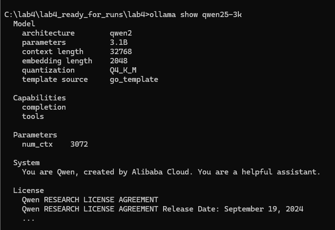

*Рисунок 2 — Параметр num_ctx = 3072 для моделі qwen25-3k.*

Після базових прогонів із вікном 4096 токенів (випадок C) створено модель на 3072 токени. У подальших порівняннях конфігурацій використано саме її. `context length = 32768` у секції Model є характеристикою базової архітектури; налаштований ліміт задає параметр `num_ctx` у секції Parameters.

### Файли та зміни щодо лабораторної № 3

- `config.py` — модель, контекстне вікно, поріг стиснення, режим історії, стан і кеш.
- `agent.py` — довгий цикл агента з логуванням, обробленням викликів, обмеженням 25 кроків і керуванням пам’яттю; для стабільного експерименту застосовано один виконуваний виклик інструмента за крок.
- `model.py`, `cache.py`, `context.py`, `state.py`, `compress.py`, `summary.py` — робота з моделлю, кешування, обрізання, запис результатів і підсумовування.
- `make_task.py`, `measure.py`, `analyze.py`, `logparse.py`, `metrics.py`, `table.py`, `build_results.py` — генерація задачі та аналіз реальних запусків.
- `tools.py` — пошук повертає опис маршруту з корпусу, щоб виконати пункт (а) довгої задачі без вигадування опису.

```text
FROM qwen2.5:3b
PARAMETER num_ctx 3072
```

## 2. Підготовка довгої задачі

Для шести поїздок агент має спочатку знайти опис маршруту, потім вартість проїзду й окремо розрахувати бюджет через `calc_budget`. Отже, мінімум становить **6 × 3 = 18 викликів інструментів**. Додаткові витрати (`extra`) дорівнюють нулю.

**Питання для агента.** Для кожного з шести відрізків маршруту: Кам’янець-Подільський (3 особи), Хотин (2 особи), Одеса (4 особи), Карпати (3 особи), Шацькі озера (2 особи), Львів (5 осіб): (а) знайти у корпусі опис маршруту й навести його одним реченням; (б) знайти в довіднику вартість проїзду на одну особу; (в) порахувати бюджет для заданої кількості осіб. Наприкінці назвати загальний бюджет.

| Маршрут | Осіб | Проїзд/особу, грн | Бюджет, грн |
| --- | --- | --- | --- |
| Кам’янець-Подільський | 3 | 420 | 1 260 |
| Хотин | 2 | 380 | 760 |
| Одеса | 4 | 300 | 1 200 |
| Карпати | 3 | 650 | 1 950 |
| Шацькі озера | 2 | 610 | 1 220 |
| Львів | 5 | 500 | 2 500 |
| **Разом** | 19 | — | **8 890** |

**Еталонна відповідь: 8890 грн.** Її сформовано прямими викликами власних функцій у `make_task.py` без звернення до мовної моделі; файл `long_task.json` містить `expected = "8890"` і `min_calls = 18`. Після створення задачі очікувану відповідь не змінювали.

```text
python make_task.py
# Правильна відповідь: 8890
# Файл long_task.json записано
```

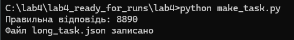

*Рисунок 3 — Результат створення long_task.json для варіанта 7.*

## 3. Початковий прогін без захисту

Спочатку використано `qwen25-4k` (4096 токенів). Пробний запуск після виправлення схеми викликів завершився на кроці 2 із входом 2596 токенів (63% вікна): модель передчасно сформувала відповідь та підставляла некоректні ціни. Це **випадок C**: прогін закінчується до заповнення 95% вікна. Тому модель звужено до 3072 токенів і поріг `COMPRESS_AT` встановлено на 2150.

На першому діагностичному запуску було зафіксовано `retry_limit` через відсутній обов’язковий аргумент `extra` та помилкову назву маршруту. Інструкції моделі уточнено, а виклики інструментів організовано послідовно. Перші діагностичні логи збережено окремо; до порівняння режимів включено лише прогони після цих виправлень.

Після переходу на 3072 токени контрольний прогін `none` завершився на кроці 19. Агент виконав 18 викликів інструментів, але у фіналі повідомив **2500 грн** замість **8890 грн**, тобто взяв результат останнього маршруту.

```text
python measure.py none 1 probe
python analyze.py logs\probe_none_r1.log steps
```

## 4. Зростання контексту без захисту

**Таблиця 2 — Зростання кількості вхідних токенів у контрольному прогоні none (3072).**

| Крок | prompt_tokens | Приріст | Дія моделі |
| --- | --- | --- | --- |
| 1 | 1311 | — | search_routes |
| 2 | 1426 | 115 | transport_info |
| 3 | 1507 | 81 | calc_budget |
| 4 | 1563 | 56 | search_routes |
| 5 | 1684 | 121 | transport_info |
| 6 | 1756 | 72 | calc_budget |
| 7 | 1811 | 55 | search_routes |
| 8 | 1917 | 106 | transport_info |
| 9 | 1990 | 73 | calc_budget |
| 10 | 2046 | 56 | search_routes |
| 11 | 2148 | 102 | transport_info |
| 12 | 2222 | 74 | calc_budget |
| 13 | 2278 | 56 | search_routes |
| 14 | 2399 | 121 | transport_info |
| 15 | 2477 | 78 | calc_budget |
| 16 | 2533 | 56 | search_routes |
| 17 | 2660 | 127 | transport_info |
| 18 | 2734 | 74 | calc_budget |
| 19 | 2790 | 56 | фінальна відповідь |

- **(а)** Постійна частина — **1311 токенів** (перший виклик).
- **(б)** Медіанний додатний приріст за крок — **74 токени**.
- **(в)** Сума `prompt_tokens` за прогін — **39 252**; за наближенням `n·C + d·n(n−1)/2` — **37 563** (різниця 1689 токенів, приблизно 4,3%).
- **(г)** Зупинка зростання входу не спостерігалася: від 1311 до 2790 токенів протягом усіх 19 кроків.
- **(д)** Наступних трьох кроків після плато немає, бо самого плато не зафіксовано. Модель дала неправильний підсумок 2500 грн без ознак автоматичного обрізання контексту.

**Класифікація — C.** Навіть після звуження до 3072 токенів максимум становив 2790, або 91% вікна, що менше за поріг 95%. Серверної помилки типу A і підтвердженої тихої втрати початку історії (B) у цьому прогоні немає. Зростання суми входів близьке до квадратичного за кількістю кроків: усю попередню історію повторно передають на наступному кроці. Відхилення формули зумовлене неоднаковою довжиною результатів різних інструментів.

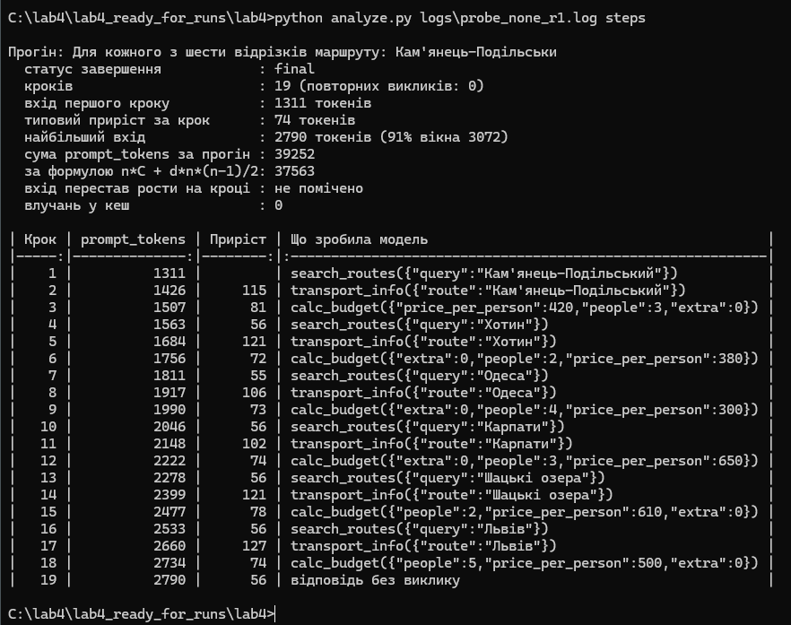

*Рисунок 4 — Пошаговий аналіз режиму none, 19 кроків, максимум 2790 токенів.*

## 5. Обрізання історії та збереження стану

Параметри досліду: `NUM_CTX = 3072`, `COMPRESS_AT = 2150`, `KEEP_LAST = 6`, `STATE_RESULT_CHARS = 200`. Після перевищення порога зберігаються системна інструкція, запитання користувача та останні шість повідомлень. Режим `trim+state` додатково повертає в запитання записи про успішні виклики інструментів.

```text
python measure.py trim 1 probe
python analyze.py logs\probe_trim_r1.log steps
python measure.py trim+state 1 probe
python analyze.py logs\probe_trim+state_r1.log steps
```

**Таблиця 3 — Події стиснення та кількість повторних викликів.**

| Режим | Крок | Вхід до, токенів | Повідомлень | Повторів за прогін |
| --- | --- | --- | --- | --- |
| trim | 12 | 2222 | 26 → 8 | 5 |
| trim | 20 | 2156 | 24 → 8 | 5 |
| trim+state | 12 | 2222 | 26 → 8 | 0 |

Для `trim` після першого стиснення вхід на наступному кроці впав із 2222 до 1543 токенів; після другого — із 2156 до 1566. Агент повторно шукав раніше отримані маршрути (Одеса, Шацькі озера, Кам’янець-Подільський), витратив 25 кроків і завершився некоректною незавершеною фразою «Гарний відповідь для Одеси:».

У `trim+state` після першого стиснення 26 → 8 повідомлень у запитання додано **12 рядків** виду `інструмент(аргументи) → результат`. Розмір повного нового запитання — **1987 символів**, орієнтовно **795 токенів** за наближенням 2,5 символа/токен. Це приблизно у 10,7 раза більше за типовий приріст 74 токени за крок, тому записник є значним за розміром. Вхід на кроці 13 становив 2238 токенів проти 2278 у `none` на тому самому кроці: економія лише 40 токенів, але 0 повторних викликів.

Наявність записника не гарантувала виконання всієї задачі: після Карпат (12 викликів) агент видав відповідь 1950 грн замість 8890 грн, не обробивши Шацькі озера і Львів. Отже, збереження стану компенсує втрату фактів, але не виправляє передчасну зупинку та помилки підсумкового міркування.

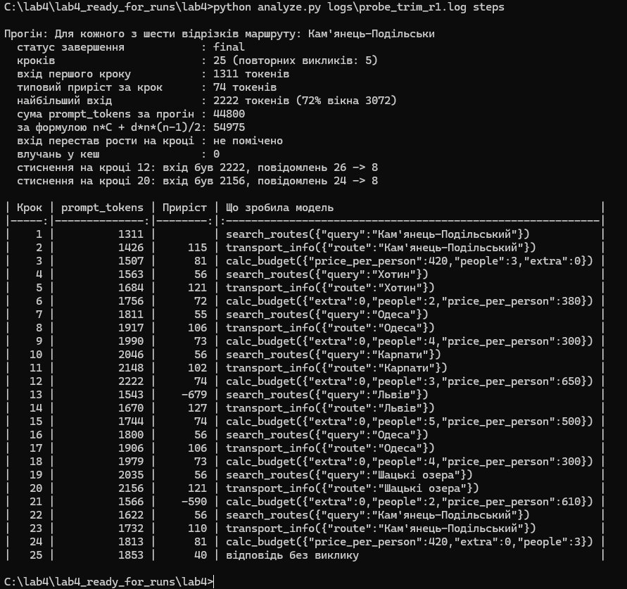

*Рисунок 5 — Два стиснення історії в режимі trim та повторні виклики.*

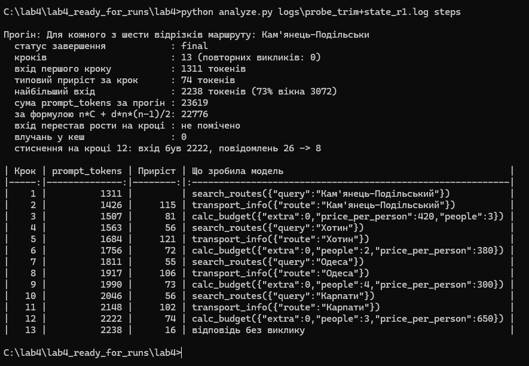

*Рисунок 6 — Одне стиснення в trim+state й відсутність повторних викликів.*

## 6. Кешування викликів моделі

Кеш формує ключ на основі хешу SHA-256 повного JSON запиту: назви моделі, повідомлень, схем інструментів і температури. За однакового запиту відповідь зчитується з локального кешу без нового звернення до Ollama.

```text
if exist cache rmdir /s /q cache
python measure.py none 1 cache1
python measure.py none 1 cache2
```

**Таблиця 4 — Порівняння двох послідовних запусків кешу.**

| Запуск | Кроків | Cache hits | До Ollama | Час, с | Правильно |
| --- | --- | --- | --- | --- | --- |
| cache1 (порожній кеш) | 19 | 0 | 19 | 8,6 | Ні |
| cache2 (повтор) | 19 | 19 | 0 | 0,1 | Ні |

Час скоротився з 8,6 до 0,1 с, тобто **приблизно в 86 разів** за округленими вимірюваннями. Сума зафіксованих у логах токенів залишилася 39 252, оскільки в кеші збережено дані попередньої відповіді. Водночас на другому запуску нових токенів Ollama не генерувала. Обидва рази модель дала неправильні 2500 грн: кеш прискорює повторення, але не виправляє зміст результату.

Якщо змінити текст системної інструкції, частина ключа зміниться, тому кеш не спрацює. Якщо зовнішній довідник змінить відповіді інструментів, наступні запити моделі теж зміняться. Однак перевизначення моделі під незмінною назвою може залишити ключ формально тим самим та повернути застарілі відповіді: тоді кеш потрібно очищати.

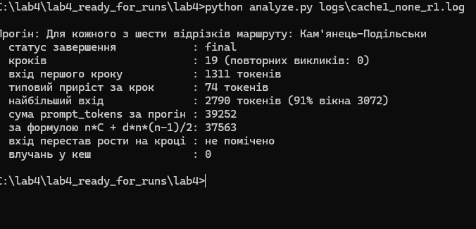

*Рисунок 7 — Перший запуск: нуль влучань у кеш.*

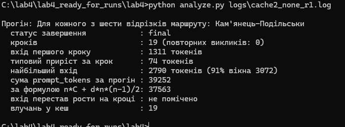

*Рисунок 8 — Повторний запуск: 19 влучань у кеш.*

## 7. Основна серія вимірювань і трасування

Виконано `python measure.py all 3 main`: по три незалежні прогони кожного з режимів `none`, `trim`, `trim+state`. Для коректної оцінки витрат під час цієї серії кеш вимкнено. Таблиця містить **медіани трьох повторів**, а стовпець «Правильно» — кількість прогонів, у яких отримано правильне число 8890.

**Таблиця 5 — Порівняння витрат і якості відповіді.**

| Режим | 8890 (із 3) | Кроків | Вхід | Вихід | Час, с | Стиснень | Повторів |
| --- | --- | --- | --- | --- | --- | --- | --- |
| none | 0 | 16 | 31 068 | 826 | 6,5 | 0 | 0 |
| trim | 0 | 19 | 33 992 | 603 | 4,8 | 1 | 3 |
| trim+state | 0 | 13 | 23 619 | 585 | 4,6 | 1 | 0 |

`trim+state` мав найменшу медіанну кількість вхідних токенів: на **7449 токенів (24%)** менше, ніж `none`. Медіанний час становив 4,6 с проти 6,5 с у `none`. Проте в усіх дев’яти запусках результат був неправильним, тому точнішого режиму за наявними вимірами немає.

**Додаткова перевірка по кожному запуску.** Шість із дев’яти запусків зупинилися раніше ніж на кроці 19 (менше 18 викликів інструментів). Повністю пройдені 18 викликів також не гарантували правильний підсумок.

| Ідентифікатор прогону | Кроків | Повторів | Вхідних токенів | Підсумок |
| --- | --- | --- | --- | --- |
| main_none_r1 | 8 | 1 | 12925 | немає фінальної відповіді |
| main_trim_r1 | 19 | 3 | 33992 | фінал неправильний |
| main_trim+state_r1 | 13 | 0 | 23619 | фінал неправильний |
| main_none_r2 | 16 | 0 | 31068 | фінал неправильний |
| main_trim_r2 | 8 | 1 | 12925 | немає фінальної відповіді |
| main_trim+state_r2 | 13 | 0 | 23619 | фінал неправильний |
| main_none_r3 | 19 | 0 | 39252 | фінал неправильний |
| main_trim_r3 | 19 | 3 | 33992 | фінал неправильний |
| main_trim+state_r3 | 13 | 0 | 23619 | фінал неправильний |

**Приклади з логів:** у `main_none_r3` після 18 коректних викликів виведено 2500 грн — бюджет лише Львова; `main_none_r2` сформував 6360 грн із неправильних складових; `main_trim+state_r2` указав 760 грн для Шацьких озер і 3150 грн для Львова, хоча інструменти давали 1220 і 2500 грн. Це помилки використання вже доступних чисел або передчасне завершення, які не усуваються самим стисканням.

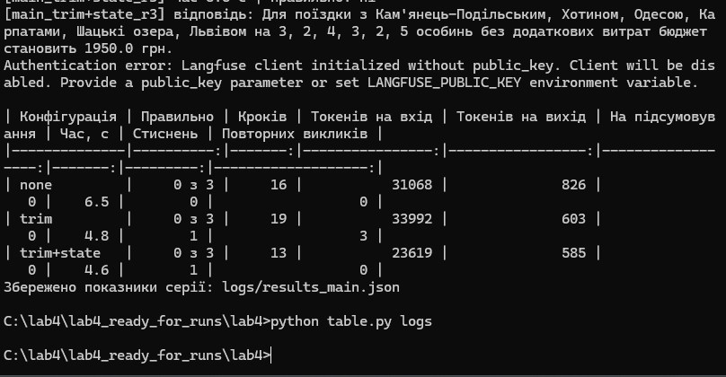

*Рисунок 9 — Підсумкова таблиця дев’яти прогонів (медіанні показники).*

### Трасування в Langfuse

Під час первинної серії `main` ключі Langfuse ще не були налаштовані, тому трас цих ранніх запусків у сервісі немає. Після налаштування API-ключів окремо проведено `tracing_none_r1` і `tracing_trim+state_r1`. Наведені нижче зображення — **справжні траси цих пізніших запусків**, а не видавані за них траси `main`. У трасах видно дерево генерацій, звернення до інструментів, аргументи й відповіді.

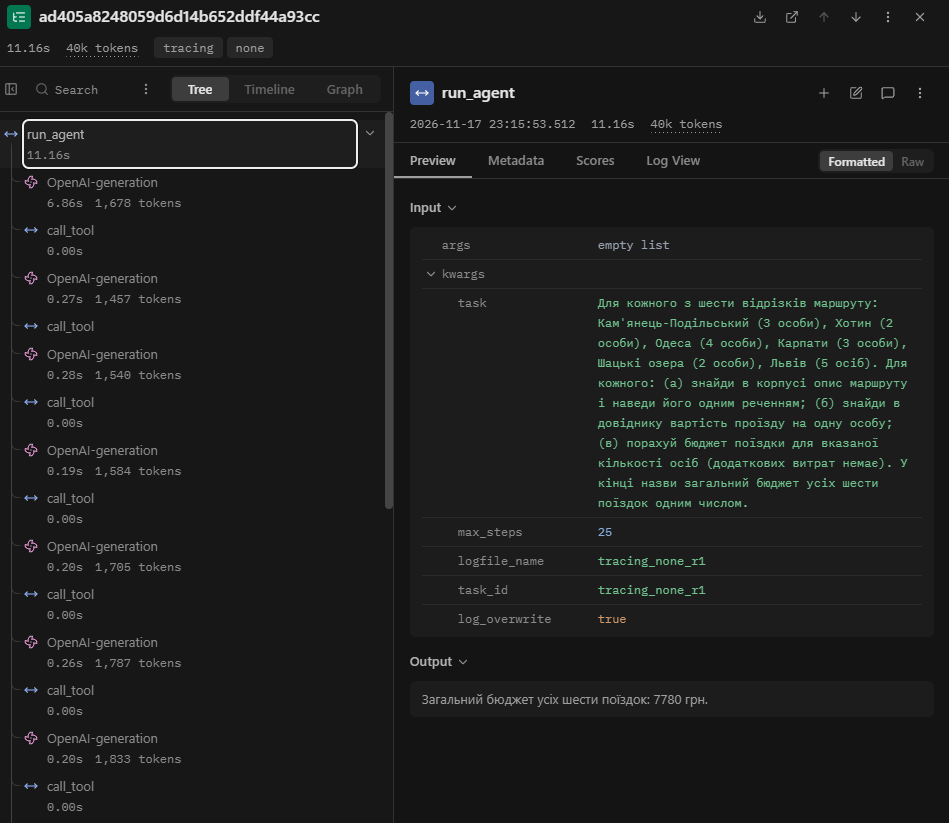

*Рисунок 10 — Дерево трасування агента без стиснення історії (окремий запуск tracing_none_r1).*

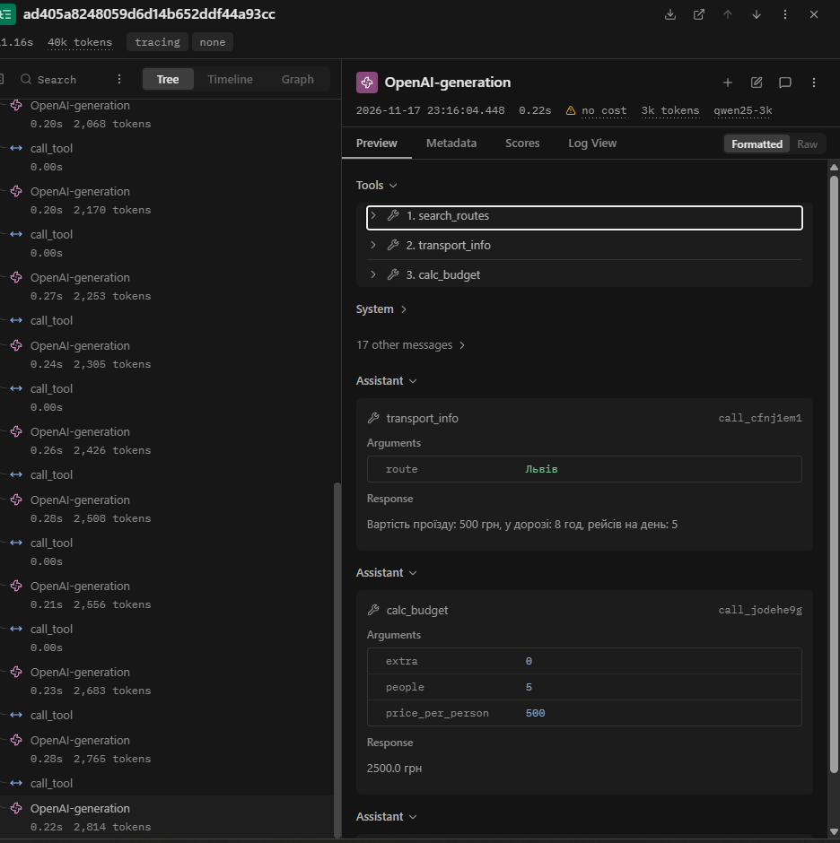

*Рисунок 11 — Результати transport_info та calc_budget у трасі none.*

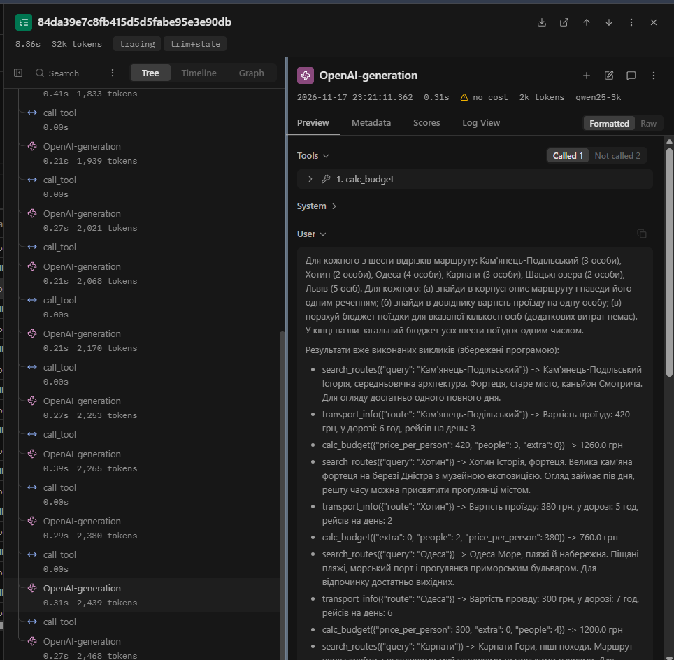

*Рисунок 12 — Блок збережених результатів у повідомленні User після стиснення (Langfuse, trim+state).*

За логами контрольних запусків перший виклик після стиснення (крок 13) мав 2238 токенів у `trim+state`, тоді як у `none` на цьому кроці — 2278. У Langfuse можна переглянути також точний вміст запиту, окремі відповіді інструментів і послідовність генерацій без ручного відновлення історії з текстового лога.

## 8. Відповіді на контрольні запитання

### 1. На якому кроці агент дійшов до межі вікна?

У контрольному прогоні `none` межу не досягнуто: на кроці 19 максимальний вхід становив 2790 із 3072 токенів (91%), а зростання не зупинялося. Тому ознак мовчазного обрізання контексту немає; ранні збої були пов’язані з помилками викликів або завершенням без правильного підсумку.

### 2. Чи збігається сума токенів із наближеною формулою?

Сума за логом дорівнювала 39 252 токени, а формула `n·C + d·n(n−1)/2` дала 37 563. Різниця 1689 токенів (4,3%) пояснюється неоднаковою довжиною відповідей `search_routes`, `transport_info` і `calc_budget`; медіанний приріст 74 токени є лише наближенням.

### 3. Що втрачає агент при trim і як допомагає стан?

Відкидаючи старі повідомлення, агент перестає бачити результати попередніх інструментів і повторює їх. Після стиснення у `probe_trim_r1` він знову звертався до маршрутів, уже оброблених раніше (5 повторних викликів). У `trim+state` ці результати було додано до запитання окремим записником; повторів стало 0, однак агент завершився після чотирьох маршрутів.

### 4. Що найдешевше, найшвидше та найточніше?

За таблицею 5 `trim+state` має найменше токенів на вході (23 619) і найменший медіанний час (4,6 с); за точністю всі режими однакові — 0 правильних із 3. Три повтори однієї задачі з температурою 0,2 і малою моделлю не дають підстав робити узагальнений статистичний висновок.

### 5. Чому кеш вимкнули під час вимірювань?

Інакше наступні запуски повторно використовували б готові відповіді, тож вимірювали б швидкість читання кешу, а не генерації моделі. Зміни даних інструмента можуть змінити наступні JSON-запити та їх хеші; зміна моделі під тією самою назвою створює ризик повернення застарілого кешу, тому його потрібно очищати.

### 6. Які помилки стискання історії не лікує?

Стискання не виправляє хибний вибір інструмента, неправильні аргументи, арифметичні помилки моделі та передчасну фінальну відповідь. Приклад: `main_none_r3` виконав усі 18 викликів, але назвав 2500 грн замість 8890; `main_trim+state_r1` завершився вже після чотирьох позицій.

## 9. Додаткове завдання: підсумовування історії

Режим `summary` окремим викликом моделі стискає стару історію до текстового підсумку. Виконано три повтори командою `python measure.py summary 3 extra`.

| Режим | 8890 із 3 | Кроків | Вхід | Вихід | На summary | Час, с | Стиснень | Повторів |
| --- | --- | --- | --- | --- | --- | --- | --- | --- |
| summary | 0 | 13 | 23 269 | 750 | 1267 | 10,5 | 1 | 0 |

Після стиснення на кроці 12 (2222 токени до операції) вхід наступного кроку в пробному `summary` зменшився до **1888 токенів**. У медіанній серії `summary` заощаджено **10 723 вхідних токени** порівняно з `trim` (33 992 − 23 269), а відносно `trim+state` — лише **350**. Підсумовування додатково потребувало 1267 токенів і збільшило час до 10,5 с.

Точність не підвищилася: **0/3** правильних відповідей. У `extra_summary_r1` модель назвала загальний бюджет 3280 грн і використала числа, що не збігаються з довідником; у `extra_summary_r2` з’явилися вигадані тарифи (наприклад, 325 і 400 грн). Отже, текстовий переказ може не зберігати всі точні числа, потрібні для розрахунку.

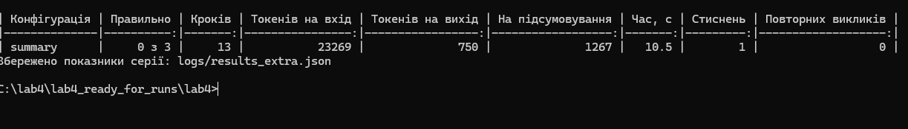

*Рисунок 13 — Показники трьох прогонів конфігурації summary.*

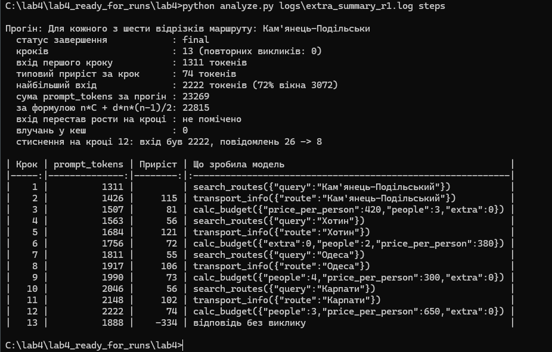

*Рисунок 14 — Аналіз кроків summary: перший вхід після підсумовування зменшився до 1888 токенів.*

## 10. Висновок

Під час лабораторної роботи реалізовано три механізми керування довгим контекстом агента: обрізання історії (`trim`), обрізання зі збереженням стану (`trim+state`) і кешування. Проведено контрольні та основні прогони з моделлю `qwen25-3k`, а також перевірено додатковий режим `summary` і налаштовано трасування Langfuse.

У контрольному режимі `trim` стиснення зменшувало розмір наступного запиту, але агент зробив п’ять повторних викликів. `trim+state` зберіг результати інструментів і знизив кількість повторів до нуля. У головній серії `trim+state` був найекономнішим за входом (23 619 токенів) і найшвидшим за медіаною (4,6 с), тоді як кеш дав прискорення приблизно в 86 разів на повністю однаковому повторному запиті.

Водночас жодна з конфігурацій не дала правильного загального бюджету 8890 грн у трьох основних повторах. Причинами були рання зупинка, плутанина з уже обчисленими сумами та неправильне підсумовування. Зафіксований максимум входу без стиснення — 2790 із 3072 токенів — не підтверджує переповнення; некоректність відповіді не слід автоматично пояснювати межею контексту. Подальше вдосконалення варто спрямувати на контроль завершення 18 обов’язкових викликів, структуроване накопичення шести бюджетів, перевірку кінцевої суми програмою та додаткові повтори для стійкішої статистики.

## 11. Файли для відтворення та перевірки

- `report.md` — цей протокол із реальними вимірами, формат звіту за методичкою.
- `logs/probe_*.log`, `logs/cache*.log`, `logs/main_*.log`, `logs/extra_*.log`, `logs/tracing_*.log` — журнали фактичних запусків.
- `logs/results_*.json`, `results_from_logs.md` — числові підсумки, отримані з журналів.
- `images/*.png` — надіслані скриншоти Ollama, термінала та Langfuse; API-ключів у звіті немає.
- `config.py`, `Modelfile` — конфігурація для основних вимірів із 3072 токенами; початкове вікно 4096 зафіксовано на рисунку 1.
- `state/` — каталог для записників стану; за потреби можна додати фактичні JSON-файли зі свого комп’ютера.

Джерела вимірювань: файли реальних запусків, надані 17.11.2026. Траси Langfuse створено окремо після налаштування ключів. Висновки описують саме ці експерименти без підміни результатів.

