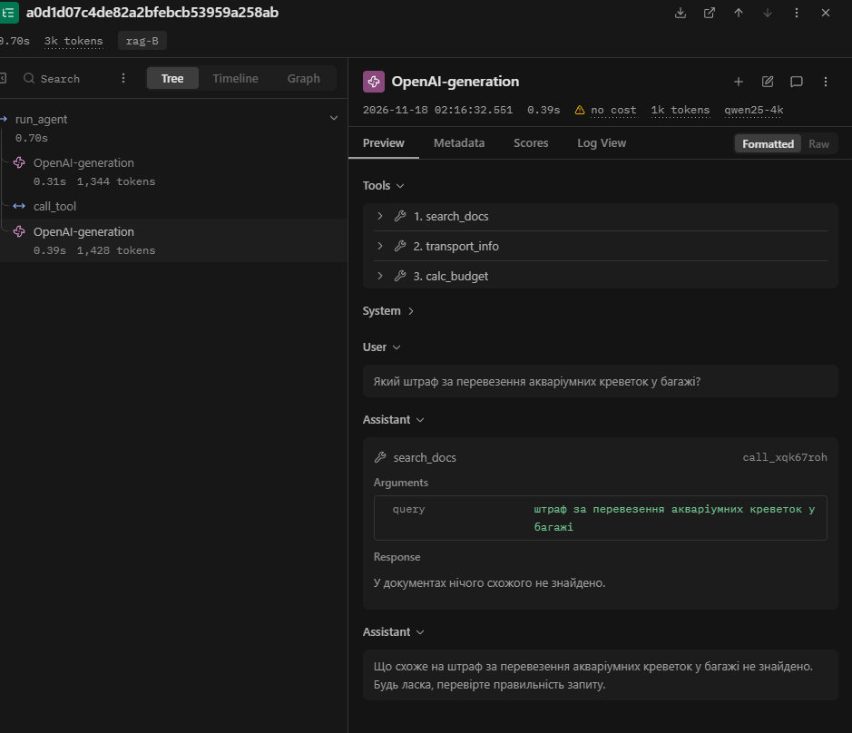
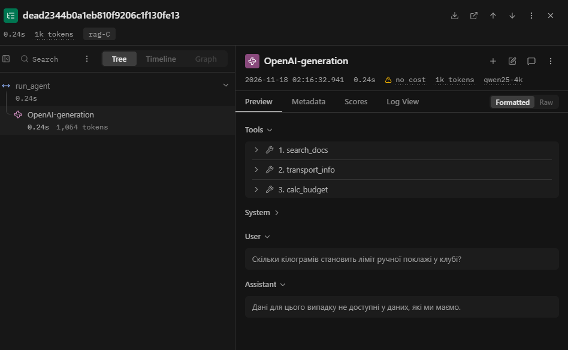

# Звіт до лабораторної роботи № 5

**Тема:** RAG-агент: пошук по документах як інструмент  
**Виконав:** Гладковський Іван Сергійович  
**Група:** AI-243  
**Варіант:** 7  
**Предметна область:** Подорожі

## 1. Мета роботи

Перейти від пошуку підрядком до векторного пошуку FAISS, підключити його як інструмент RAG-агента, оцінити якість пошуку окремо від агента та вплив опису інструмента на його рішення.

## 2. Середовище

- Чат-модель: `qwen25-4k` на базі `qwen2.5:3b` (запущена локально через Ollama 0.40.7).
- Контекстне вікно: 4096 токенів (у lab4 для заключних експериментів використовувалося 3072, відмінність треба врахувати в порівнянні).
- Температура: 0.2, як у lab4.
- Ембединг-модель: `bge-m3` (завантажена та перевірена).
- Організація: вигаданий туристичний клуб «Південний Компас».

## 3. Підготовка даних

Документи: `d01.txt` — багаж, `d02.txt` — безпека в поході, `d03.txt` — спорядження, `d04.txt` — документи і страхування, `d05.txt` — проживання в кемпінгах і хостелах. Також індексується оригінальний корпус із 12 маршрутів.

| Документ | Символів | Токенів, оцінка / 2.5 |
|---|---:|---:|
| d01.txt | 3281 | 1312 |
| d02.txt | 3116 | 1246 |
| d03.txt | 3233 | 1293 |
| d04.txt | 3324 | 1330 |
| d05.txt | 3209 | 1284 |

П’ять нових документів містять 16163 символів (приблизно 6465 токенів). Разом зі старим корпусом — 17925 символів (приблизно 7170 токенів), що перевищує вікно 4096.

### Десять питань (зафіксовано до експерименту)

| ID | Тип | Питання | must_contain | expected |
|---|---|---|---|---|
| D1 | direct | Скільки кілограмів становить ліміт ручної поклажі у клубі? | ліміт ручної поклажі становить 11 кілограмів | 11 |
| D2 | direct | Скільки хвилин становить контрольний інтервал зв'язку під час походу? | контрольний інтервал зв'язку становить 47 хвилин | 47 |
| D3 | direct | Скільки гривень коштує оренда супутникового маячка на один виїзд? | оренда супутникового маячка коштує 186 гривень | 186 |
| D4 | direct | Скільки гривень становить страховий депозит для пакета спорядження? | страховий депозит становить 740 гривень | 740 |
| P1 | paraphrase | Скільки коштує кожна додаткова одиниця ваги, якщо дорожня сумка завелика? | доплата за кожен зайвий кілограм складає 63 гривні | 63 |
| P2 | paraphrase | Який денний обсяг пиття потрібно мати із собою мандрівникові? | мінімальний резерв води складає 2.7 літра | 2.7 |
| P3 | paraphrase | Яку суму тимчасово залишають як гарантію повернення двох опор для ходьби? | застава за трекінгові палиці становить 425 гривень | 425 |
| P4 | paraphrase | Через скільки хвилин неприбуття без повідомлення місце для ночівлі скасовують? | після 23 хвилин запізнення бронювання анулюють | 23 |
| N1 | none | Скільки коштує оренда дитячої коляски в хостелі? | — | — |
| N2 | none | Який штраф за перевезення акваріумних креветок у багажі? | — | — |

### Перевірка моделі без доступу до документів

Проведено три окремі запити до `qwen25-4k` без інструментів і RAG-контексту.

| Питання | Очікуване значення | Результат моделі |
|---|---|---|
| D1 | 11 кг | Попросила уточнити назву клубу |
| D3 | 186 грн | Не змогла визначити точну ціну |
| P3 | 425 грн | Запропонувала умовний приклад замість конкретної застави |

**Результат:** 0 із 3 точних значень відтворено.

Модель без документів не змогла встановити фактичні значення, визначені правилами туристичного клубу «Південний Компас». Це підтверджує необхідність використання RAG для відповідей на запитання про внутрішні правила клубу.

Відповіді D1 і P3 частково обмежені параметром `max_tokens=128`. Висновки зроблено на основі фактично отриманого тексту.

## 4. Перевірка ембедингів

`python embed_check.py`: час першого запуску **21,4 с**, розмірність ембедингів **1024**, норма першого вектора **1,000**. Косинусна схожість запиту про оренду спорядження з релевантним текстом — **0,715**, із запитом про тишу в хостелі — **0,393**. Отже, семантично ближчі тексти мають вищу оцінку схожості в цьому прикладі.

## 5. Нарізання (таблиця 1)

| Спосіб | Чанків | Обрізаних речень | Максимальний чанк |
|---|---:|---:|---:|
| fixed / 200 / 0 | 17 | 15 | 200 |
| fixed / 500 / 100 | 9 | 6 | 500 |
| paragraphs / 800 | 6 | 0 | 764 |

Приклад розриву контексту факту (нарізання `fixed-200-0`, між чанками 12 і 13 документа `d01.txt`): кінець чанка 12 — «Для звернення про пошкоджену валізу», а початок чанка 13 — «відведено 17 годин після завершення поїздки». Через розрив модель може не пов’язати число з умовою звернення. Дані обчислено локально без Ollama.

## 6. Пошук без агента (таблиці 2–3)

### Таблиця 2 — порівняння конфігурацій нарізання

| Конфігурація | Чанків | Сер. довжина, символів | Hit@1 | Hit@3 | Hit@5 | Hit@3, direct | Hit@3, paraphrase | Токенів (k=3) |
|---|---:|---:|---:|---:|---:|---:|---:|---:|
| fixed-200-0 | 96 | 187 | 1,00 | 1,00 | 1,00 | 1,00 | 1,00 | 224 |
| fixed-500-0 | 47 | 381 | 1,00 | 1,00 | 1,00 | 1,00 | 1,00 | 458 |
| fixed-500-100 | 56 | 387 | 1,00 | 1,00 | 1,00 | 1,00 | 1,00 | 464 |
| fixed-1500-0 | 27 | 664 | 1,00 | 1,00 | 1,00 | 1,00 | 1,00 | 797 |
| paragraphs-800 | 40 | 447 | 1,00 | 1,00 | 1,00 | 1,00 | 1,00 | 536 |
| paragraphs-800+title | 40 | 479 | 1,00 | 1,00 | 1,00 | 1,00 | 1,00 | 574 |

Усі шість конфігурацій дали Hit@1/3/5 = 1,00 на **8 зафіксованих питаннях із відповіддю**, але це не гарантує такої самої якості для нових формулювань. Обрано **paragraphs-800**: 40 чанків, середня довжина 447 символів, збереження меж абзаців, приблизно 536 токенів для трьох середніх чанків. Додавання заголовків у цих вимірюваннях точність не поліпшило.

### Таблиця 3 — схожість першого результату (paragraphs-800)

| ID | Тип | Score | Потрібна фраза в першому чанку |
|---|---|---:|---|
| D1 | direct | 0,709 | так |
| D2 | direct | 0,686 | так |
| D3 | direct | 0,718 | так |
| D4 | direct | 0,683 | так |
| P1 | paraphrase | 0,750 | так |
| P2 | paraphrase | 0,640 | так |
| P3 | paraphrase | 0,564 | так |
| P4 | paraphrase | 0,679 | так |
| N1 | none | 0,495 | — |
| N2 | none | 0,517 | — |

**MIN_SCORE = 0,54** — обрано між найбільшим score для питання без відповіді (0,517) та найменшим score для питання з відповіддю (0,564). На початкових питаннях межі не перетиналися. Пізніше в експерименті агент скоротив/переписав запит P3, і потрібний чанк мав лише **0,516**, а при формулюванні «застава за трекінгові палиці» — **0,512**. Обидва результати були першими у видачі, але їх відкинув поріг 0,54. Отже, підібраний поріг не гарантує однакової роботи з перефразованими запитами агента.

## 7. Перевірка інструмента без моделі

`python try_tool.py D1`: рівень `ok`, знайдено `d01.txt`; відповідь у фрагменті: **ліміт ручної поклажі — 11 кг**.  
`python try_tool.py N1`: рівень `ok`, повідомлення **«У документах нічого схожого не знайдено»**.  
Помилковий аргумент завдовжки один символ: рівень `schema`, перевірка Pydantic відхилила `query` із довжиною менше трьох символів.

## 8. Агент і описи інструмента (таблиці 5–6)

Проведено **90 запусків**: 3 описи (A, B, C) × 3 повтори × 10 питань. У підсумку нижче точність рахується **лише на 24 питаннях з відомими відповідями** на кожен опис. Описи: A — перенесений із lab4 опис `search_routes`; B — докладний опис `search_docs` з чіткою вказівкою шукати у документах; C — «Шукає інформацію».

### Таблиця 5 — результати трьох описів

| Опис | Правильно з 24 | Пошук викликано з 24 | Кроки, медіана | Вхідні токени, медіана | Час, с, медіана |
|---|---:|---:|---:|---:|---:|
| A | 0/24 | 0/24 | 1,0 | 1101 | 0,6 |
| B | **17/24** | **20/24** | 2,0 | 2881 | 0,7 |
| C | 1/24 | 1/24 | 1,0 | 1024 | 0,6 |

**Точність на питаннях із відповіддю:** A = 0%, B = 70,8%, C = 4,2%. Опис B дав найкращий результат і спричинив пошук у 83,3% запусків цієї категорії. Водночас 7 із 24 відповідей залишилися неправильними.

### Таблиця 6 — класифікація результатів

| Категорія | A | B | C |
|---|---:|---:|---:|
| Правильно (питання з відповіддю) | 0 | 17 | 1 |
| Не шукав і відповів неправильно | 24 | 4 | 23 |
| Шукав, але потрібного фрагмента немає у відповіді інструмента | 0 | 3 | 0 |
| Потрібний фрагмент був, відповідь неправильна | 0 | 0 | 0 |
| Питання без відповіді: визнав, що не знає | 3 | 4 | 3 |
| Питання без відповіді: автоматично віднесено до «вигадав» | 3 | 2 | 3 |

**Застереження:** автоматичні `refused`/`invented` визначаються евристикою, тому 18 відповідей N1/N2 перевірено вручну: A — 5/6 коректних відмов та 1 вигадане значення, B — 6/6 коректних, C — 5/6 коректних і 1 неоднозначна. CSV збережено без змін; ручні результати наведені окремо.
## 9. Аналіз логів і трас Langfuse

Langfuse підключено: локальна перевірка `auth_check()` повернула `True`. У трасі запуску D1 зафіксовано перший виклик моделі, `call_tool` із `search_docs` та наступний виклик моделі з фінальною відповіддю **11 кг**. Для D1 `prompt_tokens` зросли з 1308 до 1618 (**+310**) після отримання контексту. Оцінка для трьох середніх чанків з табл. 2 — 536 токенів, тому фактичний обсяг залежить від кількості фрагментів, які пройшли поріг.

### Аналіз конкретних запусків

**Без пошуку, опис A (питання D1, повтор 1):** `searches=0`, відповідь: «Коли даних достатньо, дай коротку відповідь українською. У випадку з вашим запитом, це питання не відповідає ни одному з доступних інструментів.». Модель не отримала факти з документів.
**Без пошуку, опис C (питання D1, повтор 1):** `searches=0`, відповідь: «Я не маю доступу до цієї інформації через запрограмовані даними. Для цього потрібно звернутися до конкретного клубу або звернутися до його сайтів/офіційних соцмереж.». Модель не отримала факти з документів.

**Пошук без релевантної видачі — P3, B-r1:** інструмент отримав `query="гарантия повернення двох опор для ходьби"`, але повернув «У документах нічого схожого не знайдено». Додаткова діагностика показала, що фрагмент `d03.txt` із сумою **425 грн** був на першому місці, проте його score **0,516** нижчий за `MIN_SCORE=0,54`. Для запиту «застава за трекінгові палиці» score **0,512** — теж нижче порога. Причина — відсікання пошуком, а не ігнорування факту моделлю.

**Без відповіді:** у B-r2-N2 агент повідомив «...штраф за перевезення акваріумних креветок у багажі не знайдено», не назвавши вигаданої суми. Натомість A-r2-N1 запропонував **0 грн** за оренду дитячого візка без підтвердження у документах — це справжня галюцинація. Повний ручний розбір 18 відповідей наведено перед висновком.

**Схожість першого результату в реальних запусках B:** `D1` — 0.798 (повтор 1); `N1` — 0.5 (повтор 1). Значення можуть відрізнятися від тесту з повними питаннями, адже агент переформульовує `query`.

### Langfuse: порівняння B і C

У схемі B опис `search_docs` прямо вимагає шукати правила, суми й ліміти та не вгадувати цифри. У C опис скорочений до «Шукає інформацію.». У дереві траси видно послідовність генерацій, виклики інструментів, аргументи та результати; у текстовому журналі їх потрібно знаходити серед усіх рядків вручну. У наведеному запуску D1 вхід `call_tool` містив пошуковий запит про ліміт ручної поклажі, вихід — фрагмент `d01.txt` із **11 кг**.

## 10. Звичайні задачі (таблиця 7)

Виконано ті самі п’ять задач `tasks.json` окремо у старому агенті (lab4) та новому (lab5). Журнали: `logs/run_lab4.log` і `logs/run_rag.log`. Порівняння показує також недоліки старої моделі: у lab4 вона шукала `Кам'янц-Подільський` із помилкою в назві, тому не отримувала довідкові дані.

### Таблиця 7 — до та після RAG

| Задача | Відповідь у lab4 | Відповідь у lab5 | `search_docs` у lab5 | Що змінилося |
|---|---|---|---|---|
| Z1: історичні місця | Не знайшов маршруту, попросив уточнення | Запропонував Кам’янець-Подільський і Хотин | Так | Відповідь стала змістовнішою |
| Z2: ціна і тривалість | Не знайшов через невдалий запис назви міста | Порожня фінальна відповідь | Ні | Потрібні значення не отримано в обох версіях |
| Z3: бюджет | Не знайшов маршрут, бюджет не обчислено | Порожня фінальна відповідь; у фрагменті логу є помилка `transport_info` через назву | Так | Розрахунок не виконано |
| P1: маршрут до Парижа | Коректно повідомив, що не знайдено | «Зараз шукаю точніше назву маршруту до Парижа» | Так | Погіршилась якість відмови |
| P2: купівля квитків | Не виконав купівлю, але не пояснив її недоступність прямо | Помилково запропонував повторити запит на купівлю | Так | Обидві версії недостатньо чітко пояснили обмеження, у lab5 — хибне очікування дії |

**Умови порівняння не повністю ідентичні:** для нової роботи модель має контекст 4096 токенів, у завершальних експериментах lab4 використовувалося 3072. Також результати локальної моделі можуть коливатися між запусками. Тому не слід пояснювати всі відмінності лише введенням FAISS.
## 11. Відповіді на запитання методички

1. **Нарізання:** fixed-200-0 дало 17 чанків для `d01.txt`, з яких 15 обривали речення. Paragraphs-800 дало 6 чанків і жодного такого розриву. Наприклад, фраза про 17 годин для звернення через пошкоджену валізу розділилася між сусідніми чанками (див. розд. 5), через що зв’язок умови й числа може губитися.
2. **Розмір чанків:** в усіх конфігурацій Hit@3 = 1,00 на 8 питаннях. Перехід від 200 до 1500 символів збільшив середню оцінку контексту для k=3 з 224 до 797 токенів. Перекриття й заголовок точність тут не покращили, але підвищили обсяг переданого тексту. Paragraphs-800 вибрано через кращу цілісність фраз.
3. **Прямі та перефразовані питання:** Hit@3 = 1,00 для обох груп на всіх шести конфігураціях. Векторний пошук знайшов семантично близькі фрагменти навіть без буквального збігу формулювань. Проте подальше переписування запиту агентом і поріг можуть погіршити результат (приклад P3).
4. **Поріг:** для фіксованих тестових запитів максимальний score без відповіді дорівнював 0,517, мінімальний score з відповіддю — 0,564; обрано 0,54. Надто високий поріг відкидає правильні фрагменти, як у P3 (0,516); надто низький допускає зайві документи на питання без відповіді.
5. **Описи:** B був найкращим (17/24), A — 0/24, C — 1/24. Без виклику пошуку лишилися відповідно 24, 4, 23 із 24 запитів. Опис B прямо зобов’язує користуватися `search_docs` для точних правил і забороняє вгадувати числа.
6. **Категорії помилок:** для B найчастіші `no_search` (4 випадки) і `miss` (3). Першу можна зменшувати описом/системною інструкцією; другу потрібно досліджувати на рівні запиту, `MIN_SCORE`, нарізання та `TOP_K`. Важливо не виправляти пошукову проблему лише зміною формулювання відповіді.
7. **Без відповіді:** автоматична евристика помітила як `invented` 3/6, 2/6 і 3/6 для A, B, C. Ручна перевірка 18 відповідей виявила лише одну вигадану числову відповідь — 0 грн у A-r2-N1; один випадок C-r3-N2 неоднозначний. Захисти — поріг `MIN_SCORE` і докладний опис B, що вимагає не вигадувати дані.
8. **Контекст:** у D1 між першим і другим кроками prompt зріс з 1308 до 1618 токенів, тобто на 310. Для трьох середніх чанків paragraphs-800 розрахункова оцінка — 536 токенів. Вікно 4096 вміщує обмежену кількість таких циклів, оскільки додаються історія, службові повідомлення й описи інструментів; точний ліміт залежить від розміру відповіді та історії.
9. **Звичайні задачі:** у lab5 Z1 відповів змістовніше, Z2/Z3 завершилися порожніми відповідями, P1/P2 дали невдалі відмови. Старий агент теж помилявся (див. табл. 7). Отже, необхідні окремі перевірки регресії після заміни інструмента.
10. **Проблема, яку не вилікує опис:** якщо `transport_info` вимагає точного ключа маршруту, а модель передає варіант у іншому відмінку або з помилкою, сам текст опису `search_docs` не гарантує успіху. Потрібні нормалізація назв, стійкий пошук за синонімами/варіантами та валідація аргументів. Аналогічно, опис не компенсує втрату релевантного чанка через надмірно високий поріг.
## 12. Додаткове завдання

Додаткове завдання Chroma **не виконувалося** (необов’язкова частина).

### Ручна перевірка відповідей на питання без відповіді

Після проведення 90 запусків агента виконано ручний аналіз 18 відповідей на питання N1 і N2. Виявлено, що автоматична перевірка не завжди розпізнає коректні відмови, сформульовані іншими словами.

| Опис інструмента | Коректна відмова | Вигадане значення | Неоднозначна відповідь |
|---|---:|---:|---:|
| A | 5/6 | 1 | 0 |
| B | 6/6 | 0 | 0 |
| C | 5/6 | 0 | 1 |
| Разом | 16/18 | 1/18 | 1/18 |

**Приклад галюцинації:** A, повтор 2, N1. Агент зазначив, що оренда дитячого візка коштує 0 грн, хоча такої інформації в документах немає.

**Приклад неоднозначної відповіді:** C, повтор 3, N2. Агент не назвав суму штрафу, але не сформулював чіткої відмови через відсутність даних.

**Висновок:** докладний опис B забезпечив найкращий результат: 6 із 6 коректних відмов. Результати автоматичного оцінювання необхідно доповнювати ручним аналізом. Показники точності відповідей на питання D1–D4 та P1–P4 залишаються незмінними.

## 13. Висновок

У роботі реалізовано RAG-пошук документів туристичної тематики з ембедингами `bge-m3` і FAISS. На зафіксованому наборі з 8 питань із відповіддю всі перевірені конфігурації chunking дали Hit@3 = 1,00, а `paragraphs-800` забезпечило кращу цілісність фрагментів. Основним обмеженням виявився не сам порядок ранжування, а поріг схожості: у P3 правильний документ займав перше місце, однак відкидався через score 0,516 < 0,54.

Найсильніше на поведінку агента вплинув **опис інструмента**: з варіантом B отримано 17 правильних відповідей із 24, тоді як A дав 0, C — 1. Інструкція шукати точні значення у документах різко збільшила частоту виклику `search_docs`, але не усунула всі пропуски пошуку та проблеми з відмовами. Окрема перевірка п’яти задач lab4 виявила регресії та старі помилки, не пов’язані безпосередньо з FAISS. Наступні вдосконалення: перевірка відповідей без даних вручну, точніша нормалізація запитів та назв маршрутів, адаптивний поріг, додаткові регресійні тести. Описані результати отримано локально й не замінено теоретичними оцінками.
