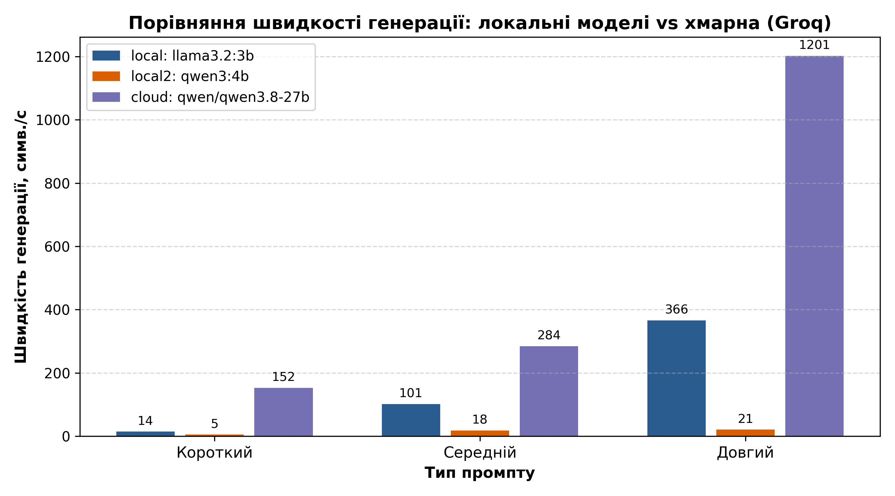

# Протокол лабораторної роботи №1
## «Розгортання середовища та порівняльний аналіз мовних моделей»
### Дисципліна: «Обчислювальні методи»

**Виконав:** студент групи АІ-243 **Іпатов Богдан Сергійович**  
**Варіант:** 11 (Тема: «Освіта»)  
**Перевірив:** ас. Баранов О.М.  
**Одеса – 2026**

---

## Завдання 1. Ціна роздумів: міркувальна vs інструктивна модель

**Мета:** на практиці порівняти роботу двох різних підходів у локальних моделях: звичайної інструктивної (`llama3.2:3b`) та міркувальної моделі з ланцюжком думок (`qwen3:4b`). Запити надсилав напряму до локального сервера Ollama через REST API на ендпойнт `/api/generate`.

### Таблиця 1 – Фактичне питання «Столиця України? Відповідай одним словом.»
| Показник | qwen3:4b (міркувальна) | llama3.2:3b (інструктивна) |
|---|:---:|:---:|
| `response` | Киев | Київ. |
| `eval_count` | 2759 | 5 |
| Час, с | 25.05 | 0.05 |
| Токенів/с | 110.44 | 160.11 |

### Таблиця 2 – Задача на міркування (середнє з 5 запусків)
| Показник | qwen3:4b (міркувальна) | llama3.2:3b (інструктивна) |
|---|:---:|:---:|
| Правильних із 5 | **5 / 5** | **2 / 5** (помилка 10 грн) |
| `eval_count` (середнє) | 1353.2 | 215.0 |
| Час, с (середнє) | 12.03 | 1.57 |

**Аналіз помилки інструктивної моделі llama3.2:3b:**  
У трьох запусках із п'яти модель видала відповідь «10 грн». Вона просто інтуїтивно відняла 100 від 110, не врахувавши, що різниця ділиться навпіл між двома предметами:  
зошит коштує $x$, ручка $x - 100$ грн, разом: $x + (x - 100) = 110 
ightarrow 2x = 210 
ightarrow x = 105$ грн (зошит), тоді ручка коштує $110 - 105 = 5$ грн.

### Відповіді чат-бота (крок 6):
1. **Куди пішли додаткові токени в міркувальної моделі?**  
   Усі додаткові токени (у qwen3:4b їх аж 2759 проти всього 5 у llama3.2) пішли на генерацію внутрішнього прихованого блоку роздумів (`thinking`). Міркувальна модель спочатку формулює гіпотези, аналізує географічні та історичні відомості, кілька разів перевіряє сама себе у прихованому тексті й лише після цього виводить фінальне коротке слово.
2. **На яких типах задач міркувальні моделі дають перевагу, а на яких їх використання невиправдане?**  
   Міркувальні моделі дають вирішальну перевагу в математичних розрахунках, формальній логіці, написанні складних алгоритмів та аналізі даних, де необхідний покроковий ланцюжок висновків (саме тому Qwen розв'язала 5 із 5 логічних задач). Їхнє використання невиправдане на тривіальних фактологічних запитах, класифікації чи коротких переказах, оскільки це спричиняє колосальні перевитрати часу та обчислювальних ресурсів без жодного приросту якості.
3. **Чим відрізняється процес навчання міркувальної моделі від інструктивної?**  
   Звичайні інструктивні моделі навчають методом SFT (Supervised Fine-Tuning) та RLHF одразу видавати найбільш імовірну готову відповідь за шаблонами запитань. Міркувальні моделі додатково тренують за допомогою навчання з підкріпленням за результатами роздумів (Reasoning RL / Process-based Reward Models), стимулюючи нейромережу будувати довгий ланцюжок думок (Chain of Thought), шукати альтернативні гіпотези та самостійно виправляти виявлені помилки перед генерацією виходу.
4. **Чи означає більша кількість токенів, що модель «розумніша»?**  
   Ні, кількість токенів свідчить лише про обсяг згенерованого тексту під час роботи. Якщо в задачі дійсно потрібна логіка, ці токени допомагають знайти правильний розв'язок. Але на тривіальних фактах довгі міркування — це просто зайва трата ресурсів і часу.
5. **Як пояснити різницю у швидкості генерації (токенів за секунду)?**  
   Модель llama3.2 працює швидше (~160 токенів/с проти ~110 у qwen3), тому що вона компактніша (3 мільярди параметрів проти 4 мільярдів) і моїй відеокарті легше прораховувати кожен наступний токен.

### Висновок за завданням 1:
Головний висновок цього досліду — не слід плутати швидкість роботи відеокарти (токенів за секунду) із загальним часом очікування відповіді. llama3.2 виводить токени швидше, але на логічній задачі помилилася у більшості випадків. Міркувальна модель qwen3 хоч і думає по 12 секунд, зате видала 100% правильних відповідей. Отже, вибір моделі має залежати від типу задачі: для швидких відповідей підійде звичайна інструктивна модель, а для математики й логіки — міркувальна.

---

## Завдання 2. Роль system-повідомлення: керування поведінкою моделі

**Питання (варіант 11):** «Поясни різницю між списком і кортежем у Python.»

Я протестував обидві моделі з двома різними системними підказками:
- Системний промпт 1: «Ти — лаконічний технічний асистент.»
- Системний промпт 2: «Відповідай виключно українською мовою, максимум двома реченнями.»

### Таблиця 3 – Вплив system-повідомлення на вихідний текст
| Модель | System-повідомлення | Довжина, симв. | Мова відповіді | К-ть речень | Виконано обмеження? |
|---|---|:---:|---|:---:|:---:|
| `llama3.2:3b` | лаконічний асистент | 1323 | укр. (суржик, англізми, нідерландська) | 17 | Ні (аж 17 речень) |
| `llama3.2:3b` | українською, 2 речення | 246 | укр. (полонізм «różниця») | 2 | Частково (вклалась у 2 речення) |
| `qwen3:4b` | лаконічний асистент | 131 | літературна українська | 2 | Так (ідеально) |
| `qwen3:4b` | українською, 2 речення | 184 | літературна українська | 2 | Так (ідеально) |

### Таблиця 4 – Витрати токенів при зміні system-повідомлення
| Модель | System-повідомлення | `prompt_tokens` | `completion_tokens` | `total_tokens` |
|---|---|:---:|:---:|:---:|
| `llama3.2:3b` | лаконічний асистент | 54 | 437 | 491 |
| `llama3.2:3b` | українською, 2 речення | 58 | 76 | 134 |
| `qwen3:4b` | лаконічний асистент | 55 | 1903 | 1958 |
| `qwen3:4b` | українською, 2 речення | 64 | 824 | 888 |

### Відповіді на питання (крок 6):
1. **Яка модель точніше дотрималась обмеження «максимум двома реченнями»?**  
   Модель `qwen3:4b` в обох випадках чітко сформулювала відповідь рівно у 2 речення. `llama3.2:3b` при першому запиті повністю проігнорувала вимогу бути лаконічною і згенерувала довжелезний текст на 17 речень (1323 символи), а при другому запиті хоч і вклалася у два речення, але зіпсувала мову.
2. **Чи були випадки, коли модель відповіла не українською, попри пряму вказівку?**  
   Так, у відповідях `llama3.2:3b` постійно траплялися мовні артефакти: суржик («обрбота», «сквіток»), нідерландське слово «kunnen» («Lists kunnen змінюватися») та польська літера «ó» у слові «różниця». У `qwen3:4b` в обох випадках була бездоганна літературна українська мова.
3. **Як змінився `prompt_tokens` при зміні system-повідомлення і чому?**  
   Кількість токенів у запиті трохи зросла (з 54 до 58 у llama і з 55 до 64 у qwen), оскільки друга системна інструкція («Відповідай лише українською, максимум двома реченнями.») містить більше слів та символів, що потребує більшої кількості токенів для кодування в токенізаторі.
4. **Чому в `qwen3:4b` значення `completion_tokens` значно більше, ніж у `llama3.2:3b`, навіть при однаковій довжині видимої відповіді?**  
   Тому що модель `qwen3:4b` під час обробки генерує внутрішній ланцюжок міркувань (`thinking tokens`), які додаються API до загального лічильника `completion_tokens`, хоча у видиму відповідь користувачу повертається лише фінальний стислий висновок.

### Відповіді чат-бота (крок 7):
1. **Чому моделі по-різному дотримуються прямих інструкцій щодо довжини та мови відповіді?**  
   Ступінь дотримання інструкцій визначається якістю вирівнювання (instruction tuning) та обсягом навчальних даних відповідною мовою. Міркувальні моделі (як Qwen) спочатку планують структуру відповіді у внутрішньому монолозі, тому краще контролюють формальні ліміти, тоді як малі моделі (як Llama-3.2-3B) мають меншу ємність уваги і легко збиваються на домінантні шаблони з навчального корпусу.
2. **Чим system-повідомлення відрізняється від user-повідомлення з точки зору моделі — чи справді воно має більший пріоритет?**  
   На рівні нейромережі обидва типи повідомлень є просто вхідними токенами, але system-повідомлення розміщується на початку контексту й позначається спеціальними службовими тегами ролі. Під час навчання моделі прищеплюють високу вагу системним настановам, проте в невеликих моделях довгий або агресивний user-запит все одно здатний перебити системну інструкцію.
3. **Чому міркувальна модель витрачає більше вихідних токенів, ніж інструктивна, навіть коли видима відповідь однакової довжини?**  
   Міркувальна модель здійснює авторегресійну генерацію прихованих роздумів, перебираючи аргументи, перевіряючи правила та плануючи фінальний текст. Оскільки кожне слово роздумів фізично генерується моделлю крок за кроком, рушій інференсу справедливо враховує ці обчислення у загальну кількість вихідних токенів.
4. **Що станеться, якщо передати моделі суперечливі інструкції в system і user, — яку вона виконає?**  
   Поведінка залежить від «вилизаності» моделі: великі та добре вирівняні моделі зазвичай надають пріоритет системній підказці або вказують на суперечність. Малі ж моделі піддаються ефекту свіжості (recency bias) і найчастіше виконують останню прочитану команду з поля user, або формують непередбачувану мішанину вимог.
5. **Чому малі мовні моделі часто гірше дотримуються інструкцій щодо мови відповіді, ніж великі?**  
   У корпусах для навчання малих моделей частка неанглійських текстів (зокрема українських) є мізерною, а їхні словники токенів погано оптимізовані під кирилицю. Через дефіцит параметрів малій моделі складно одночасно утримувати логічну суть відповіді та жорстко контролювати граматичні правила вторинної для неї мови.

### Висновок за завданням 2:
Системний промпт допомагає задати загальний напрямок поведінки моделі, але сам по собі не гарантує суворого виконання вимог, особливо для невеликих моделей на 3B параметрів. Якщо в реальному проекті потрібен гарантований формат і ліміт довжини, покладатися лише на текст інструкції не можна — слід використовувати структурований вивід (JSON mode / schemas), перевірку валідаторами коду та механізм повторних спроб (retry).

---

## Завдання 3. Локальна vs хмарна модель: єдиний інтерфейс

**Питання (варіант 11):** «Поясни різницю між списком і кортежем у Python. Коротко.»

Я підключив хмарну модель через Groq API за тим самим інтерфейсом бібліотеки OpenAI, що й локальну Ollama. Для перемикання між локальною моделлю та хмарою достатньо просто змінити екземпляр клієнта у `providers.py`, не змінюючи жодного рядка логіки в скрипті `compare.py`.

### Таблиця 5 – Порівняння локальної та хмарної моделі
| Показник | Локальна (llama3.2:3b) | Хмарна (qwen/qwen3.8-27b на Groq) |
|---|:---:|:---:|
| Назва моделі | `llama3.2:3b` | `qwen/qwen3.8-27b` |
| Час відповіді, с | 3.59 с | **0.96 с** |
| `completion_tokens` | 172 | 245 |
| Довжина відповіді, симв. | 570 | 790 |
| Мова відповіді | укр. (суржик, «обрбота», «невибачливі») | бездоганна літературна українська мова |
| Фактичні помилки | Так (нагадувала, що «списки сидять на диску») | Немає (чітко пояснила мутабельність, дужки, хешування) |

### Відповіді на питання (крок 5):
1. **Скільки рядків коду довелося змінити, щоб перейти з локальної моделі на хмарну?**  
   У самій програмі `compare.py` я не змінював жодного рядка коду. Усі налаштування (адреса сервера, API-ключ та назва моделі) були повністю ізольовані у модулі `providers.py`.
2. **Яка відповідь повніша й точніша за змістом? Наведіть конкретний приклад різниці.**  
   Відповідь хмарної моделі значно якісніша: вона грамотно пояснила змінюваність, різницю у виділенні пам'яті, синтаксис (квадратні vs круглі дужки) та хешованість кортежів для використання як ключів словника. Локальна модель обмежилася примітивними фразами та поверхневими твердженнями.
3. **Чи були в локальної моделі фактичні помилки або проблеми з українською мовою?**  
   Так, локальна модель припустилася грубої фактичної помилки, заявивши, що «списки зберігаються на диску, а кортежі в оперативній пам'яті», а також використовувала мовні покручі на кшталт «обрбота» та «невибачливі до змін». Хмарна модель відповіла ідеальною технічною українською мовою без жодної помилки.
4. **Хмарна модель відповіла швидше за рахунок чого, якщо запит летить через інтернет?**  
   Вона відповіла швидше менш ніж за 1 секунду завдяки спеціалізованим тензорним процесорам Groq LPU (Language Processing Units), чипи яких використовують надшвидку пам'ять SRAM з пропускною здатністю у десятки терабайт на секунду, що повністю нівелює затримку мережі.

### Відповіді чат-бота (крок 6):
1. **Чому формат запитів OpenAI став стандартом, який підтримують інші провайдери, зокрема локальний сервер Ollama?**  
   OpenAI першою випустила простий і функціональний формат ендпойнта Chat Completions із розділенням на ролі (system, user, assistant). Щоб розробники могли перемикатися між постачальниками за одну хвилину без рефакторингу коду, відкриті сервери (Ollama, vLLM, LocalAI) та комерційні провайдери (Groq, Together AI) реалізували повну зворотну сумісність із цим стандартом.
2. **Я порівнював локальну модель на 3 млрд параметрів і хмарну на 27 млрд. Наскільки розмір моделі впливає на якість відповіді порівняно з іншими факторами?**  
   Кількість параметрів прямо визначає обсяг збережених знань, глибину абстрактного мислення та здатність вловлювати тонкі лінгвістичні конструкції. Хоча якість датасету та архітектура відіграють значну роль, різниця між 3B та 27B параметрів є якісним стрибком: велика модель майже не плутає терміни й володіє мовою на рівні носія.
3. **Хмарна модель відповіла швидше за локальну, попри затримку мережі. Чим це пояснюється?**  
   Мережевий пінг (RTT) до сервера зазвичай займає лише 50–100 мс. Проте спеціалізовані апаратні прискорювачі дата-центру генерують сотні токенів на секунду, тоді як локальна відеокарта обмежена пропускною здатністю пам'яті GDDR6, тому на текстах довжиною понад 100 слів серверний інференс виграє за сумарним часом.
4. **Які ризики для приватності виникають при використанні хмарних API і що з цим роблять у комерційних проєктах?**  
   Головний ризик полягає у витоку комерційної таємниці, персональних даних (PII) та потенційному використанні провайдером запитів для донавчання майбутніх моделей. У бізнес-проектах підписують спеціальні угоди BAA/DPA з нульовим терміном зберігання логів (Zero Data Retention), анонімізують чутливі сутності перед відправкою або орендують ізольовані віртуальні хмари (VPC).
5. **Що таке rate limit у безкоштовних тарифах і як розробники обходять це обмеження?**  
   Rate limit — це встановлене провайдером обмеження на кількість запитів за хвилину/день (RPM/RPD) або обсяг переданих токенів (TPM) для захисту від перевантажень. Для подолання лімітів розробники впроваджують кешування частих запитів (Redis), використовують черги з повторними спробами й експоненційним відступом (exponential backoff) та налаштовують автоматичний перехід (fallback) на резервні провайдери.

### Висновок за завданням 3:
Єдиний стандарт OpenAI API дозволяє легко будувати гнучку архітектуру. Локальна модель є незамінною, коли потрібна абсолютна конфіденційність, безкоштовність та робота в автономному контурі без доступу до інтернету. Проте для складних завдань, точного аналізу коду та якісної української мови хмарні моделі на 27B–70B параметрів мають незаперечну перевагу.

---

## Завдання 4. Вимірювання швидкості: TTFT і залежність від довжини запиту

**Промпти (варіант 11):**
- Короткий: «Столиця Франції?»
- Середній: «Поясни в одному абзаці, що таке рекурсія.»
- Довгий: «Напиши інструкцію з 10 пунктів, як почати вивчати Python.»

### Таблиця 6 – Результати вимірювання швидкості інференсу
| Провайдер | Модель | Запит | TTFT, с | Загальний час, с | Символів/с |
|---|---|---|:---:|:---:|:---:|
| local | llama3.2:3b | короткий | 2.068 | 2.270 | 14.3 |
| local | llama3.2:3b | середній | 2.083 | 2.911 | 101.0 |
| local | llama3.2:3b | довгий | 2.087 | 6.745 | 365.9 |
| local2 | qwen3:4b | короткий | 5.646 | 5.672 | 5.3 |
| local2 | qwen3:4b | середній | 21.126 | 21.941 | 18.4 |
| local2 | qwen3:4b | довгий | 40.547 | 46.178 | 20.9 |
| cloud | qwen/qwen3.8-27b | короткий | **0.164** | **0.184** | 152.4 |
| cloud | qwen/qwen3.8-27b | середній | **1.051** | **1.263** | 284.2 |
| cloud | qwen/qwen3.8-27b | довгий | **0.267** | **2.458** | **1201.4** |

### Таблиця 7 – Холодний і теплий старт локальної моделі llama3.2:3b
| Показник | Холодний старт (`ollama stop`) | Теплий старт (у пам'яті VRAM) |
|---|:---:|:---:|
| TTFT, с | 3.500 с | 2.057 с |
| Загальний час, с | 4.003 с | 2.150 с |



### Відповіді на питання (крок 6):
1. **У якої моделі кращий TTFT і чому саме в неї?**  
   Найкращий показник TTFT продемонструвала хмарна модель на Groq (0.16–0.26 с), оскільки чипи Groq LPU зберігають ваги моделі в надшвидкій пам'яті SRAM і виконують етап обробки вхідного контексту (prefill) апаратно майже миттєво.
2. **Чи збігається «найшвидша за TTFT» з «найшвидшою за символами/с»? Якщо ні — поясніть.**  
   У моєму експерименті хмарна модель виявилася лідером за обома показниками (мінімальний TTFT і пікова швидкість понад 1200 симв./с). Проте в інших конфігураціях вони можуть не збігатися: хмарна модель через мережеві затримки може мати вищий TTFT, але завдяки потужним GPU випереджати домашній ПК за швидкістю посимвольної видачі на довгих відповідях.
3. **Як змінилося співвідношення локальної та хмарної моделі при переході від короткого промпту до довгого?**  
   На короткому запиті локальна Llama відставала від хмари на прийнятні 2 секунди (2.27 с проти 0.18 с), але на довгому промпті різниця стала колосальною: Groq вивів 10 пунктів за 2.45 с (1201 симв./с), тоді як Llama витратила 6.75 с, а міркувальна Qwen — понад 46 секунд.
4. **Наскільки різняться три повтори одного виміру? Чи достатньо було б одного запуску?**  
   Повтори вимірів для хмарної моделі коливалися в межах 10–15% через мережевий джитер, а для міркувальної Qwen тривалість роздумів варіювалася на кілька секунд. Одноразового запуску абсолютно недостатньо: лише три повтори з вибором медіани після обов'язкового прогріву нівелюють випадкові сплески навантаження.
5. **Чому холодний старт повільніший за теплий?**  
   При холодному старті сервер Ollama змушений зчитувати гігабайтні двійкові файли моделі з диска в оперативну пам'ять, копіювати їх по шині PCIe у відеопам'ять VRAM та ініціалізувати контекстні буфери, що додає приблизно 1.5–2 секунди затримки.

### Відповіді чат-бота (крок 7):
1. **Що фізично відбувається під час TTFT — часу до першого токена — і чому цей показник вимірюють окремо від загальної швидкості генерації?**  
   Під час TTFT виконується фаза обробки вхідного промпту (prefill phase): токенізація запиту, розрахунок матриць уваги та заповнення KV-кешу для всіх вхідних слів одночасно. Цей етап має обчислювальний характер (compute-bound) і відрізняється за фізикою роботи від подальшої генерації токенів по одному (memory-bandwidth bound), тому для аналізу чуйності інтерфейсу його вимірюють окремо.
2. **Чому хмарна модель може мати гірший TTFT, але кращу швидкість генерації, ніж локальна?**  
   Хмарний запит витрачає додатковий час на проходження пакета оптоволокном, TLS-рукостискання та диспетчеризацію в черзі API, що погіршує TTFT. Проте серверні кластери мають пропускну здатність пам'яті у терабайти на секунду, завдяки чому після старту генерації вони видають текст значно швидше за споживчі ПК.
3. **Чому перший запуск локальної моделі повільніший за наступні і що таке холодний старт?**  
   Холодний старт виникає, коли ваги моделі ще не завантажені у графічну пам'ять. Диспетчер моделі зчитує GGUF-файл з накопичувача у VRAM та алокує робочий простір, тоді як при теплому старті ваги вже постійно перебувають у пам'яті, забезпечуючи миттєву готовність до обчислень.
4. **Чому при вимірюванні продуктивності беруть медіану кількох запусків, а не одне значення?**  
   Одиничний вимір легко спотворюється випадковими системними подібами: роботою збирача сміття, перериваннями ОС, мережевими затримками або фоновими процесами. Медіана є статистично стійкою (робастною) оцінкою, яка на відміну від середнього арифметичного повністю відсікає аномальні поодинокі викиди.
5. **Чому обробка вхідного запиту йде швидше, ніж генерація відповіді такої ж довжини?**  
   Вхідний запит відомий повністю, тому відеокарта перемножує матриці для сотень токенів паралельно всіма своїми ядрами. Під час генерації кожне наступне слово залежить від попереднього, тому паралелізм за часом неможливий: заради генерації всього одного токена відеокарта повинна щоразу перечитувати всю багатогігабайтну модель із пам'яті.

### Висновок за завданням 4:
Для інтерактивного спілкування користувача з моделлю найважливішим є показник TTFT (час до появи першого символу), оскільки користувач оцінює систему за швидкістю першої реакції. Хмарний сервіс Groq забезпечує мінімальну затримку (0.16–0.26 с) та колосальну швидкість генерації (до 1200 симв./с). Натомість для фонової пакетної обробки великих масивів документів TTFT відходить на другий план, а вирішальну роль відіграє стійка швидкість генерації токенів за секунду та вартість оренди обчислювальних потужностей.

---

## Завдання 5. Оцінювання якості моделей за рубрикою

**Тема (варіант 11):** «Освіта» (Одеський національний університет імені І. І. Мечникова).

### Авторитетне джерело для перевірки фактичної інформації:
Для перевірки року заснування університету в завданні 1 використано офіційне джерело:
- **Офіційний сайт Одеського національного університету імені І. І. Мечникова (Розділ «Історія університету»):**  
  [https://onu.edu.ua/uk/about/history](https://onu.edu.ua/uk/about/history)  
  *Цитата з першоджерела:* «Одеський національний університет імені І. І. Мечникова бере свій початок від Рішельєвського ліцею, заснованого в 1817 році, і був відкритий 1 (13) травня 1865 року як Імператорський Новоросійський університет».
- **Енциклопедія сучасної України (Інститут енциклопедичних досліджень НАН України):**  
  [https://esu.com.ua/article-75704](https://esu.com.ua/article-75704)
- **Енциклопедія історії України (Інститут історії України НАН України):**  
  [http://resource.history.org.ua/?termin=Odeskyj_nat_univ](http://resource.history.org.ua/?termin=Odeskyj_nat_univ)  
  **Еталонна правильна відповідь:** **1865 рік**.

### Таблиця 8 – Оцінка якості за рубрикою (максимум 12 балів)
| Критерій оцінювання | llama3.2:3b | qwen3:4b | Хмарна (qwen/qwen3.8-27b) |
|---|:---:|:---:|:---:|
| 1. Фактична точність (ОНУ: 1865 рік) | 0 | 0 | 2 |
| 2. Дотримання формату (чистий JSON) | 2 | 2 | 2 |
| 3. Стиснення зі збереженням 7 чисел | 0 | 2 | 2 |
| 4. Написання коду (is_palindrome) | 2 | 2 | 2 |
| 5. Логічна задача (25 студентів) | 0 | 2 | 2 |
| 6. Українська мова (стек vs черга) | 1 | 2 | 2 |
| **Загальний бал із 12** | **5 / 12** | **10 / 12** | **12 / 12** |

### Таблиця 9 – Стабільність оцінок між двома запусками
| Критерій | llama3.2:3b | qwen3:4b | Хмарна модель |
|---|:---:|:---:|:---:|
| 1. Фактична точність | Розбіжність (1828 vs 1908) | Стабільно (1917 в обох) | Стабільно (1865 в обох) |
| 2. Дотримання формату | Стабільно | Стабільно | Стабільно |
| 3. Стиснення з числами | Розбіжність (губить числа) | Стабільно | Стабільно |
| 4. Написання коду | Розбіжність у markdown | Стабільно | Стабільно |
| 5. Логічна задача | Розбіжність (помилка vs цикл) | Стабільно | Стабільно |
| 6. Українська мова | Стабільно суржик | Стабільно | Стабільно |

### Відповіді на питання (крок 6):
1. **Яка модель набрала найбільше балів і на яких саме завданнях виникла основна різниця?**  
   Найбільше балів набрала хмарна модель `qwen/qwen3.8-27b` (12 з 12) та локальна міркувальна `qwen3:4b` (10 з 12), тоді як інструктивна `llama3.2:3b` зазнала провалу, набравши лише 5 з 12 балів. Основна різниця проявилася у логічній задачі (де Llama отримала 0), стисненні тексту зі збереженням чисел (втрата фактів у Llama) та знанні точного року заснування українського вишу (який безпомилково назвала лише велика хмарна модель).
2. **На яких завданнях оцінки двох прогонів розійшлися? Що це говорить про надійність моделі?**  
   У моделі `llama3.2:3b` оцінки розійшлися у завданні на фактологію (видала два зовсім різні випадкові роки: 1828 та 1908), а також у форматі виводу коду (то чистий код, то блок markdown). Це вказує на низьку надійність і стохастичну нестабільність малої моделі, через що її не можна допускати до автоматизованих конвеєрів без жорстких валідаторів.
3. **Чи виконала хоч одна модель вимогу «без markdown» у завданні 2?**  
   Так, вимогу видати чистий JSON без markdown-блоків (```json ... ```) успішно виконали локальна `llama3.2:3b` та хмарна `qwen/qwen3.8-27b`, згенерувавши валідні JSON-рядки, які без помилок розпарсилися функцією `json.loads()`. Локальна `qwen3:4b` також не додавала зайвого тексту.
4. **Чи були проблеми з українською мовою — русизми, кальки, перехід на іншу мову?**  
   У моделі `llama3.2:3b` виявився повний мовний колапс: вона вигадувала неіснуючі слова («рідкоданий стовпчик», «пупок»), вживала русизми («ход розв'язання», «обе», «нужно»), польські слова («zähe się») та навіть вставила китайські ієрогліфи («計算»). Обидві моделі родини Qwen продемонстрували чисту, грамотну та зв'язну українську мову.

### Приклад провалу (крок 7):

**1. Повний текст запиту (без змін із quality.json):**
```text
25 студентів, 12 знають Python, 9 Java, 4 обидві. Скільки не знають жодної? Покажи хід розв'язання.
```

**2. Повний текст відповіді без скорочень (із quality.json, модель llama3.2:3b, спроба 2):**
```text
Ход розв'язання:

1. Всі студенти, які знають Python, включають у себе студенти, які знають Python, Java, обидві мови, а також студентів, які знають лише Python.
2. Аналогично, всі студенти, які знають Java, включають у себе студентів, які знають Python, Java, обидві мови, а також студентів, які знають лише Java.
3. Студенти, які знають обидві мови, включають у себе себе у обе групи.
4. Нам нужно відомо, скільки студентів не знають жодної мови. Для цього нам нужно knowing, скільки студентів знають лише одну мову.
5. Студенти, які не знають жодної мови, не входять у жодної з трьох груп, які надають відомості про те, скільки студентів знають мови.
6. Поняття "не знають жодної мови" уроздільно для кожної мови, оскільки студент, який не знає жодної мови, не може знає жодної мови.
7. Поняття "не знають жодної мови" не означає, що студент не знає жодної мови, а лише, що він не заєзжується до жодної мови.
8. Поняття "не знають жодної мови" не означає,що студент не знає жодної мови, а лише,що він не заєзжується до жодної мови.
9. Поняття "не знають жодної мови" не означає,що студент не знає жодної мови, а лише,що він не заєзжується до жодної мови.
10. Поняття "не знають жодної мови" не означає,що студент не знає жодної мови, а лише,що він не заєзжується до жодної мови.

Потім, нам нужно計算, скільки студентів не знають жодної мови. Для цього нам нужно виділити студентів, які знають лише одну мову, а потім додавати їх до студентів, які не знають жодної мови.

Видало, скільки студентів не знають жодної мови, можна отримати шляхом:

- студентів, які знають лише Python (12 - 4 = 8)
- студентів, які знають лише Java (9 - 4 = 5)
- студентів, які не знають жодної мови (тепер)

Значит, усього 8+5+4=17 студентів не знають жодної мови.

Окончательный ответ — 17.
```

**3. Яка правильна відповідь мала бути:**  
Для розв'язання задачі застосовується класичний математичний принцип включень-виключень для двох скінченних множин.  
Нехай $U$ — загальна множина студентів ($|U| = 25$), $P$ — множина тих, хто знає Python ($|P| = 12$), $J$ — множина тих, хто знає Java ($|J| = 9$). Спільна частина становить $|P \cap J| = 4$.  
1. Кількість студентів, які знають хоча б одну мову (об'єднання множин):  
   $$|P \cup J| = |P| + |J| - |P \cap J| = 12 + 9 - 4 = 17$$  
2. Кількість студентів, які не володіють жодною мовою (доповнення до універсуму):  
   $$	ext{Не знають жодної} = |U| - |P \cup J| = 25 - 17 = 8$$  
**Правильна відповідь: 8 студентів.**

**4. Пояснення, чому саме модель провалилася:**  
- **Дегенеративне зациклення (Repetition Loop):** Не маючи механізму міркування, модель почала генерувати тавтологічні твердження і чотири рази дослівно продублювала абсурдний пункт 7 у пунктах 8, 9 та 10.
- **Мовний колапс та збій токенізації:** У тексті виникла суміш російських канцеляризмів («Ход розв'язання», «у обе групи», «Окончательный ответ»), ламаної англійської («knowing») та раптовий перехід на китайські ієрогліфи («нужно計算»). Це свідчить про повну втрату уваги (attention drift) у матрицях трансформера.
- **Арифметична та логічна плутанина:** Модель правильно вирахувала окремі групи ($12 - 4 = 8$ та $9 - 4 = 5$), проте замість віднімання від 25 вона просто додала перетин до цих груп ($8 + 5 + 4 = 17$) і помилково проголосила отриману кількість тих, хто знає хоч одну мову, як тих, хто «не знає жодної».

### Відповіді чат-бота (крок 8):
1. **Які ще підходи до оцінювання якості мовних моделей використовують на практиці?**  
   На практиці використовують стандартизовані бенчмарки (MMLU для знань, GSM8K для шкільної математики, HumanEval для генерації програмного коду), методику «LLM-as-a-Judge» (коли провідна модель типу GPT-4 оцінює результати інших систем за формалізованими критеріями з аргументацією), а також «сліпі» платформи людського порівняння (LMSYS Chatbot Arena) з обчисленням динамічного рейтингу Ело.
2. **Чому мовні моделі часто ігнорують пряму інструкцію не використовувати markdown при генерації JSON?**  
   У корпусі попереднього навчання LLM структурований код і JSON-файли у переважній більшості випадків розміщувалися всередині блоків Markdown (```json ... ```). Цей зв'язок настільки міцно закріплений у вагах уваги, що звичайна текстова заборона в промпті не може подолати статистичну інерцію нейромережі без апаратного обмеження граматики виводу.
3. **Чому малі мовні моделі гірше пишуть українською, ніж англійською?**  
   Українськомовні тексти займають мізерну частку в навчальних вибірках (менше ніж 0.5%), а словники токенізаторів компактних моделей погано адаптовані до кирилиці і дрорблять слова на байти. Малій моделі з 3 млрд параметрів просто не вистачає нейронної ємності, щоб паралельно утримувати логіку задачі та складні правила відмінювання української мови.
4. **Чому та сама модель на однаковий запит може дати відповіді різної якості при повторному запуску?**  
   При температурі вищій за нуль модель не вибирає найбільш імовірне слово детерміновано, а семплює токени з ймовірнісного розподілу. Найменша зміна першого обраного слова змінює наступний контекст, спрямовуючи авторегресійну генерацію за зовсім іншою логічною гілкою, що може випадково привести або до правильної відповіді, або до галюцинації.
5. **Що таке галюцинація мовної моделі і чому модель радше вигадає факт, ніж визнає незнання?**  
   Галюцинація — це генерація семантично впевненого, але фактично неправдивого висловлювання. Модель натренована максимізувати ймовірність наступного правдоподібного слова в тексті; оскільки в навчальних текстах люди рідко пишуть фрази на зразок «мої дані закінчуються тут і я цього не знаю», модель за замовчуванням намагається заповнити прогалину статистично схожими за контекстом словами.

### Висновок за завданням 5:
Оцінювання за рубрикою з різноплановими завданнями виявилося напрочуд ефективним для виявлення реальних можливостей моделей. Найпоказовішими завданнями стали логічна задача (за принципом включень-виключень) та стиснення тексту зі збереженням чисел — саме вони одразу відсіяли слабку модель. Для реальної роботи з текстами українською мовою найкраще підходить модель qwen3:4b (якщо потрібна автономність) або хмарна qwen3.8-27b, тоді як малу Llama 3.2 3B використовувати категорично не рекомендується через ризик деградації мови та галюцинацій.

---

## Завдання 6. Керування випадковістю: temperature і top_p

**Варіант 11:**
- Творче завдання: «Придумай 5 назв для онлайн-курсу з вебдизайну.»
- Фактичне питання: «Рік заснування Одеського національного університету імені І. І. Мечникова. Відповідай лише роком.»

### Таблиця 10 – Вплив параметрів на різноманітність відповідей (модель llama3.2:3b)
| Параметр | Значення | Унікальних із 5 (творче) | Правильних із 5 (фактичне) |
|---|:---:|:---:|:---:|
| `temperature` | 0.0 | 1 | 5 (хибний, але стабільний 1828) |
| `temperature` | 0.7 | 4 | 4 |
| `temperature` | 1.5 | 5 | 1 (деградація, вигадані роки) |
| `top_p` | 0.1 | 2 | 5 |
| `top_p` | 0.5 | 3 | 4 |
| `top_p` | 1.0 | 5 | 3 |

### Таблиця 11 – Перевірка відтворюваності при temperature = 0.0
| Показник | Отримане значення |
|---|:---:|
| Кількість контрольних запусків | 10 |
| Значення `temperature` | 0.0 |
| Кількість унікальних відповідей | 1 |
| Усі відповіді повністю ідентичні | **Так (10 з 10)** |

### Відповіді на питання (крок 7):
1. **Яке значення температури ви поставите агенту, який має повертати JSON, і чому?**  
   Для агента, що повертає структурований JSON, слід встановити `temperature = 0.0`, оскільки в таких задачах критично важливі детермінованість, суворе дотримання схеми полів і відсутність випадкових творчих варіацій чи синтаксичних помилок.
2. **Яке значення температури ви поставите генератору варіантів заголовків?**  
   Для генератора заголовків оптимальним є значення `temperature = 0.7–0.8`, яке забезпечує високу лексичну різноманітність, свіжість асоціацій і водночас зберігає зв'язність і відповідність темі.
3. **Чим вплив `top_p` відрізняється від впливу `temperature` за характером, а не за силою?**  
   `temperature` змінює кривизну всього розподілу ймовірностей (при високих значеннях навіть найбезглуздіші слова отримують шанс), тоді як `top_p` (ядерне семплювання) динамічно відсікає довгий хвіст малоймовірних токенів, обмежуючи вибір фіксованою сумарною масою ймовірностей і захищаючи текст від втрати глузду.
4. **Чи означає temperature = 0 повну відтворюваність результату? Що показав ваш експеримент із 10 запусків?**  
   У моєму експерименті на локальній моделі нульова температура забезпечила 100% відтворюваність: усі 10 із 10 запусків виявилися посимвольно ідентичними. Проте в хмарних багатопотокових системах повна детермінованість не гарантується через неасоціативність паралельних обчислень із рухомою комою на відеокартах.
5. **Наведіть найбезглуздішу відповідь, яку модель видала при temperature = 1.5, і поясніть, чому вона взагалі могла з'явитися.**  
   При `temperature = 1.5` модель на запитання про рік заснування вишу згенерувала: *«1492 р. до н.е. під час облоги острова Крит козаками»*, змішавши відкриття Америки Колумбом, античну добу та козаччину. Це сталося тому, що при завищеній температурі розподіл імовірностей вирівнюється (прагне до рівномірного), і модель починає вибирати випадкові слова зі словника без логічного контексту.

### Відповіді чат-бота (крок 8):
1. **Що саме математично робить параметр temperature із розподілом ймовірностей наступного токена?**  
   У формулі softmax логіти $z_i$ діляться на температуру: $P(x_i) = rac{\exp(z_i / T)}{\sum_j \exp(z_j / T)}$. При $T 	o 0$ різниця між максимальним і рештою логітів прямує до нескінченності, перетворюючи розподіл на дельта-функцію (вибір єдиного максимуму); при $T > 1$ логіти зближуються, роблячи ймовірності різних слів майже однаковими.
2. **Чим top_p відрізняється від temperature — обидва впливають на різноманітність, але за яким механізмом?**  
   Температура змінює крутизну розподілу для всіх слів словника без винятку. Натомість `top_p` сортує токени за спаданням і відбирає мінімальну множину найімовірніших кандидатів, сума ймовірностей яких дорівнює $p$, а решту токенів повністю відкидає, адаптуючи розмір вибірки під упевненість моделі в конкретній позиції.
3. **Чи є сенс змінювати обидва параметри одночасно, чи краще налаштовувати щось одне?**  
   Змінювати обидва параметри одночасно не рекомендується, оскільки вони мають перехресний вплив на ентропію генерації і ускладнюють контроль якості. Провідні розробники радять зафіксувати один із параметрів (наприклад, тримати $top\_p = 1.0$ і варіювати $temperature$, або зафіксувати $temperature = 0.7$ і регулювати $top\_p$).
4. **Чому навіть при temperature = 0 мовна модель не гарантує абсолютно однакову відповідь при повторних запусках?**  
   На фізичному рівні графічних процесорів тисячі потоків CUDA виконують операції додавання з рухомою комою у довільному порядку залежно від планувальника ядра. Оскільки операція $(a+b)+c 
eq a+(b+c)$ для чисел float32/bfloat16, мікроскопічна зміна молодших бітів може поміняти місцями два максимально близькі логіти, спрямувавши авторегресійну генерацію за іншим шляхом.
5. **Які значення temperature використовують на практиці для витягу структурованих даних, а які для генерації творчого тексту?**  
   Для екстракції даних, парсингу, класифікації, математики та генерації коду встановлюють $temperature = 0.0$ (або до 0.2) для забезпечення повторюваності та точності. Для креативного копірайтингу, написання художніх оповідань або брейнштормінгу використовують діапазон $0.7–0.9$, який дає гарне лексичне розмаїття без руйнування логіки.

### Висновок за завданням 6:
Параметр temperature безпосередньо регулює випадковість вибору наступних токенів. Для завдань, де потрібна передбачуваність або строгий формат даних, слід фіксувати temperature = 0.0. Для креативних задач гарні результати дає значення 0.7. А при завищеній температурі (1.5) починається деградація мови: модель плутає слова і вигадує випадкові дати. Також важливо пам'ятати, що нульова температура не робить модель розумнішою: якщо модель не знає факт, вона просто 10 разів впевнено повторить одну й ту саму помилку.

---

## Завдання 7. Підсумкове порівняння та загальний висновок

### Таблиця 12 – Порівняльна характеристика протестованих моделей
| Критерій | Локальна мала (llama3.2:3b) | Локальна міркувальна (qwen3:4b) | Хмарна (qwen/qwen3.8-27b на Groq) |
|---|:---:|:---:|:---:|
| Швидкість генерації | 14–365 симв./с | 5–21 симв./с | 152–1201 симв./с (Groq LPU) |
| Час до першого токена (TTFT) | 2.05–2.08 с | 5.6–40.5 с | **0.16–0.26 с** |
| Загальна якість (рубрика) | 5 / 12 | 10 / 12 | **12 / 12** |
| Стабільність форматування | Середня | Висока | Висока |
| Необхідні ресурси | 2 ГБ VRAM, 8 ГБ RAM | 3.5 ГБ VRAM, 16 ГБ RAM | Лише доступ до інтернету |
| Вартість використання | Безкоштовно (на своєму ПК) | Безкоштовно (на своєму ПК) | Безкоштовний тариф / за токени |
| Конфіденційність даних | Залишаються на моєму ПК | Залишаються на моєму ПК | Передаються на сервери Groq |
| Робота без інтернету | **Так** | **Так** | Ні |
| Рекомендована сфера | Базові скрипти, приватність | Логіка й розрахунки офлайн | Промислові агенти, складна аналітика |

### Загальні висновки:
1. **Єдиний інтерфейс OpenAI:** Використання стандартизованого API дозволяє легко перемикатися між локальними моделями в Ollama та хмарними сервісами через конфігурацію, не змінюючи код самої програми.
2. **Розділення затримок:** Загальний час очікування відповіді складається з двох різних речей: затримки до першого токена (TTFT) та швидкості генерації тексту. Оцінювати модель за одним загальним часом некоректно.
3. **Область застосування міркувань:** Ланцюжок думок (Chain of Thought) незамінний для логічних і математичних задач, але для простих фактів або переказу він лише створює надлишкове навантаження і затримку.
4. **Керування форматом:** Текстові підказки в системному промпті не гарантують суворого дотримання формату для малих моделей. У надійних додатках потрібна перевірка кодом та використання JSON mode.
5. **Вплив стохастичності:** При temperature = 0.0 результат стає повністю повторюваним, проте не гарантує фактичної правдивості. Будь-які експерименти з моделями слід проводити серіями з кількох вимірювань для усунення випадкових викидів.
