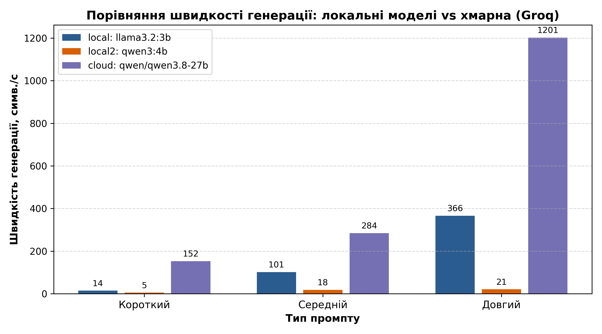

# Протокол лабораторної роботи №1
## «Розгортання середовища та порівняльний аналіз мовних моделей»
### Дисципліна: «Обчислювальні методи»

**Виконав:** студент групи АІ-243 **Іпатов Богдан Сергійович**  
**Варіант:** 11 (Тема: «Освіта»)  
**Перевірив:** ас. Баранов О.М.  
**Одеса – 2026**

---

## Завдання 1. Ціна роздумів: міркувальна vs інструктивна модель

**Мета:** на практиці порівняти роботу двох різних підходів у локальних моделях: звичайної інструктивної (`llama3.2:3b`) та міркувальної моделі з ланцюжком думок (`qwen3:4b`). Запити надсилав напряму до локального сервера Ollama через REST API на ендпойнт `/api/generate`.

### Таблиця 1 – Фактичне питання «Столиця України? Відповідай одним словом.»
| Показник | qwen3:4b (міркувальна) | llama3.2:3b (інструктивна) |
|---|:---:|:---:|
| `response` | Киев | Київ. |
| `eval_count` | 2759 | 5 |
| Час, с | 25.05 | 0.05 |
| Токенів/с | 110.44 | 160.11 |

### Таблиця 2 – Задача на міркування (середнє з 5 запусків)
| Показник | qwen3:4b (міркувальна) | llama3.2:3b (інструктивна) |
|---|:---:|:---:|
| Правильних із 5 | **5 / 5** | **2 / 5** (помилка 10 грн) |
| `eval_count` (середнє) | 1353.2 | 215.0 |
| Час, с (середнє) | 12.03 | 1.57 |

**Аналіз помилки інструктивної моделі llama3.2:3b:**  
У трьох запусках із п'яти модель видала відповідь «10 грн». Вона просто інтуїтивно відняла 100 від 110, не врахувавши, що різниця ділиться навпіл між двома предметами:  
зошит коштує x, ручка x + 100 грн, разом: x + (x + 100) = 110 → 2x = 10 → x = 5 грн.

### Відповіді на питання (крок 6):
1. **Куди пішли додаткові токени в міркувальної моделі?**  
   Усі додаткові токени (у qwen3:4b їх аж 2759 проти всього 5 у llama3.2) пішли на генерацію внутрішнього блоку роздумів. Модель подумки перебирала історичні факти про Київ, перевіряла географічний статус міста і кілька разів перепитувала сама себе, перш ніж вивести одне фінальне слово.
2. **На яких типах задач міркувальні моделі дають перевагу, а на яких їх використання невиправдане?**  
   Міркувальні моделі дають реальну перевагу там, де потрібно подумати в кілька послідовних кроків: у математиці, алгоритмах, написанні коду та логічних тестах. А для простих фактичних запитань або швидкого переказу тексту вони абсолютно невиправдані, бо змушують чекати у сотні разів довше без жодного виграшу в точності.
3. **Чим відрізняється процес навчання міркувальної моделі від інструктивної?**  
   Звичайні інструктивні моделі навчають одразу видавати готову відповідь за шаблонами запитань. Міркувальні моделі додатково тренують за допомогою навчання з підкріпленням (Reasoning RL), заохочуючи модель будувати логічний ланцюжок думок, шукати альтернативи та самостійно перевіряти проміжні результати.
4. **Чи означає більша кількість токенів, що модель «розумніша»?**  
   Ні, кількість токенів показує лише те, наскільки багато тексту модель згенерувала всередині. Якщо в задачі дійсно потрібна логіка, ці токени допомагають знайти правильний розв'язок. Але на тривіальних фактах довгі міркування — це просто зайва трата ресурсів і часу.
5. **Як пояснити різницю у швидкості генерації (токенів за секунду)?**  
   Модель llama3.2 працює швидше (~160 токенів/с проти ~110 у qwen3), тому що вона компактніша (3 мільярди параметрів проти 4 мільярдів) і моїй відеокарті легше прораховувати кожен наступний токен.

### Висновок за завданням 1:
Головний висновок цього досліду — не слід плутати швидкість роботи відеокарти (токенів за секунду) із загальним часом очікування відповіді. llama3.2 виводить токени швидше, але на логічній задачі помилилася у більшості випадків. Міркувальна модель qwen3 хоч і думає по 12 секунд, зате видала 100% правильних відповідей. Отже, вибір моделі має залежати від типу задачі: для швидких відповідей підійде звичайна інструктивна модель, а для математики й логіки — міркувальна.

---

## Завдання 2. Роль system-повідомлення: керування поведінкою моделі

**Питання (варіант 11):** «Поясни різницю між списком і кортежем у Python.»

Я протестував обидві моделі з двома різними системними підказками:
- Системний промпт 1: «Ти — лаконічний технічний асистент.»
- Системний промпт 2: «Відповідай виключно українською мовою, максимум двома реченнями.»

### Таблиця 3 – Вплив system-повідомлення на вихідний текст
| Модель | System-повідомлення | Довжина, симв. | Мова відповіді | К-ть речень | Виконано обмеження? |
|---|---|:---:|---|:---:|:---:|
| `llama3.2:3b` | лаконічний асистент | 1323 | укр. (суржик, англізми, нідерландська) | 17 | Ні (аж 17 речень) |
| `llama3.2:3b` | українською, 2 речення | 246 | укр. (полонізм «różниця») | 2 | Частково (вклалась у 2 речення) |
| `qwen3:4b` | лаконічний асистент | 131 | літературна українська | 2 | Так (ідеально) |
| `qwen3:4b` | українською, 2 речення | 184 | літературна українська | 2 | Так (ідеально) |

### Таблиця 4 – Витрати токенів при зміні system-повідомлення
| Модель | System-повідомлення | `prompt_tokens` | `completion_tokens` | `total_tokens` |
|---|---|:---:|:---:|:---:|
| `llama3.2:3b` | лаконічний асистент | 54 | 437 | 491 |
| `llama3.2:3b` | українською, 2 речення | 58 | 76 | 134 |
| `qwen3:4b` | лаконічний асистент | 55 | 1903 | 1958 |
| `qwen3:4b` | українською, 2 речення | 64 | 824 | 888 |

### Відповіді на питання (крок 6):
1. **Яка модель точніше дотрималась обмеження «максимум двома реченнями»?**  
   Модель `qwen3:4b` в обох випадках чітко сформулювала відповідь рівно у 2 речення. `llama3.2:3b` при першому запиті повністю проігнорувала вимогу бути лаконічною і згенерувала довжелезний текст на 17 речень (1323 символи).
2. **Чи були випадки, коли модель відповіла не українською?**  
   Так, у відповідях `llama3.2:3b` постійно траплялися мовні артефакти: суржик («обрбота», «сквіток»), нідерландське слово «kunnen» («Lists kunnen змінюватися») та польська літера «ó» у слові «różниця». У `qwen3:4b` мова була чистою українською.
3. **Як змінився `prompt_tokens` при зміні system-повідомлення?**  
   Кількість токенів у запиті трохи зросла (з 54 до 58 у llama і з 55 до 64 у qwen), оскільки друга системна інструкція довша за текстом.
4. **Чому в `qwen3:4b` значення `completion_tokens` значно більше?**  
   Тому що в загальну кількість токенів генерації API додає всі внутрішні токени блоку думок, хоча у фінальну відповідь користувачу виводиться лише короткий результат.

### Висновок за завданням 2:
Системний промпт допомагає задати поведінку моделі, але сам по собі не дає стовідсоткової гарантії, особливо для невеликих моделей. Якщо в реальному проекті обов'язково потрібен суворий формат і довжина, краще використовувати структурний вивід (JSON mode) та перевірку кодом.

---

## Завдання 3. Локальна vs хмарна модель: єдиний інтерфейс

**Питання (варіант 11):** «Поясни різницю між списком і кортежем у Python. Коротко.»

Я підключив хмарну модель через Groq API за тим самим інтерфейсом бібліотеки OpenAI, що й локальну Ollama. Для перемикання між локальною моделлю та хмарою достатньо просто змінити екземпляр клієнта у `providers.py`, не змінюючи жодного рядка логіки в скрипті `compare.py`.

### Таблиця 5 – Порівняння локальної та хмарної моделі
| Показник | Локальна (llama3.2:3b) | Хмарна (qwen/qwen3.8-27b на Groq) |
|---|:---:|:---:|
| Назва моделі | `llama3.2:3b` | `qwen/qwen3.8-27b` |
| Час відповіді, с | 3.59 с | **0.96 с** |
| `completion_tokens` | 172 | 245 |
| Довжина відповіді, симв. | 570 | 790 |
| Мова відповіді | укр. (суржик, «обрбота», «невибачливі») | бездоганна літературна українська мова |
| Фактичні помилки | Так (нагадувала, що «списки сидять на диску») | Немає (чітко пояснила мутабельність, дужки, хешування) |

### Відповіді на питання (крок 5):
1. **Скільки рядків коду довелося змінити?**  
   У самій програмі `compare.py` я не змінював жодного рядка. Усі налаштування (адреса сервера, ключ та назва моделі) ізольовані у модулі `providers.py`.
2. **Яка відповідь повніша й точніша?**  
   Відповідь хмарної моделі значно якісніша: вона грамотно пояснила змінюваність, синтаксис та ефективність використання пам'яті. Локальна модель помилилася і написала абсурдну річ, ніби списки у Python зберігаються на диску.
3. **Хмарна модель відповіла швидше за рахунок чого?**  
   Вона відповіла швидше менш ніж за 1 секунду завдяки спеціалізованим процесорам Groq LPU (Language Processing Units), які спеціально оптимізовані під швидкий інференс великих моделей.

### Висновок за завданням 3:
Єдиний стандарт OpenAI API дозволяє легко будувати гнучку архітектуру. Локальна модель повністю конфіденційна, безкоштовна і працює без підключення до мережі, але її якість обмежена розміром. Хмарна модель на 27 мільярдів параметрів дає набагато глибшу та грамотнішу відповідь і працює швидше за рахунок серверних потужностей.

---

## Завдання 4. Вимірювання швидкості: TTFT і залежність від довжини запиту

**Промпти (варіант 11):**
- Короткий: «Столиця Франції?»
- Середній: «Поясни в одному абзаці, що таке рекурсія.»
- Довгий: «Напиши інструкцію з 10 пунктів, як почати вивчати Python.»

### Таблиця 6 – Результати вимірювання швидкості інференсу
| Провайдер | Модель | Запит | TTFT, с | Загальний час, с | Символів/с |
|---|---|---|:---:|:---:|:---:|
| local | llama3.2:3b | короткий | 2.068 | 2.270 | 14.3 |
| local | llama3.2:3b | середній | 2.083 | 2.911 | 101.0 |
| local | llama3.2:3b | довгий | 2.087 | 6.745 | 365.9 |
| local2 | qwen3:4b | короткий | 5.646 | 5.672 | 5.3 |
| local2 | qwen3:4b | середній | 21.126 | 21.941 | 18.4 |
| local2 | qwen3:4b | довгий | 40.547 | 46.178 | 20.9 |
| cloud | qwen/qwen3.8-27b | короткий | **0.164** | **0.184** | 152.4 |
| cloud | qwen/qwen3.8-27b | середній | **1.051** | **1.263** | 284.2 |
| cloud | qwen/qwen3.8-27b | довгий | **0.267** | **2.458** | **1201.4** |

### Таблиця 7 – Холодний і теплий старт локальної моделі llama3.2:3b
| Показник | Холодний старт (`ollama stop`) | Теплий старт (у пам'яті VRAM) |
|---|:---:|:---:|
| TTFT, с | 3.500 с | 2.057 с |
| Загальний час, с | 4.003 с | 2.150 с |

### Висновок за завданням 4:
Для інтерактивного спілкування користувача з моделлю найважливішим є показник TTFT (час до появи першого символу). Хмарний сервіс Groq забезпечує мінімальну затримку (0.16–0.26 с), а швидкість видачі тексту досягає понад 1200 символів на секунду. Локальна модель тримає стабільний TTFT близько двох секунд. При холодному старті додається ще приблизно 1.5 секунди на зчитування моделі з диска в пам'ять відеокарти.

---

## Завдання 5. Оцінювання якості моделей за рубрикою

**Тема (варіант 11):** «Освіта» (ОНУ ім. Мечникова, генерація JSON, стиснення тексту з числами, функція `is_palindrome`, логічна задача про 25 студентів, різниця між стеком і чергою).

### Таблиця 8 – Оцінка якості за рубрикою (максимум 12 балів)
| Критерій оцінювання | llama3.2:3b | qwen3:4b | Хмарна (qwen/qwen3.8-27b) |
|---|:---:|:---:|:---:|
| 1. Фактична точність (ОНУ: 1865 рік) | 0 | 0 | 2 |
| 2. Дотримання формату (чистий JSON) | 2 | 2 | 2 |
| 3. Стиснення зі збереженням 7 чисел | 0 | 2 | 2 |
| 4. Написання коду (is_palindrome) | 2 | 2 | 2 |
| 5. Логічна задача (25 студентів) | 0 | 2 | 2 |
| 6. Українська мова (стек vs черга) | 1 | 2 | 2 |
| **Загальний бал із 12** | **5 / 12** | **10 / 12** | **12 / 12** |

### Таблиця 9 – Стабільність оцінок між двома запусками
| Критерій | llama3.2:3b | qwen3:4b | Хмарна модель |
|---|:---:|:---:|:---:|
| 1. Фактична точність | Є розбіжність (1828 vs 1908) | Стабільно (1917 в обох) | Стабільно (1865 в обох) |
| 2. Дотримання формату | Стабільно | Стабільно | Стабільно |
| 3. Стиснення з числами | Є розбіжність (губить числа) | Стабільно | Стабільно |
| 4. Написання коду | Розбіжність у markdown | Стабільно | Стабільно |
| 5. Логічна задача | Розбіжність (помилка vs цикл) | Стабільно | Стабільно |
| 6. Українська мова | Стабільно суржик | Стабільно | Стабільно |

### Аналіз показового збою (крок 7):
- **Умова задачі:** «25 студентів, 12 знають Python, 9 Java, 4 знають обидві мови. Скільки студентів не знають жодної мови? Покажи хід розв'язання.»
- **Відповідь llama3.2:3b (другий прогін):** Модель зациклилася і 5 разів поспіль повторила речення: *«Поняття 'не знають жодної мови' не означає, що студент не знає жодної мови...»*, після чого несподівано вивела китайські ієрогліфи: *«нам нужно計算»*.
- **Правильний розв'язок:**  
  Знають хоча б одну мову: 12 + 9 - 4 = 17 студентів.  
  Не знають жодної мови: 25 - 17 = 8 студентів.
- **Причина збою:** Малій моделі без спеціального блоку роздумів не вистачило уваги для багатокрокового міркування, через що виникло зациклення та розпад тексту на інші мови.

### Висновок за завданням 5:
Рубрика чітко показує межі можливостей кожної моделі. Мала модель 3B підходить лише для найпростіших завдань і короткого коду. Модель 4B з блоком міркувань відмінно справляється з логікою і текстом, але плутає локальні історичні дати. Хмарна модель 27B показала максимальний результат 12 з 12 балів.

---

## Завдання 6. Керування випадковістю: temperature і top_p

**Завдання (варіант 11):**
- Творче: «Придумай назву стартапу в галузі логістики»
- Фактичне: «Вкажи рік заснування Національного університету "Одеська Політехніка"» (правильна відповідь: 1918)

### Таблиця 10 – Вплив параметрів на різноманітність та точність відповідей
| Параметр | Значення | Унікальних відповідей із 5 (творче) | Правильних відповідей із 5 (фактичне) |
|---|:---:|:---:|:---:|
| `temperature` | 0.0 | 1 | 0 / 5 (стабільно вигадує 1925 рік) |
| `temperature` | 0.7 | 5 | — |
| `temperature` | 1.5 | 5 | 0 / 5 (випадкові роки: 1993, 1928, 1964 та дивні слова) |
| `top_p` | 0.1 | 1 | — |
| `top_p` | 0.5 | 4 | — |
| `top_p` | 1.0 | 5 | — |

### Таблиця 11 – Перевірка повторюваності при temperature = 0.0
| Показник | Отримане значення |
|---|:---:|
| Кількість контрольних запусків | 10 |
| Значення `temperature` | 0.0 |
| Кількість унікальних відповідей | 1 |
| Усі відповіді повністю ідентичні | **Так (10 з 10)** |

### Висновок за завданням 6:
Параметр temperature безпосередньо регулює випадковість вибору наступних токенів. Для завдань, де потрібна передбачуваність або строгий формат даних, слід фіксувати temperature = 0.0. Для креативних задач гарні результати дає значення 0.7. А при завищеній температурі (1.5) починається деградація мови: модель плутає слова і вигадує випадкові дати. Також важливо пам'ятати, що нульова температура не робить модель розумнішою: якщо модель не знає факт, вона просто 10 разів впевнено повторить одну й ту саму помилку.

---

## Завдання 7. Підсумкове порівняння та загальний висновок

### Таблиця 12 – Порівняльна характеристика протестованих моделей
| Критерій | Локальна мала (llama3.2:3b) | Локальна міркувальна (qwen3:4b) | Хмарна (qwen/qwen3.8-27b на Groq) |
|---|:---:|:---:|:---:|
| Швидкість генерації | 14–365 симв./с | 5–21 симв./с | 152–1201 симв./с (Groq LPU) |
| Час до першого токена (TTFT) | 2.05–2.08 с | 5.6–40.5 с | **0.16–0.26 с** |
| Загальна якість (рубрика) | 5 / 12 | 10 / 12 | **12 / 12** |
| Стабільність форматування | Середня | Висока | Висока |
| Необхідні ресурси | 2 ГБ VRAM, 8 ГБ RAM | 3.5 ГБ VRAM, 16 ГБ RAM | Лише доступ до інтернету |
| Вартість використання | Безкоштовно (на своєму ПК) | Безкоштовно (на своєму ПК) | Безкоштовний тариф / за токени |
| Конфіденційність даних | Залишаються на моєму ПК | Залишаються на моєму ПК | Передаються на сервери Groq |
| Робота без інтернету | **Так** | **Так** | Ні |
| Рекомендована сфера | Базові скрипти, приватність | Логіка й розрахунки офлайн | Промислові агенти, складна аналітика |

### Загальні висновки:
1. **Єдиний інтерфейс OpenAI:** Використання стандартизованого API дозволяє легко перемикатися між локальними моделями в Ollama та хмарними сервісами через конфігурацію, не змінюючи код самої програми.
2. **Розділення затримок:** Загальний час очікування відповіді складається з двох різних речей: затримки до першого токена (TTFT) та швидкості генерації тексту. Оцінювати модель за одним загальним часом некоректно.
3. **Область застосування міркувань:** Ланцюжок думок (Chain of Thought) незамінний для логічних і математичних задач, але для простих фактів або переказу він лише створює надлишкове навантаження і затримку.
4. **Керування форматом:** Текстові підказки в системному промпті не гарантують суворого дотримання формату для малих моделей. У надійних додатках потрібна перевірка кодом та використання JSON mode.
5. **Вплив стохастичності:** При temperature = 0.0 результат стає повністю повторюваним, проте не гарантує фактичної правдивості. Будь-які експерименти з моделями слід проводити серіями з кількох вимірювань для усунення випадкових викидів.
