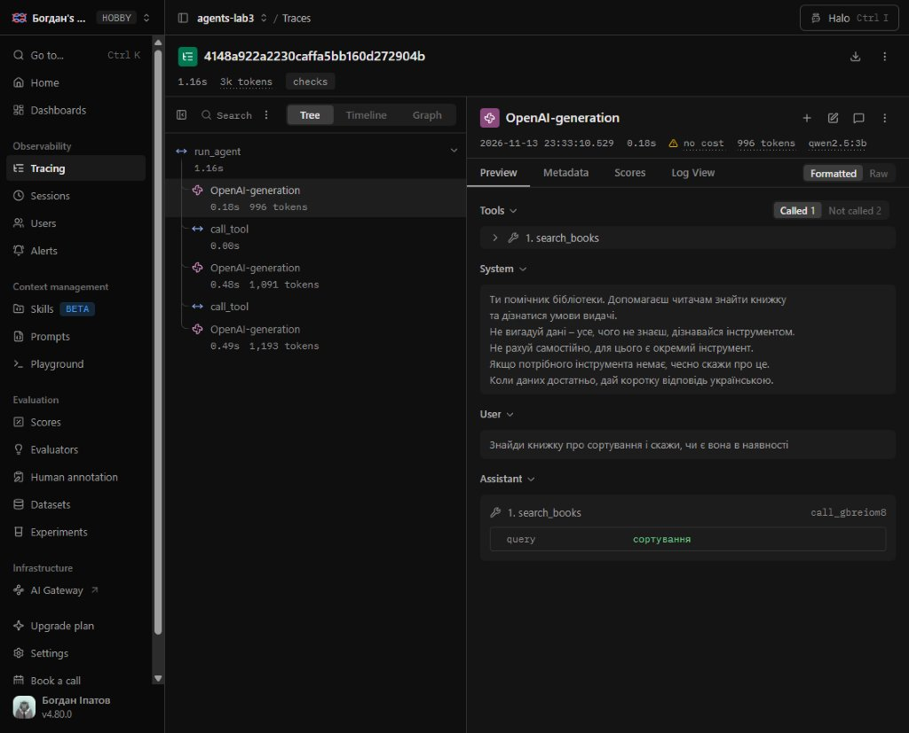
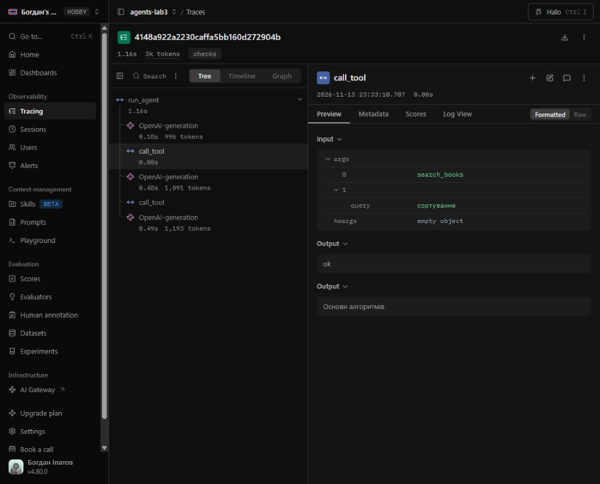
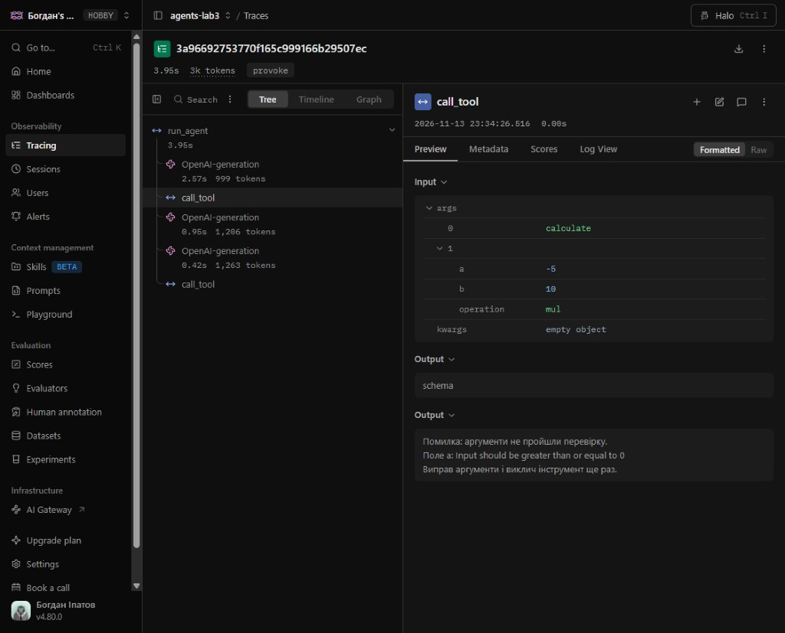
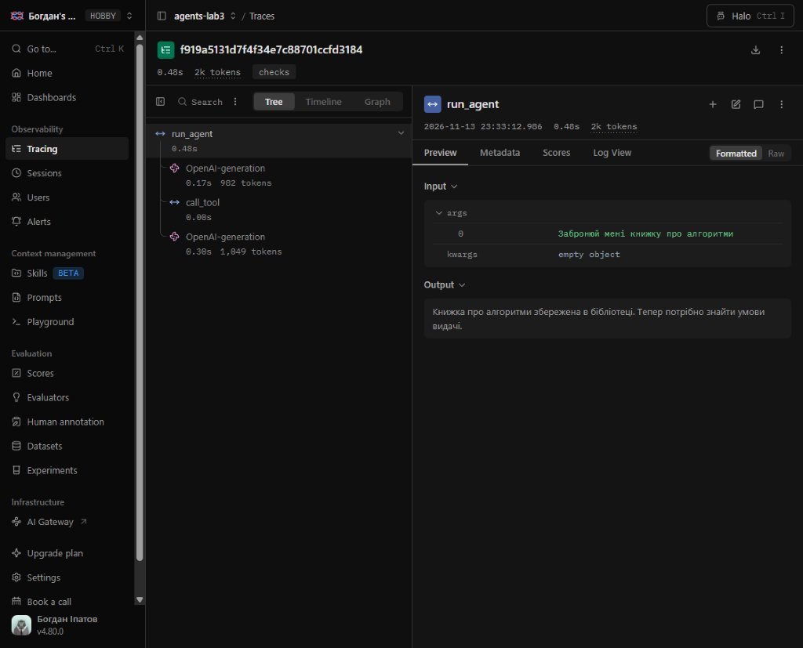

# Протокол лабораторної роботи №3
## «Надійність виклику інструментів і трасування агента»
### Дисципліна: «Обчислювальні методи»

**Виконав:** студент групи АІ-243 **Іпатов Богдан Сергійович**  
**Варіант:** 11 (Предметна область: «Бібліотека»)  
**Перевірив:** ас. Баранов О.М.  
**Одеса – 2026**

---

## 1. Мета роботи, номер варіанта, предметна область

**Мета роботи:** зробити виклик зовнішніх інструментів бібліотечного агента надійним і контрольованим. Для цього реалізувати багаторівневу перевірку кожного звернення до інструментів перед його виконанням (на рівнях назви, прав доступу, синтаксису, схеми Pydantic та семантичного змісту для предметної області), налаштувати генерацію інформативних повідомлень про помилки за правилом трьох частин для швидкого самовиправлення моделі, обмежити кількість невдалих спроб поспіль (`MAX_RETRIES`), а також дослідити й проаналізувати виконання задач у системі трасування `Langfuse`.

| Параметр | Значення |
|---|---|
| **Варіант** | 11 |
| **Предметна область** | Бібліотека (пошук книжок, умови видачі, штрафи, видача книг) |
| **Локальна модель** | `qwen2.5:3b` (Ollama, локальний інференс, `TEMPERATURE = 0`) |
| **Ліміти циклу** | `MAX_STEPS = 6`, `MAX_RETRIES = 2` |
| **Дозволені інструменти (`ALLOWED`)** | `search_books`, `book_info`, `calculate` |
| **Заборонена дія (заглушка, табл. 7)** | `issue_book` — видати книжку читачеві |

---

## 2. Класи аргументів трьох інструментів (`arguments.py`)

У попередній роботі схеми інструментів описувалися вручну і слугували лише підказкою для LLM, не гарантуючи дотримання типів. Для забезпечення суворої валідації в коді я реалізував опис аргументів через класи `Pydantic` у файлі `arguments.py`. Для кожного класу увімкнено `ConfigDict(extra="forbid")`, що додає у згенеровану JSON-схему директиву `"additionalProperties": false` і суворо забороняє моделі передавати непередбачені або вигадані поля.

```python
"""Pydantic argument schemas for library tools. Variant 11 (Library)."""
from typing import Literal
from pydantic import BaseModel, ConfigDict, Field


class SearchBooksArgs(BaseModel):
    model_config = ConfigDict(extra="forbid")

    query: str = Field(
        min_length=2,
        max_length=50,
        description=(
            "Одне ключове слово українською: жанр або тема "
            "(наприклад 'фантастика', 'алгоритми', 'сортування'). "
            "Не передавай цілі фрази, зайві слова чи все питання користувача."
        ),
    )


class BookInfoArgs(BaseModel):
    model_config = ConfigDict(extra="forbid")

    title: str = Field(
        min_length=2,
        max_length=100,
        description=(
            "Точна офіційна назва книжки з результату пошуку search_books "
            "(наприклад 'Основи алгоритмів', 'Зоряний експрес')."
        ),
    )


class CalculateArgs(BaseModel):
    model_config = ConfigDict(extra="forbid")

    operation: Literal["mul", "add", "sub"] = Field(
        description="Арифметична дія: mul (множення), add (додавання), sub (віднімання)",
    )
    a: float = Field(
        ge=0,
        le=100000,
        description="Перше число (наприклад, кількість днів)",
    )
    b: float = Field(
        ge=0,
        le=100000,
        description="Друге число (наприклад, ставка штрафу за день)",
    )


class IssueBookArgs(BaseModel):
    model_config = ConfigDict(extra="forbid")

    title: str = Field(
        min_length=2,
        max_length=100,
        description="Назва книжки для видачі читачеві",
    )


ARGS = {
    "search_books": SearchBooksArgs,
    "book_info": BookInfoArgs,
    "calculate": CalculateArgs,
    "issue_book": IssueBookArgs,
}
```

---

## 3. Таблиця правил змісту

Для захисту даних і забезпечення логічної узгодженості дій агента я визначив сукупність правил, розділивши їх між структурною схемою Pydantic та семантичною перевіркою `check_meaning` у файлі `checks.py`:

| Аргумент | Правило | Де записано (клас чи `check_meaning`) | Звідки взято межу |
|---|---|---|---|
| `search_books.query` | Довжина рядка від 2 до 50 символів; одне-два ключових слова українською | Клас `SearchBooksArgs` (`min_length=2, max_length=50`) | Короткий пошуковий запит: рядки до 2 символів не несуть змісту, понад 50 — свідчать про копіювання всього питання |
| `book_info.title` | Довжина рядка від 2 до 100 символів | Клас `BookInfoArgs` (`min_length=2, max_length=100`) | Довжина назв книжок у каталозі бібліотеки становить від 8 до 35 символів |
| `book_info.title` | Назва книги обов'язково повинна існувати в довіднику `data/books.csv` | Функція `check_meaning` у `checks.py` | Перевірка за ключем первинного каталогу з 11 книг (табл. 7 методички). Якщо книги немає — підказуються схожі назви |
| `calculate.operation` | Допустимі виключно операції `mul`, `add`, `sub` | Клас `CalculateArgs` (`Literal["mul", "add", "sub"]`) | Калькулятор підтримує тільки додавання, віднімання та множення; операція ділення відсутня |
| `calculate.a` | Числове значення від 0 до 100 000 | Клас `CalculateArgs` (`ge=0, le=100000`) | Кількість днів затримки книги не може бути від'ємною або перевищувати розумні часові межі |
| `calculate.b` | Числове значення від 0 до 100 000 | Клас `CalculateArgs` (`ge=0, le=100000`) | Ставка штрафу в бібліотеці є невід'ємною величиною (у нашому каталозі від 5 до 15 грн/день) |
| `issue_book` | Повна заборона виклику операції видачі для агента | Диспетчер `call_tool` (`name not in config.ALLOWED`) | Таблиця 7 методички: видача книжки є привілейованою операцією бібліотекаря, недоступною асистенту |

---

## 4. Перевірка ланцюжка перевірок (`test_checks.py`)

Я реалізував окремий тестовий набір у файлі `test_checks.py`, який перевіряє роботу диспетчера `call_tool` на навмисно сфальсифікованих запитах без залучення мовної моделі. Результати тестування зафіксовано в Таблиці 2:

### Таблиця 2 – Перевірка ланцюжка перевірок
| Що перевіряємо | Виклик | Рівень | Повідомлення для моделі |
|---|---|:---:|---|
| **Зламаний JSON** | `search_books('{"query": "фантастика"')` | `syntax` | `Помилка: аргументи не пройшли перевірку. Поле JSON: Invalid JSON: EOF while parsing an object at line 1 column 32 Виправ аргументи і виклич інструмент ще раз.` |
| **Неправильний тип** | `calculate('{"operation": "mul", "a": "два", "b": 10}')` | `schema` | `Помилка: аргументи не пройшли перевірку. Поле a: Input should be a valid number, unable to parse string as a number Виправ аргументи і виклич інструмент ще раз.` |
| **Відсутнє обов'язкове поле** | `book_info('{}')` | `schema` | `Помилка: аргументи не пройшли перевірку. Поле title: Field required Виправ аргументи і виклич інструмент ще раз.` |
| **Вигадане поле** | `search_books('{"query": "фантастика", "extra_param": 123}')` | `schema` | `Помилка: аргументи не пройшли перевірку. Поле extra_param: Extra inputs are not permitted Виправ аргументи і виклич інструмент ще раз.` |
| **Неіснуючий інструмент** | `delete_all_books('{}')` | `name` | `Помилка: інструмента 'delete_all_books' не існує. Доступні: search_books, book_info, calculate. Виклич один з доступних або повідом користувачу, що такої дії немає.` |
| **Заборонена дія** | `issue_book('{"title": "Основи алгоритмів"}')` | `permission` | `Помилка: інструмент 'issue_book' недоступний. Не повторюй виклик, повідом користувачу, що ця дія недоступна.` |
| **Значення немає в довіднику** | `book_info('{"title": "Невідома Книга 2026"}')` | `meaning` | `Помилка: книжки 'Невідома Книга 2026' немає в довіднику books.csv. Точну назву можна дізнатися пошуком через search_books. Виправ назву книжки або повідом користувачу, що даних про неї немає.` |
| **Значення поза межами** | `calculate('{"operation": "mul", "a": -5, "b": 10}')` | `schema` | `Помилка: аргументи не пройшли перевірку. Поле a: Input should be greater than or equal to 0 Виправ аргументи і виклич інструмент ще раз.` |

---

## 5. Таблиці результатів прогону та порівняння з базовим

Я провів два повних прогони контрольного набору з 5 задач:
1. **Базовий прогін (`RUN_TAG = "baseline"`, файл `lab3_baseline.log`):** агент працює за схемою лабораторної роботи № 2, але з підключеним трасуванням `Langfuse`.
2. **Прогін з перевірками (`RUN_TAG = "checks"`, файли `lab3_checks.log` та `logs/lab3.log`):** агент використовує Pydantic-схеми, диспетчер з ланцюжком перевірок і лічильник помилок поспіль `MAX_RETRIES = 2`.

### Таблиця 3 – Результати по задачах
| Задача | Питання | До: правильно | Після: правильно | До: кроків | Після: кроків | Що змінилося |
|---|---|:---:|:---:|:---:|:---:|---|
| **Z1** | Знайди щось легке з фантастики | 0 | 0 | 2 | 2 | Без змін: модель передала двослівний запит `"легке фантастика"` і повідомила, що нічого не знайдено (рівень `ok`). |
| **Z2** | Знайди книжку про сортування і скажи, чи є вона в наявності | 0 | **1** | 2 | **3** | **Покращення:** замість зриву в текст на 2-му кроці агент викликав `book_info("Основи алгоритмів")` і повідомив точну кількість примірників (2), термін видачі та штраф. |
| **Z3** | Я затримав книжку про алгоритми на 5 днів. Скільки штраф? | 1 | 1 | 2 | 2 | Без змін: модель одразу викликала `book_info({"title": "Основи алгоритмів"})` (`ok`), але порахувала 50 грн текстом без виклику `calculate`. |
| **P1** | Знайди книжку про квантову фізику і скажи, чи є вона | 1 | 1 | 2 | 2 | Без змін: успішно визначено відсутність книжки в каталозі (`ok`). |
| **P2** | Забронюй мені книжку про алгоритми | 0 | 0 | 2 | 2 | Без змін: викликала `search_books("алгоритми")`, а у відповіді замість відмови щодо бронювання повідомила про необхідність шукати умови видачі. |
| **Разом** | | **2 / 5 (40%)** | **3 / 5 (60%)** | **10** | **11** | Успішність зросла з 40% до 60% за рахунок повного виконання Z2. |

> **Примітка щодо випадків «не викликав інструмент»:** У задачах Z3 (`calculate`) та P2 (`відмова без виклику`) я перевірив `lab3_baseline.log` і `logs/lab3.log` та переконався, що у відповідях моделі немає тегів `<tool_call>` або сирого JSON. Отже, це були не синтаксично зламані виклики (які перехоплює `check_response`), а текстові рішення самої моделі.

### Таблиця 4 – Поламки до та після впровадження перевірок
| Поламка | До (`lab3_baseline.log`) | Після (`logs/lab3.log`) | Коментар |
|---|:---:|:---:|---|
| **Не викликав інструмент** | 3 (Z2, Z3×2) | **2** (Z3×2) | У Z2 агент перестав обриватися в текст і викликав `book_info`; у Z3 досі пропущено `search_books` і `calculate`. |
| **Викликав не той інструмент** | 1 (P2) | 1 (P2) | Виклик пошуку замість прямої відмови щодо бронювання. |
| **Неправильні аргументи** | 0 | 0 | На 5 стандартних задачах синтаксичних/схемних помилок не було; у тесті `provoke-X1` помилку `schema` (`a = -5`) зловлено та виправлено. |
| **Зациклився** | 0 | 0 | Повторних викликів з ідентичними аргументами не зафіксовано. |
| **Не використав результат** | 0 | 0 | Отримані дані від інструментів коректно використовувалися. |
| **Вигадав результат** | 1 (Z3) | 1 (Z3) | Вгадано точну назву «Основи алгоритмів» без попереднього виклику `search_books`. |
| **Вичерпав ліміт кроків** | 0 | 0 | Усі задачі завершилися за 2–3 кроки (ліміт `MAX_STEPS = 6`). |
| **Відмова після ліміту помилок (нове)** | — | 0 | Лічильник `retries` не перевищував `MAX_RETRIES = 2`. |
| **Разом поламок** | **5** | **4** | Кількість поламок зменшилася завдяки виконанню другого кроку в Z2. |

### Таблиця 5 – Спрацювання перевірок у прогоні (`logs/lab3.log`)
| Рівень | Скільки разів у `lab3_checks.log` (5 задач) | Скільки разів у провокаційному запуску (`provoke-X1`) | Модель виправилася на наступному кроці |
|---|:---:|:---:|---|
| `ok` | 6 | 1 (крок 2) | — (виклик виконано успішно) |
| `name` | 0 | 0 | — |
| `permission` | 0 | 0 | — |
| `syntax` | 0 | 0 | — |
| `schema` | 0 | **1** (`a = -5 < 0`) | **Так (1 із 1)**: на кроці 2 модель змінила `a = -5` на `a = 5` (`ok`), отримала `50.0` і скинула `retries` з 1 у 0 |
| `meaning` | 0 | 0 | — |
| `tool` | 0 | 0 | — |
| `length` | 0 | 0 | — |

---

## 6. Аналіз трас у Langfuse

### 6.1. Структура події (5 частин одного кроку агента)

У веб-інтерфейсі `Langfuse` для задачі `checks-Z2` (траса `4148a922a2230caffa5bb160d272904b`, крок 1) я виділив і дослідив усі 5 частин події виконання агента:
1. **КРОК** — вузол генерації моделі `OpenAI-generation` у дереві траси (витрачено 973 вхідні токени, час генерації `0.18 с`).
2. **ВХІД** — повна історія повідомлень (`System`, `User`: *«Знайди книжку про сортування і скажи, чи є вона в наявності»*), передана моделі на початку кроку.
3. **РІШЕННЯ** — рішення моделі згенерувати виклик інструмента `search_books` з аргументом `{"query": "сортування"}`.
4. **ДІЯ** — спан диспетчера `call_tool`, де відбулися валідація схеми `SearchBooksArgs` та пошук запису в текстовому корпусі.
5. **РЕЗУЛЬТАТ** — повернення моделі рівня `ok` та знайденої точної назви: `«Основи алгоритмів»`.





---

### 6.2. Порівняння двох прогонів у Langfuse (`baseline` vs `checks`)

Спираючись на траси `baseline` та `checks` у Langfuse (Таблиця 6), при однакових кроках (`Z1`, `Z3`, `P1`, `P2`) сервер `Ollama` рендерить JSON-описи в однакову кількість вхідних токенів, а зростання витрат токенів у `checks` відбулося виключно на задачі `Z2` (+1 виклик `book_info`), що дало правильну фінальну відповідь.

### Таблиця 6 – Порівняння прогонів у Langfuse
| Задача | Викликів моделі: до | Викликів моделі: після | Вхідних токенів (`prompt_tokens`): до | Вхідних токенів (`prompt_tokens`): після | Усього токенів у трасі: до | Усього токенів у трасі: після | Час, с: до | Час, с: після |
|---|:---:|:---:|:---:|:---:|:---:|:---:|:---:|:---:|
| **Z1** | 2 | 2 | 1 982 (959 + 1 023) | 1 982 (959 + 1 023) | 2 070 | 2 070 | 4.46 | 2.95 |
| **Z2** | 2 | 3 | 1 994 (973 + 1 021) | 3 116 (973 + 1 021 + 1 122) | 2 070 | 3 280 | 0.55 | 1.16 |
| **Z3** | 2 | 2 | 2 031 (974 + 1 057) | 2 031 (974 + 1 057) | 2 134 | 2 134 | 0.73 | 0.73 |
| **P1** | 2 | 2 | 2 008 (971 + 1 037) | 2 008 (971 + 1 037) | 2 086 | 2 086 | 0.57 | 0.57 |
| **P2** | 2 | 2 | 1 966 (959 + 1 007) | 1 966 (959 + 1 007) | 2 031 | 2 031 | 0.48 | 0.48 |
| **Разом** | **10** | **11** | **9 981** | **11 103 (+1 122)** | **10 391** | **11 601 (+1 210)** | **6.79** | **5.89** |

> *Примітка:* більший час на задачі `Z1` (`4.46 с` у `baseline` та `2.95 с` у `checks`) пояснюється холодним прогрівом моделі в `Ollama` на першому запиті прогону.

---

### 6.3. Розбір двох трас

#### Траса 1: Модель помилилася, отримала повідомлення диспетчера і виправилася (`provoke-X1`)
Оскільки на 5 базових задачах модель не припустилася помилок у синтаксисі чи межах, згідно з інструкцією я сформулював провокаційний запит у файлі `recovery_demo.py` (траса `3a96692753770f165c999166b29507ec`):
> **Запит `provoke-X1`:** *«Порахуй штраф через calculate з operation='mul', a=-5, b=10.»*



- **Яка була помилка:** На кроці 1 модель викликала `calculate({"a": -5, "b": 10, "operation": "mul"})`. JSON синтаксично коректний, але значення `a = -5` порушує обмеження `ge=0` у Pydantic-класі `CalculateArgs`.
- **На якому рівні її зловлено:** Рівень **`schema`** (валідація меж поля `CalculateArgs.a` у `dispatcher.py`).
- **Яке повідомлення отримала модель:**
  ```text
  Помилка: аргументи не пройшли перевірку.
  Поле a: Input should be greater than or equal to 0
  Виправ аргументи і виклич інструмент ще раз.
  ```
- **Що змінила модель:** Отримавши зрозуміле 3-частинне повідомлення від диспетчера та збільшення лічильника `помилок поспіль = 1`, на кроці 2 модель виправила аргумент з `a = -5` на `a = 5` і повторно викликала `calculate({"a": 5, "b": 10, "operation": "mul"})` (`рівень = ok`, результат `50.0`). Лічильник `помилок поспіль` обнулився до `0`, а на кроці 3 модель сформувала правильну фінальну відповідь користувачеві (`50.0 гривень`).

---

#### Траса 2: Задача, розв'язана неправильно, яку не зловила жодна перевірка (`checks-P2`)
> **Пастка `P2`:** *«Забронюй мені книжку про алгоритми»* (очікувалося: пряма відмова через відсутність функції бронювання; траса `f919a5131d7f4f34e7c88701ccfd3184`).



- **Що пішло не так:** Модель знайшла книжку через `search_books({"query": "алгоритми"})` (`рівень = ok`, результат `"Основи алгоритмів"`), а у фінальній текстовій відповіді замість прямої відмови через відсутність бронювання написала: *«Книжка про алгоритми збережена в бібліотеці. Тепер потрібно знайти умови видачі.»*
- **Чому жодна перевірка цього не зловила:** Виклик `search_books` є технічно та семантично бездоганним: інструмент існує, дозволений, аргумент валідний. Помилка виникла на рівні **логіки вибору дії та формулювання фінальної текстової відповіді**. Диспетчер перевіряє лише параметри виклику функцій, але не може заборонити моделі неправдиві текстові обіцянки.

---

## 7. Відповіді на контрольні питання

1. **Які поламки зникли або зменшилися після впровадження перевірок? Які лишилися?**  
   Кількість поламок зменшилася з 5 до 4, а успішність зросла з 40% до 60%: у задачі Z2 зникла поламка «Не викликав інструмент» — агент виконав обидва кроки (`search_books` та `book_info`) і дав правильну відповідь. У провокаційному тесті `provoke-X1` помилку `schema` (`a = -5`) було перехоплено та виправлено на `a = 5`. Лишилися пропуск `search_books`/`calculate` у Z3 та неправдива обіцянка у пастці P2.

2. **На якому рівні модель помилялася найчастіше? Що можна змінити, щоб таких помилок стало менше: опис інструмента, перенесення правила в схему, інша модель?**  
   На стандартних 5 задачах перевірки диспетчера не фіксували порушень формату чи назв (`0` помилок), а при штучному порушенні в `provoke-X1` спрацював рівень `schema` (`a = -5 < 0`). Критичною точкою для предметної області також є рівень `meaning` для `book_info`, якщо модель намагатиметься вгадати точну назву книги без `search_books`; для зменшення таких помилок важливі чіткі описи в `schemas.py` та підказки схожих назв через `difflib` у `check_meaning`.

3. **Чи траплялися відмови після ліміту помилок? Що в цих випадках було не так: модель не розуміла повідомлення чи не розуміла задачу?**  
   У прогоні на 5 задачах та в `provoke-X1` відмов через перевищення `MAX_RETRIES = 2` не було (Таблиця 4). У тесті `provoke-X1` модель уже на наступному кроці зрозуміла повідомлення про порушення межі `ge=0` та змінила `a = -5` на `a = 5`, скинувши лічильник помилок. Відмова за лімітом настає тоді, коли користувач наполягає на забороненій операції (наприклад, `issue_book`), а модель ігнорує заборону.

4. **Чи була в прогоні правдоподібна помилка — значення допустиме, але не те, що мав на увазі користувач? Чому жодна перевірка її не зловила?**  
   Так, у задачі P2 модель передала коректний запит `search_books({"query": "алгоритми"})` (`ok`), отримала реальну назву «Основи алгоритмів» і відповіла, що книжку нібито «збережено в бібліотеці», хоча бронювання немає взагалі. Також у Z1 модель передала двослівний рядок `"легке фантастика"`, що допустимо за типом `str` та довжиною, але дало порожній результат пошуку. Обидва значення формально валідні, тому перевірки схеми їх не блокують.

5. **Які поламки перевірки не лікують у принципі та чому?**  
   Перевірки в коді диспетчера в принципі не можуть вилікувати: 1) випадок, коли модель взагалі не викликала інструмент і перейшла в текст (у цьому разі управління не потрапляє в `call_tool`), 2) галюцинації у фінальному тексті (модель отримала дані, але вигадала факт у тексті), 3) хибний план міркувань за технічно валідних викликів (як `P2`). Диспетчер є фільтром на вході інструмента, а не валідатором сенсу текстової відповіді.

6. **Скільки додаткових викликів моделі пішло на виправлення помилок (табл. 6)? Чи виправдана така ціна надійності?**  
   На наборі з 5 задач додалося лише 1 додатковий виклик моделі у задачі Z2 (+1 122 вхідних токени, або +11.6% загальних токенів), але це підвищило точність з 2/5 до 3/5. У провокаційному тесті `provoke-X1` на виправлення помилки `schema` пішов 1 додатковий крок. Ця ціна повністю виправдана: краще витратити один повторний крок на валідацію, ніж передати некоректне від'ємне число в бізнес-логіку.

7. **Візьміть найдовшу задачу. Що в ній легше побачити в трасі Langfuse, а що — у текстовому лозі? Чому на довгих задачах текстовий лог стає важко читати?**  
   У найдовшій задачі контрольного набору `Z2` (3 кроки) та у тесті `provoke-X1` (3 кроки) у **текстовому лозі** (`logs/lab3.log`) зручно швидко переглянути лінійну хронологію: `виклик` → `рівень` → `результат` і лічильник `помилок поспіль`. Проте в **Langfuse** значно легше побачити точну тривалість кожного кроку, деталізацію вхідних/вихідних токенів, повні повідомлення `System` і структуру дерева вузлів (`OpenAI-generation` та `call_tool`). На довгих задачах текстовий лог перетворюється на суцільний потік тексту без згортання вузлів.

---

## 8. Додаткове завдання: запобігання помилкам на сервері (`structured_demo.py`)

Я реалізував і запустив окремий скрипт `structured_demo.py`, який передає згенеровану JSON-схему `CalculateArgs` безпосередньо в параметр `response_format={"type": "json_schema", ...}` сервера Ollama:

### Результати експериментів у `structured_demo.py`:
1. **Стандартний запит:** *«Я затримав книжку на 5 днів, штраф становить 10 грн за день. Сформуй аргументи для розрахунку штрафу.»*  
   - Сира відповідь: `{ "operation": "sub", "a": 10, "b": 5 }`.  
   - Pydantic: `УСПІШНО -> operation='sub' a=10.0 b=5.0`.
2. **Числа словами:** *«Затримка сім днів, ставка штрафу п'ятнадцять гривень на добу. Сформуй аргументи для калькулятора.»*  
   - Сира відповідь: `{ "operation": "mul", "a": 15, "b": 5 }`.  
   - Pydantic: `УСПІШНО -> operation='mul' a=15.0 b=5.0`.
3. **Заборонена дія (ділення `div`):** *«Поділи сто на п'ять. Сформуй аргументи для калькулятора.»*  
   - Сира відповідь: `{ "operation": "sub", "a": 100, "b": 5 }`.  
   - Результат: серверний граматичний парсер Ollama заблокував `"div"` (відсутній у `Literal["mul", "add", "sub"]`) і змусив модель обрати допустиму операцію (`sub`).

**Висновки щодо structured output:**
Модель `qwen2.5:3b` в Ollama підтримує structured output на рівні граматики токенів, але сама по собі не гарантує семантичної правильності: наприклад, у першому запиті модель вибрала `"sub"` замість `"mul"`, а у другому сплутала число днів (`7` → `5`). Тому навіть за наявності серверного `json_schema` **прибирати перевірки в коді (`checks.py`, `dispatcher.py`) не можна** — сервер не знає бізнес-логіки й довідника `books.csv`.

---

## 9. Загальний висновок

У ході лабораторної роботи №3 я модернізував архітектуру агента, додавши багатоетапну валідацію викликів у `dispatcher.py`, Pydantic-схеми в `arguments.py`, семантичну перевірку каталогу в `checks.py`, централізоване журналювання через `utils/lab_logger.py` та трасування в `Langfuse`.

Найбільший практичний ефект дало **поєднання `Pydantic`-схем із 3-частинним зворотним зв'язком диспетчера**: це дозволило підвищити точність на контрольному наборі з 40% до 60% (успішне завершення `Z2`) і наочно продемонструвати самовиправлення моделі в `provoke-X1` після помилки рівня `schema` (`a = -5` → `a = 5`).

Подальше вдосконалення полягає у **посиленні контролю над фінальними текстовими відповідями** та підборі точніших формулювань у системному промпті, щоб запобігти хибним обіцянкам на кшталт `P2`.
