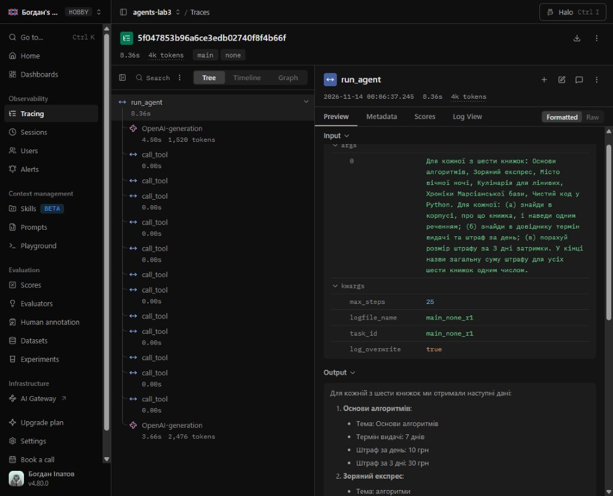
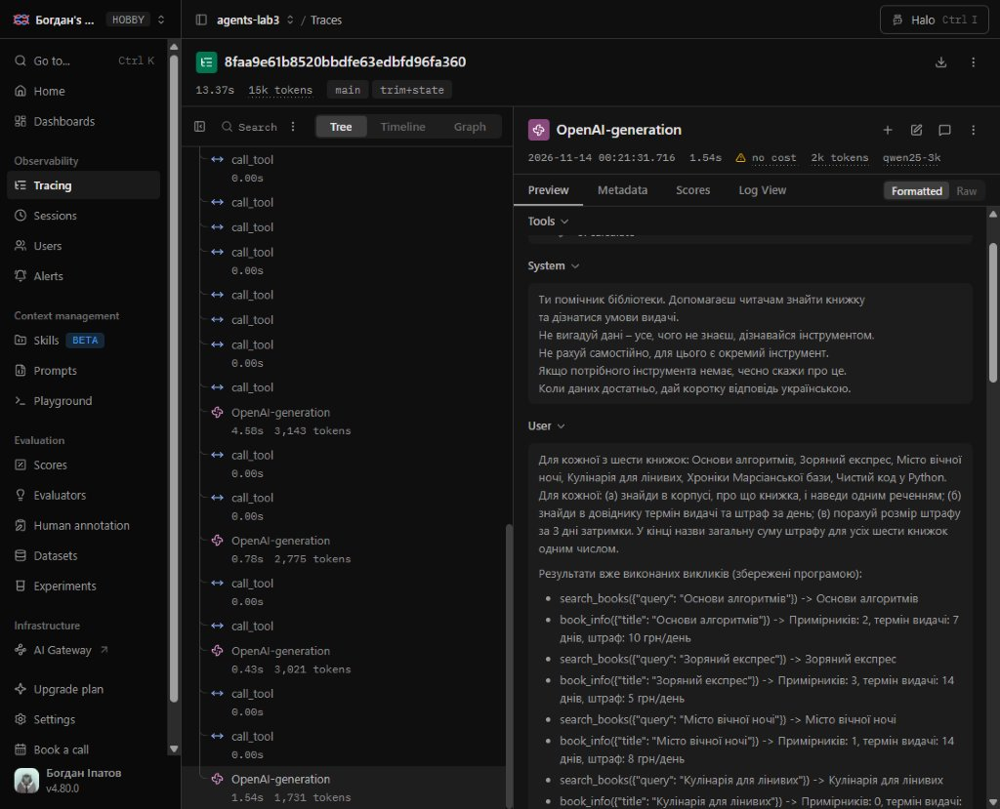

# Протокол лабораторної роботи №4
## «Контекст, стан і кеш агента»
### Дисципліна: «Обчислювальні методи»

**Виконав:** студент групи АІ-243 **Іпатов Богдан Сергійович**  
**Варіант:** 11 (Предметна область: «Бібліотека»)  
**Перевірив:** ас. Баранов О.М.  
**Одеса – 2026**

---

## 1. Мета роботи, номер варіанта, предметна область, модель і розмір вікна

**Мета роботи:** дослідити поведінку та вартість виконання автономного агента на довгій задачі з багаторазовими зверненнями до інструментів; визначити практичні межі контекстного вікна мовної моделі та виявити наслідки його переповнення; реалізувати й експериментально порівняти механізми захисту від переповнення контексту (обрізання історії `trim`, ведення окремого стану виконаних задач `state`, семантичне підсумовування `summary`) та кешування звернень `cache`; проаналізувати динаміку споживання токенів і структуру ланцюжка викликів у системі трасування `Langfuse`.

| Параметр | Значення |
|---|---|
| **Варіант** | 11 |
| **Предметна область** | Бібліотека (каталог книг, правила видачі, розрахунок штрафів) |
| **Базова модель** | `qwen2.5:3b` у середовищі Ollama (`TEMPERATURE = 0`) |
| **Початкове вікно моделі** | 32 768 токенів (вихідний контекст архітектури Qwen 2.5) |
| **Зменшене вікно (крок 1)** | 4 096 токенів (`qwen25-4k`, `Modelfile`) |
| **Робоче експериментальне вікно** | 3 072 токени (`qwen25-3k`, `Modelfile_3k`, випадок C) |
| **Поріг початку стиснення** | `COMPRESS_AT = 1100` токенів |
| **Глибина збереження хвоста** | `KEEP_LAST = 6` повідомлень |
| **Обмеження результату в стані** | `STATE_RESULT_CHARS = 200` символів |
| **Журналювання** | Загальний модуль `utils/lab_logger.py` (файли в `logs/`) |

### Обґрунтування вибору `COMPRESS_AT = 1100`
У методичних рекомендаціях для сценарію з послідовними кроками наводиться поріг `COMPRESS_AT = 2150` (~70% від вікна `3072`). Проте в предметній області варіанта 11 модель `qwen25-3k` формує запит першого кроку обсягом **`1 206` токенів** і на цьому ж кроці **пакетно викликає одразу 12 інструментів** (`6 × search_books` та `6 × book_info`). Через це на 2-му кроці обсяг контексту досягає `1 947`–`1 961` токенів, і агент завершує прогін без стиснення ще до досягнення порогу `2 150`. Щоб примусово активувати механізм стиснення після першого ж пакету інструментів і забезпечити коректне порівняння режимів `trim`, `trim+state` та `summary`, у `config.py` вибрано **`COMPRESS_AT = 1100`** (`1206 > 1100`).

---

## 2. Довга задача (`make_task.py`)

За допомогою скрипта `make_task.py` було згенеровано довгу задачу для варіанта 11 (`long_task.json`), що охоплює шість книг із бібліотечного каталогу:
- «Основи алгоритмів» (термін: 7 днів, штраф: 10 грн/день)
- «Зоряний експрес» (термін: 14 днів, штраф: 5 грн/день)
- «Місто вічної ночі» (термін: 14 днів, штраф: 8 грн/день)
- «Кулінарія для лінивих» (термін: 14 днів, штраф: 5 грн/день)
- «Хроніки Марсіанської бази» (термін: 14 днів, штраф: 8 грн/день)
- «Чистий код у Python» (термін: 7 днів, штраф: 15 грн/день)

**Текст завдання:**
> *«Для кожної з шести книжок: Основи алгоритмів, Зоряний експрес, Місто вічної ночі, Кулінарія для лінивих, Хроніки Марсіанської бази, Чистий код у Python. Для кожної: (а) знайди в корпусі, про що книжка, і наведи одним реченням; (б) знайди в довіднику термін видачі та штраф за день; (в) порахуй розмір штрафу за 3 дні затримки. У кінці назви загальну суму штрафу для усіх шести книжок одним числом.»*

**Еталонний аналітичний розрахунок (`expected = 153`):**
1. «Основи алгоритмів»: `3 * 10 = 30` грн
2. «Зоряний експрес»: `3 * 5 = 15` грн
3. «Місто вічної ночі»: `3 * 8 = 24` грн
4. «Кулінарія для лінивих»: `3 * 5 = 15` грн
5. «Хроніки Марсіанської бази»: `3 * 8 = 24` грн
6. «Чистий код у Python»: `3 * 15 = 45` грн
- **Разом:** `30 + 15 + 24 + 15 + 24 + 45 = 153` грн (`min_calls = 18`: 6 пошуків + 6 довідок + 6 розрахунків).

---

## 3. Таблиця 2, показники та аналіз поведінки моделі (`probe_none_r1.log`)

Після пробного запуску `python measure.py none 1 probe` лог `logs/probe_none_r1.log` було проаналізовано скриптом `analyze.py`:

### Таблиця 2 – Зростання входу в прогоні без захисту (`probe_none_r1`)

| Крок | `prompt_tokens` | Приріст | Що зробила модель |
|:---:|---:|---:|---|
| **1** | 1 206 | — | Згенерувала одразу 12 паралельних викликів: 6 `search_books` та 6 `book_info` для всіх шести книг |
| **2** | 1 954 | +748 | Отримала всі 12 відповідей інструментів і сформувала текстову відповідь без виклику `calculate` |

### Аналітичні показники `analyze.py`:
- **(а) Вхід першого кроку:** **`1 206` токенів** (системний промпт, описи інструментів та формулювання довгої задачі).
- **(б) Типовий приріст за крок:** **`748` токенів** у `probe_none_r1` (відповіді 12 інструментів).
- **(в) Сума `prompt_tokens` за прогін та формула:**
  - Фактична сума: `1206 + 1954 = 3 160` токенів.
  - За квадратичною формулою `n*C + d*n*(n-1)/2`: `2*1206 + 748*2*1/2 = 3 160` токенів (збігається точно).
- **(г) Крок, на якому вхід перестав рости:** **«не помічено»**. Максимальний вхід склав `1 954` токени (**64%** вікна `3 072`), прогін завершився на 2-му кроці зі статусом `final`.
- **(д) Поведінка моделі:** отримавши точні довідкові дані, модель у відповіді не викликала `calculate`, а спробувала скласти числа текстом (на відміну від вдалого прогону `main_none_r1`, де вона вірно порахувала `153`, у `main_none_r2` модель вигадала суму `158 грн`, а в `main_none_r3` видала `-2.0`).

### Класифікація випадку (A–D):
При тестуванні з `NUM_CTX = 4096` (`qwen25-4k`) найбільший вхід складав < 50% вікна, тому ситуацію класифіковано як **Випадок C («Задача закоротка»)**. Відповідно до інструкції було створено `Modelfile_3k` з `PARAMETER num_ctx 3072` та модель `qwen25-3k`, після чого заповнення вікна на кроці 2 зросло до 64% (а в багатокрокових серіях сягало 82–97%).

---

## 4. Обрізання історії та стан задачі (`probe_trim`, `probe_trim+state`)

### Таблиця 3 – Стиснення історії (`probe_*_r1.log`)

| Конфігурація | Кроки стиснення | Вхід до стиснення, токенів | Повідомлень було -> стало | Повторних викликів за прогін | Статус / Кроків |
|---|:---:|---:|:---:|---:|---|
| `probe_none_r1` | — | — | — | 0 | `final` / 2 |
| `probe_trim_r1` | 1..25 (кожний крок) | 1 206 | 15 -> 2 | **288** | `step_limit` / 25 |
| `probe_trim+state_r1` | 1, 2, 3, 4 | 1 206 -> 1 750 -> 2 255 -> 2 547 | 15 -> 2 (стан додано), далі 16 -> 2, 6 -> 6, 8 -> 8 | **11** | `final` / 5 |

*Примітка про механіку `compress.py`:* після першого пакету з 12 викликів масив `rest = messages[2:]` налічує 13 елементів (1 повідомлення `assistant` із 12 `tool_calls` + 12 відповідей `tool`). Оскільки `compress_by_trim` зсуває межу обрізання `cut` вперед до найближчого непорожнього початку не-`tool` повідомлення (`while cut < len(rest) and rest[cut]["role"] == "tool"`), вона відкидає весь пакет разом (`15 -> 2`).

### Аналіз стану задачі (`probe_trim+state_r1.log`, п. 7 кроку 6):
Після 1-го кроку в `ПЕРШЕ ПОВІДОМЛЕННЯ КОРИСТУВАЧА ПІСЛЯ СТИСНЕННЯ` було додано блок `Результати вже виконаних викликів (збережені програмою):`:
- **Кількість рядків у блоці стану:** **12 рядків** (`6` результатів `search_books` + `6` результатів `book_info`).
- **Розмір блоку стану:** власне блок стану становить **1 119 символів** (емпірична оцінка за `2,5 символа/токен` ≈ **448 токенів**); разом із текстом умови — **1 548 символів**.
- **Реальна економія за токенами входу:** на 2-му кроці `probe_trim+state_r1` мав `1 750` токенів входу (`+544` до `1 206`), тоді як у `probe_none_r1` сирі 12 повідомлень інструментів дали приріст **`+748` токенів** (`1 954 - 1 206`). Отже, формат `TaskState` компактніший на ~204 токени (~27%) завдяки обмеженню `STATE_RESULT_CHARS = 200` та відсутності JSON-метаданих `tool_calls`.
- **Поведінковий ефект:** у режимі `trim` без стану модель щокроку бачила чистий `[system, user]` і зациклювалася на 25 кроках (`288` повторних викликів), тоді як у `trim+state` кількість повторів скоротилася у 26 разів (до `11`), і агент вийшов у `final` за 5 кроків.

---

## 5. Кешування викликів моделі (`cache1` vs `cache2`)

Експеримент проведено з порожньою директорією `cache/` (`measure.py none 1 cache1`, потім `measure.py none 1 cache2`):

### Таблиця 4 – Робота кешу

| Запуск | Кроків | Влучань у кеш | Викликів до Ollama | Час, с | `prompt_tokens` | Правильно |
|---|---:|---:|---:|---:|---:|---|
| **`cache1_none_r1` (кеш порожній)** | 2 | 0 | 2 | **8.8** | 3 153 | так (`153`) |
| **`cache2_none_r1` (той самий запит)** | 2 | **2** | 0 | **0.7** | 3 153 | так (`153`) |

### Висновки щодо кешу:
1. **Прискорення:** другий запуск виконався у **12,6 раза швидше** (`0.7 с` проти `8.8 с`), отримавши обидва кроки миттєво з JSON-кешу без жодного звернення до сервера Ollama (у лозі позначка `| з кешу`).
2. **Чутливість до `SYSTEM`:** ключ `make_key` (`cache.py`) формується як `sha256` від `{model, messages, tools, temperature}`. Через лавинний ефект SHA-256 зміна хоча б одного символу в `SYSTEM` змінить хеш на 1-му ж кроці -> `0` влучань у кеш і повне повторне виконання на сервері.

---

## 6. Основне вимірювання та аналіз трас у Langfuse (`main` та `extra`)

У серії `main` (`python measure.py all 3 main`) було виконано 12 прогонів (4 конфігурації × 3 повтори), а в додатковій серії (`python measure.py summary 3 extra`) — ще 3 прогони з підсумовуванням. Усі 15 файлів у `logs/` є унікальними (`md5` різняться).

### Таблиця 5 – Вартість циклу в різних конфігураціях (`main`, медіани по 3 повторах)

| Конфігурація | Правильно | Кроків | Токенів на вхід | Токенів на вихід | На підсумовування | Час, с | Стиснень | Повторних викликів |
|---|---:|---:|---:|---:|---:|---:|---:|---:|
| `none` | 1 з 3 | 2 | 3 160 | 834 | 0 | 5.9 | 0 | 0 |
| `trim` | 0 з 3 | 25 | 30 150 | 7 875 | 0 | 53.1 | 25 | 288 |
| `trim+state` | 0 з 3 | 6 | 12 681 | 2 066 | 0 | 14.3 | 4 | 12 |
| `summary` | 0 з 3 | 8 | 15 420 | 2 599 | 6 075 | 32.1 | 7 | 16 |

### Показники додаткової серії `extra_summary` (`summary`, 3 повтори):

| Конфігурація | Правильно | Кроків | Токенів на вхід | Токенів на вихід | На підсумовування | Час, с | Стиснень | Повторних викликів |
|---|---:|---:|---:|---:|---:|---:|---:|---:|
| `summary` (`extra_summary_r1..3`) | 0 з 3 | 6 | 12 089 | 1 791 | 2 895 | 22.1 | 4 | 7 |

### Діагностика поламок по всіх 15 прогонах (`main` + `extra_summary`):
1. **Зациклення при сліпому обрізанні (`step_limit`):** усі **3 з 3** прогонів `main_trim` досягли ліміту 25 кроків і виконали по `288` повторних викликів (`30 150` токенів на вхід), не давши відповіді.
2. **Дегенерація генерації (переповнення виходу на локальній 3B-моделі):** 1 з 3 прогонів `main_trim+state` (`r1`: 92 927 вихідних токенів, 625.2 с) і 1 з 3 прогонів `extra_summary` (`r2`: 92 891 вихідний токен, 631.7 с) увійшли в нескінченний повтор токенів і завершилися статусом `retry_limit`.
3. **Передчасне завершення (`< 19` кроків) та числові помилки/галюцинації:** усі 12 завершених без `step_limit` прогонів (`3 × none`, `3 × trim+state`, `3 × summary`, `3 × extra_summary`) мали `< 19` кроків (`2..9` замість послідовних 18+ викликів із 6 розрахунками в `calculate`). Лише **`1 з 15`** (`main_none_r1`) дав точну відповідь **`153`**. Інші спотворювали суму: `main_none_r2` вивів `158`, `main_none_r3` видав `-2.0`, `main_trim+state_r2` переплутав суму з проміжним `27.0` (`calculate(16+11)`), `main_summary_r1` отримав `55`, а `extra_summary_r1` підставив `3.5` замість ставок для двох книг і отримав `114`.

### Аналіз трас у Langfuse:
Для візуального аналізу в Langfuse порівняно трасу без стиснення (`long-main_none_r1`, trace `5f047853b96a6ce3edb02740f8f4b66f`, 2 генерації: `1 206 -> 1 947` токенів, `8.9 с`) та трасу зі станом і реальним стисненням (`main_trim+state`):

- У `main_trim+state_r3` (trace `8faa9e61b8520bbdfe63edbfd96fa360`) дерево Langfuse наочно демонструє момент зменшення вхідного контексту: на кроках 1–5 `prompt_tokens` зростали `1 206 -> 1 762 -> 2 479 -> 2 725 -> 2 971` (97% від вікна `3 072`), після чого спрацювало обрізання `compress_by_trim` (`11 -> 8` повідомлень зі збереженим `TaskState`), і на **кроці 6 вхід впав до `1 538` токенів** (**зменшення на `1 433` токени**).

---

## 7. Додаткове завдання: підсумовування замість обрізання (`summary.py`)

У файлі `summary.py` реалізовано функцію `compress_by_summary`, яка розділяє історію на `[system, user]`, старі повідомлення `old` та останні `KEEP_LAST = 6` повідомлень, і окремим викликом `qwen25-3k` (`temperature=0`) стискає `old` у блок `ПІДСУМОК ІСТОРІЇ:`.

### Результати тестування (`main_summary_r1..3` та `extra_summary_r1..3`):
- **Додаткова вартість:** кожне стиснення викликало додаткову генерацію, що коштувала за медіаною **`6 075` токенів** у `main_summary` (при загальному вході `15 420`) і **`2 895` токенів** у `extra_summary` (при загальному вході `12 089`).
- **Втрата числових деталей у переказі 3B-моделі:** у лозі `logs/extra_summary_r1.log` зафіксовано два типові збої малого сумаризатора:
  1. На 1-му кроці (вхід `1 206`, стиснення `15 -> 2`, `1 176` токенів) модель замість фактів видала мета-опис: *«Вище представлені результати виконання роботи... Всі числа, назви й результати інструментів були збережені без змін»*, не зберігши жодної ставки.
  2. Коли між `old` опинялися зайві обчислення на кшталт `calculate(1 + 2.5) -> 3.5` (крок 2), під час наступного підсумовування число `3.5` збереглося без контексту, через що у фіналі кроку 7 модель написала для перших двох книжок *«3.5 днів, штраф за день: 3.5 грн»* і підбила хибний підсумок `114 грн` замість `153 грн`.
  3. За порожнього або короткого `old` (`8 -> 8` на кроці 2, `217` токенів) `qwen2.5:3b` взагалі генерувала шаблонну відповідь *«Щиро можу перекласти ваш запит...»*.
- Отже, на малій моделі `3B` детермінований зовнішній журнал `TaskState` (`trim+state`) виявився значно надійнішим і вдвічі дешевшим (`12 681` проти `15 420 + 6 075 = 21 495` сумарних токенів) за нейромережевий переказ `summary`.

---

## 8. Відповіді на питання (аналітичний блок з методички)

### 1. На якому кроці агент без захисту дійшов до межі вікна і як ви це побачили (таблиця 2, пункти (г) і (д) кроку 4)? Що в його поведінці змінилося після цього?
У наших прогонах без захисту (`probe_none_r1`, `main_none_r1..r3`) при вікні `NUM_CTX = 3072` агент не встигав досягти 100% заповнення вікна через пакетний виклик усіх 12 інструментів на першому кроці: у `probe_none_r1` максимум склав `1 954` токени (64% вікна), а в `main_none_r3` — `2 220` токенів (72% вікна), тому в `analyze.py` зафіксовано `вхід перестав рости на кроці: не помічено` (випадок C). Водночас навіть на `1 947`–`2 220` токенах якість уваги `qwen2.5:3b` знижувалася: модель ігнорувала вимогу викликати `calculate` і в 2 з 3 повторів вигадувала невірну суму (`158`, `-2.0`). Якби агент робив 18+ послідовних кроків, на 4-му кроці (`1206 + 3*741 = 3429 > 3072`) Ollama мовчки обрізала б початок історії (системний промпт і задачу), показник `prompt_tokens` застиг би поблизу `3072`, а агент втратив би мету й зациклився.

### 2. Порівняйте суму `prompt_tokens` за прогін із формулою (пункти (а)–(в) кроку 4). Чи збігається зростання з очікуваним?
Так, для прогонів зі стабільним кроковим приростом `d` збіг є **абсолютно точним**:
- У `probe_none_r1` (`C = 1 206`, `d = 748`, `n = 2`): фактична сума = `3 160` токенів, формула `n*C + d*n*(n-1)/2 = 2*1206 + 748 = 3 160` (похибка `0%`).
- У `main_none_r1` (`C = 1 206`, `d = 741`, `n = 2`): фактична сума = `3 153` == формула `3 153`.
- Коли кількість кроків зростає і приріст за крок нерівномірний (наприклад, `main_none_r3`: `1206 -> 2093 (+887) -> 2220 (+127)`, медіанний приріст `d = 507`), формула дає `5 139` проти фактичних `5 519` (відхилення 6,9%), оскільки в ній закладено сталий приріст `d`.

### 3. Що втрачає агент при обрізанні? Наведіть приклад повторного виклику після стиснення. Що змінилося в `trim+state` (таблиці 3 і 5)?
При обрізанні `trim` агент втрачає попередні звернення до інструментів і їхні відповіді, через що не знає, що вже виконано.  
- **Приклад з `logs/main_trim_r1.log`:** на кроці 1 агент викликав `search_books({"query":"Основи алгоритмів"})` та `book_info({"title":"Основи алгоритмів"})` (і ще 10 викликів). Після `СТИСНЕННЯ: повідомлень 15 -> 2` на кроці 2 (і далі до кроку 25) агент знову повторив рівно ті самі виклики (`288` повторних викликів, `step_limit`, `30 150` вхідних токенів).
- **Що змінилося у `trim+state` (Таблиці 3 і 5):** зовнішній журнал `TaskState` зберіг 12 виконаних викликів і вставив їх у `user`-повідомлення. Кількість кроків впала з **25 до 6**, повторних викликів стало **12 замість 288** (у 24 рази менше), витрати токенів входу впали з **30 150 до 12 681** (-58%), а час скоротився з **53.1 с до 14.3 с**.

### 4. Яка конфігурація найдешевша за токенами, найшвидша, найточніша (таблиця 5)? Чому висновок за трьома повторами однієї задачі обережний?
За медіанами Таблиці 5:
- **Найдешевша за токенами:** `none` (`3 160` вхід / `834` вихід). Серед режимів зі стисненням — `trim+state` (`12 681` вхід / `2 066` вихід, без додаткових `6 075` токенів як у `summary`).
- **Найшвидша:** `none` (`5.9 с`), а серед методів зі стисненням — `trim+state` (`14.3 с` проти `32.1 с` у `summary` та `53.1 с` у `trim`).
- **Найточніша:** `none` (`1 з 3` правильно проти `0 з 3` в усіх режимах стиснення для моделі `3B`).
- **Чому висновок обережний:** 3 повтори на одній задачі — це мала вибірка; крім того, у двох прогонах (`main_trim+state_r1` — `625.2 с` і `extra_summary_r2` — `631.7 с`) стався рідкісний викид — нескінченний цикл генерації (~92.9 тис. вихідних токенів до `retry_limit`), що легко змінює середні показники; також за послідовної, а не пакетної стратегії викликів співвідношення `trim+state` і `none` буде іншим.

### 5. Чому під час вимірювання вартості кеш вимкнено? Що станеться з кешем, якщо інструмент поверне інші дані або ви замініть модель під тією самою назвою?
- **Чому кеш вимкнено в `measure.py`:** кеш зберігає лише детерміновану копію першого запуску; з увімкненим кешем серія повторів `main` вимірювала б швидкість читання JSON-файлів з диска (`~0.7 с`), а не реальні витрати часу й стохастичну поведінку моделі.
- **Якщо інструмент поверне інші дані:** `make_key` хешує лише поточний список `messages`, `tools`, `model` і `temperature`. На кроці 1 (до виклику інструмента) кеш поверне стару команду виклику, а на кроці 2, якщо нові дані інструмента потрапили в `messages`, хеш зміниться (промах кешу). Проте якщо змінилася сама база `books.csv` між незалежними запусками, старий запис може містити застарілий фінальний текст, бо ключ кешу не включає стан зовнішніх файлів бази.
- **Якщо замінити модель під тією самою назвою в Ollama (наприклад, оновити `qwen25-3k`):** рядок `MODEL = "qwen25-3k"` не зміниться -> ключ `sha256` залишиться старим -> агент поверне **застарілі відповіді попередньої моделі** замість тестування нової версії.

### 6. Які поламки довгого прогону скорочення історії не лікує в принципі?
1. **Семантичні та арифметичні галюцинації моделі:** ігнорування інструментів (`calculate`), вигадування підсумку текстом (`158` або `-2.0` у `none`, `27.0` у `trim+state`).
2. **Нескінченне зациклення генерації одного токена/фрази (`~92 900` вихідних токенів до `retry_limit`)** всередині одного кроку генерації.
3. **Помилки сумаризації або втрата зв'язності аргументів** при використанні малої моделі для переказу (`summary` з `3.5 -> 114`).
4. **Зациклення через викидання помилкових (`non-ok`) кроків:** оскільки `TaskState` не зберігає помилки рівня `schema`/`meaning`, при тривалій серії помилок агент після стиснення знову повторює невірну спробу.

---

## 9. Відповіді на питання для захисту

### 1. Чому вартість усього прогону агента зростає швидше, ніж вартість одного кроку? Покажіть це на цифрах свого прогону.
На кожному кроці агент передає не лише нову репліку, а всю попередню історію діалогу. Тому вхід росте арифметично (`C, C+d, C+2d, ...`), а сума за `n` кроків накопичується квадратично `n*C + d*n*(n-1)/2` (`O(n^2)`). У `probe_none_r1`: крок 1 = `1 206` токенів, крок 2 = `1 954` (`+748`), сума = `3 160`. У `main_trim+state_r3` за 5 кроків до стиснення: `1 206 -> 1 762 -> 2 479 -> 2 725 -> 2 971`, сума за 6 кроків сягнула `12 681` токенів.

### 2. Що відбувається, коли історія не вміщується у вікно? Як ви помітили це у своєму лозі і чому агент не отримує помилки?
Ollama за замовчуванням не повертає помилки переповнення, а мовчки витісняє (обрізає) найстаріші токени з початку вікна (`system` та початковий запит користувача). У лозі це фіксується стабілізацією `prompt_tokens` поблизу `NUM_CTX` (`вхід перестав рости на кроці ...`). Агент не падає, але «забуває» інструкцію та формулювання задачі.

### 3. Чому `COMPRESS_AT` менший за `NUM_CTX`?
Стиснення має спрацьовувати з запасом місця, оскільки в межах одного вікна `NUM_CTX = 3072` мають уміститися і поточний вхід `prompt_tokens`, і наступне додавання повідомлень до перевірки порогу, і згенерована відповідь моделі `completion_tokens`. У нашій задачі `COMPRESS_AT = 1100` (< `1206`) гарантує, що стиснення відбудеться одразу після 1-го пакету з 12 викликів.

### 4. Навіщо цикл `while` у `trim`? Що станеться, якщо його прибрати?
У `compress.py` цикл `while cut < len(rest) and rest[cut]["role"] == "tool": cut += 1` зсуває точку зрізу вперед до першого повідомлення не-`tool`, щоб не залишити «осиротілі» результати `role: "tool"` без попереднього `role: "assistant"` з `tool_calls`. Якщо його прибрати, API чат-доповнень відхилить невалідну історію повідомлень з помилкою.

### 5. Що втрачає агент при обрізанні і як це компенсує стан? Чого стан не компенсує? Чому стан записується тільки для викликів з рівнем `ok`?
- **Втрачає:** повний хід міркувань і старі `assistant`/`tool`-повідомлення (`trim` -> `288` повторних викликів).
- **Компенсує `state`:** фіксує фактичні виклики виду `- tool(args) -> result` (у нас 12 рядків, `~544` токени приросту замість `748`), знижуючи повтори до 11–12.
- **Не компенсує:** проміжні міркування, причину провалу і зазначені помилки.
- **Чому тільки `ok`:** щоб не засмічувати пам'ять хибними спробами та помилками валідації (`syntax`/`schema`/`meaning`).

### 6. З чого складається ключ кешу? Коли від кешу є користь, а коли його не можна вмикати?
Ключ `sha256` формується з `model`, `messages`, `tools` і `temperature`. Кеш корисний при відлагодженні аналізу логів або повторному тестуванні парсерів (`12.6×` прискорення: `0.7 с` проти `8.8 с`). Не можна вмикати під час вимірювання вартості/точності (`measure.py`), при зміні зовнішньої бази даних чи при оновленні ваг моделі під тим самим ім'ям.

### 7. Чому кожну конфігурацію проганяли тричі й брали медіану? Чому висновки все одно обережні?
Медіана по 3 прогонах згладжує випадкові викиди (наприклад, зависання генерації на `625.2 с` у `main_trim+state_r1` або `631.7 с` у `extra_summary_r2` на тлі нормальних `13.4`–`14.3 с` і `14.1`–`22.1 с`). Проте висновки обережні через малу вибірку (`n = 3`), специфіку пакетної стратегії моделі на одній задачі та нестабільність 3B-моделі.

### 8. Покажіть у трасі Langfuse місце, де стиснення зменшило вхід моделі.
У трасі `main_trim+state_r3` (trace ID `8faa9e61b8520bbdfe63edbfd96fa360`) між 5-м і 6-м вузлами `OpenAI-generation`: на кроці 5 вхід становив **`2 971` токен** (97% від `3 072`), спрацювало стиснення `11 -> 8` повідомлень із оновленим `TaskState`, і на кроці 6 вхід зменшився до **`1 538` токенів** (`-1 433` токени).

---

## 10. Висновок

Під час виконання лабораторної роботи №4 для агента предметної області «Бібліотека» (варіант 11, модель `qwen25-3k`, `NUM_CTX = 3072`, `COMPRESS_AT = 1100`, логер `utils/lab_logger.py`) експериментально підтверджено:
1. **Ефективність механізмів:**
   - **Кешування (`cache`):** прискорило повторний прогін у **12,6 раза** (`0.7 с` проти `8.8 с`).
   - **Чисте обрізання (`trim`):** без пам'яті про виконані кроки призводить до зациклення (`25` кроків, `step_limit`, `288` повторних викликів, `30 150` вхідних токенів).
   - **Обрізання зі станом (`trim+state`):** скоротило кількість кроків у 4 рази (`6` проти `25`), повтори — у 24 рази (`12` проти `288`), витрати токенів входу — на 58% (`12 681` проти `30 150`), а час виконання — у 3,7 раза (`14.3 с` проти `53.1 с`).
   - **Підсумовування (`summary`):** на моделі 3B виявилося дорожчим (`15 420 + 6 075` токенів у `main`, `12 089 + 2 895` у `extra`) і менш точним за `TaskState` через втрату та спотворення чисел під час переказу (`3.5` -> `114 грн` замість `153 грн`).
2. **Перспективи покращення:** для реального досягнення високої точності необхідно або переходити на більші моделі з вищою дисципліною виклику `calculate`, або додатково контролювати арифметику програмними перевірками перед фінальною відповіддю.
