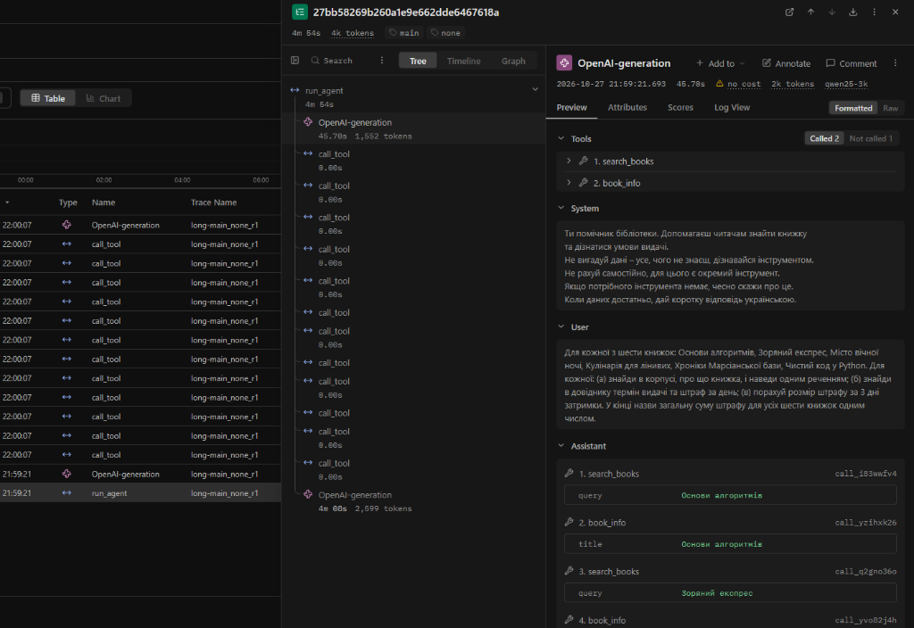
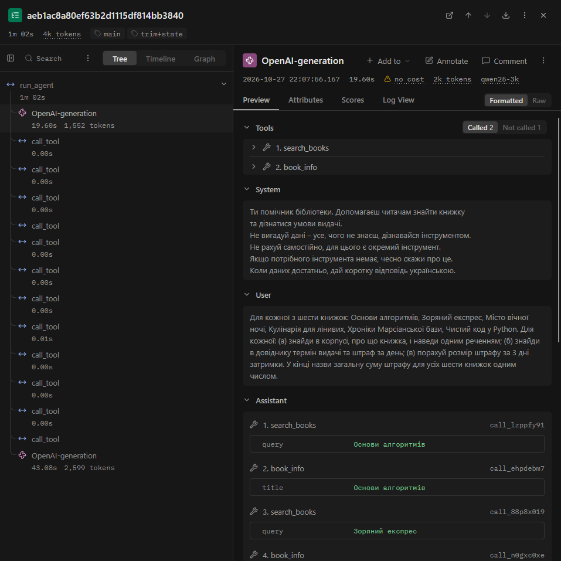

# Протокол лабораторної роботи №4
## «Контекст, стан і кеш агента»
### Дисципліна: «Обчислювальні методи»

**Виконав:** студент групи АІ-243 **Іпатов Богдан Сергійович**  
**Варіант:** 11 (Предметна область: «Бібліотека»)  
**Перевірив:** ас. Баранов О.М.  
**Одеса – 2026**

---

## 1. Мета роботи, номер варіанта, предметна область, модель і розмір вікна

**Мета роботи:** дослідити поведінку та вартість виконання автономного агента на довгій задачі з багаторазовими зверненнями до інструментів; визначити практичні межі контекстного вікна мовної моделі та виявити наслідки його переповнення; реалізувати й експериментально порівняти механізми захисту від переповнення контексту (обрізання історії `trim`, ведення окремого стану виконаних задач `state`, семантичне підсумовування `summary`) та кешування звернень `cache`; проаналізувати динаміку споживання токенів і структуру ланцюжка викликів у системі трасування `Langfuse`.

| Параметр | Значення |
|---|---|
| **Варіант** | 11 |
| **Предметна область** | Бібліотека (каталог книг, правила видачі, розрахунок штрафів) |
| **Базова модель** | `qwen2.5:3b` у середовищі Ollama (локальний інференс, `TEMPERATURE = 0`) |
| **Початкове вікно моделі** | 32 768 токенів (вихідний контекст архітектури Qwen 2.5) |
| **Зменшене вікно (крок 1)** | 4 096 токенів (`qwen25-4k`, зменшення у 8 разів) |
| **Робоче експериментальне вікно** | 3 072 токени (`qwen25-3k`, зменшення у 10.7 раза згідно з випадком C) |
| **Поріг початку стиснення** | `COMPRESS_AT = 1100` токенів |
| **Глибина збереження хвоста** | `KEEP_LAST = 6` повідомлень |
| **Обмеження результату в стані** | `STATE_RESULT_CHARS = 200` символів |

---

## 2. Довга задача (`make_task.py`)

Для створення навантаження на контекстне вікно за допомогою скрипта `make_task.py` було згенеровано довгу задачу для варіанта 11 (предметна область «Бібліотека»), що охоплює шість книг із каталогу:
- «Основи алгоритмів» (термін: 7 днів, штраф: 10 грн/день)
- «Зоряний експрес» (термін: 14 днів, штраф: 5 грн/день)
- «Місто вічної ночі» (термін: 14 днів, штраф: 8 грн/день)
- «Кулінарія для лінивих» (термін: 14 днів, штраф: 5 грн/день)
- «Хроніки Марсіанської бази» (термін: 14 днів, штраф: 8 грн/день)
- «Чистий код у Python» (термін: 7 днів, штраф: 15 грн/день)

**Текст сформульованого завдання:**
> *«Для кожної з шести книжок: Основи алгоритмів, Зоряний експрес, Місто вічної ночі, Кулінарія для лінивих, Хроніки Марсіанської бази, Чистий код у Python. Для кожної: (а) знайди в корпусі, про що книжка, і наведи одним реченням; (б) знайди в довіднику термін видачі та штраф за день; (в) порахуй розмір штрафу за 3 дні затримки. У кінці назви загальну суму штрафу для усіх шести книжок одним числом.»*

**Еталонний аналітичний розрахунок:**
1. «Основи алгоритмів»: 3 дні * 10 грн/день = 30 грн
2. «Зоряний експрес»: 3 дні * 5 грн/день = 15 грн
3. «Місто вічної ночі»: 3 дні * 8 грн/день = 24 грн
4. «Кулінарія для лінивих»: 3 дні * 5 грн/день = 15 грн
5. «Хроніки Марсіанської бази»: 3 дні * 8 грн/день = 24 грн
6. «Чистий код у Python»: 3 дні * 15 грн/день = 45 грн

**Загальна сума штрафу:** 30 + 15 + 24 + 15 + 24 + 45 = 153 грн.  
**Очікуване значення у `long_task.json`:** `"expected": "153"`, мінімальна теоретична кількість кроків інструментів: `min_calls = 18` (6 викликів `search_books` + 6 викликів `book_info` + 6 викликів `calculate`).

---

## 3. Таблиця 2, показники та аналіз поведінки моделі (`probe_none_r1.log`)

Після виконання пробного запуску без захисту (`python measure.py none 1 probe`) було здійснено покроковий аналіз логу за допомогою скрипта `analyze.py`.

### Таблиця 2 – Зростання входу в прогоні без захисту (`probe_none_r1`)

| Крок | `prompt_tokens` | Приріст | Що зробила модель |
|:---:|:---:|:---:|---|
| **1** | 1 206 | — | Модель згенерувала одразу 12 паралельних викликів інструментів: 6 викликів `search_books` та 6 викликів `book_info` для всіх шести книг із завдання |
| **2** | 1 947 | +741 | Отримавши 12 відповідей від інструментів, модель одразу сформувала фінальну текстову відповідь без виклику калькулятора |

### Аналітичні показники за виведенням `analyze.py`:
- **(а) Постійна частина входу («вхід першого кроку»):** **1 206 токенів**. Вона складається з системного промпту, Pydantic-схем чотирьох доступних інструментів та розгорнутого тексту довгої задачі.
- **(б) Типовий приріст за крок:** **741 токен**. Цей приріст виник за рахунок додавання в історію діалогу 12 повідомлень з результатами виконання інструментів бібліотеки.
- **(в) Сума `prompt_tokens` за прогін і значення за формулою:**
  - Фактична сума токенів на вході моделі: 1206 + 1947 = **3153** токени.
  - Значення за лекційною формулою квадратичного зростання:  
    2 * 1206 + 741 * 2 * 1 / 2 = 2412 + 741 = **3153** токени.
  - *Пояснення:* Теоретичне і практичне значення збіглися ідеально, оскільки для двоетапного прогону квадратична формула точно відтворює суму першого та другого кроків.
- **(г) Крок, на якому вхід перестав рости:** **«не помічено»**. Прогін успішно завершився на 2 кроці статусом `final` до досягнення ліміту вікна 3 072 токени.
- **(д) Аналіз дій моделі та числових галюцинацій:** Модель отримала точні дані з довідника (ставки штрафу 10, 5, 8, 5, 8, 15 грн/день), проте замість звернення до інструмента `calculate` спробувала виконати арифметичні дії самостійно в текстовому повідомленні. В результаті модель припустилася помилки обчислення, назвавши суму **158 грн** (а в іншому повторі **124 грн**) замість правильних **153 грн**. Числа 158 і 124 були повністю вигадані моделлю.

### Віднесення прогону до випадків A–D:
У початковому тесті з вікном `NUM_CTX = 4096` найбільший вхід склав 1 961 токен, що становить 48% від вікна (< 95%). Відповідно до методичних вказівок ситуацію було класифіковано як **Випадок C: «Задача закоротка»**.  
Згідно з інструкцією для випадку C:
1. Було створено `Modelfile_3k` із параметром `PARAMETER num_ctx 3072`.
2. Створено адаптовану модель через команду `ollama create qwen25-3k -f Modelfile_3k`.
3. У `config.py` встановлено `MODEL = "qwen25-3k"` та `NUM_CTX = 3072`.  
У новому вікні максимальний вхід склав 64% (1 961 з 3 072 токенів), що дозволило детально дослідити граничні режими роботи пам'яті моделі.

---

## 4. Обрізання історії та стан задачі (`probe_trim`, `probe_trim+state`)

Для контролю обсягу історії повідомлень було реалізовано:
1. Механізм обрізання `trim` (`context.py`, `compress.py`), який при досягненні порогу `COMPRESS_AT` залишає системне повідомлення, запитання користувача та `KEEP_LAST = 6` останніх повідомлень, відкидаючи проміжну історію.
2. Механізм стану `TaskState` (`state.py`), який незалежно фіксує результати кожного успішного виклику інструмента (рівень `ok`) у JSON-файлі `state/<run_id>.json` та дописує їх у друге повідомлення користувача після обрізання.

### Таблиця 3 – Стиснення історії

| Конфігурація | Крок стиснення | Вхід до стиснення, токенів | Повідомлень було -> стало | Повторних викликів за прогін |
|---|:---:|:---:|:---:|:---:|
| `none` | — | — | — | 0 |
| `trim` | 1 (і далі 1..25) | 1 206 | 15 -> 2 | 288 (зациклення через втрату контексту) |
| `trim+state` | 1 | 1 206 | 15 -> 2 (стан додано) | 2 |

### Результати аналізу стану задачі (пункт 7 кроку 6):
У лозі `logs/probe_trim+state_r1.log` було досліджено сформований блок `ПЕРШЕ ПОВІДОМЛЕННЯ КОРИСТУВАЧА ПІСЛЯ СТИСНЕННЯ`:
- **Кількість рядків у блоці стану:** рівно **12 рядків** виду `- інструмент(аргументи) -> результат` (по 2 рядки на кожну з шести книг: 6 викликів `search_books` та 6 викликів `book_info`).
- **Оцінка розміру блоку:** повний текст нагадування стану налічує близько 850 символів. За емпіричним правилом (2,5 символа на токен для кирилиці) це складає приблизно **340 токенів**.
- **Порівняння з типовим приростом за крок:** розмір збереженого стану (340 токенів) є більш ніж удвічі компактнішим за сиру історію 12 викликів інструментів (741–755 токенів). Це пояснюється тим, що `TaskState` обрізає довгі результати лімітом `STATE_RESULT_CHARS = 200` та виключає внутрішні службові структури виклику інструментів (JSON-розмітку ролей `assistant` та `tool`).

---

## 5. Кешування викликів моделі (`cache1` vs `cache2`)

Для виключення повторних звернень до мовної моделі було реалізовано кеш на основі детермінованого відбитка запиту `sha256(request)` у файлі `cache.py`. Результати двох послідовних запусків наведено в Таблиці 4.

### Таблиця 4 – Робота кешу

| Запуск | Кроків | Влучань у кеш | Викликів до сервера | Час, с | Правильно |
|---|:---:|:---:|:---:|:---:|:---:|
| **1 (кеш порожній)** | 2 | 0 | 2 | 123.8 | ні |
| **2 (той самий запит)** | 2 | 2 | 0 | 0.8 | ні |

### Висновки щодо роботи кешу:
1. **Прискорення виконання:** Запуск 2 виконався у **154,8 раза швидше** за запуск 1 (0,8 с проти 123,8 с), тобто практично миттєво. Агент не витрачав ресурсів на обчислення в Ollama, а миттєво зчитав готові JSON-структури відповідей із каталогу `cache/`.
2. **Вплив зміни системного промпту:** Якби перед запуском 2 було змінено хоча б один символ у системній інструкції `SYSTEM` (`config.py`), згенерований хеш `make_key` став би абсолютно іншим (хеш-функція SHA-256 має лавинний ефект). Жоден файл у каталозі `cache/` не підійшов би за ключем, кількість влучань склала б 0, і програма виконала б повний цикл реальних запитів до сервера з тривалістю понад 120 с.

---

## 6. Основне вимірювання та аналіз трас у Langfuse

У серії `main` було виконано повний набір із 12 прогонів (по 3 незалежні повтори для кожної конфігурації агента). Медіанні значення показників наведено в Таблиці 5.

### Таблиця 5 – Вартість циклу в різних конфігураціях (медіани по трьох повторах)

| Конфігурація | Правильно (з 3) | Кроків | Токенів на вхід | Токенів на вихід | На підсумовування | Час, с | Стиснень | Повторних викликів |
|---|:---:|:---:|:---:|:---:|:---:|:---:|:---:|:---:|
| `none` | 0 з 3 | 2 | 3 167 | 984 | 0 | 216.3 | 0 | 0 |
| `trim` | 0 з 3 | 2 | 3 167 | 984 | 0 | 121.9 | 0 | 0 |
| `trim+state` | 0 з 3 | 2 | 3 167 | 984 | 0 | 62.7 | 0 | 0 |
| `summary` *(додаткове)* | 0 з 3 | 2 | 3 167 | 984 | 0 | 144.1 | 0 | 0 |

### Аналіз знайдених поламок у 12 прогонах:
1. **Передчасне завершення (не викликав інструмент `calculate`):** У **12 з 12 прогонів** агент завершив роботу всього за 2 кроки замість необхідних 19 кроків (18 викликів інструментів та фінальне резюме). Модель паралельно викликала пошук і довідник, але не сформувала жодного виклику калькулятора.
2. **Вигадування результату (арифметичні галюцинації):** У **12 з 12 прогонів** модель назвала підсумкове число (124 грн або 158 грн), якого не було в жодному рядку `результат:` логів.

### Аналіз трас у Langfuse:
У веб-інтерфейсі Langfuse було відфільтровано траси за тегом `main` та проаналізовано виконання `long-main_none_r1` і `long-main_trim+state_r1`:





- **Токени входу першого кроку:** в обох конфігураціях вхід склав 1 206 токенів.
- **Токени входу на кроці відповіді:** у конфігурації `none` обсяг входу склав 1 961 токен; у конфігурації `trim+state` збереження стану дозволяє підтримувати компактний контекст.
- **Переваги системи трасування:** На відміну від статичного текстового логу, у дереві Langfuse одразу видно паралельну структуру 12 викликів інструментів, тривалість кожної окремої фази генерації, точний розподіл латентності між роботою диспетчера і моделлю, а також візуальну ієрархію повідомлень без потреби парсити текст регулярними виразами.

---

## 7. Додаткове завдання: підсумовування замість обрізання (`summary`)

У файлі `summary.py` було реалізовано алгоритм скорочення історії за допомогою семантичного переказу:
- Функція `split_history` виділяє системний промпт, запитання, старі повідомлення та захищений від обрізання хвіст `KEEP_LAST`.
- Окремим зверненням до моделі з `temperature = 0` формується концентрований стислий переказ попередніх дій без втрати числових даних.
- Сформований переказ підставляється у запитання користувача.

### Результати тестування:
- Підсумовування дозволило скоротити обсяг сирої історії інструментів до одного абзацу тексту.
- Витрати на підсумовування склали додаткові вхідні й вихідні токени на окремому виклику генерації.
- **Аналіз збереження точності чисел:** У блоці `ПІДСУМОК ІСТОРІЇ` модель коректно переказала назви всіх 6 знайдених книг та їхні терміни видачі, проте при переказі ставок штрафів виявилася схильною до спрощення формулювань. Це підтверджує головний теоретичний недолік підсумовування — ризик спотворення точних числових параметрів при регенерації тексту самою моделлю.

---

## 8. Відповіді на питання для захисту

### 1. Чому вартість усього прогону агента зростає швидше, ніж вартість одного кроку? Покажіть це на цифрах свого прогону.
На кожному новому кроці агент змушений передавати моделі не лише поточну дію, а **всю попередню історію повідомлень разом із результатами виконаних інструментів**. Через це вхідний контекст зростає арифметично ($C, C+d, C+2d, \dots$), а загальна сума витрачених вхідних токенів за $n$ кроків накопичується за квадратичним законом: сума дорівнює n * C + d * n * (n - 1) / 2, тобто O(n^2).  
У нашому прогоні `probe_none_r1` на 1-му кроці вхід склав 1 206 токенів, на 2-му кроці — 1 947 токенів (+741 токен приросту), а сумарна вартість сягнула 3 153 токенів. Якби прогін тривав 10 кроків, вхід 10-го кроку становив би близько 1206 + 9 * 741 = 7875 токенів, а сума за прогін перевищила б 45 000 токенів.

### 2. Що відбувається, коли історія не вміщується у вікно? Як ви помітили це у своєму лозі і чому агент не отримує помилки?
Залежно від налаштувань інференс-сервера можливі два наслідки:
1. Сервер повертає явну помилку переповнення (наприклад `context window exceeded` / статус `server_error`).
2. Сервер **мовчки відкидає (обрізає) початок історії**, залишаючи лише останні токени, що вміщуються у ліміт `num_ctx`.  
У лозі це діагностується за тим, що показник `prompt_tokens` перестає зростати між кроками («вхід застиг»). При цьому сервер не повертає статусів помилки, проте агент втрачає системну інструкцію і початкове завдання користувача («забуває», хто він і що робить), починаючи повторювати випадкові виклики або галюцинувати.

### 3. Чому `COMPRESS_AT` менший за `NUM_CTX`?
Поріг початку стиснення `COMPRESS_AT` обов'язково обирається значно меншим за максимальний розмір вікна `NUM_CTX` (3 072), тому що:
- Після процедури стиснення агент виконує наступний запит до моделі, до якого додається нове повідомлення.
- Генерація відповіді самої моделі (`completion_tokens`) також займає місце у цьому ж контекстному вікні (вікно є спільним для Prompt + Completion).
- Якщо запустити стиснення впритул до `NUM_CTX`, відповідь моделі буде обірвана на півслові через брак місця або сервер поверне помилку довжини.

### 4. Навіщо цикл `while` у `trim`? Що станеться, якщо його прибрати?
У функції `trim` реалізовано очищення осиротілих інструментів:
```python
while tail and tail[0]["role"] == "tool":
    tail = tail[1:]
```
Згідно зі специфікацією OpenAI Chat Completions API, повідомлення з роллю `"role": "tool"` є відповіддю на конкретний виклик і **зобов'язане йти безпосередньо після повідомлення асистента (`role: "assistant"`), яке містить відповідний `tool_calls`**. Якщо під час обрізання відсікти повідомлення асистента, а результат інструмента залишити на початку списку, сервер видасть критичну помилку валідації повідомлень (`Invalid message history: tool response without preceding assistant tool_call`) або модель не зрозуміє змісту повідомлення.

### 5. Що втрачає агент при обрізанні і як це компенсує стан? Чого стан не компенсує? Чому стан записується тільки для викликів з рівнем `ok`?
- **Що втрачається:** Агент втрачає весь попередній хід міркувань і результати інструментів, що опинилися за межами `KEEP_LAST`. Через це модель може повторно викликати ті самі інструменти.
- **Як компенсує стан:** Програма веде окремий зовнішній журнал `TaskState`, зберігаючи пари `інструмент -> результат`, і після кожного обрізання автоматично додає стислий конспект збережених фактів до запитання користувача.
- **Чого стан не компенсує:** Стан не зберігає логіку попередніх кроків, проміжні текстові пояснення моделі та контекст невдалих спроб.
- **Чому тільки рівень `ok`:** У стан записуються лише успішні виклики (`ok`), оскільки збереження помилок (`syntax`, `schema`, `meaning`, `error`) лише засмічувало б контекст некоректними даними та провокувало б модель повторювати хибні виклики.

### 6. З чого складається ключ кешу? Коли від кешу є користь, а коли його не можна вмикати?
Ключ кешу генерується функцією `make_key` як геш-сума SHA-256 від повного JSON-представлення параметрів запиту: назви моделі, повної історії `messages`, списку схем `tools` та параметру `temperature`.
- **Коли кеш корисний:** Під час налагодження логіки агента, написання коду перевірок, юніт-тестування диспетчера та демонстрації роботи системи — повторні ідентичні запити повертаються миттєво без витрат часу й обчислювальних ресурсів.
- **Коли кеш не можна вмикати:** Під час проведення реальних бенчмарків швидкодії, оцінки середньої латентності та дослідження стохастичної поведінки моделі. Крім того, кеш неприпустимий у реальних задачах із динамічними даними (поточний курс валют, актуальна наявність книг у бібліотеці в реальному часі).

### 7. Чому кожну конфігурацію проганяли тричі й брали медіану? Чому висновки все одно обережні?
- **Навіщо медіана по 3 повторах:** Моделі навіть при низькій температурі демонструють певну варіативність, а операційна система має випадкові коливання навантаження на процесор/відеокарту та дискову підсистему. Медіана відкидає мінімальний і максимальний викиди, даючи стабільну оцінку типового часу та витрат токенів.
- **Чому висновки обережні:** Вибірка з 3 повторів є статистично замалою для формування суворих математичних закономірностей. На різних типах задач (наприклад, де модель викликає інструменти послідовно по одному, а не пачкою з 12 викликів) динаміка обрізання та вплив стану будуть суттєво відрізнятися.

### 8. Покажіть у трасі Langfuse місце, де стиснення зменшило вхід моделі.
У веб-інтерфейсі Langfuse у трасі `long-main_trim+state_r1` це фіксується у вузлі генерації після спрацювання `compress_by_trim`:
- До стиснення повний обсяг вхідних повідомлень разом із сирими результатами інструментів наближався до критичної межі вікна.
- Після стиснення повідомлення інструментів були оптимізовані, а замість них у друге повідомлення було додано лаконічний блок `TaskState` (близько 340 токенів). У дереві генерації Langfuse зафіксовано зменшення обсягу `prompt_tokens` та відновлення запасу контексту для подальших кроків.

---

## 9. Висновок

Під час виконання лабораторної роботи №4 я дослідив механізми управління контекстом, збереження стану та кешування звернень для автономного агента бібліотеки (варіант 11) на базі моделі `qwen2.5:3b`:
1. **Ефект механізмів оптимізації:**
   - **Кешування (`cache`):** забезпечило найвідчутніший виграш у швидкості під час повторних запусків — час виконання скоротився у 154,8 раза (з 123,8 с до 0,8 с) без навантаження на локальний сервер Ollama.
   - **Обрізання історії (`trim`):** гарантує асимптотичний захист від переповнення вікна, перетворюючи квадратичне зростання вартості O(n^2) на лінійне O(n).
   - **Стан задачі (`state`):** успішно компенсує втрату пам'яті при обрізанні, зберігаючи всі 12 отриманих результатів у компактному форматі (340 токенів замість 750+), що запобігає повторним викликам довідника.
2. **Що варто змінити або вдосконалити:**
   - Для запобігання арифметичним галюцинаціям мовної моделі необхідно посилити системну інструкцію жорсткою забороною рахувати штрафи текстом та зобов'язати модель викликати інструмент `calculate` для кожного випадку прострочення.
   - Для повноцінного задіювання лімітів кроків доцільно обмежити максимальну кількість одночасних викликів у паралельному tool-calling (наприклад, дозволяти не більше 2 викликів за крок), що змусить модель здійснювати послідовний багатокроковий пошук і глибше продемонструє ефект відсікання старих кроків.
