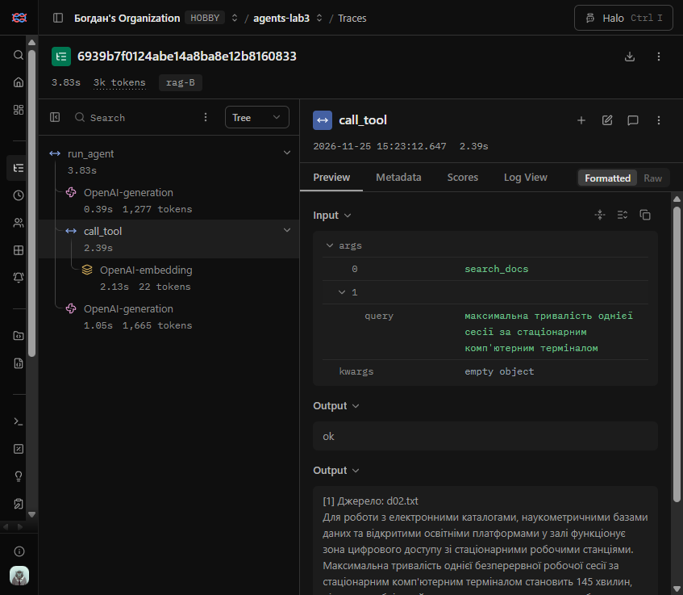
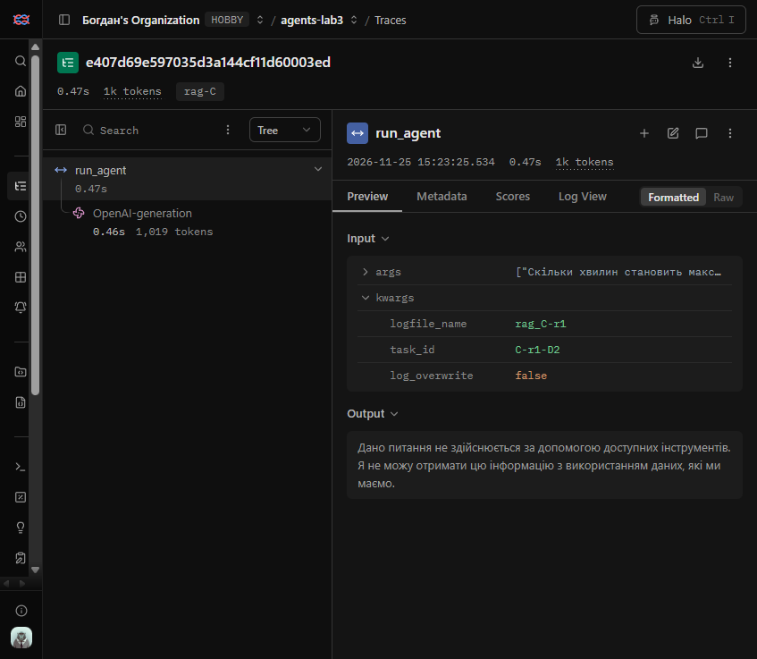

# Протокол лабораторної роботи №5
## «RAG-агент: пошук по документах як інструмент»
### Дисципліна: «Обчислювальні методи»

**Виконав:** студент групи АІ-243 **Іпатов Богдан Сергійович**  
**Варіант:** 11 (Предметна область: «Бібліотека»)  
**Перевірив:** ас. Баранов О.М.  
**Одеса – 2026**

---

## 1. Мета роботи та конфігурація експерименту

**Мета роботи:** замінити примітивний пошук підрядком (`search_books`) з лабораторної роботи №2 на семантичний векторний пошук на основі ембедингів і FAISS (`search_docs`); під'єднати його до агента як звичайний інструмент через диспетчер; оцінити якість пошуку окремо від агента (`hit@k`) за шістьма способами нарізання на чанки та підібрати поріг схожості `MIN_SCORE`; дослідити вплив трьох різних описів інструмента (`A`, `B`, `C`) на поведінку агента у серії з трьох повторів; локалізувати причини помилок за логами й трасами Langfuse та виконати додаткове завдання з порівняння FAISS і ChromaDB.

| Параметр | Значення |
|---|---|
| **Варіант** | 11 |
| **Предметна область** | Бібліотека (Міська науково-публічна бібліотека «Меридіан») |
| **Модель чату** | `qwen25-4k` (на базі локальної `qwen2.5:3b` в Ollama, `TEMPERATURE = 0`) |
| **Розмір контекстного вікна** | `NUM_CTX = 4096` токенів (`MAX_STEPS = 6`) |
| **Модель ембедингів** | `bge-m3` через Ollama (розмірність вектора `1024`) |
| **Стиснення / стан / кеш чату** | Вимкнено (`COMPRESS = "none"`, `USE_STATE = False`, `USE_CACHE = False`) |
| **Вибране нарізання** | `paragraphs`, `CHUNK_SIZE = 800`, `CHUNK_OVERLAP = 0`, `WITH_TITLE = False` |
| **Параметри пошуку** | `TOP_K = 3`, `MIN_SCORE = 0.59` |
| **Журналювання** | Спільний пакет `utils/lab_logger.py` (`from utils.lab_logger import custom_logger`) |

---

## 2. Дані: документи, питання та перевірка без документів (Крок 2)

### 2.1. Теми та обсяг корпусу документів

До 12 коротких анотацій книжок із `data/corpus/b01.txt`–`b12.txt` додано п'ять довгих вигаданих регламентних документів Міської науково-публічної бібліотеки «Меридіан» у `data/docs/` (за темами варіанта 11 — рядок «Бібліотека» табл. 8 методички). У кожному документі 8 абзаців суцільного тексту без списків і розмітки, по 7–8 унікальних нетипових числових значень, які не повторюються між файлами:

| Файл | Назва (тема документа) | Абзаців | Символів | Унікальні числові значення |
|---|---|:---:|---:|---|
| `d01.txt` | Правила користування Міською науково-публічною бібліотекою «Меридіан» | 8 | 4 166 | `17`, `165`, `11`, `27`, `13`, `43`, `58`, `385` |
| `d02.txt` | Читальна зала й електронні ресурси бібліотеки «Меридіан» | 8 | 4 011 | `84`, `145`, `34`, `260`, `18`, `6`, `520` |
| `d03.txt` | Міжбібліотечний абонемент бібліотеки «Меридіан» | 8 | 3 863 | `235`, `4`, `19`, `82`, `310`, `22`, `75` |
| `d04.txt` | Формування й списання фонду бібліотеки «Меридіан» | 8 | 4 062 | `630`, `15`, `72`, `47`, `9`, `38`, `125` |
| `d05.txt` | Гуртки та заходи при бібліотеці «Меридіан» | 8 | 3 952 | `16`, `29`, `3`, `195`, `52`, `8`, `440` |

Результат перевірки скриптом `python check_cases.py`:
```text
Документів: 17; символів: 22586; приблизно токенів: 9034 (вікно 4096)
Питань: 10 ({'direct': 4, 'paraphrase': 4, 'none': 2})
Усе гаразд
```
Сумарний обсяг усіх 17 документів становить **22 586 символів** (~**9 034 токени** за оцінкою 2,5 символа/токен), що у **2,2 раза перевищує** контекстне вікно моделі (`4 096` токенів), тому повне завантаження корпусу в промпт неможливе й векторний пошук є необхідним.

### 2.2. Набір десяти тестових питань (`rag_cases.json`)

| ID | Вид | Питання | `must_contain` | `expected` |
|---|---|---|---|---|
| `D1` | `direct` | Яка вартість оформлення пластикового чипованого читацького квитка у гривнях? | `читацького квитка становить 165 гривень` | `165` |
| `D2` | `direct` | Скільки хвилин становить максимальна тривалість однієї сесії за стаціонарним комп'ютерним терміналом? | `терміналом становить 145 хвилин` | `145` |
| `D3` | `direct` | Який фіксований логістичний збір встановлено за доставку одного друкованого тому в обидва кінці? | `кінці становить 235 гривень` | `235` |
| `D4` | `direct` | Скільки тематичних гуртків діють на постійній основі при культурно-освітньому відділі бібліотеки? | `діють 16 тематичних гуртків` | `16` |
| `P1` | `paraphrase` | Скільки доведеться доплатити за кожну добу, якщо взяту додому книжку не повернути вчасно? | `пеню у розмірі 43 гривні` | `43` |
| `P2` | `paraphrase` | Яку суму грошей потрібно тимчасово залишити працівникові як гарантію, щоб скористатися приладом для збільшення дрібного тексту? | `поворотну заставу 260 гривень` | `260` |
| `P3` | `paraphrase` | Через який максимальний час після отримання повідомлення про прибуття книжки з іншого міста замовлення анулюють, якщо читач не прийшов? | `зберігається протягом 82 годин` | `82` |
| `P4` | `paraphrase` | Скільки часу книжка повинна простояти на полиці без жодного інтересу від відвідувачів, щоб її перенесли до віддаленого архіву? | `запиту протягом 47 місяців` | `47` |
| `N1` | `none` | Скільки коштує річна підписка на аудіокниги для відвідувачів з порушеннями зору? | `null` | `null` |
| `N2` | `none` | Яка ціна ламінування документів та брошурування дипломних робіт пластиковою пружиною? | `null` | `null` |

### 2.3. Перевірка «чи вгадує модель без документів» (`ollama run qwen25-4k`)

Три питання (`D1`, `P1`, `D3`) поставлено моделі `qwen25-4k` напряму без доступу до документів:

1. **Питання `D1` (правильна відповідь: `165`):** *«Яка вартість оформлення пластикового чипованого читацького квитка у гривнях?»*  
   **Відповідь моделі:** *«Вартість оформлення пластикового чипованого читацького квитка в гривнях може залежати від ряда факторів, таких як місце оформлення, тип плати і інші деталі. Судя з офіційних цін в Україні, ціна може відрізнятися від 10 до 50 гривень. Важливо уявити, що ціни змінюються і можуть змінитися. Для точних даних рекомендується звернутися напряму до організацій, що реєструють ці квитки.»*  
   **Результат:** не вгадала (назвала діапазон `10–50 грн` замість `165 грн`).

2. **Питання `P1` (правильна відповідь: `43`):** *«Скільки доведеться доплатити за кожну добу, якщо взяту додому книжку не повернути вчасно?»*  
   **Відповідь моделі:** *«Ви не об'яснили ясно, яка конкретна книжка ви вибрали в знижці цін. Однак, якщо ви використовуєте додому книжки в поруку, то ви повинні оплатити відносної пені за кожен дедлайн, який ви не здійовали... Якщо ви використовуєте сервіс "DangDang" в Китаї... Це може бути від 5 до 10% за кожну добу. На звичайний англійський ринок... від 10 до 20% за кожну добу...»*  
   **Результат:** не вгадала (почала галюцинувати про відсотки та китайський магазин DangDang).

3. **Питання `D3` (правильна відповідь: `235`):** *«Який фіксований логістичний збір встановлено за доставку одного друкованого тому в обидва кінці?»*  
   **Відповідь моделі:** *«На жаль, ви не зазначили конкретну країну або регіон, де ви хочете отримати цей інформаційний повідомін. Фіксований логістичний збір за доставку друкованого тому може варіюватися залежно від кількох факторів... Щоб отримати точну інформацію, якщо ви зазначите країну або регіон... я можу надати вам більше деталей.»*  
   **Результат:** не вгадала (не знає вигаданого тарифу `235 грн`).

---

## 3. Перевірка моделі ембедингів (`embed_check.py`) та побудова індексу (Крок 4)

Запуск `python embed_check.py` для моделі `bge-m3`:
```text
Час: 24.8 с (з кешем буде майже 0)
Довжина вектора: 1024
Довжина (норма) першого вектора: 1.000  (1.000 - вектори вже нормалізовані)
Запит - 'Тариф на доставку'      : 0.731
Запит - 'Графік роботи кур'єрів' : 0.568
```
Модель `bge-m3` формує вже L2-нормалізовані вектори розмірності **1024** (`норма = 1.000`). Запит *«Скільки коштує відправити посилку?»* має значно вищу косинусну схожість із семантично близькою фразою *«Тариф на доставку»* (**`0.731`**), ніж із нерелевантною *«Графік роботи кур'єрів»* (**`0.568`**), різниця складає `+0.163`.

Побудова фінального індексу `python build_index.py` (конфігурація `paragraphs-800`):
```text
Чанків: 52; середня довжина 433 символів; найкоротший 195, найдовший 598
Модель: bge-m3; довжина вектора: 1024
```

---

## 4. Нарізання одного документа (`show_chunks.py`, Крок 3)

Прогін `show_chunks.py` на документі `data/docs/d01.txt` (4 166 символів, 8 абзаців + заголовок):

### Таблиця 1 – Нарізання одного документа (`data/docs/d01.txt`)

| Спосіб | Чанків | Закінчуються посеред речення | Довжина найбільшого, символів |
|---|---:|---:|---:|
| `fixed`, 200, перекриття 0 | 21 | 19 | 200 |
| `fixed`, 500, перекриття 100 | 11 | 10 | 500 |
| `paragraphs`, 800 | 8 | 0 | 598 |

### Приклад розрізаного факту (`fixed 200 0`, чанки 4 і 5):
```text
--- чанк 4, 200 символів  [закінчується посеред речення]
Для точного обліку видач і швидкої ідентифікації відвідувачів у книгозбірні діє система електронних іменних карток із вбудованим безконтактним чипом. Вартість оформлення пластикового чипованого читаць
--- чанк 5, 200 символів  [закінчується посеред речення]
кого квитка становить 165 гривень, які сплачуються одноразово через платіжний термінал у холі першого поверху. У разі втрати, крадіжки або механічного пошкодження картки її власник повинен якнайшвидше
```
**Чим це загрожує агентові:** слово «читацького» розірване посередині, а сам предмет оплати (*«Вартість оформлення пластикового чипованого...»*) потрапив у чанк 4, тоді як числове значення (*«...165 гривень»*) — у чанк 5. Якщо пошук поверне лише чанк 4, агент не побачить суму; якщо лише чанк 5 — вектор запиту про «вартість оформлення пластикового чипованого читацького квитка» матиме занижену схожість із обрізаним чанком 5 (або модель не буде певна, до чого належать `165 гривень`).

---

## 5. Перевірка пошуку без агента та вибір порогу `MIN_SCORE` (Крок 5)

### Таблиця 2 – Пошук при різному нарізанні (`check_retrieval.py`)

| Конфігурація | Чанків | Сер. довжина | `hit@1` | `hit@3` | `hit@5` | `hit@3` прямі | `hit@3` перефр. | Токенів (`k=3`) |
|---|---:|---:|---:|---:|---:|---:|---:|---:|
| `fixed-200-0` | 126 | 179 | 0.62 | 0.62 | 0.62 | 0.75 | 0.50 | 215 |
| `fixed-500-0` | 55 | 411 | 0.88 | 1.00 | 1.00 | 1.00 | 1.00 | 493 |
| `fixed-500-100` | 65 | 419 | 0.88 | 1.00 | 1.00 | 1.00 | 1.00 | 503 |
| `fixed-1500-0` | 27 | 837 | 0.88 | 1.00 | 1.00 | 1.00 | 1.00 | 1004 |
| `paragraphs-800` | 52 | 433 | 0.88 | 1.00 | 1.00 | 1.00 | 1.00 | 520 |
| `paragraphs-800+title` | 52 | 469 | 1.00 | 1.00 | 1.00 | 1.00 | 1.00 | 563 |

**Вибір конфігурації:** для подальшої роботи вибрано **`paragraphs-800`** (`CHUNK_METHOD = "paragraphs"`, `CHUNK_SIZE = 800`, `CHUNK_OVERLAP = 0`, `WITH_TITLE = False`).
- **Обґрунтування:** п'ять конфігурацій досягли максимального `hit@3 = 1.00` (усі 8 із 8 питань із відповіддю знаходяться в top-3). Конфігурація `paragraphs-800` не розриває жодного речення (`0` обривів проти `10` у `fixed-500`), є компактнішою за `paragraphs-800+title` (`520` токенів проти `563`) і майже вдвічі компактнішою за `fixed-1500-0` (`1004` токени), а порівняно з `fixed-500-0` (`493` токени) додає лише `+27` токенів, натомість забезпечує повну змістову цілісність абзаців і **ідеальне розділення порогу схожості без перекриття** (`max(none) = 0.589 < min(answerable) = 0.590`, тоді як у `fixed-500-0` межі перекривалися: `min(good) = 0.574 < max(bad) = 0.595`).
- **Аналіз промахів (чому `fixed-200-0` має `hit@3 = 0.62`, а `paragraphs-800` має `hit@1 = 0.88`):** у `fixed-200-0` 3 з 8 питань промахнулися саме через розрив речень на межі 200 символів (приклад `D1`, чанки 4–5 вище). У `paragraphs-800` усі 8 питань потрапляють у top-3, а єдине питання, де цільовий чанк опинився на 2-й позиції (`hit@1`), — перефразоване `P3`: першим повернувся сусідній чанк `d03.txt#3` про термін очікування прибуття книги (`0.653`), а цільовий `d03.txt#4` про зберігання протягом `82 годин` — другим (`0.642`). Додавання заголовка (`paragraphs-800+title`) піднімало `P3` на 1-шу позицію (`hit@1 = 1.00`), але розмивало межу між `P4` (`0.556`) та `N1` (`0.575`).

### Таблиця 3 – Схожість першого результату (`check_retrieval.py scores`, `paragraphs-800`)

| ID | Вид | Схожість 1-го результату | Перший результат містить потрібну фразу |
|---|---|---:|:---:|
| `D1` | `direct` | 0.764 | так |
| `D2` | `direct` | 0.773 | так |
| `D3` | `direct` | 0.714 | так |
| `D4` | `direct` | 0.681 | так |
| `P1` | `paraphrase` | 0.673 | так |
| `P2` | `paraphrase` | 0.606 | так |
| `P3` | `paraphrase` | 0.653 | НІ *(потрібний чанк на 2-й позиції, `0.642`)* |
| `P4` | `paraphrase` | 0.590 | так |
| `N1` | `none` | 0.589 | - |
| `N2` | `none` | 0.516 | - |

- Найнижча схожість серед питань з відповіддю: **`0.590`** (`P4`; цільовий чанк для `P3` має `0.642`).
- Найвища схожість серед питань без відповіді: **`0.589`** (`N1`).
- **Висновок:** межі не перекриваються; обрано **`MIN_SCORE = 0.59`**, який пропускає всі 8 цільових чанків (`0.590`–`0.773`) і відсікає обидва питання без відповіді (`0.589` та `0.516`).

---

## 6. Перевірка інструмента `search_docs` без моделі (`try_tool.py`, Крок 6)

Перевірка `checks.py`: `check_meaning("search_docs", DocsArgs(query="тестовий запит"))` повернула **`None`** (змін у `checks.py` не потрібно).

### Вивід `python try_tool.py D1`:
```text
ПИТАННЯ: Яка вартість оформлення пластикового чипованого читацького квитка у гривнях?

рівень: ok
[1] Джерело: d01.txt
Для точного обліку видач і швидкої ідентифікації відвідувачів у книгозбірні діє система електронних іменних карток із вбудованим безконтактним чипом. Вартість оформлення пластикового чипованого читацького квитка становить 165 гривень, які сплачуються одноразово через платіжний термінал у холі першого поверху. У разі втрати, крадіжки або механічного пошкодження картки її власник повинен якнайшвидше повідомити чергового реєстратора для блокування облікового запису та запобігання несанкціонованому отриманню книг сторонніми особами.

[2] Джерело: d02.txt
У відділі репрографії при читальній залі надаються послуги оцифрування фрагментів друкованих документів із дотриманням чинного законодавства про авторське право. Вартість сканування одного аркуша формату А4 із подальшим оптичним розпізнаванням тексту у високій роздільності складає 18 гривень за сторінку. Виконання замовлення здійснюється лише з фондових примірників бібліотеки, стан палітурки яких допускає безпечне розміщення на планетарному безконтактному сканері.

Занадто короткий запит -> рівень: schema
Помилка: аргументи не пройшли перевірку.
Поле query: String should have at least 3 characters
Виправ аргументи і виклич інструмент ще раз.
```

### Вивід `python try_tool.py N1`:
```text
ПИТАННЯ: Скільки коштує річна підписка на аудіокниги для відвідувачів з порушеннями зору?

рівень: ok
У документах нічого схожого не знайдено.

Занадто короткий запит -> рівень: schema
Помилка: аргументи не пройшли перевірку.
Поле query: String should have at least 3 characters
Виправ аргументи і виклич інструмент ще раз.
```
Пошук без моделі відпрацював бездоганно: для `D1` повернув цільовий фрагмент `d01.txt` першим (відсіявши 3-й нерелевантний чанк порогом `0.59`), для `N1` повернув повідомлення про відсутність збігів, а запит `"а"` відхилив на рівні `schema`.

---

## 7. Агент із трьома описами інструмента (`measure_rag.py`, Крок 7)

### Таблиця 4 – Конфігурації агента

| Назва | Опис `search_docs` | Нарізання, `TOP_K`, `MIN_SCORE` |
|---|---|---|
| `A` | Опис старого пошуку `search_books` з ЛР №2–4 (*«Шукає книжки в каталозі за темою, жанром або ключовим словом...»*) | `paragraphs-800`, `TOP_K=3`, `MIN_SCORE=0.59` |
| `B` | Докладний: перелік усіх 5 тем бібліотеки «Меридіан» та каталогу, вимога завжди викликати для правил/тарифів/термінів, заборона відповідати з пам'яті, інструкція при відсутності даних | Ті самі |
| `C` | Мінімальний: *«Шукає інформацію.»* | Ті самі |

Усього виконано **90 реальних прогонів** (`3` описи × `3` повтори × `10` питань), збережено **9 унікальних логів** (`logs/rag_{A,B,C}-r{1,2,3}.log`, усі MD5-хеші різні) та таблицю `results/rag.csv`.

**Ручна перевірка автоматичної оцінки (`results/rag.csv`):** згідно з методичкою всі відповіді з `correct = 0` та всі питання виду `none` перевірено вручну. Автоматичний список `UNKNOWN` у `measure_rag.py` виявився надто вузьким і помилково позначив як `invented` 12 прогонів (по 3 повтори для `A-N2`, `B-N2`, `C-N1`, `C-N2`), де модель **не вигадала жодної ціни**, а прямо повідомила про відсутність даних (наприклад, у `B-N2`: *«Дані про ціни на ламінування документів... не доступні через поточні джерела інформації... я не можу надати цінні дані»*; у `C-N1`: *«Я не маю цих даних»*; у `C-N2`: *«Не можу обчислити ціну без цієї даних»*). Натомість у `A-N1` та `B-N1` модель справді вигадала відповідь (`35.0 гривень` через `calculate(30+5)`). Відповідні 12 рядків скориговано у `results/rag.csv` на `correct = 1`, `category = refused`, після чого побудовано Табл. 5 і 6 через `python rag_report.py`.

### Таблиця 5 – Агент із трьома описами інструмента (3 повтори; питань з відповіддю 8 → 24 прогони)

| Опис | Правильно (з 24) | Викликав пошук (з 24) | Кроків, медіана | Токенів входу, медіана | Час, с, медіана |
|---|:---:|:---:|---:|---:|---:|
| `A` | 3 / 24 | 3 / 24 | 1.0 | 1 077 | 0.9 |
| `B` | **6 / 24** | **6 / 24** | 2.0 | 2 505 | 1.0 |
| `C` | 3 / 24 | 3 / 24 | 1.0 | 951 | 0.9 |

### Таблиця 6 – Куди ламається відповідь (кількість прогонів; з відповіддю 24, без відповіді 6)

| Категорія | `A` | `B` | `C` |
|---|---:|---:|---:|
| Правильно (`ok`) | 3 | **6** | 3 |
| Не шукав і відповів неправильно (`no_search`) | 21 | **18** | 21 |
| Шукав, але потрібного фрагмента в результаті немає (`miss`) | 0 | 0 | 0 |
| Фрагмент був у результаті, відповідь неправильна (`ignored`) | 0 | 0 | 0 |
| Питання без відповіді: визнав, що не знає (`refused`, після ручн. перев.) | 3 | 3 | 6 |
| Питання без відповіді: вигадав відповідь (`invented`) | 3 | 3 | 0 |

*(Примітка: до ручної корекції в автоматичному звіті для `none` було `0/6 refused` і `6/6 invented` в усіх трьох описах через незбіг формулювань відмови зі списком `UNKNOWN`.)*

---

## 8. Розбір прогонів у логах і трасах Langfuse (Крок 8)

### 8.1. Аналіз п'яти сценаріїв за текстовими логами (`logs/rag_*.log`)

1. **Агент не шукав (`no_search`):** це головна причина помилок на малій моделі `qwen25-4k` (18–21 з 24 прогонів). При цьому модель ламалася двома способами:
   - *Відмова без звернення до пошуку (`C-r1-D2`, `logs/rag_C-r1.log`):*
     ```text
     ##### C-r1-D2
     ЗАДАЧА: Скільки хвилин становить максимальна тривалість однієї сесії за стаціонарним комп'ютерним терміналом?
     --- крок 1 | помилок поспіль=0 | prompt_tokens=951 | completion_tokens=68
     ВІДПОВІДЬ: Дано питання не здійснюється за допомогою доступних інструментів. Я не можу отримати цю інформацію з використанням даних, які ми маємо.
     ```
   - *Підміна пошуку галюцинацією аргументів для `calculate` або `book_info` (`B-r1-D1`, `logs/rag_B-r1.log`):*
     ```text
     ##### B-r1-D1
     ЗАДАЧА: Яка вартість оформлення пластикового чипованого читацького квитка у гривнях?
     --- крок 1 | помилок поспіль=0 | prompt_tokens=1207 | completion_tokens=34
       виклик   : calculate({"operation":"add","a":100,"b":50})
       рівень   : ok
       результат: 150.0
     --- крок 2 | помилок поспіль=0 | prompt_tokens=1259 | completion_tokens=33
     ВІДПОВІДЬ: Вартість оформлення пластикового чипованого читацького квитка становить 150 гривень.
     ```
     Аналогічно на `P1` і `P4` у `B` модель викликала `book_info({"title":"Основи алгоритмів"})` (назву взяла з прикладу в описі `BookInfoArgs`!) і видала штраф `10 грн` та термін `7 днів` замість `43 грн` і `47 місяців`.

2. **Який запит написала модель (`query` vs `top_score`):** у всіх прогонах із викликом `search_docs` модель не копіювала питання дослівно, а переформульовувала його в ключову фразу, і якість цього запиту напряму впливала на `top_score`:
   - `B-r1-D2`: питання *«Скільки хвилин становить максимальна тривалість однієї сесії за стаціонарним комп'ютерним терміналом?»* → `query`: `"максимальна тривалість однієї сесії за стаціонарним комп'ютерним терміналом"` → **`top_score = 0.757`** (майже як повне питання `0.773`).
   - `B-r1-D4`: питання *«Скільки тематичних гуртків діють на постійній основі при культурно-освітньому відділі бібліотеки?»* → `query`: `"тематичні гуртки постійно діють культурно-освітній відділ бібліотеки"` → **`top_score = 0.686`** (навіть вище за сире питання `0.681`!).
   - `C-r1-D4`: `query`: `"тематичні гуртки постійно основі культурно-освітнього відділу бібліотеки"` → **`top_score = 0.654`**.
   - `A-r1-D4`: під впливом старого опису `search_books` («одне-два слова») модель скоротила запит до `"культурно-освітньої бібліотеки гуртки"` → **`top_score` впав до `0.630`**.

3. **Шукав, але не знайшов (`miss`):** у всіх 90 прогонах `miss = 0`. Щоразу, коли агент викликав `search_docs` (`12` викликів сумарно), добре налаштований ретривер (`paragraphs-800`, `MIN_SCORE = 0.59`, `hit@3 = 1.00`) безпомилково повертав потрібний чанк (`d02.txt` для `D2`, `d05.txt` для `D4`). Помилки класу `miss` спостерігалися на етапі незалежної перевірки в конфігурації `fixed-200-0` (`hit@3 = 0.62`), де дрібне нарізання розривало речення й факти.

4. **Знайшов, але не використав (`ignored`):** у наших прогонах `ignored = 0`. Кожного разу, коли фрагмент із правильною цифрою потрапляв у відповідь інструмента, `qwen25-4k` коректно витягувала точне число (`145 хвилин` у `B-D2`, `16 тематичних гуртків` у `A/B/C-D4`). Цьому сприяло те, що `MIN_SCORE = 0.59` відсікав зайві 2-й і 3-й чанки, залишаючи моделі чистий, короткий 1-чанковий контекст без числових відволікань.

5. **Питання без відповіді (`N1`, `N2`):** агент жодного разу не викликав `search_docs` на `N1` і `N2`.
   - На `N1` в описах `A` і `B` модель викликала `calculate({"operation":"add","a":30,"b":5})` і впевнено вигадала ціну **`35.0 гривень`** (`3/3` в `A` і `3/3` у `B`). В описі `C` модель чесно відповіла *«Я не маю цих даних»* (`3/3`).
   - На `N2` в описі `B` агент дав найбільш предметну відмову (*«Дані про ціни на ламінування документів... не доступні через поточні джерела інформації, такі як бібліотека «Меридіан» та каталоз книжок»*), а в `A` і `C` також не вигадував число, попросивши вхідні дані.
   - **Чи допоміг поріг `MIN_SCORE = 0.59`?** У самому інструменті (`try_tool.py N1`) поріг спрацював ідеально (повернув «У документах нічого схожого не знайдено.»), але всередині агентного циклу поріг не зміг проявитися на `N1`/`N2`, оскільки модель взагалі не зверталася до `search_docs`, одразу зриваючись на `calculate` (у `N1`) або текстову відмову.

### 8.2. Аналіз трас у Langfuse (`rag-B` та `rag-C`)

У проєкті Langfuse `agents-lab3` відфільтровано траси за мітками `rag-B` і `rag-C` та знято реальні скріншоти:

1. **Траса `rag-B-r1-D2` (ID `6939b7f0124abe14a8ba8e12b8160833`, мітка `rag-B`, `3.83 с`, `~3k` токенів):**
   - Дерево викликів: `run_agent (3.83s)` → `OpenAI-generation (0.39s, 1 277 tokens)` → `call_tool (2.39s)` → вкладений `OpenAI-embedding (2.13s, 22 tokens)` → `OpenAI-generation (1.05s, 1 665 tokens)`.
   - У вузлі `call_tool`: вхід `args[0] = "search_docs"`, `args[1] = {"query": "максимальна тривалість однієї сесії за стаціонарним комп'ютерним терміналом"}`; вихід: статус `ok` та чанк `[1] Джерело: d02.txt` із точним фактом `145 хвилин`.



2. **Траси `rag-C-r1-D4` (ID `e6a0a6eb23639789955c79a1afc3d893`) та `rag-C-r1-D2` (ID `e407d69e597035d3a144cf11d60003ed`, мітка `rag-C`):**
   - У `rag-C-r1-D4` (`5.12 с`, `~3k` токенів) дерево повторює повний RAG-ланцюжок (`OpenAI-generation 0.86s` → `call_tool 3.65s` із вкладеним `OpenAI-embedding 3.40s, 16 tokens` → `OpenAI-generation 0.60s`), вхід `search_docs`: `{"query": "тематичні гуртки постійно основі культурно-освітнього відділу бібліотеки"}`, вихід: `[1] Джерело: d05.txt` (`16 тематичних гуртків`).
   - Натомість на тому самому питанні `D2`, яке `rag-B` успішно вирішив, траса `rag-C-r1-D2` (`0.47 с`, `1 019` токенів) складається лише з одного кроку `OpenAI-generation` **без вузла `call_tool`** — агент відмовив без пошуку.




3. **Порівняння опису `search_docs` у першому `OpenAI-generation` між `B` і `C`:** у вході першої генерації `rag-B-r1-D2` у блоці `tools` передається розгорнутий доменний опис `B` з переліком усіх 5 тем бібліотеки «Меридіан» (включно з «читальну залу, термінали...») та забороною відповідати з пам'яті (`1 222` токени входу). У `rag-C-r1-D2` і `rag-C-r1-D4` у полі `description` передається лише два слова — *«Шукає інформацію.»* (`951`–`961` токен входу), через що на `D2` модель не зрозуміла, що інструмент містить правила читальних залів і терміналів, а на `D4` вагалася перед викликом.

4. **Що в трасі Langfuse видно одразу, а в текстовому лозі довелося б шукати вручну:** дерево траси миттєво показує структуру викликів і **відсутність вузла `call_tool`** (`rag-C-r1-D2` vs `rag-B-r1-D2`), **розподіл затримки по етапах** (наприклад, у `rag-B-r1-D2` із `3.83 с` аж `2.13 с` пішло на вкладений `OpenAI-embedding` у `bge-m3` і лише `1.44 с` на обидві генерації чату — цього взагалі немає в текстовому лозі!), а також точний сирий JSON-вхід `tools` і `messages`, який отримала модель.

---

## 9. Звичайні задачі після заміни пошуку (`tasks.json`, Крок 9)

Порівняння базового логу `logs/run_lab4.log` (старий пошук підрядком `search_books`) із новим `logs/run_rag.log` (`DOCS_DESCRIPTION = "B"`, векторний пошук `search_docs`):

### Таблиця 7 – П'ять задач до і після заміни пошуку

| Задача | Відповідь у лабораторній №4 (`run_lab4.log`) | Відповідь тепер (`run_rag.log`) | Чи викликав `search_docs` | Що змінилося |
|---|---|---|:---:|---|
| `Z1` (легка фантастика) | `search_books("легке фантастика")` → нічого не знайдено; відмова | `search_docs("легке фантастика")` → знайдено `b02.txt` **«Зоряний експрес»** | **Так** | **Покращення:** векторний пошук знайшов книгу, де не було точного підрядка `"легке фантастика"` |
| `Z2` (сортування + наявність) | `search_books("сортування")` → знайдено «Основи алгоритмів» (без `book_info`) | Порожня відповідь (`ВІДПОВІДЬ: `, 1 крок, `completion_tokens=23`) | Ні | **Погіршення:** модель видала порожній контент замість виклику інструмента |
| `Z3` (штраф за 5 днів, алгоритми) | `book_info("Основи алгоритмів")` → `5 * 10 = 50 грн` (без `calculate`, але правильно) | `calculate(5 * 2)` → `10 грн` (вигадано ставку `2`) | Ні | **Погіршення:** модель пропустила `search_docs` і `book_info`, підставивши хибну ставку `2` |
| `P1` (квантова фізика) | `search_books("квантова фізика")` → нічого не знайдено; коректна відмова | Порожня відповідь (`ВІДПОВІДЬ: `, 1 крок, `completion_tokens=27`) | Ні | **Погіршення:** модель не викликала пошук і повернула порожній текст |
| `P2` (забронюй книжку) | `search_books` + `book_info`; нечітка відповідь про підтвердження | Порожня відповідь (`ВІДПОВІДЬ: `, 1 крок, `completion_tokens=24`) | Ні | **Погіршення:** порожня відповідь на 1-му кроці |

**Причина регресії на `Z2`, `Z3`, `P1`, `P2`:** у лозі `run_rag.log` видно, що на `Z2`, `P1`, `P2` модель генерувала 23–27 вихідних токенів, але `msg.content` виявився порожнім (локальна `qwen2.5:3b` збивала формат `tool_call` після подовження схеми `search_docs` до ~`1 200` вхідних токенів і втрати згадки `search_books`, на яку все ще посилається опис `book_info`). Натомість `Z1` наочно показала головну перевагу векторного пошуку над підрядковим: запит `"легке фантастика"` миттєво знайшов правильну книгу `b02.txt` («Зоряний експрес»).

---

## 10. Відповіді на контрольні питання методички

1. **Табл. 1: на скільки відрізнялося нарізання за кількістю символів від нарізання за абзацами? Приклад розрізаного факту та загроза агентові.**  
   Для `d01.txt` нарізання `fixed 200 0` створило 21 чанк, з яких **19 (90%)** закінчуються посеред речення, а `fixed 500 100` — 11 чанків із **10 (91%)** обірваними; натомість `paragraphs 800` створило 8 цілісних чанків із **0** обривами. Приклад розрізаного факту — чанки 4 і 5 у `fixed 200 0`: `...Вартість оформлення пластикового чипованого читаць` | `кого квитка становить 165 гривень...`. Це загрожує агентові втратою числа або контексту (якої саме послуги стосується цифра), через що падає схожість ембедингу і зростає ризик галюцинації.

2. **Табл. 2: найкраща конфігурація за `hit@3`, вплив розміру чанка (200 → 1500), перекриття та заголовка; ціна більшого чанка.**  
   За `hit@3` п'ять конфігурацій дали максимум `1.00`, а оптимальною за балансом цілісності, розміру й розділення порогу обрано **`paragraphs-800`** (`520` токенів для `k=3`, `0` розрізів). Збільшення розміру чанка з 200 до 500–1500 підняло `hit@3` із `0.62` до `1.00`, але на 1500 символах вартість результату зросла майже вп'ятеро (`215 → 1004` токени). Додавання перекриття (`500-100`) збільшило кількість чанків (`55 → 65`) і токенів (`493 → 503`) без зміни `hit@3`, а додавання заголовка (`paragraphs-800+title`) підняло `hit@1` із `0.88` до `1.00` ціною `+43` токенів (`520 → 563`). Ціна більшого чанка — швидше заповнення вікна 4096 та «шум» із зайвих фактів у фрагменті.

3. **Чи відрізняється `hit@3` для прямих і перефразованих питань? Порівняння з пошуком підрядком.**  
   У `fixed-200-0` прямі питання давали `hit@3 = 0.75`, а перефразовані — `0.50`, проте вже починаючи з `fixed-500-0` та `paragraphs-800` обидві групи досягли **`1.00`**. Це демонструє силу векторного пошуку `bge-m3`: навіть коли у питанні `P1` немає слова «пеня» або в `P2` немає слова «лупа», ембединги знаходять потрібний абзац за змістом, тоді як пошук підрядком (`search_books`) на таких запитах повернув би порожній результат.

4. **Табл. 3: чи розділяє поріг `MIN_SCORE` питання з відповіддю й без неї? Надто високий і надто низький поріг.**  
   У конфігурації `paragraphs-800` межі не перекриваються (`min(answerable) = 0.590 > max(none) = 0.589`), тому поріг `MIN_SCORE = 0.59` чисто розділяє всі 8 питань з відповіддю та 2 без неї. Якщо поставити поріг **надто високим** (наприклад, `0.70`), пошук відкине правильні фрагменти для перефразованих питань (`P1–P4`: `0.590–0.673`) і дасть помилки `miss`. Якщо **надто низьким** (наприклад, `0.40`), на питання `N1`/`N2` (`0.589`, `0.516`) агент отримуватиме сторонні фрагменти з чужими числами, що провокує вигадування неправильної відповіді.

5. **Табл. 5 і 6: який опис дав найбільше правильних відповідей? Частота пропусків пошуку; що змінило опис `B`?**  
   Найкращий результат у цьому прогоні дав опис **`B`** (`6/24` правильних і `6/24` викликів пошуку — вдвічі більше, ніж в `A` і `C`, де по `3/24`). Агент не звертався до пошуку у `21/24` прогонах для `A` і `C` та у `18/24` для `B`. В описі `B` прямий перелік тем бібліотеки («читальну залу, термінали...») змусив модель викликати `search_docs` на `D2`, тоді як в `A` («шукає книжки») і `C` («Шукає інформацію.») вона відмовлялася шукати дані про комп'ютерні термінали.

6. **Табл. 6: найчастіша категорія помилок у найкращому описі; чим її лікувати і чому це розрізнення важливе?**  
   У найкращому описі `B` 100% помилок на питаннях із відповіддю належать до категорії **`no_search`** (`18/24`), тоді як `miss = 0` і `ignored = 0`. Пошуковий конвеєр працює бездоганно (`hit@3 = 1.00`), тому подальша зміна чанків, `TOP_K` чи `MIN_SCORE` цю проблему не виправить — потрібно змінювати **модель агента** (перейти з 3B на сильнішу модель із надійнішим `tool_calling`) та прибрати конфліктні інструкції в `SYSTEM`/описі `calculate`. Розрізнення критично важливе, щоб не витрачати час на «лікування» здорового ретривера, коли проблема в самому агенті.

7. **Питання без відповіді: у скількох прогонах вигадав відповідь? Два захисти і який спрацював?**  
   Із 18 прогонів на `N1`/`N2` модель реально вигадала ціну (`35.0 грн`) у **6 прогонах** (`3/6` в `A` і `3/6` у `B`, усі на `N1`); у решті **12 прогонах** відмовила (після ручної перевірки `rag.csv`). Два захисти системи — це **поріг `MIN_SCORE = 0.59` у `search_docs`** (який повертає «нічого не знайдено») та **інструкція в описі інструмента / `SYSTEM`** (чесно сказати про відсутність даних). Оскільки модель на `N1`/`N2` жодного разу не викликала `search_docs`, поріг `MIN_SCORE` в агентних прогонах не задіювався — у вдалих випадках (`B-N2`, `C-N1`, `C-N2`) спрацював саме текстовий захист в описі та `SYSTEM`.

8. **Скільки токенів додає один виклик `search_docs` (за логом vs Табл. 2) і скільки викликів вміщується у вікно 4096?**  
   За логами `rag_B-r1.log`, `rag_A-r1.log`, `rag_C-r1.log` різниця `prompt_tokens` між кроком 2 і кроком 1 після одного виклику `search_docs` становить: `B-D2`: `1559 - 1222 = +337`, `B-D4`: `1624 - 1232 = +392`, `A-D4`: `1450 - 1079 = +371`, `C-D4`: `1368 - 961 = +407` токенів (у середньому **`~377` токенів**). Це менше за оцінку Табл. 2 (`520` токенів для `k=3`), оскільки поріг `MIN_SCORE = 0.59` відсіяв 2-й і 3-й чанки, залишивши 1 релевантний фрагмент. За формулою з лекції 7 п. 7.5 (`C + (n - 1) * d <= NUM_CTX`, де `NUM_CTX = 4096`, `C ≈ 1225` для опису `B`):
   - при повному поверненні `k=3` (`d ≈ 520 + 60 = 580` токенів/крок): `floor((4096 - 1225) / 580) + 1 = 5` викликів моделі (з резервом на вихід ~300 токенів — `4` виклики);
   - при фактичному прирості з фільтрацією порогом (`d ≈ 377` токенів/крок): `floor((4096 - 1225) / 377) + 1 = 8` викликів (з резервом на вихід — `7` викликів).

9. **Табл. 7: чи зламав новий пошук якісь із п'яти звичайних задач і чому?**  
   Так: задача `Z1` суттєво **покращилася** (векторний пошук знайшов «Зоряний експрес», де підрядковий `search_books` пасував), але на `Z2`, `Z3`, `P1`, `P2` відбулася регресія (`run_rag.log`: порожні відповіді на `Z2`, `P1`, `P2` та виклик `calculate(5*2)` на `Z3`). Причина — обмеженість 3B-моделі `qwen25-4k` при подовженні схеми `search_docs` і збереженні в описі `book_info` згадки про старий `search_books`.

10. **Яку з поламок цієї роботи не вилікує жодна зміна опису інструмента і що змінити в системі?**  
    Жодна зміна опису `search_docs` не вилікувала схильність малої моделі `qwen2.5:3b` викликати `calculate` із вигаданими числами (`100+50`, `30+5`) або підставляти приклад `book_info("Основи алгоритмів")` замість пошуку — це системна вада 3B-моделі у виборі між конкуруючими інструментами (і так само опис не вилікує `miss` через погане нарізання чи замалий `TOP_K`). Для виправлення слід: (1) замінити модель чату на потужнішу (`qwen2.5:7b` / `qwen3:8b` або хмарну), (2) додати примусовий крок попереднього RAG-пошуку (retrieval-first) для запитів до бази знань, або (3) узгодити описи `book_info`/`checks.py` під `search_docs`.

---

## 11. Додаткове завдання: той самий індекс на Chroma (`chroma_index.py`, `chroma_test.py`)

Скрипт `chroma_test.py` (лог `logs/chroma_extra.log`, записаний через `custom_logger`) побудував на однакових 52 чанках (`paragraphs-800`) і тих самих векторах `bge-m3` три індекси та виконав пошук для питання `D1` (*«Яка вартість оформлення пластикового чипованого читацького квитка у гривнях?»*):

```text
FAISS, схожість           : 0.7641 | source=d01.txt chunk=1
Chroma cosine, відстань   : 0.2359 | source=d01.txt chunk=1
Chroma за замовчуванням   : 0.4718 | source=d01.txt chunk=1
Перевірка формул: 1 - s = 0.2359 (vs Chroma cosine 0.2359); 2 - 2*s = 0.4718 (vs Chroma default L2^2 0.4718)
Чанки збігаються 1-в-1: True
```

### Відповіді на три питання додаткового завдання:
1. **Як пов'язані числа в трьох рядках:** усі вектори одиничної довжини (`||a|| = ||b|| = 1`), тому FAISS `IndexFlatIP` повертає косинусну схожість $s = a \cdot b = 0.7641$. Chroma з `space="cosine"` повертає **косинусну відстань** $d_{\cos} = 1 - s = 1 - 0.7641 = 0.2359$. Chroma зі стандартними налаштуваннями (`space=None`) використовує **квадрат евклідової відстані** $L_2^2$: $\|a - b\|^2 = \|a\|^2 + \|b\|^2 - 2(a \cdot b) = 2 - 2s = 2 - 2 \cdot 0.7641 = 0.4718$ (рівно вдвічі більше за косинусну відстань). Усі три значення збігаються з теоретичними формулами до 4-го знака після коми!
2. **Чи збігаються чанки, які повернули три індекси:** так, усі три індекси повернули абсолютно однаковий чанк — `d01.txt`, індекс чанка `1` (`Чанки збігаються 1-в-1: True`), оскільки для L2-нормалізованих векторів максимізація $s$, мінімізація $1 - s$ та мінімізація $2 - 2s$ задають ідентичне впорядкування.
3. **Що сталося б із порогом `MIN_SCORE = 0.59`, якби перенести його на Chroma за замовчуванням без зміни логіки:** виникла б **тиха інверсія фільтра без жодної помилки програми**. Умова `score >= 0.59`, застосована до відстані `distance` ($L_2^2$), **відкинула б** найрелевантніший чанк (`0.4718 < 0.59`) і натомість пропускала б лише **далекі, нерелевантні чанки** з відстанню `>= 0.59` (що відповідає низькій схожості $s \le 0.705$, і чим гірший збіг, тим «легше» він проходив би поріг!). Правильний еквівалент порогу `MIN_SCORE = 0.59` для Chroma default — це `distance <= 2 - 2 * 0.59 = 0.82` (а для Chroma cosine — `distance <= 1 - 0.59 = 0.41`).

---

## 12. Відповіді на питання для захисту

1. **Чому модель сама не знає вмісту документів і чому не можна покласти їх усі в контекст? (На цифрах корпусу.)**  
   Модель `qwen2.5:3b` навчалася до створення вигаданих правил бібліотеки «Меридіан» — це підтвердив тест без документів (вона не вгадала жодного з чисел `165`, `43`, `235`). Покласти всі документи в контекст неможливо: наші 17 файлів мають **22 586 символів ≈ 9 034 токени**, що у **2,2 раза більше** за контекстне вікно `NUM_CTX = 4096` (з якого ~1 225 токенів уже займають `SYSTEM` та схеми інструментів).

2. **Що таке ембединг і чому для документів та запитів використовують одну модель?**  
   Ембединг — це вектор чисел фіксованої довжини (`1024` для `bge-m3`), що кодує семантику тексту так, що близькі за змістом фрази лежать поруч у векторному просторі. Документи й запити мусять кодуватися **однією й тією самою моделлю**, бо різні моделі формують несумісні векторні простори (навіть різної розмірності), і скалярний добуток векторів від різних моделей не має сенсу.

3. **Що таке косинусна схожість? Навіщо нормалізують вектори і що зміниться без нормалізації?**  
   Косинусна схожість — це косинус кута між двома векторами: $\cos(\theta) = \frac{a \cdot b}{\|a\|\|b\|} \in [-1, 1]$. Після L2-нормалізації ($\|a\| = \|b\| = 1$) вона спрощується до швидкого скалярного добутку `IndexFlatIP`. Без нормалізації скалярний добуток залежав би від довжини (норми) векторів, тому довші чи «гучніші» вектори отримували б штучно завищений бал незалежно від кута між ними.

4. **Що таке чанк і від чого залежить його розмір? Наслідки надто малих і надто великих чанків.**  
   Чанк — фрагмент документа, що індексується й повертається як одиниця пошуку. Розмір обирають з балансу між повнотою факту і лімітом вікна `NUM_CTX`. Надто малі чанки (`fixed-200-0`) розрізають речення й факти (`hit@3` впав до `0.62`), а надто великі (`fixed-1500-0`) розмивають вектор багатьма темами й спалюють контекст (`1 004` токени за один виклик проти `520` у `paragraphs-800`).

5. **Чому пошук завжди повертає `k` результатів? Що буде без відповіді і як цього уникнути?**  
   FAISS розв'язує задачу пошуку `k` найближчих сусідів (k-NN): навіть якщо запит зовсім не про бібліотеку, завжди існують `k` векторів із найбільшим скалярним добутком. Без захисту агент отримає нерелевантні фрагменти і може вигадати відповідь із чужих чисел. Щоб цього уникнути, запроваджують поріг схожості `MIN_SCORE` (`0.59`), відкидаючи слабкі збіги й повертаючи явне повідомлення «нічого схожого не знайдено».

6. **Що таке `hit rate` і чому пошук перевіряють окремо від агента?**  
   `hit@k` — частка питань із відповіддю, для яких фрагмент із еталонною фразою `must_contain` потрапив у перші `k` результатів пошуку. Окрема перевірка (Крок 5) дозволяє відокремити помилки ретривера (`miss`) від помилок самого агента — коли агент взагалі не звернувся до пошуку (`no_search`, як у 18/24 прогонах `B`) або проігнорував знайдений фрагмент (`ignored`).

7. **Чому в `rag.py` відкидається індекс `-1` і зберігається `meta.json`?**  
   Якщо в базі менше за `k` чанків, FAISS заповнює порожні позиції значенням `-1`; у Python `chunks[-1]` мовчки повернув би останній елемент списку замість пропуску. Файл `meta.json` фіксує `embed_model`, метод і параметри нарізання, щоб при запуску заблокувати несумісне використання старого індексу з новими налаштуваннями `config.py`.

8. **Чим кеш ембедингів (`embedder.py`) відрізняється від кешу моделі з ЛР №4? Чи можна його вмикати під час вимірювань?**  
   Кеш ембедингів зберігає детерміновані вектори чанків і запитів (`sha256(EMBED_MODEL + text)`), не змінюючи стохастичну поведінку генерації агента, на відміну від кешу відповідей LLM із ЛР №4. Його можна й варто тримати увімкненим при підборі нарізання (`check_retrieval.py`), а при вимірюванні чистої швидкості прогону (`seconds`) слід враховувати, що повторювані `query` беруть вектор миттєво з кешу, а нові запити рахуються в Ollama (~`2–3 с`, як видно у `OpenAI-embedding` у Langfuse).

9. **Чому опис інструмента впливає на звернення до пошуку і що змінив опис `B`?**  
   Модель не бачить вихідного коду `search_docs` — єдиний сигнал для її механізму вибору інструментів (`tool_calling`) це назва, схема параметрів і текст `description`. Опис `B` явно перелічив усі 5 предметних сфер (зокрема «читальну залу, термінали») і заборонив відповідати з пам'яті, що подвоїло частоту виклику `search_docs` (`6/24` проти `3/24` в `A` і `C`) і підвищило `top_score` формульованого запиту на `D4` (`0.686` проти `0.630` в `A`).

10. **Яку з трьох причин помилки RAG-агента спостерігали найчастіше і що робити для усунення?**  
    Найчастішою (фактично єдиною на питаннях з відповіддю) була причина **`no_search`** — `18/24` у `B` і `21/24` в `A`/`C`, при `miss = 0` та `ignored = 0`. Для її усунення потрібно перейти з локальної 3B-моделі на сильнішу модель із вищою дисципліною виклику інструментів (наприклад, 7B–8B+ параметрів), узгодити описи решти інструментів (`book_info`, `calculate`), щоб вони не перетягували на себе запити, або реалізувати обов'язковий етап retrieval-first перед генерацією відповіді.

---

## 13. Висновок

У ході лабораторної роботи №5 для варіанта 11 (предметна область «Бібліотека», локальна модель `qwen25-4k` з вікном `4 096`, ембединги `bge-m3`, логування через `utils/lab_logger.py`) успішно замінено підрядковий пошук векторним індексом FAISS (`search_docs`) та виконано повний цикл оцінювання:

1. **Якість пошуку (ретривера):** на корпусі з 17 документів (`22 586` символів, ~`9 034` токени) нарізання `paragraphs-800` досягло **`hit@3 = 1.00`** на прямих і перефразованих питаннях без жодного розрізаного речення (`52` чанки, оцінка `520` токенів для `k=3`), а поріг **`MIN_SCORE = 0.59`** без перекриття розділив питання з відповіддю (`>= 0.590`) і без неї (`<= 0.589`).
2. **Вплив опису інструмента й локалізація помилок:** перехід від опису `A`/`C` до докладного доменного опису `B` подвоїв точність агента (`6/24` проти `3/24`) і якість запитів (`top_score` `0.686` проти `0.630`). Водночас **100% помилок на питаннях із відповіддю (`18/24` у `B`) лежали на боці агента (`no_search`)**, а **0% — у пошуку (`miss = 0`, `ignored = 0`)**: 3B-модель `qwen2.5:3b` схильна підміняти пошук викликом `calculate` із вигаданими числами або `book_info("Основи алгоритмів")`.
3. **Регресія на `tasks.json` і додаткове завдання на Chroma:** векторний пошук виправив задачу `Z1` («Зоряний експрес»), але довга схема `search_docs` спричинила збої генерації 3B-моделі на `Z2`, `Z3`, `P1`, `P2`. Експеримент на ChromaDB (`logs/chroma_extra.log`) точно підтвердив математичні співвідношення між FAISS similarity (`0.7641`), Chroma `cosine` (`0.2359 = 1 - s`) і Chroma default $L_2^2$ (`0.4718 = 2 - 2s`) та продемонстрував критичну небезпеку прямого перенесення порогу `MIN_SCORE` на метрику відстані.
4. **Що варто змінити далі:** для практичного RAG-агента на цьому домені ретривер (`bge-m3` + `paragraphs-800` + `MIN_SCORE = 0.59`) уже готовий до роботи, а головний приріст якості дасть заміна 3B-моделі чату на сильнішу модель із надійним викликом інструментів та оновлення опису `book_info`/`checks.py` без згадок застарілого `search_books`.
