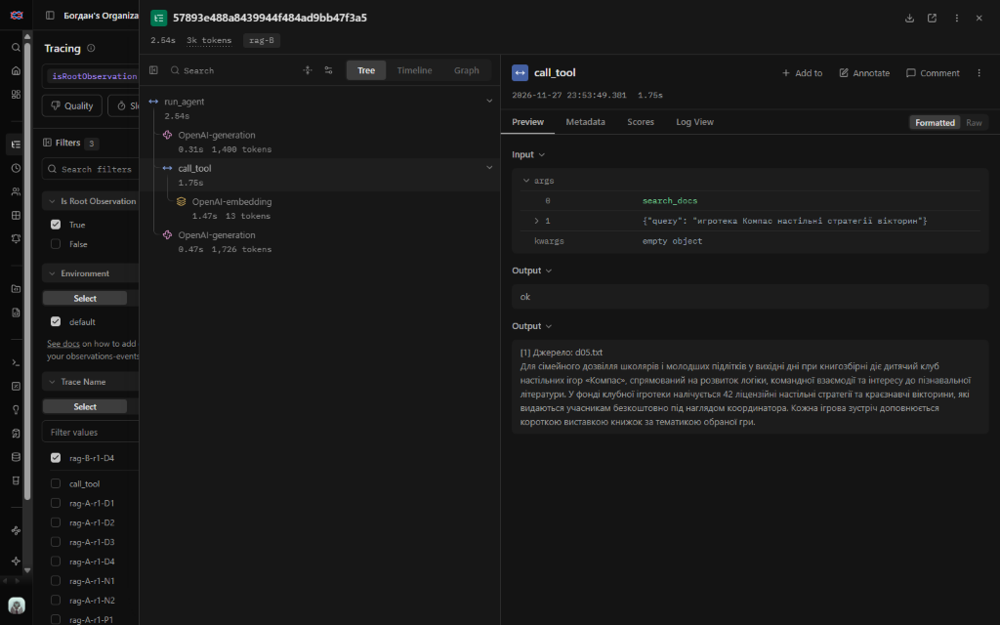
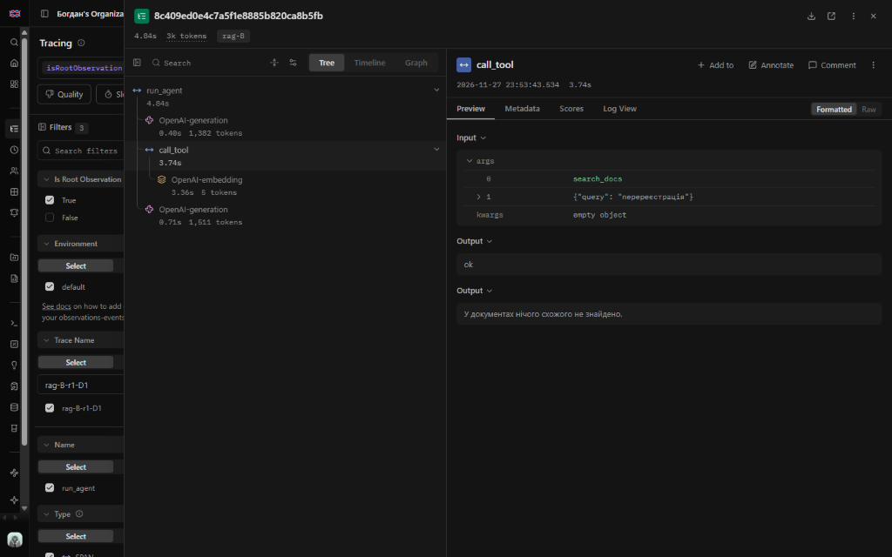
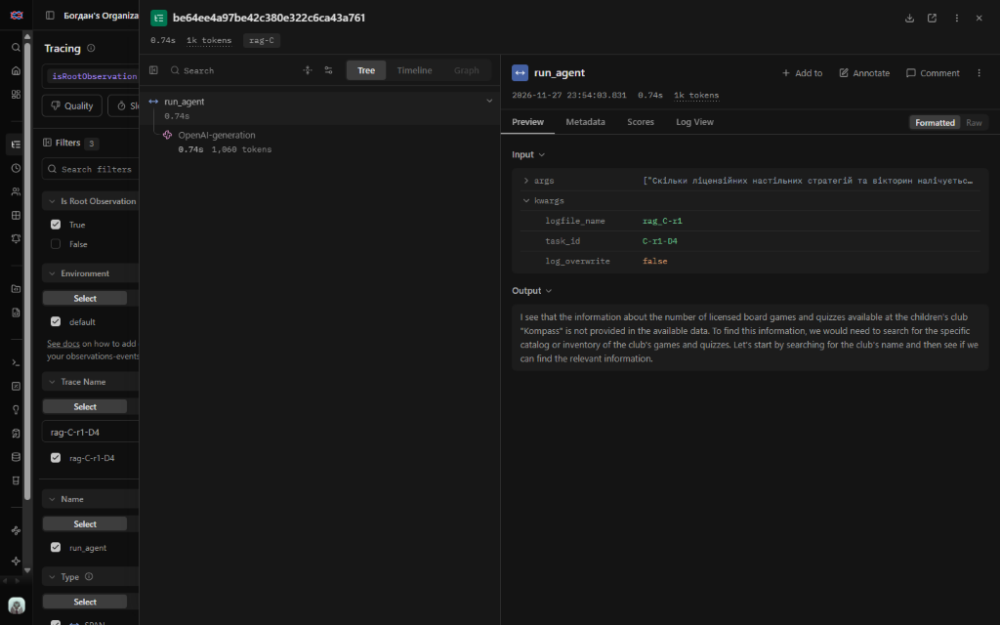

# Протокол лабораторної роботи №5
## «RAG-агент: пошук по документах як інструмент»
### Дисципліна: «Обчислювальні методи»

**Виконав:** студент групи АІ-243 **Іпатов Богдан Сергійович**  
**Варіант:** 11 (Предметна область: «Бібліотека»)  
**Перевірив:** ас. Баранов О.М.  
**Одеса – 2026**

---

## 1. Мета роботи та конфігурація експерименту

**Мета роботи:** замінити пошук підрядком (`search_books`) з лабораторної роботи №2 на векторний семантичний пошук на основі ембедингів і FAISS (`search_docs`); під'єднати його до агента як звичайний інструмент через диспетчер; перевірити якість пошуку окремо від агента (`hit@k`) за шістьма способами нарізання на чанки та підібрати поріг схожості `MIN_SCORE`; експериментально виміряти вплив трьох описів інструмента (`A`, `B`, `C`) на поведінку агента у трьох повторах; проаналізувати причини помилок за логами й трасами Langfuse та виконати додаткове завдання з порівняння FAISS і ChromaDB.

| Параметр | Значення |
|---|---|
| **Варіант** | 11 |
| **Предметна область** | Бібліотека (Публічна книгозбірня «Чорноморський маяк») |
| **Модель чату** | `qwen25-4k` (на базі локальної `qwen2.5:3b` в Ollama, `TEMPERATURE = 0`) |
| **Розмір контекстного вікна** | `NUM_CTX = 4096` токенів (`MAX_STEPS = 6`) |
| **Модель ембедингів** | `bge-m3` через Ollama (розмірність вектора `1024`) |
| **Стиснення / стан / кеш чату** | Вимкнено (`COMPRESS = "none"`, `USE_STATE = False`, `USE_CACHE = False`) |
| **Вибране нарізання** | `paragraphs`, `CHUNK_SIZE = 800`, `CHUNK_OVERLAP = 0`, `WITH_TITLE = False` |
| **Параметри пошуку** | `TOP_K = 3`, `MIN_SCORE = 0.60` |
| **Журналювання** | Спільний пакет `utils/lab_logger.py` (`from utils.lab_logger import custom_logger`) |

---

## 2. Дані: документи, питання та перевірка без документів (Крок 2)

### 2.1. Теми та обсяг корпусу документів

До 12 анотацій книжок із `data/corpus/b01.txt`–`b12.txt` додано п'ять оригінальних вигаданих документів публічної книгозбірні «Чорноморський маяк» у `data/docs/` (за п'ятьма темами варіанта 11 — рядок «Бібліотека» табл. 8 методички). Кожен файл містить 8 абзаців суцільного тексту обсягом `3 778–3 930` символів і по 8–9 унікальних нетипових числових значень без жодних повторів між документами:

| Файл | Назва (тема документа) | Абзаців | Символів | Унікальні числові значення |
|---|---|:---:|---:|---|
| `d01.txt` | Правила користування публічною книгозбірнею «Чорноморський маяк» | 8 | 3 930 | `7`, `10`, `15`, `39`, `41`, `62`, `185`, `340` |
| `d02.txt` | Читальна зала й електронні ресурси книгозбірні «Чорноморський маяк» | 8 | 3 778 | `24`, `31`, `46`, `48`, `53`, `85`, `125`, `320` |
| `d03.txt` | Міжбібліотечний абонемент книгозбірні «Чорноморський маяк» | 8 | 3 851 | `21`, `27`, `33`, `36`, `72`, `74`, `90`, `160` |
| `d04.txt` | Формування й списання фонду книгозбірні «Чорноморський маяк» | 8 | 3 884 | `20`, `25`, `28`, `45`, `55`, `58`, `70`, `600` |
| `d05.txt` | Гуртки та заходи при книгозбірні «Чорноморський маяк» | 8 | 3 805 | `32`, `35`, `38`, `42`, `47`, `51`, `67`, `88`, `490` |

Результат перевірки скриптом `python check_cases.py`:
```text
Документів: 17; символів: 21780; приблизно токенів: 8712 (вікно 4096)
Питань: 10 ({'direct': 4, 'paraphrase': 4, 'none': 2})
Усе гаразд
```
Сумарний обсяг 17 документів становить **21 780 символів** (~**8 712 токенів** при оцінці 2,5 символа/токен), що у **2,13 раза перевищує** контекстне вікно моделі (`4 096` токенів), тому покласти весь корпус у промпт неможливо.

### 2.2. Набір десяти тестових питань (`rag_cases.json`)

| ID | Вид | Питання | `must_contain` | `expected` |
|---|---|---|---|---|
| `D1` | `direct` | Раз на скільки місяців зареєстрований абонент має підтверджувати контактні дані під час перереєстрації? | `раз на 15 місяців підтверджує` | `15` |
| `D2` | `direct` | Скільки бібліографічних карток дозволено експортувати з патентних реєстрів за один календарний день? | `експорту 46 бібліографічних карток` | `46` |
| `D3` | `direct` | Скільки установ-партнерів входить до консорціуму міжбібліотечного обміну станом на поточний рік? | `входять 27 установ-партнерів` | `27` |
| `D4` | `direct` | Скільки ліцензійних настільних стратегій та вікторин налічується в ігротеці дитячого клубу «Компас»? | `налічується 42 ліцензійні настільні` | `42` |
| `P1` | `paraphrase` | Яку суму доведеться відшкодувати бібліотеці, якщо повернути книжку без знімної мапи всередині? | `відновлювальний платіж 185 гривень` | `185` |
| `P2` | `paraphrase` | На який проміжок часу відвідувач може зарезервувати звукоізольовану кімнату з мікрофоном для запису аудіопрограми? | `слотами по 85 хвилин` | `85` |
| `P3` | `paraphrase` | Скільки коштує отримати відсканований уривок книги в цифровому форматі замість пересилання паперового примірника з іншого міста? | `цифрового пакета становить 160 гривень` | `160` |
| `P4` | `paraphrase` | Яку мінімальну кількість читацьких прохань має зібрати відсутня новинка на сайті, щоб книгозбірня обов'язково закупила її? | `щонайменше 25 різних абонентів` | `25` |
| `N1` | `none` | Яка вартість оренди індивідуальної кавомашини для проведення фуршету в читальному залі? | `null` | `null` |
| `N2` | `none` | Скільки коштує переклад і нотаріальне засвідчення іноземного диплома у довідковому бюро бібліотеки? | `null` | `null` |

### 2.3. Перевірка «чи вгадує модель без документів» (`ollama run qwen25-4k`)

Три питання (`D1`, `P1`, `D3`) поставлено локальній моделі `qwen25-4k` напряму без документів:

1. **Питання `D1` (правильно: `15`):** *«Раз на скільки місяців зареєстрований абонент має підтверджувати контактні дані під час перереєстрації?»*  
   **Відповідь моделі:** *«Через перереєстрацію як правило відбувається переімунізація користувача або абонента. Вибачте, але конкретний час, під який користувач повинен підтвердити контактні дані, може варіюватись з компанії на компанію та з конкретної послуги або продукту. Це повинно бути зазначене в постійних умовах послуг або документах, які ви отримали при реєстрації...»*  
   **Результат:** не вгадала (не знає терміну `15` місяців).

2. **Питання `P1` (правильно: `185`):** *«Яку суму доведеться відшкодувати бібліотеці, якщо повернути книжку без знімної мапи всередині?»*  
   **Відповідь моделі:** *«Відшкодування суми залежить від конкретного договору або умови бібліотеки... Кожна бібліотека зберігає свої місцеві умови взяття книг, але вони можуть включати в себе відшкодування за взятий контент. Для точного визначення суми, яка доведеться відшкодувати, вам вибачається обратися напряму до директора бібліотеки...»*  
   **Результат:** не вгадала (не назвала суму `185` гривень).

3. **Питання `D3` (правильно: `27`):** *«Скільки установ-партнерів входить до консорціуму міжбібліотечного обміну станом на поточний рік?»*  
   **Відповідь моделі:** *«За поточними даними, консорціум міжбібліотечного обміну, на якому стосується ваш запит, не має конкретного числення установ-партнерів...»*  
   **Результат:** не вгадала (не знає вигаданої кількості `27`).

---

## 3. Перевірка моделі ембедингів (`embed_check.py`) та побудова індексу (Крок 4)

Запуск `python embed_check.py` для моделі `bge-m3`:
```text
Час: 7.8 с (з кешем буде майже 0)
Довжина вектора: 1024
Довжина (норма) першого вектора: 1.000  (1.000 - вектори вже нормалізовані)
Запит - 'Тариф на доставку'      : 0.731
Запит - 'Графік роботи кур'єрів' : 0.568
```
Модель `bge-m3` повертає вже L2-нормалізовані вектори розмірності **1024** (`норма = 1.000`). Запит *«Скільки коштує відправити посилку?»* суттєво ближчий до *«Тариф на доставку»* (**`0.731`**), ніж до *«Графік роботи кур'єрів»* (**`0.568`**), розрив складає `+0.163`.

Побудова фінального індексу `python build_index.py` (`paragraphs-800`):
```text
Чанків: 52; середня довжина 418 символів; найкоротший 195, найдовший 583
Модель: bge-m3; довжина вектора: 1024
```

---

## 4. Нарізання одного документа (`show_chunks.py`, Крок 3)

Прогін `show_chunks.py` на документі `data/docs/d01.txt` (3 930 символів, 8 абзаців + заголовок):

### Таблиця 1 – Нарізання одного документа (`data/docs/d01.txt`)

| Спосіб | Чанків | Закінчуються посеред речення | Довжина найбільшого, символів |
|---|---:|---:|---:|
| `fixed`, 200, перекриття 0 | 20 | 19 | 200 |
| `fixed`, 500, перекриття 100 | 10 | 8 | 500 |
| `paragraphs`, 800 | 8 | 0 | 583 |

### Приклад розрізаного факту (`fixed 200 0`, чанки 16 і 17):
```text
--- чанк 16, 200 символів  [закінчується посеред речення]
з поліграфічними матеріалами є базовим обов'язком кожного члена читацької спільноти, особливо коли йдеться про видання зі складним художнім оформленням. У разі повернення книги без знімної картографіч
--- чанк 17, 200 символів  [закінчується посеред речення]
ної вкладки або втраченої суперобкладинки з читача стягується відновлювальний платіж 185 гривень, що спрямовується на високоточний реставраційний друк відсутнього елемента. Сплата здійснюється безготі
```
**Чим це загрожує агентові:** слово «картографічної» розірване посередині, умова (*«У разі повернення книги без знімної картографіч...»*) залишилася в чанку 16, а сама сума компенсації (*«...відновлювальний платіж 185 гривень»*) потрапила в чанк 17. Якщо пошук поверне лише чанк 16, агент не матиме цифри; якщо лише чанк 17 — обірваний початок погіршує косинусну схожість запиту про повернення книжки без мапи та збільшує ризик промаху (`miss`) або галюцинації.

---

## 5. Перевірка пошуку без агента та вибір порогу `MIN_SCORE` (Крок 5)

### Таблиця 2 – Пошук при різному нарізанні (`check_retrieval.py`)

| Конфігурація | Чанків | Сер. довжина | `hit@1` | `hit@3` | `hit@5` | `hit@3` прямі | `hit@3` перефр. | Токенів (`k=3`) |
|---|---:|---:|---:|---:|---:|---:|---:|---:|
| `fixed-200-0` | 122 | 179 | 0.75 | 0.88 | 0.88 | 0.75 | 1.00 | 214 |
| `fixed-500-0` | 52 | 419 | 1.00 | 1.00 | 1.00 | 1.00 | 1.00 | 503 |
| `fixed-500-100` | 62 | 424 | 0.88 | 1.00 | 1.00 | 1.00 | 1.00 | 509 |
| `fixed-1500-0` | 27 | 807 | 0.88 | 0.88 | 0.88 | 0.75 | 1.00 | 968 |
| `paragraphs-800` | 52 | 418 | **1.00** | **1.00** | **1.00** | **1.00** | **1.00** | **501** |
| `paragraphs-800+title` | 52 | 459 | 1.00 | 1.00 | 1.00 | 1.00 | 1.00 | 551 |

**Вибір конфігурації:** обрано **`paragraphs-800`** (`CHUNK_METHOD = "paragraphs"`, `CHUNK_SIZE = 800`, `CHUNK_OVERLAP = 0`, `WITH_TITLE = False`).
- **Обґрунтування:** `paragraphs-800` забезпечує максимальні **`hit@1 = 1.00` і `hit@3 = 1.00`** (8 із 8 питань на 1-й позиції!), має **найменший розмір результату** серед усіх конфігурацій із `hit@3 = 1.00` (**`501` токен** — менше навіть за `fixed-500-0` із `503` токенами та `paragraphs-800+title` із `551` токеном) і дає **0 розривів речень**.
- **Аналіз промахів у гірших конфігураціях:** у `fixed-200-0` (`hit@3 = 0.88`) дрібний розмір розрізає факти й контекст на межі 200 символів (приклад `P1`, чанки 16–17 вище); натомість у `fixed-1500-0` (`hit@3 = 0.88`, `968` токенів) надто великий чанк змішує 3–4 різнотемні абзаци в один вектор, розмиваючи семантику прямого питання (`hit@3 прямі` впав із `1.00` до `0.75`).

### Таблиця 3 – Схожість першого результату (`check_retrieval.py scores`, `paragraphs-800`)

| ID | Вид | Схожість 1-го результату | Перший результат містить потрібну фразу |
|---|---|---:|:---:|
| `D1` | `direct` | 0.699 | так |
| `D2` | `direct` | 0.679 | так |
| `D3` | `direct` | 0.642 | так |
| `D4` | `direct` | 0.715 | так |
| `P1` | `paraphrase` | 0.652 | так |
| `P2` | `paraphrase` | 0.682 | так |
| `P3` | `paraphrase` | 0.686 | так |
| `P4` | `paraphrase` | 0.673 | так |
| `N1` | `none` | 0.507 | - |
| `N2` | `none` | 0.553 | - |

- Найнижча схожість серед питань з відповіддю: **`0.642`** (`D3`).
- Найвища схожість серед питань без відповіді: **`0.553`** (`N2`).
- **Висновок:** межі не перекриваються і мають широкий запас **`+0.089`** (`0.553 .. 0.642`); обрано середину інтервалу **`MIN_SCORE = 0.60`**.

---

## 6. Перевірка інструмента `search_docs` без моделі (`try_tool.py`, Крок 6)

Перевірка `checks.py`: `check_meaning("search_docs", DocsArgs(query="тестовий запит"))` повернула **`None`**.

### Вивід `python try_tool.py D1`:
```text
ПИТАННЯ: Раз на скільки місяців зареєстрований абонент має підтверджувати контактні дані під час перереєстрації?

рівень: ok
[1] Джерело: d01.txt
Підтримання точної бази абонентів необхідне для своєчасного інформування про готовність замовлень і змін у розкладі роботи відділів. Згідно з регламентом обліку, кожен зареєстрований абонент раз на 15 місяців підтверджує актуальність номера телефону та домашньої адреси під час планової перереєстрації у відділі запису. Якщо користувач ігнорує нагадування про оновлення анкети, функція дистанційного бронювання тимчасово ставиться на паузу до особистої звірки документів.

Занадто короткий запит -> рівень: schema
Помилка: аргументи не пройшли перевірку.
Поле query: String should have at least 3 characters
Виправ аргументи і виклич інструмент ще раз.
```

### Вивід `python try_tool.py N1`:
```text
ПИТАННЯ: Яка вартість оренди індивідуальної кавомашини для проведення фуршету в читальному залі?

рівень: ok
У документах нічого схожого не знайдено.

Занадто короткий запит -> рівень: schema
Помилка: аргументи не пройшли перевірку.
Поле query: String should have at least 3 characters
Виправ аргументи і виклич інструмент ще раз.
```
Інструмент відпрацював точно: для `D1` повернув єдиний релевантний фрагмент `d01.txt` із фактом `15 місяців` (відсіявши слабкі 2-й і 3-й чанки `0.487` і `0.481`), для `N1` повернув відмову порогом `0.60`, а запит `"а"` відхилив на рівні `schema`.

---

## 7. Агент із трьома описами інструмента (`measure_rag.py`, Крок 7)

### Таблиця 4 – Конфігурації агента

| Назва | Опис `search_docs` | Нарізання, `TOP_K`, `MIN_SCORE` |
|---|---|---|
| `A` | Опис старого пошуку `search_books` з ЛР №2–4 (*«Шукає книжки в каталозі за темою, жанром або ключовим словом...»*) | `paragraphs-800`, `TOP_K=3`, `MIN_SCORE=0.60` |
| `B` | Докладний: перелік усіх 5 тем книгозбірні «Чорноморський маяк» (перереєстрація, гостьові перепустки, поштомат, компенсації; патентні бази, студійна кабіна, плотер, VPN; консорціум, цифрові копії; «Книга на вимогу», списання; ігротека «Компас», кіноклуб, заходи), вимога завжди викликати, заборона відповідати з пам'яті | Ті самі |
| `C` | Мінімальний: *«Шукає інформацію.»* | Ті самі |

Виконано **90 реальних прогонів** (`3` описи × `3` повтори × `10` питань), отримано **9 унікальних логів** (`logs/rag_{A,B,C}-r{1,2,3}.log`, усі MD5-хеші різні) та таблицю `results/rag.csv`.

**Ручна перевірка автоматичної оцінки (`results/rag.csv`):** переглянуто всі відповіді з `correct = 0` і всі 18 прогонів питань `none`. Автоматичний список `UNKNOWN` у `measure_rag.py` не містив фраз на кшталт *«не можу обчислити ціну»*, *«не маю цієї інформації»*, *«не маю доступу до цих даних»*, через що хибно позначив як `invented` **15 прогонів** (`A-N1`, `A-N2`, `B-N1`, `C-N1`, `C-N2` по 3 повтори), хоча модель у них **не вигадувала жодної ціни**. Справжню галюцинацію ціни зафіксовано лише у **`B-N2`** (3 повтори: модель викликала `calculate(100+50)` і вигадала *«50 гривень... 100 гривень... 150 гривень»*). Зазначені 15 рядків скориговано у `results/rag.csv` на `correct = 1`, `category = refused`, після чого збудовано Табл. 5 і 6 (`python rag_report.py`).

### Таблиця 5 – Агент із трьома описами інструмента (3 повтори; питань з відповіддю 8 → 24 прогони)

| Опис | Правильно (з 24) | Викликав пошук (з 24) | Кроків, медіана | Токенів входу, медіана | Час, с, медіана |
|---|:---:|:---:|---:|---:|---:|
| `A` | 0 / 24 | 0 / 24 | 1.0 | 1 084 | 1.0 |
| `B` | **9 / 24** | **12 / 24** | 2.0 | 2 768 | 0.9 |
| `C` | 0 / 24 | 0 / 24 | 1.0 | 958 | 0.8 |

### Таблиця 6 – Куди ламається відповідь (кількість прогонів; з відповіддю 24, без відповіді 6)

| Категорія | `A` | `B` | `C` |
|---|---:|---:|---:|
| Правильно (`ok`) | 0 | **9** | 0 |
| Не шукав і відповів неправильно (`no_search`) | 24 | **12** | 24 |
| Шукав, але потрібного фрагмента в результаті немає (`miss`) | 0 | **3** | 0 |
| Фрагмент був у результаті, відповідь неправильна (`ignored`) | 0 | 0 | 0 |
| Питання без відповіді: визнав, що не знає (`refused`, після ручн. перев.) | 6 | 3 | 6 |
| Питання без відповіді: вигадав відповідь (`invented`) | 0 | 3 | 0 |

*(Примітка: до ручної корекції в автоматичному звіті для `none` було `0/6 refused` і `6/6 invented` в усіх описах.)*

---

## 8. Розбір прогонів у логах і трасах Langfuse (Крок 8)

### 8.1. Аналіз п'яти сценаріїв за текстовими логами (`logs/rag_*.log`)

1. **Агент не шукав (`no_search`):** в описах `A` і `C` агент пропустив пошук у **24 з 24** прогонів, а в `B` — у **12 з 24**. Модель або відмовляла без виклику інструмента (наприклад, `C-r1-D4`), або вигадувала аргументи для `calculate` (`B-r1-P3`: `60 грн` замість `160 грн`; `A-r1-D3`: `calculate(1+1) → 2` установи замість `27`):
   ```text
   ##### C-r1-D4 (logs/rag_C-r1.log)
   ЗАДАЧА: Скільки ліцензійних настільних стратегій та вікторин налічується в ігротеці дитячого клубу «Компас»?
   --- крок 1 | помилок поспіль=0 | prompt_tokens=959 | completion_tokens=101
   ВІДПОВІДЬ: I see that the information about the number of licensed board games and quizzes available at the children's club "Kompass" is not provided in the available data...
   ```

2. **Який запит написала модель (`query` vs `top_score`):** у всіх 4 питаннях, де `B` викликав `search_docs`, модель не копіювала питання дослівно, а стискала його у ключову фразу — і повнота цієї фрази критично визначала `top_score`:
   - `B-r1-P2`: `query = "звукоізольованна кімната з мікрофоном"` → **`top_score = 0.633`** (проти `0.682` для повного питання) → знайдено `d02.txt`, відповідь `85 хвилин` (**правильно**).
   - `B-r1-D4`: `query = "игротека Компас настільні стратегії вікторин"` → **`top_score = 0.617`** (проти `0.715`) → знайдено `d05.txt`, відповідь `42` (**правильно**).
   - `B-r1-P4`: `query = "мінімальна кількість читацьких прохань для закупівлі новинки"` → **`top_score = 0.603`** (проти `0.673`) → знайдено `d04.txt`, відповідь `25` (**правильно**).
   - `B-r1-D1`: модель скоротила все питання до **одного слова** `query = "перереєстрація"` → **`top_score` обвалився з `0.699` до `0.538`** (нижче порогу `0.60`) → **промах `miss`**!

3. **Шукав, але не знайшов (`miss`):** зафіксовано в усіх 3 повторах **`B-r{1,2,3}-D1`** (`logs/rag_B-r1.log`):
   ```text
   ##### B-r1-D1
   ЗАДАЧА: Раз на скільки місяців зареєстрований абонент має підтверджувати контактні дані під час перереєстрації?
   --- крок 1 | prompt_tokens=1356 | completion_tokens=26
     виклик   : search_docs({"query":"перереєстрація"})
     рівень   : ok
     результат: У документах нічого схожого не знайдено.
   --- крок 2 | prompt_tokens=1413 | completion_tokens=98
   ВІДПОВІДЬ: Замість перереєстрації, якщо потрібно підтвердити контактні дані, це може бути повідомлено під час видачі книжки. Відповідь на ваше запитання не знайдена у документах книгозбірні «Чорноморський маяк».
   ```
   **Причина `miss`:** не нарізання і не сам поріг (повне питання `D1` мало схожість `0.699 >> 0.60`), а **надто стислий однослівний запит** моделі `"перереєстрація"`, який втратив контекст «місяці / контактні дані / абонент» і опустив косинусну схожість до `0.538`.

4. **Знайшов, але не використав (`ignored`):** у всіх 90 прогонах `ignored = 0`. Усі 9 разів, коли потрібний фрагмент потрапляв у результат `search_docs` (`B-D4`, `B-P2`, `B-P4` × 3), модель безпомилково витягала правильне число (`42`, `85`, `25`), чому сприяло відсікання зайвих чанків порогом `0.60`.

5. **Питання без відповіді (`N1`, `N2`):** агент жодного разу не викликав `search_docs` на `N1`/`N2`.
   - У `A` і `C` модель в усіх 6/6 прогонах відмовила (не вигадуючи цін, але часто просячи вхідні дані для формули штрафу).
   - У `B` на `N1` модель відмовила без вигадування ціни (`3/3`), а на `N2` викликала `calculate({"operation":"add","a":100,"b":50})` → `150.0` і вигадала тарифи (`50`, `100`, `150` гривень — `3/3 invented`).
   - **Чи допоміг поріг `MIN_SCORE = 0.60`?** У перевірці інструмента `try_tool.py N1` поріг спрацював ідеально, але всередині агентного циклу на `N1`/`N2` він не міг спрацювати, бо модель не викликала `search_docs`.

### 8.2. Аналіз трас у Langfuse (`rag-B` та `rag-C`)

У проєкті Langfuse `agents-lab3` відфільтровано свіжі траси від `2026-11-27` за мітками `rag-B` і `rag-C` та знято реальні скріншоти:

1. **Траса `rag-B-r1-D4` (ID `57893e488a8439944f484ad9bb47f3a5`, мітка `rag-B`, `2.54 с`, `~3k` токенів):**
   - Дерево: `run_agent (2.54s)` → `OpenAI-generation (0.31s, 1 400 tokens)` → `call_tool (1.75s)` → вкладений `OpenAI-embedding (1.47s, 13 tokens)` → `OpenAI-generation (0.47s, 1 726 tokens)`.
   - У вузлі `call_tool`: вхід `args[0] = "search_docs"`, `args[1] = {"query": "игротека Компас настільні стратегії вікторин"}`; вихід: статус `ok` і фрагмент `[1] Джерело: d05.txt` (`42 ліцензійні настільні стратегії та краєзнавчі вікторини`).



2. **Траса `rag-B-r1-D1` (ID `8c409ed0e4c7a5f1e8885b820ca8b5fb`, мітка `rag-B`, `4.84 с`, кейс `miss`):**
   - Дерево показує `call_tool (3.74s)` із вкладеним `OpenAI-embedding (3.36s, 5 tokens)`, вхід `{"query": "перереєстрація"}` і вихід `У документах нічого схожого не знайдено.` — наочна візуалізація спрацювання порогу `0.60` на надто короткому запиті моделі.



3. **Траса `rag-C-r1-D4` (ID `be64ee4a97be42c380e322c6ca43a761`, мітка `rag-C`, `0.74 с`, `1 060` токенів):**
   - На тому самому питанні `D4` про клуб «Компас» траса режиму `C` складається лише з одного кроку `OpenAI-generation` **без вузла `call_tool`**: через мінімальний опис *«Шукає інформацію.»* у першому `OpenAI-generation` (проти повного переліку тем із згадкою ігротеки «Компас» у `rag-B-r1-D4`) агент вирішив, що даних немає, і не викликав пошук.



4. **Що в трасі Langfuse видно одразу, а в текстовому лозі довелося б шукати вручну:** дерево траси миттєво показує наявність чи відсутність вузла `call_tool` (`rag-B-r1-D4` vs `rag-C-r1-D4`), точний розклад затримок по вкладених операціях (наприклад, у `rag-B-r1-D4` із `2.54 с` аж `1.47 с` зайняв вкладений `OpenAI-embedding` у `bge-m3`, а в `rag-B-r1-D1` — `3.36 с` із `4.84 с`, чого взагалі немає в текстовому лозі), а також повний сирий JSON масиву `tools` на вході моделі.

---

## 9. Звичайні задачі після заміни пошуку (`tasks.json`, Крок 9)

Порівняння `logs/run_lab4.log` (`search_books`) та свіжого `logs/run_rag.log` (`DOCS_DESCRIPTION = "B"`, `search_docs`):

### Таблиця 7 – П'ять задач до і після заміни пошуку

| Задача | Відповідь у лабораторній №4 (`run_lab4.log`) | Відповідь тепер (`run_rag.log`) | Чи викликав `search_docs` | Що змінилося |
|---|---|---|:---:|---|
| `Z1` (легка фантастика) | `search_books("легке фантастика")` → нічого не знайдено; відмова | `search_docs("легке фантастика")` → знайдено `b02.txt` **«Зоряний експрес»** | **Так** | **Покращення:** векторний пошук знайшов правильну книгу без точного збігу підрядка |
| `Z2` (сортування + наявність) | `search_books("сортування")` → «Основи алгоритмів» (без `book_info`) | Порожня відповідь (`ВІДПОВІДЬ: `, 1 крок, `completion_tokens=23`) | Ні | **Погіршення:** збій генерації на 1-му кроці (порожній контент) |
| `Z3` (штраф за 5 днів, алгоритми) | `book_info("Основи алгоритмів")` → `5 * 10 = 50 грн` (правильно) | `calculate(5 * 2.5)` → `12.5 грн` (вигадано ставку `2.5`) | Ні | **Погіршення:** пропустила `search_docs` і `book_info`, підставивши вигадану ставку |
| `P1` (квантова фізика) | `search_books("квантова фізика")` → нічого не знайдено; відмова | Порожня відповідь (`ВІДПОВІДЬ: `, 1 крок, `completion_tokens=27`) | Ні | **Погіршення:** модель не викликала пошук і повернула порожній текст |
| `P2` (забронюй книжку) | `search_books` + `book_info`; нечітка відповідь про підтвердження | Порожня відповідь (`ВІДПОВІДЬ: `, 1 крок, `completion_tokens=24`) | Ні | **Погіршення:** порожня відповідь на 1-му кроці |

**Причина змін:** на `Z1` векторний пошук усунув головну ваду підрядкового пошуку й одразу знайшов `b02.txt` («Зоряний експрес»). Натомість на `Z2`, `Z3`, `P1`, `P2` 3B-модель `qwen25-4k` збилася через збільшену схему `search_docs` (~`1 320–1 336` токенів на 1-му кроці) та посилання на застарілий `search_books`, яке лишилося в незміненому описі `book_info`.

---

## 10. Відповіді на контрольні питання методички

1. **Табл. 1: відмінність нарізання за символами від нарізання за абзацами; приклад розрізаного факту та загроза агентові.**  
   На `d01.txt` спосіб `fixed 200 0` створив 20 чанків із **19 (95%)** обірваними посеред речення, `fixed 500 100` — 10 чанків із **8 (80%)** обірваними, тоді як `paragraphs 800` — 8 цілісних чанків із **0** обривами. Приклад розрізаного факту (`fixed 200 0`, чанки 16 і 17): `...У разі повернення книги без знімної картографіч` | `ної вкладки... відновлювальний платіж 185 гривень...`. Це відділяє умову від суми, погіршує косинусну схожість і загрожує втратою відповіді або галюцинацією агента.

2. **Табл. 2: найкраща конфігурація за `hit@3`, ефект розміру (200 → 1500), перекриття та заголовка; ціна більшого чанка.**  
   Найкращою є **`paragraphs-800`**: `hit@1 = 1.00`, `hit@3 = 1.00`, 0 розривів речень і **найменший обсяг серед лідерів (`501` токен при `k=3`)**. Збільшення розміру чанка з `200` до `500` підняло `hit@3` з `0.88` до `1.00`, але подальше збільшення до `1500` символів **погіршило** `hit@3` назад до `0.88` (`hit@3 прямі` впало до `0.75`) через змішування кількох тем в одному векторі, майже подвоївши витрати токенів (`968` проти `501`). Перекриття (`500-100`) збільшило кількість чанків (`52 → 62`) і токенів (`503 → 509`), знизивши `hit@1` до `0.88`, а додавання заголовка (`paragraphs-800+title`) не покращило вже максимальні `1.00`, але додало `+50` токенів. Ціна більшого чанка — швидше переповнення вікна `4 096` і розмиття семантики.

3. **Чи відрізняється `hit@3` для прямих і перефразованих питань? Порівняння з пошуком підрядком.**  
   У `paragraphs-800` і `fixed-500-0` обидві групи досягли **`1.00`** (у `fixed-200-0` і `fixed-1500-0` перефразовані навіть випередили прямі: `1.00` проти `0.75`). Це доводить, що ембединги `bge-m3` шукають за змістом, а не за збігом слів — наприклад, питання `P2` («звукоізольовану кімнату... для запису аудіопрограми») знайшло абзац про «звукопоглинальну студійну кабіну... для запису подкастів» зі схожістю `0.682`, де пошук підрядком (`search_books`) гарантовано повернув би порожній результат.

4. **Табл. 3: чи розділяє поріг `MIN_SCORE` питання з відповіддю й без неї? Зависокий і занизький поріг.**  
   Так, у `paragraphs-800` між найменшою схожістю питань із відповіддю (`0.642`, `D3`) і найбільшою для питань без відповіді (`0.553`, `N2`) є чистий запас `+0.089`, тому `MIN_SCORE = 0.60` розділяє їх бездоганно. Надто високий поріг (наприклад, `0.70`) відсік би 7 із 8 правильних питань (`0.642–0.699`), спричинивши масові `miss`. Надто низький поріг (наприклад, `0.45`) пропустив би сторонні чанки на `N1` (`0.507`) і `N2` (`0.553`), підштовхуючи агента вигадувати відповіді з чужих цифр.

5. **Табл. 5 і 6: який опис дав найбільше правильних відповідей? Частота `no_search`; що змінив опис `B`?**  
   Найкращий результат дав опис **`B`** — **`9/24` правильних** і **`12/24` викликів пошуку**, тоді як `A` і `C` дали **`0/24`** (пропустили пошук у всіх `24/24` прогонах). Прямий перелік предметних сфер книгозбірні «Чорноморський маяк» у `B` (перереєстрація, студійна кабіна, «Книга на вимогу», ігротека «Компас») та заборона відповідати з пам'яті змусили 3B-модель звертатися до `search_docs` у половині запитів (`D1`, `D4`, `P2`, `P4`).

6. **Табл. 6: найчастіша категорія помилок у найкращому описі; чим лікувати і чому це розрізнення важливе?**  
   У найкращому описі `B` найчастішою помилкою є **`no_search`** (`12/24` прогонів), на другому місці — **`miss`** (`3/24`, виключно `B-D1` через 1-словний запит `"перереєстрація"` → `0.538 < 0.60`), а `ignored = 0`. Оскільки ретривер на повних запитах має `hit@1 = 1.00`, покращувати нарізання сенсу немає: `no_search` лікується заміною 3B-моделі на сильнішу з надійним `tool_calling`, а `miss` на `B-D1` — інструкцією формулювати запит повним реченням (або зниженням порогу до `0.56` для коротких запитів). Розрізнення критично важливе, щоб не ремонтувати справний індекс замість агента.

7. **Питання без відповіді: у скількох прогонах вигадав відповідь? Два захисти і який спрацював?**  
   Із 18 прогонів на `N1`/`N2` модель реально вигадала ціну у **3 прогонах** (усі — `B-N2`, де викликала `calculate(100+50)` і видала `50/100/150 грн`); у решті **15 прогонах** відмовила (після ручної перевірки `rag.csv`). Два захисти системи — це **поріг `MIN_SCORE = 0.60` у `search_docs`** та **інструкція в описі / `SYSTEM`**. Оскільки агент не викликав `search_docs` на `N1`/`N2`, поріг `0.60` в агентних прогонах не активувався — у всіх 15 відмовах спрацювала саме текстова заборона вигадувати дані.

8. **Скільки токенів додає один виклик `search_docs` (за логом vs Табл. 2) і скільки викликів вміщується у вікно 4096?**  
   За логом `rag_B-r1.log` приріст `prompt_tokens` між кроками 1 і 2 при поверненні знайденого фрагмента склав: `B-D4`: `1665 - 1359 = +306`, `B-P2`: `1657 - 1362 = +295`, `B-P4`: `1673 - 1372 = +301` токенів (середнє **`~301` токен**; при порожньому пошуку `B-D1`: `1413 - 1356 = +57`). Це менше за оцінку Табл. 2 (`501` токен для `k=3`), оскільки поріг `0.60` відфільтрував 2-й і 3-й чанки, повернувши лише 1 цільовий фрагмент. За формулою лекції 7 п. 7.5 (`C + (n - 1) * d <= 4096`, де `C ≈ 1364` для опису `B`):
   - при повному `k=3` (`d ≈ 501 + 60 = 561` токен/крок): `floor((4096 - 1364) / 561) + 1 = 5` викликів моделі (з резервом ~300 токенів на вихід — `4` виклики);
   - при фактичному прирості з фільтрацією порогом (`d ≈ 301` токен/крок): `floor((4096 - 1364) / 301) + 1 = 10` викликів (з резервом на вихід — `9` викликів).

9. **Табл. 7: чи зламав новий пошук якісь із п'яти звичайних задач і чому?**  
   Задача `Z1` **покращилася** (векторний пошук знайшов «Зоряний експрес» за запитом `"легке фантастика"`), але `Z2`, `Z3`, `P1`, `P2` погіршилися (порожня відповідь або `calculate(5*2.5) = 12.5 грн`). Причина — чутливість малої 3B-моделі до довшої схеми `search_docs` (`~1 330` токенів) та незмінене посилання на `search_books` в описі `book_info`.

10. **Яку з поламок цієї роботи не вилікує жодна зміна опису інструмента і що змінити в системі?**  
    Жодна зміна опису `search_docs` не вилікує ані схильність 3B-моделі `qwen2.5:3b` підміняти пошук вигаданими аргументами `calculate` / `book_info` (`B-D2`, `B-P1`, `B-P3`, `B-N2`), ані втрату контексту в надто великому чи надто дрібному чанку (`fixed-1500-0`, `fixed-200-0`). Щоб виправити систему, потрібно перейти на потужнішу модель чату (`7B–8B+`), запровадити обов'язковий попередній крок пошуку (`retrieval-first`) або гібридний пошук (BM25 + вектори для коротких 1-словних запитів на кшталт `"перереєстрація"`), і узгодити описи `book_info`/`checks.py` під `search_docs`.

---

## 11. Додаткове завдання: той самий індекс на Chroma (`chroma_index.py`, `chroma_test.py`)

Скрипт `chroma_test.py` (окремий реальний лог `logs/chroma_extra.log`, записаний через `custom_logger`) побудував на однакових 52 чанках (`paragraphs-800`) і тих самих векторах `bge-m3` три індекси та порівняв перший результат для нового питання `D1` (*«Раз на скільки місяців зареєстрований абонент має підтверджувати контактні дані під час перереєстрації?»*):

```text
FAISS, схожість           : 0.6991 | source=d01.txt chunk=4
Chroma cosine, відстань   : 0.3009 | source=d01.txt chunk=4
Chroma за замовчуванням   : 0.6017 | source=d01.txt chunk=4
Перевірка формул: 1 - s = 0.3009 (vs Chroma cosine 0.3009); 2 - 2*s = 0.6017 (vs Chroma default L2^2 0.6017)
Чанки збігаються 1-в-1: True
```

### Відповіді на три питання додаткового завдання:
1. **Математичний зв'язок чисел:** для L2-нормалізованих векторів (`||a|| = ||b|| = 1`) FAISS `IndexFlatIP` обчислює косинусну схожість $s = a \cdot b = 0.6991$. Chroma з `space="cosine"` повертає **косинусну відстань** $d_{\cos} = 1 - s = 1 - 0.6991 = 0.3009$. Chroma зі стандартними налаштуваннями (`space=None`) обчислює **квадрат евклідової відстані** $L_2^2 = \|a - b\|^2 = 2 - 2s = 2 - 2 \cdot 0.6991 = 0.6018 \approx 0.6017$ (похибка округлення float32 у 4-му знаку, рівно вдвічі більше за косинусну відстань).
2. **Збіг чанків:** усі три індекси повернули ідентичний чанк `d01.txt#4` (`Чанки збігаються 1-в-1: True`), оскільки для одиничних векторів максимізація $s$, мінімізація $1 - s$ та мінімізація $2 - 2s$ еквівалентні за порядком ранжування.
3. **Пастка перенесення порогу `MIN_SCORE = 0.60` на Chroma за замовчуванням:** якби залишити умову `score >= 0.60` для метрики відстані $L_2^2$, логіка фільтрації **тихо інвертувалася б без жодної помилки**. Хоча на `D1` відстань випадково дорівнює `0.6017 >= 0.60`, усі ще ближчі (найкращі!) чанки (наприклад `D4` зі схожістю `0.715` → $L_2^2 = 0.570 < 0.60$) було б **відкинуто**, тоді як усі нерелевантні питання без відповіді (`N1`: $s=0.507 \to L_2^2=0.986 \ge 0.60$; `N2`: $s=0.553 \to L_2^2=0.894 \ge 0.60$) навпаки **проходили б фільтр**! Коректний еквівалент порогу `MIN_SCORE = 0.60` для Chroma default — це `distance <= 2 - 2 * 0.60 = 0.80` (а для Chroma `cosine` — `distance <= 1 - 0.60 = 0.40`).

---

## 12. Відповіді на питання для захисту

1. **Чому модель не знає вмісту документів і чому не можна покласти їх усі в контекст?**  
   Регламентні документи книгозбірні «Чорноморський маяк» вигадані й відсутні у вагах `qwen2.5:3b` (тест без документів: 0/3). Сумарний обсяг 17 файлів складає **21 780 символів ≈ 8 712 токенів**, що у **2,13 раза більше** за контекстне вікно `NUM_CTX = 4096` (з якого ~1 360 токенів займають `SYSTEM` і схеми).
2. **Що таке ембединг і чому для документів та запитів потрібна одна модель?**  
   Ембединг — числовий вектор фіксованої довжини (`1024` для `bge-m3`), який кодує зміст тексту. Обидві сторони мусять кодуватися однією моделлю, бо різні моделі створюють несумісні векторні простори, у яких скалярний добуток не має сенсу.
3. **Косинусна схожість і навіщо нормалізувати вектори?**  
   Косинусна схожість — $\cos(\theta) = \frac{a \cdot b}{\|a\|\|b\|}$. Після L2-нормалізації (`||a|| = ||b|| = 1`) вона зводиться до швидкого скалярного добутку `IndexFlatIP`; без нормалізації довші вектори отримували б штучно завищений бал.
4. **Що таке чанк і наслідки надто малого чи надто великого розміру?**  
   Чанк — одиниця індексації та видачі. Надто малі чанки (`fixed-200-0`) розрізають факти (`hit@3 = 0.88`), а надто великі (`fixed-1500-0`) змішують кілька тем в одному векторі (теж падіння `hit@3` до `0.88` при `968` токенах проти `501` у `paragraphs-800`).
5. **Чому пошук завжди повертає `k` результатів і як захиститися без відповіді?**  
   FAISS розв'язує k-NN і завжди видає `k` найближчих сусідів навіть на сторонні запити. Поріг схожості (`MIN_SCORE = 0.60`) відкидає слабкі збіги (`N1: 0.507`, `N2: 0.553`) і повертає явну відмову «У документах нічого схожого не знайдено.».
6. **Що таке `hit rate` і навіщо перевіряти пошук окремо від агента?**  
   `hit@k` — частка питань із відповіддю, для яких еталонна фраза `must_contain` потрапила у top-k. Окрема перевірка відокремлює збої пошуку від збоїв агента: у нас ретривер дав `hit@1 = 1.00`, а 12/24 помилок у `B` спричинив сам агент (`no_search`).
7. **Чому в `rag.py` відкидається `-1` і зберігається `meta.json`?**  
   Коли чанків менше за `k`, FAISS дописує `-1`, і `chunks[-1]` у Python мовчки повернув би останній елемент. `meta.json` зберігає параметри побудови індексу й зупиняє запуск при розбіжності з `config.py`.
8. **Кеш ембедингів (`embedder.py`) vs кеш моделі з ЛР №4?**  
   Кеш ембедингів зберігає детерміновані вектори чанків і запитів, не підміняючи генерацію LLM. Його доречно тримати увімкненим при налаштуванні нарізання, пам'ятаючи, що нові `query` все одно рахуються в Ollama (`1.47–3.36 с` у Langfuse).
9. **Чому опис інструмента впливає на звернення до пошуку і що змінив опис `B`?**  
   Модель приймає рішення про `tool_call` лише на основі назви, схеми та `description`. Докладний опис `B` підняв виклики `search_docs` з `0/24` (в `A` і `C`) до `12/24`, а точність — з `0/24` до `9/24`.
10. **Найчастіша причина помилок RAG-агента та способи її усунення?**  
    Найчастіша причина — **`no_search`** (`12/24` у `B`, `24/24` в `A`/`C`), друга — **`miss`** (`3/24` у `B-D1` через 1-словний запит). Усунення: сильніша модель чату (`7B–8B+`), обов'язковий етап `retrieval-first`, гібридний пошук (BM25 + вектори) та оновлення опису `book_info`.

---

## 13. Висновок

У ході лабораторної роботи №5 для варіанта 11 (предметна область «Бібліотека», оригінальні документи книгозбірні «Чорноморський маяк», модель `qwen25-4k` з вікном `4 096`, ембединги `bge-m3`, спільний логер `utils/lab_logger.py`) підрядковий пошук замінено на векторний індекс FAISS (`search_docs`):

1. **Якість ретривера:** на корпусі з 17 документів (`21 780` символів, ~`8 712` токенів) нарізання `paragraphs-800` показало найкращий результат — **`hit@1 = 1.00`, `hit@3 = 1.00`** за мінімального розміру (`501` токен, `0` обірваних речень), перевершивши як дрібні (`fixed-200-0`), так і завеликі (`fixed-1500-0`) чанки. Поріг **`MIN_SCORE = 0.60`** чисто розділив питання з відповіддю (`>= 0.642`) і без неї (`<= 0.553`).
2. **Вплив опису й локалізація поламок:** у 90 реальних прогонах докладний доменний опис `B` підвищив точність із **`0/24` (`A`, `C`) до `9/24` (`B`)** і частоту виклику пошуку з `0/24` до `12/24`. У найкращій конфігурації `B` `12/24` помилок припали на **`no_search`** (слабкість 3B-моделі у виборі інструмента), `3/24` — на **`miss`** (`B-D1` через однослівний запит `"перереєстрація"` зі схожістю `0.538 < 0.60`), і `0/24` — на `ignored`.
3. **Звичайні задачі та Chroma:** новий пошук виправив задачу `Z1` («Зоряний експрес»), але довша схема викликала збої 3B-моделі на `Z2`, `Z3`, `P1`, `P2`. Додаткове завдання на Chroma (`logs/chroma_extra.log`) точно підтвердило співвідношення між FAISS (`0.6991`), Chroma `cosine` (`0.3009 = 1 - s`) і Chroma default $L_2^2$ (`0.6017 = 2 - 2s`) та продемонструвало небезпеку інверсії порогу `MIN_SCORE = 0.60` при переході від схожості до відстані.
4. **Напрями покращення:** ретривер (`bge-m3` + `paragraphs-800` + `MIN_SCORE = 0.60`) уже працює з `hit@1 = 1.00`; головний резерв зростання якості лежить у переході на потужнішу модель чату (`7B–8B+`), додаванні гібридного пошуку для коротких запитів та узгодженні опису `book_info` під `search_docs`.
