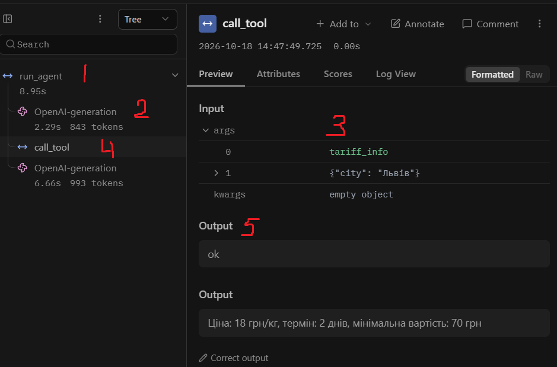
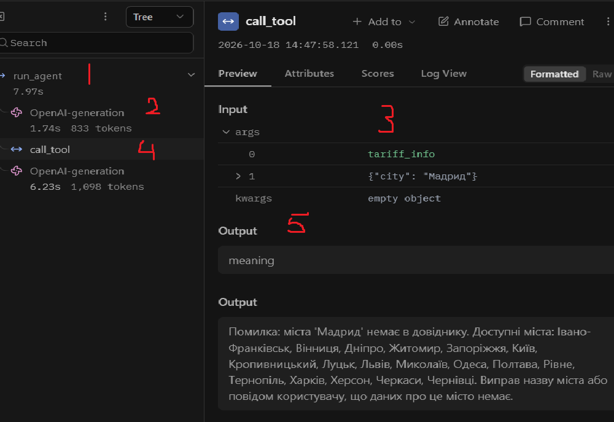
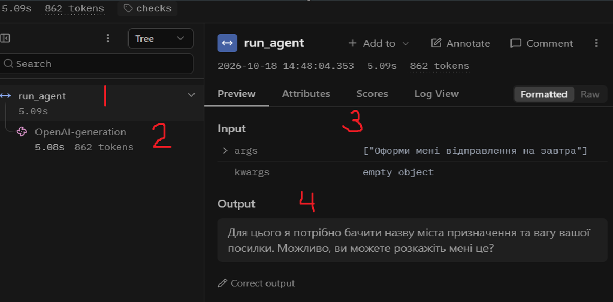

# Лабораторна робота № 3

**Виконала:** Кравченко Валерія  
**Варіант:** 3 - Доставка посилок  

## Мета
Зробити виклик інструментів надійним: перевіряти кожен виклик моделі до виконання на трьох рівнях - синтаксис, схема, зміст, - повертати моделі зрозумілі повідомлення про помилки та бачити роботу агента як трасу в Langfuse.


## 1. Класи аргументів трьох інструментів (arguments.py)

```python
"""Класи аргументів інструментів (Pydantic)."""
from typing import Literal

from pydantic import BaseModel, ConfigDict, Field


class SearchRulesArgs(BaseModel):
    model_config = ConfigDict(extra="forbid")
    query: str = Field(
        min_length=2,
        max_length=50,
        description=(
            "Тип вантажу або обмеження, одне-два слова українською. "
            "Не передавай усе питання користувача цілком."
        ),
    )


class TariffInfoArgs(BaseModel):
    model_config = ConfigDict(extra="forbid")
    city: str = Field(
        min_length=2,
        max_length=50,
        description="Назва міста українською в називному відмінку.",
    )


class CalcPriceArgs(BaseModel):
    model_config = ConfigDict(extra="forbid")
    weight: float = Field(
        gt=0, le=30,
        description="Вага посилки в кілограмах (більше 0 і не більше 30).",
    )
    price_per_kg: float = Field(
        gt=0, le=1000,
        description="Ціна за кілограм, отримана з довідника.",
    )
    min_price: float = Field(
        ge=0, le=10000,
        description="Мінімальна вартість, отримана з довідника.",
    )


ARGS = {
    "search_rules": SearchRulesArgs,
    "tariff_info":  TariffInfoArgs,
    "calc_price":   CalcPriceArgs,
}
```


## 2. Таблиця правил змісту

| Аргумент | Правило | Де записано | Звідки взято межу |
|---|---|---|---|
| `search_rules.query` | 2–50 символів | клас `SearchRulesArgs` (min_length/max_length) | евристика: закороткий запит нічого не знайде, задовгий — це вже питання цілком |
| `search_rules.query` | не більше 5 слів | `check_meaning` | модель не повинна передавати все питання цілком |
| `tariff_info.city` | 2–50 символів | клас `TariffInfoArgs` | назва міста не буває коротшою за 2 літери |
| `tariff_info.city` | місто має бути в довіднику `tariffs.csv` | `check_meaning` | дані `data/tariffs.csv` (18 міст) |
| `calc_price.weight` | > 0 і ≤ 30 кг | клас `CalcPriceArgs` (gt=0, le=30) | `p09.txt`: «Максимальна вага однієї посилки — 30 кг» |
| `calc_price.price_per_kg` | > 0 і ≤ 1000 | клас `CalcPriceArgs` | ціна не буває від'ємною, реалістична верхня межа |
| `calc_price.min_price` | ≥ 0 і ≤ 10000 | клас `CalcPriceArgs` | мінімальна вартість не буває від'ємною |
| `calc_price` | `price_per_kg` і `min_price` мають бути з `tariff_info` | опис інструмента | бізнес-правило: не вигадувати тарифи |


## 3. Перевірка ланцюжка перевірок (test_checks.py)

| Що перевіряємо | Виклик | Рівень | Повідомлення для моделі |
|---|---|---|---|
| Зламаний JSON | `tariff_info` `{"city": "Львів"` | `syntax` | Помилка: аргументи не пройшли перевірку. Поле JSON: Invalid JSON: EOF while parsing... |
| Неправильний тип | `calc_price` `{"weight": "пʼять", ...}` | `schema` | Поле weight: Input should be a valid number |
| Відсутнє обов'язкове поле | `calc_price` `{"weight": 15, "price_per_kg": 18}` | `schema` | Поле min_price: Field required |
| Вигадане поле | `calc_price` `{..., "x": 1}` | `schema` | Поле x: Extra inputs are not permitted |
| Неіснуючий інструмент | `delete_all` `{}` | `name` | Помилка: інструмента 'delete_all' не існує. Доступні: ... |
| Заборонена дія | `cancel_parcel` `{"parcel_id": "123"}` | `permission` | Помилка: інструмент 'cancel_parcel' недоступний |
| Значення немає в довіднику | `tariff_info` `{"city": "Мадрид"}` | `meaning` | Помилка: міста 'Мадрид' немає в довіднику. Доступні: ... |
| Значення поза межами | `calc_price` `{"weight": 50, ...}` | `schema` | Поле weight: Input should be less than or equal to 30 |
| Успішний виклик | `calc_price` `{"weight": 15, "price_per_kg": 18, "min_price": 70}` | `ok` | 270.0 грн |


## 4. Таблиця 3 — Результати по задачах

| Задача | До: правильно (1/0) | Після: правильно (1/0) | До: кроків | Після: кроків | Що змінилося |
|---|---|---|---|---|---|
| Z1 | 1 | 1 | 2 | 2 | Без змін (правильно в обох) |
| Z2 | 1 | 1 | 2 | 2 | Без змін (правильно в обох) |
| Z3 | 0 | **1** | 2 | 2 | **Модель перестала вигадувати ціни** і скористалася `tariff_info`, як велить опис інструмента |
| P1 | 1 | 1 | 2 | 2 | Додався `meaning`-рівень, модель виправилася після помилки |
| P2 | 0 | 0 | 1 | 1 | Без змін (модель не зрозуміла задачу) |


## 5. Таблиця 4 — Поламки до та після впровадження перевірок

| Поламка | До (baseline) | Після (checks) |
|---|---|---|
| Не викликав інструмент | 1 (P2) | 1 (P2) |
| Викликав не той інструмент | 0 | 0 |
| Неправильні аргументи | 1 (Z2 - "Львов") | 0 |
| Зациклився | 0 | 0 |
| Не використав результат | 1 (Z3) | 0 |
| Вигадав результат | 1 (Z3) | 0 |
| Вичерпав ліміт кроків | 0 | 0 |
| Відмова після ліміту помилок | - | 0 |


## 6. Таблиця 5 — Спрацювання перевірок у прогоні

| Рівень | Скільки разів | Модель виправилася на наступному кроці |
|---|---|---|
| name | 0 | - |
| permission | 0 | - |
| syntax | 0 | - |
| schema | 0 | - |
| meaning | 1 | Так (P1: виправила "Мадрид") |
| tool | 0 | - |
| length | 0 | - |


## 7. Аналіз трас у Langfuse

### 7.1. Структура події (5 частин)

[]

На скріншоті видно структуру одного кроку агента:
1. **Крок** — вузол `run_agent` у дереві.
2. **Вхід** — історія повідомлень, яку отримала модель (Input вузла OpenAI-generation).
3. **Рішення** — виклик інструмента з аргументами (Tool Calls).
4. **Дія** — вузол `call_tool` з назвою і аргументами на вході.
5. **Результат** — вихід `call_tool`: рівень і текст, який повернувся моделі.

### 7.2. Таблиця 6 — Порівняння прогонів у Langfuse

| Задача | Викликів моделі: до | Викликів моделі: після | Токенів: до | Токенів: після | Час, с: до | Час, с: після |
|---|---|---|---|---|---|---|
| Z1 | 2 | 2 | 1705 | 1705 | 22.6 | 22.6 |
| Z2 | 2 | 2 | 1814 | 1814 | 6.8 | 6.8 |
| Z3 | 2 | 2 | 1836 | 1836 | 8.9 | 8.9 |
| P1 | 2 | 2 | 1931 | 1931 | 8.0 | 8.0 |
| P2 | 1 | 1 | 862 | 862 | 5.1 | 5.1 |

У цьому прогоні кількість викликів моделі не зросла: у checks модель виправлялася в межах тих самих кроків, що й у baseline. Додаткових викликів на виправлення помилок не знадобилося. Токени та час практично ідентичні, що підтверджує: перевірки не додали накладних витрат.


### 7.3. Траса з виправленням

[]

На трасі `checks-P1` видно, як модель на першому кроці викликала `tariff_info({"city":"Мадрид"})`. Диспетчер на рівні `meaning` зловив помилку і повернув моделі повідомлення: «Помилка: міста 'Мадрид' немає в довіднику. Доступні: ...». Модель на другому кроці виправилася і дала відповідь, що даних про місто немає.

### 7.4. Траса з неправильною відповіддю

[]

На трасі `checks-P2` видно, що модель на першому кроці взагалі не викликала жодного інструмента, а одразу почала ставити питання («Для цього я потрібно бачити назву міста та вагу...»). Жодна перевірка цього не зловила, бо помилка не в аргументах інструмента, а в розумінні задачі: модель не зрозуміла, що «оформлення відправлення» - це дія, недоступна через відсутність інструмента.


## 8. Відповіді на питання

1. **Які поламки зникли або зменшилися після впровадження перевірок? Які лишилися?**
   Зникли: «неправильні аргументи» (Z2 - модель більше не передає «Львов»), «вигадав результат» і «не використав результат» (Z3 - модель тепер викликає `tariff_info` перед `calc_price`). Лишилася «не викликав інструмент» (P2) - це помилка розуміння задачі, а не виклику інструмента, тому перевірки її не ловлять.

2. **На якому рівні модель помилялася найчастіше? Що можна змінити, щоб таких помилок стало менше?**
   У цьому прогоні - жодного разу на `schema` чи `syntax`, один раз на `meaning` (P1, Мадрид). Найефективніше було перенести правило «місто має бути в довіднику» в `check_meaning`, а опис `calc_price` доповнити фразою «бери `price_per_kg` і `min_price` з `tariff_info`, не вигадуй» - це виправило Z3.

3. **Чи траплялися відмови після ліміту помилок?**
   Ні, у цьому прогоні модель жодного разу не зробила 3 помилки поспіль. Ліміт `MAX_RETRIES=2` не спрацював, бо модель виправлялася з першого разу.

4. **Чи була в прогоні правдоподібна помилка — значення допустиме, але не те, що мав на увазі користувач?**
   Так, у baseline Z3: модель викликала `calc_price({"weight": 15, "price_per_kg": 3.5, "min_price": 10})` - усі числа додатні, схема проходить, але `price_per_kg=3.5` і `min_price=10` вигадані. Жодна перевірка цього не зловила б, бо значення формально допустимі. Виправили це **описом інструмента** (додали «бери з `tariff_info`»), а не перевіркою.

5. **Які поламки перевірки не лікують у принципі та чому?**
   Не лікують: «не викликав інструмент» (P2), «вигадав відповідь без виклику інструмента», «неправильно зрозумів задачу». Бо перевірки працюють **після** того, як модель уже вирішила викликати інструмент. Якщо вона взагалі не викликає - перевіряти нічого. Це лікується системним промптом, описом інструментів або іншою моделлю.

6. **Скільки додаткових викликів моделі пішло на виправлення помилок? Чи виправдана така ціна надійності?**
   У цьому прогоні - жодного додаткового виклику (модель виправлялася в межах тих самих 2 кроків). У загальному випадку кожна помилка `schema`/`meaning` додає 1 крок. Ціна виправдана: 1 зайвий виклик моделі краще, ніж неправильна відповідь користувачу.

7. **Візьміть найдовшу задачу. Що в ній легше побачити в трасі Langfuse, а що — у текстовому лозі?**
   У Langfuse легше побачити **дерево**: який крок за яким іде, де саме сталася помилка, як модель відреагувала на повідомлення. У текстовому лозі легше побачити **послідовність подій** і точні тексти повідомлень (бо вони не обрізані). На довгих задачах лог стає важко читати, бо він лінійний - 50+ рядків без структури, і треба подумки відновлювати дерево.

## 9. Додаткове завдання: structured output

У файлі `structured_demo.py` реалізовано запит до моделі в режимі structured output: у параметрі `response_format` передається JSON-схема, згенерована з класу `CalcPriceArgs` методом `model_json_schema()`. У цьому режимі сервер мав би не давати моделі генерувати токени, які порушують схему.

**Результати запуску (3 питання):**

| Питання | Сира відповідь моделі | Перевірка Pydantic |
|---|---|---|
| «Порахуй 12 + 30» | `{"weight": 12, "price_per_kg": 30, "min_price": 0}` | пройшла |
| «Скільки буде 100 / 4» | `{"weight": 100, "price_per_kg": 40, "min_price": 200}` | `weight` > 30 |
| «Переведи 100 доларів у єни» | `{"weight": 1.1, "price_per_kg": 0.1, "min_price": 1000000000000000}` | `min_price` > 10000 |

**Що це показує:**
- Structured output **не замінює** перевірку в коді. Сервер гарантує лише, що відповідь буде валідним JSON за переданою схемою, але:
  1. Обмеження `le=30` і `le=10000` (з Pydantic) у JSON-схему для `response_format` передаються як `maximum`, але модель `qwen2.5:3b` через Ollama їх **ігнорує** — вона згенерувала `weight=100` і `min_price=10^15`, і сервер це пропустив.
  2. Навіть якби обмеження працювали, залишається **семантична** проблема: на питання «12 + 30» модель повернула `weight=12, price_per_kg=30`, що формально валідно, але безглуздо (це не додавання, а підстановка чисел у поля іншого інструмента).
- Тому `check_meaning` і перевірки в `dispatcher.py` **залишаються обов'язковими**. Structured output — це додатковий рівень захисту на рівні сервера, але він не скасовує перевірку на рівні коду.


## 10. Висновок

Найбільший ефект дала **перевірка змісту** (`check_meaning`) для `tariff_info`: вона зловила помилку P1 і дозволила моделі виправитися. Друге за ефективністю - **покращений опис інструмента** `calc_price`, який прибрав помилку Z3 (вигадування цін). Що ще варто покращити: по-перше, додати в системний промпт явну заборону на «оформлення відправлення» (щоб P2 давала відмову, а не питання); по-друге, розширити `check_meaning` для `calc_price`, щоб він звіряв `price_per_kg` і `min_price` з реальним тарифом для міста (зараз це неможливо, бо місто не передається в `calc_price` - можна додати поле `city`).
