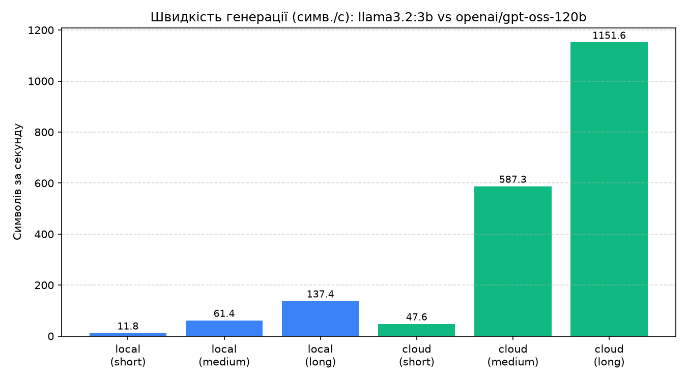

# Протокол лабораторної роботи №1
**«Розгортання середовища та порівняльний аналіз мовних моделей»**  
з дисципліни: **«Обчислювальні методи»**

| Поле | Значення |
| :--- | :--- |
| **Виконав:** | студент групи АІ-243 Кучерявенко О.В. |
| **Перевірив:** | ас. Баранов О.М. |
| **Варіант:** | № 5 |
| **Обладнання та ПЗ:** | Intel Core i5 (13-го покоління), NVIDIA RTX 3050 (4 ГБ VRAM), Windows 11, Python 3.14, Ollama (`num_ctx=2048`), Groq API (`openai/gpt-oss-120b`) |
| **Місце та рік:** | Одеса – 2026 |

---

## Завдання 1. Ціна роздумів: міркувальна vs інструктивна модель

Виконано запити до двох локальних моделей (`qwen3:4b` та `llama3.2:3b`) через ендпойнт Ollama `/api/generate`. Спочатку — просте фактичне питання, потім — задача на міркування (5 запусків для кожної моделі). Перед серією вимірів зроблено прогрівальний запит.

### Таблиця 1 – Фактичне питання «Столиця України? Відповідай одним словом.»

| Показник | `qwen3:4b` | `llama3.2:3b` |
| :--- | :---: | :---: |
| **`response`** | `Київ` | `Київ.` |
| **`eval_count`** | 190 | 5 |
| **Час, с (`total_duration / 1e9`)** | 7,32 | 0,12 |
| **Токенів/с (`eval_count / (eval_duration / 1e9)`)** | 26,98 | 62,06 |

### Таблиця 2 – Задача на міркування (середнє з 5 запусків)
*Промпт: «Ручка і зошит разом коштують 110 грн. Ручка на 100 грн дешевша за зошит. Скільки коштує ручка?» (Правильна відповідь: 5 грн).*

| Показник | `qwen3:4b` | `llama3.2:3b` |
| :--- | :---: | :---: |
| **Правильних із 5** | **5 / 5** | **3 / 5** |
| **`eval_count` (середнє)** | 1501,6 | 363,8 |
| **Час, с (середнє)** | 70,17 | 9,01 |

**Типова помилка інструктивної моделі:** у прогоні №3 модель `llama3.2:3b` дала відповідь «50 грн» (і в прогоні №4 загубилась у рівнянні, перейшовши на російську мову), оскільки без проміжної чернетки роздумів не врахувала, що різниця у 100 грн розподіляється між двома доданками ($x + (x + 100) = 110 \Rightarrow 2x = 10 \Rightarrow x = 5$).

### Відповіді на питання (Крок 6)

1. **Я порівнював міркувальну модель (`qwen3:4b`) та інструктивну (`llama3.2:3b`) на простому фактичному питанні. Відповідь обидві дали однакову, але міркувальна згенерувала в десятки разів більше токенів. Куди пішли ці токени?**  
   **Відповідь:** Додаткові 185 токенів у `qwen3:4b` пішли у внутрішнє поле `thinking` — модель згенерувала кілька абзаців самоперевірки (перебираючи інші міста України та перевіряючи інструкцію про одне слово), перш ніж вивести фінальне слово «Київ» у `response`.
2. **На яких типах задач міркувальні моделі дають перевагу над інструктивними, а на яких їх використання невиправдане?**  
   **Відповідь:** Міркувальні моделі дають вирішальну перевагу в багатокроковій арифметиці, логічних головоломках, алгоритмічному коді та плануванні дій агента, де проміжні токени слугують «робочою пам’яттю». На простих фактичних питаннях, перекладі чи стисненні готового тексту їх використання невиправдане через багаторазову перевитрату часу й токенів без покращення результату.
3. **Чим відрізняється процес навчання міркувальної моделі від інструктивної?**  
   **Відповідь:** Інструктивна модель проходить етап Supervised Fine-Tuning (SFT) на парах «запит — готова відповідь» та вирівнювання за вподобаннями людини (RLHF/DPO). Міркувальна модель додатково навчається методом навчання з підкріпленням (RL, наприклад GRPO) з винагородою за правильний кінцевий результат, що стимулює її самостійно будувати довгі ланцюжки міркувань (Chain-of-Thought) перед відповіддю.
4. **Чи означає більша кількість згенерованих токенів у міркувальної моделі, що вона «розумніша» за інструктивну?**  
   **Відповідь:** Ні, кількість згенерованих токенів відображає лише обсяг проміжних обчислень («чернетки»), який модель виділила на задачу, а не її фактичні знання чи інтелект. На простій задачі надлишкові роздуми можуть навіть зашкодити («overthinking») або призвести до обриву відповіді через вичерпання ліміту токенів.
5. **Як пояснити різницю у швидкості генерації (токенів за секунду) між моделями `qwen3:4b` та `llama3.2:3b`?**  
   **Відповідь:** `llama3.2:3b` має меншу кількість параметрів (3,2 млрд проти 4 млрд) і займає ~2,0 ГБ, завдяки чому повністю розміщується у 4 ГБ відеопам’яті NVIDIA RTX 3050 (100% GPU) і видає 62,06 токенів/с. `qwen3:4b` займає ~3,2 ГБ навіть при `num_ctx=2048`, через що ~28% її шарів вивантажується в оперативну пам’ять на CPU (28%/72% CPU/GPU), знижуючи швидкість до 26,98 токенів/с.

**Висновок за завданням 1:**  
Експеримент показав, що два показники — швидкість генерації та загальний час відповіді — не можна плутати. Перший характеризує обладнання й розмір моделі, другий — обсяг роботи, яку модель собі призначила. На фактичному питанні режим міркування виявився чистою перевитратою: результат однаковий, витрати токенів відрізняються у **38 разів** (190 проти 5), а час — у **61 раз** (7,32 с проти 0,12 с). На задачі про ручку й зошит ситуація протилежна — саме розписаний хід дозволив уникнути неправильної відповіді (5/5 у `qwen3:4b` проти 3/5 у `llama3.2:3b`). Практичний висновок: тип моделі треба обирати під тип задачі, а для агента з 8 послідовними викликами різниця складе **561,4 с проти 72,1 с**, що робить важку міркувальну модель на локальній відеокарті непридатною для швидкого налагодження.

---

## Завдання 2. Роль `system`-повідомлення: керування поведінкою моделі (Варіант 5)

**Питання користувача (`user`):** *«Поясни різницю між масивом і зв'язним списком.»*

### Таблиця 3 – Вплив `system`-повідомлення

| Модель | `System` | Довжина відповіді, символів | Мова відповіді | Кількість речень | Інструкцію виконано? |
| :--- | :--- | :---: | :---: | :---: | :---: |
| `llama3.2:3b` | лаконічний асистент | 1210 | українська (змішана з англ./пол. словами) | 11 | Частково (занадто довго) |
| `llama3.2:3b` | українською, 2 речення | 220 | українська (з калькою *«референсу»*) | 2 | Так |
| `qwen3:4b` | лаконічний асистент | 84 | українська | 2 | Так |
| `qwen3:4b` | українською, 2 речення | 287 | українська | 2 | Так (обірвано на 900 токенах через `thinking`) |

### Таблиця 4 – Витрати токенів

| Модель | `System` | `prompt_tokens` | `completion_tokens` | `total_tokens` |
| :--- | :--- | :---: | :---: | :---: |
| `llama3.2:3b` | лаконічний асистент | 54 | 350 | 404 |
| `llama3.2:3b` | українською, 2 речення | 58 | 73 | 131 |
| `qwen3:4b` | лаконічний асистент | 57 | 1992 | 2049 |
| `qwen3:4b` | українською, 2 речення | 66 | 900 | 966 |

### Власні відповіді на питання (Крок 6)

1. **Яка модель точніше дотрималась обмеження «максимум двома реченнями»?**  
   **Відповідь:** Обидві моделі вклалися у два речення при жорсткому `system`-промпті, але `llama3.2:3b` зробила це за 73 токени, тоді як `qwen3:4b` витратила 900 токенів на внутрішні роздуми (`thinking`), через що друге речення обірвалося на півслові.
2. **Чи були випадки, коли модель відповіла не українською, попри пряму вказівку?**  
   **Відповідь:** Повного переходу на іншу мову в цьому тесті не було, проте `llama3.2:3b` вставляла іншомовні вкраплення («amount», «users», «się», «референсу»), що свідчить про нестабільність токенізації української мови у малих моделей.
3. **Як змінився `prompt_tokens` при зміні `system`-повідомлення і чому?**  
   **Відповідь:** Значення `prompt_tokens` зросло на 4 токени у `llama3.2:3b` (з 54 до 58) та на 9 токенів у `qwen3:4b` (з 57 до 66), оскільки нова інструкція «Відповідай лише українською, максимум двома реченнями.» довша за «Ти лаконічний технічний асистент.» і має іншу токенізацію в кожному сімействі моделей.
4. **Чому в `qwen3:4b` значення `completion_tokens` значно більше, ніж у `llama3.2:3b`, навіть при однаковій довжині видимої відповіді?**  
   **Відповідь:** Поле `completion_tokens` у сумісному OpenAI API враховує не лише видимий текст відповіді (`content`), а й усі приховані токени міркувань (`reasoning`/`thinking`), яких `qwen3:4b` згенерувала понад 1900 штук для відповіді на 84 символи.

### Питання до чат-бота (Крок 7)

1. **Я порівнював інструктивну модель (`llama3.2:3b`) та міркувальну (`qwen3:4b`) з різними `system`-повідомленнями. Чому моделі по-різному дотримуються прямих інструкцій щодо довжини та мови відповіді?**  
   **Відповідь:** Дотримання обмежень залежить від якості етапу інструктивного донавчання (SFT/RLHF) та кількості параметрів моделі. В архітектурі трансформера всі повідомлення перетворюються на єдину послідовність токенів у вікні уваги, тому малі моделі (3B–4B) через обмежену ємність пам'яті часто «забувають» обмеження довжини чи мови під час генерації.
2. **Чим `system`-повідомлення відрізняється від `user`-повідомлення з точки зору моделі — чи справді воно має більший пріоритет?**  
   **Відповідь:** Технічно обидва повідомлення потрапляють в один контекст, але відокремлюються спеціальними службовими токенами ролей (`<|im_start|>system` тощо). Під час навчання на слідування інструкціям (instruction hierarchy) модель спеціально тренують надавати системному промпту вищий пріоритет, проте це статистична схильність, а не жорсткий програмний захист.
3. **Чому міркувальна модель витрачає більше вихідних токенів, ніж інструктивна, навіть коли видима відповідь однакової довжини?**  
   **Відповідь:** Міркувальна модель (`qwen3:4b`) перед генерацією фінальної відповіді створює внутрішній ланцюжок міркувань у тегах `<think>`, де перевіряє факти та формулювання (у нашому тесті — 1992 токени заради 84 символів тексту). Поле `completion_tokens` підсумовує як приховані токени роздумів, так і видиму відповідь користувачеві.
4. **Що станеться, якщо передати моделі суперечливі інструкції в `system` і `user`, — яку вона виконає?**  
   **Відповідь:** Сучасні моделі з налаштованою ієрархією інструкцій зазвичай надають перевагу `system`-повідомленню (наприклад, збережуть українську мову або обмеження у 2 речення), але малі моделі на 3B–4B параметрів нерідко піддаються впливу останнього повідомлення (`user`), оскільки воно розташоване ближче до точки генерації в контекстному вікні.
5. **Чому малі мовні моделі часто гірше дотримуються інструкцій щодо мови відповіді, ніж великі?**  
   **Відповідь:** У навчальних корпусах малих моделей українська мова займає мізерну частку порівняно з англійською чи російською, а їхній токенізатор дробить українські слова на багато окремих символів і складів. Через меншу кількість параметрів таким моделям складно одночасно утримувати технічний зміст і чистоту лексики, тому виникають кальки та іншомовні вкраплення («amount», «się», «референсу»).

**Власні думки щодо ролі `system`-повідомлення:**  
`system`-повідомлення є дешевим і зручним інструментом задання тону, мови та базового формату без зміни коду, але воно **не гарантує 100% дотримання жорстких обмежень**. Якщо модель ігнорує інструкцію (наприклад, перевищує довжину або додає зайвий текст навколо JSON), у реальних системах застосовують програмну валідацію (Pydantic / regex), повторні запити (retry) або жорсткі параметри API (`response_format`, `max_tokens`).

---

## Завдання 3. Локальна vs хмарна модель: єдиний інтерфейс (Варіант 5)

**Питання (`QUESTION`):** *«Поясни різницю між масивом і зв'язним списком. Коротко.»*

### Таблиця 5 – Порівняння локальної та хмарної моделі

| Показник | Локальна (`local`) | Хмарна (`cloud`) |
| :--- | :---: | :---: |
| **Назва моделі** | `llama3.2:3b` (Ollama) | `openai/gpt-oss-120b` (Groq) |
| **Час відповіді, с** | 15,10 | 1,04 |
| **`completion_tokens`** | 270 | 308 |
| **Довжина відповіді, символів** | 888 | 676 |
| **Мова відповіді** | українська (з помилками та русизмами) | чиста, термінологічно точна українська |
| **Фактичних помилок у відповіді** | Так (2 грубі помилки) | Ні (0 помилок) |

### Власні відповіді на питання (Крок 5)

1. **Скільки рядків коду довелося змінити, щоб перейти з локальної моделі на хмарну?**  
   **Відповідь:** У циклі виклику `compare.py` не змінилося **жодного рядка коду** — достатньо було змінити лише 3 параметри конфігурації (`base_url`, `api_key`, `model`) у словнику `PROVIDERS` файлу `providers.py`.
2. **Яка відповідь повніша й точніша за змістом? Наведіть конкретний приклад різниці.**  
   **Відповідь:** Відповідь хмарної моделі `openai/gpt-oss-120b` значно точніша: вона вказала асимптотичну складність доступу ($O(1)$ проти $O(n)$), безперервність пам'яті та локальність кешу. Локальна `llama3.2:3b` припустилася грубих фактичних помилок: стверджувала, що в зв'язному списку вставка відбувається операторами `push()`/`pop()`, а в масиві «не з'являються динамічні елементи».
3. **Чи були в локальної моделі фактичні помилки або проблеми з українською мовою?**  
   **Відповідь:** Так, окрім помилкової теорії структур даних, у тексті `llama3.2:3b` присутні вигадані слова, кальки та польські вкраплення: *«Різничість»*, *«характиках»*, *«видавляється»*, *«polożці»*, *«Зв'язкий список»*, *«видалка»*.
4. **Хмарна модель відповіла швидше за локальну — за рахунок чого, якщо запит летить через інтернет?**  
   **Відповідь:** Хмарний провайдер Groq виконує інференс на спеціалізованих прискорювачах LPU з величезною пропускною здатністю пам'яті (сотні токенів за секунду), тому генерація 308 токенів зайняла ~0,67 с, а мережева затримка (~0,37 с) виявилася мізерною порівняно з 15,10 с на мобільній RTX 3050.

### Питання до чат-бота (Крок 6)

1. **Чому формат запитів OpenAI став стандартом, який підтримують інші провайдери, зокрема локальний сервер Ollama?**  
   **Відповідь:** Компанія OpenAI першою популяризувала простий і універсальний REST-інтерфейс `/v1/chat/completions` із масивом ролей (`system`, `user`, `assistant`), навколо якого сформувалася величезна екосистема бібліотек та інструментів. Іншим провайдерам і локальним серверам (Ollama, vLLM, Groq) вигідніше підтримувати сумісність із цим форматом, щоб розробники могли підключати їх без переписування клієнтського коду.
2. **Я порівнював локальну модель на 3 млрд параметрів і хмарну на 70 млрд (у нашому тесті — 120 млрд). Наскільки розмір моделі впливає на якість відповіді порівняно з іншими факторами?**  
   **Відповідь:** Кількість параметрів визначає ємність «пам'яті» моделі для зберігання фактів, складних граматичних конструкцій і логічних зв'язків, що напряму пояснює розрив між 0 фактичних помилок у `openai/gpt-oss-120b` та грубими помилками у `llama3.2:3b`. Окрім розміру, на якість суттєво впливають якість і мовний баланс навчального корпусу, етапи донавчання (SFT/RLHF) та наявність режиму міркування.
3. **Хмарна модель відповіла швидше за локальну, попри затримку мережі. Чим це пояснюється?**  
   **Відповідь:** Серверні кластери зі спеціалізованими ШІ-прискорювачами (LPU/H100) мають на порядки вищу пропускну здатність пам'яті та обчислювальну потужність, ніж споживча відеокарта RTX 3050 на 4 ГБ. Завдяки цьому сама генерація відповіді триває долі секунди (0,67 с проти 15,10 с), що повністю компенсує мережевий пінг у 200–350 мс.
4. **Які ризики для приватності виникають при використанні хмарних API і що з цим роблять у комерційних проєктах?**  
   **Відповідь:** При зверненні до зовнішнього API текст запиту передається на сервери стороннього провайдера, що створює ризик витоку персональних даних, комерційної таємниці чи коду. У комерційних проєктах для захисту укладають договори про нульове збереження даних (Zero Data Retention), знеособлюють (маскують) чутливі поля перед відправкою або розгортають локальні моделі у закритому контурі.
5. **Що таке `rate limit` у безкоштовних тарифах і як розробники обходять це обмеження?**  
   **Відповідь:** `Rate limit` — це обмеження провайдера на кількість запитів за хвилину/добу (RPM/RPD) та кількість токенів за хвилину (TPM), при перевищенні якого сервер повертає помилку `429 Too Many Requests`. Розробники обходять це за допомогою повторних запитів з експоненційною затримкою (`exponential backoff`), черг завдань, кешування відповідей та автоматичного перемикання на резервного провайдера.

**Власні думки (критерій вибору):**  
Локальну модель варто обирати для роботи з конфіденційними даними без виходу в інтернет, для простих офлайн-задач (переказ наданого тексту, класифікація) та коли важлива нульова вартість запитів. Хмарну модель необхідно використовувати для складного міркування, генерації коду, роботи з природною українською мовою та інтерактивних застосунків, де потрібна висока якість і миттєва відповідь.

---

## Завдання 4. Вимірювання швидкості: TTFT і залежність від довжини запиту (Варіант 5)

**Промпти варіанта 5:**  
* Короткий (`short`): *«Столиця Єгипту?»*  
* Середній (`medium`): *«Поясни в одному абзаці, що таке рекурсія.»*  
* Довгий (`long`): *«Напиши інструкцію з 10 пунктів, як почати працювати з Git.»*

### Таблиця 7 – Результати вимірювання швидкості (медіана з 3 запусків)

| Розміщення | Модель | Промпт | TTFT, с | Всього, с | Симв./с |
| :--- | :--- | :--- | :---: | :---: | :---: |
| локальна | `llama3.2:3b` | короткий | 2,108 | 2,632 | 11,8 |
| локальна | `llama3.2:3b` | середній | 2,125 | 5,263 | 61,4 |
| локальна | `llama3.2:3b` | довгий | 2,175 | 21,047 | 137,4 |
| хмарна | `openai/gpt-oss-120b` | короткий | 0,433 | 0,462 | 47,6 |
| хмарна | `openai/gpt-oss-120b` | середній | 0,516 | 0,887 | 587,3 |
| хмарна | `openai/gpt-oss-120b` | довгий | 0,430 | 2,324 | 1151,6 |

### Таблиця 8 – Холодний і теплий старт локальної моделі (`llama3.2:3b`)

| Показник | Холодний старт (після `ollama stop`) | Теплий старт (модель у VRAM) |
| :--- | :---: | :---: |
| **TTFT, с** | 5,153 | 2,077 |
| **Всього, с** | 5,695 | 2,435 |

### Стовпчикова діаграма швидкості генерації (симв./с)



### Власні відповіді на питання (Крок 6)

1. **У якої моделі кращий TTFT і чому саме в неї?**  
   **Відповідь:** Кращий TTFT у хмарної моделі `openai/gpt-oss-120b` (0,430–0,516 с проти 2,108–2,175 с у локальної `llama3.2:3b`), оскільки серверні прискорювачі Groq виконують фазу попередньої обробки промпту (`prefill`) за десятки мілісекунд, що перекриває навіть затримку мережевого маршруту до дата-центру.
2. **Чи збігається «найшвидша за TTFT» з «найшвидшою за символами/с»? Якщо ні — поясніть.**  
   **Відповідь:** У нашому експерименті обидва лідерства збіглися в хмарної моделі `openai/gpt-oss-120b`, проте на практиці ці метрики часто розходяться (локальна модель без мережевого пінгу може мати кращий TTFT на короткому запиті, але значно програвати за швидкістю потоку токенів на довгому).
3. **Як змінилося співвідношення локальної та хмарної моделі при переході від короткого промпту до довгого?**  
   **Відповідь:** На короткому промпті хмарна модель випередила локальну за загальним часом у **5,7 раза** (0,462 с проти 2,632 с), а на довгому промпті — вже у **9,1 раза** (2,324 с проти 21,047 с), оскільки при довгій відповіді домінує швидкість генерації (1151,6 проти 137,4 симв./с).
4. **Наскільки різняться три повтори одного виміру? Чи достатньо було б одного запуску?**  
   **Відповідь:** Повтори суттєво різняться: наприклад, на довгому промпті загальний час `llama3.2:3b` коливався від 15,878 с до 26,625 с (різниця 67% через різну довжину згенерованого тексту та фонове навантаження ОС), тому одного запуску недостатньо — потрібна медіана кількох прогонів.
5. **Чому холодний старт повільніший за теплий?**  
   **Відповідь:** Під час холодного старту (5,153 с проти 2,077 с) додаткові ~3,1 с витрачаються на зчитування ~2 ГБ ваг моделі з SSD у відеопам’ять GPU та ініціалізацію KV-кешу, тоді як при теплому старті модель уже перебуває у VRAM.

### Питання до чат-бота (Крок 7)

1. **Що фізично відбувається під час TTFT — часу до першого токена — і чому цей показник вимірюють окремо від загальної швидкості генерації?**  
   **Відповідь:** Під час TTFT запит проходить мережею до сервера, відбувається токенізація тексту, паралельне обчислення матриць уваги для всіх вхідних токенів (`prefill`), заповнення KV-кешу та генерація першого вихідного токена. Цей показник вимірюють окремо, бо він визначає суб'єктивну чуйність інтерфейсу (як швидко користувач бачить початок відповіді), тоді як швидкість генерації визначає тривалість виведення великих текстів.
2. **Чому хмарна модель може мати гірший TTFT, але кращу швидкість генерації, ніж локальна?**  
   **Відповідь:** Для хмарної моделі до TTFT додається мережева затримка (round-trip time до дата-центру та черги запитів), яка може становити 0,3–1,5 с і перевищувати час локального `prefill` на короткому промпті. Проте після старту генерації серверні прискорювачі з високою пропускною здатністю пам'яті (HBM/SRAM) видають сотні токенів за секунду, значно випереджаючи споживчу відеокарту.
3. **Чому перший запуск локальної моделі повільніший за наступні і що таке холодний старт?**  
   **Відповідь:** Холодний старт — це перший запуск моделі після завантаження системи або команди `ollama stop`, коли її файли відсутні у відеопам'яті. Додаткові секунди (у нашому тесті — 5,153 с проти 2,077 с) витрачаються на копіювання кількох гігабайтів ваг моделі з диска (SSD) у VRAM відеокарти та виділення буферів пам'яті.
4. **Чому при вимірюванні продуктивності беруть медіану кількох запусків, а не одне значення?**  
   **Відповідь:** Окремий запуск схильний до випадкових викидів через фонові процеси ОС, коливання частот GPU/CPU, мережеві затримки або різну довжину згенерованої відповіді (у нашому експерименті розкид сягав 67%). Медіана трьох і більше запусків відсікає випадкові аномалії та відображає типову продуктивність системи.
5. **Чому обробка вхідного запиту йде швидше, ніж генерація відповіді такої ж довжини?**  
   **Відповідь:** Усі токени вхідного промпту відомі заздалегідь, тому графічний процесор обчислює їх паралельно за один матричний прохід (фаза `prefill`, обмежена обчислювальною потужністю). Натомість вихідна відповідь генерується авторегресійно — строго по одному токену за крок, щоразу зчитуючи всі ваги моделі з відеопам'яті (фаза `decode`, обмежена пропускною здатністю пам'яті).

**Власні думки:**  
Для інтерактивного чат-бота важливіший низький **TTFT** (бажано < 0,5–1 с), бо користувач бачить початок відповіді миттєво і не сприймає систему як «завислу». Для фонової пакетної обробки великих документів критичною є максимальна **швидкість генерації (токенів/с)**, оскільки інтерфейсу очікування немає і важить лише сумарний час виконання всього пакета.

---

## Завдання 5. Оцінювання якості моделей за рубрикою (Варіант 5 — Фінанси)

**Набір завдань (сформовано до запуску моделей):**
1. *Факт:* Рік уведення гривні як національної валюти (авторитетне джерело — [Національний банк України](https://bank.gov.ua/ua/uah): грошова реформа проведена **2–16 вересня 1996 року**).
2. *Формат:* JSON з полями `currency`, `code`, `year` для української гривні без пояснень і markdown.
3. *Стиснення тексту:* Абзац про грошову реформу 1996 року з числами `2`, `16`, `1996`, `100 000`, `1`, `3,1`, `2019`, `5`, `2020`, `10` стиснути до двох речень.
4. *Код:* Функція Python `compound_interest(principal, rate, years)` — лише код.
5. *Логіка:* Депозит 20 000 грн під 12% річних, податок 19,5% з відсотків. Скільки на руках через рік? (Правильна відповідь: $20000 + 2400 \cdot (1 - 0{,}195) = \mathbf{21\,932\text{ грн}}$).
6. *Українська мова:* Чим акція відрізняється від облігації (українською, два абзаци).

### Таблиця 13 – Оцінка якості за рубрикою (максимум 12 балів)

| Завдання | `llama3.2:3b` | `qwen3:4b` | `openai/gpt-oss-120b` (хмарна) |
| :--- | :---: | :---: | :---: |
| **1. Факт** (`1996`) | 0 *(видала 1997 і 1992)* | 0 *(видала 1991 і 1992)* | **2** *(обидва прогони: `1996`)* |
| **2. Формат** (`json.loads()`) | **2** *(парситься одразу)* | **2** *(парситься одразу)* | **2** *(парситься одразу)* |
| **3. Стиснення** (2 речення, всі числа) | 0 *(втратила частину чисел + вступна фраза)* | **2** *(2 речення, усі 10 чисел точні)* | **2** *(2 речення, усі 10 чисел точні)* |
| **4. Код** (`compound_interest`, лише код) | 1 *(різні формули в прогонах: `rate/100` і `*12`)* | **2** *(чистий код без markdown)* | 1 *(код правильний, але в обгортці ```` ```python ````)* |
| **5. Логіка** (`21 932 грн` + хід) | 1 *(прогін 1 зациклився — 0; прогін 2 вірний — 2)* | **2** *(обидва прогони правильні: `21932`)* | **2** *(обидва прогони правильні: `21 932 грн`)* |
| **6. Українська** (2 абзаци, природна мова) | 1 *(суржик, англійські слова, 3 абзаци)* | 0 *(повний перехід на російську мову!)* | **2** *(природна, точна українська, 2 абзаци)* |
| **Разом / 12** | **5 / 12** | **8 / 12** | **11 / 12** |

### Таблиця 14 – Розбіжність оцінок між двома прогонами (`Так / Ні`)

| Завдання | `llama3.2:3b` | `qwen3:4b` | `openai/gpt-oss-120b` (хмарна) |
| :--- | :---: | :---: | :---: |
| **1. Факт** | Так *(1997 vs 1992)* | Так *(1991 vs 1992)* | Ні *(1996 / 1996)* |
| **2. Формат** | Ні *(обидва валідний JSON)* | Ні *(обидва валідний JSON)* | Ні *(обидва валідний JSON)* |
| **3. Стиснення** | Ні *(обидва 0 балів)* | Ні *(обидва 2 бали)* | Ні *(обидва 2 бали)* |
| **4. Код** | Так *(різні формули)* | Ні *(обидва чистий код)* | Ні *(обидва з markdown)* |
| **5. Логіка** | **Так** *(0 vs 2 бали)* | Ні *(обидва 2 бали)* | Ні *(обидва 2 бали)* |
| **6. Українська** | Ні *(обидва 1 бал)* | Ні *(обидва 0 балів)* | Ні *(обидва 2 бали)* |

### Обов’язковий пункт (Крок 7): Найпоказовіший приклад провалу

* **Модель та завдання:** `qwen3:4b`, Завдання 6 (Якість української мови, прогін №1).
* **Повний текст запиту:**  
  `Чим акція відрізняється від облігації. Поясни українською, два абзаци.`
* **Повний текст відповіді (без скорочень):**  
  > Акция — это финансовый инструмент, который предоставляет инвестору собственность в компании и право голоса на её решения. Когда вы покупаете акцию, вы становитесь акционером, который получает дивиденды (часть прибыли компании) и влияет на управление компанией. Это означает, что собственность в компании является частью капитала, и инвестор зависит от успеха компании.
  >
  > Облигация — это финансовый инструмент, который представляет обязательство компании или государства перед инвестором. Инвестор, покупая облигацию, предоставляет финансовую сумму компании на определенный срок, и получает регулярные процентные выплаты и возврат номинальной суммы по окончании срока. Облигации являются кредитным инструментом, который обеспечивает меньший риск потерь по сравнению с акциями.
  >
  > Основное различие между акцией и облигацией заключается в том, что акция представляет собственность, а облигация — обязательство. Акционеры получают дивиденды и имеют право на управление компанией, но они подвержены риску потерь из-за зависимости от экономического состояния компании. Облигации, наоборот, обеспечивают фиксированные процентные выплаты и возврат капитала по сроку, поэтому они более подходят для инвесторов, которые ищут стабильные выплаты с минимальным риском.
  >
  > Кроме того, акции не имеют срока, так как собственность не исчезает, а облигации имеют фиксированный срок, который определяет время возврата капитала.
  >
  > Важно отметить, что акции представляют более высокий риск и более высокие возможности прибыли, чем облигации, поскольку они отражают собственность в компании и зависят от её экономического состояния.
* **Яка правильна відповідь мала бути:** Пояснення різниці між частковим (акція) та борговим (облігація) цінним папером **природною українською мовою рівно у двох абзацах**.
* **Пояснення, чому так сталося:** У навчальному корпусі моделей сімейства Qwen частка російськомовних фінансових текстів на порядки перевищує частку українських. Під час внутрішніх роздумів (`thinking`) модель перейшла на російську мову як статистично ймовірнішу для фінансової термінології й у підсумку повністю проігнорувала як мовну інструкцію («українською»), так і структурну («два абзаци», видавши п’ять абзаців).

### Власні відповіді на питання (Крок 6)

1. **Яка модель набрала найбільше балів і на яких саме завданнях виникла основна різниця?**  
   **Відповідь:** Найбільше балів набрала хмарна `openai/gpt-oss-120b` (**11/12**), обійшовши `qwen3:4b` (8/12) та `llama3.2:3b` (5/12). Основна різниця виникла у знанні регіональних фактів України (1996 рік — введення гривні), природності української мови та стабільності багатокрокових обчислень.
2. **На яких завданнях оцінки двох прогонів розійшлися? Що це говорить про надійність моделі?**  
   **Відповідь:** У `llama3.2:3b` оцінки розійшлися на завданнях 1, 4 та особливо 5 (де в першому прогоні модель зациклилася на повторенні рядка «Депозит = 20000 грн» — 0 балів, а в другому правильно порахувала 21 932 грн — 2 бали), а в `qwen3:4b` — на факті про гривню (1991 vs 1992). Це свідчить про низьку надійність малих локальних моделей при `temperature=0.7` і необхідність перевірки кількома прогонами.
3. **Чи виконала хоч одна модель вимогу «без markdown» у завданні 2?**  
   **Відповідь:** У завданні 2 усі три моделі (`llama3.2:3b`, `qwen3:4b`, `openai/gpt-oss-120b`) повністю виконали вимогу і повернули чистий JSON без markdown-обгортки (`json.loads()` пройшов без помилок). Натомість у завданні 4 хмарна модель порушила аналогічну вимогу «Лише код», додавши блок ```` ```python ````.
4. **Чи були проблеми з українською мовою — русизми, кальки, перехід на іншу мову?**  
   **Відповідь:** Так, обидві локальні моделі мали серйозні проблеми: `llama3.2:3b` змішувала українські слова з суржиком і англійськими вставками, а `qwen3:4b` у завданні 6 повністю перейшла на російську мову, проігнорувавши пряму інструкцію «Поясни українською».

### Питання до чат-бота (Крок 8)

1. **Я оцінював мовні моделі за рубрикою з шести завдань і трибальною шкалою. Які ще підходи до оцінювання якості мовних моделей використовують на практиці?**  
   **Відповідь:** Окрім ручних рубрик, у промисловій розробці застосовують автоматизовані перевірки (unit-тести для коду, валідацію JSON-схем, точний збіг Exact Match), відкриті академічні бенчмарки (MMLU, GSM8K, HumanEval), підхід **LLM-as-a-Judge** (коли відповіді оцінює сильніша модель-суддя за критеріями) та сліпе парне порівняння людьми (Chatbot Arena / Elo).
2. **Чому мовні моделі часто ігнорують пряму інструкцію не використовувати markdown при генерації JSON?**  
   **Відповідь:** Під час навчання (SFT та RLHF) моделі бачили мільйони прикладів технічної документації та чат-діалогів, де структуровані дані й код майже завжди оформлені в markdown-блоки для зручності читання людиною. Цей патерн настільки закріплений у вагах моделі, що часто переважає текстову заборону «без markdown», тому на практиці використовують примусовий `Structured Outputs` / `JSON mode`.
3. **Чому малі мовні моделі гірше пишуть українською, ніж англійською?**  
   **Відповідь:** У навчальних вибірках відкритих моделей (Llama, Qwen) англомовні тексти складають переважну більшість (70–90%), а серед кириличних даних російських текстів на порядки більше, ніж українських. Крім того, токенізатор розбиває українські слова на більшу кількість дрібних шматочків, що ускладнює моделі утримання граматики й стилю за обмеженої кількості параметрів (3B–4B).
4. **Чому та сама модель на однаковий запит може дати відповіді різної якості при повторному запуску?**  
   **Відповідь:** При ненульовій температурі (`temperature=0.7`) вибір кожного наступного токена є імовірнісним (семплінг із розподілу). Якщо на перших кроках модель випадково обере менш вдалий токен, подальша генерація спиратиметься на нього як на контекст, що може повести відповідь іншим шляхом — аж до арифметичної помилки чи зациклення.
5. **Що таке галюцинація мовної моделі і чому модель радше вигадає факт, ніж визнає незнання?**  
   **Відповідь:** Галюцинація — це впевнено сформульована, але фактично неправдива відповідь (наприклад, 1991 або 1997 рік замість 1996-го). Мовна модель не має вбудованої бази знань і працює як генератор статистично правдоподібного продовження тексту: під час навчання її винагороджували за надання зв'язної відповіді, а не за відмову, тому за браку знань вона підставляє найімовірніше число чи факт із контексту.

**Висновок за завданням 5:**  
Оцінювання за заздалегідь складеною рубрикою виявилося надійним інженерним інструментом, оскільки замінило суб'єктивне враження («модель відповіла добре») відтворюваними балами та зафіксувало нестабільність малих моделей між двома прогонами. Найпоказовішими виявилися завдання на фактичні знання України, багатоетапну арифметику та якість української мови, де чітко проявилася перевага великої хмарної моделі `openai/gpt-oss-120b` (11/12 балів проти 8/12 у `qwen3:4b` та 5/12 у `llama3.2:3b`). Для роботи з україномовним текстом у реальних проєктах варто обирати велику хмарну модель (або спеціалізовані україномовні адаптації), тоді як локальні моделі на 3B–4B параметрів придатні лише для стиснення вже наданого тексту чи генерації простого JSON.

---

## Завдання 6. Керування випадковістю: `temperature` і `top_p` (Варіант 5)

**Модель:** `llama3.2:3b` (локальна)  
**Творче завдання (`CREATIVE`):** *«Придумай одну коротку оригінальну назву застосунку пошуку партнерів для тренувань. Напиши лише назву.»*  
**Фактичне питання (`FACTUAL`):** *«Рік уведення гривні як національної валюти України? Відповідай лише роком.»* (Правильна відповідь: **1996**, джерело: [Національний банк України](https://bank.gov.ua/ua/uah)).

### Таблиця 16 – Вплив параметрів на різноманітність відповідей

| Параметр | Значення | Унікальних із 5 (творче) | Правильних із 5 (фактичне) |
| :--- | :---: | :---: | :---: |
| `temperature` | 0.0 | 2 *(«Тренер на дистанцію» ×1, «Тренер на дому» ×4)* | **5 / 5** *(усі `1996.`)* |
| `temperature` | 0.7 | 5 | — |
| `temperature` | 1.5 | 5 | **0 / 5** *(«1992.», «1947», «1999», «2004.», «2016.»)* |
| `top_p` *(при `temperature=0.7`)* | 0.1 | 1 *(5× «Тренер на дому»)* | — |
| `top_p` *(при `temperature=0.7`)* | 0.5 | 5 | — |
| `top_p` *(при `temperature=0.7`)* | 1.0 | 5 | — |

### Таблиця 17 – Перевірка відтворюваності

| Показник | Значення |
| :--- | :---: |
| **Кількість запусків (`n`)** | 10 |
| **`temperature`** | 0.0 |
| **Унікальних відповідей** | 1 (`1996.`) |
| **Усі відповіді однакові (`Так / Ні`)** | **Так** |

### Власні відповіді на питання (Крок 7)

1. **Яке значення температури ви поставите агенту, який має повертати JSON, і чому?**  
   **Відповідь:** Для агента, який повертає JSON або викликає інструменти, необхідно ставити `temperature = 0.0` (або `0.1`), щоб мінімізувати випадковість вибору токенів і забезпечити максимальну передбачуваність синтаксису та структури даних.
2. **Яке — генератору варіантів заголовків?**  
   **Відповідь:** Для генерації варіантів заголовків чи назв оптимально використовувати `temperature = 0.7–0.9`, оскільки при `0.0` модель повторює одну й ту саму назву, а при `1.5` починає генерувати неіснуючі слова та суміш алфавітів.
3. **Чим вплив `top_p` відрізняється від впливу `temperature` за характером, а не за силою?**  
   **Відповідь:** `temperature` змінює контрастність розподілу ймовірностей усіх токенів у словнику, підвищуючи шанси рідкісних слів, тоді як `top_p` (nucleus sampling) не змінює пропорцій імовірностей, а просто відсікає «хвіст» малоймовірних кандидатів за межею сумарної ймовірності $p$.
4. **Чи означає `temperature=0` повну відтворюваність результату? Що показав ваш експеримент із 10 запусків?**  
   **Відповідь:** Ні, `temperature = 0` не дає 100% математичної гарантії через недетермінований порядок паралельних обчислень з плаваючою комою на GPU. У нашому експерименті на фактичному питанні 10 із 10 запусків збіглися (`1996.`), проте на творчому запиті при `temperature = 0.0` 1 запуск із 5 видав іншу назву (*«Тренер на дистанцію»* замість *«Тренер на дому»*).
5. **Наведіть найбезглуздішу відповідь, яку модель видала при `temperature=1.5`, і поясніть, чому вона взагалі могла з'явитися.**  
   **Відповідь:** При `temperature = 1.5` модель згенерувала вигадані слова та суміш мов: `"Hрантари"` (латинська `H` + кирилиця) та `"Pартнери на шляху до zdrowsia"` (латинська `P` + українська + польське слово). Через високу температуру розподіл ймовірностей «сплющився», і в пул вибору потрапили рідкісні токени з інших алфавітів, які зазвичай мають імовірність $< 0{,}001$.

### Питання до чат-бота (Крок 8)

1. **Що саме математично робить параметр `temperature` із розподілом ймовірностей наступного токена?**  
   **Відповідь:** Перед застосуванням функції `softmax` модель ділить сирі оцінки (логіти) $z_i$ кожного токена на значення температури $T$: $p_i = \frac{\exp(z_i / T)}{\sum_j \exp(z_j / T)}$. При $T \to 0$ найбільший логіт перетворюється на ймовірність, близьку до 1, а при $T > 1$ різниця між логітами згладжується, вирівнюючи шанси між частими й рідкісними токенами.
2. **Чим `top_p` відрізняється від `temperature` — обидва впливають на різноманітність, але за яким механізмом?**  
   **Відповідь:** `temperature` глобально перемасштабовує ймовірності всього словника (навіть абсурдні токени отримують ненульовий шанс при високому $T$). Натомість `top_p` сортує токени за спаданням імовірності та динамічно обрізає список кандидатів, щойно їхня сумарна ймовірність досягає порогу $p$, повністю виключаючи низькоймовірний «хвіст».
3. **Чи є сенс змінювати обидва параметри одночасно, чи краще налаштовувати щось одне?**  
   **Відповідь:** У документації провайдерів (OpenAI, Anthropic, Ollama) рекомендується змінювати лише один із цих параметрів, залишаючи інший за замовчуванням (`top_p = 1.0`). Одночасне налаштування ускладнює передбачення поведінки моделі, оскільки ці параметри взаємодіють нелінійно (наприклад, висока `temperature` розширює набір токенів, які проходять поріг `top_p`).
4. **Чому навіть при `temperature=0` мовна модель не гарантує абсолютно однакову відповідь при повторних запусках?**  
   **Відповідь:** Обчислення матричного множення на графічних процесорах (GPU) виконуються паралельно в багатьох потоках, а додавання чисел з плаваючою комою не є асоціативним ($(a+b)+c \neq a+(b+c)$). Коли два токени-кандидати мають майже однакові логіти, мікроскопічна похибка округлення може змінити переможця на одному з кроків генерації.
5. **Які значення `temperature` використовують на практиці для витягу структурованих даних, а які для генерації творчого тексту?**  
   **Відповідь:** Для екстракції даних, класифікації, генерації коду та JSON-схем використовують `temperature = 0.0–0.2`, щоб забезпечити детермінованість і дотримання синтаксису. Для мозкового штурму, копірайтингу чи генерації назв застосовують `temperature = 0.7–1.0`, оскільки значення вище `1.2` зазвичай руйнують зв'язність тексту й викликають суміш мов.

**Власні думки:**  
Для наступних лабораторних робіт, де LLM працюватиме як програмний компонент (парсинг JSON, маршрутизація агента, виклик функцій), налаштування «за замовчуванням» (`temperature = 0.7–1.0`) є непридатним, оскільки призводить до розбіжностей між прогонами та галюцинацій (як 0/5 правильних років при `temperature = 1.5`). Для структурованих даних слід фіксувати `temperature = 0.0` і `top_p = 1.0`.

---

## Завдання 7. Підсумкове порівняння моделей та загальні висновки

### Таблиця 18 – Підсумкове порівняння моделей

| Критерій | Локальна мала (3B) `llama3.2:3b` | Локальна більша (4B) `qwen3:4b` | Хмарна `openai/gpt-oss-120b` (Groq) |
| :--- | :---: | :---: | :---: |
| **Швидкість генерації** | ~62 токенів/с (11,8–137,4 симв./с) | ~27 токенів/с (частина на CPU) | Дуже висока (47,6–1151,6 симв./с) |
| **TTFT** | ~2,11 с (теплий) / 5,15 с (холодний) | ~1,5–2,5 с (плюс затримка на `thinking`) | **~0,43–0,52 с** |
| **Якість, балів / 12** | 5 / 12 | 8 / 12 | **11 / 12** |
| **Стабільність формату (завдання 2)** | Висока (2/2 валідний JSON) | Висока (2/2 валідний JSON) | Висока (2/2 валідний JSON) |
| **Потрібні ресурси** | ~2,0 ГБ VRAM (100% GPU RTX 3050) | ~3,2 ГБ VRAM (`num_ctx=2048`, 72% GPU) | Мінімальні (лише HTTP-клієнт) |
| **Вартість** | Безкоштовно (лише електроенергія) | Безкоштовно | Безкоштовний тариф (ліміти RPM/TPM) або оплата за токени |
| **Куди йдуть ваші дані** | Залишаються локально на ПК | Залишаються локально на ПК | Передаються на сервери провайдера (Groq) |
| **Працює без інтернету** | **Так** | **Так** | Ні |
| **Коли обирати саме її** | Офлайн-робота, сувора приватність даних, швидке налагодження простих промптів і базова екстракція фактів із наданого тексту. | Офлайн-задачі, що вимагають багатокрокової логіки або арифметики (англомовні чи без жорстких лімітів часу), коли хмарні API заборонені політикою безпеки. | Складні міркування, генерація коду, робота з природною українською мовою, високі вимоги до якості (11/12) та мінімальної затримки в інтерактивних застосунках, де передача даних у хмару дозволена. |

### Загальні висновки

1. **Єдиний інтерфейс провайдерів:** локальна й хмарна моделі використовують єдиний OpenAI-сумісний інтерфейс (`/v1/chat/completions`), тому перехід між ними не потребує змін у логіці програми — достатньо змінити `base_url`, `api_key` та `model` у файлі `providers.py`, що є основою стратегії резервування провайдерів.
2. **Розділення метрик затримки:** затримка відповіді складається з двох незалежних показників — **TTFT** та **швидкості генерації**, і висновок про те, «яка модель швидша», без їх розділення є некоректним (для чат-ботів критичний TTFT, для пакетної обробки — швидкість потоку токенів).
3. **Область застосування режиму міркування:** режим міркування (`thinking` у `qwen3:4b`) окупається на багатокрокових логічних задачах (100% точність проти 60% у `llama3.2:3b`), але є чистою перевитратою ресурсів на фактичних питаннях (у 38 разів більше токенів та у 61 раз довше).
4. **Ненадійність керування форматом через промпт:** текстові інструкції у `user` та `system`-повідомленнях не гарантують дотримання формату навіть великими хмарними моделями (як додавання ```` ```python ```` у завданні 4) або дотримання мови малими моделями (перехід на російську у завданні 6). Надійність у продакшені досягається програмною валідацією та фіксацією низької `temperature = 0.0`.
5. **Недетермінованість LLM:** мовні моделі є стохастичними системами, тому будь-яке інженерне вимірювання швидкості чи якості потребує попереднього прогріву, кількох повторів і усереднення (медіани), а також чіткого розуміння апаратних обмежень (обсягу VRAM при розміщенні моделі).
