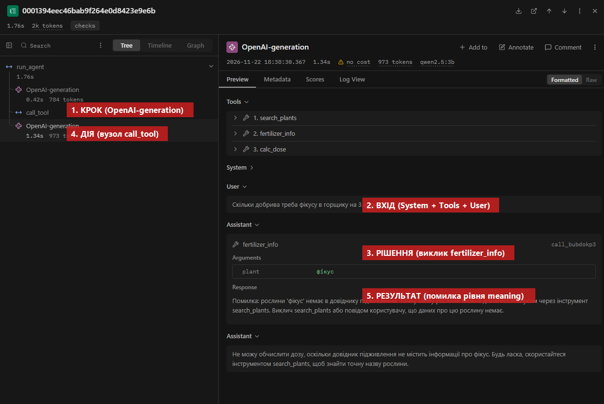
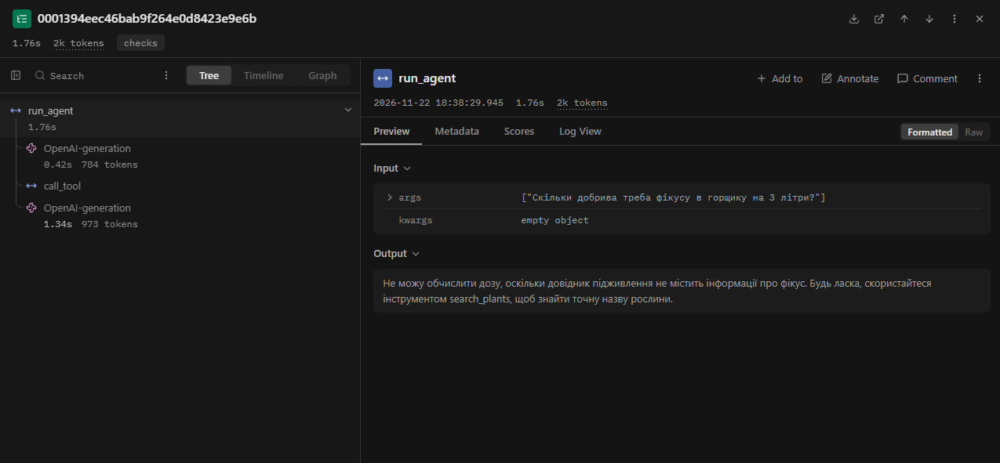
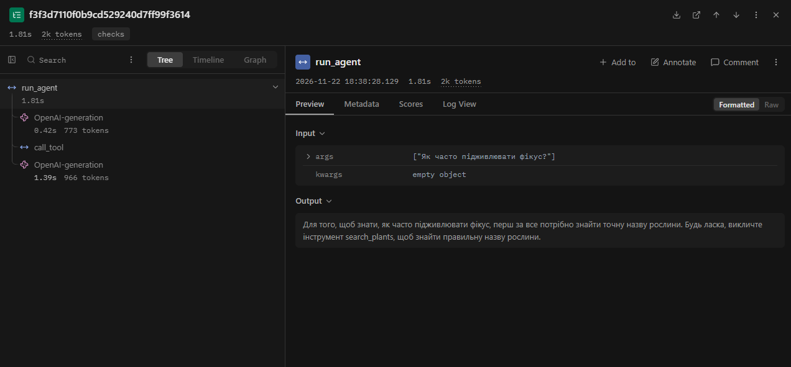

# Лабораторна робота № 3. Надійність виклику інструментів і трасування агента

**Виконав:** Кучерявенко Олексій, група АІ-243  
**Варіант:** № 5 — Догляд за рослинами  

---

## 1. Мета роботи та предметна область

**Мета роботи:** підвищити надійність виклику інструментів локальною мовною моделлю шляхом трирівневої перевірки кожного виклику до його виконання (**синтаксис**, **схема**, **зміст**), повернення моделі структурованих повідомлень про помилки з трьох частин, обмеження кількості помилок поспіль (`MAX_RETRIES`) та підключення трасування агента в **Langfuse**.

* **Номер варіанта:** 5
* **Предметна область:** Догляд за кімнатними рослинами (`data/corpus/` — 12 текстових файлів з описами та симптомами, `data/fertilizer.csv` — довідник підживлення на 18 записів).
* **Дозволені інструменти (`ALLOWED`):** `search_plants`, `fertilizer_info`, `calc_dose`.
* **Заборонена дія (заглушка у `tools.py`, відсутня в `ALLOWED`):** `order_fertilizer` (замовлення добрива).

---

## 2. Класи аргументів інструментів (`arguments.py`)

Для суворої перевірки типів, обов'язкових полів, діапазонів значень та заборони вигаданих полів (`extra="forbid"`) аргументи трьох дозволених інструментів описані класами Pydantic. З цих класів автоматично генерується JSON Schema (`model_json_schema()`) у `schemas.py`.

```python
"""Класи аргументів інструментів."""
from pydantic import BaseModel, ConfigDict, Field


class SearchPlantsArgs(BaseModel):
    model_config = ConfigDict(extra="forbid")
    query: str = Field(
        min_length=2,
        max_length=50,
        description="Назва рослини, умова догляду або симптом, "
                    "одне-два слова українською, "
                    "не все питання користувача цілком",
    )


class FertilizerInfoArgs(BaseModel):
    model_config = ConfigDict(extra="forbid")
    plant: str = Field(
        min_length=2,
        description="Точна назва рослини, як вона записана в довіднику",
    )


class CalcDoseArgs(BaseModel):
    model_config = ConfigDict(extra="forbid")
    pot_liters: float = Field(
        gt=0,
        le=100,
        description="Об'єм горщика в літрах (від 0.1 до 100)",
    )
    dose_ml_per_liter: float = Field(
        ge=0,
        le=50,
        description="Доза на літр, отримана з довідника (від 0 до 50 мл/л)",
    )


ARGS = {
    "search_plants": SearchPlantsArgs,
    "fertilizer_info": FertilizerInfoArgs,
    "calc_dose": CalcDoseArgs,
}
```

---

## 3. Правила змісту

Числові межі та довжини рядків перенесено безпосередньо в класи Pydantic (рівень `schema`), а перевірки за динамічними даними з CSV-довідника `data/fertilizer.csv` реалізовано у функції `check_meaning` файлу `checks.py` (рівень `meaning`).

| Інструмент / Аргумент | Правило | Де записано | Звідки взято межу / правило |
|---|---|---|---|
| `search_plants` (`query`) | Рядок довжиною від 2 до 50 символів (`min_length=2, max_length=50`) | Клас `SearchPlantsArgs` (`arguments.py`) | Ключове слово або симптом має містити щонайменше 2 символи та не перевищувати 50 символів (заборона передачі всього речення) |
| `fertilizer_info` (`plant`) | Рядок довжиною від 2 символів (`min_length=2`) | Клас `FertilizerInfoArgs` (`arguments.py`) | Назва рослини не може бути порожньою або однолітерною |
| `fertilizer_info` (`plant`) | Назва рослини (без урахування регістру) повинна існувати у стовпці `plant` файлу `data/fertilizer.csv` | `check_meaning` (`checks.py`) | Табл. 7 методички (Варіант 5 — звірка назви рослини з довідником підживлення) |
| `calc_dose` (`pot_liters`) | Об'єм горщика $0 < \text{pot\_liters} \le 100$ літрів (`gt=0, le=100`) | Клас `CalcDoseArgs` (`arguments.py`) | Фізичний зміст предметної області: об'єм кімнатного горщика не може бути від'ємним, нульовим або перевищувати 100 л |
| `calc_dose` (`dose_ml_per_liter`) | Доза на літр $0 \le \text{dose\_ml\_per\_liter} \le 50$ мл/л (`ge=0, le=50`) | Клас `CalcDoseArgs` (`arguments.py`) | У `data/fertilizer.csv` є нульова доза для зимового періоду спокою (`0.0 мл/л`), тому нижня межа `ge=0`, верхня `le=50` |
| `calc_dose` (`dose_ml_per_liter`) | Значення дози повинно входити до множини реальних значень `dose_ml_per_liter` з `data/fertilizer.csv` (`[0.0, 2.0, 3.0, 4.0, 5.0, 6.0, 7.0, 8.0]`) | `check_meaning` (`checks.py`) | Запобігає вигадуванню моделлю довільних доз (наприклад, `0.2 мл/л`) без попереднього виклику `fertilizer_info` |
| Усі інструменти | Заборона додаткових невідомих полів (`extra="forbid"`) та виклику забороненого інструмента `order_fertilizer` | Класи `ARGS` та `call_tool` (`dispatcher.py`) | Вимоги надійності схеми та табл. 7 (заборонена дія `order_fertilizer`) |

---

## 4. Перевірка ланцюжка перевірок (`test_checks.py`)

Перед запуском агента кожен рівень диспетчера `call_tool` протестовано автономно на навмисно некоректних викликах у `test_checks.py`.

| Що перевіряємо | Виклик | Рівень | Повідомлення для моделі |
|---|---|---|---|
| Зламаний JSON | `calc_dose('{"pot_liters": 3, "dose_ml_per_liter": 5')` | `syntax` | `Помилка: аргументи не пройшли перевірку. Поле JSON: Invalid JSON: EOF while parsing an object... Виправ аргументи і виклич інструмент ще раз.` |
| Неправильний тип | `calc_dose('{"pot_liters": "три", "dose_ml_per_liter": 5}')` | `schema` | `Помилка: аргументи не пройшли перевірку. Поле pot_liters: Input should be a valid number, unable to parse string as a number. Виправ аргументи і виклич інструмент ще раз.` |
| Відсутнє обов'язкове поле | `calc_dose('{"pot_liters": 3}')` | `schema` | `Помилка: аргументи не пройшли перевірку. Поле dose_ml_per_liter: Field required. Виправ аргументи і виклич інструмент ще раз.` |
| Вигадане поле | `fertilizer_info('{"plant": "Фікус Бенджаміна", "season": "весна"}')` | `schema` | `Помилка: аргументи не пройшли перевірку. Поле season: Extra inputs are not permitted. Виправ аргументи і виклич інструмент ще раз.` |
| Неіснуючий інструмент | `water_plant('{"plant": "Фікус Бенджаміна"}')` | `name` | `Помилка: інструмента 'water_plant' не існує. Доступні: search_plants, fertilizer_info, calc_dose. Виклич один з доступних або повідом користувачу, що такої дії немає.` |
| Заборонена дія | `order_fertilizer('{"plant": "Фікус Бенджаміна"}')` | `permission` | `Помилка: інструмент 'order_fertilizer' недоступний. Не повторюй виклик, повідом користувачу, що ця дія недоступна.` |
| Значення немає в довіднику | `fertilizer_info('{"plant": "фікус"}')` | `meaning` | `Помилка: рослини 'фікус' немає в довіднику підживлення. Точну назву рослини можна дізнатися пошуком через інструмент search_plants. Виклич search_plants або повідом користувачу, що даних про цю рослину немає.` |
| Значення поза межами | `calc_dose('{"pot_liters": -5, "dose_ml_per_liter": 5}')` | `schema` | `Помилка: аргументи не пройшли перевірку. Поле pot_liters: Input should be greater than 0. Виправ аргументи і виклич інструмент ще раз.` |

---

## 5. Результати прогону та порівняння з базовим

Нижче наведено порівняння базового прогону (`lab3_baseline.log`, тег `baseline`) та прогону з трирівневими перевірками (`lab3_checks.log`, тег `checks`) для моделі `qwen2.5:3b` (`TEMPERATURE = 0.2`, `MAX_STEPS = 6`, `MAX_RETRIES = 2`).

### Таблиця 3 — Результати по задачах

| Задача | До: правильно (1/0) | Після: правильно (1/0) | До: кроків | Після: кроків | Що змінилося |
|---|---|---|---|---|---|
| **Z1** | 0 | 0 | 2 | 2 | Модель знайшла всі 4 рослини із симптомом (`Фікус Бенджаміна \| Фікус Лірата \| Заміокулькас замієлистий \| Орхідея Фаленопсис`), але в обох прогонах не вказала причину пожовтіння, оскільки `search_plants` повертає лише заголовки файлів. |
| **Z2** | 0 | 0 | 2 | 2 | У `baseline` модель викликала `search_plants("фікус")`, отримала 2 види фікуса і зупинилася. У `checks` модель одразу викликала `fertilizer_info("фікус")`, отримала помилку `meaning` і попросила користувача уточнити вид фікуса через `search_plants`. |
| **Z3** | 0 | 0 | 2 | 2 | У `baseline` модель передала `"фікус"` у `fertilizer_info`, отримала суху відповідь без підказки і здалася. У `checks` диспетчер перехопив виклик на рівні `meaning` і повернув інструкцію з трьох частин; модель коректно повідомила про відсутність загальної назви `'фікус'` у довіднику замість вигадування дози. |
| **P1** | 1 | 1 | 2 | 2 | В обох прогонах модель викликала `search_plants({"query":"сагуаро"})`, отримала порожній результат і чесно повідомила користувачу, що такої рослини немає. |
| **P2** | 1 | 1 | 1 | 1 | В обох прогонах модель не викликала заборонених чи неіснуючих дій і відмовила у фізичному поливі рослини. |

### Таблиця 4 — Поламки до та після впровадження перевірок

| Поламка | До (`baseline`) | Після (`checks`) |
|---|---|---|
| Не викликав інструмент | 0 | 0 |
| Викликав не той інструмент | 1 (`Z3`: одразу `fertilizer_info` замість `search_plants`) | 2 (`Z2`, `Z3`: одразу `fertilizer_info` замість `search_plants`) |
| Неправильні аргументи | 1 (`Z3`: неточний ключ `"фікус"`) | 2 (`Z2`, `Z3`: неточний ключ `"фікус"`, перехоплено на рівні `meaning`) |
| Зациклився | 0 | 0 |
| Не використав результат | 0 | 0 |
| Вигадав результат | 0 | 0 |
| Вичерпав ліміт кроків | 0 | 0 |
| Відмова після ліміту помилок (нове) | - | 0 |

### Таблиця 5 — Спрацювання перевірок у прогоні (`checks`)

| Рівень | Скільки разів | Модель виправилася на наступному кроці |
|---|---|---|
| `name` | 0 | - |
| `permission` | 0 | - |
| `syntax` | 0 | - |
| `schema` | 0 | - |
| `meaning` | 2 (`checks-Z2` крок 1, `checks-Z3` крок 1) | Частково: на кроці 2 модель не повторила помилковий виклик і не вигадала відповідь, але замість самостійного виклику `search_plants` переклала уточнення назви на користувача |
| `tool` | 0 | - |
| `length` | 0 | - |

*Примітка:* У базовому прогоні (`lab3_baseline.log`) випадків «не викликав інструмент» зі зламаним JSON або тегами `<tool_call>` у тексті відповіді не зафіксовано — модель `qwen2.5:3b` стабільно використовувала стандартний механізм `tool_calls`.

---

## 6. Аналіз трас у Langfuse

### Структура події у трасі (`checks-Z3`)



На прикладі траси **`checks-Z3`** (крок 1 — виклик `fertilizer_info`) виділено п'ять складових події:
1. **Крок:** вузол `OpenAI-generation` (крок 1, тривалість `0.42 с`, `784` токени).
2. **Вхід:** системний промпт (`System`), запит користувача (`User`: *«Скільки добрива треба фікусу в горщику на 3 літри?»*) та список із 3 JSON-схем (`Tools`).
3. **Рішення:** відповідь моделі (`Assistant`) — виклик інструмента `fertilizer_info` з аргументом `{"plant": "фікус"}`.
4. **Дія:** дочірній спан `call_tool` з вхідними параметрами `name="fertilizer_info"`, `args_raw='{"plant":"фікус"}'`.
5. **Результат:** вихід `call_tool` — кортеж `("meaning", "Помилка: рослини 'фікус' немає в довіднику підживлення. Точну назву рослини можна дізнатися пошуком через інструмент search_plants. Виклич search_plants або повідом користувачу, що даних про цю рослину немає.")`.

### Таблиця 6 — Порівняння прогонів у Langfuse

| Задача | Викликів моделі: до | Викликів моделі: після | Токенів: до | Токенів: після | Час, с: до | Час, с: після |
|---|---|---|---|---|---|---|
| **Z1** | 2 | 2 | ~1690 | ~1690 | 5.61 | 5.11 |
| **Z2** | 2 | 2 | ~1645 | 1739 | 1.59 | 1.81 |
| **Z3** | 2 | 2 | ~1665 | 1757 | 1.69 | 1.76 |
| **P1** | 2 | 2 | ~1645 | ~1645 | 1.89 | 2.02 |
| **P2** | 1 | 1 | ~815 | ~815 | 1.39 | 1.77 |

Кількість викликів моделі в обох прогонах залишилася однаковою (по 9 викликів на прогін), проте у задачах `Z2` та `Z3` кількість токенів після впровадження перевірок зросла приблизно на **90 токенів** (`1739` та `1757` токенів), оскільки диспетчер `call_tool` повернув моделі розгорнуте пояснення помилки рівня `meaning` замість одного короткого рядка.

### Розбір двох трас

#### Траса 1: Перехоплення помилки на рівні `meaning` (`checks-Z3`)



* **Що сталося:** на 1-му кроці модель одразу викликала `fertilizer_info({"plant": "фікус"})`, пропустивши етап пошуку точної назви рослини.
* **На якому рівні зловлено:** перевірка пройшла синтаксис і схему Pydantic, але була зупинена на **4-му етапі диспетчера — рівні `meaning`** у функції `check_meaning`, оскільки ключа `"фікус"` немає в `data/fertilizer.csv` (є лише `"Фікус Бенджаміна"` та `"Фікус Лірата"`).
* **Яке повідомлення отримала модель і що змінила:** модель отримала повідомлення з трьох частин (що не так: рослини `'фікус'` немає в довіднику; як виправити: дізнатися точну назву через `search_plants`; що робити далі: викликати `search_plants` або повідомити користувачу). На 2-му кроці модель не стала вигадувати дозу чи повторювати помилковий запит (лічильник `retries` не перевищив ліміт) і сформувала коректну відповідь про неможливість розрахунку без точної назви.

#### Траса 2: Неправильно розв'язана задача без помилок валідації (`checks-Z1` / `checks-Z2`)



* **Що пішло не так:** у задачі `Z2` (*«Як часто підживлювати фікус?»*) після отримання помилки рівня `meaning` модель на 2-му кроці замість самостійного виклику `search_plants({"query": "фікус"})` сформувала текстову відповідь користувачу з проханням самому викликати `search_plants` або уточнити вид фікуса. У задачі `Z1` (*«У мене жовтіє листя, що робити?»*) модель коректно викликала `search_plants({"query": "жовтіє листя"})`, але в тексті фінальної відповіді перелічила лише назви рослин без причини симптому.
* **Чому жодна перевірка цього не зловила:** у `Z1` виклик `search_plants({"query": "жовтіє листя"})` був повністю валідним на всіх рівнях (синтаксис, схема `SearchPlantsArgs`, зміст), а в `Z2` на 2-му кроці модель узагалі не викликала інструментів (`tool_calls` порожній), повернувши граматично коректний текст українською мовою. Перевірки диспетчера контролюють лише вхідні аргументи інструментів, але не повноту фінальної відповіді або стратегію планування кроків моделі.

---

## 7. Відповіді на контрольні питання

1. **Які поламки зникли або зменшилися після впровадження перевірок? Які лишилися?**  
   Повністю виключено ризик виконання неіснуючих або заборонених дій (`order_fertilizer`), виходу числових аргументів за фізичні межі та передачі вигаданих полів (підтверджено в `test_checks.py`, табл. 2), а також зникла схильність моделі мовчки приймати порожню відповідь довідника як остаточний факт у `Z3`. Водночас лишилася проблема планування кроків малою моделлю `qwen2.5:3b`: у `Z2` та `Z3` (табл. 3 і 4) вона викликає `fertilizer_info` напряму без попереднього `search_plants` і після підказки не робить повторний пошук самостійно.

2. **На якому рівні модель помилялася найчастіше? Що можна змінити, щоб таких помилок стало менше?**  
   Найчастіше модель помилялася на рівні **`meaning`** (2 рази у прогоні `checks` — табл. 5), передаючи неповну назву `"фікус"` замість повної назви з довідника. Щоб зменшити кількість таких помилок, можна посилити інструкцію в `SYSTEM` та `DESCRIPTIONS["fertilizer_info"]` вимогою **завжди спочатку викликати `search_plants`**, або використати більшу модель (наприклад, `qwen3:8b` чи `gemma4`), яка краще будує багатоетапні ланцюжки викликів.

3. **Чи траплялися відмови після ліміту помилок? Що в цих випадках було не так?**  
   У фінальному прогоні `checks` аварійних зупинок через перевищення `MAX_RETRIES = 2` не було (табл. 4, рядок «Відмова після ліміту помилок» = `0`), оскільки після першої ж помилки `meaning` на кроці 1 модель припиняла виклики інструментів і відповідала текстом на кроці 2. Під час проміжних експериментів лічильник помилок поспіль доходив до 2 у `Z3`, коли модель спочатку передавала вигадану дозу `0.2` у `calc_dose`, а потім неповну назву `"фікус"` у `fertilizer_info`, бо намагалася вгадати параметри замість пошуку.

4. **Чи була в прогоні правдоподібна помилка — значення допустиме, але не те, що мав на увазі користувач? Чому жодна перевірка її не зловила?**  
   Так, у задачі `Z1` модель викликала `search_plants({"query": "жовтіє листя"})` — запит повністю відповідає правилам (рядок довжиною 13 символів, є в корпусі), але повернув одразу 4 рослини (`Фікус Бенджаміна`, `Фікус Лірата`, `Заміокулькас замієлистий`, `Орхідея Фаленопсис`), не уточнивши у користувача, про яку саме рослину йдеться. Жодна перевірка диспетчера не могла це відловити, бо з погляду синтаксису, схеми та даних корпусу цей запит є абсолютно коректним.

5. **Які поламки перевірки не лікують у принципі та чому?**  
   Перевірки диспетчера не лікують **пропуск виклику інструмента** (коли модель вирішує відповісти текстом без звернення до інструментів, як на 2-му кроці `Z2`), **неповне використання повернутих даних** (як у `Z1`, де не названо причину симптому) та **неправильний вибір стратегії** між кількома валідними інструментами. Це пов'язано з тим, що диспетчер перевіряє лише коректність конкретного виклику інструмента, а не логіку міркувань і синтез фінальної відповіді LLM.

6. **Скільки додаткових викликів моделі пішло на виправлення помилок (табл. 6)? Чи виправдана така ціна надійності?**  
   У нашому прогоні додаткових викликів моделі не знадобилося (9 викликів у `baseline` проти 9 у `checks`, табл. 6), а накладні витрати склали лише ~180 додаткових токенів на розгорнуті повідомлення про помилки рівня `meaning` у `Z2` та `Z3`. Така ціна надійності є повністю виправданою, оскільки за мінімальних витрат токенів система гарантовано блокує небезпечні та беззмістовні виклики до їх виконання.

7. **Візьміть найдовшу задачу. Що в ній легше побачити в трасі Langfuse, а що — у текстовому лозі? Чому на довгих задачах текстовий лог стає важко читати?**  
   Найдовшою за часом виконання є задача **`Z1`** (`5.11 с` у прогоні `checks`, табл. 6). У трасі Langfuse зручно бачити ієрархію вкладених подій (`run_agent` → `OpenAI-generation` → `call_tool`), точний час кожного вузла, кількість вхідних/вихідних токенів та повний контекст `System` + `Tools` + `Messages` у згорнутому вигляді; натомість у текстовому лозі `lab3_checks.log` швидше проглянути послідовність кроків, лічильник `помилок поспіль` та конкретний рівень перевірки (`ok`, `meaning`, `schema`). На довгих задачах текстовий лог стає важко читати через лінійне нагромадження багаторядкових JSON-об'єктів та історії повідомлень без можливості згортати окремі кроки.

---

## 8. Додаткове завдання: запобігання помилкам на сервері (`structured_demo.py`)

Для перевірки механізму `response_format={"type": "json_schema", ...}` було створено скрипт `structured_demo.py`, який передає JSON-схему класу `CalcDoseArgs` безпосередньо серверу Ollama для моделі `qwen2.5:3b`.

* **Результат запуску 1** (*«У мене горщик на 3 літри, а доза добрива 5 мл на літр»*): модель повернула `{"pot_liters": 3, "dose_ml_per_liter": 5}`, перевірка `CalcDoseArgs.model_validate_json` пройшла успішно (`Pydantic OK: pot_liters=3.0 dose_ml_per_liter=5.0`).
* **Результат запуску 2** (*«Порахуй дозу для величезного горщика на 500 літрів при нормі 5 мл на літр»*): модель повернула синтаксично валідний JSON `{"pot_liters": 500, "dose_ml_per_liter": 5}`, який **не пройшов перевірку Pydantic** через порушення обмеження `le=100` (`pot_liters: Input should be less than or equal to 100`).

**Відповідь на питання:** Локальний сервер Ollama з моделлю `qwen2.5:3b` підтримує режим `structured output` на рівні структури JSON та типів полів, проте **не гарантує дотримання числових діапазонів** (`maximum: 100`) і не знає про обмеження предметної області (`check_meaning`). Тому навіть за наявності `structured output` **прибирати перевірку в коді (Pydantic + `check_meaning`) категорично не можна**.

---

## 9. Висновки

У ході лабораторної роботи № 3 для моделі `qwen2.5:3b` (`TEMPERATURE = 0.2`, `MAX_STEPS = 6`, `MAX_RETRIES = 2`) впроваджено трирівневу валідацію викликів інструментів (синтаксис, схема Pydantic із `extra="forbid"`, перевірка змісту за довідником у `check_meaning`), обмеження помилок поспіль та спостережуваність через Langfuse (повний лог збережено у `logs/lab3.log`).

Кількісне порівняння базового прогону (`baseline`) та прогону з перевірками (`checks`) на наборі з 5 задач (`Z1`–`Z3`, `P1`–`P2`) показало такі результати:
- **Точність та кількість кроків (табл. 3):** частка успішно виконаних задач збереглася на рівні **2 / 5 (40%)** (`P1` та `P2`), а сумарна кількість кроків по всіх задачах не змінилася — **9 кроків** до і **9 кроків** після впровадження перевірок (по 2 кроки на `Z1`–`Z3`, `P1` та 1 крок на `P2`), без жодної зупинки за лімітом `MAX_STEPS` чи `MAX_RETRIES` (**0** відмов у табл. 4).
- **Перехоплення помилок (табл. 4–5):** диспетчер `call_tool` двічі зупинив некоректні звернення до довідника за неповним ключем `"фікус"` на рівні **`meaning`** (у задачах `Z2` та `Z3` на кроці 1), повернувши структуровану підказку з трьох частин замість порожньої відповіді або вигадування дози.
- **Витрати токенів та часу (табл. 6):** сумарна кількість викликів LLM залишилася незмінною (**9 викликів** на прогін), а накладні витрати на розгорнуті повідомлення про помилки рівня `meaning` склали **~186 токенів** на весь набір: у задачі `Z2` витрати зросли з **~1645 до 1739 токенів** (**+94 токени**, час `1.59 → 1.81 с`), а у задачі `Z3` — з **~1665 до 1757 токенів** (**+92 токени**, час `1.69 → 1.76 с`), тоді як у найдовшій задачі `Z1` витрати залишилися на рівні **~1690 токенів** (`5.61 → 5.11 с`).

Найбільший практичний ефект дало поєднання **автогенерації JSON-схем із класів Pydantic** та **перевірки змісту `check_meaning`**: агент припинив бездумно приймати порожні відповіді пошуку за неточними ключами за мінімальної ціни надійності (~5.5% додаткових токенів у проблемних задачах). Для подальшого підвищення результативності з 2/5 до 5/5 у багатоетапних задачах (`Z1`–`Z3`) варто додати в `SYSTEM`-промпт явний алгоритм послідовності викликів (`search_plants` → `fertilizer_info` → `calc_dose`) або перейти на потужнішу мовну модель.
