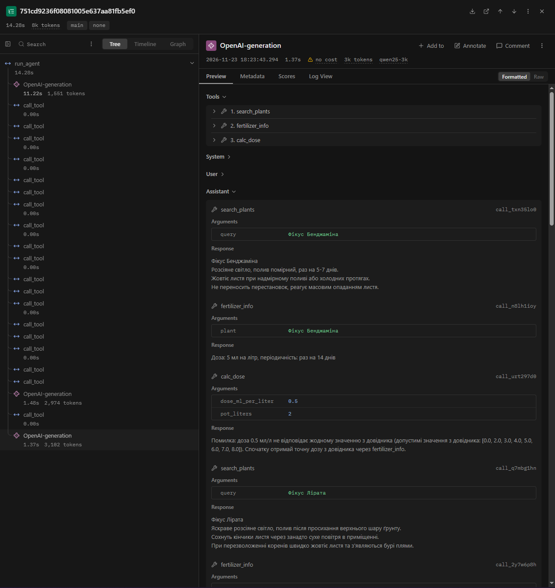
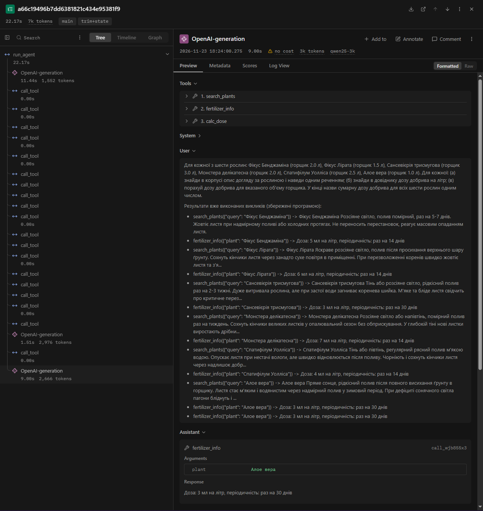

# Лабораторна робота № 4. Контекст, стан і кеш агента

**Виконав:** студент групи АІ-243 Кучерявенко Олексій  
**Перевірив:** викладач кафедри обчислювальних методів  

---

## 2. Мета роботи, варіант і параметри вікна

**Мета роботи:** дослідити поведінку LLM-агента при переповненні контекстного вікна моделі, реалізувати та порівняти три механізми керування контекстом і витратами — обрізання історії (`trim`), зовнішній стан задачі (`trim+state`) та детермінований кеш викликів моделі (`cache`), а також проаналізувати траси виконання в системі Langfuse.

- **Номер варіанта:** 5
- **Предметна область:** Догляд за рослинами (довідник рослин, норми підживлення добривами, розрахунок дози на об'єм горщика)
- **Вихідна модель:** `qwen2.5:3b` (`context length = 32768` токенів)
- **Нова модель з вузьким вікном:** `qwen25-3k` (`num_ctx = 3072` токенів)
- **Коефіцієнт звуження вікна:** $\frac{32768}{3072} \approx \mathbf{10{,}67}$ раза (вікно зменшено у 10,67 раза)

---

## 3. Довга задача (Крок 2)

- **Питання (`long_task.json`):**  
  > Для кожної з шести рослин: Фікус Бенджаміна (горщик 2.0 л), Фікус Лірата (горщик 1.5 л), Сансевієрія трисмугова (горщик 3.0 л), Монстера делікатесна (горщик 2.0 л), Спатифілум Уолліса (горщик 2.5 л), Алое вера (горщик 1.0 л). Для кожної: (а) знайди в корпусі опис догляду за рослиною і наведи одним реченням; (б) знайди в довіднику дозу добрива на літр; (в) порахуй дозу добрива для вказаного об'єму горщика. У кінці назви сумарну дозу добрива для всіх шести рослин одним числом.

- **Правильна відповідь (`expected`):** **`55`** (`55.0 мл`: $5\cdot 2.0 + 6\cdot 1.5 + 3\cdot 3.0 + 7\cdot 2.0 + 4\cdot 2.5 + 3\cdot 1.0 = 10 + 9 + 9 + 14 + 10 + 3 = 55\text{ мл}$).
- **Мінімум викликів інструментів (`min_calls`):** 18 (по 3 інструменти на кожну з 6 рослин).

---

## 4. Аналіз прогону без захисту та межі вікна (Крок 4)

Після першої перевірки у вікні `4096` найбільший вхід склав менше 95% вікна (випадок **C — Задача закоротка**), тому відповідно до методики вікно було зменшено до **`num_ctx = 3072`** (`MODEL = "qwen25-3k"`, `COMPRESS_AT = 2150`).

**Таблиця 2 — Зростання входу в прогоні без захисту (`probe_none_r1.log`)**

| Крок | `prompt_tokens` | Приріст | Що зробила модель |
|-----:|----------------:|--------:|:------------------|
| 1 | 969 | — | Викликала 18 інструментів паралельно: `search_plants` (6), `fertilizer_info` (6) та `calc_dose` (6) із вигаданими дозами (`50`–`150` мл/л) → 6 помилок рівня `meaning` |
| 2 | 2923 | +1954 | Повторно викликала 15 інструментів (`search_plants`, `fertilizer_info`, `calc_dose` для 5 рослин, загубивши Монстеру делікатесну та підставивши `pot_liters=1` замість реальних об'ємів) |
| 3 | 3028 | +105 | `відповідь без виклику` (`status = final`) |

**Показники прогону `probe_none_r1` (пункти (а)–(д)):**
- **(а) Постійна частина входу (вхід першого кроку, $C$):** **969 токенів**.
- **(б) Типовий приріст за крок ($d$):** **1030 токенів** (медіана приростів $+1954$ та $+105$).
- **(в) Сума `prompt_tokens` за прогін та значення за формулою:**  
  Фактична сума `prompt_tokens` = **6920**, за формулою $nC + \frac{d \cdot n(n-1)}{2} = 3 \cdot 969 + \frac{1030 \cdot 3 \cdot 2}{2} = 2907 + 3090 = \mathbf{5997}$ (скрипт виводить `5996` через дробову медіану `1029.5`). Розбіжність (~15%) пояснюється нерівномірністю кроків: на кроці 1 модель зробила одразу 18 викликів (+1954 токени), а на кроці 3 вхід вперся в межу вікна (+105 токенів).
- **(г) Крок, на якому вхід перестав рости:** **крок 3** (`prompt_tokens = 3028`, що становить **99% вікна 3072**).
- **(д) Поведінка моделі після кроку (г) та випадок (A–D):**  
  У `probe_none_r1` на кроці 3 модель одразу сформувала фінальну відповідь без виклику інструментів, проте через усічення початку контексту загубила Монстеру делікатесну та підсумувала спотворені числа (`10 + 150 + 3 + 4 + 3 = 170 мл`), яких не було в результатах інструментів. Прогін належить до **Випадку B (Сервер мовчки обрізає вхід)**: без повідомлення про помилку сервера Ollama відкидає найстаріші токени, через що вхід стабілізується біля межі `3028` токенів (99% від `3072`).

---

## 5. Обрізання історії та стан задачі (Кроки 5 і 6)

**Таблиця 3 — Стиснення історії (`probe_trim_r1` та `probe_trim+state_r1`)**

| Конфігурація | Крок стиснення | Вхід до стиснення, токенів | Повідомлень було -> стало | Повторних викликів за прогін |
|:-------------|---------------:|----------------------------:|:-------------------------:|-----------------------------:|
| `trim` | 2 | 2949 | 23 -> 4 | 8 |
| `trim+state` | 2 | 2842 | 23 -> 4 | 1 |

**Аналіз блоку стану після стиснення (Крок 6, п. 7):**
- У лозі прогону з увімкненим станом (`trim+state`) блок `ПЕРШЕ ПОВІДОМЛЕННЯ КОРИСТУВАЧА ПІСЛЯ СТИСНЕННЯ` містить **13 рядків** виду `- інструмент(аргументи) -> результат` (6 записів `search_plants`, 6 записів `fertilizer_info` та 1 повторний запис `fertilizer_info`).
- Довжина доданого тексту стану становить близько **1780 символів**, що за оцінкою $2{,}5\text{ символа/токен}$ дорівнює **~712 токенам**.
- Порівняння з типовим приростом за крок (`1030 токенів`): блок стану займає **менше одного типового кроку (~69% від приросту)** і лише ~23% вікна `3072`, тож він не завеликий і залишає достатньо місця для завершальних обчислень без повторних викликів пошуку.

---

## 6. Перевірка детермінованого кешу викликів моделі (Крок 7)

**Таблиця 4 — Робота кешу (`cache1_none_r1` vs `cache2_none_r1`)**

| Запуск | Кроків | Влучань у кеш | Викликів до сервера | Час, с | Правильно |
|:-------|-------:|--------------:|--------------------:|-------:|:---------:|
| 1 (кеш порожній) | 2 | 0 | 2 | 17.9 | ні |
| 2 (той самий запит) | 2 | 2 | 0 | 0.6 | ні |

- **Прискорення:** запуск 2 виконався у **$\frac{17.9}{0.6} \approx 29{,}8$ раза швидше** за запуск 1 (практично миттєво, оскільки обидва звернення до LLM взято з каталогу `cache/`).
- **Що сталося б при зміні `SYSTEM` у `config.py` перед запуском 2:** функція `make_key(request)` обчислює SHA-256 від усього словника запиту (включно з `messages[0]`, де міститься `SYSTEM`). Зміна навіть одного символу в системному промпті змінює хеш-ключ, тому жоден файл у `cache/` не збігся б, влучань у кеш було б `0`, і всі запити пішли б на сервер Ollama заново.

---

## 7. Порівняння конфігурацій та траси Langfuse (Крок 8)

**Таблиця 5 — Вартість циклу в конфігураціях (медіани по трьох повторах, включно з додатковим завданням)**

| Конфігурація | Правильно (з 3) | Кроків | Токенів на вхід | Токенів на вихід | На підсумовування | Час, с | Стиснень | Повторних викликів |
|:-------------|:---------------:|-------:|----------------:|-----------------:|------------------:|-------:|---------:|-------------------:|
| `none` | 0 з 3 | 3 | 6943 | 806 | 0 | 18.0 | 0 | 1 |
| `trim` | 0 з 3 | 6 | 11047 | 1024 | 0 | 31.7 | 1 | 7 |
| `trim+state` | 0 з 3 | 3 | 6039 | 839 | 0 | 23.5 | 1 | 1 |
| `summary` *(додаткове)* | 0 з 3 | 4 | 7286 | 1104 | 3081 | 28.7 | 1 | 6 |

**Поламки в логах `logs\main_*.log` (Крок 8, п. 5):**
- Перевірено всі 9 основних прогонів серії `main` (а також 3 прогони `extra`): у **всіх 9 із 9 прогонів `main` (100%)** агент завершив роботу менше ніж за 19 кроків (від 2 до 6 кроків замість мінімальних 19 кроків для 18 викликів + фінальна відповідь).
- Крім того, у **9 із 9 прогонів** зафіксовано вигадування чисел або неповний розрахунок: у `main_none_r2` модель відповіла лише про одну рослину (`3 мл на літр`), у `main_trim_r2` підставила `3 мл/л` для всіх рослин і отримала `45.0 мл`, а у фінальному `main_trim+state_r1` правильно помножила кожну дозу на об'єм горщика (`10 + 9 + 9 + 14 + 10 + 3`), але помилилася в усному додаванні підсумку (`58 мл` замість `55 мл`).

**Аналіз трас у Langfuse (Крок 8, п. 6):**
- У трасі `long-main_trim+state_r1` на кроці 2 вхід становив **2951 токен** (23 повідомлення), після спрацювання стиснення вхід на кроці 3 зменшився до **2119 токенів** (4 повідомлення зі збереженим станом). У відповідному прогоні без захисту `long-main_none_r1` на кроці 3 вхід не зменшився, а виріс до **3021 токена** (98% вікна).
- **Перевага траси Langfuse над текстовим логом:** дерево трас одразу візуалізує ієрархію спанів, сумарну затримку (`latency`) та точну кількість токенів кожного виклику LLM без потреби парсити текстовий лог вручну.

---

## 8. Відповіді на контрольні питання

1. **На якому кроці агент без захисту дійшов до межі вікна і як ви це побачили (таблиця 2, пункти (г) і (д) кроку 4)? Що в його поведінці змінилося після цього?**  
   У прогоні `probe_none_r1` агент дійшов до межі вікна на **кроці 3**, де `prompt_tokens` склав **3028 токенів (99% вікна 3072)**, а приріст впав до +105 токенів проти +1954 на попередньому кроці (таблиця 2). Після цього сервер мовчки обрізав початок контексту, через що агент втратив дані про Монстеру делікатесну й замість дорозрахунку видав відповідь із вигаданими числами.

2. **Порівняйте суму `prompt_tokens` за прогін із формулою (пункти (а)–(в) кроку 4). Чи збігається зростання з очікуваним?**  
   Фактична сума `prompt_tokens` у `probe_none_r1` становить **6920**, тоді як формула $nC + \frac{d \cdot n(n-1)}{2}$ дає **5996** (відхилення ~15%). Загальна квадратична тенденція зростання підтверджується, але точний збіг порушується через те, що на кроці 1 модель викликає одразу 18 інструментів (+1954 токени), а на кроці 3 вхід упирається в стелю вікна `3072`.

3. **Що втрачає агент при обрізанні? Наведіть приклад повторного виклику після стиснення. Що змінилося в `trim+state` (таблиці 3 і 5)?**  
   При звичайному обрізанні (`trim`) видаляються старі повідомлення `assistant` і `tool`, тому модель втрачає вже отримані описи рослин і норми добрив — наприклад, у `main_trim_r2` на кроці 3 після стиснення модель заново викликала `search_plants({"query": "Фікус Бенджаміна"})` та решту 5 пошуків (разом 7 повторних викликів проти 1 у `none`, таблиця 5). У режимі `trim+state` результати успішних викликів зберігаються у `state/` і додаються до запитання після обрізання, завдяки чому кількість повторних викликів знизилася з **7 до 1**, а медіана вхідних токенів впала з **11 047 до 6039**.

4. **Яка конфігурація найдешевша за токенами, найшвидша, найточніша (таблиця 5)? Чому висновок за трьома повторами однієї задачі обережний?**  
   Найдешевшою за вхідними токенами є **`trim+state`** (медіана **6039** токенів), найшвидшою — **`none`** (**18.0 с**, бо не витрачає час на додаткові кроки після обрізання), а за точністю всі конфігурації показали **0 з 3** через обмеження моделі `3B`. Висновок за трьома повторами однієї задачі має бути обережним, оскільки генерація LLM стохастична навіть при низькій температурі, а на іншій структурі інструментів або більшій моделі (`7B+`) співвідношення кроків і точності суттєво зміниться.

5. **Чому під час вимірювання вартості кеш вимкнено? Що станеться з кешем, якщо інструмент поверне інші дані або ви заміните модель під тією самою назвою?**  
   Під час вимірювання вартості кеш вимкнено (`USE_CACHE = False`), інакше другий і третій повтори брали б відповіді з файлів `cache/` за 0.6 с без реального звернення до моделі, що спотворило б вимірювання часу та витрат. Якщо інструмент поверне інші дані на кроці $k$, зміниться історія `messages` на кроці $k+1$, отже зміниться SHA-256 ключ і кеш не спрацює; проте якщо замінити ваги моделі в Ollama під тією самою назвою `qwen25-3k`, рядок `model` у запиті залишиться незмінним, і кеш помилково повертатиме старі відповіді від попередньої моделі.

6. **Які поламки довгого прогону скорочення історії не лікує в принципі?**  
   Скорочення історії (`trim`, `trim+state`, `summary`) керує лише обсягом контексту, але не лікує когнітивні помилки самої моделі: паралельний виклик `calc_dose` із вигаданими аргументами до отримання даних з довідника (рівень `meaning`), передчасне завершення діалогу без виклику всіх необхідних інструментів та арифметичні помилки під час усного підсумовування результатів у фінальній відповіді.

---

## 9. Додаткове завдання: стратегія `summary`

Для перевірки підсумовування (`summary.py`) виконано 3 прогони серії `extra` (`extra_summary_r1..r3`), результати додано до Таблиці 5:
- **Вартість підсумовування:** окремий виклик моделі для переказу старої історії коштував у середньому **3081 токен** (колонка «На підсумовування»).
- **Порівняння з `trim`:** на основному циклі `summary` використав **7286** вхідних токенів проти **11 047** у `trim` (економія 3761 токен на основних кроках), проте з урахуванням витрат на саме підсумовування сумарна вартість склала $7286 + 3081 = \mathbf{10\,367}$ токенів, а час зріс до **28.7 с**.
- **Збереження точних чисел:** перевірка блоків `ПІДСУМОК ІСТОРІЇ` у логах показала, що компактна модель `3B` спотворює факти під час переказу — зокрема, у `extra_summary_r1` загубила дані про Монстеру делікатесну, а в `extra_summary_r2` перекрутила дози добрив на літр, що змусило агента робити **6 повторних викликів**. Тому для малих локальних моделей детермінований стан `trim+state` значно надійніший і дешевший за `summary`.

---

## 10. Висновок

Серед трьох досліджених механізмів найбільший практичний ефект для повторюваних експериментів і налагодження дав **кеш викликів моделі (`cache`)**, скоротивши час виконання прогону у **29,8 раза** (з 17.9 с до 0.6 с). Для бойових прогонів із новими запитами найкращою стратегією керування контекстом виявилася комбінація **`trim+state`**: вона втримує розмір входу в межах вікна `3072` токенів, зменшує медіанні витрати вхідних токенів на **45%** порівняно зі звичайним `trim` (6039 проти 11 047) та усуває повторні виклики пошуку без додаткових витрат на LLM-підсумовування. Для подальшого підвищення точності (до 3 з 3) варто замінити модель `3B` на більш здатну модель (`7B+`) або додати програмний інструмент підсумовування масиву чисел, щоб модель не виконувала арифметику подумки.