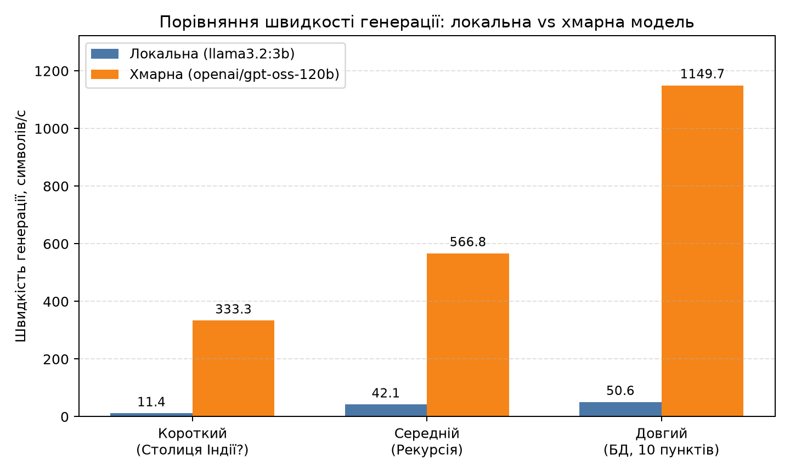

# Протокол лабораторної роботи №1
**Тема:** «Розгортання середовища та порівняльний аналіз мовних моделей»  
**Дисципліна:** «Обчислювальні методи»  
**Виконав:** студент групи АІ-243 Палас Дмитро Миколайович  
**Варіант:** 16  
**Перевірив:** ас. Баранов О.М.  

---

## 1. Розгортання середовища (Крок 1)

Для локального запуску мовних моделей встановлено `Ollama 0.40.18` (Windows, CPU-інференс, 15.5 GiB RAM) та завантажено дві локальні моделі: інструктивну `llama3.2:3b` (`2.0 GB`) та міркувальну `qwen3:4b` (`2.5 GB`). Працездатність перевірено командами `ollama list` і `ollama run qwen3:4b "Надайте інформацію про вашу модель"`.

У Python 3.12.10 (`.venv` з підключеним пакетом `utils` через `pip install -e .`) налаштовано клієнт бібліотеки `openai` та спільний логер `utils.lab_logger.custom_logger`, який записує протокол кожного експерименту в окремий `.log`-файл у каталозі `logs/`. Як хмарний провайдер підключено Groq API (`https://api.groq.com/openai/v1`, модель `openai/gpt-oss-120b`), а ключ доступу винесено в `.env` (ігнорується `.gitignore`).

---

## 2. Завдання 1. Ціна роздумів: міркувальна vs інструктивна модель (Крок 2)

На ознайомчому запиті `Столиця України?` до ендпойнта `http://localhost:11434/api/generate` (`task1_generate.py`, лог [task1_thinking.log](logs/task1_thinking.log)) модель `qwen3:4b` повернула `response = "Kyiv"`, згенерувавши при цьому `3137` символів внутрішніх роздумів (`thinking`), `730` вихідних токенів (`eval_count`) при `19` вхідних (`prompt_eval_count`, з яких `1` узято з кешу — `prompt_eval_cached_count`) і завершилась зі статусом `done_reason = "stop"` за `63.658` с (`11.56` токенів/с).

Далі виконано порівняння міркувальної (`qwen3:4b`) та інструктивної (`llama3.2:3b`) моделей після прогріву на простому фактичному питанні та задачі на міркування (по 5 запусків).

**Таблиця 1 – Фактичне питання «Столиця України? Відповідай одним словом.»**

| Показник | `qwen3:4b` | `llama3.2:3b` |
|---|---|---|
| `response` | Киев | Київ |
| `eval_count` | 4752 | 4 |
| Час, с | 656.11 | 6.33 |
| Токенів/с | 7.25 | 11.77 |

**Таблиця 2 – Задача на міркування (середнє з 5 запусків)**

| Показник | `qwen3:4b` | `llama3.2:3b` |
|---|---|---|
| Правильних із 5 | 5 / 5 | 1 / 5 |
| `eval_count` | 1189.4 | 174.8 |
| Час, с | 145.27 | 15.08 |

На задачі про ручку і зошит (`110` грн разом, ручка на `100` грн дешевша; правильна відповідь — `5` грн) `qwen3:4b` дала правильну відповідь у всіх `5` із `5` запусків, тоді як `llama3.2:3b` впоралася лише `1` раз (5-й запуск — `5 грн`): у 1-му та 4-му запусках модель припустилася типової інтуїтивної помилки `10 грн` (забувши, що різниця `100` грн розподіляється між двома змінними), у 2-му дала `100`, а в 3-му заплуталася в рівнянні без фінального числа.

### Відповіді на питання до чат-бота (Крок 6)

1. **Я порівнював міркувальну модель (`qwen3:4b`) та інструктивну (`llama3.2:3b`) на простому фактичному питанні. Відповідь обидві дали однакову, але міркувальна згенерувала в десятки разів більше токенів. Куди пішли ці токени?**  
   Додаткові токени пішли в приховане поле `thinking` — внутрішню чернетку роздумів, яка не потрапляє до поля `response`, але повністю враховується в `eval_count` і часі генерації. У моєму прогоні на питанні про столицю України `qwen3:4b` витратила `13 995` символів (`4752` токени, `656.11` с) на самоперевірку та сумніви щодо орфографії (та ще й повернула «Киев» замість «Київ»), тоді як `llama3.2:3b` обмежилася `4` токенами (`6.33` с).

2. **На яких типах задач міркувальні моделі дають перевагу над інструктивними, а на яких їх використання невиправдане?**  
   Міркувальні моделі виграють у багатокроковій логіці, математичних рівняннях, алгоритмічному коді та задачах із пастками, де інтуїтивна перша відповідь хибна (`5/5` проти `1/5` у задачі про ручку й зошит). На простих фактичних запитах, короткому переказі або класифікації режим міркувань є чистою перевитратою токенів і затримки.

3. **Чим відрізняється процес навчання міркувальної моделі від інструктивної?**  
   Інструктивна модель проходить переважно контрольоване донавчання на парах «запит–відповідь» (SFT) та вирівнювання під вподобання користувача (RLHF/DPO), щоб одразу видавати готову відповідь. Міркувальна модель додатково навчається за допомогою навчання з підкріпленням на задачах із верифікованою відповіддю (RLVR), що стимулює її будувати довгий ланцюжок самоперевірки перед фінальним висновком.

4. **Чи означає більша кількість згенерованих токенів у міркувальної моделі, що вона «розумніша» за інструктивну?**  
   Ні, це свідчить лише про іншу стратегію інференсу — витрату додаткового обчислювального часу на етапі генерації (test-time compute). Як показав фактичний тест, модель здатна витратити `4752` токени на тривіальне питання і при цьому помилитися з мовою написання слова, тому багато токенів без реальної потреби — це надлишковість, а не «розум».

5. **Як пояснити різницю у швидкості генерації (токенів за секунду) між моделями `qwen3:4b` та `llama3.2:3b`?**  
   На одному й тому самому CPU (`15.5 GiB` RAM без дискретної GPU) пропускна здатність пам'яті обмежує швидкість читання ваг на кожному токені. Оскільки `qwen3:4b` містить більше параметрів (`2.5 GB` проти `2.0 GB` у `llama3.2:3b`), вона генерує повільніше (`7.25–13.63` ток/с проти `10.2–17.43` ток/с у `llama3.2:3b`).

**Власні думки:** Експеримент наочно розмежував швидкість генерації (властивість заліза й розміру моделі) та загальний час відповіді (обсяг роботи, який модель сама собі призначила). На CPU для інтерактивних чи агентних циклів із 6–8 кроками міркувальна модель на кшталт `qwen3:4b` створює критичну затримку (`2.5–11` хвилин на запит), тому в агентних сценаріях варто обирати швидкі інструктивні моделі, а режим мислення залишати суто для складного аналізу.

---

## 3. Завдання 2. Роль `system`-повідомлення (Крок 3)

У файлі `hello.py` (лог [task2_hello.log](logs/task2_hello.log)) досліджено вплив `system`-інструкції на поведінку моделей `llama3.2:3b` і `qwen3:4b` при запиті Варіанта 16: *«Поясни різницю між HTTP і HTTPS.»* (`temperature=0.7`).

**Таблиця 3 – Вплив `system`-повідомлення**

| Модель | `System` | Довжина відповіді, символів | Мова відповіді | Кількість речень | Інструкцію виконано? |
|---|---|---|---|---|---|
| `llama3.2:3b` | лаконічний асистент | 969 | Українська (з англ. вкрапленням і помилками) | 8 | Частково (надто багато тексту) |
| `llama3.2:3b` | українською, 2 речення | 203 | Українська | 2 | Так (формат виконано, але є одруківка `HTTS`) |
| `qwen3:4b` | лаконічний асистент | 208 | Англійська | 2 | Ні (відповіла англійською) |
| `qwen3:4b` | українською, 2 речення | 214 | Українська | 2 | Так |

**Таблиця 4 – Витрати токенів**

| Модель | `System` | `prompt_tokens` | `completion_tokens` | `total_tokens` |
|---|---|---|---|---|
| `llama3.2:3b` | лаконічний асистент | 48 | 262 | 310 |
| `llama3.2:3b` | українською, 2 речення | 52 | 62 | 114 |
| `qwen3:4b` | лаконічний асистент | 49 | 1880 | 1929 |
| `qwen3:4b` | українською, 2 речення | 58 | 492 | 550 |

### Відповіді на питання (Крок 6)

1. **Яка модель точніше дотрималась обмеження «максимум двома реченнями»?**  
   Обидві моделі впоралися з обмеженням у 2 речення (`203` і `214` символів відповідно), проте `qwen3:4b` сформулювала значно грамотнішу й змістовнішу українську відповідь без спотворення абревіатури (`HTTS` у `llama3.2:3b`).
2. **Чи були випадки, коли модель відповіла не українською, попри пряму вказівку?**  
   Коли пряма вказівка мови в `system` була відсутня (`«Ти лаконічний технічний асистент.»`), `qwen3:4b` перейшла на англійську мову (`"HTTP is an unencrypted protocol..."`), хоча `user`-питання було українською; після явної вимоги `«Відповідай лише українською...»` обидві моделі відповіли українською.
3. **Як змінився `prompt_tokens` при зміні `system`-повідомлення і чому?**  
   Значення `prompt_tokens` зросло з `48` до `52` для `llama3.2:3b` і з `49` до `58` для `qwen3:4b`, оскільки другий `system`-промпт довший за кількістю слів і пунктуаційних токенів.
4. **Чому в `qwen3:4b` значення `completion_tokens` значно більше, ніж у `llama3.2:3b`, навіть при однаковій довжині видимої відповіді?**  
   Тому що `completion_tokens` у OpenAI-сумісному API `Ollama` сумує не лише токени видимої відповіді (`208–214` символів), а й приховані токени внутрішнього міркування `thinking` (`1880` проти `262` і `492` проти `62`).

### Відповіді на питання до чат-бота (Крок 7)

1. **Я порівнював інструктивну модель (`llama3.2:3b`) та міркувальну (`qwen3:4b`) з різними `system`-повідомленнями. Чому моделі по-різному дотримуються прямих інструкцій щодо довжини та мови відповіді?**  
   Різниця зумовлена відмінним складом тренувальних корпусів і процедурою вирівнювання інструкцій: різні токенізатори та етапи SFT/RL формують різну чутливість до обмежень на обсяг і мову. За відсутності жорсткого ліміту `qwen3:4b` віддала перевагу англійській як домінантній мові навчання, тоді як `llama3.2:3b` без обмеження розтягнула відповідь на `969` символів.
2. **Чим `system`-повідомлення відрізняється від `user`-повідомлення з точки зору моделі — чи справді воно має більший пріоритет?**  
   На рівні трансформера обидва повідомлення потрапляють у єдину послідовність токенів, розділену спеціальними службовими маркерами ролей (`<|im_start|>system` тощо). Пріоритет `system` формується під час донавчання на ієрархії інструкцій, але для малих відкритих моделей `3B–4B` він не є абсолютним і часто порушується.
3. **Чому міркувальна модель витрачає більше вихідних токенів, ніж інструктивна, навіть коли видима відповідь однакової довжини?**  
   Тому що перед генерацією фінальної відповіді користувачу міркувальна модель будує проміжний монолог самоперевірки, і всі токени цього монологу входять до `completion_tokens` та підлягають оплаті або забирають час обчислень.
4. **Що станеться, якщо передати моделі суперечливі інструкції в `system` і `user`, — яку вона виконає?**  
   Більшість сучасних моделей навчені дотримуватися `system`-інструкції як вищої за пріоритетом, однак у малих моделей (`3B`) ефект «близькості до кінця контексту» часто перемагає, і модель виконує останню команду з `user`-повідомлення.
5. **Чому малі мовні моделі часто гірше дотримуються інструкцій щодо мови відповіді, ніж великі?**  
   У моделей малого обсягу ємність параметрів обмежена, і більша частина знань закодована в англомовному просторі токенів. Коли інструкція вимагає рідкіснішої мови без жорсткого примусу, модель схильна з'їжджати на англійську або утворювати суржикові конструкції (`"протokol"`, `"third-party"`).

**Власні думки:** `System`-повідомлення є дешевим і корисним способом задати роль та мову, що скоротило довжину відповіді `llama3.2:3b` у 4.8 раза (`969` → `203` символи). Водночас воно не гарантує безпомилкового формату й чистоти мови на малих моделях, тому для програмних пайплайнів інструкції обов'язково потрібно підкріплювати кодовою валідацією (Pydantic, regex, повторні запити).

---

## 4. Завдання 3. Локальна vs хмарна модель: єдиний інтерфейс (Крок 4)

У файлах `providers.py` та `compare.py` (лог [task3_compare.log](logs/task3_compare.log)) реалізовано єдиний інтерфейс перемикання між локальною моделлю `llama3.2:3b` (`Ollama`) та хмарною `openai/gpt-oss-120b` (`Groq`) через словник `PROVIDERS` і функцію `make_client(name)`. Питання Варіанта 16: *«Поясни різницю між HTTP і HTTPS. Коротко.»*

**Таблиця 5 – Порівняння локальної та хмарної моделі**

| Показник | Локальна (`llama3.2:3b`) | Хмарна (`openai/gpt-oss-120b`) |
|---|---|---|
| Назва моделі | `llama3.2:3b` | `openai/gpt-oss-120b` |
| Час відповіді, с | 11.53 | 0.90 |
| `completion_tokens` | 94 | 205 (з них 27 reasoning) |
| Довжина відповіді, символів | 337 | 546 |
| Мова відповіді | Українська (з помилками й суржиком) | Українська (природна, без помилок) |
| Фактичних помилок у відповіді | 0 (термінологічні спотворення: «безсекurentний», «сецурний») | 0 |

### Відповіді на питання (Крок 5)

1. **Скільки рядків коду довелося змінити, щоб перейти з локальної моделі на хмарну?**  
   Жодного рядка в логіці виклику `client.chat.completions.create(...)` змінювати не довелося — достатньо передати ключ `"cloud"` замість `"local"` у `make_client(name)`, оскільки `base_url`, `api_key` і `model` ізольовано в конфігураційному словнику `PROVIDERS`.
2. **Яка відповідь повніша й точніша за змістом? Наведіть конкретний приклад різниці.**  
   Хмарна `openai/gpt-oss-120b` дала повнішу й точнішу відповідь: вона пояснила не лише шифрування через `TLS/SSL`, а й три властивості захисту — конфіденційність, цілісність та автентифікацію сервера, тоді як `llama3.2:3b` обмежилася загальною фразою про шифрування зі спотвореними неологізмами («безсекurentний», «сецурний»).
3. **Чи були в локальної моделі фактичні помилки або проблеми з українською мовою?**  
   Грубих фактичних помилок не було, але якість української мови низька: модель змішала кирилицю, латиницю та русизми (`"безсекurentний"`, `"сецурний"`, `"передачи"`, `"конфіденциальних"`).
4. **Хмарна модель відповіла швидше за локальну — за рахунок чого, якщо запит летить через інтернет?**  
   Хмарний запит виконався майже в 13 разів швидше (`0.90` с проти `11.53` с), оскільки сервер Groq виконує інференс на спеціалізованих високопродуктивних прискорювачах із величезною пропускною здатністю пам'яті (`total_time` на сервері — `0.427` с), що з надлишком перекриває мережеву затримку.

### Відповіді на питання до чат-бота (Крок 6)

1. **Чому формат запитів OpenAI став стандартом, який підтримують інші провайдери, зокрема локальний сервер Ollama?**  
   OpenAI першою вивела на ринок масовий розробницький API з простою структурою `chat/completions` (`model`, `messages`, `temperature`), під яку одразу написали тисячі бібліотек та фреймворків. Для конкуренції іншим провайдерам і локальним серверам виявилося найвигідніше реалізувати сумісність drop-in, щоб клієнтський код переносився зміною `base_url` та `api_key`.
2. **Я порівнював локальну модель на 3 млрд параметрів і хмарну на 120 млрд. Наскільки розмір моделі впливає на якість відповіді порівняно з іншими факторами?**  
   Збільшення кількості параметрів у десятки разів критично підвищує словниковий запас, грамотність рідкіснішими мовами (зокрема українською) та повноту знань. Проте якість залежить також від чистоти навчальних даних, архітектури (MoE/dense) і системного промпту — велика модель усе одно потребує коректної постановки задачі.
3. **Хмарна модель відповіла швидше за локальну, попри затримку мережі. Чим це пояснюється?**  
   Мережевий round-trip до хмарного API становить ~`100–300` мс, а саме обчислення на кластері прискорювачів триває долі секунди (`0.43` с у моєму лозі), тоді як локальний CPU рахує кожен токен послідовно з обмеженою шиною оперативної пам'яті й витрачає на таку ж відповідь понад `11` секунд.
4. **Які ризики для приватності виникають при використанні хмарних API і що з цим роблять у комерційних проєктах?**  
   Будь-які персональні дані, комерційна таємниця або вихідний код передаються на зовнішні сервери, де потенційно можуть логуватися. У бізнесі для цього підписують угоди про незбереження даних (Zero Data Retention), застосовують анонімізацію PII до відправки або розгортають моделі в приватному контурі (on-premise / VPC).
5. **Що таке rate limit у безкоштовних тарифах і як розробники обходять це обмеження?**  
   Rate limit — це обмеження на кількість запитів за хвилину/день (RPM/RPD) і токенів за хвилину (TPM), за перевищення якого сервер повертає HTTP `429`. Розробники додають експоненційну затримку при повторах (backoff), кешування однакових запитів, балансування між кількома провайдерами або резервне перемикання на локальну модель.

**Власні думки:** Локальну модель варто обирати там, де критична приватність даних, робота без інтернету, нульова вартість на великому потоці нескладних запитів або налагодження коду без спалювання лімітів. Хмарну модель доцільно брати для продакшн-якості, складних роздумів, чистої української мови та мінімальної затримки генерації при допустимості передачі контексту назовні.

---

## 5. Завдання 4. Вимірювання швидкості: TTFT і залежність від довжини запиту (Крок 5)

У скрипті `benchmark.py` (логи [task4_benchmark.log](logs/task4_benchmark.log), [task4_cold_warm.log](logs/task4_cold_warm.log) і таблиця [results.csv](results.csv)) виміряно потокову генерацію (`stream=True`) після прогрівального запиту по 3 повтори з обчисленням медіани для промптів Варіанта 16:
- короткий: *«Столиця Індії?»*
- середній: *«Поясни в одному абзаці, що таке рекурсія.»*
- довгий: *«Напиши інструкцію з 10 пунктів, як спроєктувати просту базу даних.»*

**Таблиця 6 – Результати вимірювання швидкості (медіана з 3 запусків)**

| Розміщення | Модель | Промпт | TTFT, с | Всього, с | Симв./с |
|---|---|---|---|---|---|
| локальна | `llama3.2:3b` | короткий | 2.132 | 3.151 | 11.4 |
| локальна | `llama3.2:3b` | середній | 2.106 | 7.239 | 42.1 |
| локальна | `llama3.2:3b` | довгий | 2.141 | 33.610 | 50.6 |
| хмарна | `openai/gpt-oss-120b` | короткий | 0.448 | 0.543 | 333.3 |
| хмарна | `openai/gpt-oss-120b` | середній | 0.418 | 0.653 | 566.8 |
| хмарна | `openai/gpt-oss-120b` | довгий | 0.451 | 2.245 | 1149.7 |

**Таблиця 7 – Холодний і теплий старт локальної моделі (`llama3.2:3b`, короткий промпт)**

| Показник | Холодний старт | Теплий старт |
|---|---|---|
| TTFT, с | 20.474 | 2.281 |
| Всього, с | 22.012 | 3.779 |

  
*Рисунок 1 — Порівняння швидкості генерації (симв./с) для всіх шести комбінацій «модель × промпт»*

### Відповіді на питання (Крок 6)

1. **У якої моделі кращий TTFT і чому саме в неї?**  
   Кращий TTFT має хмарна `openai/gpt-oss-120b` (~`0.42–0.45` с проти `2.11–2.14` с у локальної `llama3.2:3b`), оскільки серверний префіл (обробка вхідних токенів) на потужних GPU-кластерах виконується за мілісекунди і навіть разом із мережевим шляхом випереджає локальний CPU.
2. **Чи збігається «найшвидша за TTFT» з «найшвидшою за символами/с»? Якщо ні — поясніть.**  
   У цьому експерименті збігається: хмарна модель перемогла за обома метриками (`0.448` с та `1149.7` симв./с на довгому промпті). Проте на дуже короткій відповіді ефективна швидкість символів/с у обох моделей штучно падає (`11.4` і `333.3` симв./с), бо фіксований TTFT займає більшу частку від загального часу.
3. **Як змінилося співвідношення локальної та хмарної моделі при переході від короткого промпту до довгого?**  
   На короткому промпті хмарна модель випередила локальну за загальним часом у `5.8` раза (`0.543` с проти `3.151` с), а на довгому розрив виріс до `15.0` разів (`2.245` с проти `33.610` с), оскільки при довгій генерації домінує чиста пропускна здатність (токенів/с).
4. **Наскільки різняться три повтори одного виміру? Чи достатньо було б одного запуску?**  
   Повтори помітно коливалися: наприклад, на довгому промпті `llama3.2:3b` витратила `31.328` с, `33.610` с і `67.356` с (через різну довжину згенерованого тексту та фонове навантаження ОС), а на короткому промпті хмари швидкість коливалася від `49.0` до `431.0` симв./с, тому одного запуску недостатньо — потрібна медіана кількох повторів.
5. **Чому холодний старт повільніший за теплий?**  
   При холодному старті після `ollama stop llama3.2:3b` модель було вивантажено з пам'яті, тому перший запит витратив близько `18.2` с на читання `2.0 GB` файлу моделі з диска в RAM та ініціалізацію KV-кешу (TTFT `20.474` с проти `2.281` с при теплому старті).

### Відповіді на питання до чат-бота (Крок 7)

1. **Що фізично відбувається під час TTFT — часу до першого токена — і чому цей показник вимірюють окремо від загальної швидкості генерації?**  
   Під час TTFT виконується мережева передача запиту (для хмари) та фаза `prefill`: паралельний прохід усіх токенів промпту крізь шари моделі для заповнення KV-кешу й обчислення першого вихідного токена. Цю метрику вимірюють окремо, бо вона визначає суб'єктивну «чутливість» інтерфейсу, тоді як швидкість генерації (`decode`) залежить від послідовного прогону по одному токену.
2. **Чому хмарна модель може мати гірший TTFT, але кращу швидкість генерації, ніж локальна?**  
   Хмара завжди додає затримку на TCP/TLS-з'єднання, чергу на сервері та дорогу пакета інтернетом, що на коротких локальних запитах із GPU може робити TTFT хмари гіршим; але на фазі декодування спеціалізовані хмарні прискорювачі значно швидше видають наступні токени.
3. **Чому перший запуск локальної моделі повільніший за наступні і що таке холодний старт?**  
   Холодний старт — це звернення до моделі, коли її ваги ще не розміщені в оперативній пам'яті або VRAM. Під час першого запуску система зчитує гігабайтні файли з диска, виділяє пам'ять під контекст і готує обчислювальні буфери, після чого модель лишається в кеші пам'яті (`keep_alive`) і наступні старти є «теплими».
4. **Чому при вимірюванні продуктивності беруть медіану кількох запусків, а не одне значення?**  
   Окремий замір схильний до випадкових сплесків: фонові процеси ОС, тротлінг CPU, мережевий джитер або різна кількість згенерованих слів (як `67.356` с проти `33.610` с у моєму тесті). Медіана надійно відсіює одиничні викиди, не спотворюючи типовий час відповіді так сильно, як середнє арифметичне.
5. **Чому обробка вхідного запиту йде швидше, ніж генерація відповіді такої ж довжини?**  
   Усі токени вхідного промпту вже відомі заздалегідь, тому під час `prefill` їхні матричні операції виконуються паралельно одним пакетом. Генерація відповіді (`decode`) є авторегресійною: кожен наступний токен не можна порахувати до завершення попереднього, тому процесор простоює в очікуванні читання ваг із пам'яті на кожен окремий токен.

**Власні думки:** Для інтерактивного чат-бота критично важливий передусім малий **TTFT** (< 1 с), адже користувач бачить початок тексту миттєво і не сприймає систему як «завислу». Натомість для фонової пакетної обробки великих документів або пайплайнів екстракції визначальною є висока **швидкість генерації** та стабільний загальний час, бо ніхто не чекає першого слова на екрані в реальному часі.

---

## 6. Завдання 5. Оцінювання якості моделей за рубрикою (Крок 6)

У скрипті `quality.py` (лог [task5_quality.log](logs/task5_quality.log), збережені відповіді [quality.json](quality.json)) виконано подвійний прогін (`temperature=0.7`) шести стандартизованих завдань Варіанта 16 (тема **Екологія**) для трьох моделей: `llama3.2:3b`, `qwen3:4b` та `openai/gpt-oss-120b`.

- **Авторитетне джерело до Завдання 1:** Офіційний портал Рамкової конвенції ООН про зміну клімату (UNFCCC) — `https://unfccc.int/process-and-meetings/the-paris-agreement`. Паризьку кліматичну угоду **ухвалено 12 грудня 2015 року** на конференції COP21 у Парижі та **відкрито до підписання 22 квітня 2016 року** у штаб-квартирі ООН у Нью-Йорку (набула чинності 4 листопада 2016 року). У запиті `1_fact` (*«Рік підписання Паризької кліматичної угоди»*) усі три моделі в обох спробах вказали **2015** (рік укладення в Парижі; у `llama3.2:3b` спроба 1 дала `"2015."`, а спроба 2 — `"2015 рік."`, порушивши формат «лише роком», тому виставлено `1` бал і розбіжність `так`), а в `2_format` перша спроба `openai/gpt-oss-120b` окремо зафіксувала `2016` та `New York` (рік церемонії підписання).
- **Текст для Завдання 3 (Екологія, 5 речень, 10 унікальних числових значень: `2024`, `585`, `15%`, `46%`, `92%`, `452`, `113`, `50%`, `2025`, `54%`, на основі даних звітів IRENA та Eurostat):**  
  *«За звітом Міжнародного агентства з відновлюваної енергетики (IRENA), у 2024 році глобальні потужності зеленої енергетики зросли на 585 ГВт, що на 15% більше за показник попереднього року. Частка відновлюваних джерел сягнула 46% у загальній встановленій потужності електростанцій світу, а серед усіх нових об'єктів генерації вони забезпечили 92%. Головним рушієм зростання стала сонячна енергетика, на яку припало 452 ГВт нових потужностей. Вітрова енергетика додала ще 113 ГВт, зберігши друге місце серед нових відновлюваних станцій. У Європейському Союзі частка відновлюваних джерел у виробництві електроенергії у 2024 році досягла 50%, а в другому кварталі 2025 року піднялася до 54%.»*
- **Перевірка Завдання 2 через `json.loads()`:** усі `6` відповідей (`2` спроби × `3` моделі) розпарсилися без синтаксичних помилок (`json.loads OK`), однак у 1-й спробі `llama3.2:3b` самовільно переклала ключі українською (`{"кліматична угода": "2015", "міста": ["Паризь"]}`), порушивши задану схему `agreement, year, city`, а в обох спробах зробила помилку `"Паризь"`.
- **Перевірка Завдання 4 (`sort_waste(items)`) запуском у Python:**
  - `llama3.2:3b`: 1-ша спроба працює для списку рядків (`{'пластик': ['пластикова пляшка'], ...}`), але повертає порожні списки для списку словників; 2-га спроба падає з `TypeError` на рядках і містить одруківку в ключі словника `"орігана"`.
  - `qwen3:4b`: обидві спроби повернули чистий код без markdown-обгортки, що запускається одразу (1-ша — для рядків, 2-га — для словників із ключем `'category'`).
  - `openai/gpt-oss-120b`: написала найуніверсальнішу реалізацію з обробкою рядків, словників і кортежів, але **обидва рази загорнула відповідь у блок** ```` ```python ... ``` ````, через що прямий `exec()` без зрізання обгортки завершується `SyntaxError` (`1` бал за порушення вимоги «Лише код»).

**Таблиця 8 – Оцінка якості за рубрикою**

| Завдання | `llama3.2:3b` | `qwen3:4b` | `openai/gpt-oss-120b` |
|---|---|---|---|
| 1. Факт | 1 | 2 | 2 |
| 2. Формат | 1 | 2 | 2 |
| 3. Стиснення | 0 | 2 | 2 |
| 4. Код | 1 | 2 | 1 |
| 5. Логіка | 0 | 2 | 2 |
| 6. Українська | 0 | 1 | 2 |
| **Разом /12** | **3** | **11** | **11** |

**Таблиця 9 – Розбіжність оцінок між двома прогонами (так / ні)**

| Завдання | `llama3.2:3b` | `qwen3:4b` | `openai/gpt-oss-120b` |
|---|---|---|---|
| 1. Факт | так | ні | ні |
| 2. Формат | так | ні | ні |
| 3. Стиснення | ні | ні | ні |
| 4. Код | так | ні | ні |
| 5. Логіка | так | ні | ні |
| 6. Українська | так | ні | ні |

### Приклад провалу (Крок 7, обов'язковий пункт)

Найпоказовішим провалом стала друга спроба `llama3.2:3b` у задачі `5_logic` (розбіжність із першим прогоном і переконлива на вигляд, але математично абсурдна відповідь).

- **Повний текст запиту:**  
  `500 т сміття: 40% органіка, 25% пластик. Переробляють 60% пластику. Скільки тонн пластику на полігон? Покажи хід розв'язання.`
- **Повний текст відповіді (без скорочень):**  
```text
Здасться, давайте проведем хід розв'язання:

1. Определіть масу пластику, która входить в 500 т сміття. Для цього need 100% органики + 100% пластику = 125%.
Значить, маса пластику = 500 т см * (25/125) = 200 т.
2. Определіть масу пластику, яка переробляється на полігоні. Для цього need 60% пластику = 0,6 * 200 т = 120 т.
3. Затримайте масу пластику, яка не переробляється на полігоні. Для цього need 100% пластику - 60% пластику = 40% пластику.
Значит, маса пластику, яка не переробляється на полігоні = 200 т * (40/100) = 80 т.
4. Затримайте масу пластику, яка переробляється на полігоні. Для цього need маса пластику, переробленої на полігоні - маса пластику, яка не переробляється на полігоні.
Значит, маса пластику, переробленої на полігоні = 120 т - 80 т = 40 т.

Следовательно, на полігоні на 40 т пластику.
```
- **Правильна відповідь:** `50` тонн (`25%` від `500` т = `125` т усього пластику; переробляють `60%`, тобто на полігон потрапляє `40%` від `125` т = `50` т).
- **Пояснення причин:** Мала 3B-модель без внутрішнього ланцюжка міркувань генерує текст авторегресійно по одному токену і вже на першому кроці переплутала відсотки, склавши вигадану пропорцію `100% + 100% = 125%` та `25/125` (`200` т замість `125` т). Далі кожен наступний крок спирався на хибний попередній вивід у контексті, а в кінці модель ще й відняла неперероблену масу від переробленої (`120 - 80 = 40`), змішавши при цьому українську, російську, польську (`która`) та англійську (`need`) мови.

### Відповіді на питання (Крок 6)

1. **Яка модель набрала найбільше балів і на яких саме завданнях виникла основна різниця?**  
   Найвищий результат (`11 / 12`) поділили `qwen3:4b` та хмарна `openai/gpt-oss-120b`, тоді як `llama3.2:3b` набрала лише `3 / 12`; основна різниця виникла в задачах на збереження чисел при стисненні (`0` проти `2`), багатокрокову логіку (`0` проти `2`) та якість української мови (`0` проти `1–2`).
2. **На яких завданнях оцінки двох прогонів розійшлися? Що це говорить про надійність моделі?**  
   Оцінки розійшлися лише у `llama3.2:3b` (завдання 1, 2, 4, 5, 6), де між першою та другою спробами змінювалися дотримання формату (`"2015."` проти `"2015 рік."`), назви ключів JSON, працездатність коду й сама кінцева відповідь задачі (`50` т проти `40` т); це свідчить про вкрай низьку стабільність 3B-моделі при `temperature=0.7`.
3. **Чи виконала хоч одна модель вимогу «без markdown» у завданні 2?**  
   У завданні `2_format` усі три моделі повернули чистий JSON без markdown-обгортки (`json.loads()` спрацював у `6/6` випадках), проте у завданні `4_code` хмарна `openai/gpt-oss-120b` все одно обгорнула код у ```` ```python ```` попри вимогу «Лише код».
4. **Чи були проблеми з українською мовою — русизми, кальки, перехід на іншу мову?**  
   Так: `llama3.2:3b` у 2-му прогоні `6_language` видала одне зіпсоване речення з переходом на англійську (`"Решені джерела енергії різні themselves from нерозв'язані."`), а в `5_logic` вживала польське `która` та англійське `need`; `qwen3:4b` вживала поодинокі русизми (`"фосільні вугілля"`, `"викиди вуглеця"`), і лише `openai/gpt-oss-120b` писала чистою літературною українською.

### Відповіді на питання до чат-бота (Крок 8)

1. **Я оцінював мовні моделі за рубрикою з шести завдань і трибальною шкалою. Які ще підходи до оцінювання якості мовних моделей використовують на практиці?**  
   На практиці застосовують автоматизовані бенчмарки (MMLU, HumanEval, GSM8K), юніт-тести для перевірки коду й JSON-схем, підхід *LLM-as-a-Judge* (коли сильніша модель оцінює відповіді слабшої за критеріями) та сліпе парне порівняння людьми (*Chatbot Arena / Elo*).
2. **Чому мовні моделі часто ігнорують пряму інструкцію не використовувати markdown при генерації JSON?**  
   Під час RLHF та інструктивного донавчання моделі заохочували за красиве форматування коду й JSON у markdown-блоках ```` ```json ```` / ```` ```python ```` для зручності читання людиною. Цей умовний рефлекс сильніший за окреме текстове прохання, що й підтвердив збій у `4_code` навіть у `120B`-моделі.
3. **Чому малі мовні моделі гірше пишуть українською, ніж англійською?**  
   Англомовні тексти складають переважну частку тренувального датасету, тоді як українська представлена на порядки менше, часто разом із близькоспорідненими слов'янськими текстами. Крім того, токенізатор розбиває кирилицю на дрібніші фрагменти, що зменшує ефективний контекст і призводить до перемішування мов.
4. **Чому та сама модель на однаковий запит може дати відповіді різної якості при повторному запуску?**  
   При ненульовій температурі (`temperature=0.7`) наступний токен обирається ймовірнісно з розподілу кандидатів. Вибір іншого першого слова встановлює іншу траєкторію генерації: модель може піти як правильним шляхом обчислень, так і звернути в хибну пропорцію.
5. **Що таке галюцинація мовної моделі і чому модель радше вигадає факт, ніж визнає незнання?**  
   Галюцинація — це впевнена генерація неіснуючого або спотвореного факту. Модель оптимізована передбачати найімовірніше продовження тексту, а не звірятися з базою істини, і в навчальних даних відповіді впевненим тоном трапляються значно частіше за зізнання «я не знаю».

**Власні думки:** Оцінювання за фіксованою рубрикою виявилося значно надійнішим за суб'єктивне враження: воно одразу показало провал `llama3.2:3b` (`3/12`) на роботі з числами й українською мовою та виявило порушення формату навіть у 120B-хмарної моделі. Найпоказовішими стали завдання `3_summary` (точність передачі чисел), `4_code` / `2_format` (машинозчитуваність) та `5_logic`. Для роботи з українськомовним текстом серед перевірених моделей однозначно варто обрати хмарну `openai/gpt-oss-120b` (а локально для задач без жорсткого ліміту часу — `qwen3:4b`, але з подальшою вичиткою стилю).

---

## 7. Завдання 6. Керування випадковістю: `temperature` і `top_p` (Крок 7)

У скрипті `sampling.py` (лог [task6_sampling.log](logs/task6_sampling.log)) на локальній моделі `llama3.2:3b` виконано експерименти з параметрами семплінгу для Варіанта 16:
- творче завдання: *«Назва освітнього проєкту з астрономії»*
- фактичне питання: *«Рік підписання Паризької кліматичної угоди»* (джерело: `https://unfccc.int/process-and-meetings/the-paris-agreement` — ухвалено у `2015` році на COP21 у Парижі, відкрито до підписання 22 квітня `2016` року в Нью-Йорку).

**Таблиця 10 – Вплив параметрів на різноманітність відповідей (`llama3.2:3b`)**

| Параметр | Значення | Унікальних із 5 (творче) | Правильних із 5 (фактичне) |
|---|---|---|---|
| `temperature` | 0.0 | 2 | 5 (рік 2015 вірний, дата/місце вигадані) |
| `temperature` | 0.7 | 5 | — |
| `temperature` | 1.5 | 5 | 5 (рік 2015 вірний, текст із вигадками) |
| `top_p` | 0.1 | 4 | — |
| `top_p` | 0.5 | 5 | — |
| `top_p` | 1.0 | 5 | — |

**Таблиця 11 – Перевірка відтворюваності**

| Показник | Значення |
|---|---|
| Кількість запусків | 10 |
| `temperature` | 0.0 |
| Унікальних відповідей | 1 |
| Усі відповіді однакові (так / ні) | так |

### Відповіді на питання (Крок 7)

1. **Яке значення температури ви поставите агенту, який має повертати JSON, і чому?**  
   Для генерації JSON та викликів інструментів необхідно ставити `temperature=0.0` (або `0.0–0.1`), щоб модель щоразу обирала найімовірніші структурні токени без випадкових відхилень у назвах полів чи лапках.
2. **Яке — генератору варіантів заголовків?**  
   Для генерації різноманітних ідей та заголовків доцільно ставити `temperature` у діапазоні `0.7–0.9`: це вже дає `5/5` унікальних відповідей (як у нашому експерименті), але ще не ламає граматику й мову, як `1.5`.
3. **Чим вплив `top_p` відрізняється від впливу `temperature` за характером, а не за силою?**  
   `temperature` масштабує логіти всіх токенів перед вибором, роблячи рідкісні токени ймовірнішими, тоді як `top_p` не змінює співвідношення ймовірностей, а просто відсікає «хвіст» кандидатів, залишаючи мінімальний набір із сумарною ймовірністю `p`.
4. **Чи означає `temperature=0` повну відтворюваність результату? Що показав ваш експеримент із 10 запусків?**  
   Ні, не завжди: на короткому фактичному запиті всі `10/10` запусків при `temperature=0.0` збіглися (хоча всі `10` разів галюцинували неіснуючу дату «12 червня 2015 року в Паризькому університеті»), але на довгому творчому списку навіть при `temperature=0.0` отримано `2` різні варіанти з `5` через недетермінованість обчислень із плаваючою комою.
5. **Наведіть найбезглуздішу відповідь, яку модель видала при `temperature=1.5`, і поясніть, чому вона взагалі могла з'явитися.**  
   При `temperature=1.5` на творчому запиті модель видала: *«Можноoscuro: Молodyм астронавtam та вожакам, скажите правду!»* та *«К fewнажних назвах освітніх проєктів з астрономією можна виделити наступаї»*, а на фактичному — *«Паризька clіматична угода (PCU) була підписана 12 червня 2015 року на Мінсиссі.»*. Це сталося тому, що висока температура сплющила розподіл і дала шанс рідкісним іноземним чи обірваним підсловам перемогти правильні українські токени.

### Відповіді на питання до чат-бота (Крок 8)

1. **Що саме математично робить параметр `temperature` із розподілом ймовірностей наступного токена?**  
   Перед функцією `softmax` сирі оцінки токенів (логіти $z_i$) діляться на значення температури $T$: $p_i = \text{softmax}(z_i / T)$. При $T < 1$ контраст між лідером та іншими кандидатами різко зростає, при $T = 0$ обирається `argmax`, а при $T > 1$ розподіл вирівнюється.
2. **Чим `top_p` відрізняється від `temperature` — обидва впливають на різноманітність, але за яким механізмом?**  
   `temperature` змінює форму самого розподілу ймовірностей на всьому словнику, тоді як `top_p` (nucleus sampling) динамічно обрізає простір вибірки за сукупним порогом маси ймовірності, не зачіпаючи відносних ваг відібраних токенів.
3. **Чи є сенс змінювати обидва параметри одночасно, чи краще налаштовувати щось одне?**  
   Зазвичай у прикладних задачах регулюють один основний параметр (найчастіше `temperature`), залишаючи другий стандартним (`top_p=1.0` або `0.95`), щоб уникнути непередбачуваної взаємодії, коли висока температура роздуває «хвіст», а `top_p` його несподівано зрізає чи пропускає сміття.
4. **Чому навіть при `temperature=0` мовна модель не гарантує абсолютно однакову відповідь при повторних запусках?**  
   Через неповноасоціативність додавання чисел із плаваючою комою (FP16/BF16/Q4) під час паралельних обчислень на різних потоках CPU/GPU, батчування запитів або оптимізацій графу обчислень логіти двох майже рівних токенів можуть помінятися місцями на сьомому знаку після коми.
5. **Які значення `temperature` використовують на практиці для витягу структурованих даних, а які для генерації творчого тексту?**  
   Для екстракції даних, SQL/JSON-генерації та агентних викликів інструментів використовують `0.0–0.2`; для технічних пояснень і помірного перефразування — `0.3–0.5`; для креативних назв, брейнштормінгу та художнього тексту — `0.7–1.0`.

**Власні думки:** Для наступних лабораторних робіт, де агент викликатиме зовнішні функції через структуровані JSON-аргументи, я однозначно оберу `temperature=0.0` (з фіксованим `top_p=1.0`). Значення за замовчуванням у більшості клієнтів (`0.7` або `1.0`) непридатне для агентів, оскільки провокує розбіжність результатів, вигадані параметри й збої синтаксису JSON.

---

## 8. Загальні висновки та підсумкове порівняння моделей (Крок 8)

**Таблиця 12 – Підсумкове порівняння моделей**

| Критерій | Локальна мала (3B) — `llama3.2:3b` | Локальна більша (4B) — `qwen3:4b` | Хмарна — `openai/gpt-oss-120b` |
|---|---|---|---|
| Швидкість генерації | 11.4–50.6 симв./с (10.2–17.4 ток/с) | 7.25–13.63 ток/с | 333.3–1149.7 симв./с |
| TTFT | 2.11–2.14 с (теплий); 20.47 с (холодний) | Окремо не вимірювався (повний час у Завданні 1: 52.6–656.1 с через приховане міркування) | 0.42–0.45 с |
| Якість, балів /12 | 3 / 12 | 11 / 12 | 11 / 12 |
| Стабільність формату (завдання 2) | Нестабільна: парситься, але міняє ключі схеми й робить одруківки | Стабільна (`2/2` точний JSON без markdown) | Стабільна в JSON (`2/2`), але в коді додала markdown-обгортку |
| Потрібні ресурси | ~2.0 GB диска, ~2.5–3 GB RAM, CPU/GPU | ~2.5 GB диска, ~3–4 GB RAM, тривалий CPU-час | Інтернет-з'єднання, API-ключ, мінімальні ресурси ПК |
| Вартість | Безкоштовно (лише електроенергія) | Безкоштовно (лише електроенергія) | Безкоштовний тариф із rate limit / платний API за токени |
| Куди йдуть ваші дані | Залишаються локально на ПК | Залишаються локально на ПК | Надсилаються на сервери Groq |
| Працює без інтернету | Так | Так | Ні |
| Коли обирати саме її | Обирати для автономних офлайн-задач на слабкому ПК із конфіденційними даними, де достатньо простої класифікації чи короткого шаблону з жорсткою програмною валідацією виходу | Обирати локально в автономному контурі без інтернету, коли критична точність логічних обчислень, чисел у переказі та стабільний JSON, а час очікування (1–3 хв на CPU) не є перешкодою | Обирати для продакшну, інтерактивних чат-ботів і складних українськомовних агентів, де потрібні висока швидкість (`< 1` с), чиста українська мова та глибокі знання, а дані дозволено передавати у хмару |

### Підсумок по роботі
1. Локальна та хмарна моделі працюють через єдиний OpenAI-сумісний інтерфейс (`providers.py`), що дозволяє перемикатися між провайдерами зміною конфігурації без переписування логіки застосунку.
2. Затримка моделі складається з часу очікування першого токена (`TTFT`) і швидкості подальшої генерації (`симв./с` або `ток/с`), причому холодний старт локальної моделі (`20.474` с) майже у 9 разів довший за теплий (`2.281` с).
3. Міркувальний режим (`qwen3:4b`) забезпечує кращу логіку (`5/5` проти `1/5` у `llama3.2:3b`), але на тривіальних фактах перевитрачає тисячі прихованих токенів і сотні секунд.
4. Ні `system`-промпт, ні розмір моделі (`120B`) не гарантують 100% дотримання формату інструкцій («Лише код» порушено markdown-обгорткою), тому у наступних лабораторних роботах для агентів потрібні `temperature=0.0` та програмна валідація схем.
5. Мовні моделі недетерміновані й схильні до галюцинацій (навіть при `temperature=0.0` локальна модель стабільно вигадала «12 червня 2015 року в Паризькому університеті»), тому факти слід перевіряти за зовнішніми джерелами або підключати RAG.
