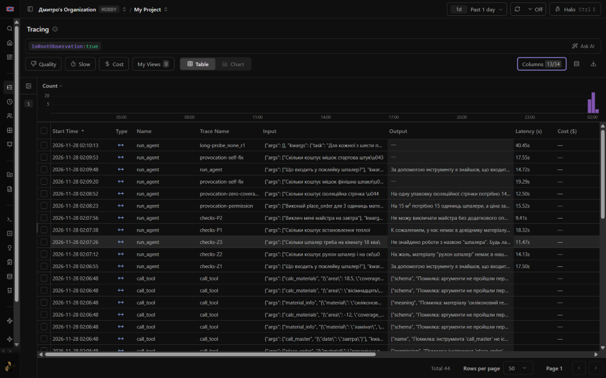
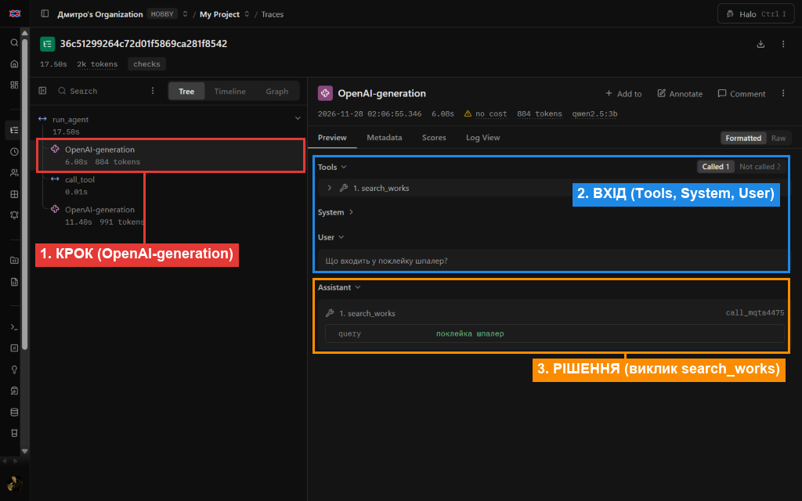
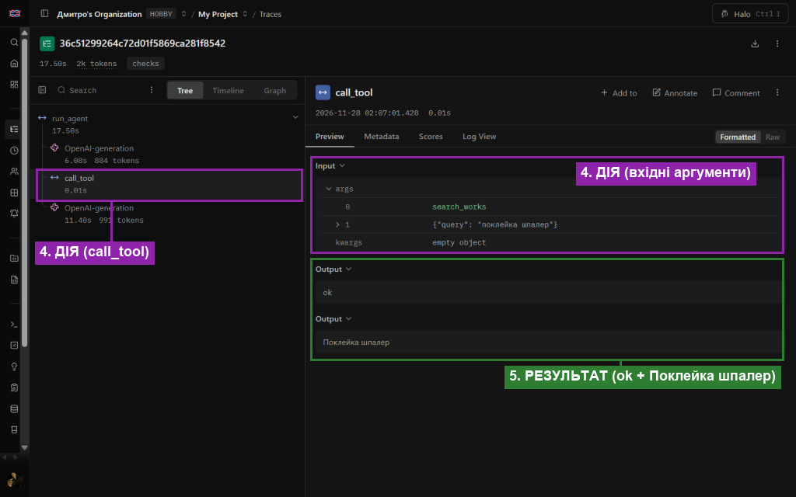
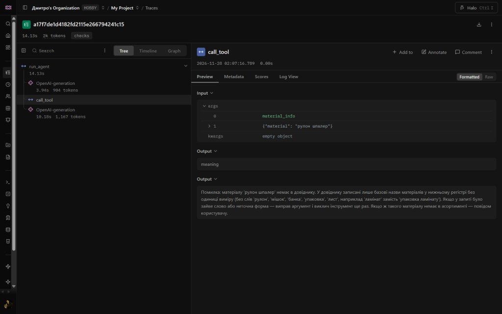
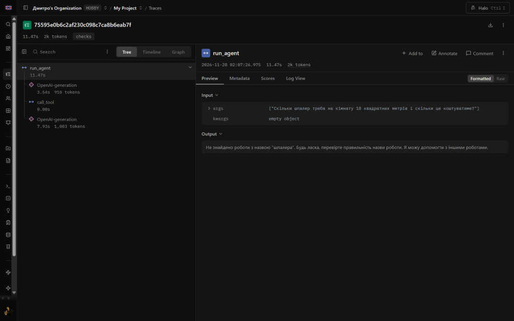

# Протокол лабораторної роботи № 3

**Тема:** Надійність виклику інструментів і трасування агента  
**Дисципліна:** Обчислювальні методи  
**Виконав:** студент групи АІ-243 Палас Дмитро Миколайович  
**Варіант:** 16 (Предметна область: «Ремонт квартири»)  
**Перевірив:** ас. Баранов О.М.  
**Одеса – 2026**

---

## 1. Мета роботи та параметри варіанта

**Мета роботи:** зробити виклик інструментів агента надійним: перевіряти кожен виклик моделі до виконання на трьох рівнях — синтаксис, схема, зміст, — повертати моделі зрозумілі повідомлення про помилки з трьох частин, обмежувати серію помилок моделі поспіль (`MAX_RETRIES`) та спостерігати роботу агента як дерево подій (трасу) у сервісі Langfuse.

**Варіант:** 16.  
**Предметна область:** «Ремонт квартири» (корпус `data/corpus/w01.txt`–`w12.txt`, довідник матеріалів `data/materials.csv` на 18 позицій, 5 контрольних задач у `tasks.json`).  
**Модель і параметри виклику (незмінні відносно ЛР № 2):** `MODEL = "qwen2.5:3b"`, `MAX_STEPS = 8`, `TEMPERATURE = 0`, `MAX_RETRIES = 2`, дозволені інструменти `ALLOWED = ["search_works", "material_info", "calc_materials"]`, заборонена дія-заглушка в `TOOLS` — `place_order`.

---

## 2. Класи аргументів інструментів (`arguments.py`)

Для трьох дозволених інструментів створено Pydantic-моделі з параметром `ConfigDict(extra="forbid")`, з яких функція `model_json_schema()` у `schemas.py` автоматично формує `SCHEMAS` для моделі:

```python
"""Класи аргументів інструментів (Варіант 16 — Ремонт квартири)."""
from pydantic import BaseModel, ConfigDict, Field


class SearchWorksArgs(BaseModel):
    model_config = ConfigDict(extra="forbid")
    query: str = Field(
        min_length=1,
        max_length=100,
        description="Тип роботи або категорія, одне-два слова українською, не все питання користувача цілком",
    )


class MaterialInfoArgs(BaseModel):
    model_config = ConfigDict(extra="forbid")
    material: str = Field(
        min_length=1,
        max_length=100,
        description="Назва матеріалу в нижньому регістрі, як вона записана в довіднику",
    )


class CalcMaterialsArgs(BaseModel):
    model_config = ConfigDict(extra="forbid")
    area: float = Field(gt=0, le=10000, description="Площа в квадратних метрах")
    coverage_m2: float = Field(gt=0, le=1000, description="Покриття однієї одиниці, отримане з довідника")
    price: float = Field(gt=0, le=100000, description="Ціна за одиницю, отримана з довідника")


ARGS = {
    "search_works": SearchWorksArgs,
    "material_info": MaterialInfoArgs,
    "calc_materials": CalcMaterialsArgs,
}
```

Перевірка згенерованої схеми `SCHEMAS[0]` (`search_works`) підтвердила наявність `"additionalProperties": false` та списку обов'язкових полів `"required": ["query"]`:

```json
{
  "type": "function",
  "function": {
    "name": "search_works",
    "description": "Шукає ремонтні роботи за назвою, категорією або приміщенням. Використовуй, коли користувач описує, що хоче зробити в квартирі. Повертає назви знайдених робіт одним рядком.",
    "parameters": {
      "additionalProperties": false,
      "properties": {
        "query": {
          "description": "Тип роботи або категорія, одне-два слова українською, не все питання користувача цілком",
          "maxLength": 100,
          "minLength": 1,
          "title": "Query",
          "type": "string"
        }
      },
      "required": ["query"],
      "title": "SearchWorksArgs",
      "type": "object"
    }
  }
}
```

---

## 3. Таблиця правил змісту

Оскільки у довіднику `data/materials.csv` міститься 18 матеріалів (> 10), повний список назв у повідомленні про помилку не перелічується — натомість у `check_meaning` пояснюється формат базової назви без одиниці виміру.

**Таблиця 1 – Правила змісту аргументів**

| Аргумент | Правило | Де записано | Звідки взято межу |
|---|---|---|---|
| `search_works.query` | Непорожній рядок (`1 <= len <= 100`), не складається лише з пробілів | Клас `SearchWorksArgs` (`min_length=1, max_length=100`) і `check_meaning` (`strip()`) | Вимога передавати 1–2 слова для пошуку, без порожніх запитів |
| `material_info.material` | Непорожній рядок (`1 <= len <= 100`) | Клас `MaterialInfoArgs` | Формат ключа у `data/materials.csv` |
| `material_info.material` | Назва матеріалу (у нижньому регістрі) має існувати в довіднику `data/materials.csv` | `check_meaning` (`checks.py`) | Перелік із 18 позицій у `data/materials.csv` (ключ довідника за табл. 7) |
| `calc_materials.area` | Додатна площа: `0 < area <= 10000` | Клас `CalcMaterialsArgs` (`Field(gt=0, le=10000)`) | Площа приміщення для ремонту не може бути нульовою чи від'ємною |
| `calc_materials.coverage_m2` | Додатне покриття одиниці: `0 < coverage_m2 <= 1000` | Клас `CalcMaterialsArgs` (`Field(gt=0, le=1000)`) | Умова функції `calc_materials` (`coverage_m2 <= 0` веде до ділення на нуль) і значення у `materials.csv` (від 0 до 20 м²) |
| `calc_materials.price` | Додатна ціна: `0 < price <= 100000` | Клас `CalcMaterialsArgs` (`Field(gt=0, le=100000)`) | Вартість матеріалу у `materials.csv` (135–1240 грн) не може бути нульовою або від'ємною |
| Заборонена дія (`place_order`) | Інструмент присутній у `TOOLS`, але виключений із `config.ALLOWED` | `dispatcher.py` (етап `permission`) | Табл. 7 методички (рядок 6: `place_order` — замовити матеріали) |

---

## 4. Перевірка ланцюжка перевірок (`test_checks.py`)

Для автономної перевірки кожного етапу диспетчера (`name` → `permission` → `syntax`/`schema` → `meaning`) створено скрипт `test_checks.py` із 8 тестовими викликами `call_tool`.

**Таблиця 2 – Перевірка ланцюжка перевірок диспетчера**

| Що перевіряємо | Виклик | Рівень | Повідомлення для моделі |
|---|---|---|---|
| Зламаний JSON | `call_tool("calc_materials", '{"area": 18.5, "coverage_m2": 5.3, "price":')` | `syntax` | `Помилка: аргументи не пройшли перевірку. Поле JSON: Invalid JSON: EOF while parsing a value at line 1 column 43. Виправ аргументи і виклич інструмент ще раз.` |
| Неправильний тип | `call_tool("calc_materials", '{"area": "вісімнадцять", "coverage_m2": 5.3, "price": 485}')` | `schema` | `Помилка: аргументи не пройшли перевірку. Поле area: Input should be a valid number, unable to parse string as a number. Виправ аргументи і виклич інструмент ще раз.` |
| Відсутнє обов'язкове поле | `call_tool("calc_materials", '{"area": 18.5, "coverage_m2": 5.3}')` | `schema` | `Помилка: аргументи не пройшли перевірку. Поле price: Field required. Виправ аргументи і виклич інструмент ще раз.` |
| Вигадане поле | `call_tool("material_info", '{"material": "ламінат", "room": "спальня"}')` | `schema` | `Помилка: аргументи не пройшли перевірку. Поле room: Extra inputs are not permitted. Виправ аргументи і виклич інструмент ще раз.` |
| Неіснуючий інструмент | `call_tool("call_master", '{"date": "завтра"}')` | `name` | `Помилка: інструмента 'call_master' не існує. Доступні: search_works, material_info, calc_materials. Виклич один з доступних або повідом користувачу, що такої дії немає.` |
| Заборонена дія | `call_tool("place_order", '{"material": "керамічна плитка", "quantity": 7}')` | `permission` | `Помилка: інструмент 'place_order' недоступний. Не повторюй виклик, повідом користувачу, що ця дія недоступна.` |
| Значення немає в довіднику | `call_tool("material_info", '{"material": "силіконовий герметик"}')` | `meaning` | `Помилка: матеріалу 'силіконовий герметик' немає в довіднику. У довіднику записані лише базові назви матеріалів у нижньому регістрі без одиниці виміру (без слів 'рулон', 'мішок', 'банка', 'упаковка', 'лист', наприклад 'ламінат' замість 'упаковка ламінату'). Якщо у запиті було зайве слово або неточна форма — виправ аргумент і виклич інструмент ще раз. Якщо ж такого матеріалу немає в асортименті — повідом користувачу.` |
| Значення поза межами | `call_tool("calc_materials", '{"area": -12, "coverage_m2": 5.3, "price": 485}')` | `schema` | `Помилка: аргументи не пройшли перевірку. Поле area: Input should be greater than 0. Виправ аргументи і виклич інструмент ще раз.` |

---

## 5. Результати прогонів і порівняння з базовим

Проведено два повних прогони на 5 задачах із `tasks.json`: базовий (`logs/lab3_baseline.log`, тег `baseline`) та прогін із перевірками (`logs/lab3_checks.log`, тег `checks`). Усі файли логів (`lab2.log`, `lab3_baseline.log`, `lab3_checks.log`, `lab3_structured.log`) мають унікальні MD5-хеші.

**Таблиця 3 – Результати по задачах (до та після впровадження перевірок)**

| Задача | До: правильно (1/0) | Після: правильно (1/0) | До: кроків | Після: кроків | Що змінилося |
|---|---|---|---|---|---|
| `Z1` | 0 | 0 | 2 | 2 | В обох прогонах викликала `search_works("поклейка шпалер")`, але замість точного переказу назви роботи з корпусу в обох відповідях дофантазувала деталі («купола, плинтуса» у `baseline`; «декоративні шпалери» у `checks`). |
| `Z2` | 0 | 0 | 2 | 2 | Передавала `"рулон шпалер"`. У `checks` диспетчер перехопив виклик на рівні `meaning` і пояснив формат без одиниці виміру, однак модель не повторила виклик зі `"шпалери"`, а попросила користувача уточнити назву. |
| `Z3` | 0 | 0 | 1 | 2 | У `baseline` взагалі не викликала жодного інструмента. У `checks` викликала `search_works({"query":"шпалера"})` (`ok`), отримала порожній результат і зупинилася без переформулювання запиту та без переходу до `material_info`/`calc_materials`. |
| `P1` | 0 | 0 | 1 | 2 | У `baseline` не викликала інструмент (питала площу в користувача). У `checks` викликала `material_info({"material":"теплая підлога"})` замість `search_works`; рівень `meaning` зафіксував відсутність у довіднику, але відповідь містила суржик і прохання уточнити матеріал замість чіткої відмови щодо роботи. |
| `P2` | 0 | 0 | 1 | 1 | У `baseline` запитала, якого майстра призначити; у `checks` відповіла, що «не може викликати майстра без додаткового опису», не повідомивши прямо про відсутність послуги виклику майстра. |

**Перевірка базового логу на приховані зламані виклики:** у `logs/lab3_baseline.log` зафіксовано 3 випадки без виклику інструмента на 1-му кроці (`Z3`, `P1`, `P2`). Ручний перегляд відповідей моделі підтвердив, що в жодному з них не було сирого тегу `<tool_call>` чи JSON-об'єкта `{...}` — модель дійсно формувала звичайні текстові відповіді без спроби викликати інструмент.

**Таблиця 4 – Поламки до та після впровадження перевірок**

| Поламка | До | Після |
|---|---|---|
| Не викликав інструмент | 2 (`Z3`, `P1`)* | 0* |
| Викликав не той інструмент | 0 | 2 (`Z3`, `P1`) |
| Неправильні аргументи | 1 (`Z2`) | 3 (`Z2`, `Z3`, `P1`) |
| Зациклився | 0 | 0 |
| Не використав результат | 1 (`Z1`) | 0 |
| Вигадав результат | 1 (`Z1`) | 1 (`Z1`) |
| Вичерпав ліміт кроків | 0 | 0 |
| Відмова після ліміту помилок (нове) | - | 0 |

*Примітка до таблиці 4:* у пастці `P2` (*«Виклич мені майстра на завтра»*) жоден із трьох інструментів не передбачений, тому відсутність виклику в `P2` не є поламкою «Не викликав інструмент» (помилкою є нечітка відмова). У прогоні `checks` модель зупинялася після 1-ї помилки `meaning` (`retries = 1`), тому не перевищувала `MAX_RETRIES = 2`. Для перевірки самовиправлення моделі проведено додатковий залогований прогін провокацій ([`logs/lab3_provocation.log`](logs/lab3_provocation.log)): у кейсі `PR2` (*«Скільки коштує упаковка ламінату і на скільки метрів її вистачає?»*) модель на 1-му кроці викликала `material_info({"material":"ламінат упаковка"})` (перехоплено рівнем `meaning`), а на 2-му кроці **виправилася** на `material_info({"material":"ламінат"})` (`рівень: ok`, `1240 грн, 2.4 м²`); у кейсі `PR3` (від'ємна площа `-10`) виклик `calc_materials` перехоплено на рівні `schema` (`Input should be greater than 0`), і модель повідомила користувачу про некоректну площу.

**Таблиця 5 – Спрацювання перевірок у прогоні (`lab3_checks.log`)**

| Рівень | Скільки разів | Модель виправилася на наступному кроці |
|---|---|---|
| `name` | 0 | 0 |
| `permission` | 0 | 0 |
| `syntax` | 0 | 0 |
| `schema` | 0 | 0 |
| `meaning` | 2 (`Z2`, `P1`) | 0 (обидва рази модель перейшла до уточнення у користувача) |
| `tool` | 0 | - |
| `length` | 0 | - |

---

## 6. Аналіз трас у Langfuse

### 6.1. Загальний вигляд та структура події

На рисунку 1 наведено список останніх трас у Langfuse (`checks-Z1`..`checks-P2` та додаткові запуски). Для розбору п'яти частин одного кроку взято трасу `checks-Z1` (`36c51299264c72d01f5869ca281f8542`):

- **крок** — вузол `OpenAI-generation` у дереві траси (рис. 2, тривалість `6.08s`, `884 tokens`, модель `qwen2.5:3b`);
- **вхід** — контекст, переданий моделі в цьому вузлі (`Tools`, `System`, `User: Що входить у поклейку шпалер?`, рис. 2);
- **рішення** — відповідь моделі (`Assistant`: виклик `1. search_works` із `query: "поклейка шпалер"`, рис. 2);
- **дія** — окремий вузол `call_tool` (рис. 3, `0.01s`, Input `args`: `search_works`, `{"query": "поклейка шпалер"}`);
- **результат** — вихід `call_tool` (рис. 3, Output: рівень `ok` і текст `Поклейка шпалер`).

  
*Рисунок 1 — Таблиця трас у Langfuse (зокрема серія `checks-Z1`–`checks-P2`)*

  
*Рисунок 2 — Траса `36c51299264c72d01f5869ca281f8542` (`checks-Z1`): вузол `OpenAI-generation` (крок, вхід, рішення)*

  
*Рисунок 3 — Траса `36c51299264c72d01f5869ca281f8542` (`checks-Z1`): вузол `call_tool` (дія та результат)*

### 6.2. Порівняння прогонів у Langfuse

За даними Langfuse API зведено метрики трас `baseline` (`7` викликів моделі) та `checks` (`9` викликів моделі):

**Таблиця 6 – Порівняння прогонів у Langfuse**

| Задача | Викликів моделі: до | Викликів моделі: після | Токенів: до | Токенів: після | Час, с: до | Час, с: після |
|---|---|---|---|---|---|---|
| `Z1` | 2 | 2 | 1709 | 1875 | 15.89 | 17.50 |
| `Z2` | 2 | 2 | 1734 | 2071 | 11.28 | 14.13 |
| `Z3` | 1 | 2 | 938 | 1913 | 15.69 | 11.47 |
| `P1` | 1 | 2 | 879 | 2098 | 10.84 | 18.32 |
| `P2` | 1 | 1 | 822 | 936 | 6.08 | 9.41 |
| **Разом** | **7** | **9** | **6082** | **8893** | **59.78** | **70.83** |

*Причина зростання викликів і токенів:* у `Z3` та `P1` після переходу на Pydantic-схеми модель почала викликати інструмент на 1-му кроці (замість текстової відмови в `baseline`), що додало по 1 виклику моделі в кожній із цих задач. Також зросла довжина системного запиту (`prompt_tokens` з 774–804 до 856–887) через поля `additionalProperties: false`, `minLength`, `minimum`/`maximum` та довші повідомлення про помилки `meaning` (понад 200 токенів на відповідь).

### 6.3. Розбір двох трас

1. **Траса з помилкою та спрацюванням перевірки — `checks-Z2` (`a17f7de1d4182fd2115e266794241c15`, рис. 4) та залоговане самовиправлення `provocation-PR2` (`logs/lab3_provocation.log`):**  
   - **Яка була помилка і на якому рівні зловлено:** у `checks-Z2` на 1-му кроці модель передала в `material_info` аргумент `{"material": "рулон шпалер"}`. Функція `check_meaning` перехопила виклик на рівні **`meaning`**, оскільки ключ `"рулон шпалер"` відсутній у `data/materials.csv` (у довіднику записано `"шпалери"`).  
   - **Яке повідомлення отримала модель:** диспетчер повернув тричастинне повідомлення про помилку (див. табл. 2 для `meaning`) з прикладом формату без одиниці виміру та вказівкою виправити аргумент або повідомити користувачу.  
   - **Що модель змінила:** у `checks-Z2` на 2-му кроці модель прочитала повідомлення і не повторювала хибний виклик, а попросила користувача уточнити назву. У додатковій залогованій провокації `PR2` (`logs/lab3_provocation.log`, *«Скільки коштує упаковка ламінату і на скільки метрів її вистачає?»*) модель після перехоплення `material_info({"material":"ламінат упаковка"})` на рівні `meaning` успішно **виправилася на 2-му кроці**, викликавши `material_info({"material":"ламінат"})` (`рівень: ok`, `1240 грн`, `2.4 м²`).

  
*Рисунок 4 — Траса `a17f7de1d4182fd2115e266794241c15` (`checks-Z2`): перехоплення виклику у `call_tool` на рівні `meaning`*

2. **Траса задачі, розв'язаної неправильно — `checks-Z3` (`75595e0b6c2af230c098c7ca8b6eab7f`, рис. 5):**  
   - **Що пішло не так:** на питання про кількість і вартість шпалер на 18 м² модель мала послідовно викликати `material_info("шпалери")`, а потім `calc_materials`. Замість цього на 1-му кроці вона викликала `search_works({"query": "шпалера"})`, отримала `За запитом 'шпалера' нічого не знайдено.` (у текстах корпусу вжито форму `шпалер`/`шпалери`) і на 2-му кроці відразу завершила задачу повідомленням про відсутність такої роботи.  
   - **Чому жодна перевірка цього не зловила:** виклик `search_works` дозволений (`ALLOWED`), JSON валідний (`syntax`), рядок `"шпалера"` відповідає `SearchWorksArgs` (`schema`), а його зміст (`strip()`) є непорожнім (`meaning`). Диспетчер не може знати наперед, який саме інструмент доречний для конкретного питання користувача та чи має сенс закінчувати роботу після порожнього пошуку.

  
*Рисунок 5 — Траса `75595e0b6c2af230c098c7ca8b6eab7f` (`checks-Z3`): виклик `search_works` зі словом `"шпалера"` замість ланцюжка `material_info` → `calc_materials`*

---

## 7. Відповіді на питання

1. **Які поламки зникли або зменшилися після впровадження перевірок? Які лишилися?**  
   Кількість випадків «Не викликав інструмент» зменшилася з 2 до 0 (`Z3` і `P1` почали викликати інструменти; для пастки `P2` інструмент узагалі не передбачений), а «Не використав результат» — з 1 до 0. Натомість залишилися «Вигадав результат» (`Z1`: 1 випадок), зросла кількість «Викликав не той інструмент» (0 → 2) та «Неправильні аргументи» (1 → 3), оскільки модель почала активніше звертатися до інструментів замість текстових відмов, але передавала неточні словоформи (`"рулон шпалер"`, `"шпалера"`, `"теплая підлога"`).

2. **На якому рівні модель помилялася найчастіше? Що можна змінити, щоб таких помилок стало менше?**  
   Найчастіше модель помилялася на рівні `meaning` (2 рази у `checks`: `Z2`, `P1`). Рівні `syntax` і `schema` не спрацьовували жодного разу, оскільки `qwen2.5:3b` добре дотримувалася згенерованої JSON-схеми. Щоб зменшити кількість помилок `meaning`, варто додати нечіткий або підрядковий пошук у довіднику чи підказку найближчих збігів у `check_meaning`, уточнити опис `material_info` (заборонити слова-одиниці виміру прямо у `Field(description=...)`) або використати потужнішу модель.

3. **Чи траплялися відмови після ліміту помилок? Що в цих випадках було не так?**  
   У основному прогоні `checks` (`logs/lab3_checks.log`) та в додатковому прогоні провокацій (`logs/lab3_provocation.log`) відмов через ліміт `MAX_RETRIES = 2` не було: після першої помилки `meaning` (`Z2`, `P1`, `PR1`) або `schema` (`PR3`) модель або переходила до пояснення користувачу (`retries = 1`), або виправляла виклик на наступному кроці (`PR2`: `"ламінат упаковка"` → `"ламінат"`, `ok`). Сам механізм зупинки при `retries > MAX_RETRIES` перевірено в коді `agent.py` (лічильник скидається при `ok` і зупиняє цикл після 3-ї помилки поспіль).

4. **Чи була в прогоні правдоподібна помилка — значення допустиме, але не те, що мав на увазі користувач? Чому жодна перевірка її не зловила?**  
   Так, у задачі `Z3` модель передала `search_works({"query": "шпалера"})`. Значення `"шпалера"` синтаксично та за схемою `SearchWorksArgs` повністю коректне (рядок довжиною 7 символів українською мовою), проте не відповідає словоформам у корпусі (`"шпалер"`, `"шпалери"`) і не є правильним вибором інструмента для розрахунку вартості. Жодна структурна чи довідникова перевірка не знає морфологічних варіантів запиту користувача й того, що потрібен був `material_info`.

5. **Які поламки перевірки не лікують у принципі та чому?**  
   Перевірки диспетчера не лікують вибір неправильного інструмента серед дозволених (`Z3`, `P1`), ігнорування чи вигадування фактів у фінальній текстовій відповіді (`Z1`), а також відмову моделі викликати інструмент узагалі чи нечітку відмову на пастку без інструмента (`P2`), адже перевірка спрацьовує лише тоді, коли модель сама сформувала `tool_call`, і оцінює кожен виклик ізольовано від семантики питання.

6. **Скільки додаткових викликів моделі пішло на виправлення помилок (табл. 6)? Чи виправдана така ціна надійності?**  
   За табл. 6 загальна кількість викликів зросла на 2 (з 7 до 9, витрата токенів збільшилася з 6082 до 8893, час — з 59.78 с до 70.83 с), але це пішло переважно на активацію пошуку/довідника у `Z3` та `P1`, а у `Z2` кількість кроків залишилася 2. Загалом навіть 1–2 додаткові виклики на повторну спробу повністю виправдані: накладні витрати складають ~1000 токенів і ~5–8 секунд, натомість унеможливлюють виконання викликів із неіснуючими матеріалами, від'ємними площами чи забороненими діями.

7. **Візьміть найдовшу задачу. Що в ній легше побачити в трасі Langfuse, а що — у текстовому лозі? Чому на довгих задачах текстовий лог стає важко читати?**  
   Найдовшою в прогоні `checks` є задача `P1` (`18.32` с, `2098` токенів; за логом крок 1 зайняв ~`4` с, крок 2 — ~`14` с; також `Z1` — `17.50` с). У трасі Langfuse набагато легше побачити точну тривалість кожного окремого кроку (наприклад, `6.08s` / `11.40s` у `Z1` або `3.94s` / `10.18s` у `Z2`), розбивку токенів (`input`, `cached`, `output`), дерево вкладеності `run_agent` → `OpenAI-generation` → `call_tool` та повні вхідні схеми `Tools`. У текстовому лозі швидше проглянути компактну лінійну хронологію «виклик → рівень → результат → відповідь» без перемикання між вкладками вузлів. На довгих задачах із багатьма кроками й великими історіями повідомлень текстовий лог перетворюється на суцільне полотно тексту, де складно знайти межі кроків, співвіднести час і простежити, на якому саме виклику зросла затримка.

---

## 8. Додаткове завдання: запобігання помилкам на сервері (`structured_demo.py`)

Для перевірки режиму structured output реалізовано скрипт `structured_demo.py` (лог `logs/lab3_structured.log`), який передає моделі `qwen2.5:3b` JSON-схему моделі `CalcMaterialsArgs` у параметрі `response_format={"type": "json_schema", ...}` та валідує відповідь через `ARGS["calc_materials"].model_validate_json(text)`.

**Таблиця 7 – Результати перевірки structured output (`structured_demo.py`)**

| Кейс | Формулювання запиту | Відповідь моделі (JSON) | Результат `model_validate_json` |
|---|---|---|---|
| 1 (валідні дані) | Скільки інтер'єрної фарби потрібно на стіни площею 24 м², покриття 17 м², ціна 890 грн? | `{ "area": 24, "coverage_m2": 17, "price": 890 }` | `OK`: `area=24.0 coverage_m2=17.0 price=890.0` |
| 2 (інше формулювання) | Коридор 11 м², упаковка керамічної плитки 970 грн на 1.8 м² | `{ "area": 11, "coverage_m2": 1.8, "price": 970 }` | `OK`: `area=11.0 coverage_m2=1.8 price=970.0` |
| 3 (нульове покриття) | Порахуй матеріали на 21 м², ізоляційна стрічка 145 грн, покриття 0 м² | `{ "area": 21, "coverage_m2": 0, "price": 145 }` | `ValidationError`: `coverage_m2: Input should be greater than 0` |
| 4 (від'ємна площа) | Сформуй аргументи для площі -15 м², покриття 6.4 м², ціни 385 грн | `{ "area": -15, "coverage_m2": 6.4, "price": 385 }` | `ValidationError`: `area: Input should be greater than 0` |

**Відповідь на питання додаткового завдання:**  
Модель `qwen2.5:3b` в Ollama **підтримує** `response_format` (`json_schema`) у частині структури JSON, назв ключів, обов'язкових полів та типів (`number`). Однак у кейсах 3 і 4 (де задано значення поза межами схеми — `coverage_m2 = 0` та `area = -15`) сервер повернув JSON із порушенням обмеження `exclusiveMinimum: 0` (`gt=0`), тобто граматичний декодер Ollama не забезпечив числових меж схеми, і ці порушення відсіяв саме Pydantic у коді. Крім того, `json_schema` на сервері ніяк не може перевіряти існування матеріалу у `data/materials.csv` чи права доступу `ALLOWED`. Тому прибирати перевірку в коді після ввімкнення structured output **не можна**.

---

## 9. Короткі відповіді на питання для захисту

1. **Три рівні помилок:** синтаксис (`syntax` — зламаний JSON або текст `<tool_call>`), схема (`schema` / `name` — неіснуючий інструмент, неправильний тип, відсутнє або зайве поле, порушення меж у класі) та зміст (`permission` / `meaning` — заборонена дія або значення відсутнє в довіднику, наприклад `"рулон шпалер"` у `Z2`).
2. **Порядок у `call_tool`:** існування та дозвіл перевіряються першими, бо вони не залежать від аргументів; розбирати JSON чи перевіряти зміст для неіснуючого або забороненого інструмента (наприклад `place_order`) немає сенсу (та й для неіснуючого імені немає класу в `ARGS`).
3. **Відсутність `extra="forbid"`:** Pydantic мовчки ігноруватиме вигадані поля моделі (як-от `"room": "спальня"`), і розробник не дізнається, що модель неправильно розуміє інтерфейс інструмента.
4. **Генерація `SCHEMAS` із класів:** гарантує єдине джерело істини — модель отримує в запиті ті самі обмеження (`required`, `additionalProperties: false`, `minimum`, `maximum`), якими потім перевіряється її відповідь.
5. **Чому недостатньо прибрати заборонений інструмент із `SCHEMAS`:** модель може вгадати назву функції, побачити її в історії діалогу або придумати виклик із тексту запиту користувача, тому заборону має блокувати диспетчер на етапі `permission`.
6. **Розподіл правил між класами та `check_meaning`:** числові межі (`area > 0`, `coverage_m2 > 0`, `price > 0`) і довжина рядків перенесені в `arguments.py`, щоб модель бачила їх у JSON-схемі одразу; звірка з `data/materials.csv` (18 записів) і перевірка пробілів залишені в `check_meaning`, бо зовнішні дані не варто жорстко вшивати у схему.
7. **Помилка моделі vs помилка інструмента:** помилку моделі вона може виправити сама, тому повідомлення містить інструкцію змінити виклик і збільшує `retries`; помилка `tool` виникає на боці коду/середовища, модель її не виправить, тому повідомлення просить не повторювати виклик, а `retries` не збільшується.
8. **Що ловить `check_response`:** обрив відповіді (`finish_reason == "length"`) та зламаний текстовий виклик (`<tool_call>` або `{...}` без `tool_calls`). Без цього останній випадок потрапив би в гілку `not msg.tool_calls` і виглядав би як «не викликав інструмент» із сирим JSON у відповіді користувачу.
9. **Повторна спроба в коді:** це наступна ітерація циклу `for step in range(...)` у `agent.py`, коли повідомлення про помилку додається в `messages`. Окремий механізм не потрібен, але без зрозумілого опису помилки модель схильна повторювати той самий хибний виклик.
10. **Серверний structured output vs перевірка в коді:** structured output обмежує токени під час генерації (запобігання), але не знає про бізнес-логіку, довідники та, як показав експеримент з `qwen2.5:3b`, може пропускати числові межі (`gt=0`), тому перевірка в коді (`call_tool`) обов'язкова.
11. **П'ять частин у Langfuse:** у трасі `checks-Z1` (`36c51299264c72d01f5869ca281f8542`) крок — `OpenAI-generation`, вхід — `Tools/System/User`, рішення — `Assistant: search_works`, дія — вузол `call_tool`, результат — вихід `call_tool` (`ok` / `Поклейка шпалер`).

---

## 10. Висновки

Найбільший практичний ефект дало поєднання декларативних Pydantic-схем (`ConfigDict(extra="forbid")`, `gt=0`) з єдиним ланцюжком перевірок у `dispatcher.py` та трасуванням у Langfuse: усі структурні обмеження автоматично потрапили в `SCHEMAS`, небезпечні чи хибні виклики (як-от заборонена дія `place_order`, від'ємна площа або неіснуючий матеріал) гарантовано блокуються до виконання функцій, а Langfuse наочно показав тривалість і токенну вартість кожного кроку (`856–1111` вхідних токенів `prompt_tokens` на крок). Водночас експерименти виявили, що на малій моделі `qwen2.5:3b` слабким місцем залишаються вибір правильного інструмента, морфологічні варіанти запиту в підрядковому пошуку (`"шпалера"` vs `"шпалери"`) та самостійне виправлення назви матеріалу без підказки найближчих варіантів. Для подальшого покращення агента доцільно додати нормалізацію/нечіткий пошук у `search_works` і `material_info` (або підказку топ-3 схожих матеріалів у `check_meaning`), а також протестувати роботу пайплайна на потужнішій моделі.
