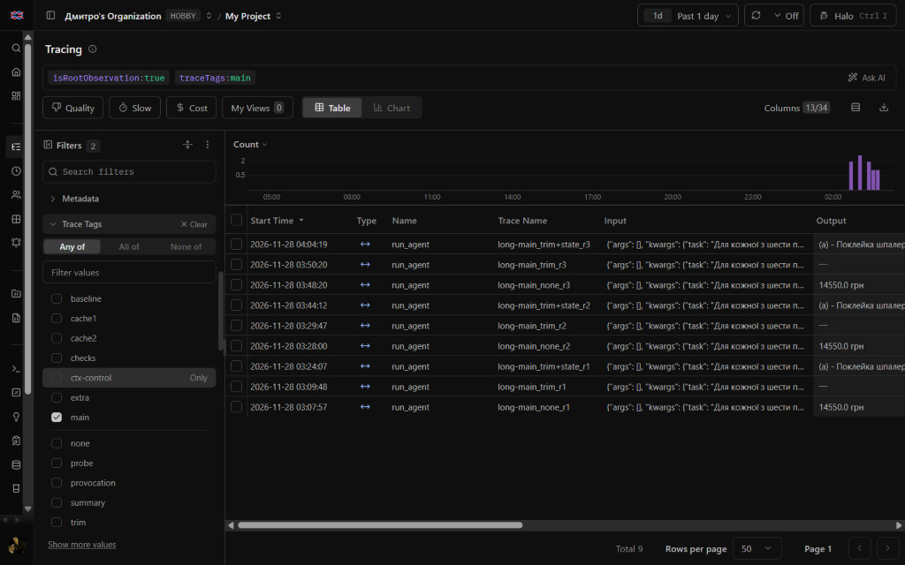
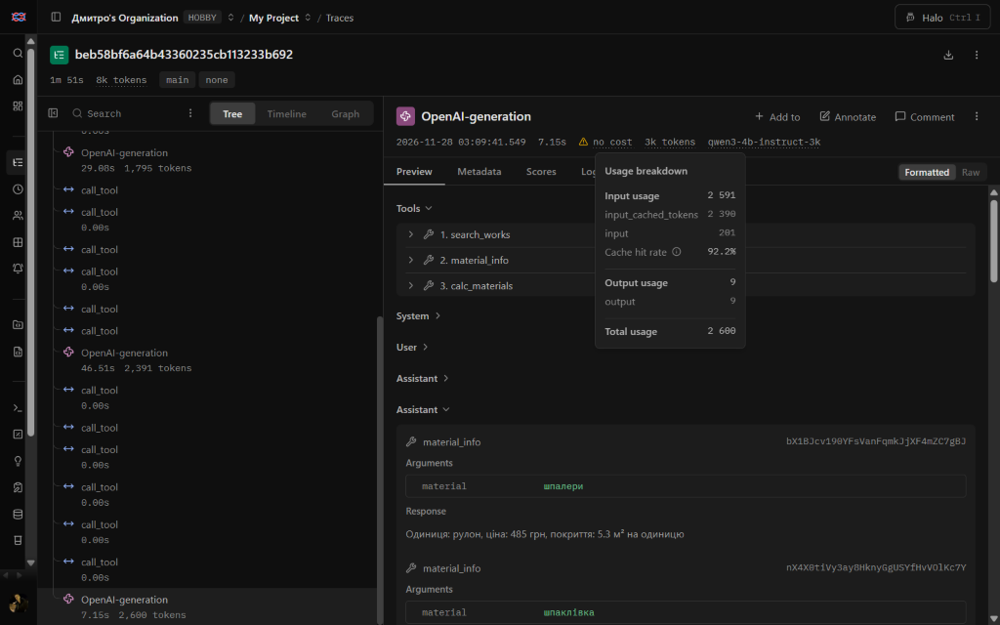
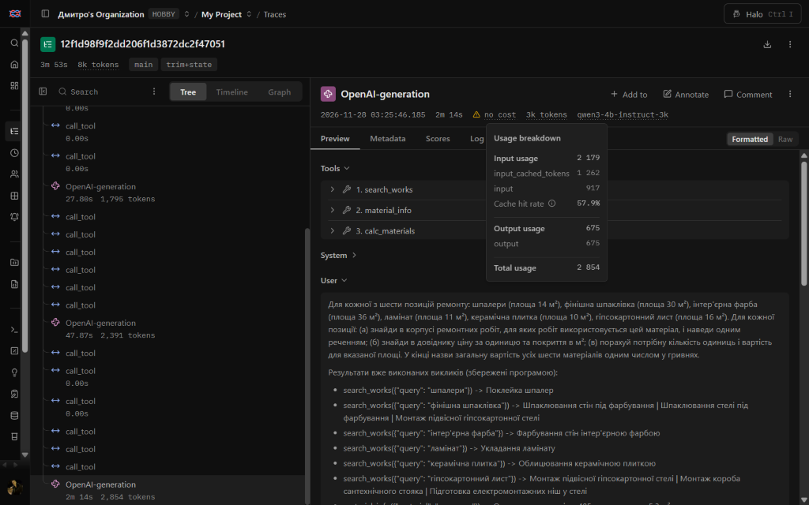

# Протокол лабораторної роботи № 4

**Тема:** Контекст, стан і кеш агента  
**Дисципліна:** Обчислювальні методи  
**Виконав:** студент групи АІ-243 Палас Дмитро Миколайович  
**Перевірив:** ас. Баранов О.М.  
**Варіант:** 16 (Предметна область: «Ремонт квартири»)  
**Одеса – 2026**

---

## 1. Мета роботи, варіант, модель і розмір вікна

**Мета роботи:** побачити, що відбувається з агентом, коли історія діалогу не вміщується в контекстне вікно моделі; навчитися скорочувати історію (`trim`), зберігати результати інструментів поза текстом діалогу (`TaskState`) та кешувати виклики моделі (`cache`); виміряти вартість кожного підходу за токенами й часом, а також дослідити додатковий метод стиснення через підсумовування (`summary`).

- **Варіант:** 16 — предметна область **«Ремонт квартири»** (шість матеріалів, пошук робіт у корпусі `data/corpus/w01.txt`–`w12.txt` через `search_works`, довідник `data/materials.csv` через `material_info`, обчислення вартості через `calc_materials`; базовий агент `MAX_STEPS = 8`, довгий прогін `MAX_STEPS_LONG = 25`).
- **Вибір моделі:** у лабораторній роботі № 3 використовувалася `qwen2.5:3b`, однак під час перевірки на довгій задачі з шести позицій вона видавала всі 18 викликів інструментів паралельно за один перший крок і завершувала діалог на 2-му кроці (~2485 токенів), через що переповнення вікна й стиснення історії не встигали спрацювати. Тому для ЛР № 4 використано модель **`qwen3:4b-instruct`** (як і в еталонному `docs/lab4/python_example/`), яка обробляє позиції покроково.
- **Три числа щодо звуження контекстного вікна (Крок 1 і уточнення у Кроці 4):**
  1. `context length` вихідної моделі `qwen3:4b-instruct` (за `ollama show qwen3:4b-instruct`): **`262144`** токенів.
  2. `num_ctx` нової моделі `qwen3-4b-instruct-4k` (за `Modelfile` кроку 1 та `ollama show`): **`4096`** токенів — вікно звужено у **64 рази** (`262144 / 4096 = 64`).
  3. Після пробного прогону у Кроці 4 зафіксовано випадок **C** (на `4096` максимальний вхід сягнув `2619` токенів — `64%` вікна при статусі `final`), тому відповідно до методики `num_ctx` звужено до **`3072`** (`qwen3-4b-instruct-3k`, `NUM_CTX = 3072`, `COMPRESS_AT = 2150`), що становить звуження у **85,3 раза** від вихідного вікна `262144` (і в `1,33` раза від `4096`).

---

## 2. Довга задача (Крок 2)

Для предметної області «Ремонт квартири» (таблиця 6 методичних вказівок) скриптом [`make_task.py`](make_task.py) згенеровано файл [`long_task.json`](long_task.json) із шістьма матеріалами з `data/materials.csv` та заданими площами (`min_calls = 18`).

**Повний текст питання (`long_task.json`):**
> Для кожної з шести позицій ремонту: шпалери (площа 14 м²), фінішна шпаклівка (площа 30 м²), інтер'єрна фарба (площа 36 м²), ламінат (площа 11 м²), керамічна плитка (площа 10 м²), гіпсокартонний лист (площа 16 м²). Для кожної позиції: (а) знайди в корпусі ремонтних робіт, для яких робіт використовується цей матеріал, і наведи одним реченням; (б) знайди в довіднику ціну за одиницю та покриття в м²; (в) порахуй потрібну кількість одиниць і вартість для вказаної площі. У кінці назви загальну вартість усіх шести матеріалів одним числом у гривнях.

**Правильна відповідь (`expected`):** **`18760`** грн, обчислена напряму функціями `material_info` і `calc_materials` із `tools.py`:
- `шпалери` (14 м², 5.3 м²/рулон, 485 грн) → 3 од. × 485 = `1455` грн;
- `фінішна шпаклівка` (30 м², 16 м²/мішок, 420 грн) → 2 од. × 420 = `840` грн;
- `інтер'єрна фарба` (36 м², 17 м²/банка, 890 грн) → 3 од. × 890 = `2670` грн;
- `ламінат` (11 м², 2.4 м²/уп., 1240 грн) → 5 од. × 1240 = `6200` грн;
- `керамічна плитка` (10 м², 1.8 м²/уп., 970 грн) → 6 од. × 970 = `5820` грн;
- `гіпсокартонний лист` (16 м², 3.6 м²/лист, 355 грн) → 5 од. × 355 = `1775` грн;
- Сума: `1455 + 840 + 2670 + 6200 + 5820 + 1775 = 18760` грн.

---

## 3. Прогін без захисту та аналіз вікна (Кроки 3–4)

На моделі `qwen3-4b-instruct-4k` (`NUM_CTX = 4096`) пробний прогін завершився за 4 кроки зі статусом `final` і найбільшим входом `2619` токенів (`64%` вікна `4096`, час `132.6` с, відповідь `19415,0 грн` — неправильна через помилку підстановки для шпаклівки). Оскільки `2619 < 95%` від `4096`, за таблицею випадків кроку 4 це **випадок C (задача закоротка)**, тож вікно було зменшено до `NUM_CTX = 3072` (`qwen3-4b-instruct-3k`) і виконано повторний прогін [`logs/probe_none_r1.log`](logs/probe_none_r1.log) (тривалість `153.8` с, відповідь `28940.0 грн`, `правильно: ні`).

**Таблиця 2 – Зростання входу в прогоні без захисту (`logs/probe_none_r1.log`, `NUM_CTX = 3072`)**

| Крок | `prompt_tokens` | Приріст | Що зробила модель |
|-----:|----------------:|--------:|:------------------|
| 1 | 1268 | — | `search_works({"query":"шпалери"})` `material_info({"material":"шпалери"})` `calc_materials({"area":14,"coverage_m2":5,"price":120})` |
| 2 | 1442 | 174 | `search_works({"query":"фінішна шпаклівка"})` `material_info({"material":"фінішна шпаклівка"})` `calc_materials({"area":30,"coverage_m2":5,"price":150})` |
| 3 | 1689 | 247 | `search_works({"query":"інтер'єрна фарба"})` `material_info({"material":"інтер'єрна фарба"})` `calc_materials({"area":36,"coverage_m2":12,"price":180})` |
| 4 | 1887 | 198 | `search_works({"query":"ламінат"})` `material_info({"material":"ламінат"})` `calc_materials({"area":11,"coverage_m2":3,"price":1200})` |
| 5 | 2070 | 183 | `search_works({"query":"керамічна плитка"})` `material_info({"material":"керамічна плитка"})` `calc_materials({"area":10,"coverage_m2":1.5,"price":1800})` |
| 6 | 2267 | 197 | `search_works({"query":"гіпсокартонний лист"})` `material_info({"material":"гіпсокартонний лист"})` `calc_materials({"area":16,"coverage_m2":2.5,"price":1400})` |
| 7 | 2509 | 242 | відповідь без виклику (`Загальна вартість усіх шести матеріалів: 28940.0 грн.`) |

**Показники за виведенням `analyze.py logs\probe_none_r1.log steps`:**
- **(а) Постійна частина входу (вхід першого кроку):** `1268` токенів.
- **(б) Типовий приріст за крок:** `197,5` токенів (медіана приростів `174, 247, 198, 183, 197, 242`; у виведенні `analyze.py` округлено до `198`).
- **(в) Сума `prompt_tokens` за прогін та значення за формулою:** фактична сума становить **`13132`** токенів, значення за формулою `n*C + d*n*(n-1)/2` (`n = 7, C = 1268, d = 197,5`, тобто `13023,5`) у `analyze.py` округлено до **`13024`** токенів. Розбіжність становить лише `108` токенів (`0,8%`), оскільки на окремих кроках відповіді корпусу довші (наприклад, на кроці 2 три назви робіт дали приріст `+247`), через що фактичний приріст коливається навколо медіани `197,5`.
- **(г) Крок, на якому вхід перестав рости:** `не помічено` (максимальний вхід на 7-му кроці — `2509` токенів, або `82%` вікна `3072`).
- **(д) Поведінка на трьох останніх кроках (кроки 5–7) та перевірка чисел:** на кроках 5 і 6 модель обробляла по одному матеріалу (3 паралельні виклики на крок), але викликала `calc_materials` одночасно з `material_info` зі здогаданими аргументами (наприклад, на кроці 5 передала `coverage_m2=1.5, price=1800` замість `1.8` і `970`, на кроці 6 — `coverage_m2=2.5, price=1400` замість `3.6` і `355`). На кроці 7 модель дала фінальну відповідь `28940.0 грн`. Сума фактичних результатів `calc_materials` у лозі становить `360 + 900 + 540 + 4800 + 12600 + 9800 = 29000.0` грн, отже число **`28940.0` є відсутнім у будь-якому рядку `результат:`** (модель помилилася в усному додаванні на `60` грн).
- **Класифікація (випадок A–D):** після звуження до `3072` найбільший вхід (`82%`) менший за `95%` при статусі `final` (випадок **C**), однак за методичними вказівками після переходу на `3072` подальші експерименти та `COMPRESS_AT = 2150` виконуються саме з цим значенням вікна (`2150` токенів перевищуються на 6-му кроці в `probe_none_r1` або на 3-му кроці при групуванні викликів по 6).

---

## 4. Обрізання історії та стан задачі (Кроки 5–6)

Для вікна `3072` встановлено `COMPRESS_AT = 2150`, `KEEP_LAST = 6`, `STATE_RESULT_CHARS = 200`. Прогін [`logs/probe_trim_r1.log`](logs/probe_trim_r1.log) завершився зі статусом **`step_limit`** (25 кроків, `41756` токенів на вхід, `132` повторних виклики), а [`logs/probe_trim+state_r1.log`](logs/probe_trim+state_r1.log) — за **4 кроки** зі статусом **`final`** (`7240` токенів на вхід, `0` повторних викликів, відповідь `19700.0 грн`, `правильно: ні`).

**Таблиця 3 – Стиснення історії (`probe_trim_r1.log` та `probe_trim+state_r1.log`)**

| Конфігурація | Крок стиснення | Вхід до стиснення, токенів | Повідомлень було -> стало | Повторних викликів за прогін |
|--------------|---------------:|----------------------------:|:-------------------------:|-----------------------------:|
| `trim` | 3 | 2152 | 23 -> 2 | 132 |
| `trim` | 6 | 2152 | 23 -> 2 | 132 |
| `trim` | 9 | 2152 | 23 -> 2 | 132 |
| `trim` | 12 | 2152 | 23 -> 2 | 132 |
| `trim` | 15 | 2152 | 23 -> 2 | 132 |
| `trim` | 18 | 2152 | 23 -> 2 | 132 |
| `trim` | 21 | 2152 | 23 -> 2 | 132 |
| `trim` | 24 | 2152 | 23 -> 2 | 132 |
| `trim+state` | 3 | 2152 | 23 -> 2 | 0 |

*(Примітка: стиснення зменшило кількість повідомлень `23 -> 2`, а не `23 -> 8`, оскільки на 3-му кроці модель згенерувала 6 паралельних викликів `calc_materials`, тому останні `KEEP_LAST = 6` повідомлень були виключно повідомленнями ролі `tool`, і `drop_orphan_tools()` відкинула їх усі як «осиротілі» без повідомлення `assistant`.)*

**Аналіз першого блоку `ПЕРШЕ ПОВІДОМЛЕННЯ КОРИСТУВАЧА ПІСЛЯ СТИСНЕННЯ` (`logs/probe_trim+state_r1.log`, п. 7 кроку 6):**
- У блоці міститься **`17`** рядків виду `- інструмент(аргументи) -> результат` (6 викликів `search_works`, 5 успішних `material_info` та 6 викликів `calc_materials`; виклик `material_info({"material": "шпаклівка"})` на кроці 2 повернув помилку рівня `meaning`, тому до `TaskState` не потрапив).
- Довжина самого тексту збереженого стану становить `1870` символів — це близько **`748` токенів** (за оцінкою `2,5` символа на токен), а разом із текстом вихідного запитання (`2419` символів) — близько `968` токенів.
- Порівняно з типовим приростом `198` токенів за крок із кроку 4, сам блок стану є приблизно в **3,8 раза більшим** за один крок (`~24%` вікна `3072`), проте він одноразово замінює всю 21-повідомленнєву історію. У результаті на 4-му кроці вхід моделі склав лише `2179` токенів (на `412` токенів менше, ніж на 4-му кроці без стиснення — `2591` токен).

---

## 5. Кеш викликів моделі (Крок 7)

Перед першим запуском каталог `cache/` було очищено, після чого послідовно виконано `python measure.py none 1 cache1` ([`logs/cache1_none_r1.log`](logs/cache1_none_r1.log)) і `python measure.py none 1 cache2` ([`logs/cache2_none_r1.log`](logs/cache2_none_r1.log)).

**Таблиця 4 – Робота кешу (`cache1_none_r1.log` та `cache2_none_r1.log`)**

| Запуск | Кроків | Влучань у кеш | Викликів до сервера | Час, с | Правильно |
|--------|-------:|--------------:|--------------------:|-------:|:---------:|
| 1 (кеш порожній) | 4 | 0 | 4 | 122.7 | ні |
| 2 (той самий запит) | 4 | 4 | 0 | 1.2 | ні |

- **Прискорення:** запуск 2 виявився швидшим за запуск 1 у **102,25 раза** (`122.7 / 1.2` с), оскільки всі 4 звернення до моделі було прочитано з локальних JSON-файлів у `cache/` без жодного мережевого/CPU-виклику Ollama.
- **Що б сталося при зміні `SYSTEM` у `config.py`:** функція `make_key(request)` формує `sha256`-відбиток з усього словника запиту, включно з `messages` (де `messages[0]` — це `SYSTEM`). Зміна навіть одного символу в `SYSTEM` змінює хеш-ключ усіх кроків, тому в запуску 2 було б `0` влучань у кеш і всі 4 запити знову пішли б на сервер Ollama.

---

## 6. Основні вимірювання, аудит поламок і траси Langfuse (Крок 8)

У серії `main` при вимкненому кеші (`USE_CACHE = False`) виконано по 3 прогони для конфігурацій `none`, `trim` та `trim+state` (9 логів `logs/main_*_r*.log`), а також 3 прогони `summary` в серії `extra` (`logs/extra_summary_r*.log`).

**Таблиця 5 – Вартість циклу в конфігураціях (медіани по трьох повторах)**

| Конфігурація | Правильно (з 3) | Кроків | Токенів на вхід | Токенів на вихід | На підсумовування | Час, с | Стиснень | Повторних викликів |
|--------------|----------------:|-------:|----------------:|-----------------:|------------------:|-------:|---------:|-------------------:|
| `none` | 0 з 3 | 4 | 7652 | 568 | 0 | 112 | 0 | 0 |
| `trim` | 0 з 3 | 25 | 41756 | 4638 | 0 | 859.1 | 8 | 132 |
| `trim+state` | 0 з 3 | 4 | 7240 | 1234 | 0 | 236.9 | 1 | 0 |
| `summary` *(дод.)* | 0 з 3 | 6 | 12077 | 718 | 2781 | 199.1 | 1 | 1 |

**Ручний аудит колонки «Правильно» та поламки у 12 прогонах (`main_*` і `extra_*`):**
1. **`none` (`main_none_r1..r3`):** усі 3 прогони завершилися за `4` кроки (`< 19` кроків, бо модель групувала по 6 інструментів у кроці). На 2-му кроці модель передала `material_info({"material": "шпаклівка"})` замість `"фінішна шпаклівка"` (помилка `meaning`), тому на 3-му кроці підставила для площі 30 м² параметри фарби (`17`, `890`) замість шпаклівки (`16`, `420`), отримавши `1780.0` замість `840.0` грн. На 4-му кроці модель відповіла **`14550.0 грн`** — числом, якого **немає в жодному рядку `результат:`** (сума шести `calc_materials` дорівнювала `19700.0`, тобто модель вигадала/хибно порахувала підсумок усно).
2. **`trim` (`main_trim_r1..r3`):** усі 3 прогони досягли ліміту `25` кроків (`step_limit`) без фінальної відповіді. Через стиснення `23 -> 2` що 3 кроки агент щоразу втрачав результати попередніх кроків і 8 разів починав виконання з нуля (`132` повторних виклики).
3. **`trim+state` (`main_trim+state_r1..r3`):** усі 3 прогони завершилися за `4` кроки (`< 19` кроків). Завдяки `TaskState` модель зберегла всі 17 результатів і на 4-му кроці безпомилково підсумувала 6 викликів `calc_materials` (`1455 + 1780 + 2670 + 6200 + 5820 + 1775 = 19700.0 грн`), однак `19700.0 != 18760` (і не траплялося в рядку `результат:`) через ту саму помилку кроку 2 (`meaning` для `'шпаклівка'`) і підстановку параметрів фарби.
4. **`summary` (`extra_summary_r1..r3`):** усі 3 прогони мали `< 19` кроків (`7, 6, 6`). У `r1` модель відповіла `29340.0 грн` (вигадане/хибно додане число замість суми викликів `29000.0` і еталона `18760`), а в `r2` та `r3` через повторний промах `meaning` на `'шпаклівка'` і втрату прив'язок у переказі модель відмовилася рахувати підсумок («Даних про матеріал «шпаклівка» немає в довіднику»).
Отже, приховані поламки (кількість кроків `< 19`, вихід за `step_limit` або число/відмова поза еталоном) зафіксовано в **усіх 12 прогонах** (9 із 9 у `main_*` та 3 із 3 у `extra_*`).

**Порівняння трас у Langfuse (фільтр за міткою `main`):**

*Рисунок 1 — Список дев'яти трас серії `main` у Langfuse, відфільтрованих за тегом `main` (2026-11-28).*

*Рисунок 2 — Дерево траси `long-main_none_r1` (Trace ID `beb58bf6a64b43360235cb113233b692`): 4-й виклик `OpenAI-generation`, `Input usage: 2 591`.*

*Рисунок 3 — Дерево траси `long-main_trim+state_r1` (Trace ID `12f1d98f9f2dd206f1d3872dc2f47051`): 4-й виклик `OpenAI-generation` після стиснення, `Input usage: 2 179` і блок збереженого стану в `User`.*

- **Порівняння першого кроку після стиснення (крок 4 за `analyze.py logs\main_trim+state_r1.log`):**
  - у `long-main_trim+state_r1` (`12f1d98f9f2dd206f1d3872dc2f47051`) на 4-му кроці після стиснення вхід моделі становить **`2179`** токенів (`input_cached_tokens: 1262`, `input: 917`);
  - у `long-main_none_r1` (`beb58bf6a64b43360235cb113233b692`) на тому ж 4-му кроці вхід моделі дорівнює **`2591`** токенів (`input_cached_tokens: 2390`, `input: 201`) — стиснення заощадило `412` токенів входу на фінальному кроці.
- **Що в трасі видно одразу, а в текстовому лозі довелося б рахувати вручну:** у веб-інтерфейсі Langfuse миттєво видно ієрархічне дерево `run_agent` із часом виконання кожного виклику `OpenAI-generation` та кожного вкладеного `call_tool`, точну розбивку токенів (`Input usage`, `input_cached_tokens`, `Output usage`, `Total usage`), а також повний переформатований вміст повідомлень `User` зі вставленим станом — у текстовому лозі ці підсумки та тривалості довелося б збирати й сумувати парсером або вручну.

---

## 7. Додаткове завдання: підсумовування замість обрізання (`summary.py`)

Реалізовано модуль [`summary.py`](summary.py) (`split_history`, `render_messages`, `summarize`, `compress_by_summary`), інтегрований у [`compress.py`](compress.py) та [`measure.py`](measure.py). Виконано три прогони окремою серією `python measure.py summary 3 extra`: [`extra_summary_r1.log`](logs/extra_summary_r1.log), [`extra_summary_r2.log`](logs/extra_summary_r2.log), [`extra_summary_r3.log`](logs/extra_summary_r3.log).

- **Витрати на підсумовування:** у трьох повторах окремі виклики `summarize()` коштували `2024` (`r1`), `2781` (`r2`) та `3222` (`r3`: `2877` на кроці 3 + `345` на кроці 5) токенів; **медіана в таблиці 5 — `2781` токен** (колонка «На підсумовування»).
- **Економія токенів на вході порівняно з `trim`:** медіанний вхід основного агента у `summary` склав `12077` токенів проти `41756` у `trim` — **заощаджено `29679` токенів (`71,1%`)** на вході основного циклу; навіть з урахуванням `2781` токенів на саме підсумовування загальна витрата входу (`14858`) майже у **2,8 раза менша**, ніж у `trim` (`41756`).
- **Перевірка збереження точних чисел (`ПІДСУМОК ІСТОРІЇ` проти `результат:`):**
  - В `extra_summary_r1.log` переказ зберіг усі числа довідника та підрахунків (`485`, `5.3`, `360.0`, `420`, `16`, `900.0`, `890`, `17`, `540.0`, `1240`, `2.4`, `4800.0`, `970`, `1.8`, `12600.0`), однак повністю втратив вхідні площі з умови задачі (`14, 30, 36, 11, 10, 16`), і на фінальному кроці модель видала хибну суму `29340.0` замість `29000.0`.
  - В `extra_summary_r2.log` переказ переплутав площі та матеріали між собою: записав `інтер'єрна фарба (площа 30 м²): ... 1780.0 грн` (хоча `30 м²` стосувалися шпаклівки), `інтер'єрна фарба (площа 36 м²)`, `ламінат (площа 11 м²)`, зсунувши відповідність попередніх кроків.
  - В `extra_summary_r3.log` при першому стисненні (`2877` токенів) з'явився вигаданий пункт «Фарба (площа 10 м²)» замість плитки та переплуталися площі в пункті 4 (`інтер'єрна фарба (площа 30 м²)`, `ламінат (площа 36 м²)`, `керамічна плитка (площа 11 м²)`), а при другому стисненні на 5-му кроці (`345` токенів) модель повністю згалюцинувала неіснуючі статистичні тести (`Spearman correlation: 0.87`, `Linear Regression: R² = 0.75`, `ANOVA: F = 4.21`, `t-test: t = 2.85`), яких не було в жодному виклику інструментів.

---

## 8. Відповіді на питання

### Контрольні питання (розділ «Відповіді на питання»)

1. **На якому кроці агент без захисту дійшов до межі вікна і як ви це побачили (таблиця 2, пункти (г) і (д) кроку 4)? Що в його поведінці змінилося після цього?**  
   На вікні `4096` максимальний вхід сягнув лише `2619` токенів (`64%`), тому за методикою вікно звузили до `3072`. У прогоні `probe_none_r1` на `3072` вхід безперервно зростав із `1268` до `2509` токенів (`82%` вікна на кроці 7), тож ознаки застою (`stall`) за критерієм `analyze.py` (`>= 80%` вікна та приріст `<= 20%` норми) не настало (випадок C). Водночас уже при `2509` токенах на 7-му кроці модель припустилася помилки усного підсумовування (`28940.0` замість суми `29000.0` із `calc_materials`) та передчасно згенерувала `calc_materials` в одному кроці з `material_info`.

2. **Порівняйте суму `prompt_tokens` за прогін із формулою (пункти (а)-(в) кроку 4). Чи збігається зростання з очікуваним?**  
   У `probe_none_r1` фактична сума `prompt_tokens` дорівнює `13132` токенів, а формула `n*C + d*n*(n-1)/2` при `n = 7`, `C = 1268`, `d = 197,5` (округлено до `198` у `analyze.py`) дає `13023,5` (`13024` токенів). Зростання майже точно збігається з квадратичним прогнозом (різниця `108` токенів, або `0,8%`), а незначне відхилення пояснюється тим, що приріст на кроках 2 і 6 був більшим за медіану `197,5` (`247` і `242`) через довші списки знайдених робіт.

3. **Що втрачає агент при обрізанні? Наведіть приклад повторного виклику після стиснення. Що змінилося в `trim+state` (таблиці 3 і 5)?**  
   При звичайному обрізанні (`trim`) агент втрачає старі повідомлення `assistant` і `tool` з результатами вже виконаних інструментів; у нашому прогоні `main_trim_r1.log` після стиснення на кроці 3 (`23 -> 2` повідомлень) агент уже на кроці 4 повторно викликав `search_works({"query":"шпалери"})`, `material_info` та `calc_materials`, повторивши це 8 разів до ліміту 25 кроків (`132` повтори, `41756` токенів). У `trim+state` додавання `TaskState` повністю прибрало повторні виклики (`132 -> 0`), скоротило прогін із `25` до `4` кроків і зменшило вхід із `41756` до `7240` токенів (таблиці 3 і 5).

4. **Яка конфігурація найдешевша за токенами, найшвидша, найточніша (таблиця 5)? Чому висновок за трьома повторами однієї задачі обережний?**  
   Найдешевшою за вхідними токенами виявилася `trim+state` (`7240` токенів на вхід проти `7652` у `none`, `12077` у `summary` та `41756` у `trim`), найшвидшою — `none` (`112` с проти `199.1` с у `summary`, `236.9` с у `trim+state` та `859.1` с у `trim`), а точність у всіх чотирьох конфігураціях склала `0 з 3` через ранню помилку `meaning` на `'шпаклівка'` та паралельний виклик `calc_materials` до отримання ціни. Висновок за 3 повторами однієї задачі при `temperature = 0` є обережним, бо одна й та сама задача не перевіряє варіативність інших запитів, довжин текстів і можливу недетермінованість при ненульовій температурі або на довших ланцюжках.

5. **Чому під час вимірювання вартості кеш вимкнено? Що станеться з кешем, якщо інструмент поверне інші дані або ви замініть модель під тією самою назвою?**  
   Кеш вимкнено у серії `main`, бо при трьох повторах (`r1..r3`) тієї самої задачі `r2` і `r3` брали б готові відповіді з `cache/` за ~1 с без реальних викликів моделі, і ми виміряли б швидкість диска замість вартості циклу агента. Якщо інструмент поверне інші дані, зміняться `messages` після його виклику, тому хеш-ключ оновиться і кеш не спрацює (крім кроку 1); натомість якщо замінити ваги або квантизацію моделі під тим самим ім'ям у `config.MODEL`, ключ `make_key` залишиться незмінним і кеш помилково повертатиме старі відповіді від попередньої моделі.

6. **Які поламки довгого прогону скорочення історії не лікує в принципі?**  
   Скорочення історії не лікує помилки вибору аргументів або невірного порядку викликів (наприклад, передчасний виклик `calc_materials` зі здогаданою ціною до отримання результату `material_info` або помилку `meaning` `'шпаклівка'`), неточне усне додавання чисел моделлю без окремого інструмента, і не запобігає галюцинаціям при підсумовуванні.

---

### Питання для захисту

1. **Чому вартість усього прогону агента зростає швидше, ніж вартість одного кроку? Покажіть це на цифрах свого прогону.**  
   На кожному кроці модель повторно отримує всю попередню історію плюс нові повідомлення (`prompt_tokens` зростає лінійно: `1268, 1442, 1689, 1887, 2070, 2267, 2509` у `probe_none_r1`), тому сумарна кількість вхідних токенів зростає як арифметична прогресія — квадратично від числа кроків `n`: `n*C + d*n*(n-1)/2 = 13024` (факт `13132`), тоді як кожен окремий крок додавав лише `~198` токенів.

2. **Що відбувається, коли історія не вміщується у вікно? Як ви помітили це у своєму лозі і чому агент не отримує помилки?**  
   Коли вхід перевищує `num_ctx`, сервер або відмовляє з помилкою (`server_error`), або мовчки відкидає найстаріші токени початку історії, через що приріст `prompt_tokens` зупиняється біля межі вікна (`stall`), а агент забуває початок задачі. У нашому `probe_none_r1` на вікні `3072` агент досяг `82%` вікна (`2509` токенів) і завершив прогін до жорсткого зрізу, а в `main_trim` без стану циклічне скидання історії тривало без жодної помилки сервера, доки не спрацював `MAX_STEPS_LONG = 25`.

3. **Чому `COMPRESS_AT` менший за `NUM_CTX`?**  
   Поріг `COMPRESS_AT` (`2150 < 3072`) має залишати запас у вікні для поточного виклику інструмента, його відповіді та генерації наступної відповіді моделі, адже перевірка `compress_history` відбувається вже після того, як черговий виклик моделі пройшов.

4. **Навіщо цикл `while` у `trim`? Що станеться, якщо його прибрати?**  
   Цикл `while tail and tail[0]["role"] == "tool"` у `drop_orphan_tools()` видаляє з початку залишеного «хвоста» результати інструментів, чий батьківський виклик `assistant` з `tool_calls` було відрізано. Якщо його прибрати, історія міститиме «осиротілі» повідомлення `role="tool"`, що призведе до помилки валідації історії на сервері API або дезорієнтації моделі; водночас у нашому прогоні з 6 паралельними `tool`-відповідями при `KEEP_LAST = 6` цей цикл видалив увесь «хвіст» (`23 -> 2`).

5. **Що втрачає агент при обрізанні і як це компенсує стан? Чого стан не компенсує? Чому стан записується тільки для викликів з рівнем `ok`?**  
   При обрізанні агент втрачає проміжні результати інструментів і хід міркувань; `TaskState` компенсує саме фактичні результати успішних викликів, дописуючи їх до `messages[1]`, але не компенсує проміжні виправлення помилок, структуру діалогу чи покрокові міркування моделі. До стану записуються лише виклики рівня `ok`, щоб не засмічувати записник і обмежене контекстне вікно повідомленнями про синтаксичні чи змістові помилки (`meaning`, `schema` тощо).

6. **З чого складається ключ кешу? Коли від кешу є користь, а коли його не можна вмикати?**  
   Ключ кешу в `cache.py` — це `sha256`-хеш JSON-подання повного словника запиту (`model`, `messages`, `tools`, `temperature`). Кеш корисний при відтворенні та налагодженні логіки обробки (прискорив повторний прогін у `102,25` раза), але його не можна вмикати під час замірів реальної вартості/часу, при тестуванні стохастичної поведінки (`temperature > 0`) або коли змінюється зовнішній стан інструментів чи ваги моделі під тим самим іменем.

7. **Чому кожну конфігурацію проганяли тричі й брали медіану? Чому висновки все одно обережні?**  
   Три повтори з медіаною згладжують випадкові сплески часу виконання (навантаження CPU/сервера) та можливі коливання траєкторії генерації (як у серії `extra_summary`, де `r1`, `r2`, `r3` дали `2024`, `2781` і `3222` токенів підсумовування). Проте висновки залишаються обережними, бо вимірювання проводилися на одній синтетичній задачі з 6 позицій при `temperature = 0`.

8. **Покажіть у трасі Langfuse місце, де стиснення зменшило вхід моделі.**  
   На Рисунку 3 у трасі `long-main_trim+state_r1` (`12f1d98f9f2dd206f1d3872dc2f47051`) після 3-го виклику `OpenAI-generation` (вхід `2152`, вихід `239`) на 4-му кроці показник **`Input usage` становить `2 179`** (проти `2 591` на кроці 4 у трасі `long-main_none_r1` на Рисунку 2), а в полі `User` видно скорочену історію зі списком `Результати вже виконаних викликів (збережені програмою):`.

---

## 9. Висновки

Найбільший практичний ефект серед трьох досліджених методів дала комбінація **обрізання історії зі станом задачі (`trim+state`)**: вона зменшила вхідні токени на 82,7% порівняно з чистим обрізанням (`7240` проти `41756`), повністю прибрала повторні виклики (`132 -> 0`) і скоротила кількість кроків із `25` до `4`. Звичайне обрізання (`trim`) без пам'яті про виконані кроки на задачах із паралельними викликами виявилося найдорожчим (`41756` токенів і `859.1` с) через втрату результатів та зациклення, а кеш (`cache`) забезпечив 102-кратне прискорення (`122.7 -> 1.2` с) для відтворюваного налагодження, але не підходить для бойових вимірювань вартості. Додатковий метод переказу (`summary`) заощадив `71,1%` вхідних токенів основного агента відносно `trim`, проте додав `2781` токенів на підсумовування і продемонстрував головний ризик — переплутування площ і галюцинації чисел під час переказу (`extra_summary_r2`, `extra_summary_r3`).

Для досягнення повної точності відповіді (`18760` грн) надалі варто збільшити `KEEP_LAST` так, щоб останній блок паралельних `tool`-результатів не обрізався повністю разом із повідомленням `assistant`, заборонити паралельний виклик `calc_materials` до отримання відповіді `material_info` (або виконувати калькуляцію всередині послідовного кроку) та додати нормалізацію назв матеріалів у запитах.
