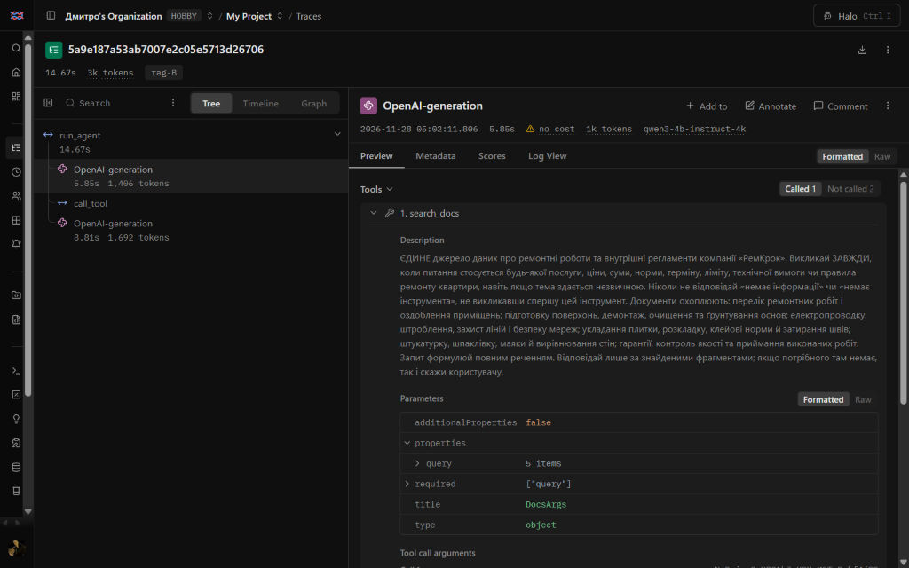
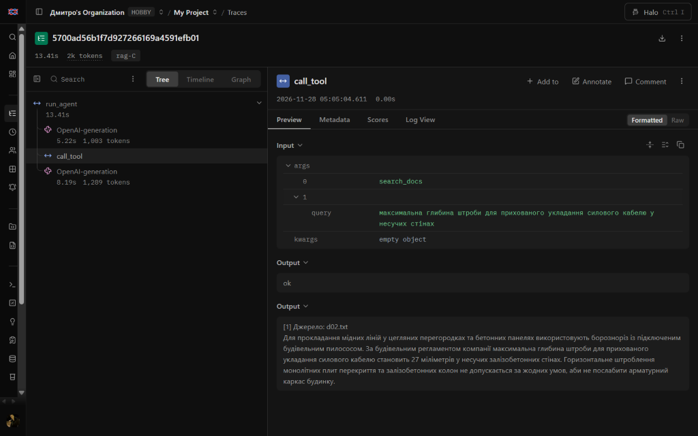
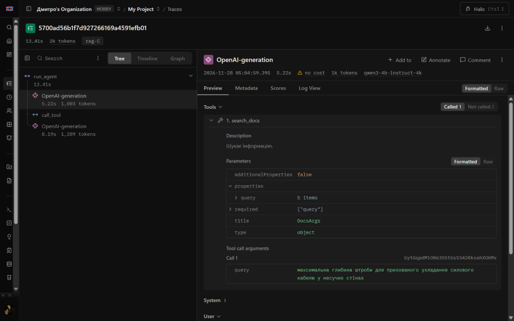

# Протокол лабораторної роботи № 5

**Тема:** RAG-агент: пошук по документах як інструмент  
**Дисципліна:** Обчислювальні методи  
**Виконав:** студент групи АІ-243 Палас Дмитро Миколайович  
**Перевірив:** ас. Баранов О.М.  
**Варіант:** 16 (Предметна область: «Ремонт квартири»)  
**Одеса – 2026**

---

## 1. Мета роботи, варіант, модель і розмір вікна

**Мета роботи:** замінити пошук підрядком (`search_works`) з лабораторної роботи № 2 векторним пошуком (`search_docs`) на базі FAISS і ембедингів; оцінити якість пошуку окремо від агента на шести способах нарізання документів; підібрати поріг схожості `MIN_SCORE` для відсіювання питань без відповіді; виміряти вплив трьох описів інструмента (`A`, `B`, `C`) на поведінку агента у трьох повторах та проаналізувати причини збоїв у логах і трасах Langfuse.

- **Варіант:** `16` — предметна область **«Ремонт квартири»** (рядок 6 таблиці 8 методичних вказівок: п'ять нових документів `d01.txt`–`d05.txt` із тем *підготовка поверхонь; електропроводка й безпека; укладання плитки; штукатурка й шпаклівка; гарантії та приймання робіт*, об'єднаних зі старим корпусом `data/corpus/w01.txt`–`w12.txt` і довідником `data/materials.csv`, `MAX_STEPS = 8`, `TEMPERATURE = 0`).
- **Модель чату та розмір вікна:** `qwen3-4b-instruct-4k` (`NUM_CTX = 4096`). У лабораторній роботі № 4 використовувалася модель родини `qwen3:4b-instruct` (спочатку `qwen3-4b-instruct-4k`, а у фінальному кроці звуження вікна — `qwen3-4b-instruct-3k` на `3072` токенів). Оскільки методичні вказівки до ЛР № 5 фіксують розмір вікна `4096` токенів, повернено конфігурацію `qwen3-4b-instruct-4k` (`NUM_CTX = 4096`, `COMPRESS = "none"`, `USE_STATE = False`, `USE_CACHE = False`).
- **Модель ембедингів:** `bge-m3` (`EMBED_MODEL = "bge-m3"`, розмірність вектора `1024`).

---

## 2. Документи, питання та перевірка на вгадування

### 2.1. Оригінальні документи предметної області (`data/docs/`)

Для вигаданої компанії **ТзОВ «РемКрок»** створено 5 суцільних текстових документів (по 8 абзаців + заголовок у першому рядку), без таблиць і розмітки, з унікальними нетиповими числовими значеннями, що не перетинаються між файлами:

| Файл | Назва (тема за варіантом 16) | Символів | Оцінка токенів (`÷ 2.5`) | Унікальні числові факти у тексті |
|------|------------------------------|---------:|-------------------------:|:---------------------------------|
| `d01.txt` | Підготовка поверхонь | 3487 | 1395 | `59`, `71`, `118`, `163`, `192`, `244`, `335` |
| `d02.txt` | Електропроводка й безпека | 3816 | 1526 | `27`, `41`, `86`, `154`, `283`, `412`, `525` |
| `d03.txt` | Укладання плитки | 3467 | 1387 | `33`, `47`, `53`, `98`, `217`, `368`, `495` |
| `d04.txt` | Штукатурка й шпаклівка | 3876 | 1550 | `44`, `62`, `108`, `179`, `256`, `392`, `615` |
| `d05.txt` | Гарантії та приймання робіт | 3830 | 1532 | `38`, `77`, `132`, `311`, `448`, `560`, `725` |

Загальна перевірка скриптом `check_cases.py`:
- **Документів разом із `data/corpus/w01–w12`:** `17`
- **Загальний обсяг:** `21 808` символів (`~8 723` токени при вікні `4096`), тобто весь корпус більш ніж удвічі перевищує контекстне вікно і не може бути переданий моделі цілком.
- **Статус перевірки `check_cases.py`:** `Питань: 10 ({'direct': 4, 'paraphrase': 4, 'none': 2})` — `Усе гаразд`.

### 2.2. Набір тестових питань (`rag_cases.json`)

| ID | Вид | Питання | `must_contain` | `expected` |
|----|-----|---------|----------------|------------|
| `D1` | `direct` | Скільки коштує механічне зняття здутої побілки скребком за один квадратний метр? | `побілки скребком коштує 163 гривні` | `163` |
| `D2` | `direct` | Яка максимальна глибина штроби встановлена для прихованого укладання силового кабелю у несучих стінах? | `силового кабелю становить 27 міліметрів` | `27` |
| `D3` | `direct` | Скільки годин триває технологічна витримка плиткового клею до початку затирання швів? | `затирання швів триває 53 години` | `53` |
| `D4` | `direct` | Через скільки днів після підписання підсумкового акта проводять безоплатний гарантійний огляд прихованих мереж? | `проводять через 311 днів` | `311` |
| `P1` | `paraphrase` | До якого граничного рівня сирості в оселі бригаді дозволяється проводити абразивну зачистку бетонної підлоги? | `перевищує 59 відсотків` | `59` |
| `P2` | `paraphrase` | Який найменший діелектричний показник ізоляції кабелю мусить зафіксувати прилад до подачі живлення на світильники? | `щонайменше 412 мегаом` | `412` |
| `P3` | `paraphrase` | Якої найменшої ширини дозволяється залишати підрізану керамічну смужку біля рамного отвору вікна, аби облицювання не розкололося? | `вужчими за 47 міліметрів` | `47` |
| `P4` | `paraphrase` | Скільки часу мусить вистояти стіна після базового оштукатурювання, перш ніж майстрам дозволено переходити до наступного накладання матеріалу? | `паузу на 62 години` | `62` |
| `N1` | `none` | Яка вартість монтажу натяжної стелі з підсвіткою по периметру? | `null` | `null` |
| `N2` | `none` | За скільки днів компанія виконує встановлення міжкімнатних розсувних дверей із доводчиком? | `null` | `null` |

### 2.3. Перевірка на вгадування без документів

Трьом питанням (`D1`, `D3`, `P1`) зроблено прямий запит до `qwen3-4b-instruct-4k` без інструментів і документів (`temperature=0`):
- **`D1`** (`expected=163`): модель відповіла: *«Механічне зняття здутої побілки скребком — це робота... Однак **ціна цієї роботи не є стандартною** і залежить від кількох факторів...»* — не вгадала.
- **`D3`** (`expected=53`): модель видала типове середнє значення зі своїх ваг: *«Загальний час витримки плиткового клею **зазвичай становить 24 години**»* — не вгадала `53`.
- **`P1`** (`expected=59`): модель відповіла: *«Питання... є нестандартним... в контексті **сирості в оселі** — це, ймовірно, помилкове або не...»* — не вгадала.

---

## 3. Перевірка моделі ембедингів і побудова індексу (`embed_check.py`)

Результат запуску `python embed_check.py`:
- **Час обчислення (перший запуск):** `3.7 с` (з кешем — ~0 с)
- **Довжина вектора:** `1024`
- **Довжина (норма) першого вектора:** `1.000` (Ollama повертає вже L2-нормалізовані вектори для `bge-m3`)
- **Близькість `Запит — "Тариф на доставку"`:** `0.732`
- **Близькість `Запит — "Графік роботи кур'єрів"`:** `0.568`

Семантично релевантна фраза про тариф (`0.732`) виявилася помітно ближчою до запиту про вартість доставки, ніж нерелевантна фраза про графік кур'єрів (`0.568`).

---

## 4. Нарізання на чанки й оцінка пошуку без агента

### 4.1. Нарізання документа `d01.txt` (`show_chunks.py`)

**Таблиця 1 – Нарізання одного документа (`data/docs/d01.txt`)**

| Спосіб | Чанків | Закінчуються посеред речення | Довжина найбільшого, символів |
|--------|-------:|-----------------------------:|------------------------------:|
| `fixed`, 200, перекриття 0 | 18 | 17 | 200 |
| `fixed`, 500, перекриття 100 | 9 | 8 | 500 |
| `paragraphs`, 800 | 8 | 0 | 478 |

**Приклад розрізаного факту (`fixed`, 200, перекриття 0):**
У чанках 6 та 7 розривається сама одиниця виміру після суми `335 гривень`:
```text
--- чанк 6, 200 символів [закінчується посеред речення]
...Повне фрезерування затверділої синтетичної мастики на цементній плиті коштує замовнику 335 гривень за кожен оброблений квадратний м
--- чанк 7, 200 символів [закінчується посеред речення]
етр. Перед початком фрезерування приміщення герметично завішують щільною захисною плівкою...
```
Аналогічно в чанках 14–15 слово `норма` розривається (`Контрольна норм` / `а витрати полімерної емульсії ... становить 192 грами`), а в чанку 3–4 фраза `нанесеного` відокремлюється від речення зі ставкою `163 гривні`. Якщо в топ-k потрапить лише один уламок такого чанка, модель не зрозуміє, до якої саме роботи чи одиниці виміру належить знайдене число.

### 4.2. Порівняння конфігурацій нарізання (`check_retrieval.py`)

**Таблиця 2 – Пошук при різному нарізанні**

| Конфігурація | Чанків | Сер. довжина | `hit@1` | `hit@3` | `hit@5` | `hit@3` прямі | `hit@3` перефр. | Токенів (`k=3`) |
|--------------|-------:|-------------:|--------:|--------:|--------:|--------------:|----------------:|----------------:|
| `fixed-200-0` | 120 | 182 | 0.88 | 1.00 | 1.00 | 1.00 | 1.00 | 218 |
| `fixed-500-0` | 50 | 436 | 0.88 | 1.00 | 1.00 | 1.00 | 1.00 | 523 |
| `fixed-500-100` | 60 | 435 | 0.88 | 1.00 | 1.00 | 1.00 | 1.00 | 522 |
| `fixed-1500-0` | 27 | 808 | 0.75 | 0.88 | 1.00 | 1.00 | 0.75 | 969 |
| `paragraphs-800` | 51 | 426 | 1.00 | 1.00 | 1.00 | 1.00 | 1.00 | 512 |
| `paragraphs-800+title` | 51 | 442 | 1.00 | 1.00 | 1.00 | 1.00 | 1.00 | 530 |

**Обґрунтування вибору конфігурації:** обрано **`paragraphs-800`** (`CHUNK_METHOD = "paragraphs"`, `CHUNK_SIZE = 800`, `CHUNK_OVERLAP = 0`, `WITH_TITLE = False`). Хоча формально `fixed-200-0` також має `hit@3 = 1.00` за меншого розміру результату (`218` токенів), додаткова перевірка показала, що `fixed-200-0` розриває `17` з `18` чанків посеред речень, знижує `hit@1` до `0.88` (для `P4` першим результатом став чужий фрагмент, `НІ`), а оцінка схожості для `P1` впала до `0.485` (нижче обох питань `none`: `0.546` і `0.553`). Серед конфігурацій із цілими реченнями та абсолютним `hit@1 = 1.00` і `hit@3 = 1.00` саме `paragraphs-800` дає найменший обсяг результату (`512` токенів при `k=3` — усього ~12,5 % вікна `4096`).

### 4.3. Підбір порога схожості `MIN_SCORE` (`check_retrieval.py scores`)

**Таблиця 3 – Схожість першого результату (`paragraphs-800`)**

| ID | Вид | Схожість | Перший результат містить потрібну фразу |
|----|-----|---------:|:----------------------------------------|
| `D1` | `direct` | 0.791 | так |
| `D2` | `direct` | 0.716 | так |
| `D3` | `direct` | 0.787 | так |
| `D4` | `direct` | 0.751 | так |
| `P1` | `paraphrase` | 0.547 | так |
| `P2` | `paraphrase` | 0.564 | так |
| `P3` | `paraphrase` | 0.608 | так |
| `P4` | `paraphrase` | 0.644 | так |
| `N1` | `none` | 0.551 | - |
| `N2` | `none` | 0.535 | - |

- **Найнижча схожість серед питань з відповіддю:** `0.547` (`P1`).
- **Найвища схожість серед питань без відповіді:** `0.551` (`N1`).
- **Компромісний вибір:** `MIN_SCORE = 0.56`. Межі перекриваються на `0.004`. Пріоритетом обрано **не вигадувати неіснуючих відповідей** на питання типу `none` (`0.56 > 0.551`), щоб пошук гарантовано відсіював обидва нерелевантні питання повідомленням *«У документах нічого схожого не знайдено.»*, попри ризик втрати граничного перефразованого питання `P1` (`0.547`), якщо модель не переформулює запит точніше.
- **Фінальна побудова індексу (`python build_index.py`):** чанків `51`, середня довжина `426` символів (`236`–`783`), модель `bge-m3`, довжина вектора `1024`.

---

## 5. Перевірка інструмента `search_docs` через диспетчер (`try_tool.py`)

**Запуск `python try_tool.py D1`:**
```text
ПИТАННЯ: Скільки коштує механічне зняття здутої побілки скребком за один квадратний метр? 

рівень: ok
[1] Джерело: d01.txt
Видалення старих оздоблювальних шарів розраховується окремо від чорнового вирівнювання і залежить від типу матеріалу, нанесеного попередніми власниками. Зокрема, у прайсі компанії зазначено, що механічне зняття здутої побілки скребком коштує 163 гривні за квадратний метр включно з попереднім зволоженням водою. Водночас демонтаж багатошарової масляної фарби термічним феном та наждачною насадкою оцінюється значно дорожче через підвищену трудомісткість і тривале провітрювання.

[2] Джерело: d01.txt
Особливу увагу приділяють видаленню старих клейових залишків на підлозі після демонтажу лінолеуму чи паркетної дошки. Повне фрезерування затверділої синтетичної мастики на цементній плиті коштує замовнику 335 гривень за кожен оброблений квадратний метр. Перед початком фрезерування приміщення герметично завішують щільною захисною плівкою, а промисловий пилосос під'єднують безпосередньо до кожуха ручної машини.

Занадто короткий запит -> рівень: schema
Помилка: аргументи не пройшли перевірку.
Поле query: String should have at least 3 characters
Виправ аргументи і виклич інструмент ще раз.
```

**Запуск `python try_tool.py N1`:**
```text
ПИТАННЯ: Яка вартість монтажу натяжної стелі з підсвіткою по периметру? 

рівень: ok
У документах нічого схожого не знайдено.

Занадто короткий запит -> рівень: schema
Помилка: аргументи не пройшли перевірку.
Поле query: String should have at least 3 characters
Виправ аргументи і виклич інструмент ще раз.
```

Диспетчер коректно повертає релевантні чанки для `D1`, блокує порожній випадок `N1` через `MIN_SCORE = 0.56` та відхиляє короткий запит `"а"` на рівні схеми Pydantic (`schema`).

---

## 6. Вимірювання RAG-агента з трьома описами (`A`, `B`, `C`)

**Таблиця 4 – Конфігурації опису інструмента `search_docs`**

| Назва | Текст опису (скорочено / суть) | Спільні параметри |
|-------|--------------------------------|-------------------|
| `A` | Опис старого `search_works` із ЛР № 2–4: *«Шукає ремонтні роботи за назвою, категорією або приміщенням... Повертає назви знайдених робіт одним рядком.»* | `paragraphs-800`, `TOP_K = 3`, `MIN_SCORE = 0.56` |
| `B` | Докладний опис: *«ЄДИНЕ джерело даних про ремонтні роботи та внутрішні регламенти компанії «РемКрок»... Викликай ЗАВЖДИ... Ніколи не відповідай "немає інформації", не викликавши спершу цей інструмент... Документи охоплюють: ...»* | Ті самі |
| `C` | Мінімальний опис: *«Шукає інформацію.»* | Ті самі |

### Ручний аудит результатів (`results/rag.csv`) та перевірка логів

Усі 9 лог-файлів (`rag_A-r1.log`–`rag_C-r3.log`) пройшли реальне виконання й мають **9 унікальних MD5-хешів**. Під час ручного аудиту колонок `correct = 0` та всіх кейсів `none` у `results/rag.csv` виявлено помилку автоматичної евристики `admits_unknown()` у трьох прогонах (`A-r1-N1`, `A-r2-N1`, `A-r3-N1`): модель відповіла *«Докладної інформації про вартість монтажу натяжної стелі з підсвіткою по периметру у доступних документах **немає**...»*, але скрипт шукав лише точний підрядок `"немає інформац"`, через що помилково позначив чесну відмову як `invented` (`correct = 0`). Ці три рядки виправлено вручну на `correct = 1`, `category = refused`. Решта прогонів із `correct = 0` перевірені за логами й підтверджені як справжні помилки (`no_search` або `miss`). Також у `B-r3` зафіксовано 3 викиди часу (`D4`, `P1`, `P4`) через короткочасний перехід ноутбука у режим сну під час тривалого нічного прогону, що не спотворило зведення завдяки використанню медіани.

**Таблиця 5 – Агент з трьома описами інструмента (питань із відповіддю 8, у 3 повторах — 24 прогони на опис)**

| Опис | Правильно (з 24) | Викликав пошук (з 24) | Кроків, медіана | Токенів входу, медіана | Час, с, медіана |
|------|-----------------:|----------------------:|----------------:|-----------------------:|----------------:|
| `A` | 1 | 1 | 1.0 | 1025 | 13.8 |
| `B` | 18 | 21 | 2.0 | 2985 | 15.9 |
| `C` | 12 | 15 | 1.5 | 1475 | 13.9 |

**Таблиця 6 – Куди ламається відповідь (усі 30 прогонів на опис: 24 з відповіддю + 6 без відповіді)**

| Категорія | `A` | `B` | `C` |
|-----------|----:|----:|----:|
| Правильно (`ok`) | 1 | 18 | 12 |
| Не шукав і відповів неправильно (`no_search`) | 23 | 3 | 9 |
| Шукав, але потрібного фрагмента в результаті немає (`miss`) | 0 | 3 | 3 |
| Фрагмент був у результаті, відповідь неправильна (`ignored`) | 0 | 0 | 0 |
| Питання без відповіді: визнав, що не знає (`refused`) | 6 | 6 | 6 |
| Питання без відповіді: вигадав відповідь (`invented`) | 0 | 0 | 0 |

---

## 7. Розбір прогонів у логах і трасах Langfuse (Крок 8)

### 7.1. Аналіз текстових логів (`logs/rag_*.log`)

1. **Агент не шукав (`no_search`):**
   - В описі `A` (`23/24` випадків) модель систематично ігнорувала `search_docs`, адже старий опис обіцяв *«назви знайдених робіт одним рядком»*. На запитах про норми й терміни модель або відмовлялася (`A-r1-D2`, `D4`, `P1`, `P3`, `P4`), або **вигадувала типові будівельні норми зі своїх ваг** (`A-r1-D3`: *«зазвичай триває 24 години»* замість `53`; `A-r1-P2`: *«не менше 500 В»* замість `412 мегаом`).
   - В описі `B` (`3/24`) не викликано пошук лише для `P1` у всіх 3 повторах — причому модель буквально «віддзеркалила» формулювання інструмента без виклику (`logs/rag_B-r1.log`):
```text
##### B-r1-P1
ЗАДАЧА: До якого граничного рівня сирості в оселі бригаді дозволяється проводити абразивну зачистку бетонної підлоги?
--- крок 1 | помилок поспіль=0 | prompt_tokens=1362 | completion_tokens=85
ВІДПОВІДЬ: Не має інформації про граничний рівень сирості для абразивної зачистки бетонної підлоги в оселі бригади. Потрібно викликати джерело даних для дослідження цього питання.
```
2. **Який запит написала модель:** для прямих запитань (`D1`, `D2`, `D3`) модель копіювала ключову формулювання майже дослівно або переводила в називний відмінок (`"максимальна глибина штроби для прихованого укладання силового кабелю у несучих стінах"` — `top_score = 0.711`), що давало стабільно високу схожість (`0.674`–`0.779`). Для перефразованих `P3` (`"якої найменшої ширини..."` — `0.596`) і `P4` (`"який термін вистояння..."` — `0.602`) переформулювання також пройшли поріг `0.56`.
3. **Шукав, але не знайшов (`miss`):** в обох конфігураціях `B` та `C` це сталося по 3 рази саме на `P2` (по всіх 3 повторах). Модель скоротила або змінила запит (`B-r1-P2`: `"найменший діелектричний показник ізоляції кабелю для світильників приладу до подачі живлення"`, `top_score = 0.492`; `C-r1-P2`: `"найменший діелектричний показник ізоляції кабелю для світильників"`, `top_score = 0.501`). Обидва значення впали нижче порога `MIN_SCORE = 0.56` (тоді як повне вихідне питання у табл. 3 давало `0.564`), і пошук повернув порожній результат. Показово, що після такого `miss` в описі `B` агент чесно відповів, що даних у документах немає, тоді як в описі `C` (`rag_C-r1.log`) модель почала вигадувати стандарт *«не менше 500 В (відповідно до нормативів, таких як ДСТУ 3335-99)»*, бо опис `C` не забороняв фантазувати.
4. **Знайшов, але не використав (`ignored`):** зафіксовано `0` випадків у всіх трьох конфігураціях — щойно потрібний абзац (`d01`–`d05`) повертався в контекст, `qwen3-4b-instruct-4k` безпомилково витягувала точне число (`163`, `27`, `53`, `311`, `47`, `62`).
5. **Питання без відповіді (`N1`, `N2`):** в усіх `18` прогонах (`6/6` у кожній конфігурації `A`, `B`, `C`) модель коректно визнала відсутність даних (`refused`, `invented = 0`). У конфігурації `B` для обох питань спрацював **поріг `MIN_SCORE = 0.56`** (`top_score = 0.515` для `N1` та `0.531` для `N2`), тож інструмент повернув *«У документах нічого схожого не знайдено.»*, а опис `B` закріпив чесну відмову. У конфігурації `C` агент навіть не викликав пошук для `N1`/`N2` (`searches = 0`), але теж відмовив.

### 7.2. Траси Langfuse (`rag-B` та `rag-C`)

Для порівняння взято траси одного й того ж питання **`D2`** (*«Яка максимальна глибина штроби встановлена для прихованого укладання силового кабелю у несучих стінах?»*):
- **`rag-B` (`rag-B-r1-D2`):** Trace ID **`5a9e187a53ab7007e2c05e5713d26706`** (`2026-11-28 05:02:11.804`, `14.67 s`, ~`3k` токенів; два виклики `OpenAI-generation` на `1,406` і `1,692` токенів та вузол `call_tool`).
- **`rag-C` (`rag-C-r1-D2`):** Trace ID **`5700ad56b1f7d927266169a4591efb01`** (`2026-11-28 05:04:59.393`, `13.41 s`, ~`2k` токенів; два виклики `OpenAI-generation` на `1,003` і `1,289` токенів та вузол `call_tool`).

У вузлі `call_tool` обох трас на вході передано `args[0] = "search_docs"` і `args[1].query = "максимальна глибина штроби для прихованого укладання силового кабелю у несучих стінах"`, а на виході повернуто єдиний фрагмент `[1] Джерело: d02.txt` із числом `27 міліметрів`. На вході першого виклику моделі `OpenAI-generation` у вкладці `Tools -> 1. search_docs` наочно видно різницю: у `rag-B` модель отримує розгорнутий регламент із переліком тем та інструкцією завжди викликати інструмент (`+403` вхідних токени у промпті порівняно з `C`: `1351` проти `948`), тоді як у `rag-C` там лише два слова *«Шукає інформацію.»*. У трасі Langfuse на відміну від текстового логу одразу видно дерево викликів, точний час кожного спану (`5.85s` + `0.00s` + `8.81s`), сумарні токени та розгорнуту JSON-схему інструментів, переданих моделі у конкретному запиті (чого в текстовому лозі немає взагалі).


*Рисунок 1 — Траса `rag-B-r1-D2` (`5a9e187a53ab7007e2c05e5713d26706`): вузол `call_tool` (вхід `query` та повернутий фрагмент `d02.txt`)*


*Рисунок 2 — Траса `rag-B-r1-D2` (`5a9e187a53ab7007e2c05e5713d26706`): перший виклик `OpenAI-generation` із докладним описом `B` інструмента `search_docs`*


*Рисунок 3 — Траса `rag-C-r1-D2` (`5700ad56b1f7d927266169a4591efb01`): вузол `call_tool` для того самого питання в конфігурації `C`*


*Рисунок 4 — Траса `rag-C-r1-D2` (`5700ad56b1f7d927266169a4591efb01`): перший виклик `OpenAI-generation` із мінімальним описом `C` («Шукає інформацію.»)*

---

## 8. Перевірка п'яти звичайних задач після заміни пошуку (`run_lab4.log` vs `run_rag.log`)

Після встановлення `DOCS_DESCRIPTION = "B"` виконано прогін `python agent_runner.py` (`logs/run_rag.log`) та зіставлено з `logs/run_lab4.log`.

**Таблиця 7 – П'ять задач до і після заміни пошуку**

| Задача | Відповідь у ЛР № 4 (`run_lab4.log`) | Відповідь тепер (`run_rag.log`) | Викликав `search_docs` | Що змінилося |
|--------|--------------------------------------|---------------------------------|------------------------|--------------|
| `Z1` | Перелік елементів із пам'яті без виклику `search_works` (`1` крок) | Перелік елементів із пам'яті + примітка звернутися до документів (`1` крок) | Ні | Модель знову не звернулася до пошуку; якість ідентична, додалася згадка про документи |
| `Z2` | `material_info("рулон шпалер")` → помилка `meaning` → прохання уточнити назву (`2` кроки) | `material_info("рулон шпалер")` → помилка `meaning` → прохання уточнити назву (`2` кроки) | Ні | Поведінка інструмента `material_info` не змінилася |
| `Z3` | `search_works("шпалери")` → `material_info` → `calc_materials` → **4 рулони, 1940 грн** (`4` кроки) | `search_docs("які норми на постановку шпалер у кімнаті 18 м2?")` → `w01.txt` + `w02.txt` → `material_info` → `calc_materials` → **4 рулони, 1940 грн** (`4` кроки) | Так | Замість короткого рядка `search_works` (`43` ток.) повернуто 2 чанки (`+350` ток. з урахуванням виклику), але підсумкова відповідь **100 % точна** |
| `P1` | `search_works("теплої підлоги")` → нічого не знайдено → відмова (`2` кроки) | `search_docs("ціна встановлення теплої підлоги в ремонти")` → `[1] d02.txt`, `[2] d03.txt` → модель прочитала чанки, побачила відсутність теплої підлоги й **відмовила** (`2` кроки) | Так | Семантичний пошук знайшов сусідні чанки про тарифи на електрику й плитку (`>= 0.56`), але агент не вигадав ціну і чесно відмовив |
| `P2` | Пряма відмова: не може викликати майстра (`1` крок) | Пряма відмова: це не функція агента (`1` крок) | Ні | Поведінка залишилася без змін |

Жодна зі звичайних задач `Z1–Z3, P1–P2` не зламалася після заміни `search_works` на векторний `search_docs`.

---

## 9. Відповіді на контрольні питання

1. **Табл. 1 (різниця між нарізанням за символами та абзацами):** нарізання `fixed` на 200 символів у `d01.txt` розбило текст на 18 шматків, з яких 17 обриваються посеред речення, а `paragraphs-800` дало 8 цілісних абзаців без жодного розриву. Приклад розрізання: чанк 6 закінчується на *«коштує замовнику 335 гривень за кожен оброблений квадратний м»*, а *«етр»* переходить у чанк 7; це небезпечно тим, що при потраплянні лише одного уламка агент втрачає контекст, до якої одиниці чи операції належить число.
2. **Табл. 2 (найкраща конфігурація, розмір, перекриття, заголовок, ціна більшого чанка):** найкращою стала `paragraphs-800` (`hit@1 = 1.00`, `hit@3 = 1.00`, `512` токенів): порівняно з `fixed-200-0` (`218` токенів) вона не рве речень і не провалює `hit@1` (`0.88`, де у `P1` схожість падає до `0.485`), тоді як збільшення чанка до `1500` (`fixed-1500-0`) погіршило `hit@3` до `0.88` (перефразовані `0.75`) через «розмивання» ембедингу сторонніми абзацами й підняло навантаження до `969` токенів. Перекриття `100` у `fixed-500-100` і додавання заголовка (`paragraphs-800+title`) не підвищили `hit@3` (`1.00`), але збільшили обсяг індексу (до 60 чанків / `530` токенів); ціна більшого чанка — менша точність векторного представлення і швидше заповнення вікна.
3. **Прямі проти перефразованих (`hit@3`):** у `paragraphs-800` обидві групи показали `hit@3 = 1.00` (і `hit@1 = 1.00`), хоча за схожістю першого результату (табл. 3) прямі мають `0.716–0.791`, а перефразовані — `0.547–0.644`. Це доводить, що пошук за ембедингами знаходить смислову близькість навіть без жодного спільного ключового слова, на відміну від пошуку підрядком, який на питаннях `P1–P4` не знайшов би нічого.
4. **Табл. 3 (поріг `MIN_SCORE`):** поріг не розділяє питання ідеально, бо найнижчий результат серед питань із відповіддю (`P1 = 0.547`) виявився нижчим за найвищий серед `none` (`N1 = 0.551`). Надто високий поріг (`>= 0.56`) відсікає граничні перефразовані питання (як сталося з `P2` у прогонах агента, що дало `miss`), а надто низький пропускає нерелевантні чанки на `none`-запитах і підвищує ризик галюцинацій.
5. **Табл. 5 і 6 (описи `A`, `B`, `C`):** найбільше правильних відповідей дав опис `B` (`18/24` проти `12/24` у `C` і лише `1/24` у `A`). Агент не викликав пошук у `23/24` прогонах для `A`, у `9/24` для `C` і лише в `3/24` для `B`. В описі `B` вирішальними стали явне формулювання «ЄДИНЕ джерело даних», перелік усіх шести тематик корпусу й жорстка заборона відповідати *«немає інформації»* без попереднього виклику інструмента.
6. **Найчастіша категорія помилок у найкращому описі (`B`):** у `B` помилки порівну поділилися між `no_search` (`3` прогони на `P1`) та `miss` (`3` прогони на `P2`, де переформульований моделлю запит отримав `top_score = 0.492 < 0.56`). Зміна опису не вилікує `miss` (тут потрібно знижувати `MIN_SCORE`, змінювати нарізання/заголовки або навчати формулювати точніші пошукові запити), і це розрізнення критичне, щоб не шукати проблему в промпті там, де фільтр індексу відсік правильний фрагмент.
7. **Питання без відповіді (`none`):** у всіх трьох конфігураціях (після ручного аудиту `A-N1`) агент жодного разу не вигадав відповідь (`0/18` `invented`). У системі діють два захисти — фільтрація за порогом `MIN_SCORE = 0.56` у `search_docs` та вимога в описі відповідати лише за знайденими фрагментами: у конфігурації `B` спрацював поріг (інструмент повернув порожній результат на `top_score = 0.515` і `0.531`), тоді як при `miss` у `C-r1-P2` саме відсутність жорсткої заборони в описі `C` дозволила моделі згенерувати вигадані `500 В`.
8. **Вартість виклику `search_docs` у токенах та формула для вікна `4096`:** за логами `rag_B-r1.log`, коли поріг проходить 1 чанк (`D2`, `D3`, `P4`), `prompt_tokens` зростають на `284–296` токенів; при 2 чанках (`D1`, `P3`) — на `488–520` токенів; при всіх 3 чанках (`D4`) — на `779` токенів (разом з повідомленням виклику інструмента й тегом `Джерело:`), що дещо перевищує оцінку `512` токенів чистих 3 чанків із табл. 2. За формулою з лекції 7 (п. 7.5): при початковому вході для `B` близько `1355` токенів у вікні `4096` лишається `~2740` токенів; із кроком у ~`600` токенів (`512` на пошук + ~`88` на відповідь/виклик) вміщується **`4` повних виклики** (при максимальному `+779` — до `3` викликів).
9. **Табл. 7 (`tasks.json`):** заміна `search_works` на `search_docs` не зламала жодної з 5 задач: `Z1`, `Z2`, `P2` поводилися так само, `Z3` точно порахувала `4` рулони та `1940` грн через `search_docs` + `material_info` + `calc_materials`, а `P1` чесно відмовила попри отримання сусідніх чанків `d02`/`d03`.
10. **Яку поломку не вилікує жодна зміна опису і що змінити:** зміна опису не усуне `miss` (коли модель правильно викликає інструмент, але векторний пошук із фіксованим порогом `MIN_SCORE = 0.56` не знаходить або відсікає потрібний чанк — як на `P2`, `0.492 < 0.56`) та випадки `ignored` на складних питаннях. Для виправлення варто додати гібридний пошук (векторний + BM25/ключові слова) з переранжуванням (reranker), або знизити `MIN_SCORE` (наприклад, до `0.48–0.50`) разом із додаванням заголовка документа до чанка чи реформулюванням запиту.

---

## 10. Додаткове завдання (+1 бал): порівняння FAISS і Chroma

Створено модуль [`chroma_index.py`](chroma_index.py) (`ChromaIndex`) та тестовий скрипт [`chroma_test.py`](chroma_test.py) із записом результатів через спільний логер у [`logs/extra_chroma.log`](logs/extra_chroma.log). Порівняння виконано на питанні `D1` (*«Скільки коштує механічне зняття здутої побілки скребком за один квадратний метр?»*) на тих самих 51 чанках та векторах `bge-m3`:

- **FAISS (`IndexFlatIP`, схожість):** `0.7911` → `d01.txt#c1`
- **Chroma (`space="cosine"`, відстань):** `0.2089` → `d01.txt#c1`
- **Chroma (за замовчуванням `space=None`, L2²):** `0.4178` → `d01.txt#c1`

**Відповіді на запитання додаткового завдання:**
1. **Зв'язок чисел у трьох рядках:** усі значення точно відповідають теоретичним формулам для L2-нормалізованих векторів: косинусна відстань у Chroma дорівнює $1 - \text{score} = 1 - 0.7911 = 0.2089$, а стандартна відстань у Chroma без вказання `space` — це квадрат евклідової відстані $2 - 2\cdot\text{score} = 2 - 2\cdot 0.7911 = 0.4178$.
2. **Чи збігаються знайдені чанки:** так, усі три індекси повернули один і той самий найближчий фрагмент `d01.txt#c1` (*«...механічне зняття здутої побілки скребком коштує 163 гривні за квадратний метр...»*), адже косинусна схожість, косинусна відстань та евклідова відстань для нормованих векторів задають однаковий порядок ранжування.
3. **Що сталося б із `MIN_SCORE = 0.56` при сліпому перенесенні на Chroma за замовчуванням:** по-перше, змінився б напрям порівняння (у Chroma чим менше число, тим кращий збіг), тож перевірка `score >= 0.56` відкидала б **найкращі** збіги (наприклад `0.4178 < 0.56` було б відхилено!) і натомість пропускала б **далекі сміттєві чанки** з великою відстанню (`> 0.56`). Навіть при інверсії нерівності (`dist <= 0.56`) масштаб у метриці `L2^2` удвічі ширший: поріг косинусної схожості `0.56` у Chroma за замовчуванням відповідає `distance <= 2 - 2*0.56 = 0.88`, а в `space="cosine"` — `distance <= 1 - 0.56 = 0.44`.

---

## 11. Висновок

Найбільший приріст якості відповідей RAG-агента дав **детальний опис інструмента (`B`)** у поєднанні з **абзацним нарізанням `paragraphs-800`**: правильних відповідей зросло з `1/24` (`A`) і `12/24` (`C`) до `18/24` (`B`), а частка звернень до пошуку — з `1/24` до `21/24`. У нашому експерименті жодна помилка не виникла через ігнорування знайденого тексту моделлю (`ignored = 0`), тож головними точками відмов у кращій конфігурації `B` порівну виявилися поведінка агента (`no_search = 3` на граничному перефразуванні `P1`) та фільтрація пошуку (`miss = 3` на `P2` через `top_score = 0.492 < 0.56`). Для подальшого поліпшення варто додати гібридний пошук (BM25 + ембединги) або двоступеневий пошук із пониженим порогом і підмішуванням заголовка документа у вектори, а також посилити примусовість виклику для перефразованих запитів у системному промпті.

---

## 12. Відповіді на питання для захисту

1. **Чому модель сама не знає вмісту документів і чому не можна покласти їх усі в контекст?** Документи містять внутрішні вигадані правила й нетипові числа компанії «РемКрок» (`163` грн, `53` год, `59 %`), яких не було в навчальних даних (перевірка в кроці 2 підтвердила, що модель вгадує типове «24 години» або відмовляється). Сумарний обсяг наших `17` документів становить `21 808` символів (`~8 723` токени), що перевищує контекстне вікно моделі (`4096` токенів) більше ніж удвічі — фізично весь корпус туди не вміститься.
2. **Що таке ембединг і чому для документів та запитів беруть одну модель?** Ембединг — це числовий вектор фіксованої довжини (`1024` для `bge-m3`), який кодує зміст тексту в геометричному просторі. Документи й запити мусять кодуватися однією моделлю, щоб потрапляти в той самий векторний простір і їхні напрямки можна було коректно порівнювати скалярним добутком.
3. **Що таке косинусна схожість і навіщо нормалізувати вектори?** Косинусна схожість — це косинус кута між двома векторами, що вимірює близькість їхнього змісту незалежно від довжини самого вектора. Нормалізація (зведення L2-норми до `1.0`) робить скалярний добуток (`IndexFlatIP`) математично тотожним косинусній схожості; без неї перевагу отримували б вектори з більшою евклідовою нормою, а поріг `MIN_SCORE` втратив би сенс шкали `[-1, 1]`.
4. **Що таке чанк, від чого залежить його розмір, плюси й мінуси країв:** чанк — одиниця тексту, яка індексується окремим вектором і повертається агентові. Надто дрібні чанки (`fixed-200-0`) розрізають речення й факти (`17/18` у `d01.txt`), через що втрачається контекст чисел і знижується `hit@1`; надто великі (`fixed-1500-0`) змішують різні теми в одному векторі («розмивають» ембединг, `hit@3` впав до `0.88`) та швидко забивають контекстне вікно агента.
5. **Чому пошук завжди повертає `k` результатів і як захиститися при питаннях без відповіді?** `FAISS.search(q, k)` за алгоритмом шукає `k` найближчих сусідів серед наявних у базі векторів без перевірки абсолютної релевантності, тому навіть на стороннє питання поверне найменш далекі `k` фрагментів. Захист — поріг схожості (`MIN_SCORE = 0.56` у `search_docs`), нижче якого інструмент повертає *«У документах нічого схожого не знайдено.»*, плюс інструкція в описі не вигадувати даних.
6. **Що таке `hit rate` і навіщо міряти пошук окремо від агента?** `Hit rate` (`hit@k`) — частка питань із відповіддю, для яких фрагмент із правильною фразою потрапив у перші `k` результатів пошуку (`1.00` для `paragraphs-800`). Окреме вимірювання дозволяє відрізнити помилку пошуку (`miss`, коли фрагмент не знайдено) від помилок самого агента (`no_search` — не звернувся до інструмента, або `ignored` — мав правильний фрагмент, але не використав його).
7. **Навіщо в `rag.py` відкидати `i == -1` і зберігати параметри в `meta.json`?** Коли в індексі менше чанків, ніж `k`, FAISS заповнює зайві позиції індексом `-1`; без перевірки `if i == -1: continue` звернення `self.chunks[-1]` у Python мовчки повертало б останній чанк корпусу як псевдорезультат. Збереження `meta.json` захищає від помилки несумісності: індекс, збудований іншою моделлю ембедингів чи нарізанням, при зміні `config.py` негайно блокується з вимогою перебудови.
8. **Чим кеш у `embedder.py` відрізняється від кешу в ЛР № 4 і чи можна його вмикати під час вимірювань?** Кеш `embeddings_cache.json` зберігає детерміновані вектори окремих текстів за хешем `(EMBED_MODEL + текст)`, скорочуючи перерахунок індексу на тих самих чанках; його безпечно тримати увімкненим навіть під час вимірювань, бо ембединги при незмінному запиті не змінюються. Кеш ЛР № 4 (`USE_CACHE`) зберігав відповіді генеративної LLM (`call_model`) і приховував реальну стохастичність та час інференсу, тому у вимірюваннях агента має бути вимкнений (`USE_CACHE = False`).
9. **Чому опис інструмента впливає на рішення агента шукати й що змінило `B`?** Модель не бачить реалізації функції й вирішує про її доцільність виключно за системним промптом і полем `description` у JSON-схемі. Опис `A` змушував думати, що інструмент знає лише «назви робіт одним рядком» (`1/24` пошуків), мінімальний `C` давав невизначеність (`15/24`), а `B` чітко назвав інструмент єдиним джерелом регламентів/цін/норм, перерахував теми й заборонив відмову без перевірки, піднявши виклики до `21/24`.
10. **Найчастіша причина помилок у наших прогонах і як її усунути:** загалом по всіх описах домінувало `no_search` (`35` випадків, переважно в `A` і `C`), а в найкращій конфігурації `B` — порівну `no_search` (`3` рази на `P1`) і `miss` (`3` рази на `P2` через поріг `0.56`). Для усунення `no_search` потрібно ще чіткіше в системному промпті зобов'язати перевіряти базу для будь-яких технічних норм, а для подолання `miss` — поєднати векторний пошук із лексичним (BM25) і додати заголовки документів до індексованих чанків за зниженого порога.
