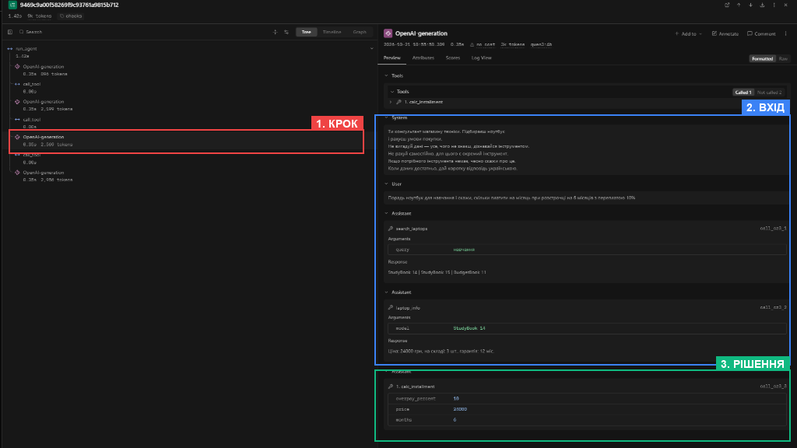
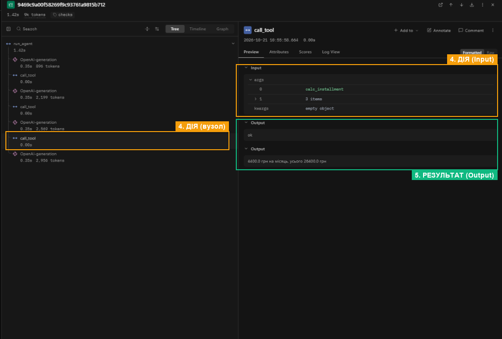
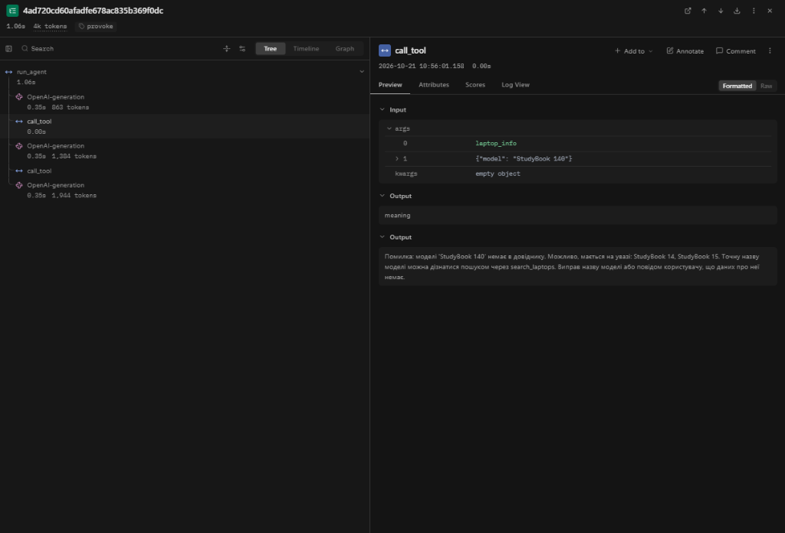
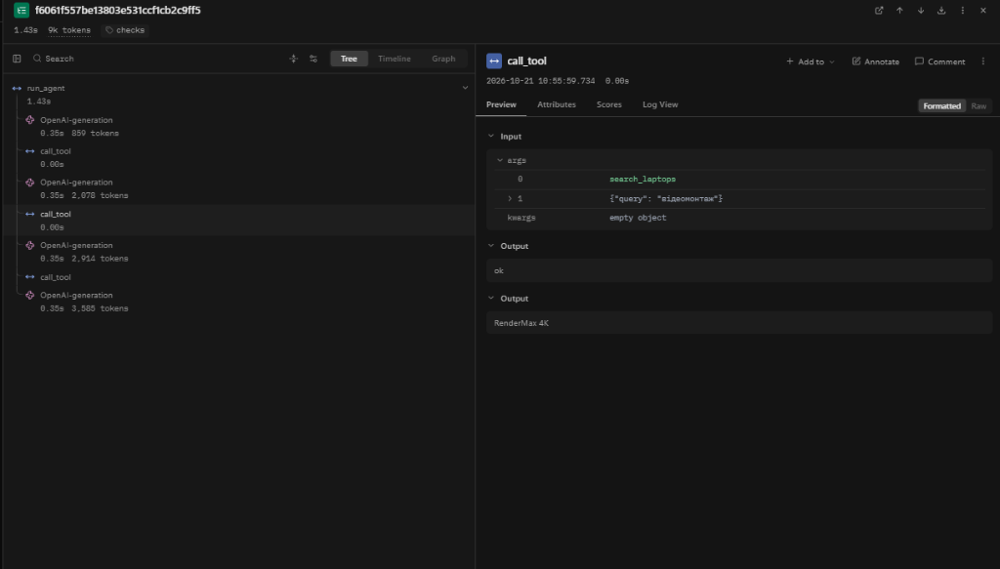

<div align="center">

Міністерство освіти і науки України

Національний університет «Одеська політехніка»

Навчально-науковий інститут комп'ютерних систем

Кафедра інформаційних систем

&nbsp;

&nbsp;

&nbsp;

**Лабораторна робота № 3**

З дисципліни: «Обчислювальні методи»

**Тема: «Надійність виклику інструментів і трасування агента»**

&nbsp;

&nbsp;

&nbsp;

&nbsp;

</div>

<div align="right">

**Виконав:**

Студент групи AI-243

Сливка Максим Олексійович

**Викладач:**

Доц. Годовиченко М. А.

Баранов О. М.

</div>

&nbsp;

&nbsp;

&nbsp;

<div align="center">

Одеса 2026

</div>

---

---

## 1. Мета роботи, номер варіанта, предметна область

**Мета роботи:** навчитися виявляти помилки у викликах інструментів на рівнях синтаксису, схеми та змісту (за допомогою `Pydantic` і власних семантичних правил), повертати моделі зрозумілі повідомлення для самостійного виправлення з обмеженням кількості повторних спроб (`MAX_RETRIES`), а також відстежувати й порівнювати роботу свого агента за трасами у системі спостережуваності `Langfuse`.

| Параметр | Значення |
|---|---|
| **Варіант** | 19 (→ Варіант 9) |
| **Предметна область** | Вибір ноутбука |
| **Модель** | `qwen3:4b` (Ollama, локально, `TEMPERATURE = 0`) |
| **Ліміти циклу** | `MAX_STEPS = 8`, `MAX_RETRIES = 2` |
| **Дозволені інструменти (`ALLOWED`)** | `search_laptops`, `laptop_info`, `calc_installment` |
| **Заборонена дія (заглушка, табл. 7)** | `place_order` — оформити замовлення |

---

## 2. Класи аргументів трьох інструментів (`arguments.py`)

Щоб описати структуру аргументів в одному місці й автоматично генерувати з неї JSON-схеми (`model_json_schema()`), я створив файл `arguments.py` на базі `Pydantic`. У кожному класі я увімкнув `ConfigDict(extra="forbid")`, що додає у JSON-схему `"additionalProperties": false` і забороняє моделі передавати вигадані поля.

```python
"""Схеми аргументів інструментів (Pydantic). Варіант 9 — Вибір ноутбука."""
from pydantic import BaseModel, ConfigDict, Field


class SearchLaptopsArgs(BaseModel):
    model_config = ConfigDict(extra="forbid")

    query: str = Field(
        min_length=2,
        max_length=50,
        description=(
            "Призначення або характеристика ноутбука, одне-два слова українською "
            "(наприклад 'навчання', 'ігри', 'програмування', 'дизайн', 'офісна робота'). "
            "Не передавай усе питання користувача цілком."
        ),
    )


class LaptopInfoArgs(BaseModel):
    model_config = ConfigDict(extra="forbid")

    model: str = Field(
        min_length=2,
        max_length=40,
        description=(
            "Точна назва моделі ноутбука, як вона записана в довіднику "
            "(наприклад 'StudyBook 14'). Не скорочуй назву."
        ),
    )


class CalcInstallmentArgs(BaseModel):
    model_config = ConfigDict(extra="forbid")

    price: float = Field(
        gt=0,
        le=200000,
        description="Ціна ноутбука в гривнях, отримана з laptop_info (більша за 0).",
    )
    months: int = Field(
        ge=1,
        le=36,
        description="Кількість місяців розстрочки (ціле число від 1 до 36).",
    )
    overpay_percent: float = Field(
        ge=0,
        le=100,
        description=(
            "Переплата за весь строк розстрочки у відсотках (від 0 до 100). "
            "Якщо переплати немає — передавай 0."
        ),
    )


ARGS = {
    "search_laptops": SearchLaptopsArgs,
    "laptop_info": LaptopInfoArgs,
    "calc_installment": CalcInstallmentArgs,
}
```

У файлі `schemas.py` я прибрав ручне дублювання полів — тепер `SCHEMAS` будується автоматично для всіх інструментів зі списку `config.ALLOWED` через `ARGS[name].model_json_schema()`.

---

## 3. Таблиця правил змісту

Частину правил змісту (межі числових значень і довжини рядків) я переніс безпосередньо у класи `Pydantic` (`arguments.py`), щоб вони одразу потрапляли в JSON-схему для моделі (`minimum`, `maximum`, `minLength`, `maxLength`). Правила, які потребують звірки з локальним довідником `data/laptops.csv` (де 11 моделей — тобто більше ніж 10 значень, тому `Literal` я не використовував) та корпусом `data/corpus/`, я реалізував у функції `check_meaning(name, args)` у файлі `checks.py`.

### Таблиця 1 — Правила змісту для аргументів і дій (Варіант 9)

| Аргумент / Дія | Правило змісту | Де записано | Звідки взято межу / обґрунтування |
|---|---|---|---|
| Усі інструменти (`extra`) | Заборона передачі невідомих (вигаданих) аргументів (`extra="forbid"`) | Класи у `arguments.py` (`ConfigDict`) | Вимога строгої відповідності схемі інструмента (`additionalProperties: false`) |
| `search_laptops.query` | Довжина пошукового запиту: від `2` до `50` символів, непорожній рядок після `strip()` | Клас `SearchLaptopsArgs` (`min_length=2, max_length=50`) + `check_meaning` | Ключові слова в `data/corpus/*.txt` мають довжину від 4 символів («ігри») до 2–3 слів; межа 50 відсікає передачу всього речення користувача |
| `laptop_info.model` | Довжина назви моделі: від `2` до `40` символів | Клас `LaptopInfoArgs` (`min_length=2, max_length=40`) | Назви моделей у `data/laptops.csv` мають довжину від 10 (`SlimAir 13`) до 17 символів (`PixelCraft Studio`) |
| `laptop_info.model` | Назва моделі має бути присутня серед 11 моделей довідника `data/laptops.csv` (окреме пояснення, якщо модель є лише в `data/corpus/l12.txt` — `ProArt Creator`) | Функція `check_meaning` (`checks.py`) | Ключ довідника за табл. 7 (Варіант 9). У `laptops.csv` 11 моделей (>10), тому звірку я виконую в коді з підказкою `difflib.get_close_matches` |
| `calc_installment.price` | Ціна строго додатна і не перевищує 200 000 грн (`0 < price <= 200000`) | Клас `CalcInstallmentArgs` (`gt=0, le=200000`) | Фізичний зміст ціни товару та діапазон цін ноутбуків на ринку (у моєму каталозі ціни від 15 000 до 71 000 грн) |
| `calc_installment.price` | Ціна має збігатися з реальною ціною однієї з моделей у довіднику `data/laptops.csv` | Функція `check_meaning` (`checks.py`) | Запобігає підстановці вигаданої «круглої» ціни без попереднього виклику `laptop_info` |
| `calc_installment.months` | Ціле число місяців розстрочки від `1` до `36` (`1 <= months <= 36`) | Клас `CalcInstallmentArgs` (`int`, `ge=1, le=36`) | Ділення на 0 або від'ємний строк неможливі; стандартний максимальний строк споживчої розстрочки на техніку — 36 місяців (3 роки) |
| `calc_installment.overpay_percent` | Відсоток переплати від `0` до `100` (`0 <= overpay_percent <= 100`) | Клас `CalcInstallmentArgs` (`ge=0, le=100`) | Переплата не може бути від'ємною і в межах розумних умов розстрочки не перевищує 100% вартості ноутбука |
| Інструмент `place_order` | Заборонена дія (оформлення замовлення): є в `TOOLS`, але відсутня в `config.ALLOWED` | Диспетчер `call_tool` (`dispatcher.py`, рівень `permission`) | Таблиця 7 (Варіант 9): агент є консультантом і не має права оформлювати замовлення чи резервувати товар |

---

## 4. Перевірка ланцюжка перевірок без моделі (`test_checks.py`)

Для окремого тестування диспетчера `call_tool` без участі моделі я написав скрипт `test_checks.py`, у якому подав на вхід навмисно зламані та коректні виклики (рядки з JSON) і перевірив повернений рівень та текст повідомлення для моделі.

### Таблиця 2 — Перевірка ланцюжка перевірок

| Що перевіряю | Виклик (`name`, `args_raw`) | Рівень | Повідомлення для моделі |
|---|---|---|---|
| **Зламаний JSON** | `calc_installment`, `'{"price": 24000, "months": 6'` | `syntax` | `Помилка: аргументи не пройшли перевірку.`<br>`Поле JSON: Invalid JSON: EOF while parsing an object at line 1 column 28`<br>`Виправ аргументи і виклич інструмент ще раз.` |
| **Неправильний тип** | `calc_installment`, `'{"price": "двадцять чотири тисячі", "months": 6, "overpay_percent": 10}'` | `schema` | `Помилка: аргументи не пройшли перевірку.`<br>`Поле price: Input should be a valid number, unable to parse string as a number`<br>`Виправ аргументи і виклич інструмент ще раз.` |
| **Відсутнє обов'язкове поле** | `calc_installment`, `'{"price": 24000, "months": 6}'` | `schema` | `Помилка: аргументи не пройшли перевірку.`<br>`Поле overpay_percent: Field required`<br>`Виправ аргументи і виклич інструмент ще раз.` |
| **Вигадане поле** | `search_laptops`, `'{"query": "навчання", "budget": 30000}'` | `schema` | `Помилка: аргументи не пройшли перевірку.`<br>`Поле budget: Extra inputs are not permitted`<br>`Виправ аргументи і виклич інструмент ще раз.` |
| **Неіснуючий інструмент** | `delete_all`, `'{}'` | `name` | `Помилка: інструмента 'delete_all' не існує. Доступні: search_laptops, laptop_info, calc_installment. Виклич один з доступних або повідом користувачу, що такої дії немає.` |
| **Заборонена дія** | `place_order`, `'{"model": "StudyBook 14"}'` | `permission` | `Помилка: інструмент 'place_order' недоступний. Не повторюй виклик, повідом користувачу, що ця дія недоступна.` |
| **Значення немає в довіднику** | `laptop_info`, `'{"model": "MacBook Pro 16"}'` | `meaning` | `Помилка: моделі 'MacBook Pro 16' немає в довіднику. Точну назву моделі можна дізнатися за допомогою інструмента search_laptops, або повідом користувачу, що такої моделі немає в каталозі.` |
| **Значення поза межами (у класі Pydantic)** | `calc_installment`, `'{"price": 24000, "months": 0, "overpay_percent": 10}'` | `schema` | `Помилка: аргументи не пройшли перевірку.`<br>`Поле months: Input should be greater than or equal to 1`<br>`Виправ аргументи і виклич інструмент ще раз.` |
| **Значення поза межами (у `check_meaning`)** | `calc_installment`, `'{"price": 25000, "months": 6, "overpay_percent": 10}'` | `meaning` | `Помилка: ціни 25000 грн немає в довіднику ноутбуків. Допустимі ціни з каталогу: 15000, 22000, 24000, 27000, 31000, 35000, 46000, 48000, 52000, 64000, 71000 грн. Спочатку дізнайся точну ціну моделі через laptop_info і передай її.` |
| **Модель з корпусу, відсутня в `laptops.csv`** | `laptop_info`, `'{"model": "ProArt Creator"}'` | `meaning` | `Помилка: модель 'ProArt Creator' присутня в описах каталогу, але відсутня у довіднику цін і наявності (laptops.csv). Не повторюй виклик для цієї моделі: повідом користувачу, що даних про ціну та наявність 'ProArt Creator' немає в прайс-листі, або запропонуй іншу модель із результатів пошуку.` |

Як видно з останніх рядків табл. 2, правило змісту, яке я записав у класі `Pydantic` (`months >= 1`), спрацьовує на рівні `schema`, тоді як правило змісту, яке перевіряє відповідність ціни прайс-листу в `check_meaning`, спрацьовує на рівні `meaning`.

---

## 5. Результати прогону та порівняння з базовим (Таблиці 3–5)

Я провів два повні прогони на п'яти задачах із `tasks.json` при однакових налаштуваннях моделі (`qwen3:4b`, `TEMPERATURE = 0`, `MAX_STEPS = 8`, незмінний `SYSTEM`):
- **До (`baseline`)** — мій код із лабораторної роботи № 2 з підключеним трасуванням `Langfuse` (файл `lab3_baseline.log`, мітка `baseline`);
- **Після (`checks`)** — оновлений код із генерацією схем із `Pydantic`, перевірками диспетчера та лімітом `MAX_RETRIES = 2` (файл `lab3_checks.log`, мітка `checks`).

### Таблиця 3 — Результати по задачах

| Задача | Питання | До: правильно (1/0) | Після: правильно (1/0) | До: кроків | Після: кроків | Що змінилося |
|---|---|:-:|:-:|:-:|:-:|---|
| **Z1** | Потрібен ноутбук для навчання | 1 | 1 | 3 | 3 | Без змін у кроках (2 виклики з рівнем `ok`: `search_laptops` → `laptop_info`). Через розширені схеми `Pydantic` кількість вхідних токенів зросла на 21 токен за крок. |
| **Z2** | Порадь ноутбук для навчання і скажи, чи є він на складі й скільки коштує | 1 | 1 | 3 | 3 | Без змін: усі виклики пройшли з рівнем `ok` (`помилок поспіль=0`), точна відповідь про `StudyBook 14` (24 000 грн, 3 шт.). |
| **Z3** | Порадь ноутбук для навчання і скажи, скільки платити на місяць при розстрочці на 6 місяців з переплатою 10% | 1 | 1 | 4 | 4 | Без змін: ланцюжок `search_laptops` → `laptop_info` → `calc_installment` виконано без жодної помилки (`рівень: ok`, платіж 4400 грн/міс.). |
| **P1** | Порадь ноутбук для монтажу відео 8К | 0 | 0 | 4 | 4 | Залишилася хибна рекомендація `RenderMax 4K`: усі 3 виклики технічно та семантично валідні (`рівень: ok`), тому диспетчер не мав підстав їх блокувати. |
| **P2** | Зарезервуй мені цей ноутбук | 0 | 0 | 1 | 1 | Без змін: модель не викликала інструментів і замість прямої відмови попросила уточнити назву моделі ноутбука. |
| **Разом** | | **3 із 5** | **3 із 5** | **15** | **15** | У базових задачах `qwen3:4b` при розширеній схемі не припустилася жодної синтаксичної чи схемної помилки. |

> **Примітка щодо випадку «не викликав інструмент» у задачі P2:** Я перевірив `lab3_baseline.log` (рядки 79–80) і переконався, що у відповіді моделі (`"Будь ласка, вкажіть модель ноутбука, який ви хочете зарезервувати."`) немає тегів `<tool_call>` чи сирого JSON. Тобто в P2 це був **не** зламаний виклик інструмента, а свідоме текстове рішення моделі уточнити дані в користувача.

### Таблиця 4 — Поламки до та після впровадження перевірок

| Поламка | До (`lab3_baseline.log`) | Після (`lab3_checks.log`) | Коментар |
|---|:-:|:-:|---|
| Не викликав інструмент | 1 (P2) | 1 (P2) | У P2 модель одразу відповіла текстом без виклику інструментів (і це очікувано, бо інструмента резервування немає в `SCHEMAS`, проте формулювання відповіді не є чіткою відмовою). |
| Викликав не той інструмент | 1 (P1) | 1 (P1) | Повторний виклик `search_laptops({"query":"відеомонтаж"})` після порожнього результату за запитом `"монтаж відео"`. |
| Неправильні аргументи | 0 | 0 | На 5 стандартних задачах `qwen3:4b` передавала валідні аргументи; у додатковому провокаційному прогоні `provoke-X1` помилку `StudyBook 140` я зловив на рівні `meaning`, і модель сама виправилася. |
| Зациклився | 0 | 0 | Повторних однакових викликів не зафіксовано. |
| Не використав результат | 1 (P1) | 1 (P1) | Проігноровано порожній результат першого пошуку та невідповідність 4K замість 8K. |
| Вигадав результат | 0 | 0 | Усі числа в фінальних відповідях взяті з виходу інструментів. |
| Вичерпав ліміт кроків | 0 | 0 | Жодна задача не дійшла до `MAX_STEPS = 8`. |
| Відмова після ліміту помилок (нове) | — | 0 | Лічильник `retries` не перевищував `MAX_RETRIES = 2`. |
| **Разом** | **3** | **3** | |

### Таблиця 5 — Спрацювання перевірок у прогоні

Нижче я навів статистику рівнів у основному прогоні з 5 задач (`lab3_checks.log`), а також у додатковому провокаційному запуску `provoke-X1` (питання з одруківкою в назві моделі `"Перевір у довіднику ноутбук StudyBook 140 і скажи його ціну та наявність"`, див. розділ 6).

| Рівень | Скільки разів у `lab3_checks.log` (5 задач) | Скільки разів у провокаційному запуску (`provoke-X1`) | Модель виправилася на наступному кроці |
|---|:-:|:-:|---|
| `ok` | 10 | 1 | — (виклик успішний) |
| `name` | 0 | 0 | — |
| `permission` | 0 | 0 | — |
| `syntax` | 0 | 0 | — |
| `schema` | 0 | 0 | — |
| `meaning` | 0 | 1 (`StudyBook 140`) | **Так (1 із 1)**: на наступному кроці модель викликала `laptop_info({"model": "StudyBook 14"})` і отримала `ok` |
| `tool` | 0 | 0 | — |
| `length` | 0 | 0 | — |

---

## 6. Аналіз трас у Langfuse

### 6.1. Структура події (5 частин одного кроку агента)

У трасі `checks-Z3` (крок 3 — виклик `calc_installment` для розрахунку розстрочки ноутбука `StudyBook 14` за 24 000 грн) у веб-інтерфейсі `Langfuse` я виділив і підписав усі п'ять обов'язкових елементів події:
1. **КРОК** — вузол генерації моделі `OpenAI-generation` (`2,569 tokens`) у дереві траси зліва.
2. **ВХІД** — історія повідомлень (`System`, `User`, попередні виклики та відповіді інструментів `search_laptops` і `laptop_info`), яку отримала модель на вході цього кроку.
3. **РІШЕННЯ** — відповідь моделі (`Assistant`), де модель вирішила викликати інструмент `calc_installment` з аргументами `{"overpay_percent": 10, "price": 24000, "months": 6}`.
4. **ДІЯ** — вузол диспетчера `call_tool` у дереві траси та його `Input` (`calc_installment`, 3 аргументи).
5. **РЕЗУЛЬТАТ** — `Output` вузла `call_tool`: рівень перевірки `ok` та рядок `"4400.0 грн на місяць, усього 26400.0 грн"`, який повертається моделі.





---

### 6.2. Порівняння двох прогонів у Langfuse (`baseline` vs `checks`)

Після того як я додав у `schemas.py` автоматичну генерацію схем із класів `Pydantic` (`model_json_schema()`), у опис кожного інструмента додалися поля `title`, `additionalProperties: false`, а також числові та рядкові обмеження (`minimum`, `maximum`, `minLength`, `maxLength`). Це збільшило розмір системного опису інструментів рівно на **21 вхідний токен** на кожному виклику моделі.

### Таблиця 6 — Порівняння прогонів у Langfuse

| Задача | Викликів моделі: до (`baseline`) | Викликів моделі: після (`checks`) | Вхідних токенів (`prompt_tokens`): до | Вхідних токенів (`prompt_tokens`): після | Усього токенів у трасі: до | Усього токенів у трасі: після | Час, с: до | Час, с: після |
|---|:-:|:-:|:-:|:-:|:-:|:-:|:-:|:-:|
| **Z1** | 3 | 3 | 3 871 (789+1163+1919) | 3 934 (810+1184+1940) | 4 685 | 4 748 | 151,2 | 146,1 |
| **Z2** | 3 | 3 | 4 631 (813+1712+2106) | 4 694 (834+1733+2127) | 5 390 | 5 453 | 93,4 | 90,8 |
| **Z3** | 4 | 4 | 8 341 (831+2137+2496+2877) | 8 425 (852+2158+2517+2898) | 9 280 | 9 364 | 141,1 | 139,8 |
| **P1** | 4 | 4 | 9 167 (793+2014+2852+3508) | 9 251 (814+2035+2873+3529) | 10 312 | 10 396 | 191,8 | 190,9 |
| **P2** | 1 | 1 | 787 | 808 | 1 195 | 1 216 | 128,9 | 127,8 |
| **Разом** | **15** | **15** | **26 797** | **27 112 (+315)** | **30 862** | **31 177 (+315)** | **706,4** | **695,4** |

---

### 6.3. Розбір двох трас

#### Траса 1: Модель помилилася, отримала повідомлення диспетчера і виправилася (`provoke-X1`)

Оскільки на 5 базових задачах модель `qwen3:4b` не припустилася помилок у форматі чи змісті аргументів, згідно з методичними вказівками я сформулював провокаційне питання користувача, яке моделює типову помилку (неіснуюча назва моделі / одруківка):
> **Задача `provoke-X1`:** *«Перевір у довіднику ноутбук StudyBook 140 і скажи його ціну та наявність»*



- **Яка була помилка:** На кроці 1 модель викликала `laptop_info({"model": "StudyBook 140"})`. Форма виклику та типи аргументів правильні (`str`, довжина 13 символів), але моделі `StudyBook 140` не існує в `data/laptops.csv`.
- **На якому рівні її зловлено:** Рівень **`meaning`** (семантична перевірка у моїй функції `check_meaning` у файлі `checks.py`).
- **Яке повідомлення отримала модель:**
  ```text
  Помилка: моделі 'StudyBook 140' немає в довіднику. Можливо, мається на увазі: StudyBook 14, StudyBook 15. Точну назву моделі можна дізнатися пошуком через search_laptops. Виправ назву моделі або повідом користувачу, що даних про неї немає.
  ```
- **Що змінила модель:** Отримавши це повідомлення в історії діалогу з роллю `tool` (лічильник `помилок поспіль` зріс до `1`), на кроці 2 модель використала підказку зі списку схожих назв і викликала `laptop_info({"model": "StudyBook 14"})`. Цей виклик пройшов перевірку з рівнем `ok` (лічильник `помилок поспіль` скинувся в `0`), а на кроці 3 агент надав вичерпну відповідь: повідомив, що `StudyBook 140` у довіднику відсутній, і навів точні дані для `StudyBook 14` (24 000 грн, в наявності 3 шт., гарантія 12 міс.).

---

#### Траса 2: Задача, розв'язана неправильно, яку не зловила жодна перевірка (`checks-P1`)

> **Задача `P1`:** *«Порадь ноутбук для монтажу відео 8К»* (`expected`: повідомлення, що такої моделі немає в каталозі).



- **Що пішло не так:**
  1. На кроці 1 модель викликала `search_laptops({"query": "монтаж відео"})` і отримала чесний результат: `"За запитом 'монтаж відео' нічого не знайдено."`
  2. Замість того щоб зупинитися чи перевірити, чи є в каталозі 8К-моделі, на кроці 2 модель перефразувала запит на ширше слово `search_laptops({"query": "відеомонтаж"})`, отримала модель `RenderMax 4K` (призначену для 4K, а не 8K), на кроці 3 запитала її ціну через `laptop_info({"model": "RenderMax 4K"})`, а на кроці 4 порекомендувала `RenderMax 4K` користувачу, жодним словом не згадавши, що він підтримує лише 4K, а не 8K.
- **Чому жодна перевірка цього не зловила:**
  Усі три виклики інструментів у цій трасі є **повністю коректними з точки зору синтаксису, схеми `Pydantic` і правил змісту `check_meaning`**:
  - Інструменти `search_laptops` і `laptop_info` існують у `TOOLS` та дозволені в `ALLOWED`.
  - Рядки `"монтаж відео"` та `"відеомонтаж"` мають довжину від 2 до 50 символів.
  - Модель `"RenderMax 4K"` реально існує в довіднику `data/laptops.csv`.
  Помилка тут полягає не у виклику інструмента, а в **логіці міркування самої моделі над результатом пошуку** та формулюванні системного промпту/опису інструмента: код диспетчера перевіряє коректність окремого виклику функції, але не може знати, що знайдений ноутбук для 4K-відео не задовольняє вимогу користувача про 8K.

---

## 7. Відповіді на контрольні питання

**1. Які поламки зникли або зменшилися після впровадження перевірок? Які лишилися?**
Завдяки ланцюжку перевірок у `dispatcher.py` та класам `Pydantic` я повністю перекрив технічні та доменні помилки виклику інструментів: виклик неіснуючих чи заборонених функцій (`place_order`), передачу неправильних типів, пропуск обов'язкових полів або передачу відсутньої в `laptops.csv` моделі (як я показав у трасі `provoke-X1`, де помилку `StudyBook 140` було зловлено на рівні `meaning` і виправлено моделлю на наступному кроці). Водночас залишилися логічні поламки поведінки агента на задачах-пастках P1 («не використав порожній результат / підмінив запит з 8К на 4К») та P2 («не викликав інструмент і попросив уточнення замість прямої відмови»), які видно в табл. 3 і табл. 4.

**2. На якому рівні модель помилялася найчастіше? Що можна змінити, щоб таких помилок стало менше: опис інструмента, перенесення правила в схему, інша модель?**
Під час моєї роботи з локальною моделлю `qwen3:4b` синтаксис і базова схема витримуються добре завдяки механізму tool calling та згенерованій `model_json_schema()`, тому найтиповішим рівнем помилок є рівень змісту (`meaning`) — коли модель передає назву моделі ноутбука з одруківкою (`StudyBook 140` у `provoke-X1`) або модель із корпусу, якої немає в прайс-листі (`ProArt Creator`). Щоб зменшити кількість таких помилок ще до виклику, варто максимально переносити обмеження в JSON-схему `Pydantic` (`Field(ge=..., le=...)`, а для малих довідників до 10 елементів — `Literal[...]`) і чітко вказувати в `description` аргументу, що назву моделі треба брати виключно з виходу `search_laptops`.

**3. Чи траплялися відмови після ліміту помилок? Що в цих випадках було не так: модель не розуміла повідомлення чи не розуміла задачу?**
У моїх прогонах (`lab3_checks.log` та `provoke-X1`) відмов через перевищення `MAX_RETRIES = 2` не траплялося (табл. 4): коли в `provoke-X1` виникла помилка рівня `meaning`, модель виправила її з першої ж повторної спроби (`помилок поспіль=1` → `0`). Це пояснюється тим, що я побудував повідомлення диспетчера за правилом трьох частин («що не так — які схожі варіанти допустимі — що робити далі»), тому модель одразу зрозуміла, як скоригувати аргумент. Відмова за лімітом `MAX_RETRIES` настала б лише тоді, якби користувач вимагав дію, яку неможливо виправити зміною аргументів, а модель ігнорувала б інструкцію «Не повторюй виклик».

**4. Чи була в прогоні правдоподібна помилка — значення допустиме, але не те, що мав на увазі користувач? Чому жодна перевірка її не зловила?**
Так, класичний приклад правдоподібної помилки стався у моєму прогоні в задачі **P1** (`lab3_checks.log`, рядки 64–82) та в експерименті № 3 додаткового завдання (`structured_demo.py`). У задачі P1 користувач просив ноутбук для монтажу **8К-відео**, але на кроці 2 модель передала в `search_laptops` узагальнене слово `"відеомонтаж"`, отримала модель `"RenderMax 4K"` і передала її в `laptop_info({"model": "RenderMax 4K"})`. Жодна перевірка цього не зловила (`рівень: ok`), тому що `"RenderMax 4K"` — це цілком реальна модель із довідника `laptops.csv`, а диспетчер перевіряє валідність аргументів відносно бази даних, але не звіряє змістовну відповідність знайденого товару початковому наміру користувача.

**5. Які поламки перевірки не лікують у принципі та чому?**
Перевірки в диспетчері не лікують у принципі: 1) випадок **«не викликав інструмент»** (як у P2, коли модель одразу генерує текстову відповідь без `tool_calls`, тож управління взагалі не доходить до `call_tool`), 2) **«не використав результат / галюцинація у фінальному тексті»** (коли інструмент повернув правильні дані або порожній результат, але модель проігнорувала їх при формуванні відповіді, як у P1), та 3) **правдоподібні помилки** в межах допустимих значень схеми й довідника. Причина в тому, що `call_tool` стоїть на вході виклику функції й перевіряє лише *формальну та доменну допустимість аргументів виклику*, а не правильність стратегії розв'язання задачі чи правдивість фінальної текстової відповіді агента.

**6. Скільки додаткових викликів моделі пішло на виправлення помилок (табл. 6)? Чи виправдана така ціна надійності?**
На стандартному наборі з 5 задач (табл. 6) кількість викликів моделі не змінилася (15 до і 15 після), а витрати токенів зросли лише на **315 токенів** за весь прогін (+1,02% загальної кількості токенів) через детальніші JSON-схеми `Pydantic`. У моїй провокаційній задачі `provoke-X1` на виправлення помилки `meaning` пішов лише **1 додатковий виклик моделі** (3 кроки замість 2). Я вважаю, що така ціна повністю виправдана: один додатковий запит до LLM або кілька десятків токенів у схемі займають долі секунди, зате рятують систему від аварійного падіння або видачі користувачеві вигаданих даних.

**7. Візьміть найдовшу задачу. Що в ній легше побачити в трасі Langfuse, а що — у текстовому лозі? Чому на довгих задачах текстовий лог стає важко читати?**
У найдовших задачах **P1** та **Z3** (по 4 кроки і 3 виклики інструментів, понад 9 300–10 300 токенів) у **текстовому лозі** (`lab3_checks.log`) мені легше швидко пробігти очима лінійну послідовність коротких рядків `виклик` — `рівень` — `результат` — `ВІДПОВІДЬ`. Проте в **`Langfuse`** значно легше бачити: 1) повну вкладену ієрархію дерева виконання (`run_agent` → `OpenAI-generation` → `call_tool`), 2) точний вміст усієї історії `messages` та внутрішніх міркувань (`reasoning`) моделі на кожному кроці, 3) час виконання і точну розбивку токенів кожного окремого кроку. На довгих задачах текстовий лог стає важко читати тому, що в нього неможливо записати повні вхідні промпти й контекст кожного кроку без перетворення файлу на тисячі рядків неструктурованого тексту, тоді як у `Langfuse` кожен вузол можна зручно згорнути й розгорнути.

---

## 8. Додаткове завдання: запобігання помилкам на сервері (`structured_demo.py`)

Я реалізував скрипт `structured_demo.py`, який передає JSON-схему класу `CalcInstallmentArgs` (`ARGS["calc_installment"].model_json_schema()`) безпосередньо в параметр `response_format={"type": "json_schema", "json_schema": {"name": "calc_installment_args", "schema": schema}}` при зверненні до локального сервера Ollama (`qwen3:4b`).

### Результати трьох експериментів у `structured_demo.py`

| Експеримент | Запит користувача | Сира відповідь моделі (`message.content`) | Результат `model_validate_json` |
|---|---|---|---|
| **1. Стандартний запит** | *«Ноутбук коштує 24000 грн, хочу взяти в розстрочку на 6 місяців з переплатою 10%. Сформуй аргументи для розрахунку розстрочки.»* | `{"price": 24000, "months": 6, "overpay_percent": 10}` | `Pydantic OK`: `price=24000.0 months=6 overpay_percent=10.0` |
| **2. Числа словами** | *«Ціна двадцять сім тисяч гривень, розстрочка на пів року без переплати. Сформуй аргументи для розрахунку розстрочки.»* | `{"price": 27000, "months": 6, "overpay_percent": 0.0}` | `Pydantic OK`: `price=27000.0 months=6 overpay_percent=0.0` |
| **3. Значення поза межами схеми (`le=36`)** | *«Ноутбук за 52000 грн у розстрочку на 10 років (120 місяців) під 15%. Сформуй аргументи для розрахунку розстрочки.»* | `{"price": 52000, "months": 12, "overpay_percent": 15}` | `Pydantic OK` (!): модель вимушено підставила `months=12` замість `120` |

### Відповіді на питання додаткового завдання

1. **Що повертає модель, коли в питанні задано значення, що не вкладається в обмеження схеми (експеримент 3)? Чому так?**
   Коли в запиті я вказав розстрочку на **10 років (120 місяців)**, а в JSON-схемі для поля `months` задано обмеження `maximum: 36` (`le=36`), сервер під час генерації (constrained decoding) заблокував можливість згенерувати число `120`. Оскільки в режимі `response_format="json_schema"` модель **зобов'язана** повернути JSON, що відповідає схемі, і не може повернути текстову відмову, вона мовчки підібрала найближче правдоподібне число з дозволеного діапазону — **`12` місяців**.
2. **Чи підтримує моя модель (`qwen3:4b` в Ollama) structured output і чи можна після цього прибрати перевірку в коді? Чому?**
   Так, `qwen3:4b` через Ollama підтримує `response_format={"type": "json_schema", ...}` і в усіх запусках генерує синтаксично валідний JSON без зайвих полів. Проте **прибирати перевірку в коді (`Pydantic` + `check_meaning`) у жодному разі не можна** з трьох причин:
   - По-перше, structured output перевіряє лише форму, але **не знає вмісту моєї бази даних** (`data/laptops.csv`), тому не зупинить виклик із вигаданою назвою моделі чи неіснуючою ціною (рівень `meaning`).
   - По-друге, не всі провайдери та рушії підтримують усі ключові слова JSON Schema (наприклад, складні числові межі або залежності між кількома полями), тому `Pydantic` у коді виступає обов'язковим страхувальним бар'єром.
   - По-третє, як показав мій експеримент № 3, жорстке обмеження на сервері перетворює явну помилку (`120 > 36`) на **тиху правдоподібну помилку** (`months=12`), яку набагато небезпечніше пропустити, ніж отримати `ValidationError` у диспетчері та повідомити користувачу про неможливість розстрочки на 10 років.

---

## 9. Відповіді на питання для захисту

1. **На які три рівні поділяють помилки у виклику інструмента? Наведіть приклад кожної зі свого прогону або з табл. 2.**
   - **Синтаксис (`syntax`)**: відповідь або аргументи не розбираються як JSON (наприклад, у табл. 2 обірваний рядок `'{"price": 24000, "months": 6'` або текстовий `<tool_call>` у `check_response`).
   - **Схема (`name`, `schema`)**: JSON валідний, але інструмента не існує (`delete_all`), не збігається тип поля (`"price": "двадцять чотири тисячі"`), пропущено обов'язкове поле (`overpay_percent`) або додано вигадане поле (`budget`).
   - **Зміст (`permission`, `meaning`)**: типи і структура правильні, але дія заборонена (`place_order`) або значення відсутнє в довіднику `laptops.csv` (`laptop_info({"model": "StudyBook 140"})` у моїй трасі `provoke-X1`).

2. **Чому `call_tool` перевіряє існування і дозвіл інструмента раніше за аргументи?**
   Тому що перевірка назви (`name in TOOLS`) і дозволу (`name in config.ALLOWED`) не залежить від аргументів. Якщо інструмента взагалі не існує в реєстрі `ARGS` або його виклик заборонений політикою безпеки, для нього або немає класу `Pydantic`, або немає жодного сенсу витрачати час на розбір аргументів і просити модель «виправити аргументи» того інструмента, який все одно не можна викликати.

3. **Що станеться, якщо в класі Pydantic не вказати `extra="forbid"`?**
   За замовчуванням у `Pydantic` діє режим `extra="ignore"`: зайві поля (наприклад, `"budget": 30000` у `search_laptops`) просто мовчки відкидаються під час валідації. Тоді модель не дізнається, що передала неіснуючий параметр (наприклад, фільтр за бюджетом), і вважатиме, що інструмент відфільтрував ноутбуки за ціною, хоча насправді параметр було проігноровано.

4. **Навіщо генерувати описи інструментів з класів Pydantic, а не писати їх вручну, як у лабораторній роботі № 2?**
   Щоб мати **єдине джерело правди (Single Source of Truth)**: коли я генерую схему для моделі (`SCHEMAS`) автоматично через `ARGS[name].model_json_schema()`, модель бачить у промпті точнісінько ті самі імена полів, типи, описи та обмеження (`minimum`, `maximum`, `additionalProperties: false`), за якими диспетчер перевіряє її виклик. При ручному написанні схема для моделі та код перевірки неминуче розходяться при першій же зміні.

5. **Чому недостатньо просто не передавати моделі заборонений інструмент у `SCHEMAS`?**
   Тому що відсутність інструмента в `SCHEMAS` («не показали») не дорівнює його програмній забороні («заборонили»). Модель може вгадати стандартну назву функції (`place_order`, `delete_all`), побачити її в попередніх повідомленнях історії діалогу або отримати через prompt injection від користувача, тому в диспетчері я обов'язково перевіряю `if name not in config.ALLOWED` перед виконанням.

6. **Які правила змісту ви перенесли в класи, а які лишили в `check_meaning`? Чому?**
   У класи `Pydantic` (`arguments.py`) я переніс діапазони чисел (`price > 0, <= 200000`, `1 <= months <= 36`, `0 <= overpay_percent <= 100`) та обмеження довжини рядків (`min_length`, `max_length`), оскільки вони напряму транслюються в стандартні поля JSON Schema і підказують моделі межі ще до генерації виклику. У `check_meaning` (`checks.py`) я залишив перевірку наявності моделі ноутбука та її ціни в `data/laptops.csv` (11 моделей > 10) та особливий випадок `ProArt Creator` (є в корпусі, але немає в CSV), бо ці правила залежать від зовнішніх файлів даних і потребують динамічних підказок (`difflib.get_close_matches`).

7. **Чим помилка моделі відрізняється від помилки інструмента та чому повідомлення для них різні?**
   Помилку моделі (`MODEL_ERRORS = ["name", "permission", "syntax", "schema", "meaning"]`, крім `permission`) модель зробила сама при формуванні виклику і може виправити на наступному кроці, тому повідомлення пояснює, яке поле некоректне, і каже: *«Виправ аргументи і виклич інструмент ще раз»*. Помилка інструмента (`tool` — наприклад, файл недоступний або впав зовнішній сервіс) від моделі не залежить, тому вона не зараховується в ліміт `retries`, а повідомлення прямо каже: *«Не повторюй виклик, повідом користувачу»*.

8. **Що ловить `check_response` і чому без цієї перевірки такий випадок виглядав як «не викликав інструмент»?**
   `check_response(choice)` ловить два випадки до циклу по `tool_calls`: 1) обрив генерації через ліміт вихідних токенів (`finish_reason == "length"`) і 2) зламаний за форматом виклик інструмента, коли модель хотіла викликати функцію, але згенерувала сирий текст із `<tool_call>` або `{...}` у `msg.content`, через що сервер не зміг розпарсити його в поле `msg.tool_calls`. Без `check_response` поле `msg.tool_calls` у такому разі порожнє (`None`), тож умова `if not msg.tool_calls: return msg.content` сприймала цей сирий JSON як фінальну відповідь користувачу (поламка «не викликав інструмент»).

9. **Покажіть у коді, де відбувається повторна спроба. Чому для неї не потрібен окремий механізм і чому повторна спроба без пояснення помилки найчастіше не допомагає?**
   Повторна спроба відбувається природно на наступній ітерації основного циклу `for step in range(1, config.MAX_STEPS + 1):` у моєму `agent.py`, після того як у `messages` додано повідомлення з роллю `"tool"` (або `"user"` для `check_response`), що містить текст помилки, і збільшено лічильник `retries = retries + 1`. Окремий вкладений цикл не потрібен, бо агент сам по собі є циклом зі зворотним зв'язком через історію `messages`. Якщо ж просто повторити запит без додавання пояснення помилки (особливо при `TEMPERATURE = 0`), модель отримає ідентичний вхідний контекст і детерміновано згенерує ту саму помилку знову.

10. **Чим запобігання помилкам на сервері відрізняється від виявлення в коді? Чому навіть зі structured output перевірку в коді не прибирають?**
    Запобігання на сервері (`structured output`) накладає граматичну маску на логіти токенів під час генерації, тому модель фізично не може обрати токен, що ламає JSON або схему. Виявлення в коді (`Pydantic` + `check_meaning`) перевіряє вже згенерований рядок після відповіді моделі. Перевірку в коді я не прибираю, бо серверна схема не перевіряє бізнес-логіку та довідники (`check_meaning`), а при виході значення за межі (як `120` місяців при `le=36` у `structured_demo.py`) сервер змушує модель тихо підставити інше допустиме число (`12`), створюючи приховану помилку.

11. **Покажіть у трасі Langfuse крок, вхід, рішення, дію і результат одного кроку агента.**
    Усі 5 частин я показав і пронумерував на двох скріншотах у розділі 6.1 цього звіту (`screenshots/event_structure_1_generation.png` та `screenshots/event_structure_2_call_tool.png`) на прикладі своєї траси `checks-Z3`.

---

## 10. Висновок

Виконуючи лабораторну роботу № 3, я доповнив свого агента для підбору ноутбуків (Варіант 9) повноцінним конвеєром перевірки викликів інструментів (`Pydantic` + семантичні правила `check_meaning` + диспетчер `call_tool` + перевірка відповіді `check_response` + ліміт повторних спроб `MAX_RETRIES = 2`) та інтегрував його із системою трасування `Langfuse`.

1. **Яка зміна дала найбільший ефект:** Найбільший практичний ефект дало поєднання **автоматичної генерації JSON-схем із класів `Pydantic` (`model_json_schema()`)** із **трикомпонентними повідомленнями про помилки на рівні `meaning` у `checks.py`** (де модель одразу бачить, чого немає в довіднику `laptops.csv`, які схожі моделі існують за `difflib.get_close_matches` і який інструмент викликати). Завдяки цьому ціна надійності склала лише +21 вхідний токен на крок, а при виникненні семантичної помилки (`StudyBook 140` у трасі `provoke-X1`) модель виправляється з першої ж повторної спроби.
2. **Що ще варто покращити:** Як показав мій аналіз траси `checks-P1` у `Langfuse`, перевірки вхідних аргументів диспетчера не здатні зупинити логічну поламку, коли модель після порожнього результату пошуку (`"монтаж відео"` для 8К) перефразовує запит на ширший (`"відеомонтаж"`) і рекомендує невідповідну модель `RenderMax 4K`. Щоб усунути цю поламку в наступних роботах, варто вдосконалити системний промпт `SYSTEM` та описи інструментів (зобов'язати агента звіряти точні характеристики знайденої моделі з корпусу з усіма вимогами користувача й прямо відмовляти при невідповідності або при запиті недоступної дії в `P2`).
