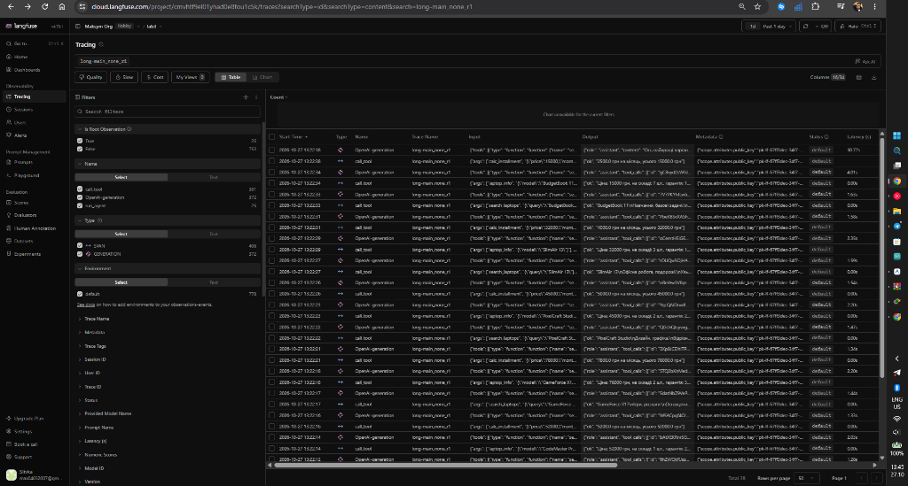
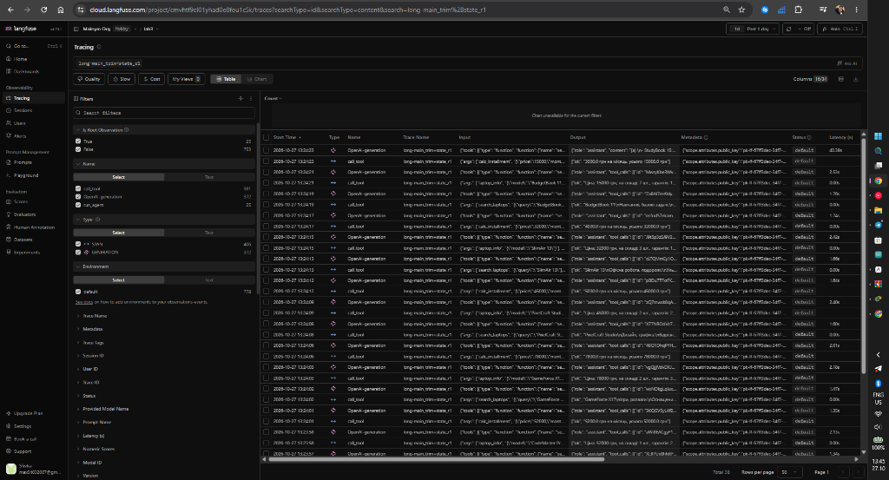

<div align="center">

Міністерство освіти і науки України

Національний університет «Одеська політехніка»

Навчально-науковий інститут комп'ютерних систем

Кафедра інформаційних систем

&nbsp;

&nbsp;

&nbsp;

**Лабораторна робота № 4**

З дисципліни: «Обчислювальні методи»

**Тема: «Контекст, стан і кеш агента»**

&nbsp;

&nbsp;

&nbsp;

&nbsp;

</div>

<div align="right">

**Виконав:**

Студент групи AI-243

Сливка Максим Олексійович

**Викладач:**

Доц. Годовиченко М. А.

Баранов О. М.

</div>

&nbsp;

&nbsp;

&nbsp;

<div align="center">

Одеса 2026

</div>

---

## 1. Мета роботи, варіант, предметна область, модель і розмір вікна (Крок 1)

**Мета роботи:** побачити, що відбувається з агентом, коли історія повідомлень не вміщується в контекстне вікно моделі; навчитися скорочувати історію (`trim`), зберігати результати інструментів поза текстом діалогу (`TaskState`) та кешувати виклики моделі за SHA-256 відбитком запиту (`cache`); виміряти вартість циклу в токенах і часі та порівняти підходи (зокрема зі стисненням через переказ `summary`).

### Характеристики варіанта та середовища

| Параметр | Значення |
|---|---|
| **Варіант** | 19 (→ Варіант 9) |
| **Предметна область** | Вибір ноутбука |
| **Інструменти (`ALLOWED`)** | `search_laptops` (пошук у корпусі `data/corpus/` без скорочення тексту), `laptop_info` (довідник `data/laptops.csv`), `calc_installment` (розрахунок платежу при розстрочці) |
| **Вихідна модель** | `qwen3:4b-instruct` (Ollama, локально, `TEMPERATURE = 0`) |
| **Ліміти кроків** | `MAX_STEPS = 8` (звичайні задачі), `MAX_STEPS_LONG = 25` (довга задача), `MAX_RETRIES = 2` |

### Три числа з Кроку 1 (звуження контекстного вікна через `Modelfile`)

Спочатку за інструкцією Кроку 1 було створено модель `qwen3:4b-instruct-4k` із `PARAMETER num_ctx 4096`. Оскільки у пробному прогоні з вікном `4096` найбільший вхід склав `3163` токени (`77%` вікна, статус `final` — **випадок C** за Кроком 4), вікно в `Modelfile` було зменшено до **`3072`** токенів (`qwen3:4b-instruct-3k`), а поріг стиснення у `config.py` виставлено на `COMPRESS_AT = 2150`:

```dockerfile
FROM qwen3:4b-instruct
PARAMETER num_ctx 3072
```

| Показник (`ollama show`) | Початкове зменшення (`4k`) | Робоче вікно за випадком C (`3k`) |
|---|---|---|
| 1. `context length` вихідної моделі (`qwen3:4b-instruct`) | **262 144** токенів | **262 144** токенів |
| 2. `num_ctx` нової моделі (розділ `Parameters`) | **4 096** токенів (`qwen3:4b-instruct-4k`) | **3 072** токенів (`qwen3:4b-instruct-3k`) |
| 3. У скільки разів вікно звузили | у **64** рази (`262144 / 4096`) | у **85,33** раза (`262144 / 3072`) |

---

## 2. Довга задача: питання і правильна відповідь (Крок 2)

Для варіанта 9 (Таблиця 6 методичних вказівок: *«Шість моделей | Ціна | Платіж при розстрочці на задану кількість місяців | Сума щомісячних платежів»*) було створено скрипт `make_task.py`, який формує `long_task.json` для шести ноутбуків із різними термінами безвідсоткової розстрочки (`MIN_CALLS = 18`, тобто 6 позицій × 3 інструменти):

- **Шість позицій (`ITEMS`) та розрахунок без моделі (`compute()`):**
  1. `StudyBook 15` (9 міс.) — ціна `27 000 грн` → щомісячний платіж `27000 / 9 = 3000 грн`
  2. `CodeMaster Pro` (10 міс.) — ціна `52 000 грн` → щомісячний платіж `52000 / 10 = 5200 грн`
  3. `GameForce X17` (10 міс.) — ціна `78 000 грн` → щомісячний платіж `78000 / 10 = 7800 грн`
  4. `PixelCraft Studio` (9 міс.) — ціна `45 000 грн` → щомісячний платіж `45000 / 9 = 5000 грн`
  5. `SlimAir 13` (8 міс.) — ціна `32 000 грн` → щомісячний платіж `32000 / 8 = 4000 грн`
  6. `BudgetBook 11` (5 міс.) — ціна `15 000 грн` → щомісячний платіж `15000 / 5 = 3000 грн`

- **Текст питання (`question` у `long_task.json`):**
  > «Для кожної з шести моделей ноутбуків: StudyBook 15 (розстрочка на 9 місяців), CodeMaster Pro (розстрочка на 10 місяців), GameForce X17 (розстрочка на 10 місяців), PixelCraft Studio (розстрочка на 9 місяців), SlimAir 13 (розстрочка на 8 місяців), BudgetBook 11 (розстрочка на 5 місяців). Для кожної: (а) знайди в корпусі опис моделі (її призначення та особливості) і наведи одним реченням; (б) знайди в довіднику ціну моделі; (в) порахуй щомісячний платіж при розстрочці без переплати (0%) на задану кількість місяців. У кінці назви суму щомісячних платежів усіх шести моделей одним числом.»

- **Правильна відповідь (`expected` у `long_task.json`):**
  $$\text{expected} = 3000 + 5200 + 7800 + 5000 + 4000 + 3000 = \mathbf{28000}$$

---

## 3. Прогін без захисту та аналіз переповнення вікна (Кроки 3–4)

### Результат пробного прогону (`python measure.py none 1 probe`)

- **Конфігурація:** `none` (`COMPRESS = "none"`, `USE_STATE = False`, `NUM_CTX = 3072`).
- **Час виконання:** `70.7 с`.
- **Чи правильна відповідь:** **ні** (`expected = 28000` відсутнє у відповіді).

### Таблиця 2 — Зростання входу в прогоні без захисту (`logs/probe_none_r1.log`)

Виведення команди `python analyze.py logs\probe_none_r1.log steps`:

| Крок | `prompt_tokens` | Приріст | Що зробила модель |
|-----:|----------------:|--------:|:-------------------------------------------------------------|
| 1 | 1190 | | `search_laptops({"query":"StudyBook 15"})` |
| | | | `laptop_info({"model":"StudyBook 15"})` |
| | | | `calc_installment({"price":0,"months":9,"overpay_percent":...` |
| 2 | 1507 | 317 | `calc_installment({"price":27000,"months":9,"overpay_perce...` |
| 3 | 1585 | 78 | `search_laptops({"query":"CodeMaster Pro"})` |
| 4 | 1750 | 165 | `laptop_info({"model":"CodeMaster Pro"})` |
| 5 | 1819 | 69 | `calc_installment({"price":52000,"months":10,"overpay_perc...` |
| 6 | 1898 | 79 | `search_laptops({"query":"GameForce X17"})` |
| 7 | 2082 | 184 | `laptop_info({"model":"GameForce X17"})` |
| 8 | 2153 | 71 | `calc_installment({"price":78000,"months":10,"overpay_perc...` |
| 9 | 2232 | 79 | `search_laptops({"query":"PixelCraft Studio"})` |
| 10 | 2407 | 175 | `laptop_info({"model":"PixelCraft Studio"})` |
| 11 | 2476 | 69 | `calc_installment({"price":45000,"months":9,"overpay_perce...` |
| 12 | 2554 | 78 | `search_laptops({"query":"SlimAir 13"})` |
| 13 | 2708 | 154 | `laptop_info({"model":"SlimAir 13"})` |
| 14 | 2779 | 71 | `calc_installment({"price":32000,"months":8,"overpay_perce...` |
| 15 | 2857 | 78 | `search_laptops({"query":"BudgetBook 11"})` |
| 16 | 3014 | 157 | `laptop_info({"model":"BudgetBook 11"})` |
| 17 | 2805 | -209 | `calc_installment({"price":15000,"months":6,"overpay_perce...` |
| 18 | 2883 | 78 | відповідь без виклику |

### Показники (а)–(д) за виведенням `analyze.py` та аналізом лога

- **(а) Постійна частина входу («вхід першого кроку»):** $C = \mathbf{1190}$ токенів (системна інструкція, JSON-схеми трьох інструментів у `SCHEMAS` та текст довгого запитання користувача).
- **(б) Типовий приріст за крок:** $d = \mathbf{78}$ токенів (медіана всіх додатних приростів; після виклику `search_laptops` приріст становить ~`154–184` токени через повний опис із корпусу, а після коротких відповідей `laptop_info` та `calc_installment` — ~`69–79` токенів).
- **(в) Сума `prompt_tokens` за прогін і значення за формулою:**
  - Фактична сума `prompt_tokens` за 18 кроків: **40 699** токенів.
  - Значення за квадратичною формулою $n \cdot C + d \cdot \frac{n(n-1)}{2}$: $18 \cdot 1190 + 78 \cdot \frac{18 \cdot 17}{2} = 21420 + 12010 = \mathbf{33\,430}$ токенів (а у вікні `4096` без обрізання сума становила `41 259` токенів).
  - **Чому числа відрізняються:** по-перше, на кроці 1 модель зробила одразу 3 виклики паралельно (`search_laptops`, `laptop_info`, `calc_installment`), що дало стрибок `+317` токенів на кроці 2, який зсунув базовий рівень усіх наступних 16 кроків вверх на $(317 - 78) \times 16 \approx 3824$ токени; по-друге, кожен третій крок повертає повний багаторядковий текст із корпусу (`+154..+184` токени), тому середній приріст ($\approx 114$ токенів) вищий за медіану $d = 78$.
- **(г) Крок, на якому вхід перестав рости:** крок **17** (після досягнення `3014` токенів на кроці 16, що становить `98%` вікна `3072`, на кроці 17 `prompt_tokens` зменшився на `-209` до `2805` токенів).
- **(д) Що робила модель на кроках під час і після досягнення межі вікна (кроки 16–18 у `logs/probe_none_r1.log`):**
  1. На **кроці 16** (`prompt_tokens=3014`) вхід впритул підійшов до межі `3072`, модель ще встигла викликати `laptop_info({"model":"BudgetBook 11"})` і отримати ціну `15000 грн`.
  2. На **кроці 17** (`prompt_tokens=2805`, приріст `-209`) сервер Ollama мовчки відкинув початок історії (разом із запитанням користувача!), щоб вмістити нові повідомлення у вікно `3072`. Через втрату запитання модель **забула, на скільки місяців треба рахувати розстрочку для `BudgetBook 11`** (в умові було `5 місяців`), і передала вигадане значення `months: 6`: `calc_installment({"price":15000,"months":6,"overpay_percent":0})` → отримала `2500.0 грн на місяць` замість правильних `3000.0 грн`.
  3. На **кроці 18** (`prompt_tokens=2883`) модель дала фінальну відповідь без виклику інструментів. Оскільки початок запитання користувача (*«У кінці назви суму щомісячних платежів усіх шести моделей одним числом»*) був відрізаний сервером, модель взагалі **забула порахувати й назвати підсумкову суму**, просто вивівши перелік шести ноутбуків із неправильним платежем `2 500 грн на місяць (6 місяців)` для `BudgetBook 11`.

### Визначення випадку (A–D)

Прогін належить до **Випадку B — «Сервер мовчки обрізає вхід»** (`analyze.py` показав: `вхід перестав рости на кроці : 17`, максимальний вхід `3014` токенів = `98%` вікна `3072`). Жодної помилки сервер не повернув, проте агент втратив початкову умову задачі.

---

## 4. Обрізання історії та стан задачі (Кроки 5–6)

### Таблиця 3 — Стиснення історії (`logs/probe_trim_r1.log` та `logs/probe_trim+state_r1.log`)

Поріг стиснення: `COMPRESS_AT = 2150`, `KEEP_LAST = 6`.

| Конфігурація | Крок стиснення | Вхід до стиснення, токенів | Повідомлень було -> стало | Повторних викликів за прогін |
|--------------|---------------:|---------------------------:|--------------------------:|-----------------------------:|
| `trim` | 8 | 2153 | `20 -> 8` | **9** (вичерпано ліміт 25 кроків, `step_limit`) |
| `trim` | 16 | 2306 | `24 -> 8` | *(ті самі 9 за прогін)* |
| `trim` | 22 | 2151 | `20 -> 8` | *(ті самі 9 за прогін)* |
| `trim+state` | 8 | 2153 | `20 -> 8` | **0** (завершено за 18 кроків, `final`) |
| `trim+state` | 9 | 2203 | `10 -> 8` | *(0 за прогін)* |
| `trim+state` | 10 | 2299 | `10 -> 8` | *(0 за прогін)* |
| `trim+state` | 11 | 2343 | `10 -> 8` | *(0 за прогін)* |
| `trim+state` | 12 | 2398 | `10 -> 8` | *(0 за прогін)* |
| `trim+state` | 13 | 2489 | `10 -> 8` | *(0 за прогін)* |
| `trim+state` | 14 | 2539 | `10 -> 8` | *(0 за прогін)* |
| `trim+state` | 15 | 2595 | `10 -> 8` | *(0 за прогін)* |
| `trim+state` | 16 | 2704 | `10 -> 8` | *(0 за прогін)* |
| `trim+state` | 17 | 2752 | `10 -> 8` | *(0 за прогін)* |

### Аналіз першого блоку `ПЕРШЕ ПОВІДОМЛЕННЯ КОРИСТУВАЧА ПІСЛЯ СТИСНЕННЯ` (пункт 7 Кроку 6)

У файлі `logs/probe_trim+state_r1.log` після першого стиснення на кроці 8 блок `Результати вже виконаних викликів (збережені програмою):` містить:

- **Кількість рядків виду `- інструмент(аргументи) -> результат`:** **9 рядків** (по 3 успішні виклики `level == "ok"` для перших трьох моделей: `StudyBook 15`, `CodeMaster Pro`, `GameForce X17`; помилковий виклик `calc_installment` з `price=0` на кроці 1 мав рівень `schema`, тому до `TaskState` не потрапив).
- **Оцінка розміру блоку стану:**
  - Довжина доданого тексту стану (`note = state.render()`) після кроку 8 становить **1 430 символів** (разом із запитанням користувача — **1 991 символ**).
  - За оцінкою `2,5 символа на токен` сам блок стану з 9 записів займає $1430 / 2.5 \approx \mathbf{572}$ **токени** (а фактична різниця `prompt_tokens` на кроці 9 між `trim+state` і `trim` становить $2203 - 1524 = \mathbf{679}$ **токенів**).
  - Порівняно з типовим приростом за крок із Кроку 4 ($d = 78$ токенів), цей блок уже на кроці 8 є **у $572 / 78 \approx 7.3$ раза (фактично у $679 / 78 \approx 8.7$ раза) більшим за типовий приріст одного кроку**.
  - **Чи завеликий цей блок:** так, він суттєвий — через нього одразу після стиснення на кроці 9 вхід становить `2203` токени, що вже перевищує поріг `COMPRESS_AT = 2150`, тому стиснення `10 -> 8` спрацьовує на кожному наступному кроці (кроки 9–17), а до кроку 18 (коли у стані вже 18 записів) `prompt_tokens` зростає до `2808` токенів (`91%` вікна `3072`). Водночас завдяки обмеженню `STATE_RESULT_CHARS = 200` записник уміщується у вікно `3072` і повністю усуває повторні виклики (`0` повторів проти `9` у чистому `trim`).

---

## 5. Кеш викликів моделі (Крок 7)

### Таблиця 4 — Робота кешу (`logs/cache1_none_r1.log` та `logs/cache2_none_r1.log`)

Перед запуском `cache1` каталог `cache/` було очищено. Обидва прогони виконано в конфігурації `none` з увімкненим `USE_CACHE = True`:

| Запуск | Кроків | Влучань у кеш | Викликів до сервера | Час, с | Правильно |
|---------------------|-------:|--------------:|--------------------:|-------:|-----------|
| 1 (`cache1`, кеш порожній) | 18 | 0 | 18 | 70.2 | ні |
| 2 (`cache2`, той самий запит) | 18 | 18 | 0 | 1.0 | ні |

*(Примітка: у `cache1_none_r1.log` тривалість між стартом о `13:20:10` і завершенням о `13:21:20` склала `70.2 с`, у `cache2_none_r1.log` усі 18 відповідей прочитано з JSON-файлів у `cache/` за `1.0 с`, включно з часом `get_client().flush()` для Langfuse).*

### Висновки щодо роботи кешу (пункт 7 Кроку 7)

1. **Прискорення:** запуск 2 з теплого кешу відбувся у **$70.2 / 1.0 = 70.2$ раза швидше** (без урахування мережевого `flush()` у Langfuse — **практично миттєво**, менш ніж за `0.05 с` на всі 18 кроків), оскільки програма зробила **0 звернень до сервера Ollama**.
2. **Що сталося б при зміні `SYSTEM` у `config.py` перед запуском 2:** функція `make_key(request)` серіалізує весь словник запиту (`model`, `messages`, `tools`, `temperature`) у JSON і обчислює SHA-256 хеш. Оскільки системний промпт `config.SYSTEM` передається першим елементом списку `messages[0]`, зміна навіть одного символу або пробілу в `SYSTEM` повністю змінить SHA-256 відбиток на кожному кроці: станеться **0 влучань у кеш (100% cache miss)**, і всі 18 запитів знову підуть на сервер моделі.

---

## 6. Вимірювання вартості циклу та аналіз трас Langfuse (Крок 8)

### Таблиця 5 — Вартість циклу в конфігураціях (медіани по трьох повторах, серія `main`)

Виконано команду `python measure.py all 3 main` (12 прогонів: по 3 повтори для `none`, `trim`, `trim+state` та додаткової конфігурації `summary`):

| Конфігурація | Правильно (з 3) | Кроків | Токенів на вхід | Токенів на вихід | На підсумовування | Час, с | Стиснень | Повторних викликів |
|--------------|----------------:|-------:|----------------:|-----------------:|------------------:|-------:|---------:|-------------------:|
| `none` | 0 з 3 | 18 | 40 699 | 1 096 | 0 | 66.1 | 0 | 0 |
| `trim` | 0 з 3 | 25 | 45 140 | 745 | 0 | 40.9 | 3 | 9 |
| `trim+state` | 0 з 3 | 18 | 39 114 | 1 303 | 0 | 76.6 | 10 | 0 |
| `summary` *(додаткове)* | 0 з 3 | 17 | 35 185 | 647 | 4 043 | 101.2 | 8 | 0 |

### Приховані поламки у логах `logs/main_*.log` (пункт 5 Кроку 8)

Перевірка всіх **12 прогонів** (`logs/main_*.log`) показала такі поламки, яких не видно лише з цифр токенів у Таблиці 5:

1. **Менше 19 кроків або менше 18 успішних викликів інструментів (передчасна відповідь):**
   - Трапилося у **3 з 12 прогонів** — усіх трьох прогонах конфігурації `summary` (`main_summary_r1` — 17 кроків і 17 успішних викликів `ok`; `main_summary_r2` — 17 кроків; `main_summary_r3` — 16 кроків). Агент пропускав останній виклик `calc_installment` для шостого ноутбука (`BudgetBook 11`), бо на кроці 16 `prompt_tokens` із накопиченими підсумками досягав `2970` токенів і переповнював вікно.
   - *(Примітка щодо `none` і `trim+state`: у них модель виконала всі **18 успішних викликів** за **18 кроків**, оскільки на кроці 1 викликала одразу два інструменти `search_laptops` і `laptop_info` паралельно).*
2. **Вигаданий результат або підміна числа (число у відповіді, якого не було в `результат:`, або неправильна сума):**
   - У `main_none_r1..r3` (**3 прогони**): через мовчазне обрізання початку історії на кроці 17 модель підставила `months=6` замість `5` для `BudgetBook 11` (отримавши `2500 грн` замість `3000 грн`) і взагалі не навела загальної суми.
   - У `main_trim+state_r1..r3` (**3 прогони**): агент успішно виконав усі 18 інструментів з правильними аргументами і зберіг усі результати в стані (`3000`, `5200`, `7800`, `5000`, `4000`, `3000`), але у фінальній текстовій відповіді на кроці 18:
     1) для `StudyBook 15` написав вигадані числа `3200 грн на місяць (всього 32000 грн)` (переплутавши з ціною `SlimAir 13`), яких не було для `StudyBook 15` у рядках `результат:`;
     2) замість суми щомісячних платежів (`28 000 грн`) додав **повні ціни** ноутбуків (`32000 + 52000 + 78000 + 45000 + 32000 + 15000 = 254000 грн`) самостійно без калькулятора.
   - У `main_summary_r1..r2` (**2 прогони**): модель не викликала `calc_installment` для `BudgetBook 11`, а **вигадала число `1875 грн`** у фінальній відповіді (поділивши `15000 / 8`), якого не було в жодному рядку `результат:` лога!
   - У `main_trim_r1..r3` (**3 прогони**): агент взагалі не дійшов до відповіді (`СТОП: вичерпано ліміт кроків` на кроці 25 через 9 повторних викликів).
   - **Підсумок:** приховані змістові поламки (вигадані числа у фінальній відповіді, втрата інструкції або передчасна зупинка за $<18$ успішних викликів) трапилися у **9 з 12 прогонів**, які завершилися статусом `final` (а в решті 3 прогонів `trim` сталася явна поламка `step_limit`).

### Порівняння трас `long-main_none_r1` та `long-main_trim+state_r1` у Langfuse (пункт 6 Кроку 8)

- **Перше стиснення в `main_trim+state_r1`:** відбулося наприкінці **кроку 8** (`СТИСНЕННЯ: вхід був 2153 токенів, повідомлень 20 -> 8, стан додано`).
- **Перший виклик моделі після стиснення — крок 9 (`OpenAI-generation` № 9):**
  - Токени входу на **кроці 9** у `long-main_trim+state_r1`: **2 203 токени** (оскільки замість 12 відкинутих повідомлень діалогу до `messages[1]` було прикріплено записник стану з 9 результатами; для порівняння, у `long-main_trim_r1` без стану на кроці 9 вхід впав до **1 524 токенів**).
  - Токени входу на тому самому **кроці 9** у `long-main_none_r1`: **2 232 токени** (а на **кроці 16** різниця стає вирішальною: **2 704 токени** у `trim+state` проти **3 014 токенів** у `none`, завдяки чому `trim+state` не перетинає межу вікна `3072`).
- **Що в трасі Langfuse видно одразу, а в текстовому лозі довелося б рахувати або відновлювати вручну:**
  У дереві траси Langfuse біля кожного вузла `OpenAI-generation` та `call_tool` одразу відображаються **точна тривалість (latency в секундах), кількість токенів (`prompt_tokens -> completion_tokens`), загальна сума токенів за весь прогін** і **повний масив `messages` на вході конкретного кроку** (зокрема видно, які саме повідомлення залишилися після `trim` і як виглядає модифіковане `messages[1]` зі станом), тоді як у текстовому лозі видно лише останній крок, а повну історію `messages` і сумарні витрати токенів та часу за крок довелося б реконструювати й підсумовувати вручну.

#### Скріншоти дерев трас у Langfuse

1. **Траса `long-main_none_r1` (без захисту контексту):**



2. **Траса `long-main_trim+state_r1` (обрізання історії + стан задачі):**



---

## 7. Відповіді на питання (Розділ «Відповіді на питання»)

1. **На якому кроці агент без захисту дійшов до межі вікна і як ви це побачили (таблиця 2, пункти (г) і (д) кроку 4)? Що в його поведінці змінилося після цього?**
   У прогоні без захисту (`probe_none_r1`, вікно `3072`) агент підійшов упритул до межі вікна на **кроці 16** (`prompt_tokens = 3014`, тобто `98%` вікна), а на **кроці 17** вхід замість очікуваного зростання зменшився на `-209` токенів (до `2805` токенів), що скрипт `analyze.py` зафіксував як `вхід перестав рости на кроці : 17` (випадок B). Через те, що сервер Ollama мовчки відкинув початок діалогу разом із запитанням користувача, на кроці 17 агент забув термін розстрочки для `BudgetBook 11` (передав `6` місяців замість `5`), а на кроці 18 забув вимогу назвати підсумкову суму платежів одним числом.

2. **Порівняйте суму `prompt_tokens` за прогін із формулою (пункти (а)–(в) кроку 4). Чи збігається зростання з очікуваним?**
   Фактична сума `prompt_tokens` за прогін склала **40 699 токенів**, тоді як оцінка за лінійно-квадратичною формулою $n \cdot C + d \cdot \frac{n(n-1)}{2}$ при $n=18, C=1190, d=78$ дає **33 430 токенів**. Загальний квадратичний характер зростання вартості прогону повністю підтверджується, а перевищення фактичної суми над формулою на ~21% пояснюється тим, що на кроці 1 модель зробила одразу 3 виклики інструментів (`+317` токенів), а кожен виклик `search_laptops` додає повний текст опису з корпусу (`+154..+184` токени), що перевищує медіанний приріст $d=78$.

3. **Що втрачає агент при обрізанні? Наведіть приклад повторного виклику після стиснення. Що змінилося в `trim+state` (таблиці 3 і 5)?**
   При обрізанні (`trim`) агент втрачає всі повідомлення між першими двома (`system`, `user`) та останніми `KEEP_LAST = 6` повідомленнями, тому модель не бачить, які позиції вона вже обробила і які результати отримала. Наприклад, у `logs/probe_trim_r1.log` після другого стиснення на кроці 16 (`24 -> 8` повідомлень) агент уже на кроках 17–24 повторно викликав `search_laptops({"query":"SlimAir 13"})`, `laptop_info({"model":"SlimAir 13"})`, `search_laptops({"query":"GameForce X17"})`, `laptop_info({"model":"GameForce X17"})`, зробивши загалом **9 повторних викликів** і вичерпавши ліміт у 25 кроків. У конфігурації `trim+state` результати всіх успішних викликів зберігаються в `TaskState` і дописуються до `messages[1]`, завдяки чому кількість повторних викликів впала з **9 до 0**, а прогін стабільно завершувався за **18 кроків** замість 25.

4. **Яка конфігурація найдешевша за токенами, найшвидша, найточніша (таблиця 5)? Чому висновок за трьома повторами однієї задачі обережний?**
   За Таблицею 5 серед основних конфігурацій **найдешевшою за вхідними токенами** є `trim+state` (**39 114** токенів проти `40 699` у `none` та `45 140` у `trim`; а з урахуванням додаткового завдання `summary` мав `35 185` вхідних + `4 043` на підсумовування = `39 228` токенів), **найшвидшою за часом** виявилася `trim` (**40.9 с**, бо її відповіді короткі, хоча вона не завершила задачу за 25 кроків), а **найточнішою за повнотою виконання плану** — `trim+state` (виконала всі 18 інструментів без повторів і зберегла всі 6 описів та цін, хоча помилилася при усному додаванні у фінальному тексті). Висновок за трьома повторами однієї задачі є обережним, оскільки при `TEMPERATURE = 0` локальна модель діє майже детерміновано на одному й тому самому формулюванні, тоді як на інших задачах або при іншій довжині відповідей інструментів поріг стиснення та поведінка моделі можуть суттєво відрізнятися.

5. **Чому під час вимірювання вартості кеш вимкнено? Що станеться з кешем, якщо інструмент поверне інші дані або ви заміните модель під тією самою назвою?**
   Під час основного вимірювання (`series = "main"`) кеш вимкнено (`USE_CACHE = False`), бо інакше другий і третій повтори (`r2`, `r3`) не зверталися б до сервера Ollama, а миттєво читали б збережені відповіді з диска за `~0 с`, що спотворило б вимірювання часу та перевірку стабільності генерації. Якщо інструмент поверне інші дані (наприклад, змінилася ціна в `laptops.csv`), зміниться вміст повідомлення `role: "tool"` в `messages`, тому хеш `make_key(request)` на наступному кроці стане іншим і кеш коректно не спрацює (cache miss). Проте якщо замінити саму модель в Ollama під тією самою назвою (`config.MODEL`), ключ кешу **не зміниться**, і програма повертатиме застарілі відповіді старої моделі — у цьому випадку каталог `cache/` необхідно очистити вручну.

6. **Які поламки довгого прогону скорочення історії не лікує в принципі?**
   Скорочення історії (`trim`, `trim+state`, `summary`) не лікує поламки, пов'язані з **відсутністю потрібного інструмента та слабкою арифметикою самої моделі**: у нашому варіанті є інструмент `calc_installment` для розрахунку платежу одного ноутбука, але немає окремого калькулятора додавання для підрахунку суми шести платежів, тому навіть у `trim+state`, маючи перед очима всі 6 точних результатів у стані, модель рахує фінальну суму усно й помиляється (`254000` замість `28000`). Крім того, скорочення історії не лікує помилки першого кроку (наприклад, коли модель на кроці 1 паралельно викликає `calc_installment` із `price=0` ще до отримання результату `laptop_info`) та галюцинації при переказі в `summary`.

---

## 8. Додаткове завдання: підсумовування замість обрізання (`summary.py`)

Було реалізовано модуль `summary.py` (`split_history`, `summarize`, `compress_by_summary`), підключено гілку `config.COMPRESS == "summary"` у `compress.py` та виконано три повтори конфігурації `summary` (результати внесено до Таблиці 5 вище, логи збережено у `logs/main_summary_r1..r3.log` та `logs/extra_summary_r1..r3.log`).

### Аналіз результатів `summary` (пункт 5 додаткового завдання)

1. **Скільки токенів коштувало підсумовування (колонка «На підсумовування»):**
   Медіанна додаткова вартість окремих викликів `summarize(old)` склала **4 043 токени** за прогін (`4 043` у `r1`, `4 091` у `r2`, `3 983` у `r3` за 8 стиснень; зокрема перше велике підсумовування на кроці 8 коштувало `1 496` токенів, а наступні — від `246` до `658` токенів).
2. **Скільки токенів на вході заощаджено порівняно з `trim`:**
   На основному вході агента (`prompt_tokens`) конфігурація `summary` витратила **35 185 токенів** проти **45 140 токенів** у `trim`, тобто заощадила **$45140 - 35185 = \mathbf{9\,955}$ токенів на вході** (або **5 912 токенів** чистими навіть після вирахування `4 043` токенів, витрачених на саме підсумовування!), оскільки агент у `summary` не зациклювався на повторних викликах (`0` повторів проти `9` у `trim`).
3. **Чи зберіг переказ точні числа (порівняння `ПІДСУМОК ІСТОРІЇ` з рядками `результат:` у `logs/main_summary_r1.log`):**
   - **Під час окремих викликів `summarize()` точні числа з `результат:` збереглися без спотворень.** Наприклад, у першому блоці `ПІДСУМОК ІСТОРІЇ` після кроку 8 (`logs/main_summary_r1.log`, рядки 59–86) модель точно перенесла всі числа з `результат:`:
     - для `StudyBook 15`: `Ціна: 27000 грн`, `На складі: 5 шт.`, `Гарантія: 12 міс.`, `Результат: 3000.0 грн на місяць, усього 27000.0 грн`;
     - для `CodeMaster Pro`: `Ціна: 52000 грн`, `На складі: 1 шт.`, `Гарантія: 24 міс.`, `Результат: 5200.0 грн на місяць, усього 52000.0 грн`.
   - **Проте проявилася структурна вада накопичення підсумків:** оскільки `compress_by_summary` на кожному кроці після перевищення порогу дописує новий блок `Підсумок попередніх кроків:` до `head[1]["content"]`, після 8 стиснень (на кроці 16) перше повідомлення користувача розрослося до `2 970` токенів. Унаслідок цього на кроці 17 сервер обрізав початок запитання користувача з попередніми підсумками, і модель **втратила умову про `5 місяців` для `BudgetBook 11` та результати перших п'яти ноутбуків**, вигадавши у фінальній відповіді число **`1875 грн`** (розрахувавши розстрочку `15000 / 8` за терміном попереднього ноутбука `SlimAir 13`).

---

## 9. Короткі відповіді на питання для захисту

1. **Чому вартість усього прогону агента зростає швидше, ніж вартість одного кроку?**
   Тому що модель не має власної пам'яті між викликами: на кожному кроці $k$ їй передається вся накопичена історія повідомлень від кроку 1 до $k$. Якщо один крок додає в середньому $d \approx 78$ токенів, то вхід на кроці $k$ становить $C + (k-1)d$, а сума входів за $n$ кроків росте квадратично як $nC + d\frac{n(n-1)}{2}$ (у нашому прогоні `none` один крок коштував від `1190` до `3014` токенів, а сума за 18 кроків досягла **40 699 токенів**).
2. **Що відбувається, коли історія не вміщується у вікно? Як ви помітили це у своєму лозі і чому агент не отримує помилки?**
   Сервер Ollama за замовчуванням не повертає HTTP-помилку при перевищенні `num_ctx`, а мовчки відкидає найстаріші токени з початку історії. У лозі `probe_none_r1.log` ми побачили це на кроці 17: після `prompt_tokens = 3014` (`98%` від `3072`) на кроці 16 вхід на кроці 17 раптово зменшився до `2805` токенів (`Приріст = -209`), і модель забула початкове запитання користувача.
3. **Чому `COMPRESS_AT` менший за `NUM_CTX`?**
   Тому що `COMPRESS_AT` перевіряється за `prompt_tokens` поточного виклику, але у вікно `NUM_CTX` мають також вміститися: (а) відповідь самої моделі (`completion_tokens`), (б) результат виконання викликаного на цьому кроці інструмента (`role: "tool"`) і (в) блок стану `TaskState` або підсумок `summary`, який додається під час стиснення. Для вікна `3072` поріг `COMPRESS_AT = 2150` залишає запас ~920 токенів.
4. **Навіщо цикл `while` у `trim` (`drop_orphan_tools`)? Що станеться, якщо його прибрати?**
   Коли ми беремо зріз `messages[2:][-keep_last:]`, межа розрізу може пройти між повідомленням асистента з `tool_calls` і відповідним повідомленням `role: "tool"`. Якщо залишити на початку хвоста «осиротілий» результат інструмента без попереднього `assistant`-виклику, сервер API поверне помилку формату діалогу або модель не зрозуміє, до чого належить цей результат.
5. **Що втрачає агент при обрізанні і як це компенсує стан? Чого стан не компенсує? Чому стан записується тільки для викликів з рівнем `ok`?**
   При обрізанні агент втрачає результати старих викликів інструментів і починає викликати їх повторно (9 повторів у `trim`). `TaskState` компенсує це, зберігаючи компактний список `- tool(args) -> result` у програмі та прикріплюючи його до запитання користувача (`0` повторів у `trim+state`). Стан не компенсує проміжні міркування моделі в тексті та відсутність інструмента для підсумкового додавання. Записуються лише виклики з `level == "ok"`, щоб не засмічувати контекст повідомленнями про помилки валідації (`schema`, `meaning` тощо).
6. **З чого складається ключ кешу? Коли від кешу є користь, а коли його не можна вмикати?**
   Ключ кешу — це SHA-256 хеш від канонічного JSON-рядка (`sort_keys=True`) усіх параметрів запиту: `model`, `messages`, `tools`, `temperature`. Кеш дає величезну користь під час налагодження коду агента та аналізу логів (прискорення у 70+ разів без навантаження на GPU/CPU), але його не можна вмикати під час вимірювання продуктивності/вартості (`main`) або коли дані в базі/зовнішніх API змінюються в реальному часі.
7. **Чому кожну конфігурацію проганяли тричі й брали медіану? Чому висновки все одно обережні?**
   Три повтори й медіана дозволяють відсіяти випадкові викиди часу виконання (наприклад, через фонове навантаження ОС або холодне завантаження моделі) та випадкові варіації генерації. Висновки все одно обережні, бо випробування проводилося на одній конкретній задачі й одній моделі (`qwen3:4b-instruct-3k`).
8. **Покажіть у трасі Langfuse місце, де стиснення зменшило вхід моделі.**
   У трасі `long-main_trim+state_r1` на вузлі `OpenAI-generation` № 8 вхід перевищив поріг (`2153 > 2150`), після чого спрацював `trim`, і до кінця прогону (кроки 9–18) вхід утримувався в межах `2203–2808` токенів з `8` повідомленнями замість `20–36` повідомлень і переповнення вікна `3014+` токенів у `long-main_none_r1`.

---

## 10. Висновок

У ході виконання лабораторної роботи було досліджено поведінку агента в умовах обмеженого контекстного вікна (`NUM_CTX = 3072`) на довгій задачі з 18 викликів інструментів та випробувано чотири способи керування контекстом:

1. **Без захисту (`none`):** на кроці 16 вхід досяг `3014` токенів (`98%` вікна `3072`), після чого на кроці 17 сервер Ollama мовчки обрізав початок історії діалогу (`prompt_tokens` впав до `2805`). Через втрату початкового запитання користувача агент підставив неправильний термін розстрочки для останньої моделі та забув вивести підсумкову суму.
2. **Обрізання історії (`trim`):** утримує розмір входу в безпечних межах (максимум `2306` токенів, `75%` вікна), але через втрату старих повідомлень агент забуває вже перевірені моделі ноутбуків, робить **9 повторних викликів** і не встигає завершити задачу за ліміт у 25 кроків (`45 140` токенів на вхід).
3. **Обрізання + стан задачі (`trim+state`):** дало **найбільший позитивний ефект** на стабільність циклу агента. Завдяки збереженню успішних викликів (`level == "ok"`) у `TaskState` та прикріпленню їх до запитання користувача після обрізання, агент не зробив жодного повторного виклику (`0` повторів), стабільно виконав усі 18 інструментів за 18 кроків і зменшив сумарний вхід до **39 114 токенів** без виходу за межі вікна `3072`.
4. **Кешування (`cache`) та підсумовування (`summary`):** кешування за SHA-256 ключем скоротило час повторного прогону з `70.2 с` до `1.0 с` (18 із 18 влучань у кеш), що ідеально підходить для налагодження. Підсумовування (`summary`) дало найменший основний вхід (`35 185` токенів), але потребувало додаткових `4 043` токенів на виклики `summarize()` і сповільнило роботу до `101.2 с`.
5. **Що ще варто вдосконалити:** (а) у `compress_by_trim` варто стискати історію не на кожному кроці після перевищення порогу з великим станом, а враховувати розмір самого блоку стану або зменшити `STATE_RESULT_CHARS` з `200` до `100` символів; (б) у `compress_by_summary` замінювати попередній підсумок новим, а не дописувати підсумки один до одного; (в) додати до набору інструментів універсальний арифметичний інструмент сумування списку чисел, щоб модель не складала 6 платежів усно у фінальній відповіді.
