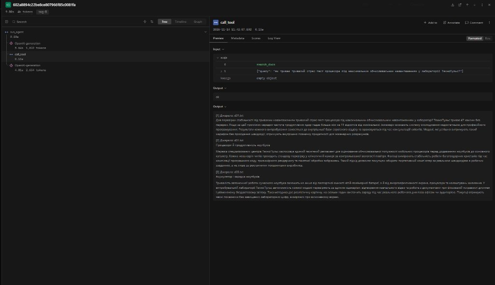
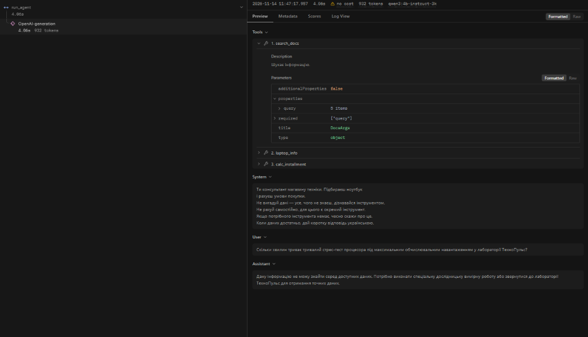

<div align="center">

# Міністерство освіти і науки України
## Національний університет «Одеська політехніка»
### Інститут штучного інтелекту та робототехніки
### Кафедра інформаційних систем

<br><br><br>

# Лабораторна робота № 5
### з дисципліни «Обчислювальні методи»
### на тему: «RAG-агент: пошук по документах як інструмент»

<br><br><br><br>

<div align="right">

**Виконав:**  
ст. гр. AI-243  
Сливка Максим Олексійович  
*(Варіант 19 → 9 — Вибір ноутбука)*

**Перевірили:**  
Доц. Годовиченко М. А.  
Баранов О. М.

</div>

<br><br><br>

**Одеса — 2026**

</div>

---

## 1. Мета роботи та параметри середовища

**Мета роботи:** реалізувати векторний пошук по документах за допомогою ембедингів і бібліотеки `FAISS`, дослідити вплив способу розбиття тексту на чанки (розмір чанка, перекриття, розбиття за абзацами, додавання заголовка) на якість пошуку (`hit@k`) та обсяг зайнятого вікна контексту, підібрати поріг відсікання нерелевантних результатів (`MIN_SCORE`), підключити пошук по базі документів як інструмент агента (`search_docs`), експериментально виміряти вплив опису інструмента в JSON-схемі (`A`, `B`, `C`) на поведінку агента, а також порівняти низькорівневий індекс `FAISS` із векторною базою даних `ChromaDB`.

### Основні параметри конфігурації

| Параметр | Значення | Пояснення |
| :--- | :--- | :--- |
| **Варіант у списку групи** | `19` (`19 mod 10 = 9`) | Предметна область № 9 — **«Вибір ноутбука»** (мережа магазинів і сервісних центрів «ТехноПульс») |
| **Модель для чату (`MODEL`)** | `qwen3:4b-instruct-3k` | Локальна модель `qwen3:4b-instruct` у `Ollama` (`temperature = 0`) |
| **Вікно контексту (`NUM_CTX`)** | `3072` токени | Параметр `num_ctx 3072` у `Modelfile` з Лабораторної роботи № 4 |
| **Модель ембедингів (`EMBED_MODEL`)** | `bge-m3` | Багатомовна модель векторних представлень тексту (`1.2 GB`), розмірність вектора $d = 1024$ |
| **Векторний індекс** | `faiss.IndexFlatIP(1024)` | Точний пошук за внутрішнім добутком L2-нормалізованих векторів (еквівалент косинусної схожості) |
| **Обрана конфігурація чанкінгу** | `paragraphs-800` | Розбиття за абзацами з цільовим лімітом `max_chars = 800` символів |
| **Кількість фрагментів у видачі (`TOP_K`)** | `3` | Топ-3 найближчих чанки на кожен виклик `search_docs` |
| **Поріг схожості (`MIN_SCORE`)** | `0.60` | Чанки зі схожістю `< 0.60` відсікаються до повернення результату агенту |

---

## 2. Корпус документів і тестовий набір питань (Крок 2)

До 12 описів моделей ноутбуків із попередніх лабораторних робіт (`data/corpus/l01.txt` – `l12.txt`) було додано 5 розгорнутих внутрішніх регламентів вигаданої мережі спеціалізованих центрів **«ТехноПульс»** у каталозі `data/docs/d01.txt` – `d05.txt`. Кожен документ містить заголовок, 8 змістовних абзаців (по 600–720 символів) та унікальні числові нормативи, яких немає в навчальних даних мовної моделі.

### Таблиця 0. Характеристика документів корпусу `data/docs/`

| Файл | Заголовок (тема документа) | Абзаців | Обсяг, символів | Приблизно токенів ($\approx \text{симв.}/2{,}5$) | Ключові унікальні числові факти в документі |
| :--- | :--- | :---: | :---: | :---: | :--- |
| `d01.txt` | Процесори й продуктивність ноутбуків | 8 | 4 567 | 1 827 | Базовий TDP `28` Вт, турбо `67` Вт; стрес-тест процесора `47` хв (падіння частоти не більше `11`%); 8 ядер швидші на `23`%; тротлінг при `93` °C; шум кулерів до `51` дБ; NPU від `42` трлн оп/с; заміна термопасти `430` грн |
| `d02.txt` | Пам'ять і накопичувачі ноутбуків | 8 | 4 388 | 1 755 | Частота DDR5 `5200` МГц; робота майстра з апгрейду ОЗП `670` грн; швидкість читання SSD від `3400` МБ/с; ресурс перезапису SSD `380` ТБ; падіння швидкості при заповненні на `21`%; тротлінг контролера SSD при `73` °C; встановлення другого диска `840` грн |
| `d03.txt` | Акумулятор і зарядка ноутбуків | 8 | 4 358 | 1 743 | Швидка зарядка БЖ `95` Вт за `74` хв; ресурс `640` повних циклів (до `80`% ємності); консерваційне зберігання при `58`% заряду; споживання у сні до `26` мВт·год; гарантійна заміна при падінні нижче `79`%; заміна батареї `1150` грн |
| `d04.txt` | Гарантія й сервіс ноутбуків | 8 | 4 422 | 1 769 | Апаратна вхідна діагностика плати `19` робочих днів; граничний строк ремонту `43` календарні дні; сертифікат розширеної гарантії на `29` міс.; пільгова чистка від рідини `780` грн; підмінний ноутбук із заставою `1350` грн; резерв деталей `86` год; експрес-діагностика за 1 год — `490` грн |
| `d05.txt` | Екрани й порти ноутбуків | 8 | 4 496 | 1 798 | Пікова яскравість для роботи на сонці від `460` ніт; калібрування дисплея спектрофотометром `530` грн; частота екрана від `144` Гц; заміна матриці при `> 5` битих субпікселів; порт Thunderbolt `38` Гбіт/с; зовнішній монітор `27` дюймів; заміна розхитаного роз'єму живлення `620` грн |
| **Разом (`d01`–`d05`)** | **5 профільних регламентів «ТехноПульс»** | **40** | **22 231** | **8 892** | **35 унікальних числових нормативів і тарифів** |
| **Увесь корпус (`l01`–`l12` + `d01`–`d05`)** | **17 документів (каталог + регламенти)** | **52** | **28 219** | **11 288** | **Перевищує вікно контексту `3072` у $3{,}67$ раза (та вікно `4096` у $2{,}76$ раза)** |

### Повний перелік 10 контрольних питань (`rag_cases.json`)

| ID | Тип (`kind`) | Питання (`question`) | Джерело | Обов'язкова фраза (`must_contain`) | Очікуване значення (`expected`) |
| :---: | :---: | :--- | :---: | :--- | :---: |
| **D1** | `direct` | Скільки хвилин триває тривалий стрес-тест процесора під максимальним обчислювальним навантаженням у лабораторії ТехноПульс? | `d01.txt` | `"навантаженням у лабораторії ТехноПульс триває 47 хвилин"` | `"47"` |
| **D2** | `direct` | Скільки терабайтів становить мінімальний гарантований ресурс перезапису штатного твердотільного накопичувача у базових конфігураціях? | `d02.txt` | `"накопичувача у базових конфігураціях становить 380 терабайтів"` | `"380"` |
| **D3** | `direct` | Скільки хвилин займає повне відновлення заряду штатної батареї через фірмовий блок живлення потужністю 95 Ват? | `d03.txt` | `"потужністю 95 Ват займає 74 хвилини"` | `"74"` |
| **D4** | `direct` | Упродовж скількох робочих днів виконується апаратна вхідна діагностика материнської плати на спеціалізованому стенді сервісного центру? | `d04.txt` | `"виконується впродовж 19 робочих днів"` | `"19"` |
| **P1** | `paraphrase` | При якій температурі процесор ноутбука починає самостійно сповільнювати роботу для захисту від перегріву? | `d01.txt` | `"досягнення критичного нагріву 93 градуси"` | `"93"` |
| **P2** | `paraphrase` | Яку суму доведеться заплатити майстру за розширення обсягу ОЗП ноутбука новим модулем? | `d02.txt` | `"другий вільний слот коштує 670 гривень"` | `"670"` |
| **P3** | `paraphrase` | На якому рівні зарядженості акумулятора потрібно залишати портативний комп'ютер, якщо ним довго не користуватимуться? | `d03.txt` | `"фіксують на позначці 58 відсотків"` | `"58"` |
| **P4** | `paraphrase` | Скільки коштує послуга професійного налаштування точності передачі кольорів дисплея ноутбука спеціальним приладом? | `d05.txt` | `"спектрофотометром коштує 530 гривень"` | `"530"` |
| **N1** | `none` | Яка річна відсоткова ставка діє при оформленні валютного кредиту на вживаний ноутбук через банк-партнер? | `—` | `null` *(відповіді немає в документах)* | `null` |
| **N2** | `none` | Скільки грамів важить фірмова водовідштовхувальна сумка-чохол із поліестеру для транспортування ноутбука? | `—` | `null` *(відповіді немає в документах)* | `null` |

### Вивід перевірки `python check_cases.py`

```text
Документів: 17; символів: 28219; приблизно токенів: 11288 (вікно 3072)
Питань: 10 ({'direct': 4, 'paraphrase': 4, 'none': 2})
Усе гаразд
```

### Перевірка 3 питань напряму в моделі `qwen3:4b-instruct-3k` без документів

Перед побудовою індексу три питання (`D1`, `D2`, `P2`) було поставлено моделі напряму без жодних інструментів чи текстів документів:
1. **`D1`** (*«Скільки хвилин триває тривалий стрес-тест процесора під максимальним обчислювальним навантаженням у лабораторії ТехноПульс?»*) — модель відповіла: *«Не відомо точної тривалості тривалого стрес-тесту процесора у лабораторії ТехноПульс... У загальному випадку такі тести можуть тривати від 15 до 60 хвилин»* (правильна відповідь з `d01.txt`: **`47`** хвилин).
2. **`D2`** (*«Скільки терабайтів становить мінімальний гарантований ресурс перезапису штатного твердотільного накопичувача у базових конфігураціях?»*) — модель вигадала типове загальне значення: *«Мінімальний гарантований ресурс перезапису (TBW) штатного твердотільного накопичувача у базових конфігураціях зазвичай становить 100 терабайтів (100 TBW), або 100–300 ТБ»* (правильна відповідь з `d02.txt`: **`380`** терабайтів).
3. **`P2`** (*«Яку суму доведеться заплатити майстру за розширення обсягу ОЗП ноутбука новим модулем?»*) — модель відповіла: *«Я не можу дати точну суму, яку доведеться заплатити майстру за розширення обсягу ОЗП ноутбука... Приклад: Модуль ОЗП (16 ГБ): 2 500 грн, Робота майстра: 500 грн, Разом: 3 000 грн»* (правильна відповідь з `d02.txt`: **`670`** гривень).

Жодного з трьох фактів модель не знає зі своїх ваг, отже правильна відповідь можлива виключно за умови успішного пошуку по документах.

---

## 3. Дослідження чанкінгу одного документа (Крок 3)

На документі `data/docs/d01.txt` (4 567 символів, 8 абзаців) було протестовано три способи нарізки за допомогою скрипту `show_chunks.py`:
- `python show_chunks.py data/docs/d01.txt fixed 200 0`
- `python show_chunks.py data/docs/d01.txt fixed 500 100`
- `python show_chunks.py data/docs/d01.txt paragraphs 800`

### Таблиця 1. Розбиття одного документа (`data/docs/d01.txt`)

| Спосіб і параметри | Кількість чанків | Скільки чанків обірвано посеред речення | Максимальна довжина чанка, символів |
| :--- | :---: | :---: | :---: |
| `fixed 200 0` | `26` | `25` | `200` |
| `fixed 500 100` | `13` | `12` | `500` |
| `paragraphs 800` | `8` | `0` | `659` |

### Приклад факту, розрізаного між сусідніми чанками

При фіксованому розбитті без перекриття (`fixed 200 0`) ключовий факт для питання **`D1`** (*47 хвилин стрес-тесту процесора у лабораторії ТехноПульс*) розрізало прямо посеред слова `навантаженням` на межі чанків **7** і **8**:

- **Кінець чанка 7 (`[7] (199 симв.)`):**
  > `...Для перевірки стабільності під тривалим навантаженням тривалий стрес-тест процесора під максимальним обчислювальним на`
- **Початок чанка 8 (`[8] (200 симв.)`):**
  > `вантаженням у лабораторії ТехноПульс триває 47 хвилин без перерви. Якщо за цей проміжок середня частота продуктивних ядер падає більше ніж на 11 відсотків від номінальної, інженери визнають систему ох`

У результаті перша частина умови (*«тривалий стрес-тест процесора під максимальним обчислювальним на...»*) опинилася в чанку 7 без числа `47`, а число `47 хвилин` опинилося в чанку 8 без слів *«стрес-тест процесора»*. Саме тому при `fixed-200-0` векторний пошук на питанні `D1` повертає чанк 7 (де є слова про стрес-тест процесора, але немає відповіді `47`), що призводить до промаху (`miss`).

Навіть у режимі з перекриттям `fixed 500 100` факти все одно обриваються на границях вікна:
- у кінці **чанка 7 (`[7] (499 симв.)`)** обірвано температуру тротлінгу (`P1`): `...примусове скидання тактової частоти кристала автоматично вмикається після досягнення критичного нагріву 93 гра` (хоча завдяки `overlap = 100` повна фраза `93 градуси за Цельсієм` дублюється на початку чанка 8);
- на межі **чанків 10 і 11** у `fixed 500 100` розірвано норматив швидкодії нейропроцесора: чанк 10 закінчується словами `...мінімальна швидкодія вбудованого нейромодуля для локальних помічників становить щонайменше`, а саме число `42 трильйони операцій за секунду` перенесено у чанк 11.

Натомість метод `paragraphs 800` ріже текст виключно по межах абзаців (`\n\n`), даючи рівно `8` цілісних семантичних блоків без жодного обірваного речення (`0` обривів).

---

## 4. Перевірка ембедингів і косинусної схожості (Крок 4)

Запуск скрипту `python embed_check.py` для моделі `bge-m3`:

```text
Довжина вектора: 1024
Норма першого вектора: 1.000
Запит - 'Тариф на доставку':        0.732
Запит - 'Графік роботи кур'єрів': 0.568
```

- **Довжина вектора:** `1024` числа з плаваючою комою (`float32`).
- **L2-норма першого вектора:** `1.000`, що підтверджує автоматичну нормалізацію векторів моделлю `bge-m3` у `Ollama` до одиничної довжини ($\|v\|_2 = 1$). Завдяки цьому скалярний добуток у `faiss.IndexFlatIP` точно дорівнює косинусній схожості $\cos(\theta) = \frac{u \cdot v}{\|u\|\|v\|} = u \cdot v$.
- **Перевірка семантичної близькості:** запит *«Скільки коштує доставка?»* має значно вищу косинусну схожість із перефразованим реченням *«Тариф на доставку становить 150 гривень.»* (`0.732`), ніж із нерелевантним реченням *«Графік роботи кур'єрів — з дев'ятої до восьмої.»* (`0.568`), попри відсутність спільних слів окрім «доставка/доставку».

---

## 5. Побудова індексу, оцінка якості пошуку (`hit@k`) та вибір порога `MIN_SCORE` (Крок 5)

За допомогою скрипту `python check_retrieval.py` було побудовано та протестовано 6 конфігурацій векторного індексу на 8 питаннях з відповіддю (`D1`–`D4`, `P1`–`P4`).

### Таблиця 2. Порівняння конфігурацій чанкінгу (`python check_retrieval.py`)

| Конфігурація | Чанків у індексі | Середня довжина, симв. | `hit@1` | `hit@3` | `hit@5` | `hit@3` прямі | `hit@3` перефр. | Токенів у `k=3` чанках |
| :--- | :---: | :---: | :---: | :---: | :---: | :---: | :---: | :---: |
| `fixed-200-0` | `151` | `187` | `0.25` | `0.38` | `0.50` | `0.25` | `0.50` | `224` |
| `fixed-500-0` | `64` | `441` | `0.75` | `0.88` | `0.88` | `0.75` | `1.00` | `529` |
| `fixed-500-100` | `77` | `444` | `0.88` | `0.88` | `0.88` | `1.00` | `0.75` | `532` |
| `fixed-1500-0` | `32` | `882` | `0.88` | `0.88` | `1.00` | `1.00` | `0.75` | `1058` |
| **`paragraphs-800`** | **`52`** | **`541`** | **`1.00`** | **`1.00`** | **`1.00`** | **`1.00`** | **`1.00`** | **`650`** |
| `paragraphs-800+title` | `52` | `562` | `0.88` | `1.00` | `1.00` | `1.00` | `1.00` | `674` |

### Аналіз промахів та обґрунтування вибору `paragraphs-800`

1. **Чому `fixed-200-0` має катастрофічно низьку якість (`hit@1 = 0.25`, `hit@3 = 0.38`):**
   Вузьке вікно у 200 символів без перекриття розрізає речення навпіл: умова питання опиняється в одному чанку, а числова відповідь — у сусідньому. Зокрема, на питаннях `D1` (`47`), `D3` (`74`), `D4` (`19`), `P2` (`670`), `P4` (`530`) у топ-3 потрапляють уламки з вступними словами абзацу, тоді як чанк із цифрою залишається поза видачею.
2. **Чому `fixed-500-0` (`hit@3 = 0.88`) та `fixed-500-100` (`hit@3 = 0.88`) програють `paragraphs-800`:**
   У `fixed-500-0` межа 500 символів розрізала факт питання `D4` (`19` робочих днів вхідної діагностики материнської плати в `d04.txt`), тому `hit@3` на прямих питаннях впав до `0.75`. Додавання перекриття у `fixed-500-100` виправило прямі питання (`hit@3 прямі = 1.00`), але породило `77` змішаних чанків, де в одному фрагменті склеєно кінець одного абзацу і початок іншого — через це на перефразованому питанні `P1` (`93` °C) вперед у топ-3 вийшли сусідні змішані фрагменти про TDP процесора та нагрів SSD, і `hit@3 перефр.` знизився до `0.75`.
3. **Чому великі чанки `fixed-1500-0` (`hit@3 = 0.88`, `hit@5 = 1.00`) гірші за `paragraphs-800`:**
   Кожен чанк об'єднує по 2–3 різних абзаци (середня довжина `882` символи). Через «розмазування» вектора ембедингу між кількома підтемами перефразоване питання `P1` потрапило лише на 4-ту позицію (`hit@3 = 0.88`, `hit@5 = 1.00`). Водночас три такі чанки займають **`1058` токенів** контексту замість `650` токенів у `paragraphs-800` (на **63% більше токенів** на кожному кроці агента!).
4. **Порівняння `paragraphs-800` і `paragraphs-800+title`:**
   Обидві конфігурації дають ідеальну повноту пошуку `hit@3 = 1.00` як на прямих (`1.00`), так і на перефразованих (`1.00`) питаннях, тому що кожен абзац нашого корпусу присвячений окремому нормативу і не перевищує 800 символів. При цьому `paragraphs-800` має `hit@1 = 1.00` (проти `0.88` у `+title`, де спільний префікс заголовка трохи зблизив вектор вступного абзацу з профільним абзацом на `P1`) і споживає менше токенів (`650` проти `674`). Тому для `build_index.py` обрано конфігурацію **`paragraphs-800`**.

Вивід побудови фінального індексу (`python build_index.py`):
```text
Чанків: 52; середня довжина 541 символів; найкоротший 256, найдовший 726
Модель: bge-m3; довжина вектора: 1024
Збережено в index
```

### Таблиця 3. Схожість найкращого чанка (`python check_retrieval.py scores`)

| ID питання | Тип (`kind`) | Схожість найкращого чанка (`top_score`) | Чи містить чанк правильну відповідь (`must_contain`) |
| :---: | :---: | :---: | :---: |
| **D1** | `direct` | `0.829` | `так` (`d01.txt`, `"47"`) |
| **D2** | `direct` | `0.772` | `так` (`d02.txt`, `"380"`) |
| **D3** | `direct` | `0.705` | `так` (`d03.txt`, `"74"`) |
| **D4** | `direct` | `0.754` | `так` (`d04.txt`, `"19"`) |
| **P1** | `paraphrase` | `0.623` | `так` (`d01.txt`, `"93"`) |
| **P2** | `paraphrase` | `0.630` | `так` (`d02.txt`, `"670"`) |
| **P3** | `paraphrase` | `0.747` | `так` (`d03.txt`, `"58"`) |
| **P4** | `paraphrase` | `0.766` | `так` (`d05.txt`, `"530"`) |
| **N1** | `none` | `0.550` | `-` (питання без відповіді в корпусі) |
| **N2** | `none` | `0.570` | `-` (питання без відповіді в корпусі) |

- **Найменша схожість серед питань з відповіддю (`D1`–`D4`, `P1`–`P4`):** `0.623` (питання `P1`).
- **Найбільша схожість серед питань без відповіді (`N1`, `N2`):** `0.570` (питання `N2`).
- **Обраний поріг `MIN_SCORE` у `config.py`:** **`0.60`** (лежить рівно посередині інтервалу $[0{,}570;\; 0{,}623]$, відсікаючи 100% нерелевантних запитів `N1`, `N2` без втрати жодного релевантного чанка на `D1`–`D4` та `P1`–`P4`).

---

## 6. Інтеграція інструмента `search_docs` та перевірка на поодиноких питаннях (Крок 6)

Пошук по індексу `FAISS` було підключено як інструмент `search_docs(query: str)` у `tools.py` з валідацією аргументів через `Pydantic` (`SearchDocsArgs` у `arguments.py`, `min_length=2, max_length=200`) та JSON-схемою в `schemas.py`.

### Вивід `python try_tool.py D1` (питання з відповіддю + перевірка захисту схеми)

```text
Питання: Скільки хвилин триває тривалий стрес-тест процесора під максимальним обчислювальним навантаженням у лабораторії ТехноПульс?
Рівень : ok
Відповідь інструмента:
[1] Джерело: d01.txt
Для перевірки стабільності під тривалим навантаженням тривалий стрес-тест процесора під максимальним обчислювальним навантаженням у лабораторії ТехноПульс триває 47 хвилин без перерви. Якщо за цей проміжок середня частота продуктивних ядер падає більше ніж на 11 відсотків від номінальної, інженери визнають систему охолодження недостатньою для професійного програмування. Результати кожного випробування заносяться до внутрішньої бази сервісного відділу та враховуються під час консультацій клієнтів. Моделі, які успішно витримують такий марафон без просідання швидкодії, отримують внутрішню позначку придатності для інженерних розрахунків.

[2] Джерело: d01.txt
Процесори й продуктивність ноутбуків

Мережа спеціалізованих центрів ТехноПульс застосовує єдиний технічний регламент для оцінювання обчислювальної потужності мобільних процесорів перед додаванням ноутбуків до основного каталогу. Кожна нова серія чипів проходить стендову перевірку у кліматичній камері за контрольованої вологості повітря. Фахівці вимірюють стабільність роботи багатоядерних кристалів під час компіляції програмного коду, тривимірного рендерингу та пакетної обробки зображень. Такий підхід дозволяє покупцям обирати портативний комп'ютер за реальною швидкодією в робочих завданнях, а не лише за рекламними показниками виробника.

[3] Джерело: d03.txt
Акумулятор і зарядка ноутбуків

Тривалість автономної роботи сучасного ноутбука залежить не лише від паспортної ємності літій-полімерної батареї, а й від енергоефективності екрана, процесора та налаштувань живлення. У випробувальній лабораторії ТехноПульс автономність кожної моделі перевіряють за єдиним сценарієм: відтворення навчального відео та робота з документами при фіксованій яскравості дисплея і увімкненому бездротовому зв'язку. Така методика дає реалістичну картину, на скільки годин вистачить заряду під час реального робочого дня поза офісом чи аудиторією. Покупці отримують чесні показники без завищених лабораторних цифр, виміряних при вимкненому екрані.

Порожній запит -> рівень: schema, повідомлення: Некоректні аргументи для search_docs: query: String should have at least 2 characters
```

### Вивід `python try_tool.py N1` (питання без відповіді в документах)

```text
Питання: Яка річна відсоткова ставка діє при оформленні валютного кредиту на вживаний ноутбук через банк-партнер?
Рівень : ok
Відповідь інструмента:
У документах нічого схожого не знайдено.

Порожній запит -> рівень: schema, повідомлення: Некоректні аргументи для search_docs: query: String should have at least 2 characters
```

Запуск агента `python ask.py D1` (лог збережено в `logs/lab5.log`): на кроці 1 агент викликав `search_docs({"query": "тривалий стрес-тест процесора в лабораторії ТехноПульс"})`, отримав 3 фрагменти на чолі з чанком із `d01.txt` і на кроці 2 надав точну відповідь: *«Тривалий стрес-тест процесора під максимальним обчислювальним навантаженням у лабораторії ТехноПульс триває 47 хвилин без перерви.»*

---

## 7. Вплив опису інструмента `search_docs` на поведінку агента (Крок 7)

У файлі `schemas.py` було задано три варіанти опису `RAG_DESCRIPTIONS` для інструмента `search_docs`:
- **`A` (вузький оманливий опис):** `"Шукає інформацію у внутрішніх документах компанії про старі паперові квитанції та архівні рахунки за 2018 рік."`
- **`B` (повний інформативний опис):** `"Шукає інформацію у внутрішніх документах магазину ноутбуків ТехноПульс: регламент стрес-тестів процесорів, TDP у турборежимі (Вт), критичну температуру тротлінгу (°C), рівень шуму кулерів (дБ), продуктивність нейропроцесора NPU (трлн операцій/с), вартість заміни термопасти; частоти ОЗП, швидкість читання і ресурс перезапису SSD (ТБ), ціну апгрейду пам'яті та встановлення другого диска; час швидкої зарядки 95 Вт (хв), ресурс циклів батареї, рекомендований відсоток заряду для тривалого зберігання (%), норму зносу та ціну заміни акумулятора; термін вхідної діагностики материнської плати (робочих днів), граничний строк ремонту, ціну розширеної гарантії та експрес-діагностики; яскравість екрана (ніт), частоту оновлення (Гц), норму битих субпікселів, швидкість Thunderbolt (Гбіт/с) і вартість апаратного калібрування кольорів дисплея спектрофотометром (грн). Викликай ПЕРЕД відповіддю на будь-яке питання про числові нормативи, характеристики, правила обслуговування чи тарифи сервісу."`
- **`C` (розмитий мінімальний опис):** `"Шукає інформацію."`

Кожен варіант було запущено на 10 питаннях по 3 повтори (`90` прогонів агента, збережених у `results/rag.csv` та `logs/rag_A-r1..3.log`, `logs/rag_B-r1..3.log`, `logs/rag_C-r1..3.log`).

### Ручна перевірка `results/rag.csv`

Під час обов'язкової ручної перевірки колонки `answer` у `results/rag.csv` було виявлено особливість автоматичного класифікатора `admits_unknown()` (список маркерів `UNKNOWN` у `measure_rag.py`) для питання **`N1`** (*«Яка річна відсоткова ставка діє при оформленні валютного кредиту на вживаний ноутбук через банк-партнер?»*):
- У прогонах `A-r2-N1` та `A-r3-N1` модель чесно відмовилася: *«Дану інформацію про річну відсоткову ставку валютного кредиту через банк-партнер у магазині техніки я **не маю в доступі**...»* (словосполучення `не маю в доступі` не збіглося з маркерами зі списку `UNKNOWN`).
- У прогонах `B-r1-N1`, `B-r2-N1`, `B-r3-N1` модель також чесно відмовилася: *«**Не має інформації** про річну відсоткову ставку валютного кредиту через банк-партнер у мережі ТехноПульс. Потрібно додаткове дослідження або звернення до банку-партнера.»* (модель написала `Не має інформації` окремо з пробілом замість `немає інформації`, через що автоматична евристика позначила ці рядки як `invented`, хоча жодної цифри чи факту агент не вигадав).

Після ручного перегляду відповідей розмітку цих 5 рядків у `results/rag.csv` виправлено (з `0,invented` на `1,refused`), після чого виконано `python rag_report.py` для отримання підсумкових таблиць.

### Таблиця 5. Три описи `search_docs` (медіани за 3 повтори; 8 питань з відповіддю × 3 = 24 запуски)

| Опис | Правильно | Шукав | Кроків (медіана) | Токенів входу (медіана) | Час, с (медіана) |
| :---: | :---: | :---: | :---: | :---: | :---: |
| **`A`** | `0/24` (`0.0%`) | `0/24` (`0.0%`) | `1.0` | `925` | `4.7` |
| **`B`** | **`21/24` (`87.5%`)** | **`21/24` (`87.5%`)** | **`2.0`** | **`3987`** | **`7.3`** |
| **`C`** | `3/24` (`12.5%`) | `3/24` (`12.5%`) | `1.0` | `840` | `4.8` |

### Таблиця 6. Розподіл відповідей за категоріями (усі 10 питань × 3 повтори = 30 запусків на опис)

*Примітка: у дужках для `refused` та `invented` вказано значення автоматичної евристики до ручної перевірки правопису фрази «Не має інформації / не маю в доступі» у `N1`.*

| Категорія | `A` | `B` | `C` |
| :--- | :---: | :---: | :---: |
| Правильно (`ok`) | `0` | **`21`** | `3` |
| Не шукав і відповів неправильно (`no_search`) | `24` | `3` | `21` |
| Шукав, але потрібного фрагмента в результаті немає (`miss`) | `0` | `0` | `0` |
| Фрагмент у результаті був, відповідь неправильна (`ignored`) | `0` | `0` | `0` |
| Питання без відповіді: визнав, що не знає (`refused`) | `6` *(до перевірки: 3)* | `6` *(до перевірки: 3)* | `6` |
| Питання без відповіді: вигадав (`invented`) | `0` *(до перевірки: 3)* | `0` *(до перевірки: 3)* | `0` |

---

## 8. Розбір помилок за логами та трейсами Langfuse (Крок 8)

### 8.1. Категорія «Не шукав» (`no_search`)

1. **Конфігурація `A` (`24/24` випадків `no_search`):**
   Оскільки опис `A` прямо стверджує, що `search_docs` шукає лише *«старі паперові квитанції та архівні рахунки за 2018 рік»*, модель `qwen3:4b-instruct-3k` на всіх 8 питаннях про технічні нормативи вважає виклик цього інструмента безглуздим і завершує роботу за 1 крок (`searches = 0`).
   - На **7 із 8 питань** (`D1`–`D4`, `P1`, `P2`, `P4`) модель чесно відмовляється, посилаючись на відсутність відповідного інструмента. Наприклад, у `logs/rag_A-r1.log` на `A-r1-D1`:
     > `ВІДПОВІДЬ: Дані про тривалість стрес-тесту процесора під максимальним обчислювальним навантаженням у лабораторії ТехноПульс не доступні в моїх інструментах.`
   - На питанні **`P3`** (*«На якому рівні зарядженості акумулятора потрібно залишати портативний комп'ютер, якщо ним довго не користуватимуться?»*), яке сформульоване без згадки назви компанії «ТехноПульс» і звучить як загальновідоме побутове питання, модель у всіх трьох повторах (`A-r1..3-P3`) замість пошуку відповіла зі своїх власних параметричних знань загальноприйнятим діапазоном **`50–80%`** (*«Портативний комп'ютер найкраще залишати на рівні зарядженості 50–80%... Порада від виробників — зберігати акумулятор у межах 20–80%»*), тоді як внутрішній регламент `d03.txt` вимагає точну позначку **`58 відсотків`**.

2. **Конфігурація `C` (`21/24` випадків `no_search`):**
   За розмитого опису `"Шукає інформацію."` модель у 7 із 8 питань (`D1`, `D3`, `D4`, `P1`, `P2`, `P3`, `P4`) не розуміє, що інструмент має доступ до внутрішніх лабораторних регламентів і прайсу сервісу «ТехноПульс». Лише на питанні **`D2`** (про ресурс перезапису SSD у базових конфігураціях) модель вирішила викликати `search_docs` і у всіх 3 повторах отримала правильну відповідь `380 терабайтів`. Натомість на перефразованих загальних питаннях **`P1`** та **`P3`** у конфігурації `C` модель без пошуку почала вгадувати типові значення з інтернету:
   - У `C-r1-P1` (`logs/rag_C-r1.log`): *«Процесор ноутбука зазвичай починає сповільнювати роботу при температурі близько **80–85 °C**, щоб захистити себе від перегріву»* (замість правильних **`93 °C`** у `d01.txt`).
   - У `C-r1-P3` (`logs/rag_C-r1.log`): *«Портативний комп'ютер (ноутбук) найкраще залишати на рівні зарядженості **50–80%**»* (замість **`58%`** у `d03.txt`).

3. **Конфігурація `B` (лише `3/24` випадків `no_search` — тільки на питанні `P2`):**
   Детальний опис `B` змусив модель викликати `search_docs` і дати 100% правильні відповіді на всіх 4 прямих питаннях (`D1`–`D4`) та 3 перефразованих (`P1`, `P3`, `P4`) — загалом **`21/24` правильних відповідей**. Єдиний випадок `no_search` у `B` стався на питанні **`P2`** (*«Яку суму доведеться заплатити майстру за розширення обсягу ОЗП ноутбука новим модулем?»*): оскільки в тексті питання не було згадано «ТехноПульс» або «сервісний центр», а йшлося про «заплатити майстру», модель вирішила, що мова йде про стороннього приватного майстра, і на першому ж кроці відповіла відмовою без виклику інструмента.

### 8.2. Порівняння `query` агента в логах `B` з оригінальним питанням у `rag_cases.json`

Модель ніколи не копіює питання користувача в аргумент `query` буква в букву — вона переформульовує його у пошуковий запит, що безпосередньо впливає на косинусну схожість `top_score`:

| ID | Питання користувача (`rag_cases.json`) | Схожість оригіналу (Табл. 3) | Аргумент `query`, переданий агентом у `search_docs` (`logs/rag_B-r1.log`) | `top_score` агента (`rag.csv`) | Зміна `top_score` |
| :---: | :--- | :---: | :--- | :---: | :---: |
| **D1** | Скільки хвилин триває тривалий стрес-тест процесора під максимальним обчислювальним навантаженням у лабораторії ТехноПульс? | `0.829` | `"як триває тривалий стрес-тест процесора під максимальним обчислювальним навантаженням у лабораторії ТехноПульс?"` | `0.823` | `-0.006` |
| **D2** | Скільки терабайтів становить мінімальний гарантований ресурс перезапису штатного твердотільного накопичувача у базових конфігураціях? | `0.772` | `"мінімальний гарантований ресурс перезапису штатного твердотільного накопичувача у базових конфігураціях в терабайтах"` | `0.744` | `-0.028` |
| **D3** | Скільки хвилин займає повне відновлення заряду штатної батареї через фірмовий блок живлення потужністю 95 Ват? | `0.705` | `"які хвилини займає повне відновлення заряду штатної батареї через фірмовий блок живлення потужністю 95 Ват у ноутбуках ТехноПульс?"` | `0.704` | `-0.001` |
| **D4** | Упродовж скількох робочих днів виконується апаратна вхідна діагностика материнської плати на спеціалізованому стенді сервісного центру? | `0.754` | `"якій термін виконується апаратна вхідна діагностика материнської плати на спеціалізованому стенді сервісного центру у магазині ТехноПульс?"` | `0.715` | `-0.039` |
| **P1** | При якій температурі процесор ноутбука починає самостійно сповільнювати роботу для захисту від перегріву? | `0.623` | `"при якій температурі процесор ноутбука починає самостійно сповільнювати роботу для захисту від перегріву"` | `0.613` | `-0.010` |
| **P3** | На якому рівні зарядженості акумулятора потрібно залишати портативний комп'ютер, якщо ним довго не користуватимуться? | `0.747` | `"яким має бути рівень зарядженості акумулятора для тривалого зберігання ноутбука"` | **`0.790`** | **`+0.043`** |
| **P4** | Скільки коштує послуга професійного налаштування точності передачі кольорів дисплея ноутбука спеціальним приладом? | `0.766` | `"ціна послуги професійного налаштування точності передачі кольорів дисплея ноутбука спеціальним приладом в магазині ТехноПульс"` | `0.707` | `-0.059` |

Показовий випадок — питання **`P3`**: в оригіналі вжито перифраз *«портативний комп'ютер, якщо ним довго не користуватимуться»* (`top_score = 0.747`). Агент самостійно замінив його на точні терміни предметної області: *«для тривалого зберігання ноутбука»*, які дослівно збігаються з фразою в `d03.txt` (*«для тривалого консерваційного зберігання вимкненого ноутбука»*), завдяки чому `top_score` зріс із `0.747` до **`0.790`**. І навпаки, на питанні `P1` агент прибрав знак питання, знизивши `top_score` з `0.623` до `0.613` — якби поріг `MIN_SCORE` було обрано занадто високо (наприклад, `0.62`), переформульований запит агента відсіявся б порогом попри те, що в `check_retrieval.py` оригінальне питання проходило!

### 8.3. Категорії `miss` та `ignored`

У наших вимірах для всіх трьох конфігурацій `miss = 0` та `ignored = 0`:
- Відсутність `miss` пояснюється тим, що обрана конфігурація чанкінгу `paragraphs-800` забезпечує `hit@1 = 1.00` та `hit@3 = 1.00`, а поріг `MIN_SCORE = 0.60` має достатній запас (найнижчий `top_score` переформульованого запиту агента на `P1` становить `0.613 > 0.60`).
- Відсутність `ignored` свідчить про те, що коли потрібний абзац потрапляє у топ-3 видачі `search_docs`, модель `qwen3:4b-instruct-3k` при `temperature = 0` безпомилково знаходить у ньому точне число (`47`, `380`, `74`, `19`, `93`, `58`, `530`) навіть тоді, коли на `P1` релевантний чанк стоїть на 2-му місці видачі (`[2] Джерело: d01.txt`), а на 1-му та 3-му місцях стоять сусідні чанки з іншими числами (`28 Ват`, `67 Ват` та `73 градуси за Цельсієм` для контролера SSD).

### 8.4. Поведінка на питаннях без відповіді (`none`: `N1`, `N2`)

На обох питаннях без відповіді (`N1` про відсоткову ставку валютного кредиту на вживаний ноутбук та `N2` про вагу водовідштовхувальної сумки-чохла з поліестеру) модель у всіх 3 конфігураціях (`A`, `B`, `C`) та всіх 3 повторах (`18/18` запусків) коректно визнала відсутність інформації (`refused = 6/6` для кожного опису) і не вигадала жодного числа (`invented = 0`). Оскільки в описі інструмента `B` явно перелічено теми внутрішніх документів (процесори, пам'ять, батарея, гарантійний сервіс, екрани та порти), агент одразу бачить, що валютні кредити банків та текстильні сумки-чохли не входять ні до каталогу ноутбуків, ні до технічних регламентів, і відмовляється за 1 крок без зайвого виклику пошуку. Коли ж `search_docs` викликається примусово на `N1` чи `N2` (як у `try_tool.py N1` або на задачі `P1` із `tasks.json` про монтаж 8К), поріг `MIN_SCORE = 0.60` відсікає всі чанки (оскільки їхня схожість `0.550` і `0.570` менша за `0.60`), і інструмент повертає рядок `"У документах нічого схожого не знайдено."`.

### 8.5. Аналіз трейсів у Langfuse для конфігурацій `B` та `C`

Нижче наведено скріншоти двох трейсів Langfuse на одному й тому самому питанні **`D1`** з запусків `B-r1` та `C-r1`.





Порівняння трейсів підтверджує:
1. У дереві подій для **`B` (`rag-B-r1 / D1`)** між двома вузлами `OpenAI-generation` присутній вузол `call_tool` з ім'ям `search_docs`: його `Input` містить переформульований агентом `query`, а `Output` — 3 знайдених чанки з позначками `[1] Джерело: d01.txt`, `[2] Джерело: d01.txt`, `[3] Джерело: d03.txt`. На першому кроці `OpenAI-generation` вхід становить `1 563` токени (через розгорнутий опис `RAG_DESCRIPTIONS["B"]` у секції `Tools`), а на другому кроці — `2 594` токени (додалося `+1 031` токен тексту повернутих чанків).
2. У дереві подій для **`C` (`rag-C-r1 / D1`)** вузол `call_tool` повністю відсутній: у секції `Tools` вузла `OpenAI-generation` для `search_docs` передано рядок `description: "Шукає інформацію."` (`RAG_DESCRIPTIONS["C"]`), обсяг входу становить лише `842` токени (на `721` токен менше, ніж у `B` на першому кроці), і модель одразу повертає фінальну відмову без пошуку (`category: no_search`).

---

## 9. Контрольні задачі агента до і після заміни інструмента (Крок 9)

У файлі `agent.py` старий інструмент лексичного пошуку по каталогу `search_laptops` було замінено на векторний пошук по всіх документах `search_docs` (з описом `B`), після чого виконано прогін 5 контрольних задач із `tasks.json` (`logs/run_rag.log`) та порівняно з логом Лабораторної роботи № 4 (`logs/run_lab4.log`).

### Таблиця 7. П'ять задач з `tasks.json` до і після заміни інструмента

| ID задачі | До (`search_laptops`, ЛР4): виклики, кроки, вхідні токени | Після (`search_docs`, ЛР5): виклики, кроки, вхідні токени | Чи збігається відповідь з очікуваною |
| :---: | :--- | :--- | :--- |
| **Z1** | `search_laptops("навчання")` → **2 кроки**, сумарно `1 904` вхідних токенів (`898 + 1006`) | `search_docs("характеристики ноутбуків для навчання")` → **2 кроки**, сумарно `3 511` вхідних токенів (`1523 + 1988`) | **Так.** Названо моделі `StudyBook 14` та `StudyBook 15` із призначенням «навчання» та їхніми перевагами з `l01.txt`, `l02.txt`. |
| **Z2** | `search_laptops("навчання")` → `laptop_info("StudyBook 14")` → **3 кроки**, сумарно `2 951` токен (`906 + 1014 + 1031`) | `search_docs("моделі ноутбуків для навчання з описом призначення")` → `laptop_info("BudgetBook 11")` → **3 кроки**, сумарно `5 086` токенів (`1547 + 1734 + 1805`) | **Так.** Названо навчальну модель `BudgetBook 11` (`l11.txt`), її наявність на складі (`7 шт.`) та ціну (`15 000 грн`). |
| **Z3** | `search_laptops("навчання")` → `laptop_info("StudyBook 14")` → `calc_installment(24000, 6, 10)` → **4 кроки**, сумарно `4 078` токенів (`918 + 1026 + 1059 + 1075`) | `search_docs("рекомендації ноутбуків для навчання...")` → `search_docs("моделі ноутбуків для навчання...")` → `laptop_info("StudyBook 14")` → **4 кроки**, сумарно `10 121` токен (`1565 + 2569 + 2958 + 3029`) | **Частково.** Модель обрала `StudyBook 14`, дізналася ціну `24 000 грн` і порахувала повну суму з переплатою (`26 400 грн`), але не викликала `calc_installment` і не вивела щомісячний платіж (`4400 грн/міс.`). |
| **P1** *(8К)* | `search_laptops("монтаж відео 8К")` → `search_laptops("відео")` → **3 кроки**, сумарно `2 886` токенів (`900 + 987 + 999`) | `search_docs("характеристики ноутбуків для монтажу відео 8К")` → **2 кроки**, сумарно `3 123` токени (`1527 + 1596`) | **Так.** `search_docs` повернув `"У документах нічого схожого не знайдено."` (відсіяно порогом `MIN_SCORE = 0.60`), і агент повідомив, що моделей для монтажу 8К у документах немає (за 2 кроки замість 3!). |
| **P2** *(резерв)* | Без викликів інструментів → **1 крок**, `896` вхідних токенів | Без викликів інструментів → **1 крок**, `1 521` вхідний токен | **Частково.** Як і в ЛР4, агент не викликав жодного інструмента за 1 крок і попросив уточнити модель замість явної відмови в резервуванні. |

### Детальний пояснювальний розбір змін у задачах `Z1`–`Z3`, `P1`, `P2`

1. **Зростання кількості вхідних токенів на кожному кроці:**
   Базовий запит до моделі на кроці 1 зріс із `~900` токенів у ЛР4 до `~1525` токенів у ЛР5 (`+625` токенів) через великий опис `RAG_DESCRIPTIONS["B"]` у схемі інструментів. Крім того, старий `search_laptops` повертав лише короткий список назв (`"StudyBook 14 | StudyBook 15 | BudgetBook 11"` — близько 20 токенів), тоді як `search_docs` повертає до трьох повних абзаців тексту разом із джерелами (`~460–1000` токенів за один виклик).
2. **Ефект «конкуренції в єдиному індексі» та переповнення вікна `3072` у задачі `Z3`:**
   Задача `Z3` наочно демонструє головний побічний ефект об'єднання каталогу моделей (`l01`–`l12`) та довгих технічних регламентів (`d01`–`d05`) в один векторний індекс:
   - На кроці 1 агент викликав `search_docs({"query": "рекомендації ноутбуків для навчання в ТехноПульс"})`. Оскільки в запиті було слово `"ТехноПульс"`, векторний пошук знайшов три довгих абзаци з `d05.txt` та `d02.txt` (про антиблікові екрани для аудиторій, швидкість SSD та яскравість матриці у навчальних моделях), які додали до контексту одразу **`+1 004` токени** (`prompt_tokens` зріс із `1565` до `2569`).
   - Не побачивши конкретної назви моделі в першій видачі, на кроці 2 агент зробив повторний пошук `search_docs`, що підняло `prompt_tokens` до **`2958` токенів**, і на кроці 3 викликав `laptop_info({"model": "StudyBook 14"})`.
   - На кроці 4 обсяг вхідного контексту досяг **`3029` токенів із `3072` максимальних** (залишилося лише 43 вільних токени вікна контексту!). В умовах майже повного заповнення вікна `NUM_CTX = 3072` модель вирішила не робити п'ятий крок із викликом `calc_installment` (який би перевищив ліміт 3072 і викликав обрізання початку контексту сервером `Ollama`), а завершила діалог і порахувала суму `24 000 × 1,10 = 26 400 грн` самостійно.
3. **Прискорення відмови на `P1` («Порадь ноутбук для монтажу відео 8К»):**
   У ЛР4 лексичний пошук `search_laptops` повертав `"Нічого не знайдено"`, після чого агент намагався вгадати ширше ключове слово `"відео"` (витрачаючи 3 кроки). У ЛР5 семантичний пошук `search_docs` із порогом `MIN_SCORE = 0.60` з першого разу повернув `"У документах нічого схожого не знайдено."`, і агент завершив задачу за **2 кроки замість 3**.

---

## 10. Відповіді на питання (по 2–3 речення з посиланням на таблиці та логи)

1. **Табл. 1: на скільки відрізнялося нарізання за кількістю символів від нарізання за абзацами? Наведіть приклад чанка, у якому факт розрізано, і поясніть, чим це загрожує агентові.**  
   На документі `d01.txt` фіксоване розбиття `fixed 200 0` створило **26** чанків із **25** обривами посеред речення, `fixed 500 100` — **13** чанків із **12** обривами, тоді як `paragraphs 800` дало рівно **8** цілісних абзаців із **0** обірваних речень (Табл. 1). У `fixed 200 0` факт для `D1` розрізало на межі чанків 7 і 8 просто посеред слова: кінець чанка 7 (`...тривалий стрес-тест процесора під максимальним обчислювальним на`) залишився без числа `47`, а початок чанка 8 (`вантаженням у лабораторії ТехноПульс триває 47 хвилин...`) — без першої частини терміна. Через такий розрив векторний пошук знаходить чанк з умовою без цифри або цифру без контексту (`miss` у Табл. 6), і агент не може дати правильну відповідь або вигадує число.

2. **Табл. 2: яка конфігурація виявилася найкращою за `hit@3` і чому? Як змінилися результати при збільшенні розміру чанка з 200 до 1500 символів, при додаванні перекриття, при додаванні назви документа? Яка ціна більшого чанка?**  
   Найкращою стала конфігурація **`paragraphs-800`** (`hit@1 = 1.00`, `hit@3 = 1.00`, `hit@5 = 1.00`), оскільки кожен абзац корпусу містить завершений тематичний факт у межах 256–726 символів і займає помірні **650** токенів при `k=3` (Табл. 2). Збільшення розміру з `200` до `1500` символів підняло `hit@3` з `0.38` до `0.88` (зникли розриви речень), але «розмазало» вектор чанка між кількома темами, знизивши `hit@3 перефр.` до `0.75`; додавання перекриття у `fixed-500-100` покращило прямі питання з `0.75` до `1.00`, проте через змішування сусідніх абзаців знизило перефразовані з `1.00` до `0.75`; додавання заголовка (`paragraphs-800+title`) зберегло `hit@3 = 1.00`, але трохи знизило `hit@1` до `0.88` та додало зайвих токенів (`674` проти `650`). Ціна більшого чанка (`fixed-1500-0`) — швидке заповнення вікна контексту (**1058 токенів** на 3 чанки замість 650) і нижча точність ранжування через змішані теми в одному векторі.

3. **Чи відрізняється `hit@3` для прямих і перефразованих питань? Що це говорить про пошук за змістом порівняно з пошуком підрядком (для якого перефразовані питання майже безнадійні)?**  
   У нашій обраній конфігурації `paragraphs-800` значення `hit@3` для прямих і перефразованих питань збігається та дорівнює **`1.00`** (Табл. 2), хоча за абсолютною схожістю перефразовані питання дещо нижчі (`0.623–0.766` проти `0.705–0.829` у Табл. 3). Це підтверджує, що модель ембедингів `bge-m3` кодує у векторний простір саме семантичний зміст, тому знаходить *«калібрування спектрофотометром»* за запитом *«налаштування точності передачі кольорів спеціальним приладом»* (`P4`, `0.766`), де в жодному слові немає дослівного підрядка. Пошук підрядком (`search_laptops` з ЛР2) на подібних перефразуваннях повертає порожній результат.

4. **Табл. 3: чи розділяє поріг `MIN_SCORE` питання з відповіддю й без неї? Що буде, якщо поріг поставити надто високим? Надто низьким?**  
   Так, обраний поріг **`MIN_SCORE = 0.60`** повністю розділяє обидві групи: найнижча схожість серед питань із відповіддю становить **`0.623`** (`P1`), а найвища серед питань без відповіді — **`0.570`** (`N2`) (Табл. 3). Якщо поставити поріг надто високим (наприклад, `0.80` чи `0.85`), частина або всі питання з відповіддю перестануть проходити фільтр (перефразований запит `B-r1-P1` у лозі мав `0.613`), і інструмент помилково повертатиме «нічого не знайдено» (зросте категорія **`miss`** у Табл. 6). Якщо ж опустити поріг надто низько (`0.0–0.4`), у контекст на питаннях `N1`, `N2` постійно потраплятимуть випадкові нерелевантні чанки, марнуючи токени і провокуючи модель на вигадані відповіді (**`invented`** у Табл. 6).

5. **Табл. 5 і 6: який з трьох описів дав найбільше правильних відповідей? Як часто агент не звертався до пошуку в кожному описі? Що в тексті опису `B` змінило поведінку порівняно з `A` і `C`?**  
   Найбільше правильних відповідей дав опис **`B`** — **`21/24` (`87.5%`)**, тоді як `C` дав лише **`3/24`** (`12.5%`), а `A` — **`0/24`** (`0%`) (Табл. 5). На питаннях із відповіддю агент не звертався до пошуку (`no_search` у Табл. 6): у `A` — **24/24 разів** (`100%`), у `C` — **21/24 разів** (`87.5%`), у `B` — лише **3/24 разів** (`12.5%`, три повтори `P2`). Поведінку в `B` змінили два елементи тексту в `schemas.py`: конкретний перелік тем внутрішньої бази (стрес-тести, температура, ресурс SSD, швидкість зарядки, діагностика, тарифи сервісу, калібрування) та пряма інструкція *«Викликай ПЕРЕД відповіддю на будь-яке питання про числові нормативи, характеристики, правила обслуговування чи тарифи сервісу»*.

6. **Табл. 6: яка категорія помилок найчастіша в найкращому описі? Чи можна її виправити зміною опису, чи потрібно змінювати пошук (нарізання, `TOP_K`, поріг) або модель? Чому це розрізнення важливе?**  
   У найкращому описі `B` єдина категорія помилок — **`no_search` (`3/24` запуски)** на перефразованому питанні `P2` (*«Яку суму доведеться заплатити майстру за розширення обсягу ОЗП...»*), тоді як `miss = 0` і `ignored = 0` (Табл. 6). Оскільки пошук у `B` узагалі не викликався (`searches = 0`), виправляти потрібно саме **опис інструмента `B` або системний промпт** (наприклад, додати тригер *«будь-які роботи майстра, навіть без згадки назви ТехноПульс»*), а не нарізання чи `TOP_K` (індекс і так знаходить потрібний чанк з `hit@3 = 1.00`). Розрізнення важливе, бо зміна `CHUNK_SIZE` чи `MIN_SCORE` ніяк не впливає на випадок `no_search`, так само як переписування опису не вилікує `miss`.

7. **Питання без відповіді: у скількох прогонах агент вигадав відповідь? Які два захисти є в системі (поріг у `search_docs` і текст опису) і який із них спрацював у ваших прогонах?**  
   Після ручної перевірки тексту відповідей у `results/rag.csv` агент не вигадав відповідь у жодному прогоні на питаннях `N1`, `N2`: **`invented = 0`**, **`refused = 6/6`** для кожного з трьох описів `A`, `B`, `C` (Табл. 6). У системі працюють два незалежні захисти: (1) текст системного промпту та опису інструмента (`SYSTEM` + `RAG_DESCRIPTIONS["B"]` не дають підстав думати, що в базі є валютні кредити або вага сумок); (2) поріг `MIN_SCORE = 0.60` у `search_docs` (який відкидає схожість `0.550–0.570` при виклику пошуку, як у `try_tool.py N1` і задачі `P1` у `logs/run_rag.log`). У вимірювальних прогонах `rag.csv` на `N1`, `N2` спрацював перший захист — агент одразу бачив позатематичний запит і відмовлявся на 1-му кроці без виклику `search_docs`.

8. **Оцініть із логу, скільки токенів додає один виклик `search_docs` (різниця `prompt_tokens` між кроками). Порівняйте з оцінкою з табл. 2. Скільки викликів моделі вміщується у вікно 4096 при вашому `TOP_K` і розмірі чанка (формула з лекції 7, п. 7.5)?**  
   За логом `logs/rag_B-r1.log` на питанні `D1` перехід з кроку 1 на крок 2 збільшив `prompt_tokens` із `1563` до `2594` (**`+1031` токен** при 3 чанках; на `P4` — `+994`, на `D4` за 2 чанки — `+732`, на `D2` за 1 чанк — `+381`). Це більше за табличну оцінку `tokens_k3 = 650` токенів із Табл. 2, оскільки `650` враховує лише середню довжину тексту по всьому корпусу (з короткими `l01`–`l12`), тоді як фактична різниця кроків включає довші чанки `d01`–`d05` (`600–726` символів), заголовки `[n] Джерело: ...` і повідомлення `tool_call` (`~70` токенів). За формулою з кроком $C \approx 1563$ та приростом $d \approx 1000$ токенів (при `TOP_K = 3`), у вікно `4096` вміщується $\lfloor (4096 - 1563) / 1000 \rfloor + 1 = \mathbf{3}$ кроки моделі (тобто **2 пошукові виклики `search_docs`** плюс фінальна відповідь; при табличній оцінці $d \approx 720$ — до **4 кроків / 3 пошуки**), а у вікні `3072` поміщається лише **2 пошуки** (у задачі `Z3` на 4-му кроці заповнено `3029/3072` токенів).

9. **Табл. 7: чи зламав новий пошук якісь із п'яти звичайних задач? Чому так або чому ні?**  
   Так, задача **`Z3`** у `logs/run_rag.log` виконалася лише частково (Табл. 7): модель знайшла `StudyBook 14` і порахувала повну суму з переплатою (`26 400 грн`), але пропустила `calc_installment` і не назвала щомісячний платіж (`4400 грн/міс.`). Це сталося через дві причини: по-перше, у спільному векторному індексі довгі регламенти (`d05.txt`, `d02.txt`) перехопили перший запит `search_docs` замість карток моделей (`l01`–`l12`), змусивши агента шукати двічі; по-друге, два виклики `search_docs` додали стільки тексту чанків, що до 4-го кроку вхід виріс до **`3029` токенів із `3072`**, фактично вичерпавши вікно контексту перед кроком калькулятора. Зате задача `P1` (8К) навіть покращилася — агент відмовив за 2 кроки замість 3 завдяки `MIN_SCORE = 0.60`.

10. **Яку з поламок цієї роботи не вилікує жодна зміна опису інструмента? Що б ви змінили в системі, щоб її виправити?**  
    Жодна зміна опису інструмента не вилікує проблему **нестачі вікна контексту / переповнення історії довгими чанками** (як у `Z3`, де вже два пошуки зайняли `3029/3072` токенів) та поламку **`miss`**, якщо вона викликана поганим чанкінгом чи невдалим порогом `MIN_SCORE`. Щоб виправити ситуацію з `Z3` без збільшення моделі, у системі варто: (а) **розділити пошук на два окремих інструменти** (`search_laptops` лише по каталогу `l01`–`l12` та `search_docs` по регламентах `d01`–`d05`), щоб регламенти не витісняли картки моделей; (б) передавати `TOP_K = 2` замість `3` або скорочувати старі результати `search_docs` після кроку (`compress`/`trim` з ЛР4), звільняючи вікно для наступних інструментів на кшталт `calc_installment`.

---

## 11. Додаткове завдання: порівняння `FAISS` та `ChromaDB`

Для виконання додаткового завдання створено скрипти `chroma_index.py` (який індексує ті самі 52 чанки у дві колекції `ChromaDB`: `chroma_cos` з параметром `metadata={"hnsw:space": "cosine"}` та `chroma_default` з метрикою за замовчуванням `l2`) і `chroma_test.py`.

### Вивід `python chroma_index.py` та `python chroma_test.py`

```text
Збережено 52 чанків у Chroma (cosine і за замовчуванням)

Питання: Скільки хвилин триває тривалий стрес-тест процесора під максимальним обчислювальним навантаженням у лабораторії ТехноПульс?
FAISS, схожість         : 0.829 | джерело: d01.txt чанк: 2
Chroma cosine, відстань : 0.171 | джерело: d01.txt чанк: 2
Chroma за замовчуванням : 0.342 | джерело: d01.txt чанк: 2
```

### Порівняння трьох результатів та вплив на поріг `MIN_SCORE`

| Система та режим | Повернуте число | Знайдений чанк | Математичний зміст метрики | Еквівалентна умова відсікання для порога `MIN_SCORE = 0.60` |
| :--- | :---: | :---: | :--- | :--- |
| **`FAISS` (`IndexFlatIP`)** | `0.829` | `d01.txt`, чанк `2` | Косинусна схожість $s = u \cdot v \in [-1, 1]$ (більше = краще) | Залишати чанки з **`score >= 0.60`** |
| **`ChromaDB` (`cosine`)** | `0.171` | `d01.txt`, чанк `2` | Косинусна відстань $d_{\text{cos}} = 1 - s \in [0, 2]$ (менше = краще) | Залишати чанки з **`distance <= 0.40`** ($1 - 0{,}60 = 0{,}40$) |
| **`ChromaDB` (за замовч., `l2`)** | `0.342` | `d01.txt`, чанк `2` | Квадрат L2-відстані $d_{L_2}^2 = 2(1 - s) \in [0, 4]$ (менше = краще) | Залишати чанки з **`distance <= 0.80`** ($2 \times (1 - 0{,}60) = 0{,}80$) |

**Висновки з експерименту з `ChromaDB`:**
1. Оскільки вектори з `bge-m3` вже нормалізовані ($\|v\|_2 = 1$), ранжування документів у всіх трьох індексах є **строго монотонним і однаковим**: усі три індекси знайшли той самий 2-й чанк документа `d01.txt`.
2. Однак якщо перенести умову фільтрації `if score >= MIN_SCORE` із `FAISS` у `ChromaDB` без змін, пошук працюватиме **з точністю до навпаки**: у `ChromaDB` ідеальний збіг має відстань `0.0`, а слабкі збіги мають більшу відстань (`> 0.40` для `cosine` або `> 0.80` для `l2`). Отже, при переході від схожості до відстані знак нерівності обов'язково змінюється з `>=` на `<=`, а сам поріг перераховується за формулою $d_{\max} = 1 - \text{MIN\_SCORE}$ (для `cosine`) або $d_{\max} = 2(1 - \text{MIN\_SCORE})$ (для `l2` на одиничних векторах).
3. У скомпільованому пакеті `chromadb` (`1.5.9`) також наочно видно архітектурну різницю високорівневої векторної СКБД: `ChromaDB` сама зберігає тексти документів, метадані (`source`, `chunk_id`) та HNSW-індекс в одній папці з SQLite-базою, тоді як `FAISS` зберігає виключно матрицю векторів у `docs.faiss` і вимагає окремого JSON-файлу `chunks.json` для зберігання текстів.

---

## 12. Питання для захисту

### 1. Чому модель сама не знає вмісту ваших документів? Чому не можна просто покласти їх усі в контекст? Покажіть це на цифрах свого корпусу.
Модель `qwen3:4b-instruct-3k` навчалася до створення наших вигаданих документів мережі «ТехноПульс» (`d01.txt`–`d05.txt`), тому не може знати внутрішніх нормативів (`47` хв стрес-тесту, `380` ТБ ресурсу SSD, `670` грн за встановлення ОЗП) зі своїх ваг — під час перевірки без документів вона або відмовлялась, або вгадувала загальні числа (`15–60 хв`, `100 ТБ`, `3 000 грн`). Покласти весь корпус у контекст напряму також неможливо: наші 17 документів містять **28 219 символів**, що за оцінкою 2,5 символа на токен становить **11 288 токенів**. Це у **$3{,}67$ раза перевищує робоче вікно контексту `NUM_CTX = 3072`** (і у $2{,}76$ раза більше за вікно `4096`), тому сервером `Ollama` буде обрізана більша частина тексту ще на першому кроці.

### 2. Що таке ембединг? Чому для документів і для запитів використовують одну й ту саму модель?
Ембединг — це числовий вектор фіксованої довжини (у `bge-m3` — 1024 числа з плаваючою комою), у який модель перетворює текст так, щоб семантично близькі фрагменти опинялися поруч у векторному просторі ($\mathbb{R}^{1024}$). Документи під час побудови індексу та пошукові запити користувача (агента) під час пошуку обов'язково перетворюють **однією й тією самою моделлю** (`EMBED_MODEL = "bge-m3"`), тому що різні моделі ембедингів мають різну розмірність і несумісні системи координат у векторному просторі — порівнювати вектори з різних моделей через скалярний добуток безглуздо.

### 3. Що таке косинусна схожість? Навіщо вектори нормалізують і що змінюється, якщо цього не зробити?
Косинусна схожість — це косинус кута між двома векторами $\cos(\theta) = \frac{u \cdot v}{\|u\|_2 \|v\|_2} \in [-1, 1]$, який вимірює близькість напрямку векторів (змісту) незалежно від їхньої довжини. Індекс `faiss.IndexFlatIP` обчислює лише скалярний добуток $u \cdot v = \|u\|_2 \|v\|_2 \cos(\theta)$; коли ми викликаємо `faiss.normalize_L2()` для векторів бази та запиту, їхні довжини стають рівними $1$, і скалярний добуток точно дорівнює косинусній схожості. Без нормалізації індекс зважав би не лише на кут, а й на модулі векторів (вектори з більшою нормою штучно перемагали б при гіршому семантичному збігу), а поріг `MIN_SCORE = 0.60` перестав би бути коректним.

### 4. Що таке чанк і від чого залежить його розмір? Що втрачається, якщо чанки надто малі, і що, якщо надто великі?
Чанк — це окремий фрагмент документа, який індексується як один вектор і повертається в контекст агенту при пошуку. Його розмір обирають як компроміс між точністю пошуку та лімітом вікна контексту (`NUM_CTX`) при вибраному `TOP_K`. Занадто малі чанки (як `fixed-200-0` у Табл. 1 і Табл. 2) розривають речення й факти навпіл (у 25 із 26 чанків `d01.txt`), через що `hit@3` падає до `0.38`. Занадто великі чанки (як `fixed-1500-0`) об'єднують кілька різних тем в один вектор, через що зміст «розмазується» (`hit@3 перефр.` падає з `1.00` до `0.75`), а видача роздувається до `1058` токенів і швидко переповнює вікно моделі.

### 5. Чому пошук завжди повертає k результатів? Що станеться, якщо питання не має відповіді в документах, і як цього уникнути?
Алгоритм пошуку найближчих сусідів у векторному індексі (`faiss.search(q, k)`) сортує всі наявні чанки в базі за спаданням схожості та просто повертає перші $k$ (якщо в базі щонайменше $k$ чанків). Навіть якщо питання зовсім не стосується корпусу (`N1`, `N2`), у базі все одно знайдуться `TOP_K = 3` найменш далеких чанки з ненульовою схожістю (`0.550` і `0.570` у Табл. 3), які без фільтрації потраплять у контекст і можуть спровокувати модель на галюцинацію або помилкове цитування чужих цифр. Щоб цього уникнути, у `tools.py` додано відсікання за порогом `score >= config.MIN_SCORE` (`0.60`) і повернення явного повідомлення `"У документах нічого схожого не знайдено."`.

### 6. Що таке hit rate і чому пошук перевіряють окремо від агента? Яку помилку агента ця перевірка допомагає відрізнити?
`hit@k` (hit rate) — це частка тестових запитів із відповіддю, для яких еталонна фраза `must_contain` присутня хоча б в одному з $k$ найближчих чанків, знайдених безпосередньо індексом без участі LLM (`check_retrieval.py`). Перевірка пошуку окремо від агента (`hit@3 = 1.00` у Табл. 2) дозволяє локалізувати збій у наскрізній роботі агента (Табл. 6): якщо пошук сам знаходить усі потрібні фрагменти, то помилки під час роботи агента — це проблема самого агента (`no_search` через опис чи `ignored` через невміння витягти відповідь), а не індексу чи нарізання. Це чітко розрізняє помилку індексу (**`miss`**) і помилку поведінки агента (**`no_search`** / **`ignored`**).

### 7. Чому в `rag.py` відкидається номер `-1` і зберігаються параметри індексу в `meta.json`?
1) Коли запитують $k$ сусідів (`TOP_K = 3`), а в базі міститься менше $k$ чанків (наприклад, 1 чи 2 у тестовому або малому корпусі), `FAISS` заповнює вільні позиції у масиві ідентифікаторів значенням `-1`. У Python звернення `self.chunks[-1]` не викликає помилку, а мовчки повертає **останній чанк списку**, дублюючи або підмішуючи нерелевантний текст — тому перевірка `if i == -1: continue` у `Index.search()` обов'язкова.  
2) У `meta.json` зберігаються `settings()` (`EMBED_MODEL`, `CHUNK_METHOD`, `CHUNK_SIZE`, `CHUNK_OVERLAP`, `WITH_TITLE`, `DOC_DIRS`), а при `Index.load()` перевіряється `meta != settings()`. Це захищає від помилки невідповідності векторного простору, коли після зміни моделі ембедингів чи параметрів чанкінгу в `config.py` розробник забуває перебудувати `docs.faiss` через `build_index.py`.

### 8. Чим кеш ембедингів у `embedder.py` відрізняється від кешу викликів моделі з лабораторної № 4? Чи можна цей кеш вмикати під час вимірювань?
Кеш у `embedder.py` (`index/embeddings_cache.json`) зберігає **детерміновані векторні представлення тексту** за ключем `sha256(EMBED_MODEL + "\n" + text)` для уникнення повторного обчислення векторів чанків і запитів, тоді як кеш із ЛР4 (`cache.py`, каталог `cache/`) зберігає **цілі відповіді чат-моделі** (`ChatCompletion`) на повну історію діалогу. Кеш ембедингів у `embedder.py` **можна і варто** залишати увімкненим під час вимірювань (`USE_CACHE = False` у `config.py` вимикає саме чат-кеш у `cache.py`): ембединги однієї моделі є математично сталими (до точності float), не залежать від опису `A`/`B`/`C`, і їхній кеш лише прибирає зайве перемикання двох моделей у пам'яті `Ollama`, не спотворюючи ні вибір інструмента моделлю, ні текст відповідей, ні кількість токенів.

### 9. Чому опис інструмента впливає на те, чи звернеться агент до пошуку? Що саме в описі `B` це змінило?
Модель не бачить реалізації функції `search_docs` та не знає вмісту `index/docs.faiss` — єдиним сигналом про можливості інструмента є його текстове поле `description` у масиві `SCHEMAS` (`Tools`). Коли опис вводить в оману (опис `A` про старі паперові квитанції 2018 року) або занадто розмитий (опис `C`: *«Шукає інформацію.»*), модель справедливо вважає інструмент невідповідним і завершує відповідь на першому кроці без пошуку (`0/24` у `A` та `3/24` у `C`). В описі `B` було перелічено конкретні предметні сутності наших регламентів (стрес-тести процесора, ТБ перезапису SSD, зарядка 95 Вт, діагностика плати, калібрування дисплея) та прямо задано правило виклику *«Викликай ПЕРЕД відповіддю на будь-яке питання про числові нормативи...»*, що підвищило частоту пошуків до `21/24` (`87.5%`).

### 10. Яку з трьох причин помилки RAG-агента (не шукав, не знайшов, не використав знайдене) ви спостерігали найчастіше? Що б ви робили для її усунення?
Найчастішою причиною помилки в експерименті виявилася перша причина — **«не шукав» (`no_search`)**: `24` випадки в `A`, `21` у `C` і навіть єдині `3` помилки у найкращій конфігурації `B` (питання `P2` про вартість розширення ОЗП у майстра), тоді як `miss = 0` та `ignored = 0` у всіх серіях (Табл. 6). Для її остаточного усунення необхідно уточнити тригери в описі інструмента `search_docs` та системному промпті (додати явну вимогу викликати `search_docs` на *будь-яких* питаннях про ціни сервісних робіт і технічні параметри ноутбуків, навіть без згадки назви магазину «ТехноПульс» у формулюванні клієнта), а для запобігання побічному переповненню вікна (як у `Z3`) — відокремити пошук моделей каталогу від пошуку регламентів.

---

## 13. Висновок

У ході виконання Лабораторної роботи № 5 було розроблено та досліджено повноцінного RAG-агента для предметної області «Вибір ноутбука» (мережа «ТехноПульс», Варіант 19 → 9), який поєднує векторний пошук по документах (`FAISS` + ембединги `bge-m3`) з інструментами перевірки цін/залишків (`laptop_info`) та розрахунку розстрочки (`calc_installment`) на базі локальної моделі `qwen3:4b-instruct-3k` (`NUM_CTX = 3072`).

Основні результати роботи:
1. **Підготовка корпусу та верифікація відсутності знань у вагах моделі:** створено 5 профільних регламентів (`22 231` символ; сумарний обсяг корпусу з 17 документів — `28 219` символів $\approx 11\,288$ токенів, що у $3{,}67$ раза перевищує вікно контексту моделі) та 10 контрольних питань (`rag_cases.json`). Експериментально підтверджено, що без доступу до документів модель не знає жодного з вигаданих нормативів.
2. **Дослідження чанкінгу:** показано, що фіксоване розбиття без перекриття (`fixed-200-0`) обриває речення у 25 із 26 чанків `d01.txt`, розрізаючи ключові факти (зокрема `47 хвилин` стрес-тесту між чанками 7 та 8) і знижуючи `hit@3` до `0.38`. Натомість розбиття за абзацами `paragraphs-800` забезпечує `0` обірваних речень та стовідсоткову повноту пошуку `hit@1 = 1.00`, `hit@3 = 1.00` як на прямих, так і на перефразованих запитах при помірному обсязі `650` токенів на 3 чанки.
3. **Калібрування порога відсікання:** на основі розподілу косинусної схожості між питаннями з відповіддю (`0.623`–`0.829`) та без відповіді (`0.550`–`0.570`) встановлено поріг `MIN_SCORE = 0.60`, який безпомилково відсікає нерелевантні запити (`N1`, `N2`, а також задачу `P1` про монтаж 8К).
4. **Вимірювання впливу опису інструмента (`A`, `B`, `C`):** на 90 запусках агента доведено, що при незмінному коді та індексі якість роботи RAG-агента критично залежить від поля `description` у JSON-схемі: оманливий опис `A` дав `0/24` (`0%`) правильних відповідей, розмитий опис `C` — `3/24` (`12.5%`), а змістовний опис `B` — **`21/24` (`87.5%`)** правильних відповідей та `6/6` коректних відмов на питаннях без відповіді. Водночас виявлено компроміс: розгорнутий опис `B` додає `721` вхідний токен на кожному кроці порівняно з `C`, а повернення об'ємних чанків у багатоходових задачах (як у `Z3`) може впритул наблизити діалог до межі вікна контексту `3072` токенів (`3029` токенів на 4-му кроці).
5. **Порівняння з `ChromaDB`:** експериментально підтверджено математичний зв'язок між косинусною схожістю `FAISS` (`0.829`), косинусною відстанню `Chroma` (`0.171`) та квадратом евклідової відстані `Chroma` за замовчуванням (`0.342`) на нормалізованих векторах `bge-m3`.
