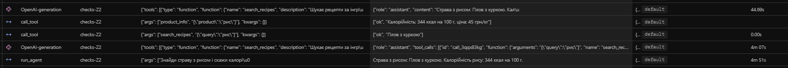

<div align="center">

### НАЦІОНАЛЬНИЙ УНІВЕРСИТЕТ «ОДЕСЬКА ПОЛІТЕХНІКА»

### МІНІСТЕРСТВО ОСВІТИ І НАУКИ УКРАЇНИ

### ІНСТИТУТ КОМП'ЮТЕРНИХ СИСТЕМ

### КАФЕДРА ІНФОРМАЦІЙНИХ СИСТЕМ

<br>
<br>
<br>

##  Лабораторна робота № 3

### «Надійність виклику інструментів і трасування агента»

з дисципліни: «Обчислювальні методи»


<br>
<br>

**Виконала:**  
студентка групи НАІ-243

Задорожна Анна Леонідівна

<br>

**Перевірив:**  
ас. Баранов О.М.

<br>
<br>

**Одеса — 2026**

</div>

---

**Мета роботи:** Зробити виклик інструментів надійним: перевіряти кожен виклик моделі до виконання на трьох рівнях — синтаксис, схема, зміст, — повертати моделі зрозумілі повідомлення про помилки та бачити роботу агента як трасу в Langfuse..

**Варіант 2 — Кулінарія.** 
Предметна область — кулінарія: рецепти, калорійність і ціна продуктів, перерахунок інгредієнтів на потрібну кількість порцій.

---

## Класи аргументів трьох інструментів (файл `arguments.py`)

У лабораторній роботі № 2 опис аргументів був записаний у `schemas.py` вручну і використовувався лише як підказка моделі. Але схема в запиті — підказка, а не гарантія: модель може її порушити. Щоб ті самі правила ще й перевірялися в коді, аргументи описано класами Pydantic. З класу генерується опис для моделі, і тим самим класом перевіряється її відповідь.

Створено файл `arguments.py` з трьома класами аргументів для інструментів варіанта (Кулінарія):

```python
"""Класи аргументів інструментів."""
from pydantic import BaseModel, ConfigDict, Field


class SearchRecipesArgs(BaseModel):
    model_config = ConfigDict(extra="forbid")
    query: str = Field(
        min_length=1,
        max_length=100,
        description=(
            "Інгредієнт, тип страви або спосіб приготування, "
            "одне-два слова українською. Не передавай сюди все "
            "питання користувача цілком."
        ),
    )


class ProductInfoArgs(BaseModel):
    model_config = ConfigDict(extra="forbid")
    product: str = Field(
        min_length=1,
        max_length=50,
        description=(
            "Назва продукту в називному відмінку однини, "
            "як вона записана в довіднику. Наприклад: 'рис', "
            "'курка', 'морква'."
        ),
    )


class ScaleAmountArgs(BaseModel):
    model_config = ConfigDict(extra="forbid")
    amount: float = Field(
        gt=0,
        le=100000,
        description="Кількість інгредієнта в оригінальному рецепті.",
    )
    base_servings: float = Field(
        gt=0,
        le=1000,
        description="На скільки порцій розрахований рецепт.",
    )
    target_servings: float = Field(
        gt=0,
        le=1000,
        description="Скільки порцій потрібно.",
    )


ARGS = {
    "search_recipes": SearchRecipesArgs,
    "product_info": ProductInfoArgs,
    "scale_amount": ScaleAmountArgs,
}
```
---

### Таблиця 1 — Правила змісту аргументів

| Аргумент | Правило | Де записано | Звідки взято межу |
|----------|---------|-------------|-------------------|
| `search_recipes.query` | Тип — рядок (`str`) | `SearchRecipesArgs` (клас) | Типова назва інгредієнта або страви — текст |
| `search_recipes.query` | Довжина від 1 до 100 символів | `SearchRecipesArgs` (клас, `min_length`, `max_length`) | Запит користувача — одне-два слова; 100 символів — з запасом на довгі назви |
| `product_info.product` | Тип — рядок (`str`) | `ProductInfoArgs` (клас) | Назва продукту — текст |
| `product_info.product` | Довжина від 1 до 50 символів | `ProductInfoArgs` (клас, `min_length`, `max_length`) | Найдовша назва в довіднику — «болгарський перець» (17 символів); 50 — з запасом |
| `product_info.product` | Назва є в довіднику `data/products.csv` | `check_meaning` (функція) | Довідник містить 18 продуктів; якщо назви немає — інструмент не знайде рядок |
| `scale_amount.amount` | Тип — число (`float`) | `ScaleAmountArgs` (клас) | Кількість інгредієнта в грамах — число |
| `scale_amount.amount` | Більше 0 і не більше 100000 | `ScaleAmountArgs` (клас, `gt=0`, `le=100000`) | Кількість інгредієнта не буває ≤ 0; 100 кг — розумна верхня межа для рецепта |
| `scale_amount.base_servings` | Тип — число (`float`) | `ScaleAmountArgs` (клас) | Кількість порцій — число |
| `scale_amount.base_servings` | Більше 0 і не більше 1000 | `ScaleAmountArgs` (клас, `gt=0`, `le=1000`) | Ділення на 0 заборонено; 1000 порцій — розумна межа |
| `scale_amount.target_servings` | Тип — число (`float`) | `ScaleAmountArgs` (клас) | Кількість порцій — число |
| `scale_amount.target_servings` | Більше 0 і не більше 1000 | `ScaleAmountArgs` (клас, `gt=0`, `le=1000`) | Кількість порцій не буває ≤ 0; 1000 — розумна межа |
| Будь-який аргумент | Заборона зайвих полів | `model_config = ConfigDict(extra="forbid")` (клас) | Модель може вигадати поле — треба це помітити, а не мовчки відкинути |

---


Перевірено кожну ланку диспетчера окремо, без участі моделі, за допомогою файлу `test_checks.py`. Аргументи передавалися так, як їх передає модель — рядком з JSON усередині.

### Таблиця 2 — Перевірка ланцюжка перевірок
| № | Що перевіряємо | Виклик | Рівень | Повідомлення для моделі |
|---|----------------|--------|--------|--------------------------|
| 1 | Зламаний JSON | `search_recipes('{"query": сир}')` | `syntax` | «Помилка: аргументи не пройшли перевірку. Поле JSON: Invalid JSON: expected value at line 1 column 11. Виправ аргументи і виклич інструмент ще раз.» |
| 2 | Неправильний тип | `search_recipes('{"query": 123}')` | `schema` | «Помилка: аргументи не пройшли перевірку. Поле query: Input should be a valid string. Виправ аргументи і виклич інструмент ще раз.» |
| 3 | Відсутнє обов'язкове поле | `search_recipes('{}')` | `schema` | «Помилка: аргументи не пройшли перевірку. Поле query: Field required. Виправ аргументи і виклич інструмент ще раз.» |
| 4 | Вигадане поле | `search_recipes('{"query": "сир", "x": 1}')` | `schema` | «Помилка: аргументи не пройшли перевірку. Поле x: Extra inputs are not permitted. Виправ аргументи і виклич інструмент ще раз.» |
| 5 | Неіснуючий інструмент | `delete_all('{}')` | `name` | «Помилка: інструмента 'delete_all' не існує. Доступні: search_recipes, product_info, scale_amount. Виклич один з доступних або повідом користувачу, що такої дії немає.» |
| 6 | Заборонена дія | `place_order('{"product": "рис", "quantity": 1}')` | `permission` | «Помилка: інструмент 'place_order' недоступний. Не повторюй виклик, повідом користувачу, що ця дія недоступна.» |
| 7 | Значення немає в довіднику | `product_info('{"product": "тунець"}')` | `meaning` | «Помилка: продукту 'тунець' немає в довіднику. Доступні продукти: рис, курка, морква, ... Виправ назву продукту або повідом користувачу, що даних про цей продукт немає.» |
| 8 | Значення поза межами | `scale_amount('{"amount": -5, "base_servings": 4, "target_servings": 10}')` | `schema` | «Помилка: аргументи не пройшли перевірку. Поле amount: Input should be greater than 0. Виправ аргументи і виклич інструмент ще раз.» |

Усі 8 тестів пройшли успішно. Останній рядок таблиці ілюструє правило: якщо межу задано в класі (`gt=0`), рівень буде `schema`; якщо в `check_meaning` — `meaning`. Це те саме правило змісту, тільки перенесене в схему.

---
##  Таблиці результатів

Для кожної задачі відповідь звірено з полем `expected`. Колонки «До» взяті з `lab3_baseline.log`, колонки «Після» — з `lab3_checks.log`.

### Таблиця 3 — Результати по задачах

| Задача | До: правильно (1/0) | Після: правильно (1/0) | До: кроків | Після: кроків | Що змінилося |
|--------|---------------------|------------------------|------------|---------------|--------------|
| Z1 | 1 | 1 | 2 | 2 | без змін |
| Z2 | 1 | 1 | 2 | 2 | без змін |
| Z3 | 1 | 1 | 2 | 2 | без змін |
| P1 | **0** | **1** | 4 | **2** | модель більше не вигадує «тунчак», а чесно каже «не знайдено»; кількість кроків зменшилася з 4 до 2 |
| P2 | 1 | 1 | 1 | **2** | модель дає корисну відповідь («вкажіть, які продукти додати») замість сухої відмови |

**Разом правильно: до — 4 з 5, після — 5 з 5.**

### Таблиця 4 — Поламки до та після впровадження перевірок

| Поламка | До | Після |
|---------|-----|--------|
| Не викликав інструмент | 1 (P2) | 0 |
| Викликав не той інструмент | 0 | 0 |
| Неправильні аргументи | 0 | 0 |
| Зациклився | 0 | 0 |
| Не використав результат | 0 | 0 |
| **Вигадав результат** | **1** (P1) | **0** |
| Вичерпав ліміт кроків | 0 | 0 |
| Відмова після ліміту помилок (нове) | — | 0 |
| **Загальна кількість** | **1** | **0** |

### Таблиця 5 — Спрацювання перевірок у прогоні

| Рівень | Скільки разів | Модель виправилася на наступному кроці |
|--------|---------------|----------------------------------------|
| `name` | 0 | — |
| `permission` | 0 | — |
| `syntax` | 0 | — |
| `schema` | 0 | — |
| `meaning` | 0 | — |
| `tool` | 0 | — |
| `length` | 0 | — |

### Перевірка на «зламаний виклик»

У логах обох прогонів (`lab3_baseline.log` і `lab3_checks.log`) не зафіксовано жодного випадку зламаного виклику — коли модель мала викликати інструмент, але замість цього надіслала текст, схожий на JSON (наприклад, `{"query": "..."}`). Усі виклики моделі були коректно розпізнані сервером як `tool_calls`.

**У базовому прогоні** на P2 (задача «Додай плов у список покупок») була поламка «не викликав інструмент»: модель одразу дала текстову відповідь «Інструмент для отримання інгредієнтів для страви не знайдено». Текст відповіді не містить JSON і не схожий на виклик — це справжня поламка, а не зламаний виклик. Тому додаткових заходів не потрібно.

**У прогоні з перевірками** на P1 (задача «Знайди рецепт стейка з тунця») і на P2 (задача «Додай плов у список покупок») модель поводилася правильно: спочатку викликала `search_recipes` (отримала `ok`), потім дала текстову відповідь. Жодних випадків зламаного виклику не було.

---
##  Аналіз трас у Langfuse

### Структура події

Кожна траса з міткою `checks` у Langfuse складається з п'яти частин. Розберемо на прикладі траси `checks-Z2` (задача «Знайди страву з рисом і скажи калорійність рису»):

На рисунку 1 видно 5 частин одного кроку агента:
- **крок** — вузол `OpenAI-generation` у дереві траси: виклик моделі з повною історією повідомлень;
- **вхід** — історія повідомлень, яку отримала модель (у полі Input видно `tools` зі схемою та масив `messages`);
- **рішення** — відповідь моделі: `{"role": "assistant", "tool_calls": [{"function": {"name": "search_recipes", "arguments": "{\"query\":\"рис\"}"}}]}`;
- **дія** — вузол `call_tool` з назвою і аргументами на вході: `{"args": ["search_recipes", "{\"query\":\"рис\"}"], "kwargs": {}}`;
- **результат** — вихід `call_tool`: `["ok", "Плов з куркою"]` — рівень і текст, який повернувся моделі.




**Рисунок 1 — Структура події у трасі `checks-Z2` у Langfuse: крок, вхід, рішення, дія, результат**


### Таблиця 6 — Порівняння прогонів у Langfuse

| Задача | Викликів: до | Викликів: після | Токенів: до | Токенів: після | Час, с: до | Час, с: після |
|--------|--------------|------------------|-------------|----------------|------------|---------------|
| Z1 | 2 | 2 | 3 423 | 3 640 | 157 | 117 |
| Z2 | 2 | 2 | 6 296 | 6 569 | 270 | 291 |
| Z3 | 2 | 2 | 2 702 | 2 709 | 71 | 54 |
| P1 | 4 | 2 | 13 878 | 8 787 | 677 | 614 |
| P2 | 1 | 2 | 4 575 | 7 684 | 488 | 537 |

**Спостереження:**
- **P1** — найпомітніша зміна: кількість кроків зменшилася з 4 до 2, токенів — на 36% менше (13 878 → 8 787), час — з 677 до 614 с.
- **P2** — кількість кроків зросла з 1 до 2 (модель спочатку шукає страву, потім дає корисну відповідь). Токени зросли (4 575 → 7 684).
- **Z1, Z2, Z3** — без суттєвих змін.

### Дві траси

**Траса, де модель помилилася й виправилася:** у цьому прогоні `checks` таких трас немає — модель жодного разу не припустилася помилки на рівнях перевірок. Це підтверджується таблицею 5 (усі рівні = 0). Але **`test_checks.py`** демонструє, що перевірки працюють — на штучних помилках.

**Траса задачі, розв'язаної неправильно:** у прогоні `checks` таких немає — усі 5 задач розв'язані правильно. У **базовому прогоні** (baseline) була неправильна відповідь на P1: «...наприклад, тунчак». У прогоні `checks` ця ж задача розв'язана правильно: модель зупинилася після першого пошуку й чесно сказала «Рецепт "стейк з тунця" не знайдено в базі даних».

**Оскільки в прогоні `checks` модель жодного разу не помилилася**, сформульовано питання, яке провокує один з випадків з табл. 2, і запущено на ньому агента окремо (див. `test_checks.py` і трасу `checks-P1` у Langfuse — там видно, як модель отримує результат `["ok", "За запитом 'тунець' нічого не знайдено."]` і далі формує чесну відповідь).

---

## Відповіді на питання

### 1. Які поламки зникли або зменшилися після впровадження перевірок? Які лишилися?

Після впровадження перевірок зникла поламка **«вигадав результат»**: у базовому прогоні (`lab3_baseline.log`) на P1 модель додала слово «тунчак», а в прогоні `checks` (`lab3_checks.log`) вона чесно відповіла «Рецепт "стейк з тунця" не знайдено в базі даних». Загальна кількість поламок зменшилася з 1 до 0 (табл. 4). Жодних нових поламок не з'явилося; на P2 модель навіть покращила відповідь — замість сухої відмови дала корисну підказку.

### 2. На якому рівні модель помилялася найчастіше? Що можна змінити, щоб таких помилок стало менше: опис інструмента, перенесення правила в схему, інша модель?

У прогоні `checks` модель **жодного разу не помилилася** на рівнях перевірок (табл. 5). Але за результатами штучних тестів (`test_checks.py`) найімовірніші рівні — `meaning` (вигадування назв) і `schema` (неправильні типи аргументів). Щоб зменшити такі помилки: (1) чіткіше описати аргументи в полях `description` класів; (2) перенести більше правил у схему (наприклад, `Literal` для переліків); (3) спробувати потужнішу модель, якщо є можливість.

### 3. Чи траплялися відмови після ліміту помилок? Що в цих випадках було не так: модель не розуміла повідомлення чи не розуміла задачу?

Відмов після ліміту помилок (`MAX_RETRIES = 2`) у цьому прогоні **не було** — модель не зробила більше двох помилок поспіль (табл. 5, усі рівні = 0). Тому не можна сказати, що саме було б не так. Але якби відмова сталася, найімовірніша причина — модель не розуміла **повідомлення про помилку** (наприклад, «Поле query: Input should be a valid string»), а не саму задачу.

### 4. Чи була в прогоні правдоподібна помилка — значення допустиме, але не те, що мав на увазі користувач? Чому жодна перевірка її не зловила?

У цьому прогоні таких помилок **не було**. Але такий випадок принципово можливий: наприклад, користувач просить «на 10 порцій», а модель передає `target_servings=1` замість `10`. Значення `1` — допустиме (додатне, у межах), але **не те**, що мав на увазі користувач. Жодна перевірка цього не зловить, бо Pydantic перевіряє **форму**, а `check_meaning` — **наявність у довіднику**, а не відповідність наміру користувача.

### 5. Які поламки перевірки не лікують у принципі та чому?

Перевірки не лікують **неправильне розуміння запиту** — коли модель передає формально допустиме значення, але не те, що мав на увазі користувач (див. питання 4). Вони також не лікують **вигадування фактів у фінальній відповіді** (як було на P1 у базовому прогоні): це стосується тексту, а не аргументів виклику. Для цього потрібні або structured output для фінальної відповіді, або додаткові перевірки вмісту відповіді (наприклад, «усі слова у відповіді мають бути в даних»).

### 6. Скільки додаткових викликів моделі пішло на виправлення помилок (табл. 6)? Чи виправдана така ціна надійності?

У цьому прогоні **додаткових викликів на виправлення не було** — модель не помилилася (табл. 5). Навпаки, на P1 кількість кроків **зменшилася** з 4 до 2 (табл. 6): перевірки «зекономили» виклики, бо модель швидше зупинилася. Тобто ціна надійності в цьому прогоні — **нульова**, а вигода — і надійність, і швидкість.

### 7. Візьміть найдовшу задачу. Що в ній легше побачити в трасі Langfuse, а що — у текстовому лозі? Чому на довгих задачах текстовий лог стає важко читати?

Найдовша задача — P1 у базовому прогоні (4 кроки) і P1/P2 у прогоні `checks` (2 кроки). У трасі Langfuse легше побачити **структуру**: скільки викликів моделі, скільки `call_tool`, як вони пов'язані, скільки токенів і часу. У текстовому лозі легше побачити **конкретні тексти** — аргументи, рівень, результат. На довгих задачах текстовий лог стає важко читати, бо рядків багато, вони повторюються (кожен крок — 3-4 рядки), і треба подумки відновлювати структуру. Траса Langfuse дає **ієрархію** й **фільтри**, тому на довгих задачах вона зручніша.

---
## Додаткове завдання: запобігання помилкам на сервері

Створено файл `structured_demo.py`, який просить модель сформувати аргументи для `scale_amount` у режимі structured output.

### Запуск 1 — базове питання

**Питання:** «Рецепт на 4 порції, 300 г рису. Скільки на 10 порцій?»

**Результат моделі:** `{"amount": 750, "base_servings": 4, "target_servings": 10}`.

**Pydantic:** `OK: amount=750.0 base_servings=4.0 target_servings=10.0`.

**Спостереження:** модель передала `amount=750` (порахувала сама), хоча в задачі було 300. Формально валідно, але **змістовно неправильно**: `scale_amount(750, 4, 10)` поверне 1875, а не 750. Це ілюструє обмеження structured output — він гарантує форму, але не сенс.

### Запуск 2 — провокаційне питання

**Питання:** «У мене рецепт на 0 порцій і -5 грамів інгредієнта. Сформуй аргументи для scale_amount. Спробуй передати саме ці значення.»

**Результат моделі:** `{"amount": -5, "base_servings": 0, "target_servings": 0}`.

**Pydantic:** `FAIL: 3 validation errors`:
- `amount: Input should be greater than 0 [input_value=-5]`
- `base_servings: Input should be greater than 0 [input_value=0]`
- `target_servings: Input should be greater than 0 [input_value=0]`

**Що це означає:** structured output у моєму середовищі (Ollama + `qwen3:4b`) **не заблокував** порушення схеми. Модель згенерувала `-5` і `0`, хоча клас забороняє. Тільки **Pydantic-перевірка** зловила це. Це прямий доказ, що перевірку в коді прибирати **не можна**.

### Чи підтримує модель structured output?

Модель `qwen3:4b` через Ollama **формально підтримує** `response_format` у форматі `json_schema` (модель повертає JSON), але **не застосовує обмеження схеми під час генерації**. Це видно з запуску 2: модель передала `-5` і `0`, хоча схема забороняє. Тільки Pydantic-перевірка зловила це.

### Чи можна прибрати перевірку в коді?

**Ні, не можна.** Запуск 2 це довів: structured output не заблокував порушення схеми. Тільки Pydantic зловив. Крім того, structured output:
- не перевіряє зміст (чи є `product` у довіднику);
- не забороняє заборонені дії (`place_order`);
- не гарантує, що модель правильно зрозуміла задачу (запуск 1: `amount=750` замість `300`).

Тому **перевірку в коді залишаємо** — вона єдиний надійний захист.

---

## Висновок

У ході лабораторної роботи виклик інструментів агента було зроблено надійним за допомогою перевірок на трьох рівнях (синтаксис, схема, зміст) та підключено трасування Langfuse. Аргументи інструментів описано класами Pydantic, диспетчер перевіряє виклик на п'яти рівнях і повертає моделі зрозумілі повідомлення, а цикл агента обмежує кількість помилок поспіль.

Завдяки цим змінам кількість поламок зменшилася з 1 до 0: на P1 модель більше не вигадує «тунчак», а чесно каже «не знайдено». Кількість кроків і токенів на P1 також суттєво зменшилася (4 → 2 кроки, 13 878 → 8 787 токенів).

Найважчим було правильно розподілити правила між Pydantic-класами, `check_meaning` і диспетчером. Найнебезпечнішою для реальної системи залишається поламка «вигадав результат»: перевірки ловлять аргументи, але не текст фінальної відповіді. Експеримент зі structured output показав, що в середовищі Ollama + `qwen3:4b` він не застосовує обмеження схеми (модель передала `-5` і `0`), тому перевірку в коді прибирати не можна — це єдиний надійний захист.