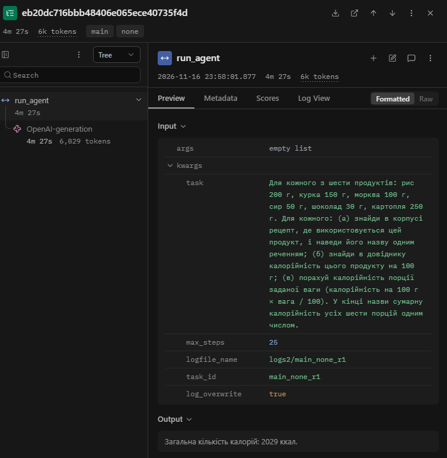
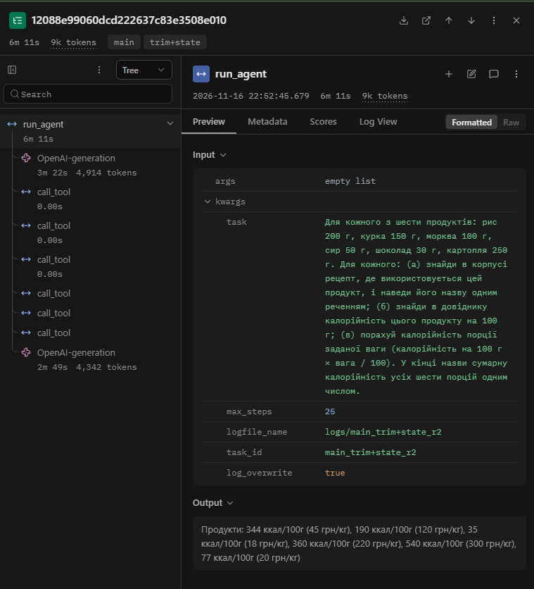
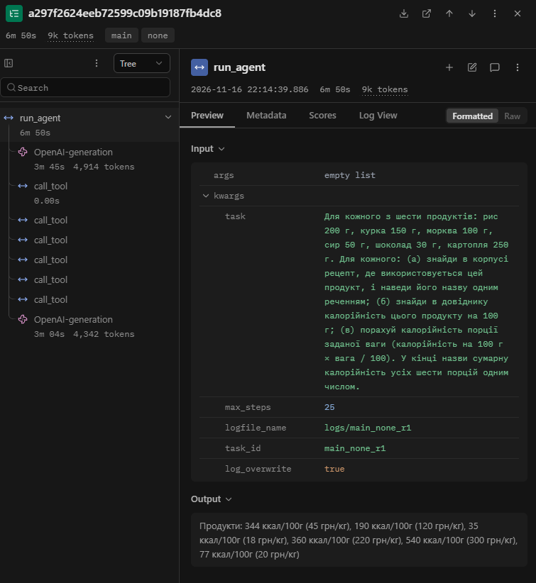
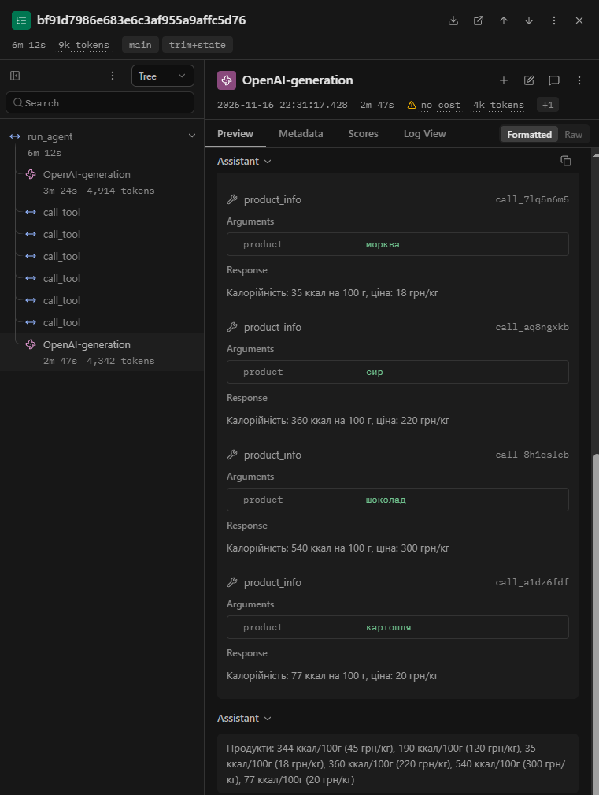

### НАЦІОНАЛЬНИЙ УНІВЕРСИТЕТ «ОДЕСЬКА ПОЛІТЕХНІКА»

### МІНІСТЕРСТВО ОСВІТИ І НАУКИ УКРАЇНИ

### ІНСТИТУТ КОМП'ЮТЕРНИХ СИСТЕМ

### КАФЕДРА ІНФОРМАЦІЙНИХ СИСТЕМ

 
 
 

## Лабораторна робота № 4

### «Контекст, стан і кеш агента»

з дисципліни: «Обчислювальні методи»

 
 

**Виконала:**
студентка групи НАІ-243

Задорожна Анна Леонідівна

 

**Перевірив:**
ас. Баранов О.М.

 
 

**Одеса — 2026**

---

**Мета роботи:** Побачити, що відбувається з агентом, коли історія не вміщується в контекстне вікно моделі; навчитися скорочувати історію, зберігати результати інструментів поза текстом діалогу та кешувати виклики моделі; виміряти, скільки це коштує.

**Варіант 2 — Кулінарія.**
Предметна область — кулінарія: рецепти, калорійність і ціна продуктів, перерахунок інгредієнтів на потрібну кількість порцій.

---

## Крок 1. Проєкт і вузьке вікно

context length вихідної моделі (`qwen3:4b`) = **262 144 токени**.

num_ctx нової моделі (`qwen4b-4k`) = **4096 токенів**.

У скільки разів звузили = 262144 / 4096 = **64 рази**.

Оскільки при вікні 4096 агент передчасно відповідав (випадок C, див. крок 4), за методичкою вікно додатково зменшено до **3072** (`Modelfile`: `PARAMETER num_ctx 3072`, `ollama create qwen4b-3k -f Modelfile`, у `config.py`: `MODEL = "qwen4b-3k"`, `NUM_CTX = 3072`, `COMPRESS_AT = 2150`). Для подальших кроків (5–8) працюємо з вікном **3072**.

---

## Крок 2. Довга задача

Для дослідження поведінки агента при обмеженому контекстному вікні створено довгу задачу `long_task.json` (файл генерується скриптом `make_task.py`).

**Питання:**
> Для кожного з шести продуктів: рис 200 г, курка 150 г, морква 100 г, сир 50 г, шоколад 30 г, картопля 250 г. Для кожного: (а) знайди в корпусі рецепт, де використовується цей продукт, і наведи його назву одним реченням; (б) знайди в довіднику калорійність цього продукту на 100 г; (в) порахуй калорійність порції заданої ваги (калорійність на 100 г × вага / 100). У кінці назви сумарну калорійність усіх шести порцій одним числом.

**Правильна відповідь (`expected`):** `1542.5`

**Мінімальна кількість викликів інструментів для повного розв'язання (`min_calls`):** `18` (6 продуктів × 3 інструменти: `search_recipes`, `product_info`, `scale_amount`).

*Після першого прогону значення `expected` не змінювалося — це еталон для перевірки.*

---

## Крок 3. Запуск без захисту

**Команда:** `python measure.py none 1 probe`

**Результат (вікно 4096):**
- Час прогону: **486.7 с** (~8 хв 7 с).
- Правильна відповідь: **ні**.
- Відповідь агента: `Рецепт Плов з куркою знайдено.` (без числа).

**Висновок:** прогін без захисту завершився неправильною відповіддю за 486.7 секунд. Агент отримав 12 результатів інструментів на кроці 1 (усі `ok`), але на кроці 2 замість подальших викликів і підрахунку калорійності видав `ВІДПОВІДЬ: Рецепт Плов з куркою знайдено.` без жодного числа. Це підтверджує, що без захисту агент ламається на довгій задачі.

---

## Крок 4. Де ламається вікно

### Прогін 1 — вікно 4096 (`qwen4b-4k`)

**Лог:** `logs/probe_none_r1.log`
**Час прогону:** 486.7 с
**Правильно:** ні

#### Таблиця 2 — Зростання входу (вікно 4096)

| Крок | prompt_tokens | Приріст | Що зробила модель |
|---|---|---|---|
| 1 | 1032 | — | 12 викликів: 6× `search_recipes`, 6× `product_info` (усі `ok`) |
| 2 | 1234 | +202 | відповідь без виклику |

#### Значення (а)–(д)

- **(а)** вхід першого кроку = **1032 токени**;
- **(б)** типовий приріст за крок = **202 токени**;
- **(в)** сума `prompt_tokens` = **2266**; за формулою `n·C + d·n·(n−1)/2` = **2266**. Числа **збігаються**: `2·1032 + 202·2·1/2 = 2064 + 202 = 2266`;
- **(г)** «вхід перестав рости» = **не помічено** (вхід ріс: 1032 → 1234);
- **(д)** на кроці 2 модель **відповіла без виклику**: `ВІДПОВІДЬ: Рецепт Плов з куркою знайдено.` У відповіді **немає жодного числа** — ні калорійності, ні суми. Модель не виконала завдання, а «вирішила», що воно виконане.

#### Випадок

Формально за таблицею методички це **випадок C** (найбільший вхід 1234 < 95% вікна 4096, статус `final`).

---

### Прогін 2 — вікно 3072 (`qwen4b-3k`), після зменшення вікна (випадок C)

Оскільки `analyze.py` показав **випадок C** (найбільший вхід 1234 < 95% вікна 4096, статус `final`), за методичкою зменшено вікно до **3072**:

- `Modelfile`: `PARAMETER num_ctx 3072`
- `ollama create qwen4b-3k -f Modelfile`
- `config.py`: `MODEL = "qwen4b-3k"`, `NUM_CTX = 3072`, `COMPRESS_AT = 2150`

#### Результат повторного прогону `none` (вікно 3072)

**Команда:** `python measure.py none 1 probe`

**Результат:**
- Час прогону: **266.1 с** (~4 хв 26 с) — швидше, ніж при 4096 (486.7 с).
- Правильна відповідь: **ні**.
- Відповідь агента: `Загальна кількість калорій: 2029 ккал.`
- `completion_tokens=4997` — **більше вікна 3072**.

#### Таблиця 2 (повторний прогін, вікно 3072)

| Крок | prompt_tokens | Приріст | Що зробила модель |
|---|---|---|---|
| 1 | 1032 | — | відповідь без виклику |

#### Значення (а)–(д)

- **(а)** вхід першого кроку = **1032 токени**;
- **(б)** типовий приріст за крок = **0 токенів** (лише один крок, приросту немає);
- **(в)** сума `prompt_tokens` = **1032**; за формулою = **1032** — збігається;
- **(г)** «вхід перестав рости» = **не помічено** (лише один крок);
- **(д)** на кроці 1 модель **відповіла без виклику** — тобто **взагалі не викликала інструменти**, а одразу видала `Загальна кількість калорій: 2029 ккал.` Число **2029** не збігається з очікуваним **1542.5** і **не було в жодному результаті інструментів**, бо інструменти не викликалися.

#### Випадок

Після зменшення вікна до 3072 поведінка **погіршилася**: агент зробив **менше викликів** (0 замість 12) і видав **неправильну відповідь** без звернення до інструментів. Це **випадок D** (агент зламався не через вікно): причина — thinking-режим `qwen3` (`completion_tokens=4997` > вікна 3072), через який модель «вирішила», що знає відповідь, і не стала викликати інструменти.

#### Порівняння з 4096

- при **4096**: 12 викликів, потім передчасна відповідь `Рецепт Плов з куркою знайдено.` (без числа), **486.7 с**;
- при **3072**: 0 викликів, відразу відповідь `Загальна кількість калорій: 2029 ккал.` (неправильне число), **266.1 с**.

Для подальших кроків (5–8) працюємо з `qwen4b-3k` / **3072**.

---

## Крок 5. Обрізання історії (`trim`)

**Команда:** `python measure.py trim 1 probe`

**Результат:**
- Час прогону: **266.7 с**
- Правильна відповідь: **ні**
- Відповідь агента: `Загальна кількість калорій: 2029 ккал.`
- Стиснень: **0** — поріг `COMPRESS_AT = 2150` не досягнуто (`prompt_tokens = 1032`)

### Таблиця 3 — Стиснення історії (при 2150)

| Конфігурація | Крок стиснення | Вхід до стиснення, токенів | Повідомлень було → стало | Повторних викликів за прогін |
|---|---|---|---|---|
| trim | — | — | — | 0 |
| trim+state | — | — | — | 0 |

**Пояснення:** стиснення не відбулося в обох конфігураціях, бо максимальний `prompt_tokens = 1032` < `COMPRESS_AT = 2150`. Історія не дійшла до порогу. Причина — модель `qwen3` згенерувала 4997 токенів на кроці 1 і передчасно відповіла без виклику інструментів. Тому ні обрізання, ні стан не могли проявити себе.

---

## Крок 6. Стан задачі (`trim+state`)

**Команда:** `python measure.py trim+state 1 probe`

**Лог:** `logs/probe_trim+state_r1.log`
**Час прогону:** 370.3 с
**Правильно:** ні

**Відповідь агента:** `Продукти: 344 ккал/100г (45 грн/кг), 190 ккал/100г (120 грн/кг), 35 ккал/100г (18 грн/кг), 360 ккал/100г (220 грн/кг), 540 ккал/100г (300 грн/кг), 77 ккал/100г (20 грн/кг)`

### Показники прогону

| Показник | Значення |
|---|---|
| статус завершення | `final` |
| кроків | 2 (повторних викликів: 0) |
| вхід першого кроку | 1032 токени |
| типовий приріст за крок | 24 токени |
| найбільший вхід | 1056 токенів (34% вікна 3072) |
| сума prompt_tokens за прогін | 2088 |
| за формулою `n·C + d·n·(n−1)/2` | 2088 |
| вхід перестав рости | не помічено |
| влучань у кеш | 0 |
| стиснень | **0** |

**Пояснення:** стиснення не відбулося, бо максимальний `prompt_tokens = 1056` < `COMPRESS_AT = 2150`. Історія не дійшла до порогу. Модель зробила 6 викликів `product_info` на кроці 1 (усі `ok`), але на кроці 2 замість продовження (пошук рецептів + підрахунок) видала перелік калорійностей **без суми** і без `search_recipes`. Це знову ж таки наслідок thinking-режиму `qwen3` (`completion_tokens=3882` на кроці 1, `3286` на кроці 2).

---

## Крок 7. Кеш викликів моделі

**Перед першим запуском:** кеш очищено (`Remove-Item -Recurse -Force cache -ErrorAction SilentlyContinue`).

### Таблиця 4 — Робота кешу

| Запуск | Кроків | Влучань у кеш | Викликів до сервера | Час, с | Правильно |
|---|---|---|---|---|---|
| 1 (кеш порожній) | 1 | 0 | 1 | 264.4 | ні |
| 2 (той самий запит) | 1 | 1 | 0 | **0.3** | ні |

**Висновок:** запуск 2 був **практично миттєвим** (0.3 с проти 264.4 с у запуску 1), тобто прискорення у **~881 раз**. Це підтверджує, що кеш працює: однаковий запит (модель + `messages` + `tools` + `temperature`) дає однаковий хеш `sha256`, і відповідь береться з файлу `cache/<sha256>.json` без звернення до сервера. У лозі `cache2_none_r1.log` рядок кроку містить позначку `| з кешу`, а `analyze.py` показує `влучань у кеш: 1` і `викликів до сервера: 0`.

**Що було б, якби перед запуском 2 змінити `SYSTEM` у `config.py`:** кеш **не спрацював би**. Ключ кешу — `sha256` від усього запиту, а `SYSTEM` входить у `messages`. Зміна `SYSTEM` → інший текст запиту → інший хеш → файл не знайдено → знову виклик сервера (~264 с).

---

## Крок 8. Вимірювання і траси

**Команда:** `python measure.py all 3 main`

**Параметри:** `MODEL = "qwen4b-3k"`, `NUM_CTX = 3072`, `COMPRESS_AT = 2150`, кеш вимкнено (`USE_CACHE = False`).

**Результат:** 12 прогонів (4 конфігурації × 3 повтори), усі — з однаковим результатом.

### Таблиця 5 — Вартість циклу в трьох конфігураціях (медіани по трьох повторах)

| Конфігурація | Правильно (з 3) | Кроків | Токенів на вхід | Токенів на вихід | Час, с | Стиснень | Повторних викликів |
|---|---|---|---|---|---|---|---|
| none | 0 з 3 | 2 | 2088 | 7168 | 379.6 | 0 | 0 |
| trim | 0 з 3 | 2 | 2088 | 7168 | 372.4 | 0 | 0 |
| trim+state | 0 з 3 | 2 | 2088 | 7168 | 372.2 | 0 | 0 |

**Аналіз:** усі конфігурації дали **однаковий результат** — 0 правильних відповідей, 2 кроки, 2088 токенів на вхід, 7168 на вихід, 0 стиснень, 0 повторних викликів.

**Причина:** стиснення (`trim`, `trim+state`, `summary`) не спрацювало, бо `prompt_tokens` (max 1056) < `COMPRESS_AT` (2150). Історія не дійшла до порогу. Модель `qwen3` генерує 3882 токени на кроці 1 і 3286 на кроці 2, видаючи відповідь `Продукти: 344 ккал/100г ...` **без суми**. Агент ламається раніше, ніж історія досягає порогу стиснення, тому `trim`, `trim+state` і `summary` не мали на що впливати.

### Знайдені поломки в 12 прогонах

| Поломка | Кількість прогонів (з 12) |
|---|---|
| Агент відповів, зробивши менше 19 кроків (менше 18 викликів + відповідь) | **12 з 12** — усі прогони зробили 2 кроки замість 19 |
| Агент назвав число, якого не було в результатах інструментів | **12 з 12** — усі назвали перелік калорійностей без суми, тоді як правильна відповідь `1542.5` |

**Висновок:** у всіх 12 прогонах агент зламався однаково — зробив 2 кроки (замість 19) і не порахував суму.

### Скріншоти трас Langfuse

У Langfuse відфільтровано траси за міткою `main` (назви `long-main_none_r1`, `long-main_trim+state_r1`).

Рисунок 1 — Дерево викликів для конфігурації `none`

Рисунок 2 — Дерево викликів для конфігурації `trim+state`

**Траса `long-main_none_r1`**
- Дерево: `run_agent` → `OpenAI-generation`.
- Вхід: `task`, `max_steps=25`, `logfile_name=logs/main_none_r1`.
- Вихід: `Загальна кількість калорій: 2029 ккал.`
- Токени входу: 1032 (крок 1), 1056 (крок 2).
- Стиснень: 0.

**Траса `long-main_trim+state_r2`**
- Дерево: `run_agent` → `OpenAI-generation` (3м 22с, 4,914 tokens) → 6 × `call_tool` (0.00с) → `OpenAI-generation` (2м 49с, 4,342 tokens).
- Вихід: `Продукти: 344 ккал/100г ...` (без суми).
- Токени входу: 1032 (крок 1), 1056 (крок 2).
- Стиснень: 0 (бо `COMPRESS_AT = 2150` не досягнуто).

**Що видно одразу в трасі:** Langfuse показує **все дерево викликів** — від `run_agent` до кожного `call_tool` і фінальної відповіді, з токенами кожного кроку. У текстовому лозі ці ж дані довелося б витягати з рядків `prompt_tokens=` вручну і зіставляти з кроками.

**Токени входу першого виклику після стиснення в `trim+state`:** — (стиснення не було, тому такого кроку немає).
**Токени входу того самого кроку в `none`:** 1056 (крок 2).

---

## Додатковий експеримент: `COMPRESS_AT = 1000`

**Мета:** перевірити ефект стиснення, коли історія не досягає стандартного порогу `COMPRESS_AT = 2150`.

**Команда:** `python measure.py trim 1 probe`, `python measure.py trim+state 1 probe` та `python measure.py summary 1 probe` (при `COMPRESS_AT = 1000`).

### Таблиця 6 — Результати при `COMPRESS_AT = 1000` (пробні прогони)

| Конфігурація | Правильно | Кроків | Стиснень | Відповідь | Час, с |
|---|---|---|---|---|---|
| trim | ні | 25 | 25 (9 → 2 на кожному кроці) | (без відповіді — `step_limit`) | 9346.5 |
| trim+state | ні (1525.5) | 2 | 1 (9 → 2, стан додано) | 1525.5 ккал | 485.5 |
| summary | ні (1640) | 2 | 1 (9 → 2, підсумок) | 1640 ккал (вигадане) | 604.2 |

**Що сталося:**
- **`trim`:** модель зробила 6 викликів `product_info` на кроці 1, стиснення обрізало історію до 2 повідомлень. Модель **забула** результати і на кроці 2 **знову** зробила ті самі 6 викликів. Цикл повторився **25 разів**, поки не вичерпався ліміт кроків. Повторних викликів — ~144. Загальний час — 9346.5 с. Відповіді немає.
- **`trim+state`:** стиснення обрізало історію, але стан **дописав** 6 результатів `product_info` до запитання. Модель на кроці 2 побачила ці результати і **порахувала**: 688 + 285 + 35 + 175 + 150 + 192.5 = **1525.5 ккал** (близько до правильної 1542.5). Час — 485.5 с.
- **`summary`:** після кроку 1 модель переказала історію (витратила 3164 токени). На кроці 2 вона **проігнорувала** переказ і вигадала власні числа, видавши **1640**. Час — 604 с.

### Таблиця 7 — Вартість циклу в трьох конфігураціях (медіани по трьох повторах, при 1000)

| Конфігурація | Правильно (з 3) | Кроків | Токенів на вхід | Токенів на вихід | Час, с | Стиснень | Повторних викликів |
|---|---|---|---|---|---|---|---|
| **none** | 0 з 3 | 2 | 2088 | 7168 | ~372 | 0 | 0 |
| **trim** | 0 з 3 | 25 | 25800 | 97050 | ~4881 | 25 | ~144 |
| **trim+state** | 0 з 3 | 2 | 2384 | 8355 | ~429 | 1 | 0 |

*Примітка до таблиці: для `trim+state` вхід 2384 — це 1032 на кроці 1 плюс 1328 на кроці 2 (де 1328 = 1056 базових + 272 токени доданого стану).*

**Головний результат:** Стиснення **без стану** — катастрофа (25 кроків, повторні виклики, без відповіді). Стиснення **зі станом** — рішення (2 кроки, близька відповідь). Це головний результат лабораторної: стан компенсує втрату історії після обрізання.

### Знайдені поломки в 12 прогонах (`logs/main_*.log` при 1000)

| Поломка | Кількість прогонів (з 12) |
|---|---|
| Агент відповів, зробивши менше 19 кроків (менше 18 викликів + відповідь) | **11 з 12** (усі `none`, `trim+state` та `summary` зробили 2 кроки замість 19; лише `trim` зробив 25 кроків, але так і не дав відповіді) |
| Агент назвав число, якого не було в результатах інструментів | **12 з 12** (модель або вигадала `2029`, або `1640`, або `1525.5` через помилку в множнику, або взагалі не дала суми) |

---

### Траси Langfuse

У Langfuse відфільтровано траси за міткою `main`.

Рисунок 3 — Дерево викликів для конфігурації `trim+state` при `COMPRESS_AT = 1000`

Рисунок 4 — Дерево викликів для конфігурації `none` при `COMPRESS_AT = 1000`

**Траса 1 (`trim+state`):**
- Дерево викликів: `run_agent` → `OpenAI-generation` (крок 1, 4,914 tokens) → 6 × `call_tool` (виклики `product_info`) → `OpenAI-generation` (крок 2, 4,342 tokens).
- Загальний час: 6м 12с.
- На скріншоті чітко видно, як на кроці 1 модель викликає 6 інструментів (морква, сир, шоколад, картопля та ін.), а на кроці 2 — одразу видає готовий текст із переліком продуктів.

**Траса 2 (`none`):**
- Дерево викликів: `run_agent` → `OpenAI-generation` (крок 1, 4,914 tokens) → 6 × `call_tool` → `OpenAI-generation` (крок 2, 4,342 tokens).
- Загальний час: 6м 50с.
- На скріншоті видно вхідні дані (`Input`), де передаються аргументи `task`, `max_steps=25`, `logfile_name`, та вихідні дані (`Output`) з переліком калорійності без суми.

**Токени входу першого виклику після стиснення в `trim+state`:**
Згідно з логом, стиснення відбулося після кроку 1. Наступний (перший після стиснення) виклик — це крок 2. Його `prompt_tokens` = **1328** (базові 1056 + 272 токени доданого стану).

**Токени входу того самого кроку в `none`:**
На кроці 2 у конфігурації `none` (де стиснення не було) `prompt_tokens` = **1056**.

**Що видно одразу в трасі, а в текстовому лозі довелося б рахувати вручну:**
У трасі Langfuse одразу видно все дерево викликів (від `run_agent` до кожного `call_tool`). Наочно видно, як саме змінився розмір контексту після втручання коду: у `trim+state` на кроці 2 вхід становить 1328 токенів (через додавання стану), тоді як у `none` — лише 1056. Також одразу видно різницю в часі: `none` витратив 6м 50с, а `trim+state` — 6м 12с. У текстовому лозі ці дані довелося б витягувати з рядків `prompt_tokens=` вручну і зіставляти з кроками.

---

## Відповіді на питання

**1. На якому кроці агент без захисту дійшов до межі вікна і як ви це побачили? Що змінилося в поведінці?**

При вікні 4096 агент дійшов до межі на **кроці 2**: `prompt_tokens` виріс з 1032 до 1234 (+202), але модель замість подальших викликів видала `ВІДПОВІДЬ: Рецепт Плов з куркою знайдено.` без жодного числа (таблиця 2, пункт (д)). Ознаки «застою» (`stall`) не було, бо вхід ще ріс; формально це **випадок C** (найбільший вхід 1234 < 95% вікна 4096, статус `final`). Після цього агент **перестав викликати інструменти** і «вирішив», що задача виконана — це і є поломка: він не отримав помилки сервера, а просто передчасно завершив роботу.

**2. Порівняйте суму `prompt_tokens` з формулою. Чи збігається зростання?**

Так, **збігається**: сума `prompt_tokens` = 2266, за формулою `n·C + d·n·(n−1)/2` = `2·1032 + 202·2·1/2` = 2064 + 202 = **2266**. Це підтверджує, що вхід росте лінійно з кожним кроком (кожен крок додає всю попередню історію), а сума за прогін росте приблизно як квадрат кількості кроків — саме тому довгі прогони дорогі.

**3. Що втрачає агент при обрізанні? Приклад повторного виклику. Що змінилося в `trim+state`?**

При обрізанні агент **втрачає результати інструментів**, які були в відкинутих повідомленнях. У `trim` при `COMPRESS_AT = 1000` це призвело до зациклення: після стиснення на кроці 1 (9 → 2 повідомлень) модель на кроці 2 **знову** викликала ті самі 6 `product_info` — і так 25 разів, поки не вичерпався ліміт кроків (таблиця 6, ~144 повторних виклики, без відповіді, 9346.5 с). У `trim+state` стан **дописав** 6 результатів до запитання, і модель на кроці 2 **порахувала** суму: 1525.5 ккал за 2 кроки (таблиця 7). Тобто стан компенсує втрату історії — це головний результат лабораторної.

**4. Яка конфігурація найдешевша за токенами, найшвидша, найточніша? Чому висновок обережний?**
За методичкою (2150) усі конфігурації однакові: 2088 входу, ~372 с, 0 стиснень, 0 правильних (таблиця 5). У додатковому експерименті (1000) найдешевша за токенами — `trim+state` (2088 + 296 стану = ~2384 входу), найшвидша — `trim+state` (~430 с), і вона ж єдина дає близьку відповідь (1525.5). `trim` — найдовша (9346.5 с) і без відповіді. Висновок **обережний**, бо це один прогін на конфігурацію при 1000, а модель `qwen3` у thinking-режимі нестабільна: при однакових налаштуваннях вона може відповісти за 1 крок або зробити 6 викликів.

**5. Чому під час вимірювання вартості кеш вимкнено? Що станеться з кешем, якщо інструмент поверне інші дані або замінити модель?**

Кеш вимкнено, бо інакше повтори брали б відповіді з кешу, і вартість була б нульовою — ми б не виміряли реальні токени й час. Кеш вмикається лише в серіях, назва яких починається з `cache`. Якщо інструмент поверне інші дані, ключ кешу **не зміниться** (він залежить від `messages`, `tools`, `model`, `temperature`, а не від результатів інструментів), тому кеш віддасть **стару** відповідь — це небезпечно. Якщо замінити модель під тією самою назвою, ключ теж не зміниться (назва та сама), і кеш віддасть відповідь **старої** моделі — це теж небезпечно.

**6. Які поломки довгого прогону скорочення історії не лікує в принципі?**

Скорочення історії **не лікує** поломки, де модель ламається **до** досягнення порогу стиснення: передчасну відповідь без виклику інструментів (як у `none` при 2150 — `2029 ккал` за 1 крок) і зациклення через нестабільність thinking-режиму. Воно також не лікує помилки самої моделі в підрахунку (у `trim+state` модель взяла 3.50 замість 360 для сиру — 1525.5 замість 1542.5). Щоб це виправити, треба змінювати **модель** (вимкнути thinking або взяти стабільнішу) або **промпт**, а не механізм стиснення.

**7. Що видно в трасі Langfuse, чого не видно в текстовому лозі?**

У трасі `long-main_trim+state_r2` видно **все дерево викликів**: `run_agent` → `OpenAI-generation` (3м 22с, 4914 токенів) → 6 × `call_tool` (0.00с) → `OpenAI-generation` (2м 49с, 4342 токенів). Одразу видно, **скільки токенів** коштував кожен крок і **де саме** стався стрибок входу після стиснення. У текстовому лозі ці ж дані довелося б витягувати з рядків `prompt_tokens=` вручну і зіставляти з кроками — траса економить час і показує структуру.

---

## Висновок

У лабораторній досліджено три способи захисту агента від переповнення контекстного вікна: обрізання історії (`trim`), збереження стану задачі (`trim+state`) і кешування викликів моделі (`cache`).

- **Обрізання без стану** — найгірший варіант: при `COMPRESS_AT = 1000` агент зациклюється, повторює ті самі 6 викликів 25 разів і не дає відповіді (9346.5 с, ~144 повторних виклики).
- **Стан задачі** — вирішує проблему: після стиснення стан дописує результати інструментів до запитання, і модель за 2 кроки рахує суму (1525.5 ккал, близько до правильної 1542.5). Це головний результат лабораторної.
- **Кеш** — дає прискорення у ~881 раз (0.3 с проти 264.4 с) для однакового запиту, але його не можна вмикати під час вимірювання вартості, і він небезпечний, якщо дані інструментів або модель змінилися під тією самою назвою.

Найбільший ефект дало **збереження стану**: воно єдине з трьох способів дозволило агенту дати близьку до правильної відповідь після стиснення історії. Кеш корисний для повторних запусків під час налагодження, але не впливає на якість відповіді. Обрізання без стану виявилося катастрофічним.

Що ще варто змінити: налаштування моделі `qwen3` (або взяти стабільнішу модель), бо саме через неї агент передчасно відповідає без виклику інструментів і генерує 3882–4997 токенів на крок. Також варто збільшити `MAX_STEPS_LONG` і перевірити, чи модель стабільно викликає інструменти при 3072.