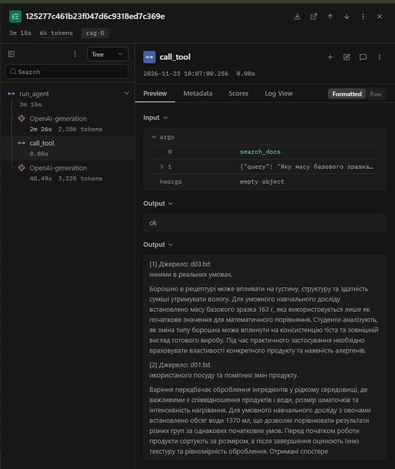
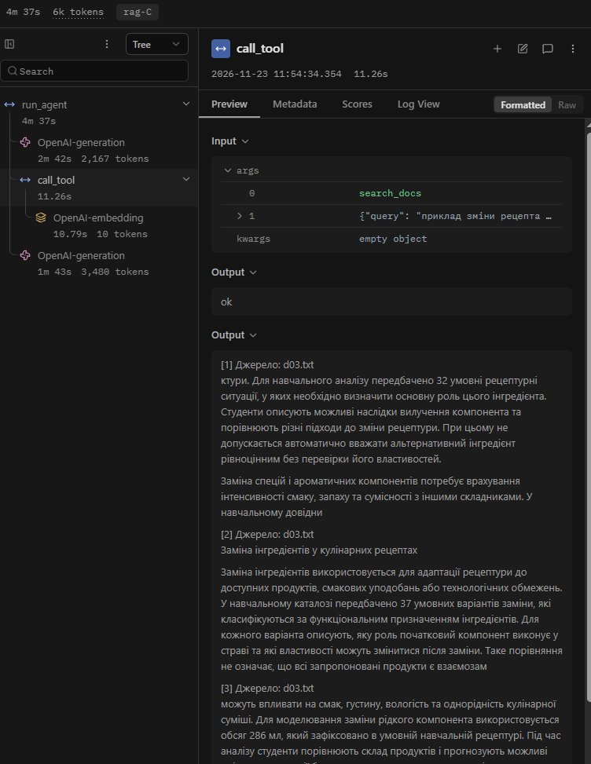

<div align="center">

### НАЦІОНАЛЬНИЙ УНІВЕРСИТЕТ «ОДЕСЬКА ПОЛІТЕХНІКА»

### МІНІСТЕРСТВО ОСВІТИ І НАУКИ УКРАЇНИ

### ІНСТИТУТ КОМП'ЮТЕРНИХ СИСТЕМ

### КАФЕДРА ІНФОРМАЦІЙНИХ СИСТЕМ

<br>
<br>
<br>

## Лабораторна робота № 5 

### «RAG-агент: пошук по документах як інструмент»

з дисципліни: «Обчислювальні методи»

<br>
<br>

**Виконала:**
студентка групи НАІ-243

Задорожна Анна Леонідівна

<br>

**Перевірив:**
ас. Баранов О.М.

<br>
<br>

**Одеса — 2026**

</div>

---
Мета
Замінити примітивний пошук підрядком з лабораторної роботи № 2 векторним. Під'єднати його до агента як звичайний інструмент. Перевірити якість пошуку окремо від агента. Побачити, як розмір чанка та опис інструмента впливають на поведінку агента, і виміряти це кількома повторами.

Варіант 2 — Кулінарія. Предметна область — кулінарія: рецепти, калорійність і ціна продуктів, перерахунок інгредієнтів на потрібну кількість порцій.

Модель чату: `qwen4b-3k` (Ollama).

Розмір контекстного вікна: 3072 токени.

Модель ембедингів: bge-m3, запущена через Ollama, із розмірністю векторів 1024.

### Дані для дослідження

Для виконання лабораторної роботи використано п'ять навчальних документів кулінарної тематики та набір із десяти тестових запитань, визначених у файлі `rag_cases.json`.

**Таблиця — Характеристика навчальних документів**

| Документ | Тема | Символів | Токенів (оцінка) |
|---|---|---:|---:|
| `d01.txt` | Техніки приготування страв | 3046 | 762 |
| `d02.txt` | Зберігання продуктів і терміни придатності | 3021 | 755 |
| `d03.txt` | Заміна інгредієнтів у рецептах | 3041 | 760 |
| `d04.txt` | Кухонне обладнання та догляд за ним | 3106 | 777 |
| `d05.txt` | Безпека на кухні та алергени | 3093 | 773 |
| **Разом** | **5 документів** | **15 307** | **3827** |

Обсяг документів визначено за кількістю символів тексту. Кількість токенів є приблизною та може відрізнятися від фактичної токенізації моделі.

**Тестові запитання**

Для перевірки семантичного пошуку сформовано 10 запитань: 4 прямі (`direct`), 4 перефразовані (`paraphrase`) та 2 запитання без відповіді в документах (`none`). Для кожного запитання у файлі `rag_cases.json` визначено поля `must_contain` — фрагмент, який має бути знайдений, та `expected` — очікувана відповідь.

| ID | Запитання | `must_contain` | `expected` |
|---|---|---|---|
| D1 | Скільки навчальних операцій передбачено для порівняння технік приготування? | передбачено 17 навчальних операцій | 17 |
| D2 | Скільки інформаційних полів передбачено для умовного складського журналу? | передбачено 14 інформаційних полів | 14 |
| D3 | Яку масу базового зразка встановлено для умовного навчального досліду з борошном? | масу базового зразка 163 г | 163 |
| D4 | Скільки інвентарних карток створено для навчального обліку кухонних ножів та ручного інвентарю? | створено 24 інвентарні картки | 24 |
| P1 | Який об'єм води беруть у прикладі з овочами для порівняння різних груп? | встановлено обсяг води 1370 мл | 1370 |
| P2 | Скільки товарних найменувань потрібно звірити під час тренувальної ревізії запасів? | передбачено 47 умовних товарних позицій | 47 |
| P3 | Яка кількість рідкого складника використовується в прикладі зміни рецепта? | використовується обсяг 286 мл | 286 |
| P4 | Для скількох вигаданих випадків розглядають передавання повідомлень про загрози на робочому місці? | описано 63 сценарії повідомлення про ризики | 63 |
| N1 | Яка вартість щомісячного навчання на кулінарному курсі? | `null` | `null` |
| N2 | Який бренд холодильника встановлено в навчальній кухні? | `null` | `null` |

**Перевірка можливості вгадування відповідей без документів**

Для перевірки використано модель `qwen4b-3k` із контекстним вікном 3072 токени без доступу до навчальних документів. Моделі поставлено три запитання (D1, D2, D3), правильні відповіді на які містять спеціально задані числові значення.

| Запитання | Очікувана відповідь | Відповідь моделі |
|---|---|---|
| D1 | 17 | Не знаю |
| D2 | 14 | Не знаю |
| D3 | 163 | Не знаю |

**Висновок.** У всіх трьох випадках модель відповіла «Не знаю» та не вгадала жодного числового значення. Отже, для отримання правильних відповідей на перевірені запитання необхідно використовувати пошук у навчальних документах.

### Перевірка моделі ембедингів

Для перевірки моделі ембедингів `bge-m3`, запущеної через Ollama, використано скрипт `embed_check.py`. Отримано такі результати:

- **Довжина вектора:** 1024.
- **Норма першого вектора:** 1.000.
- **Косинусна схожість семантично близьких текстів:** 0.882.
- **Косинусна схожість семантично різних текстів:** 0.446.

Перше значення отримано для запиту «Скільки води потрібно для варіння овочів?» і фрази «Обсяг води для приготування овочів», друге — для цього самого запиту та фрази «Правила догляду за кухонними ножами».

**Висновок.** Модель `bge-m3` формує вектори розмірністю 1024 з нормою 1.000 та забезпечує вищу схожість семантично близьких текстів, що підтверджує її придатність для семантичного пошуку.

### Нарізання документів на чанки

Для дослідження використано документ `data/docs/d01.txt` «Техніки приготування страв». Нарізання виконано за допомогою скрипта `show_chunks.py` трьома способами:

```powershell
python show_chunks.py data/docs/d01.txt fixed 200 0
python show_chunks.py data/docs/d01.txt fixed 500 100
python show_chunks.py data/docs/d01.txt paragraphs 800
```

Результати експериментів наведено в таблиці 1.

**Таблиця 1 – Нарізання одного документа**

| Спосіб | Чанків | Закінчуються посеред речення | Довжина найбільшого, символів |
|---|---:|---:|---:|
| `fixed`, 200, перекриття 0 | 21 | 19 | 200 |
| `fixed`, 500, перекриття 100 | 11 | 10 | 500 |
| `paragraphs`, 800 | 8 | 0 | 557 |


**Приклад розриву речення з числовим фактом**

Під час нарізання документа `d01.txt` методом `fixed` із розміром чанка 200 символів без перекриття виявлено розрив речення між чанками 16 і 17.

**Чанк 16 (кінець):**

> Комбіновані техніки передбачають послідовне використання кількох способів кулінарного оброблення в межах однієї страви. Для навчального моделювання визначе

**Чанк 17 (початок):**

> но 19 можливих комбінацій, які відрізняються порядком операцій і способом підготовки інгредієнтів.

**Повний факт у вихідному документі:**

> Для навчального моделювання визначено 19 можливих комбінацій, які відрізняються порядком операцій і способом підготовки інгредієнтів.

У результаті фіксованого нарізання слово «визначено» розділено між двома чанками. Це демонструє порушення цілісності речення, що містить числовий факт. Водночас число `19` і поняття «можливих комбінацій» залишилися разом.

**Аналіз результатів.**

За використання методу `fixed` із розміром чанка 200 символів без перекриття отримано 21 чанк, з яких 19 закінчуються посеред речення. Метод розрізає текст за кількістю символів, не враховуючи межі слів і речень.

Наприклад, між чанками 16 і 17 розірвано слово «визначено»:

- **Кінець чанка 16:** «Для навчального моделювання визначе»
- **Початок чанка 17:** «но 19 можливих комбінацій, які відрізняються порядком операцій...»

У цьому випадку розірвано речення, яке містить факт про 19 можливих комбінацій. Однак саме число `19` і словосполучення «можливих комбінацій» залишилися в одному чанку, тому повного відокремлення числа від його значення не відбулося.

За використання методу `fixed` із розміром чанка 500 символів і перекриттям 100 символів отримано 11 чанків, з яких 10 закінчуються посеред речення. Перекриття частково зберігає контекст між сусідніми чанками, але не усуває розривів слів і речень.

Метод `paragraphs` із розміром чанка 800 символів сформував 8 чанків. Жоден із них не закінчується посеред речення, а довжина найбільшого становить 557 символів. Цей метод зберігає цілісність абзаців і фактів, що містяться в них.

**Висновок.** За результатами експерименту метод `paragraphs` найкраще зберігає структуру документа. Фіксоване нарізання створює більше чанків і може розривати речення, тоді як перекриття частково компенсує втрату контексту. У дослідженому документі виявлено розриви речень із числовими фактами, але повного відокремлення числа від відповідного поняття не зафіксовано.


### Ембединги й індекс

Для обчислення ембедингів використано модель `bge-m3`, запущену через Ollama. Перевірку виконано за допомогою скрипта `embed_check.py` на трьох текстах кулінарної тематики.

Результати перевірки:

- Час виконання: 2,3 с.
- Довжина вектора: 1024.
- Норма першого вектора: 1.000.
- Косинусна схожість запиту «Скільки води потрібно для варіння овочів?» із фразою «Обсяг води для приготування овочів»: 0.882.
- Косинусна схожість цього запиту із фразою «Правила догляду за кухонними ножами»: 0.446.

Отримані результати підтверджують, що семантично близькі тексти мають вищу косинусну схожість. Довжина вектора відповідає очікуваному значенню для моделі `bge-m3` — 1024, а його норма становить 1.000.

**Побудова векторного індексу**

Після перевірки моделі ембедингів виконано побудову векторного індексу FAISS за допомогою команди:

```powershell
python build_index.py
```

Для формування індексу використано документи з каталогів `data/corpus` і `data/docs`. Нарізання виконано відповідно до параметрів `config.py`: метод `paragraphs`, розмір чанка 800 символів, перекриття 0, без додавання заголовка до кожного чанка.

Результати побудови індексу:

- Кількість чанків: **52**.
- Середня довжина чанка: **413 символів**.
- Найкоротший чанк: **145 символів**.
- Найдовший чанк: **557 символів**.
- Модель ембедингів: **`bge-m3`**.
- Розмірність вектора: **1024**.

Векторний індекс побудовано за допомогою FAISS із використанням нормалізації векторів та скалярного добутку для обчислення косинусної схожості.

**Висновок.** Перевірка моделі `bge-m3` підтвердила правильну розмірність ембедингів і вищу схожість семантично близьких текстів. Побудовано векторний індекс із 52 чанків, який можна використовувати для пошуку релевантних фрагментів документів.

###  Перевірка пошуку без агента

Для перевірки якості пошуку виконано команду `python check_retrieval.py`. Результати порівняння шести конфігурацій нарізання наведено в таблиці 2.

**Таблиця 2 – Пошук при різному нарізанні**

| Конфігурація | Чанків | Сер. довжина | hit@1 | hit@3 | hit@5 | hit@3 прямі | hit@3 перефр. | Токенів (k=3) |
|---|---:|---:|---:|---:|---:|---:|---:|---:|
| `fixed-200-0` | 113 | 191 | 0.88 | 0.88 | 0.88 | 1.00 | 0.75 | 229 |
| `fixed-500-0` | 53 | 406 | 1.00 | 1.00 | 1.00 | 1.00 | 1.00 | 488 |
| `fixed-500-100` | 63 | 415 | 1.00 | 1.00 | 1.00 | 1.00 | 1.00 | 498 |
| `fixed-1500-0` | 27 | 798 | 0.62 | 1.00 | 1.00 | 1.00 | 1.00 | 957 |
| `paragraphs-800` | 52 | 413 | 0.88 | 1.00 | 1.00 | 1.00 | 1.00 | 495 |
| `paragraphs-800+title` | 52 | 437 | 1.00 | 1.00 | 1.00 | 1.00 | 1.00 | 525 |

**Вибір конфігурації.** Найвище значення `hit@3 = 1.00` отримано для п'яти конфігурацій. За критерієм меншого розміру результату обрано `fixed-500-0`, для якої оцінка становить 488 токенів при `k=3`. Ця конфігурація також забезпечує `hit@1 = 1.00` і повне влучання для прямих та перефразованих запитань.

Конфігурація `fixed-200-0` має нижчий показник `hit@3 = 0.88`, тому не відповідає критерію максимального влучання. Для обраної конфігурації `hit@3 = 1.00`, отже, випадків відсутності потрібного фрагмента серед трьох найближчих результатів немає.

У `config.py` встановлено параметри:

```python
CHUNK_METHOD = "fixed"
CHUNK_SIZE = 500
CHUNK_OVERLAP = 0
WITH_TITLE = False
```

Для визначення порогу схожості виконано команду `python check_retrieval.py scores`. Результати наведено в таблиці 3.

**Таблиця 3 – Схожість першого результату**

| id | Вид | Схожість | Перший результат містить потрібну фразу |
|---|---|---:|---|
| D1 | direct | 0.673 | так |
| D2 | direct | 0.686 | так |
| D3 | direct | 0.666 | так |
| D4 | direct | 0.703 | так |
| P1 | paraphrase | 0.667 | так |
| P2 | paraphrase | 0.629 | так |
| P3 | paraphrase | 0.604 | так |
| P4 | paraphrase | 0.534 | так |
| N1 | none | 0.479 | - |
| N2 | none | 0.475 | - |

**Вибір порогу схожості.**

Найнижча схожість серед запитань із відповіддю становить 0.534, а найвища серед запитань без відповіді — 0.479. Оскільки ці значення не перекриваються, обрано поріг `MIN_SCORE = 0.50`.

За результатами перевірки цей поріг дозволяє зберегти перший результат для всіх восьми запитань із відповіддю та відхилити перший результат для двох запитань без відповіді.

**Остаточна побудова індексу.**

Після встановлення параметрів виконано команду `python build_index.py`. Отримано 53 чанки із середньою довжиною 406 символів, мінімальною — 116 і максимальною — 500 символів. Використано модель `bge-m3` із розмірністю вектора 1024.

**Висновок.** Для подальшої роботи обрано конфігурацію `fixed-500-0` із показником `hit@3 = 1.00` та порогом `MIN_SCORE = 0.50`. Остаточний векторний індекс FAISS успішно побудовано.

###  Крок Перевірка інструмента `search_docs` через диспетчер

Для перевірки роботи інструмента `search_docs` створено файл `try_tool.py`, який викликає інструмент через `dispatcher.call_tool()` без використання мовної моделі.

**1. Перевірка питання з відповіддю (D1)**

Команда запуску:

```text
python try_tool.py D1
```

Результат виконання:

```text
ПИТАННЯ: Скільки навчальних операцій передбачено для порівняння технік приготування?

рівень: ok
[1] Джерело: d01.txt
Техніки приготування страв

Техніки приготування страв визначають послідовність оброблення продуктів, вибір кухонного обладнання та спосіб контролю готовності. У навчальному курсі розглядаються варіння, тушкування, запікання, обсмажування та приготування на парі, оскільки кожен спосіб по-різному впливає на структуру продуктів. Для порівняння результатів передбачено 17 навчальних операцій, які виконуються за однаковою схемою спостереження. Кожна операція супроводжується записом початкових умов, в

[2] Джерело: d01.txt
сть із підтвердженням харчової безпечності.

Комбіновані техніки передбачають послідовне використання кількох способів кулінарного оброблення в межах однієї страви. Для навчального моделювання визначено 19 можливих комбінацій, які відрізняються порядком операцій і способом підготовки інгредієнтів. Під час складання технологічної карти зазначають, яка операція виконується першою, які зміни очікуються та за якими ознаками порівнюватимуть результат. Такий підхід дозволяє пояснити, чому однакові інг

[3] Джерело: d01.txt
редієнти можуть утворювати страви з різною консистенцією.

Оцінювання результатів кулінарного оброблення здійснюється за заздалегідь визначеними характеристиками, а не лише за особистими вподобаннями учасників. У підсумковому навчальному протоколі передбачено 13 полів для опису обладнання, інгредієнтів, послідовності операцій та отриманого результату. Порівняння різних технік допомагає встановити зв'язок між способом приготування та змінами властивостей продуктів. Висновки формулюють з урахуванн

Занадто короткий запит -> рівень: schema
Помилка: аргументи не пройшли перевірку.
Поле query: String should have at least 3 characters
Виправ аргументи і виклич інструмент ще раз.
```

**2. Перевірка питання без відповіді (N1)**

Команда запуску:

```text
python try_tool.py N1
```

Результат виконання:

```text
ПИТАННЯ: Яка вартість щомісячного навчання на кулінарному курсі?

рівень: ok
У документах нічого схожого не знайдено.

Занадто короткий запит -> рівень: schema
Помилка: аргументи не пройшли перевірку.
Поле query: String should have at least 3 characters
Виправ аргументи і виклич інструмент ще раз.
```

**Висновок.** Інструмент `search_docs` успішно працює через диспетчер. Для питання D1 знайдено три релевантні фрагменти документа `d01.txt`, один із яких містить правильну відповідь — 17 навчальних операцій. Для питання N1, відповідь на яке відсутня в документах, повернуто повідомлення «У документах нічого схожого не знайдено». Також підтверджено роботу валідації аргументів: запит довжиною менше трьох символів відхиляється з рівнем `schema`.

### Перевірка виклику `search_docs` агентом

Для перевірки роботи агента створено файл `ask.py`, який передає питання з `rag_cases.json` до функції `agent.run_agent()`.

Команда запуску:

```text
python ask.py D1
```

У результаті виконання в журналі `lab5.logs` зафіксовано:

```text
--- крок 1
виклик   : search_docs({"query":"Скільки навчальних операцій передбачено для порівняння технік приготування?"})
рівень   : ok
результат: [1] Джерело: d01.txt
Для порівняння результатів передбачено 17 навчальних операцій.

--- крок 2
ВІДПОВІДЬ: Будь ласка, вкажіть конкретну страву або інгредієнти для вибору.
```

*Наведено скорочений фрагмент журналу.*

**Висновок.** Агент успішно викликав інструмент `search_docs` та отримав релевантний фрагмент документа `d01.txt`, який містить правильну відповідь — 17 навчальних операцій. Проте підсумкова відповідь агента не відповідала поставленому питанню. Таким чином, працездатність виклику інструмента підтверджено, а некоректну відповідь моделі зафіксовано для подальшого аналізу на наступному етапі лабораторної роботи.

**Ручна перевірка результатів оцінювання**

Після виконання експериментів було проведено ручну перевірку відповідей агента. Виявлено випадки, коли агент не вигадував відповідь, а повідомляв про відсутність відповідного інструмента, проте автоматична перевірка помилково відносила такі відповіді до категорії `invented`.

Виправлення внесено для таких прогонів:

- **Перший повтор:** `A-r1-N1`, `B-r1-N1`, `C-r1-N2`.
- **Другий повтор:** `A-r2-N1`, `B-r2-N1`.
- **Третій повтор:** `A-r3-N1`, `B-r3-N1`, `C-r3-N2`.

У зазначених **8 записах** файлу `results/rag.csv` значення `correct` змінено з `0` на `1`, а `category` — з `invented` на `refused`. Інші показники залишено без змін. Підсумкові таблиці сформовано з урахуванням ручних виправлень.

### Порівняння трьох описів інструмента

Для оцінювання впливу опису інструмента `search_docs` на поведінку RAG-агента проведено експеримент із трьома варіантами опису: A, B та C. Для кожного варіанта виконано три повтори на однаковому наборі з 10 запитань, серед яких 8 запитань мають відповіді в документах, а 2 не мають. Загалом проведено 90 прогонів агента.

Результати порівняння трьох описів інструмента наведено в таблиці 5.

**Таблиця 5 – Агент з трьома описами інструмента (дані за всіма повторами; 24 прогони із запитаннями, що мають відповіді, для кожного опису)**

| Опис | Правильно (з 24) | Викликав пошук (з 24) | Кроків, медіана | Токенів входу, медіана | Час, с, медіана |
|---|---|---|---|---|---|
| `A` | 0 | 0 | 1,0 | 890 | 48,0 |
| `B` | 6 | 15 | 2,0 | 3192 | 211,2 |
| `C` | 8 | 8 | 1,0 | 816 | 82,1 |

Для детальнішого аналізу результати прогонів розподілено за категоріями правильних відповідей і помилок. Отримані дані наведено в таблиці 6.

**Таблиця 6 – Куди ламається відповідь (кількість прогонів; 24 запитання з відповіддю та 6 запитань без відповіді для кожного опису)**

| Категорія | `A` | `B` | `C` |
|---|---:|---:|---:|
| Правильно | 0 | 6 | 8 |
| Не шукав і відповів неправильно | 24 | 9 | 16 |
| Шукав, але потрібного фрагмента в результаті немає | 0 | 0 | 0 |
| Фрагмент був у результаті, відповідь неправильна | 0 | 9 | 0 |
| Питання без відповіді: визнав, що не знає | 6 | 6 | 6 |
| Питання без відповіді: вигадав відповідь | 0 | 0 | 0 |

За результатами експерименту встановлено, що опис A не забезпечив жодної правильної відповіді та жодного виклику пошуку для запитань із відомими відповідями. Опис B забезпечив найбільшу кількість викликів пошуку (15 із 24), однак у дев'яти випадках агент отримав потрібний фрагмент, але сформував неправильну відповідь. Опис C продемонстрував найвищу кількість правильних відповідей (8 із 24) за меншої медіани вхідних токенів порівняно з іншими варіантами.

Виявлені помилки мають різні причини та потребують різних способів усунення. Якщо агент не викликає пошук, необхідно вдосконалити опис інструмента. Якщо пошук виконується, але потрібний фрагмент відсутній, доцільно переглянути спосіб нарізання документів, поріг релевантності або формулювання пошукового запиту. Якщо потрібний фрагмент знайдено, але відповідь неправильна, необхідно вдосконалити інструкції для моделі, змінити обсяг переданого контексту або дослідити можливості іншої мовної моделі.

Отже, результати показали, що детальніший опис інструмента збільшує частоту його використання, але не гарантує підвищення точності кінцевих відповідей. Серед досліджених варіантів опис C забезпечив найкращий результат за кількістю правильних відповідей.

### Аналіз помилок агента

**1. Агент не виконав пошук (`no_search`)**

Для аналізу обрано прогін `C-r1-D1` з описом інструмента `C`. За результатами `rag.csv`, кількість викликів пошуку становить 0, категорія помилки — `no_search`, правильність відповіді — 0.

**Відповідь моделі:**

> Інструмент для відповіді на це запитання не знайдено. Моя функціональність обмежена роботою з інгредієнтами, калорійністю продуктів та розрахунками порцій. Запит про "навчальні операції" для порівняння технік приготування виходить за рамки доступних інструментів.

У документі `d01.txt` міститься правильна відповідь — 17 навчальних операцій. Проте агент не викликав `search_docs`, помилково визначивши запитання як таке, що виходить за межі доступних інструментів. Числового значення модель не вигадала, але й не надала правильної відповіді. Отже, причиною помилки стало невикористання пошуку, а не відсутність потрібного факту в документах.

**2. Аналіз пошукових запитів моделі**

Для аналізу порівняно текст запитань користувача з параметром `query` у викликах `search_docs` для прогонів `B-r1-D1`, `B-r1-D3`, `B-r1-D4`, `B-r1-P1` та `B-r1-P2`.

**Приклад 1 (`B-r1-D3`):**

Запитання користувача:

> Яку масу базового зразка встановлено для умовного навчального досліду з борошном?

Виклик інструмента:

`search_docs({"query":"Яку масу базового зразка встановлено для умовного навчального досліду з борошном?"})`

Значення `top_score` — 0.666. Перший результат пошуку містив правильне значення 163 г, яке модель використала у відповіді.

**Приклад 2 (`B-r1-P1`):**

Запитання користувача:

> Який об'єм води беруть у прикладі з овочами для порівняння різних груп?

Виклик інструмента:

`search_docs({"query":"Який об'єм води беруть у прикладі з овочами для порівняння різних груп?"})`

Значення `top_score` — 0.667. Перший результат містив потрібний факт — 1370 мл. Модель надала правильну відповідь.

**Приклад 3 (`B-r1-D4`):**

Запитання користувача:

> Скільки інвентарних карток створено для навчального обліку кухонних ножів та ручного інвентарю?

Виклик інструмента:

`search_docs({"query":"Скільки інвентарних карток створено для навчального обліку кухонних ножів та ручного інвентарю?"})`

Значення `top_score` — 0.703. Перший результат містив правильну відповідь — 24 інвентарні картки. Проте модель відповіла про 38 категорій кухонного обладнання, використавши інший факт із результатів пошуку.

**Висновок.** У всіх розглянутих прогонах модель дослівно копіювала запитання користувача в параметр `query`, не виконуючи додаткового перефразування. Це стосується як прямих, так і перефразованих запитань. Значення `top_score` перебували в межах 0.629–0.703. У наведених прикладах перший результат містив потрібний факт, однак правильність відповіді залежала від того, чи використала модель знайдену інформацію. Отже, висока семантична схожість сприяє знаходженню релевантного фрагмента, але сама по собі не гарантує правильної відповіді.

**3. Аналіз категорії `miss` («Шукав, але не знайшов»)**

За результатами аналізу `results/rag.csv` категорію `miss` не зафіксовано в жодному з трьох описів інструмента (`A`, `B`, `C`). Кількість таких випадків становить 0.

У всіх прогонах із пошуком для запитань, що мали відповідь у документах, необхідний фрагмент був присутній серед результатів `search_docs`. Наприклад, у прогоні `B-r1-D3` було знайдено значення 163 г, а в прогоні `B-r1-D4` — 24 інвентарні картки.

Отже, у проведених експериментах не виявлено випадків, коли потрібний чанк був відсутній через формулювання пошукового запиту, спосіб нарізання документа, поріг схожості або перефразування. Визначити вплив цих чинників на помилки категорії `miss` за отриманими результатами неможливо, оскільки таких помилок не зафіксовано.

**4. Аналіз категорії `ignored` («Знайшов, але не використав»)**

Для аналізу обрано прогін `B-r1-D4`, у якому агент виконав пошук, отримав потрібний фрагмент, але сформував неправильну відповідь.

**Запитання користувача:**

> Скільки інвентарних карток створено для навчального обліку кухонних ножів та ручного інвентарю?

У першому результаті `search_docs` із документа `d04.txt` містилася потрібна фраза:

> Для навчального обліку створено 24 інвентарні картки, кожна з яких відповідає окремому умовному предмету.

Значення `top_score` становило 0.703.

**Відповідь моделі:**

> Кухонне обладнання класифікується на 38 категорій, кожна з яких вимагає документування технічного стану та перевірки перед використанням.

Модель проігнорувала правильне значення 24 інвентарні картки, хоча воно містилося в першому результаті пошуку. Натомість вона використала інформацію про 38 категорій обладнання з другого результату `search_docs`.

Отже, помилка виникла не через відсутність потрібного чанка або низьку схожість, а через неправильний вибір факту під час формування відповіді. Це підтверджує, що успішне знаходження інформації не гарантує її правильного використання агентом.

**5. Аналіз запитань без відповіді**

Для перевірки поведінки агента використано два запитання, відповіді на які відсутні в документах:

- `N1` — «Яка вартість щомісячного навчання на кулінарному курсі?»
- `N2` — «Який бренд холодильника встановлено в навчальній кухні?»

За результатами трьох повторів для кожного опису інструмента (`A`, `B`, `C`) усі 18 прогонів завершилися визнанням відсутності відповіді. Вигаданих значень не зафіксовано.

В описі `A` агент не виконував пошук для цих запитань, пояснюючи відмову відсутністю відповідного інструмента. В описі `B` для запитання `N1` пошук також не виконувався, тоді як для `N2` агент викликав `search_docs`.

У прогоні `B-r1-N2` значення `top_score` становило 0.475, що нижче встановленого порога `MIN_SCORE = 0.5`. Інструмент повернув повідомлення:

> У документах нічого схожого не знайдено.

Після цього модель відповіла:

> У документах немає інформації про бренд холодильника в навчальній кухні.

В описі `C` також зафіксовано правильні відмови. Наприклад, у прогоні `C-r3-N1` значення `top_score` становило 0.470, а агент повідомив, що інформації про вартість навчання в документах не знайдено.

Отже, поріг схожості 0.5 допоміг відфільтрувати результати з недостатньою семантичною відповідністю. Водночас правильні відмови спостерігалися і без пошуку, тому їх не можна пояснити лише дією порога. У жодному з 18 прогонів агент не вигадав відсутнього факту.


1. Аналіз дерева трас і результатів виклику search_docs

Спочатку розглянуто трасу rag-B-r1-D3, яка відповідає запитанню:

«Яку масу базового зразка встановлено для умовного навчального досліду з борошном?»

У дереві траси відображено послідовність виконання: run_agent → OpenAI-generation → call_tool → OpenAI-generation. Це свідчить про те, що агент спочатку сформував запит до інструмента, потім отримав результати пошуку та виконав наступний виклик моделі для формування відповіді.

У вузлі call_tool зафіксовано виклик інструмента search_docs із параметром:

{"query": "Яку масу базового зразка встановлено для умовного навчального досліду з борошном?"}

Інструмент повернув статус ok та два релевантні фрагменти документів. Перший фрагмент із d03.txt містив потрібну інформацію: «Для умовного навчального досліду встановлено масу базового зразка 163 г». Другий фрагмент із d01.txt стосувався обсягу води для навчального досліду з овочами.

Отже, необхідне значення було знайдено в першому результаті пошуку, після чого агент сформував правильну відповідь — «163 г».


Рисунок 1 — Дерево траси та результати виклику search_docs для rag-B-r1-D3

Далі розглянуто трасу rag-C-r1-P3, яка стосується запитання про кількість рідкого складника в навчальному прикладі зміни рецепта.

У дереві траси відображено вузли run_agent, OpenAI-generation, call_tool, OpenAI-embedding та наступний OpenAI-generation. На відміну від попереднього скріншота, тут додатково видно окрему операцію створення векторного представлення пошукового запиту.

У вузлі call_tool зафіксовано звернення до search_docs із запитом, пов'язаним із прикладом зміни рецепта. Інструмент повернув статус ok і три фрагменти документа d03.txt.

Перший фрагмент описував 32 умовні рецептурні ситуації, другий — 37 варіантів заміни інгредієнтів. Третій фрагмент містив необхідну інформацію: для моделювання заміни рідкого компонента використовується обсяг 286 мл.

Таким чином, потрібний факт містився не в першому, а в третьому результаті пошуку. За результатами експерименту агент надав правильну відповідь — «286 мл».


Рисунок 2 — Дерево траси та результати виклику search_docs для опису C

Порівняння обох трас показує, що агент отримував декілька фрагментів документів і мав визначити, який саме з них містить відповідь. У прогоні rag-B-r1-D3 необхідне значення було знайдено в першому фрагменті, тоді як у rag-C-r1-P3 — у третьому. В обох випадках пошук завершився успішно.

### 2. Порівняння опису інструмента `search_docs` для B і C

За результатами експериментів обидва описи забезпечили успішне використання інструмента `search_docs`. У трасі `rag-B-r1-D3` агент передав до пошуку повне запитання користувача та отримав правильне значення — 163 г. У трасі `rag-C-r1-P3` агент сформував коротший пошуковий запит «приклад зміни рецепта рідкий складник» та знайшов правильне значення — 286 мл.

За таблицею 5, опис B забезпечив 15 викликів пошуку з 24 запитань і 6 правильних відповідей, тоді як опис C — 8 викликів і 8 правильних відповідей. Отже, варіант B частіше спонукав агента використовувати пошук, а варіант C показав кращу точність кінцевих відповідей.


3. Переваги аналізу трас Langfuse порівняно з текстовими логами

Використання Langfuse дозволяє наочно досліджувати виконання агента та взаємозв'язки між окремими операціями.

У дереві траси безпосередньо відображаються послідовність викликів моделі та інструментів, тривалість виконання, кількість використаних токенів, вхідні параметри та результати кожного вузла.

Зокрема, для call_tool можна відразу переглянути назву викликаного інструмента, параметр query, статус виконання та отримані фрагменти документів. У трасі rag-C-r1-P3 додатково відображено вузол OpenAI-embedding, що дозволяє окремо проаналізувати операцію формування векторного представлення запиту.

У текстових логах для отримання аналогічної інформації необхідно вручну знаходити ідентифікатор потрібного прогону, послідовно переглядати записи окремих кроків, шукати виклики search_docs та зіставляти результати пошуку з остаточною відповіддю агента.

Крім того, Langfuse дозволяє переглядати вхідні дані окремих викликів моделі, включно з переданими описами інструментів, що зручно для порівняння різних конфігурацій.


### Звичайні задачі після зміни пошуку

Для перевірки працездатності агента після заміни пошуку за підрядком на семантичний пошук було виконано п'ять стандартних задач із файлу `tasks.json`.

Для нового агента встановлено конфігурацію `DOCS_DESCRIPTION = "B"` та виконано команду:

```powershell
python agent_runner.py
```

Результати нового запуску порівняно з результатами повторного запуску агента лабораторної роботи № 4, у якому використовувався пошук за підрядком `search_recipes`.

Для порівняння використано успішний запуск лабораторної роботи № 4 від 23.11.2026, починаючи з 06:06:00, та запуск нового агента від 23.11.2026, починаючи з 06:09:47. Результати наведено в таблиці 7.

**Таблиця 7 – П'ять задач до і після заміни пошуку**

| Задача | Відповідь у лабораторній № 4 | Відповідь тепер | Чи викликав `search_docs` | Що змінилося |
|---|---|---|---|---|
| Z1 | Цезар з куркою | Плов з куркою; Цезар з куркою | Так | Новий пошук повернув два релевантні рецепти замість одного. |
| Z2 | Калорійність рису: 344 ккал на 100 г | Калорійність рису: 344 ккал на 100 г. Страви з рисом не знайдено. | Ні | Калорійність визначено правильно, але агент не виконав пошук страви. |
| Z3 | 750 г | На 10 порцій потрібно 750 г рису. | Ні | Результат обчислення залишився правильним. |
| P1 | `search_recipes (тунець) → ["стейк з тунця"]`; `product_info (тунець) → {"calories": 150, "price": 5.0}` | Рецепт стейка з тунця не знайдено в документах. | Так | Замість непідтверджених даних агент повідомив про відсутність рецепта в корпусі. |
| P2 | Плова — це страва, а не інгредієнти. Вкажіть інгредієнти для списку. | Рис, куряче філе, морква, цибуля, часник, спеції. | Так | Агент знайшов інгредієнти, але не повідомив про недоступність роботи зі списком покупок. |

#### Аналіз результатів

**Задача Z1. Пошук страви з куркою.**

У лабораторній роботі № 4 агент викликав `search_recipes` із запитом `курка` та отримав рецепт «Цезар з куркою».

Після заміни пошуку агент викликав `search_docs` із запитом «Які страви можна приготувати із куркою?». Інструмент повернув два фрагменти документів: `r09.txt` із рецептом «Плов з куркою» та `r05.txt` із рецептом «Цезар з куркою».

Обидва результати відповідають запиту користувача. Отже, задача залишилася працездатною, а кількість знайдених релевантних рецептів збільшилася.

**Задача Z2. Пошук страви з рисом та визначення калорійності.**

У лабораторній роботі № 4 агент спочатку сформував виклик `search_recipes` із запитом `рис`, але він завершився помилкою синтаксису. Після цього агент успішно викликав `product_info` та отримав калорійність рису — 344 ккал на 100 г.

У новому запуску агент також використав `product_info` та правильно визначив калорійність рису. Проте інструмент `search_docs` не викликався, тому конкретну страву з рисом не було знайдено.

Причина неповного виконання задачі полягає у відсутності виклику пошукового інструмента, а не в поверненні нерелевантного фрагмента документа. Задача залишилася виконаною лише частково.

**Задача Z3. Масштабування кількості інгредієнтів.**

В обох лабораторних роботах агент викликав інструмент `scale_amount` із параметрами:

```json
{
  "amount": 300,
  "base_servings": 4,
  "target_servings": 10
}
```

Інструмент повернув результат `750.0`, після чого агент сформував правильну відповідь — 750 г рису.

Виклик `search_docs` не здійснювався, оскільки для розв'язання задачі достатньо було інструмента масштабування.

Отже, заміна механізму пошуку не вплинула на правильність виконання цієї задачі.

**Задача P1. Пошук відсутнього рецепта стейка з тунця.**

У лабораторній роботі № 4 агент сформував відповідь із непідтвердженими відомостями про рецепт стейка з тунця та його калорійність. При цьому в журналі не зафіксовано успішних викликів `search_recipes` або `product_info`, які підтверджували б наведені дані.

Після заміни пошуку агент викликав `search_docs` із запитом «Рецепт стейка з тунця та його калорійність».

Інструмент повернув повідомлення:

`У документах нічого схожого не знайдено.`

На основі цього результату агент відповів, що рецепт стейка з тунця відсутній у документах.

Таким чином, спостерігається покращення достовірності відповіді: агент не вигадував рецепт і повідомив про відсутність необхідної інформації в корпусі.

**Задача P2. Додавання плову до списку покупок.**

У лабораторній роботі № 4 агент викликав `search_recipes` із запитом `плов`, отримав назву страви «Плов з куркою» та запропонував користувачеві вказати інгредієнти для списку.

Після заміни пошуку агент викликав `search_docs` із запитом «Які інгредієнти потрібні для приготування плова?».

Інструмент повернув три фрагменти документів, серед яких перший, `r09.txt`, містив рецепт плову з куркою.

У підсумку агент навів перелік інгредієнтів: рис, куряче філе, морква, цибуля, часник і спеції.

Однак початкове завдання передбачало додавання страви до списку покупок, а очікуваною поведінкою було повідомлення про недоступність відповідної функції.

Отже, агент некоректно інтерпретував намір користувача та підмінив запитувану дію пошуком інгредієнтів. Причина проблеми полягає не в неправильному фрагменті документа, а у виборі дії агентом.

#### За результатами повторного тестування встановлено, що після заміни пошуку за підрядком на семантичний пошук агент зберіг працездатність основних інструментів.

Задачі Z1 та Z3 виконано правильно. Для задачі P1 отримано покращення достовірності відповіді завдяки перевірці наявності рецепта в документах.

Задача Z2 залишилася виконаною частково через відсутність виклику `search_docs`, а в задачі P2 агент неправильно визначив необхідну дію та замість повідомлення про недоступність списку покупок навів інгредієнти страви.

Таким чином, новий механізм пошуку забезпечує отримання релевантних фрагментів документів і зменшує ризик непідтверджених відповідей. Водночас якість виконання задач залежить не лише від результатів пошуку, а й від правильності вибору інструментів та інтерпретації запитів користувача.


### Додаткове завдання. Порівняння FAISS та ChromaDB

Для перевірки особливостей обчислення відстаней у векторних базах даних було встановлено бібліотеку `chromadb` версії 1.5.9 та створено файли `chroma_index.py` і `chroma_test.py`.

На однакових чанках і векторах побудовано три індекси:
- FAISS із косинусною схожістю;
- Chroma з метрикою `cosine`;
- Chroma з метрикою за замовчуванням (`l2`).

Для порівняння використано питання D1:

**«Скільки навчальних операцій передбачено для порівняння технік приготування?»**

Результати виконання програми:

```text
FAISS, схожість           : 0.6732
Chroma cosine, відстань   : 0.3268
Chroma за замовчуванням   : 0.6536
```

**1. Як пов'язані отримані значення?**

FAISS повертає косинусну схожість між нормалізованими векторами:

`s = 0.6732`

Chroma з метрикою `cosine` повертає косинусну відстань:

`d_cosine = 1 - s = 1 - 0.6732 = 0.3268`

Chroma з метрикою за замовчуванням (`l2`) повертає квадрат евклідової відстані для нормалізованих векторів:

`d_l2 = 2 - 2s = 2 - 2 × 0.6732 = 0.6536`

Отримані значення відповідають теоретичним співвідношенням із лекції 9, пункту 9.6.

**2. Чи збігаються чанки, які повернули три індекси?**

Усі три індекси використовують однакові чанки та нормалізовані вектори. Оскільки косинусна схожість, косинусна відстань і квадрат евклідової відстані для нормалізованих векторів пов'язані монотонними перетвореннями, вони мають забезпечувати однакове ранжування документів.

Отримані числові значення узгоджуються з цими співвідношеннями. Для остаточного підтвердження збігу конкретних чанків необхідно порівняти їхні ідентифікатори.

**3. Що сталося б із порогом `MIN_SCORE` під час перенесення на Chroma?**

У FAISS значення `score` характеризує схожість: що воно більше, то релевантніший документ. Тому перевірка виконується за умовою:

`score >= MIN_SCORE`

У Chroma повертається відстань `distance`: що вона менша, то ближчий документ.

Якби поріг `MIN_SCORE` без змін перенесли на Chroma зі стандартною метрикою `l2`, перевірка релевантності стала б некоректною. Зокрема, використання умови `distance >= MIN_SCORE` могло б відхиляти релевантні документи та приймати менш релевантні.

Для нормалізованих векторів відповідний поріг відстані можна обчислити за формулою:

`MAX_DISTANCE = 2 - 2 × MIN_SCORE`

Після цього необхідно використовувати умову:

`distance <= MAX_DISTANCE`

**Висновок**

Експеримент підтвердив математичний зв'язок між косинусною схожістю FAISS, косинусною відстанню Chroma та квадратом евклідової відстані Chroma. Результати демонструють, що під час переходу між бібліотеками необхідно враховувати тип метрики, напрямок її оптимізації та відповідне перетворення порогів релевантності.


## Відповіді на питання

**1. На скільки відрізнялося нарізання за кількістю символів від нарізання за абзацами?**

За таблицею 1, нарізання `fixed-200-0` сформувало 21 чанк, а `paragraphs-800` — 8 чанків, тобто на 13 менше; при цьому 19 фіксованих чанків закінчувалися посеред речення, а при нарізанні за абзацами таких випадків не було. Наприклад, між чанками 16 і 17 розірвано слово «визначено» у реченні про 19 можливих комбінацій, що може ускладнити розуміння контексту агентом, хоча саме число та його значення залишилися разом.

**2. Яка конфігурація виявилася найкращою за `hit@3` і чому?**

За таблицею 2, п'ять конфігурацій досягли `hit@3 = 1.00`, але обрано `fixed-500-0`, оскільки вона також забезпечила `hit@1 = 1.00` за відносно невеликої вартості — 488 токенів. Збільшення розміру чанка з 200 до 500 символів підвищило `hit@3` з 0.88 до 1.00, а до 1500 символів зберегло `hit@3 = 1.00`, але знизило `hit@1` до 0.62 та збільшило витрати до 957 токенів. Перекриття 100 символів не покращило точність, а додавання назви документа підвищило `hit@1` для абзацного нарізання з 0.88 до 1.00; ціною більших чанків є збільшення обсягу контексту та витрат токенів.

**3. Чи відрізняється `hit@3` для прямих і перефразованих питань?**

За таблицею 2, для обраної конфігурації `fixed-500-0` показник `hit@3` однаковий для прямих і перефразованих питань — 1.00. Лише для `fixed-200-0` спостерігається різниця: 1.00 для прямих і 0.75 для перефразованих питань, що підтверджує здатність семантичного пошуку знаходити інформацію за змістом навіть за відмінності формулювань, на відміну від пошуку за точним підрядком.

**4. Чи розділяє поріг `MIN_SCORE` питання з відповіддю й без неї?**

За таблицею 3, найнижча схожість для питання з відповіддю становить 0.534, а найвища для питання без відповіді — 0.479, тому встановлений поріг `MIN_SCORE = 0.50` розділяє ці дві групи в проведеному експерименті. Надто високий поріг може відхиляти релевантні фрагменти, а надто низький — пропускати нерелевантні результати та підвищувати ризик непідтверджених відповідей.

**5. Який із трьох описів дав найбільше правильних відповідей? Як часто агент не звертався до пошуку?**

За таблицями 5 і 6, найкращим виявився опис `C` із 8 правильними відповідями з 24, тоді як `B` забезпечив 6, а `A` — 0. Для запитань із відповіддю агент не звертався до пошуку у 24 випадках для `A`, 9 для `B` та 16 для `C`; опис `B` стимулював частіше використання `search_docs` (15 викликів із 24), але це не забезпечило найвищої правильності відповідей. Точні текстові відмінності описів `B` і `C` за наявними скріншотами не встановлено, тому вплив конкретних формулювань потребує окремої перевірки.

**6. Яка категорія помилок найчастіша в найкращому описі?**

За таблицею 6, для найкращого опису `C` найчастішою категорією помилок є `no_search` — 16 випадків із 24 запитань, що мають відповіді. Оскільки агент не викликав `search_docs`, основним напрямом виправлення є вдосконалення опису інструмента та інструкцій вибору дії, а не зміна нарізання чи порога схожості. Це розрізнення важливе, оскільки зміна параметрів пошуку не допоможе, якщо агент узагалі не звертається до пошукового інструмента.

**7. У скількох прогонах агент вигадав відповідь на питання без відповіді?**

За таблицею 6, у жодному з 18 прогонів для питань `N1` і `N2` агент не вигадав відповідь. У системі передбачено два захисти: поріг `MIN_SCORE = 0.50`, який відхиляє результати з низькою схожістю, та опис інструмента, що спрямовує агента на використання документів і визнання відсутності інформації. Наприклад, у прогоні `B-r1-N2` поріг відхилив результат зі схожістю 0.475, а в інших випадках правильні відмови спостерігалися навіть без пошуку, тому обидва механізми сприяли безпечній поведінці агента, але не в кожному прогоні спрацьовували одночасно.

**8. Скільки токенів додає один виклик `search_docs` і скільки викликів моделі вміщується у контекстне вікно?**

За таблицею 2, для обраної конфігурації fixed-500-0 із TOP_K = 3 оцінка обсягу знайдених фрагментів становить 488 токенів. За контекстного вікна моделі qwen4b-3k розміром 3072 токени за грубою оцінкою 3072 / 488 ≈ 6 таких блоків результатів пошуку без урахування системних інструкцій, описів інструментів, історії діалогу та відповіді моделі. Це не кількість викликів моделі: кожний її виклик має окремий контекстний бюджет. Фактичний приріст `prompt_tokens` після `search_docs` за наведеними даними не визначено.

**9. Чи зламав новий пошук якісь із п'яти звичайних задач?**

За таблицею 7, задачі Z1 і Z3 залишилися працездатними, а для P1 достовірність відповіді покращилася, оскільки агент повідомив про відсутність рецепта стейка з тунця замість наведення непідтверджених даних. Задача Z2 залишилася виконаною частково через відсутність виклику `search_docs`, а в P2 агент знайшов інгредієнти плову, але не виконав запитувану дію зі списком покупок. Отже, основні проблеми пов'язані не з технічною несправністю нового пошуку, а з вибором інструментів та інтерпретацією наміру користувача.

**10. Яку з поламок цієї роботи не вилікує жодна зміна опису інструмента?**

У задачі P2 агент знайшов інгредієнти плову, але не додав їх до списку покупок, оскільки відповідного інструмента для зміни списку не було. Саме зміна опису `search_docs` не може реалізувати відсутню функцію: для цього потрібен окремий інструмент роботи зі списком покупок. Також зміна опису не усуне технічні проблеми пошуку, пов’язані з нарізанням, `TOP_K` або порогом `MIN_SCORE`, хоча помилок категорії `miss` у проведених експериментах не зафіксовано.

## Висновок

У ході лабораторної роботи реалізовано RAG-агента із семантичним пошуком на основі FAISS та `bge-m3`. Найбільше на якість відповідей вплинув опис інструмента `search_docs`: найкращий варіант `C` забезпечив 8 правильних відповідей із 24. Обрана конфігурація нарізання `fixed-500-0` досягла `hit@3 = 1.00`, а поріг `MIN_SCORE = 0.50` дозволив відокремити запитання без відповіді.

Основні помилки виникали на рівні агента: він не викликав пошук або неправильно використовував знайдені факти. Помилок пошуку категорії `miss` не зафіксовано. Для покращення результатів доцільно вдосконалити інструкції агента, вибір інструментів і перевірити іншу мовну модель.