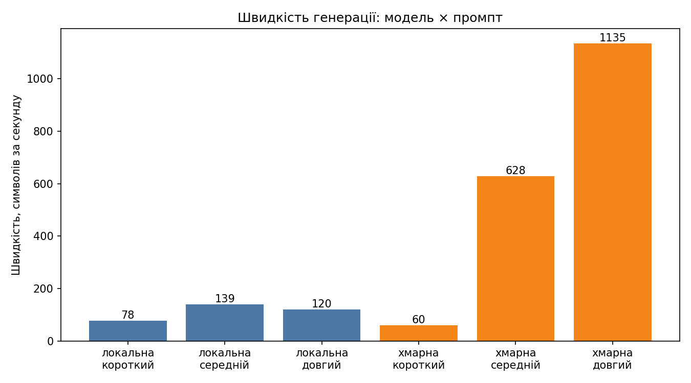

# Лабораторна робота №1. Мовні моделі: локальні та хмарні

**Студент:** Білогуб Аліна Костянтинівна · **Група:** AI-244 · **Варіант:** 1 (тема «Освіта»)

> Відповіді на питання до чат-бота (Кроки «надіслати чат-боту») підготовлено за допомогою чат-бота Claude на основі даних із моїх таблиць. Висновки «своїми словами» наприкінці кожного завдання написані мною.

## 0. Конфігурація

| Параметр | Значення |
|---|---|
| Комп'ютер | MacBook Air, чип Apple M2, 8 ГБ пам'яті |
| ОС | macOS |
| Ollama | 0.40.15 |
| Локальна мала модель | `llama3.2:3b` (2,0 ГБ) |
| Локальна більша модель | `qwen3:4b` (2,5 ГБ, міркувальна) |
| Хмарна модель | `openai/gpt-oss-120b` через Groq (`https://api.groq.com/openai/v1`) |
| Python | 3.9.6 (бібліотеки `openai`, `python-dotenv`, `matplotlib`) |

Примітка: модель `llama-3.3-70b-versatile`, вказана в завданні, на момент виконання (09.11.2026) була недоступна на безкоштовному рівні Groq (помилка 404 `model_not_found`), тому використано `openai/gpt-oss-120b`. Це модель на 120 млрд параметрів, а не 70.

---

## Завдання 1. Ціна роздумів: міркувальна vs інструктивна модель

**Фактичне питання** («Столиця України? Відповідай одним словом.»)

| Показник | qwen3:4b | llama3.2:3b |
|---|---|---|
| `response` | Киев | Київ |
| `eval_count` | 2458 | 4 |
| Час, с | 82,29 | 2,57 |
| Токенів/с | 30,0 | 51,4 |

Час `qwen3:4b` включає завантаження моделі в пам'ять (перший запит).

**Задача на міркування** (середнє з 5 запусків; правильна відповідь 5 грн)

| Показник | qwen3:4b | llama3.2:3b |
|---|---|---|
| Правильних із 5 | 5 | 3 |
| `eval_count` | 1018 | 178 |
| Час, с | 44,5 | 7,2 |

Окремий запит `curl` до `qwen3:4b` («Столиця України?») показав: `response` = «Київ», `thinking` містить довгі роздуми англійською, `done_reason` = `stop`, `eval_count` = 299, `total_duration` ≈ 10,3 с (≈ 30,7 токенів/с).

**Питання до чат-бота (відповіді стисло):**

1. *Куди пішли токени?* У поле `thinking`: модель «міркувала» вголос (перекладала питання, перевіряла, чи не Харків чи Львів, перевіряла правопис). Це такий самий згенерований текст, тому він коштує токенів і часу, хоча користувач бачить лише одне слово.
2. *Де перевага міркувальних моделей?* На арифметиці, логіці, багатокрокових задачах і коді, де проміжні кроки підвищують точність. На простих фактичних питаннях, перекладі чи форматуванні їх використання невиправдане: відповідь та сама, а токенів і часу витрачено в рази більше.
3. *Чим відрізняється навчання?* Інструктивну модель донавчають на парах «інструкція — відповідь» і підкріплюють оцінками людей. Міркувальну додатково тренують навчанням з підкріпленням на задачах з перевірюваною відповіддю (математика, код), тому вона вчиться будувати ланцюг думок перед відповіддю.
4. *Чи означає більше токенів «розумніша»?* Ні. На фактичному питанні `qwen3:4b` навіть відповіла «Киев» російською, а `llama3.2:3b` — правильним «Київ». Перевагу міркувальної моделі видно лише на задачі з розрахунком (5/5 проти 3/5).
5. *Чому різна швидкість (30,0 проти 51,4 ток/с)?* Генерація впирається в читання ваг із пам'яті, тому більша модель (4 млрд проти 3 млрд параметрів) повільніша. Решту різниці дають архітектура, розмір словника та умови запуску на ноутбуці з 8 ГБ.

**Мої думки.** Міркувальна модель `qwen3:4b` краще впоралась із задачею, де треба рахувати: вона розв'язала її 5 разів із 5, а `llama3.2:3b` лише 3 рази. Але на простому питанні про столицю вона витратила 2458 токенів і 82 секунди замість 4 токенів і 2,5 секунди. Тому я б брала міркувальну модель для логіки й розрахунків, а для простих запитів і швидких відповідей інструктивну.

---

## Завдання 2. Роль system-повідомлення

Питання: «Поясни різницю між списком і кортежем у Python.» System-повідомлення: A — «Ти лаконічний технічний асистент.», B — «Відповідай лише українською, максимум двома реченнями.»

| Модель | System | Довжина, симв. | Мова відповіді | Речень | Інструкцію виконано? |
|---|---|---|---|---|---|
| llama3.2:3b | A (лаконічний) | 2136 | українська зі вкрапленнями англійської та русизмів («хранения», «various», «Immutable») | ≈21 | ні, відповідь довга, зі списками й кодом |
| llama3.2:3b | B (укр., 2 речення) | 225 | українська з перекрученнями («круглumi дужками») | 2 | формально так, але зміст хибний |
| qwen3:4b | A (лаконічний) | 156 | українська | 3 | так |
| qwen3:4b | B (укр., 2 речення) | 174 | українська | 2 | так |

| Модель | System | `prompt_tokens` | `completion_tokens` | `total_tokens` |
|---|---|---|---|---|
| llama3.2:3b | A | 54 | 687 | 741 |
| llama3.2:3b | B | 58 | 66 | 124 |
| qwen3:4b | A | 55 | 2109 | 2164 |
| qwen3:4b | B | 64 | 1492 | 1556 |

Примітка: `llama3.2:3b` у відповіді з обмеженням «2 речення» написала, що списки позначаються *круглими* дужками `[]`, а кортежі *квадратними* `( )`. Це навпаки: формат виконано, зміст хибний.

**Відповіді на питання:**

1. Точніше дотрималась `qwen3:4b`: на «лаконічно» вона дала 3 речення, а `llama3.2:3b` — приблизно 21. На «максимум двома реченнями» обидві дали 2, але відповідь `llama` змістовно хибна.
2. Так. Навіть із прямою вказівкою `llama` додавала англійські слова та русизми, а `qwen` відповіла чистою українською.
3. `prompt_tokens` зріс: у `llama` з 54 до 58, у `qwen` з 55 до 64. Друге system-повідомлення довше, а питання те саме.
4. `qwen3:4b` генерує приховані роздуми (`thinking`), які враховуються в `completion_tokens` (2109 і 1492), хоча користувач бачить лише 156–174 символи.

**Питання до чат-бота (стисло):**

1. *Чому моделі по-різному дотримуються інструкцій?* Це залежить від якості навчання на інструкціях і розміру моделі. `qwen3:4b` перед відповіддю «звіряє» вимоги в роздумах, а `llama3.2:3b` відповідає одразу.
2. *System проти user?* Це різні ролі в шаблоні чату, і моделей навчають надавати system більшу вагу. Але це статистична схильність, а не жорстке правило.
3. *Чому міркувальна модель витрачає більше вихідних токенів?* Роздуми генеруються як звичайний текст і рахуються у `completion_tokens`, хоча в `content` їх немає.
4. *Що буде з суперечливими інструкціями?* Найчастіше модель виконає system, але гарантії немає, результат залежить від моделі та формулювань. Тому критичні правила треба ще й перевіряти кодом.
5. *Чому малі моделі гірші з українською?* Українських даних у навчанні значно менше, ніж англійських, а в малої моделі менше параметрів, щоб «тримати» кілька мов, тому вона змішує мови й калькує.

**Мої думки.** System-повідомлення допомагає, але не гарантує результат. `qwen3:4b` виконала обидві інструкції, а мала `llama3.2:3b` на «лаконічно» все одно написала понад 2000 символів, а на «українською, 2 речення» помилилась у змісті (переплутала дужки). Якщо модель ігнорує інструкцію, я б спробувала її скоротити, додати приклад відповіді, знизити `temperature` і перевірити результат кодом.

---

## Завдання 3. Локальна vs хмарна модель

Питання: «Поясни різницю між списком і кортежем у Python. Коротко.» Один і той самий код (`compare.py`), змінюється лише провайдер у `providers.py`.

| Показник | Локальна | Хмарна |
|---|---|---|
| Назва моделі | llama3.2:3b | openai/gpt-oss-120b |
| Час відповіді, с | 7,39 | 2,10 |
| `completion_tokens` | 252 | 286 |
| Довжина відповіді, символів | ≈683 | ≈658 |
| Мова відповіді | українська з вкрапленнями російської, англійської, іспанської та німецької («и кортежи», «tipos», «В general», «möglichі») | чиста українська, англійські терміни в дужках |
| Фактичних помилок | кілька: «Змінній, який не може бути змінений» про кортеж, «Вказується в клавіші», порожні «», безглузда фінальна фраза | немає |

Довжину відповідей пораховано за текстом зі скриншота, тому вона приблизна. У хмарної моделі `completion_tokens` включає 28 `reasoning_tokens`, а `prompt_tokens` більший (93 проти 47) через службову розмітку шаблону чату.

**Відповіді на питання:**

1. У `compare.py` змінювати нічого не довелося, цикл однаковий для обох. У `providers.py` змінюються три значення: `base_url`, `api_key` (із `.env`) і `model`.
2. Повнішою й точнішою є хмарна. Вона правильно пише, що список оголошується `[]`, кортеж `()`, і що кортеж може бути ключем словника, а локальна називає кортеж «Змінній, який не може бути змінений».
3. Так: локальна змішала українську, російську, англійську, іспанську («tipos») та німецьку («möglichі»), і зробила фактичні помилки.
4. Хмарна швидша, бо запит виконується на потужному обладнанні в дата-центрі, а локальна модель рахується на 8 ГБ ноутбука. Затримка мережі (десяті частки секунди) значно менша за виграш у швидкості генерації. Сам час обробки в Groq 0,70 с, решта із 2,10 с — черга й мережа.

**Питання до чат-бота (стисло):**

1. *Чому формат OpenAI став стандартом?* OpenAI першою зробила масовий API, навколо нього виросли бібліотеки й інструменти. Інші провайдери (і Ollama) повторюють формат, щоб розробникам не доводилося переписувати код при зміні провайдера.
2. *Наскільки розмір впливає на якість?* Сильно: більша модель краще знає факти, мови та інструкції (наше порівняння 3 млрд проти 120 млрд). Але важливі й якість навчальних даних, архітектура, донавчання та квантування, тому розмір не єдиний чинник.
3. *Чому хмарна швидша попри мережу?* Через спеціалізоване обладнання з великою пропускною здатністю пам'яті та оптимізований інференс, а затримка мережі мала порівняно з часом генерації.
4. *Які ризики приватності?* Дані покидають ваш комп'ютер, можуть логуватися чи (залежно від умов) використовуватися для навчання, а витік ключа дозволяє чужим витрачати ваш ліміт. У комерційних проєктах використовують договори без збереження даних, анонімізацію, приватні розгортання або локальні моделі.
5. *Що таке rate limit?* Обмеження на кількість запитів чи токенів за хвилину/день на безкоштовному тарифі. Законні способи впоратися: розподіляти запити в часі, повторювати з наростаючою паузою, кешувати відповіді, переходити на платний тариф.

**Мої думки.** Локальну модель я б вибрала, коли дані не можна віддавати стороннім (особисті чи робочі документи) або коли немає інтернету. Хмарну, коли важливі якість, швидкість і правильна українська: у нашому тесті вона відповіла швидше (2,1 с проти 7,4 с) і без помилок. Для навчання зручно локальна, бо безкоштовно й нічого не потрібно реєструвати.

---

## Завдання 4. Вимірювання швидкості

**Результати вимірювання** (медіана з 3 запусків після прогріву; файл `results.csv`)

| Розміщення | Модель | Промпт | TTFT, с | Всього, с | Симв./с |
|---|---|---|---|---|---|
| локальна | llama3.2:3b | короткий | 0,037 | 0,321 | 77,8 |
| локальна | llama3.2:3b | середній | 0,048 | 2,709 | 138,8 |
| локальна | llama3.2:3b | довгий | 0,137 | 18,145 | 119,6 |
| хмарна | openai/gpt-oss-120b | короткий | 0,376 | 0,402 | 59,7 |
| хмарна | openai/gpt-oss-120b | середній | 0,511 | 0,802 | 628,1 |
| хмарна | openai/gpt-oss-120b | довгий | 0,414 | 2,1 | 1134,6 |

Промпти: короткий — «Столиця Франції?», середній — «Поясни в одному абзаці, що таке рекурсія.», довгий — «Напиши інструкцію з 10 пунктів, як почати вивчати Python.»

**Холодний і теплий старт** (llama3.2:3b, короткий промпт)

| Показник | Холодний старт | Теплий старт |
|---|---|---|
| TTFT, с | 3,367 | 0,074 |
| Всього, с | 3,713 | 0,421 |

**Діаграма:**



**Відповіді на питання:**

1. Кращий TTFT у локальної моделі (0,04–0,14 с проти 0,38–0,51 с у хмарної): їй не потрібні дорога через мережу й черга, а модель уже в пам'яті. Хмарна `gpt-oss` до того ж спочатку «міркує».
2. Ні, не збігається. Локальна виграє за TTFT, а хмарна за швидкістю генерації (628 і 1135 проти 139 і 120 симв./с). На короткому промпті хмарна навіть програє (59,7 проти 77,8), бо відповідь коротка і час майже весь іде на затримку.
3. На короткому промпті локальна трохи швидша (0,32 с проти 0,40 с), на довгому хмарна швидша майже в 9 разів (2,1 с проти 18,1 с).
4. Повтори різняться помітно: загальний час локальної на довгому промпті 17,4 / 25,3 / 18,1 с (різниця до 45 %), TTFT хмарної на середньому 0,33–0,63 с. Одного запуску недостатньо, медіана зменшує вплив викидів.
5. Холодний старт повільніший, бо ваги моделі (≈2 ГБ) спершу треба прочитати з диска в пам'ять: 3,37 с проти 0,07 с.

**Питання до чат-бота (стисло):**

1. *Що відбувається під час TTFT?* Запит надходить до сервера, стоїть у черзі, модель обробляє весь вхідний текст і генерує перший токен. Його міряють окремо, бо він визначає, як швидко користувач бачить хоч щось, а швидкість генерації впливає лише на тривалість подальшого очікування.
2. *Чому хмарна має гірший TTFT, але кращу швидкість?* До затримки додаються мережа та черга (а у `gpt-oss` ще й міркування), але потужне обладнання дата-центру генерує текст набагато швидше за ноутбук.
3. *Що таке холодний старт?* Це перший запуск, коли модель ще не завантажена з диска в пам'ять. Далі вона залишається в пам'яті (в Ollama за замовчуванням приблизно 5 хвилин), тому наступні запити швидкі.
4. *Чому медіана, а не одне значення?* Окремі запуски можуть бути спотворені фоновими процесами, мережею чи кешем, а медіана не залежить від таких викидів.
5. *Чому обробка запиту швидша за генерацію?* Вхідні токени обробляються паралельно одним великим обчисленням, а відповідь генерується послідовно, токен за токеном, і кожен крок потребує читання всіх ваг моделі.

**Мої думки.** Для чат-бота важливіший TTFT, тобто за скільки секунд з'явиться перше слово, бо користувач не хоче дивитися на порожній екран. Для великих обсягів тексту, які обробляються у фоні, важливіші швидкість генерації та загальний час. У нашому тесті локальна модель виграла за TTFT, а хмарна за швидкістю: на довгому промпті вона була майже в 9 разів швидшою.

---

## Завдання 5. Оцінювання якості за рубрикою

Кожне завдання виконано двічі (`temperature=0.7`). У таблицю записано **менший** з двох балів. Правильна відповідь у завданні 1 — **1865** (джерело: Вікіпедія, стаття «Одеський національний університет імені І. І. Мечникова»), у завданні 5 — **8**. Текст для завдання 3 узято з тієї самої статті Вікіпедії (файл `text.txt`).

**Оцінка якості за рубрикою**

| Завдання | llama3.2:3b | qwen3:4b | Хмарна модель |
|---|---|---|---|
| 1. Факт | 0 | 0 | 1 |
| 2. Формат | 2 | 2 | 2 |
| 3. Стиснення | 0 | 2 | 2 |
| 4. Код | 2 | 2 | 2 |
| 5. Логіка | 1 | 2 | 2 |
| 6. Українська | 0 | 1 | 2 |
| **Разом /12** | **5** | **9** | **11** |

**Розбіжність оцінок між двома прогонами (так / ні)**

| Завдання | llama3.2:3b | qwen3:4b | Хмарна модель |
|---|---|---|---|
| 1. Факт | ні | ні | так |
| 2. Формат | ні | ні | ні |
| 3. Стиснення | ні | ні | ні |
| 4. Код | ні | ні | ні |
| 5. Логіка | так | ні | ні |
| 6. Українська | ні | ні | ні |

**Перевірка завдання 2 (`json.loads()`):** усі шість відповідей (по дві від кожної моделі) парсяться без правок. Жодна модель не обгорнула JSON у markdown. Зміст при цьому часто хибний: наприклад, `llama3.2:3b` вказала роки 1940 і 1925, написала «Одесса» та назву латинкою з кирилічними літерами.

**Пояснення оцінок:**
- Завдання 1: `llama3.2:3b` дала 1921 і 1855, `qwen3:4b` — 1920 і 1914, хмарна — 1900 і 1865. Лише в хмарної є правильний рік, і лише в одному прогоні, тому 1 бал за розбіжність.
- Завдання 3: `llama3.2:3b` втратила всі числа (1865, 1945, 12, 4) і написала одне речення. `qwen3:4b` і хмарна зберегли всі числа у двох реченнях.
- Завдання 4: усі функції `is_palindrome` працюють. Хмарна обгортає код у блок ```` ```python ````, зайвого тексту немає.
- Завдання 5: усі отримали 8. У `llama3.2:3b` у першому прогоні хибна «формула» (кількість = кількість − …), а в тексті є російські та в'єтнамські слова.
- Завдання 6: `llama3.2:3b` написала нісенітницю («стек — структурний елемент з електронів», «стек виробляється з хімічних матеріалів, черга — з деревини»). `qwen3:4b` має кальки («дві різновиди», «видаляння», «на противному»). Хмарна пише природною українською.

**Крок 7. Приклад провалу моделі**

- **Запит:** «Рік заснування Одеського національного університету імені І. І. Мечникова. Відповідай лише роком.»
- **Відповіді:** `llama3.2:3b`: «1921» і «1855.»; `qwen3:4b`: «1920» і «1914»; `gpt-oss-120b`: «1900» і «1865».
- **Правильна відповідь:** 1865.
- **Чому це провал:** модель не «шукає» факт, а генерує правдоподібний рік. Регіональні факти рідко трапляються в навчальних даних, тому відповіді різні в кожному запуску. Розбіжність між прогонами показує, що це галюцинація, а не знання; правильний збіг в одному з двох прогонів хмарної моделі не доводить, що вона знає цей факт.

**Питання до чат-бота (стисло):**

1. *Які ще способи оцінювання?* Стандартні бенчмарки (MMLU, GSM8K, HumanEval), оцінювання іншою моделлю («LLM-as-judge»), порівняння людьми (Chatbot Arena), автоматичні тести для коду, власні набори завдань під конкретний продукт.
2. *Чому модель ігнорує «без markdown»?* Під час донавчання чат-моделі звикають оформлювати відповіді списками й розміткою, і ця звичка не завжди перебивається інструкцією. У нашому тесті всі виконали вимогу, але в завданні 4 хмарна все одно додала блок коду.
3. *Чому малі моделі гірші з українською?* Українських даних у навчанні значно менше, ніж англійських, у малої моделі менше параметрів для кількох мов одночасно, а близькість до російської призводить до змішування.
4. *Чому відповіді різні при однакових запитах?* При `temperature > 0` наступний токен обирається випадково серед імовірних, тому відповіді різняться. Крім того, дрібні відмінності в обчисленнях з плаваючою комою теж можуть змінювати результат.
5. *Чому моделі галюцинують?* Модель вчиться передбачати правдоподібне продовження тексту, а не шукати у базі фактів, і її навчання винагороджує впевнені відповіді більше, ніж «не знаю».

**Мої думки.** Рубрика допомогла порівняти моделі, але вона не ідеальна: у нас лише два прогони на завдання, а оцінка якості мови трохи суб'єктивна. Найкраще розрізнили моделі завдання з фактом, стиснення тексту й українська мова. Для українського тексту я б вибрала хмарну `gpt-oss-120b`, а з локальних `qwen3:4b`. `llama3.2:3b` я б не довіряла ні фактам, ні цифрам.

---

## Завдання 6. Керування випадковістю: temperature і top_p

Творче завдання: «Назва стартапу в галузі логістики». Фактичне питання: «Рік заснування Національного університету "Одеська Політехніка"». Правильна відповідь — **1918** (джерело: довідник osvita.ua, університет створено 18 вересня 1918 року). Модель: `llama3.2:3b`.

**Вплив параметрів на різноманітність відповідей**

| Параметр | Значення | Унікальних із 5 (творче) | Правильних із 5 (фактичне) |
|---|---|---|---|
| temperature | 0.0 | 1 | 0 |
| temperature | 0.7 | 5 | — |
| temperature | 1.5 | 5 | 1 |
| top_p | 0.1 | 1 | — |
| top_p | 0.5 | 5 | — |
| top_p | 1.0 | 5 | — |

Фактичне питання: при `temperature=0.0` усі п'ять відповідей «1925» (хибно); при `1.5` — 2008, 1994, 1955, 1920 і 1918 (правильний лише останній, і той випадково).

**Перевірка відтворюваності**

| Показник | Значення |
|---|---|
| Кількість запусків | 10 |
| temperature | 0.0 |
| Унікальних відповідей | 1 |
| Усі відповіді однакові (так / ні) | так |

Висновок із експерименту: при `temperature=0` модель десять разів підряд упевнено дала хибний рік (1925). Однакова відповідь не означає правильну: температура керує випадковістю, а не знаннями.

**Відповіді на питання:**

1. *Температура для агента, що повертає JSON?* Близька до нуля (0–0,2): структура й значення мають бути передбачуваними, а випадковість може зламати формат чи значення полів.
2. *Для генератора варіантів заголовків?* Помірно висока (приблизно 0,7–1,0), щоб варіантів було багато, але не безглуздих, як при 1,5.
3. *Чим top_p відрізняється за характером?* `temperature` змінює форму всього розподілу ймовірностей (робить його рівнішим або гострішим), а `top_p` відкидає «хвіст» малоймовірних токенів і залишає набір найімовірніших. У нашому експерименті `top_p=0.1` дав одну й ту саму відповідь п'ять разів, як `temperature=0`; `top_p=0.5` дав різні, переважно змістовні назви; а `temperature=1.5` призвів до розпаду тексту (чужі слова всередині речень).
4. *Чи означає temperature=0 повну відтворюваність?* У нашому експерименті так: усі 10 запусків збіглися. Але гарантії немає, бо обчислення з плаваючою комою та паралелізація можуть давати мінімальні відмінності.
5. *Найбезглуздіша відповідь при temperature=1.5:* «Существуют багато стартапов в галузі логістики.以下 alcuni примеров:» — рядок змішує російську, українську, китайську та італійську. Вона могла з'явитися, бо при високій температурі розподіл ймовірностей «розплющується» і шанс отримують малоймовірні токени з інших мов; а оскільки модель багатомовна, обраний токен іншою мовою тягне за собою продовження цією мовою.

**Питання до чат-бота (стисло):**

1. *Що робить temperature математично?* Ділить логіти (сирі оцінки токенів) на значення температури перед softmax. Низька температура робить розподіл гострішим (найімовірніший токен домінує), висока робить його рівнішим, і шанс отримують малоймовірні токени. При 0 береться завжди найімовірніший токен.
2. *Чим top_p відрізняється?* Це відсікання: беруться найімовірніші токени, поки сумарна ймовірність не досягне `p`, решта відкидається, і вибір робиться з цього набору. Параметр обмежує набір кандидатів, а не змінює ймовірності всіх токенів.
3. *Змінювати обидва параметри?* Зазвичай краще змінювати один, бо їхні ефекти накладаються і важко зрозуміти, що саме дало результат.
4. *Чому навіть при temperature=0 можуть бути різні відповіді?* Через дрібні відмінності в обчисленнях з плаваючою комою на GPU/CPU, різний порядок паралельних операцій і пакетну обробку запитів на сервері.
5. *Практичні значення?* Для структурованих даних 0–0,2, для коду й фактів низькі значення, для творчих текстів приблизно 0,7–1,0.

**Мої думки.** Для лабораторних, де модель має повертати структуровані дані, я поставлю `temperature` близько 0–0,2, а `top_p` не чіпатиму. Значення за замовчуванням створені для чату й можуть вносити випадкові помилки в поля чи формат. Ще я побачила, що при `temperature=0` модель десять разів підряд повторила неправильний рік (1925 замість 1918), тобто низька температура робить відповідь стабільною, але не правильною.

---

## Підсумкове порівняння моделей

| Критерій | Локальна мала (3B) `llama3.2:3b` | Локальна більша (4B) `qwen3:4b` | Хмарна `gpt-oss-120b` |
|---|---|---|---|
| Швидкість генерації | ≈120–139 симв./с (≈51 ток/с) | ≈30 ток/с | ≈628–1135 симв./с |
| TTFT | 0,04–0,14 с | окремо не вимірювався; через «роздуми» перша відповідь з'являється пізніше (82 с на просте питання при першому запуску) | 0,38–0,51 с |
| Якість, балів /12 | 5 | 9 | 11 |
| Стабільність формату (завдання 2) | JSON парситься в 2 з 2 прогонів, але зміст хибний | JSON парситься в 2 з 2 прогонів | JSON парситься в 2 з 2 прогонів |
| Потрібні ресурси | ≈2 ГБ диска та пам'яті, працює на ноутбуці з 8 ГБ | ≈2,5 ГБ, але дуже довго «думає» (до 80 с) | лише інтернет і API-ключ |
| Вартість | безкоштовно (електроенергія) | безкоштовно (електроенергія) | безкоштовний рівень з лімітами (rate limit), далі оплата за токени |
| Куди йдуть ваші дані | залишаються на комп'ютері | залишаються на комп'ютері | на сервери провайдера (Groq) |
| Працює без інтернету | так | так | ні |
| Коли обирати саме її | швидкі прості запити й конфіденційні дані, де якість не критична (короткі відповіді, класифікація) | локальні задачі з розрахунками й логікою, коли дані не можна відправляти назовні, а час відповіді не критичний | складні запити, українська мова, висока якість і швидкість, якщо дані не конфіденційні |

**Правило вибору.** Я візьму локальну модель, попри слабкість, коли дані конфіденційні, немає стабільного інтернету або запитів багато і вони прості: тоді важливіші приватність і нульова вартість за запит. Для розрахунків і логіки на локальній машині краще `qwen3:4b`, для швидких коротких відповідей `llama3.2:3b`. Хмарну модель я візьму, коли потрібні висока якість, правильна українська та швидкість, а передача даних назовні й залежність від мережі припустимі. Перед використанням будь-якої моделі її відповіді на критичні факти треба перевіряти, бо навіть найбільша модель при першому прогоні дала хибний рік.

## Висновок

Три моделі показали різні профілі. Мала `llama3.2:3b` швидка, але ненадійна з фактами й українською (5 балів із 12). Міркувальна `qwen3:4b` точніша в розрахунках (9 з 12), але витрачає на прості питання сотні токенів і десятки секунд. Хмарна `gpt-oss-120b` найкраща за якістю (11 з 12) і швидкістю генерації, але потребує інтернету й передачі даних назовні. Параметри `temperature` і `top_p` керують різноманітністю, а не правильністю відповіді: при `temperature=0` модель однаково впевнено повторювала хибний рік. Тому вибір моделі залежить від задачі, а результати критичних запитів треба перевіряти.
