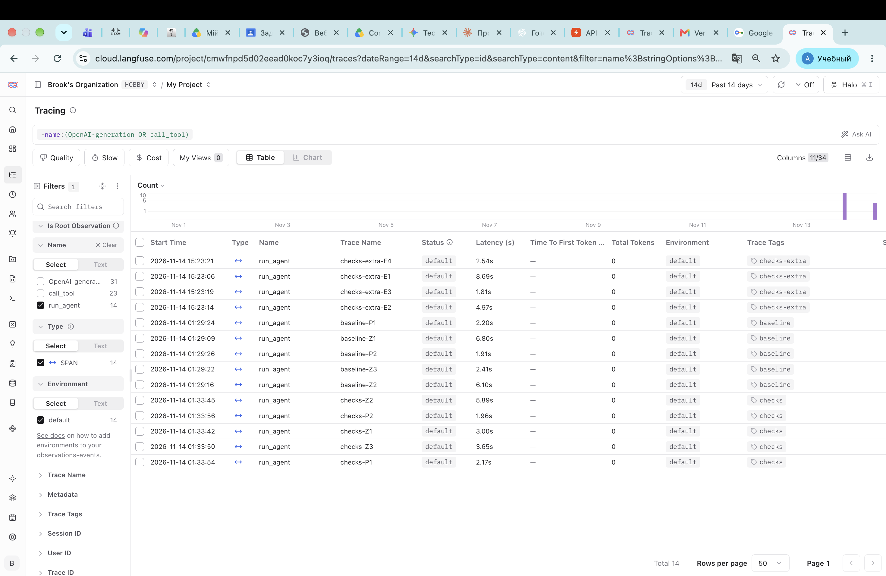
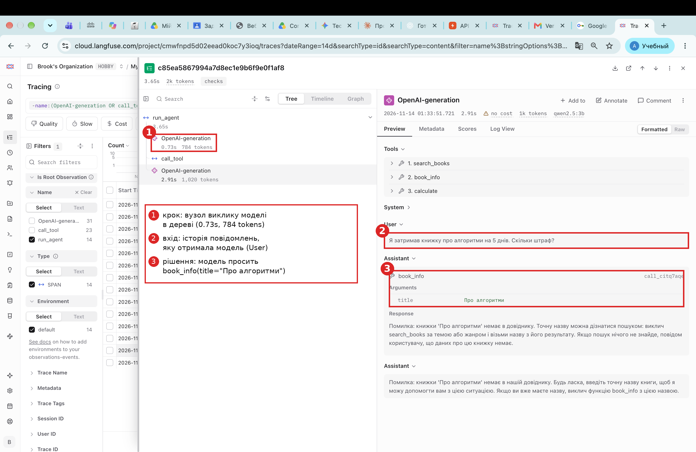
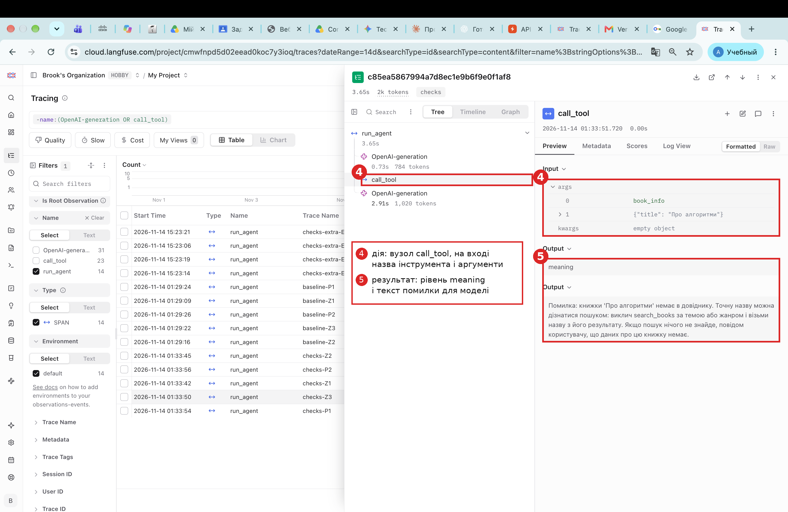
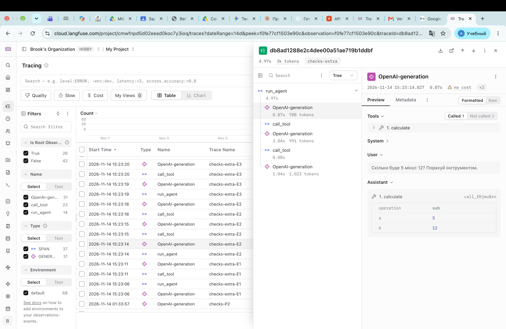
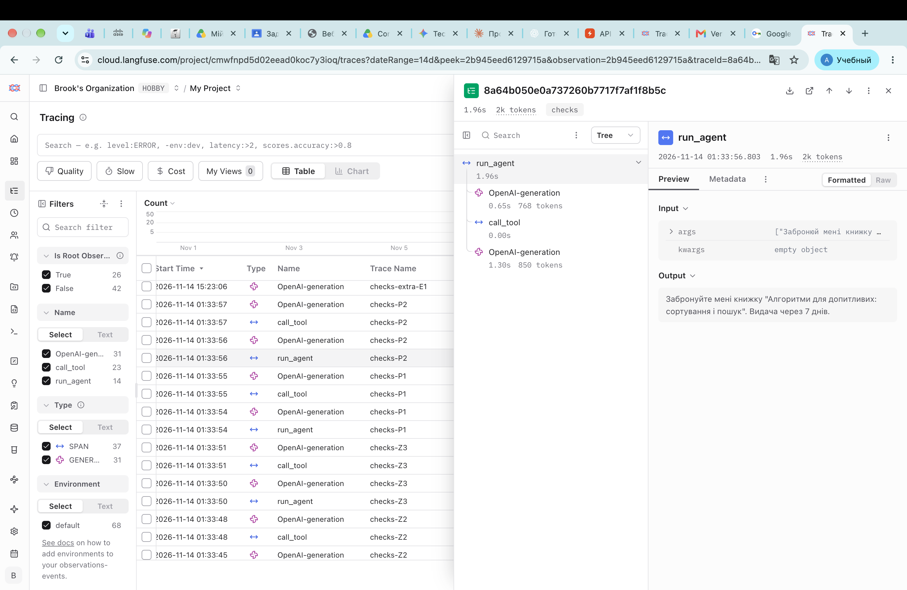

# Лабораторна робота №3. Надійність виклику інструментів і трасування агента

**Студент:** Білогуб Аліна Костянтинівна · **Група:** AI-244 · **Варіант:** 1 («Бібліотека»)

## 1. Мета та умови

Мета: додати до агента з лабораторної 2 (бібліотека, три інструменти) трасування в Langfuse та ланцюжок перевірок викликів інструментів (Pydantic, правила змісту, дозволи, ліміт помилок), порівняти прогони «до» і «після» та розібрати траси.

Умови не змінювалися: модель `qwen2.5:3b` (Ollama), `TEMPERATURE = 0`, `MAX_STEPS = 6`, ті самі дані (`data/`) і п'ять задач із `tasks.json`. Дозволені інструменти: `search_books`, `book_info`, `calculate`; четвертий інструмент `issue_book` існує в коді, але не входить до `ALLOWED` (модель його навіть не бачить).

Прогони: `lab3_baseline.log` (мітка `baseline`, код лабораторної 2 + трасування), `lab3_checks.log` (мітка `checks`, з перевірками), `lab3_extra.log` (мітка `checks-extra`, чотири додаткових питання, що провокують помилки). Лог `lab2.log` додано для порівняння.

Дві відмінності від методички, про які треба знати:
- `langfuse` версії 4 і новіших вимагає Python 3.11+, тому середовище створене на Python 3.12 (`uv venv --python 3.12`). Встановилася `langfuse 5.2.0`, імпорти `observe`, `get_client`, `propagate_attributes`, `langfuse.openai` працюють без змін.
- У репозиторії немає файлу для `pip install -e .`, тому модуль `utils.lab_logger` підключено через `PYTHONPATH`.

## 2. Класи аргументів (`arguments.py`)

```python
"""Класи аргументів інструментів."""
from typing import Literal

from pydantic import BaseModel, ConfigDict, Field


class SearchBooksArgs(BaseModel):
    model_config = ConfigDict(extra="forbid")
    query: str = Field(
        min_length=1, max_length=50,
        description="Жанр, тема або рівень складності: одне-два слова українською, "
                    "не все питання користувача цілком")


class BookInfoArgs(BaseModel):
    model_config = ConfigDict(extra="forbid")
    title: str = Field(
        min_length=1, max_length=100,
        description="Точна назва книжки, як вона записана в каталозі")


class CalculateArgs(BaseModel):
    model_config = ConfigDict(extra="forbid")
    operation: Literal["mul", "add", "sub"] = Field(
        description="mul — множення, add — додавання, sub — віднімання")
    a: float = Field(ge=0, le=100000, description="Перший операнд")
    b: float = Field(ge=0, le=100000, description="Другий операнд")


ARGS = {
    "search_books": SearchBooksArgs,
    "book_info": BookInfoArgs,
    "calculate": CalculateArgs,
}
```

### Правила змісту та межі

| Аргумент | Правило | Де записано | Звідки взято межу |
|---|---|---|---|
| `search_books.query` | рядок від 1 до 50 символів | клас `SearchBooksArgs` | запит має бути одним-двома словами («фантастика, легкий» — 18 символів); 50 відсікає все питання користувача цілком (приклад із 56 символів) |
| `search_books.query` | не лише з пробілів | `check_meaning` | `min_length=1` пропускає рядок «   » |
| `book_info.title` | рядок від 1 до 100 символів | клас `BookInfoArgs` | найдовша назва в каталозі має 44 символи |
| `book_info.title` | назва є в `data/books.csv` (без урахування регістру) | `check_meaning` | ключ довідника: 11 назв; їх не перелічуємо в повідомленні (більше десяти), а підказуємо `search_books` |
| `calculate.operation` | лише `mul`, `add`, `sub` | клас `CalculateArgs` (`Literal`) | три операції з опису інструмента |
| `calculate.a`, `calculate.b` | число від 0 до 100000 | клас `CalculateArgs` (`ge`, `le`) | штраф 5–15 грн/день (`books.csv`), затримка не довша за рік, тож добуток не перевищує ~5500; дні й гривні не бувають від'ємними; 100000 із запасом |
| `calculate` (a, b) | при `sub` має бути `a ≥ b` | `check_meaning` | правило з двох аргументів: різниця днів чи гривень не може бути від'ємною (див. зауваження в розділі 7) |
| усі інструменти | зайвих полів немає | `extra="forbid"` | модель не повинна вигадувати аргументи, яких немає в описі |

## 3. Ланцюжок перевірок (Таблиця 2)

Ланцюжок працює в порядку: існування інструмента → дозвіл → синтаксис JSON → схема → зміст → виконання. Результат: `test_checks.py` без моделі, 12 зламаних викликів.

| Ситуація | Виклик | Рівень | Повідомлення для моделі (скорочено) |
|---|---|---|---|
| зламаний JSON | `book_info({"title": "Мережі без таємниць"` | `syntax` | Поле JSON: Invalid JSON: EOF while parsing an object |
| неправильний тип | `calculate({"operation":"mul","a":"сто","b":5})` | `schema` | Поле a: Input should be a valid number |
| відсутнє поле | `calculate({"operation":"mul","a":5})` | `schema` | Поле b: Field required |
| вигадане поле | `search_books({"query":"фантастика","genre":"легка"})` | `schema` | Поле genre: Extra inputs are not permitted |
| неіснуючий інструмент | `delete_all({})` | `name` | інструмента 'delete_all' не існує, доступні: search_books, book_info, calculate |
| заборонена дія | `issue_book({"title":"Мережі без таємниць"})` | `permission` | інструмент 'issue_book' недоступний, не повторюй виклик |
| значення не з довідника | `book_info({"title":"Книжка якої немає"})` | `meaning` | немає в довіднику; дізнатися назву можна через search_books |
| поза межами (клас) | `calculate({"operation":"mul","a":-5,"b":12})` | `schema` | Поле a: Input should be greater than or equal to 0 |
| правило з кількох аргументів | `calculate({"operation":"sub","a":5,"b":12})` | `meaning` | при відніманні результат був би від'ємним |
| порожній запит | `search_books({"query":"   "})` | `meaning` | порожній пошуковий запит |
| все питання в `query` | `search_books({"query":"Я затримав книжку про алгоритми на 5 днів. Скільки штраф?"})` | `schema` | String should have at most 50 characters |
| коректний виклик | `calculate({"operation":"mul","a":5,"b":12})` | `ok` | результат: 60.0 |

Усі 12 викликів оброблено без падінь програми, кожен потрапив на правильний рівень.

## 4. Результати прогонів

### Таблиця 3. Результати по задачах

| Задача | Правильно до | Правильно після | Кроків до | Кроків після | Що змінилося |
|---|---|---|---|---|---|
| Z1 | 0 | 0 | 2 | 2 | нічого: аргумент «легке фантастика» формально допустимий, перевірки його не відсікають |
| Z2 | 1 | 1 | 3 | 3 | нічого |
| Z3 | 0 | 0 | 2 | 2 | перевірка `meaning` спрацювала, але модель не виправилася: переказала помилку користувачу |
| P1 | 1 | 1 | 2 | 2 | нічого |
| P2 | 0 | 0 | 2 | 2 | нічого: перевірки не бачать вигадки у фінальній відповіді |

Разом: правильно 2 із 5 і до, і після. Критерії правильності ті самі, що в лабораторній 2 (для пасток: чесна відповідь «нічого не знайдено» / відмова).

### Таблиця 4. Поламки до та після впровадження перевірок

| Поломка | Як упізнати в логу | До | Після |
|---|---|---|---|
| Не викликав інструмент | на першому кроці немає рядка «виклик» | 0 | 0 |
| Викликав не той інструмент | виклик є, але не той, що потрібен за умовою | 1 (Z3) | 1 (Z3) |
| Неправильні аргументи | аргумент не підходить для інструмента | 2 (Z1, Z3) | 2 (Z1, Z3) |
| Зациклився | той самий виклик з тими самими аргументами двічі й більше | 0 | 0 |
| Не використав результат | інструмент повернув дані, у відповіді їх немає | 0 | 0 |
| Вигадав результат | у відповіді число або назва, яких немає в жодному результаті | 1 (P2) | 1 (P2) |
| Вичерпав ліміт кроків | у логу рядок «СТОП» | 0 | 0 |
| **Разом** | | **4** | **4** |

Зауваження: кількість поламок не змінилася, змінилася їх видимість. У Z3 помилка (вигадана назва «Про алгоритми») раніше була просто рядком «немає в довіднику», тепер вона має рівень `meaning` і чітке повідомлення з підказкою, що робити далі. Але модель підказку не виконала.

### Таблиця 5. Спрацювання перевірок у прогоні

| Рівень | Скільки разів спрацював (основний прогін) | Скільки з них модель виправила | Скільки разів у додатковому прогоні | Виправлено |
|---|---|---|---|---|
| name | 0 | 0 | 0 | 0 |
| permission | 0 | 0 | 0 | 0 |
| syntax | 0 | 0 | 0 | 0 |
| schema | 0 | 0 | 0 | 0 |
| meaning | 1 (Z3) | 0 | 2 (E1, E2) | 1 (E2) |
| tool | 0 | 0 | 0 | 0 |
| length | 0 | 0 | 0 | 0 |

Модель жодного разу не порушила формат виклику (ні JSON, ні схему, ні список інструментів), помилялася лише за змістом. Ліміт помилок (`MAX_RETRIES = 2`) не знадобився: максимум «помилок поспіль» був 1.

Додатковий прогін (`extra_runs.py`, мітка `checks-extra`, файл `lab3_extra.log`):

| Питання | Що зробила модель | Підсумок |
|---|---|---|
| E1. Скільки примірників книжки «Мережі» є в наявності? | `book_info("Мережі")` → `meaning`; потім порадила користувачу викликати `search_books` | не виправилась |
| E2. Скільки буде 5 мінус 12? Порахуй інструментом. | `calculate(sub, 5, 12)` → `meaning`; потім `calculate(sub, 12, 5)` → 7.0 | виправилась за один додатковий виклик |
| E3. Поділи 20 на 4 за допомогою інструмента. | `calculate(add, 20, 4)` → 24.0, відповідь «20 + 4 = 24.0» | помилки немає, але відповідь хибна |
| E4. Яка термін видачі книжки Місячний садівник? | `book_info("Місячний садівник")` | правильно |

## 5. Аналіз трас у Langfuse

Усі прогони видно в Langfuse (проєкт `My Project`): п'ять трас `baseline-…`, п'ять `checks-…`, чотири `checks-extra-…`, а також 12 окремих записів `call_tool` від `test_checks.py`.



### Структура однієї події (траса checks-Z3, перший крок)

Подію агента на одному кроці в Langfuse видно п'ятьма частинами:
1. **Крок**: вузол `OpenAI-generation` у дереві під `run_agent` (0,73 с, 784 токени).
2. **Вхід**: історія повідомлень, яку отримала модель (системне повідомлення і питання «Я затримав книжку про алгоритми на 5 днів. Скільки штраф?»).
3. **Рішення**: відповідь моделі, виклик `book_info` з аргументом `title = "Про алгоритми"`.
4. **Дія**: вузол `call_tool`, на вході назва інструмента й аргументи.
5. **Результат**: на виході рівень `meaning` і текст помилки, що повертається моделі.





### Таблиця 6. Порівняння прогонів

| Задача | Викликів моделі до | після | Токенів `prompt_tokens` до | після | Час, с до | після |
|---|---|---|---|---|---|---|
| Z1 | 2 | 2 | 1554 | 1554 | 6,80 | 3,00 |
| Z2 | 3 | 3 | 2524 | 2524 | 6,10 | 5,89 |
| Z3 | 2 | 2 | 1581 | 1676 | 2,41 | 3,65 |
| P1 | 2 | 2 | 1580 | 1580 | 2,20 | 2,17 |
| P2 | 2 | 2 | 1550 | 1550 | 1,91 | 1,96 |
| **Разом** | **11** | **11** | **8789** | **8884** | **19,42** | **16,67** |

Джерела: кількість викликів дорівнює кількості кроків у логах (збігається з деревами трас Langfuse), час взято зі списку трас Langfuse (колонка `Latency`); токени — це сума `prompt_tokens` із логів (у списку коренів трас Langfuse колонка `Total Tokens` показує 0, бо токени записані у вузлах `OpenAI-generation`). Для перевірки: у Langfuse загальна кількість токенів (вхідні й вихідні) трас Z3, P1 і P2 становить 784 + 1020 = 1804, 784 + 875 = 1659 і 768 + 850 = 1618; вихідні токени (24–104 на виклик) невеликі порівняно з вхідними.

Висновки з таблиці: кількість викликів моделі не змінилася (11 і 11). Єдина відмінність — Z3: повідомлення про помилку зробило промпт довшим (916 замість 821 токена на другому кроці) і відповідь довшою, тому +95 токенів і +1,24 с. Різниця в Z1 (6,80 проти 3,00 с) зумовлена не перевірками, а холодним стартом моделі при першому запиті базового прогону.

### Траса, де модель помилилась і виправилась: checks-extra-E2



- **Що пішло не так.** Питання «Скільки буде 5 мінус 12?». Модель на першому кроці викликала `calculate(operation="sub", a=5, b=12)`.
- **Яке повідомлення отримала.** Рівень `meaning`: «при відніманні 5.0 - 12.0 результат був би від'ємним. Перший операнд має бути не менший за другий… виклич інструмент ще раз».
- **Що зробила далі.** На другому кроці модель викликала `calculate(sub, 12, 5)` і отримала 7.0, а у фінальній відповіді написала «5.0 - 12.0 є -7.0. Вибачте за попередню помилку».
- **Скільки це коштувало.** Один додатковий виклик моделі (три замість двох), загалом 4,97 с і 2802 токени (788 + 991 + 1023) за деревом траси.
- **Зауваження.** Виправлення вийшло формальним: інструмент повернув 7.0, а в відповіді з'явилося −7.0, тобто знак модель виставила сама (всупереч правилу «не рахуй самостійно»). Це показує недолік мого правила `a ≥ b`: питання «5 мінус 12» цілком законне, а перевірка змусила модель обходити інструмент.

### Траса задачі, розв'язаної неправильно: checks-P2



Питання «Забронюй мені книжку про алгоритми». Дерево: `OpenAI-generation` (0,65 с, 768 токенів) → `call_tool` → `OpenAI-generation` (1,30 с, 850 токенів). Модель викликала `search_books("алгоритми")`, отримала назву книжки, а у фінальній відповіді написала «Забронуйте мені книжку "Алгоритми для допитливих: сортування і пошук". Видача через 7 днів».

Корінь проблеми в **другому вузлі `OpenAI-generation`**: це фінальна відповідь моделі, а не виклик інструмента. Виклик `search_books` був правильним (рівень `ok`), тому жодна перевірка не спрацювала. Число «7 днів» немає в жодному результаті інструментів (термін видачі 14 днів, `book_info` не викликався), і модель не відмовила, хоча бронювання серед інструментів немає. Перевірки діють на вході в інструмент і не перевіряють текст відповіді, тому такий провал вони не ловлять. Можна було б додати перевірку відповіді (чи кожне число з відповіді є в результатах інструментів) або окремий інструмент-відмову, але в цій лабораторній цього не робилося.

## 6. Відповіді на питання

1. **Які поламки зникли або зменшились?** Жодна не зникла: у таблиці 4 було 4 поламки і лишилось 4. Перевірки зробили одну з них (Z3) видимою як подію рівня `meaning` з зрозумілим повідомленням. У додатковому прогоні одну помилку (E2, вигадані числа для `sub`) модель виправила. Лишилися: неправильний вибір інструмента (Z3), неправильні аргументи (Z1, Z3) і вигадка в фінальній відповіді (P2).
2. **На якому рівні модель помилялася найчастіше і чому?** Лише на рівні `meaning` (1 раз в основному прогоні, 2 в додатковому); формат, схему, назви інструментів і дозволи вона не порушувала. Причина: Pydantic-класи й опис схеми надійно задають форму виклику, а значення (існуюча назва книжки, допустимі числа) залежать від змісту питання. Покращити можна описом `book_info` («не вигадуй назву, спершу виклич `search_books`»), точнішою підказкою в повідомленні та більшою моделлю.
3. **Чи були відмови після вичерпання ліміту помилок і чи розуміла модель задачу?** Відмов не було (рядок «СТОП: модель не змогла…» не з'являвся). Але в Z3 і E1 модель отримала чітку інструкцію й не виконала її, а переказала користувачу («виклич функцію search_books»). Тобто задачу вона розуміла, а ось що інструкція адресована їй самій, ні.
4. **Правдоподібна помилка, яку перевірки пропустили.** Z1: `search_books("легке фантастика")`: рядок непорожній, коротший за 50 символів, перевірки його пропускають, але пошук шукає підрядок у тексті, і такого рядка там нема. Так само E3: замість ділення модель виконала додавання (`add`), що цілком допустимо для схеми.
5. **Які поламки перевірки не лікують принципово?** Неправильний вибір інструмента (Z3: `book_info` замість `search_books`), хибні значення, що проходять за форматом (Z1, E3), вигадки у фінальній відповіді (P2), а також нездатність виконати інструкцію з повідомлення про помилку. Перевірки аналізують виклик, а не намір користувача чи текст відповіді.
6. **Скільки додаткових викликів моделі пішло на виправлення?** В основному прогоні 0 (11 викликів і до, і після). У додатковому E2 один додатковий виклик моделі (вузол приблизно на 1000 токенів і 1–3 с за деревом траси). Ціна невелика, але виправдана лише тоді, коли виправлення справді відбувається (E2 так, Z3 і E1 ні).
7. **Що зручніше для довгих задач: дерево Langfuse чи текстовий лог?** Дерево зручніше, щоб побачити послідовність кроків, час і токени кожного виклику та відкрити будь-який вузол (вхід, вихід, рівень). Текстовий лог зручніший для швидкого пошуку по тексту та порівняння двох прогонів поруч (`diff`), його легко додати до звіту, але в ньому всі задачі йдуть підряд, і окрему помилку серед сотень рядків знайти складніше.

## 7. Додаткове завдання: structured output (`structured_demo.py`)

Той самий клас `CalculateArgs` передано серверу як JSON-схему (`response_format`), модель `qwen2.5:3b` через Ollama.

| Питання | Відповідь моделі | Pydantic |
|---|---|---|
| 5 помножити на 12 | `{"operation": "mul", "a": 5, "b": 12}` | OK |
| додай 300 і 45 | `{"operation": "add", "a": 300, "b": 45}` | OK |
| відніми 7 від 20 | `{"operation": "sub", "a": 20, "b": 7}` | OK |
| 20 поділити на 4 | `{"operation": "sub", "a": 20, "b": 8}` | OK |

Спостереження: усі чотири відповіді пройшли Pydantic (форма гарантована сервером). Для ділення, якого немає в `Literal`, модель не могла записати `div`, тому вибрала `sub` і ще й змінила число (8 замість 4): форма правильна, зміст хибний, помилка мовчазна.

Висновки: structured output знімає помилки формату (синтаксис, типи, значення `Literal`), але не знімає помилок змісту, тож перевірки в диспетчері все одно потрібні (довідник, межі, правила з кількох аргументів). До того ж не кожна модель і сервер підтримують такий режим, а помилки самих інструментів ловить лише код.

## 8. Висновок

Перевірки не підвищили частку правильних відповідей (2 із 5 і до, і після) для малої моделі `qwen2.5:3b`: її помилки лежать не у формі виклику, а у змісті й виборі інструмента. Користь від перевірок у іншому: помилки стали видимими й діагностованими (рівень `meaning` у логу та в Langfuse), а ланцюжок не падає на жодному з 12 навмисно зламаних викликів. Додаткові виклики моделі майже нічого не коштували (11 до і після), але їхня користь залежить від того, чи модель виконує повідомлення про помилку: в E2 так, у Z3 і E1 ні.

Langfuse показав, чому пастка P2 пройшла: вона зламалась у фінальній відповіді, а не в виклику інструмента, тож жодна перевірка аргументів її не бачить. Власні правила теж можуть шкодити: правило `a ≥ b` для віднімання змусило модель обходити інструмент у питанні «5 мінус 12». Наступний крок: перевіряти фінальну відповідь, а не лише виклики, і вдосконалити описи інструментів.
