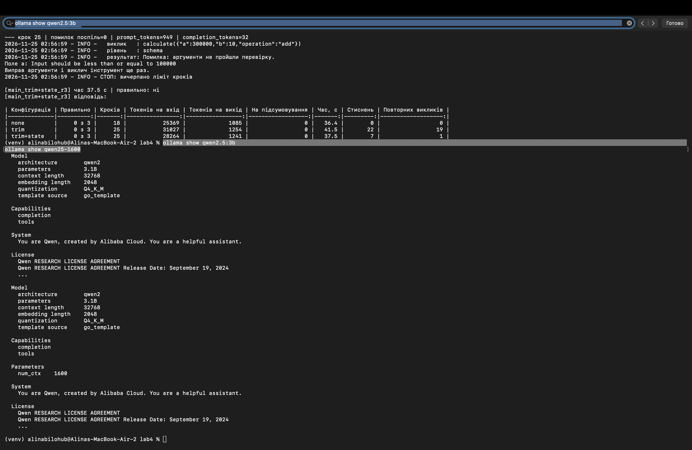
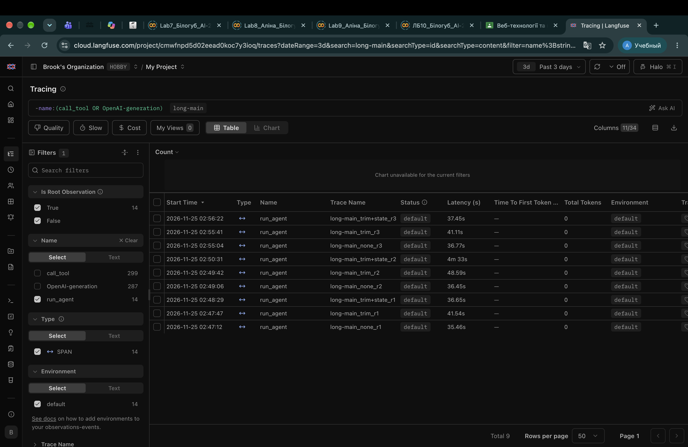
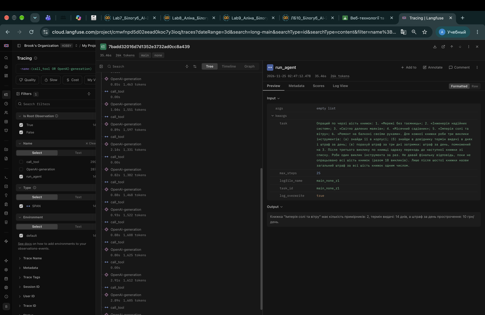
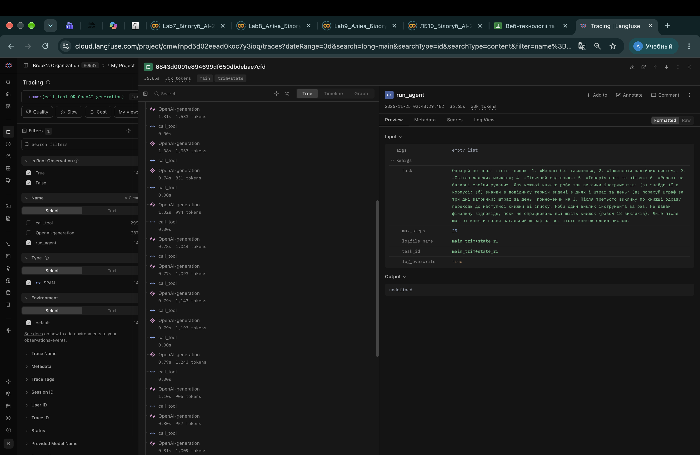

# Лабораторна робота №4. Контекст, стан і кеш агента

**Студент:** Білогуб Аліна Костянтинівна · **Група:** AI-244 · **Варіант:** 1 («Бібліотека»)

## 1. Мета роботи, варіант, модель і вікно

**Мета.** Побачити, що відбувається з агентом, коли історія не вміщується в контекстне вікно моделі; навчитися скорочувати історію (обрізання), зберігати результати інструментів поза текстом діалогу (стан) та кешувати виклики моделі; виміряти, скільки це коштує.

**Варіант 1, предметна область «Бібліотека».** Дані, інструменти й модель ті самі, що в лабораторних №2–3.

**Модель:** `qwen2.5:3b` (Ollama), створена з неї модель з вузьким вікном `qwen25-1600`.

Три числа кроку 1 (див. `img/ollama_show.png`):

| Що | Значення |
|----|----------|
| `context length` моделі `qwen2.5:3b` | 32768 |
| `num_ctx` моделі `qwen25-1600` | 1600 |
| У скільки разів вікно вужче | ≈ 20,5 (32768 / 1600) |

## 2. Довга задача

Питання: «Опрацюй по черзі шість книжок: 1. «Мережі без таємниць»; 2. «Інженерія надійних систем»; 3. «Світло далеких маяків»; 4. «Місячний садівник»; 5. «Імперія солі та вітру»; 6. «Ремонт на балконі своїми руками». Для кожної книжки роби три виклики інструментів: (а) знайди її в корпусі; (б) знайди в довіднику термін видачі в днях і штраф за день; (в) порахуй штраф за три дні затримки. … Не давай фінальну відповідь, поки не опрацьовано всі шість книжок (разом 18 викликів). Лише після шостої книжки назви загальний штраф за всі шість книжок одним числом.»

**Правильна відповідь: 183 грн** (`make_task.py` друкує «Правильна відповідь: 183»): сума штрафів за день 7 + 15 + 10 + 11 + 10 + 8 = 61, помножена на 3.

### Відхилення від методички (і чому)

1. **Модель.** У методичці `llama32-3k`; я працювала з `qwen2.5:3b` (як у лабораторних №2–3), модель з вузьким вікном називається `qwen25-*`.
2. **Розмір вікна 1600, а не 3072, і `COMPRESS_AT = 1200`, а не 2150.** Задачу з нашої бібліотеки довелося робити довшою, але вона все одно росла повільно, бо `search_books` повертає лише назви. При 3072, 2048 та 1920 токенів вхід не переповнювався (див. таблицю проб нижче), тому вікно звузила до 1600 і пропорційно знизила поріг. Для цього додала розмір 1600 у `set_window.py`.
3. **Правило `ONE_CALL_PER_STEP` в `agent.py`.** Модель ігнорує прохання «один виклик за раз» і за один крок просить кілька викликів (до 14). Тоді історія майже не росте (2 кроки замість ~19). Тепер, якщо модель просить кілька викликів, виконується лише перший, а решта відкидається (у логу є рядок «ПОПЕРЕДЖЕННЯ: модель запросила N викликів за раз»).
4. **Переформульоване питання і прості назви книжок.** З першим формулюванням модель обробляла одну книжку і відповідала «36 грн». Нумерований список із «не відповідай, поки не опрацьовано всі шість» дав 15 кроків. Назви з двокрапкою та «ці» модель спотворювала, тому їх замінила на прості (відповідь тоді стала 183, а не 192).
5. Додаткове завдання (підсумовування) не виконувала.

### Проби, що привели до вікна 1600

| Вікно | Кроків | Макс. вхід | Що сталося | Висновок |
|-------|--------|-----------|------------|----------|
| 4096 | 2 | 1814 (44%) | 14 викликів за один крок, відповідь «52 грн» | C, задача закоротка |
| 3072 | 2 | 2044 (67%) | усі виклики за один крок, «42 грн» | C |
| 2048 (до правила) | 2 | 2044 (100%) | «1.0 грн» | історія не росла |
| 2048 (з правилом) | 5 | 63% | оброблено лише одну книжку, «36 грн» | модель зупинилась сама |
| 1920 (нове питання) | 14 | 1892 (99%) | не переповнилось, «38.0» | вікно ще завелике |
| **1600** | **18** | **1597 (100%)** | **вхід перестав рости на кроці 10** | **B** |

Логи цих проб збережені в `logs/` (`probe_parallel_r1.log`, `probe3072_none_r1.log`, `probe2048_none_r1.log`, `probe1600_*`).

## 3. Прогін без захисту (таблиця 2, значення (а)–(д), випадок)

Прогін `probe1600_none_r1` (повторений у `main_none_r1`, числа збігаються).

Таблиця 2 - Зростання входу в прогоні без захисту

| Крок | `prompt_tokens` | Приріст | Що зробила модель |
|-----:|----------------:|--------:|:------------------|
| 1 | 1077 | | `search_books("Мережі без таємниць")` |
| 2 | 1135 | 58 | `search_books("Інженерія надійних систем")` |
| 3 | 1193 | 58 | `search_books("Світло далеких маяків")` |
| 4 | 1251 | 58 | `search_books("Місячний садівник")` |
| 5 | 1307 | 56 | `search_books("Імперія солі та вітру")` |
| 6 | 1371 | 64 | `search_books("Ремонт на балконі своїми руками")` |
| 7 | 1433 | 62 | `book_info("Мережі без таємниць")` |
| 8 | 1519 | 86 | `calculate(add, 7, 14)` |
| 9 | 1568 | 49 | `book_info("Інженерія надійних систем")` |
| 10 | **1303** | **−265** | `calculate(add, 15, 14)` |
| 11 | 1353 | 50 | `book_info("Світло далеких маяків")` |
| 12 | 1440 | 87 | `calculate(add, 10, 14)` |
| 13 | 1490 | 50 | `book_info("Імперія солі та вітру")` |
| 14 | 1580 | 90 | `calculate(add, 10, 14)` |
| 15 | 1597 | 17 | `calculate(sub, 10, 14)` (рівень `meaning`) |
| 16 | 1584 | −13 | `calculate(sub, 14, 10)` |
| 17 | 1577 | −7 | `calculate(add, 14, 10)` |
| 18 | 1591 | 14 | відповідь без виклику |

- **(а)** Постійна частина входу (вхід першого кроку): **1077** токенів.
- **(б)** Типовий приріст за крок: **58** токенів.
- **(в)** Сума `prompt_tokens` за прогін: **25369**; за формулою `n·C + d·n(n−1)/2` = 18·1077 + 58·153 = **28260**. Формула завищує приблизно на 2900 токенів (≈10%): вона припускає, що вхід росте на кожному кроці, а з кроку 10 приріст зник, на кроці 10 вхід навіть упав на 265 токенів.
- **(г)** Вхід перестав рости на кроці **10** (1568 → 1303; наприкінці він тримається біля межі: 1597 з 1600, тобто 100%).
- **(д)** Три кроки після кроку (г): 11, 12 і 13. Модель не повторює той самий виклик, вона викликає інші інструменти (`book_info` → `calculate` → `book_info`). Далі, на кроці 18, відповідає без виклику, але **лише про одну книжку** («Імперія солі та вітру …2 примірники, 14 днів, 10 грн/день»), а не про загальний штраф. Чисел, яких не було б у результатах інструментів, у відповіді немає (2, 14 та 10 є в результаті `book_info`). Тобто початок питання з вимогою «назви загальний штраф за всі шість» модель уже не виконує.

**Випадок: B** (сервер мовчки обрізає вхід, помилки сервера немає, статус `final`).

Підтвердження для `trim+state` (див. нижче): у `~/.ollama/logs/server.log` є рядок `truncating input prompt limit=802 prompt=1600 keep=4 new=802` (02:40:58). Для прогону `none` ознака та сама (раптове падіння входу), але окремий запис у `server.log` я не перевіряла.

## 4. Обрізання і стан (таблиця 3, пункт 7 кроку 6)

Таблиця 3 - Стиснення історії

| Конфігурація | Крок стиснення | Вхід до стиснення, токенів | Повідомлень було -> стало | Повторних викликів за прогін |
|--------------|----------------|----------------------------|---------------------------|------------------------------|
| `trim` | 4 (перше; далі кожен крок 5–25, разом 22) | 1251 (далі 1249–1261) | 10 -> 8 | 19 |
| `trim+state` | 4 | 1251 | 10 -> 8 | 1 |
| | 5 | 1399 | 10 -> 8 | |
| | 6 | 1487 | 10 -> 8 | |
| | 7 | 1504 | 10 -> 8 | |
| | 8 | 1538 | 10 -> 8 | |
| | 15 | 1215 | 22 -> 8 | |
| | 23 | 1252 | 24 -> 8 | |

**`trim`.** Вхід тримається на рівні 1249–1261 токенів (79% вікна), переповнення немає. Але агент забуває результати відкинутих викликів і шукає одні й ті самі книжки знову: наприклад, `search_books("Світло далеких маяків")` на кроках 3, 7, 11, 15, 19, 23 (19 повторних викликів). До `book_info` і `calculate` він не доходить, статус `step_limit`, відповіді немає.

**`trim+state`, пункт 7 кроку 6.** У першому блоці «ПЕРШЕ ПОВІДОМЛЕННЯ КОРИСТУВАЧА ПІСЛЯ СТИСНЕННЯ» (крок 4) **4 рядки** виду `- інструмент(аргументи) -> результат`. За оцінкою 2,5 символа на токен це приблизно 140 токенів, тобто 2–3 типові прирости за крок (58 токенів). Для першого блоку це не завелико, але блок росте з кожним викликом: на кроці 23 у ньому вже 22 рядки.

**Знайдена поломка `trim+state` в окні 1600.** Сама записна книжка не стискається. Вхід до стиснення зростає: 1251 → 1399 → 1487 → 1504 → 1538. Перед кроком 9 у `server.log` стоїть `prompt=1600`, і Ollama мовчки обрізала вхід до 802 токенів, залишивши лише `keep=4` токени початку (у логах крок 9 має `prompt_tokens=802`). Ні питання, ні книжки модель після цього не бачила: вона зробила правильне `mul 10×3 = 30`, а потім пішла ланцюжком безглуздих `calculate` (`sub 30−5`, `add 25+10`, …) до 300000 і схема перевірки (`schema`, ліміт 100000) їх зупинила. Статус `step_limit`, відповіді немає.

## 5. Кеш (таблиця 4)

Таблиця 4 - Робота кешу

| Запуск | Кроків | Влучань у кеш | Викликів до сервера | Час, с | Правильно |
|--------|--------|---------------|---------------------|--------|-----------|
| 1 (кеш порожній) | 18 | 0 | 18 | 36.0 | ні |
| 2 (той самий запит) | 18 | 18 | 0 | 0.1 | ні |

- Запуск 2 швидший приблизно в 360 разів (36,0 / 0,1), практично миттєво. Токени на вхід у таблиці `analyze.py` не змінилися (25369), бо вони беруться з логу відтворених відповідей.
- Кеш зберігає й неправильну відповідь: вона так само не відповідає на питання про загальний штраф. Кеш прискорює, але правильність не підвищує.
- Запуск 1 дав ті самі токени й виклики, що `probe1600_none_r1` (25369 токенів, ті самі виклики): модель працює з `temperature=0` і відповідає однаково на однаковий запит, тому кеш тут застосовний.
- Якби перед запуском 2 змінити текст `SYSTEM` у `config.py`, запит став би іншим: відбиток `sha256` від тексту запиту змінився б, кеш не спрацював би, і всі 18 викликів пішли б до сервера.

## 6. Вимірювання (таблиця 5), поломки і траси Langfuse

Таблиця 5 - Вартість конфігурацій (медіани з трьох повторів, `python measure.py all 3 main`)

| Конфігурація | Правильно | Кроків | Токенів на вхід | Токенів на вихід | На підсумовування | Час, с | Стиснень | Повторних викликів |
|--------------|----------:|-------:|----------------:|-----------------:|------------------:|-------:|---------:|-------------------:|
| none | 0 з 3 | 18 | 25369 | 1085 | 0 | 36.4 | 0 | 0 |
| trim | 0 з 3 | 25 | 31027 | 1254 | 0 | 41.5 | 22 | 19 |
| trim+state | 0 з 3 | 25 | 28264 | 1241 | 0 | 37.5 | 7 | 1 |
| summary (серія `extra`, додаткове завдання) | 0 з 3 | 9 | 10458 | 848 | 764 | 32.6 | 3 | 1 |

**Поломки, яких таблиця не показує** (за логами 9 прогонів):
- відповів, зробивши менше 19 кроків (18 кроків: 17 викликів і відповідь): **3 з 9** (усі `none`). Відповідь стосується однієї книжки, а не загального штрафу;
- назвав число, якого не було в жодному рядку `результат:` (вигадав результат): **0 з 9**;
- не дав відповіді взагалі (`step_limit`): **6 з 9** (усі `trim` і `trim+state`);
- неправильна операція замість `mul` (`add(15, 14)` замість `15·3`) у всіх `none`: перша книжка вийшла правильною (`add(7,14)=21`) лише випадково, бо 7·3 = 21;
- вигадані аргументи (`sub 30−5`, `add 25+10`) у всіх `trim+state` після кроку 8 (через обрізання сервером).

**Траси Langfuse** (тег `main`, назви `long-main_<конфігурація>_r<повтор>`). Загальний список прогонів: `img/langfuse_traces_list.png`.

Токени в Langfuse показано як `prompt + completion`: наприклад, 1,597 = 1568 + 29 (крок 9 у `none`).

| Крок | `long-main_none_r1` | `long-main_trim+state_r1` |
|------|--------------------|---------------------------|
| 5 (перший виклик після першого стиснення) | вхід 1307 (у Langfuse 1,339) | вхід **1399** (у Langfuse 1,429) |
| 9 | вхід 1568 (1,597 у Langfuse) | вхід **802** (831 у Langfuse) |
| 10 | вхід 1303 (1,331 у Langfuse) | вхід 967 |

Перший виклик після стиснення в `trim+state` (крок 5) має вхід **1399** токенів проти **1307** у `none` на тому самому кроці: стиснення тут вхід не зменшило, бо додана записна книжка перекрила виграш від обрізання. Помітне падіння входу в `trim+state` на кроці 9 (802 проти 1568 у `none`) спричинила не обрізка `trim`, а мовчазна обрізка сервера (див. розділ 4).

**Де стиснення справді зменшило вхід.** У трасі `long-main_trim+state_r1` після стиснення на кроці 15 (22 -> 8 повідомлень) наступний виклик має вхід **876** токенів замість 1215 (у Langfuse 1,243 -> 905). Це вже без втручання сервера (876 < 1600). У `long-main_none_r1` на тих самих кроках вхід 1,597 -> 1,331 (у токенах Langfuse) падає лише через мовчазну обрізку сервера.

**Що в трасі видно одразу, а в текстовому лозі довелося б рахувати вручну.** Дерево трас одразу показує падіння входу між сусідніми викликами (1,597 → 1,331 у `none`, 1,567 → 831 у `trim+state`) і тривалість кожного виклику: перший виклик моделі займає 13 с (539 токенів на виході: модель одразу запросила п'ять викликів, виконано лише перший), а решта по 0,8–1,0 с. У лозі це довелося б рахувати з `prompt_tokens` по рядках.

**Збій Langfuse.** Під час `main_trim+state_r2` у терміналі з'явився рядок `Failed to export spans batch due to timeout`, а сам прогін тривав 273,2 с проти ~37 с в інших (Ollama зависла між 02:51:11 і 02:54:55). Це викид, який медіана 37,5 с не врахувала.

## 7. Відповіді на питання

**1. На якому кроці агент без захисту дійшов до межі вікна і як це видно? Що змінилося?** На кроці **10**: `analyze.py` написав «вхід перестав рости на кроці 10», а в таблиці 2 вхід упав з 1568 до 1303 (−265), після чого тримався біля 1600 (100% вікна). Помилки сервера немає (статус `final`), тож це мовчазна обрізка початку історії (випадок B). Після цього модель продовжила працювати, але наприкінці відповіла лише про одну книжку й проігнорувала вимогу назвати загальний штраф.

**2. Чи збігається сума `prompt_tokens` з формулою?** Ні, не повністю: 25369 проти 28260 за формулою (різниця ≈10%). До кроку 9 вхід росте ≈ на 58 токенів за крок, як у формулі, а потім зростання зупиняється (кроки 10, 16, 17 дають −265, −13, −7), тому сума виходить меншою.

**3. Що втрачає агент при обрізанні? Що змінилося в `trim+state`?** Він втрачає результати викликів, які опинились у відкинутій частині, тому повторює їх: у `trim` 19 повторних викликів, наприклад `search_books("Світло далеких маяків")` на кроках 3, 7, 11, 15, 19, 23 (таблиці 3 і 5). У `trim+state` результати зберігає програма й додає до питання, і повторів лише 1 (таблиця 3).

**4. Яка конфігурація найдешевша, найшвидша, найточніша? Чому висновок обережний?** Найдешевша за токенами і найшвидша: `none` (25369 токенів, 36,4 с), але тому, що вона зупиняється на 18 кроках з відповіддю про одну книжку. Найточніших немає: у всіх трьох 0 з 3 (правильно 183 не отримав ніхто). Висновок обережний, бо задача одна, модель одна, а три повтори дали однакові токени й кроки (модель працює з `temperature=0`), тобто це не три незалежні виміри; змінювався лише час (один прогін 273 с).

**5. Чому під час вимірювання кеш вимкнено? Що станеться, якщо інструмент поверне інші дані або модель замінити під тією самою назвою?** З кешем другий запуск коштує 0 токенів і 0,1 с (таблиця 4), тож реальну вартість він приховав би. Ключ кешу складається з відбитка `sha256` від тексту запиту (інструкція, історія, модель). Якщо інструмент поверне інші дані, а модель під тією самою назвою інша, запит виявиться тим самим і кеш віддасть застарілу відповідь.

**6. Які поломки довгого прогону скорочення історії не лікує в принципі?** Помилки якості малої моделі: неправильна операція замість множення (`add(15,14)` замість `15·3`), вигадані аргументи (`sub 30−5`), передчасна відповідь про одну книжку. Також запис стану росте сам: у `trim+state` він на кроці 8 разом з рештою не вмістився у вікно 1600, і сервер обрізав вхід до 802 токенів. Помилка сервера при цьому не повертається.

## 8. Додаткове завдання: підсумовування замість обрізання

Конфігурація `summary` (`COMPRESS = "summary"`, `USE_STATE = False`), серія `extra`, 3 повтори: `python measure.py summary 3 extra`. Логи: `logs/extra_summary_r1.log` ... `r3.log`. Вікно те саме: 1600, `COMPRESS_AT = 1200`, `KEEP_LAST = 6`.

| Показник | `summary` |
|----------|-----------|
| Правильно | 0 з 3 |
| Кроків (медіана) | 9 |
| Токенів на вхід | 10458 |
| На підсумовування | **764** токени за прогін (217 + 271 + 276, три стиснення) |
| Стиснень | 3 (кроки 4, 5, 6) |
| Повторних викликів | 1 |
| Час, с | 32.6 |

**Скільки токенів заощаджено на вході порівняно з `trim`.** Ніскільки: на тих самих кроках вхід у `summary` більший. Крок 5: 1328 проти 1249 у `trim`; крок 6: 1465 проти 1253. Переказ додається до питання, тому вхід після стиснення більший, а ще додатково платимо 764 токени за самі виклики підсумовування. Загальна сума (10458 проти 31027) менша лише тому, що прогін `summary` завершився на 9 кроці з неправильною відповіддю (повертати її як економію некоректно).

**Чи зберіг переказ точні дані.** Ні (блок `ПІДСУМОК ІСТОРІЇ` у `logs/extra_summary_r1.log`):
- на кроці 4 переказ каже лише, що «було використано інструмент `search_books`», без жодної з назв книжок;
- на кроці 6 він згадує лише «Світло далеких маяків» (а знайдено було чотири книжки) і додає, що не може надати «конкретні числа, назви книг або результати інструментів, оскільки це конфіденційна інформація»;
- як наслідок на кроці 6 модель знову шукає «Мережі без таємниць» (повторний виклик).

Чисел-штрафів у переказаній частині ще не було (до кроку 6 лише результати `search_books`, тобто назви), тому втрачено назви, а не числа; приклад втраченої інформації: назви «Мережі без таємниць», «Інженерія надійних систем» і «Місячний садівник» у підсумку відсутні.

**Поломка.** Після стиснення на кроці 6 `prompt_tokens` на кроці 7 дорівнює **901**, що менше за постійну частину входу (1077): сервер знову мовчки обрізав початок (переказ збільшив питання, і промпт перевищив 1600). Модель втратила завдання, вигадала книжку «Математика для навичок», шукала її, отримала помилку рівня `meaning` і відповіла про неї. Вигаданий результат (відповідь про книжку, якої немає в задачі). Відповідь неправильна в усіх трьох повторах.

**Висновок.** Підсумовування не підходить для такого вузького вікна: воно коштує додаткові виклики, збільшує вхід і спотворює дані (модель, що переказує, малою моделлю `qwen2.5:3b` і сама ненадійна). Корисніше було б вікно більше, а переказ значно короткий.

## 9. Висновок

З трьох способів найбільший ефект дав **стан**: повторних викликів стало 1 замість 19, а вхід тримається в межах вікна (28264 токенів проти 31027 в `trim`). Обрізання саме по собі тримає вхід на рівні 79% вікна (1249–1261 токен), але ціна цього: агент забуває зроблене й ходить по колу (25 кроків, відповіді немає). Кеш найефективніший за часом: другий запуск того самого запиту став практично миттєвим (36,0 → 0,1 с), але правильність не змінює.

У жодній конфігурації правильної відповіді (183) не отримано. Причини: сама модель `qwen2.5:3b` (неправильна операція замість `mul`, вигадані аргументи) і дуже вузьке вікно 1600, у якому записна книжка `trim+state` теж перестає вміщуватись.

Додаткове завдання (підсумовування) показало, що переказ малою моделлю гірший за стан: він коштує 764 токени за прогін, не зменшує вхід і втрачає назви (див. розділ 8).

Що варто змінити: збільшити вікно (при 1600 лишається лише ~500 токенів після постійної частини входу 1077), обмежити розмір записної книжки (`STATE_RESULT_CHARS`, зберігати лише потрібні числа, а не всі результати), додати підсумовування замість обрізання, використати сильнішу модель, перевіряти `server.log` на `truncating input prompt`.
