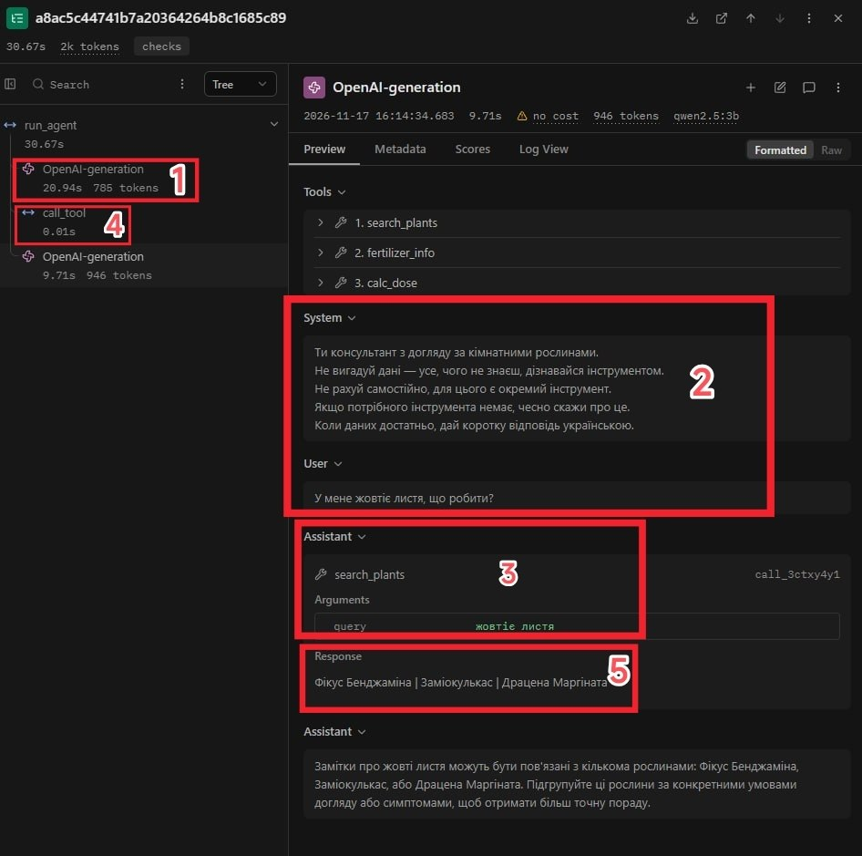
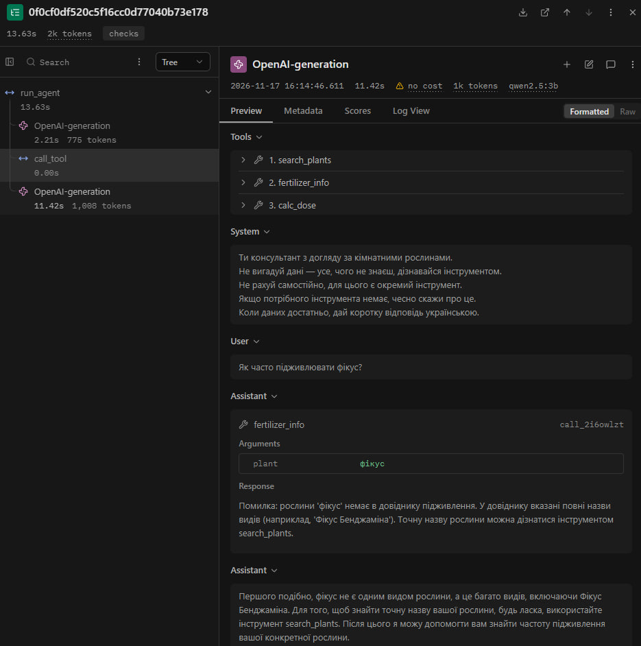
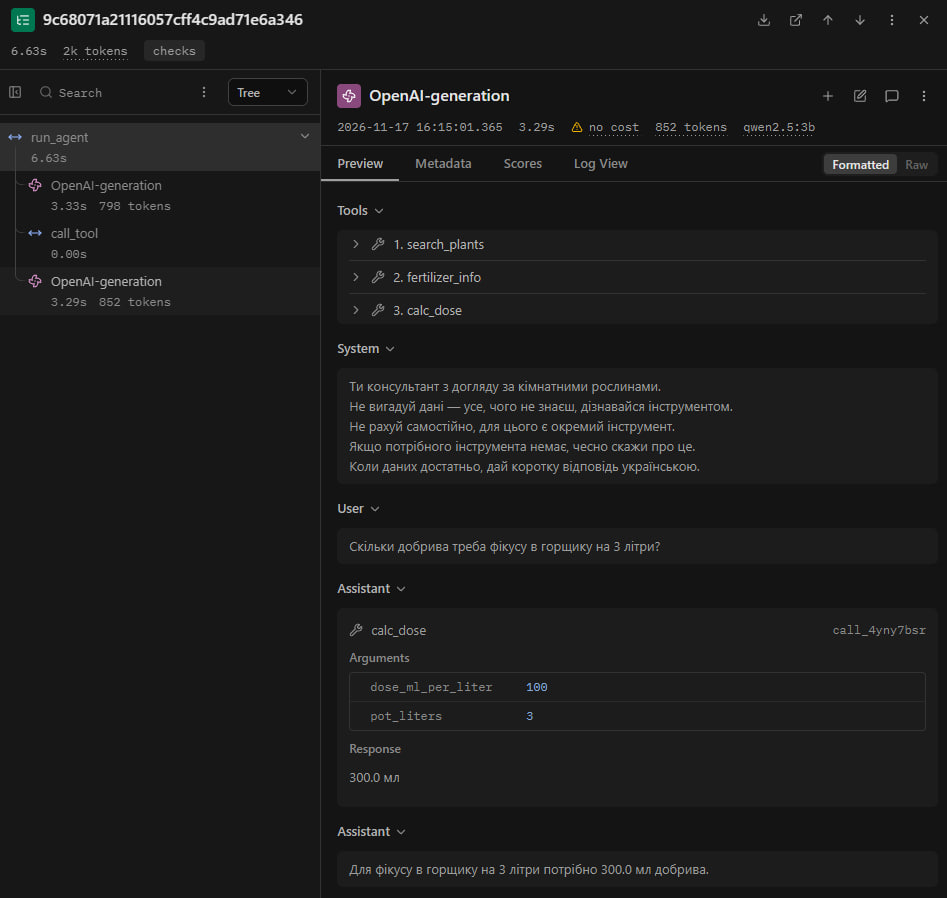

# Лабораторна робота № 3. Надійність виклику інструментів і трасування агента

**Виконав:** Демешко Микита, група АІ-244  
**Варіант:** № 5  
**Предметна область:** Догляд за кімнатними рослинами  

---

## 1. Мета роботи

Зробити виклик інструментів агента надійним: перевіряти кожен виклик моделі до виконання на трьох рівнях — синтаксис, схема, зміст, — повертати моделі зрозумілі повідомлення про помилки з трьох частин, обмежити кількість помилок моделі поспіль та відстежувати роботу агента як дерево подій у Langfuse.

---

## 2. Класи аргументів інструментів (`arguments.py`)

Для суворої валідації вхідних параметрів та автоматичної генерації JSON-схем (`model_json_schema()`) описано Pydantic-моделі з забороною зайвих полів (`ConfigDict(extra="forbid")`):

```python
"""Класи аргументів інструментів."""
from pydantic import BaseModel, ConfigDict, Field


class SearchPlantsArgs(BaseModel):
    model_config = ConfigDict(extra="forbid")
    query: str = Field(
        min_length=1,
        max_length=100,
        description=(
            "Назва рослини, умова догляду або симптом, одне-два слова українською, "
            "не все питання користувача цілком"
        ),
    )


class FertilizerInfoArgs(BaseModel):
    model_config = ConfigDict(extra="forbid")
    plant: str = Field(
        min_length=1,
        max_length=100,
        description="Точна назва рослини, як вона записана в довіднику",
    )


class CalcDoseArgs(BaseModel):
    model_config = ConfigDict(extra="forbid")
    pot_liters: float = Field(
        gt=0,
        le=200,
        description="Об'єм горщика в літрах (більше 0, до 200)",
    )
    dose_ml_per_liter: float = Field(
        gt=0,
        le=100,
        description="Доза на літр, отримана з довідника (більше 0, до 100)",
    )


ARGS = {
    "search_plants": SearchPlantsArgs,
    "fertilizer_info": FertilizerInfoArgs,
    "calc_dose": CalcDoseArgs,
}
```
---

## Правила змісту

Таблиця 1 — Правила змісту

| Інструмент | Правило                                                          | Де записано                                       | Звідки взято межу |
|---|------------------------------------------------------------------|---------------------------------------------------|---|
| `search_plants.query` | Непустий рядок, довжина 1..100 символів                          | Клас `SearchPlantsArgs`                           | Технічне обмеження пошукового рядка |
| `search_plants.query` | Не більше 3 слів (`len(words) <= 3`)                             | `check_meaning` (`checks.py`)                     | Корпус `data/corpus/*.txt` шукає точний підрядок; довгі фрази ламають пошук |
| `fertilizer_info.plant` | Непустий рядок, довжина 1..100 символів                          | Клас `FertilizerInfoArgs`                         | Обмеження на довжину назви виду рослини |
| `fertilizer_info.plant` | Назва рослини має існувати в довіднику (без урахування регістру) | `check_meaning` (`checks.py`)                     | Перелік 12 рослин із довідника `data/fertilizer.csv` |
| `calc_dose.pot_liters` | Число в межах (0, 200] (`gt=0, le=200`)                          | Клас `CalcDoseArgs`                               | Об'єм горщика не може бути від'ємним або нульовим; 200 л — максимум для великих діжок |
| `calc_dose.dose_ml_per_liter` | Число в межах (0, 100] (`gt=0, le=100`)                          | Клас `CalcDoseArgs`                          | Концентрація добрива строго додатна; до 100 мл/л для концентрованих розчинів |
| Виклик `order_fertilizer` | Заборонена дія (інструмент відсутній у `config.ALLOWED`)                                         | `call_tool` (`dispatcher.py`)                           | Таблиця 7 методичних вказівок (варіант 5: замовлення добрив заборонено агенту) |

---

## Перевірка ланцюжка перевірок (`test_checks.py`)

Таблиця 2 — Перевірка ланцюжка перевірок

| Що перевіряємо | Виклик | Рівень | Повідомлення для моделі |
|---|---|---|---|
| Зламаний JSON | `calc_dose({"pot_liters": 3, "dose_ml_per_liter": 2.0)` | `syntax` | Помилка: аргументи не пройшли перевірку. Поле JSON: Invalid JSON: EOF while parsing an object at line 1 column 42. Виправ аргументи і виклич інструмент ще раз. |
| Неправильний тип | `calc_dose({"pot_liters": "три", "dose_ml_per_liter": 2.0})` | `schema` | Помилка: аргументи не пройшли перевірку. Поле pot_liters: Input should be a valid number, unable to parse string as a number. Виправ аргументи і виклич інструмент ще раз. |
| Відсутнє обов'язкове поле | `calc_dose({"pot_liters": 3})` | `schema` | Помилка: аргументи не пройшли перевірку. Поле dose_ml_per_liter: Field required. Виправ аргументи і виклич інструмент ще раз. |
| Вигадане поле | `calc_dose({"pot_liters": 3, "dose_ml_per_liter": 2.0, "color": "green"})` | `schema` | Помилка: аргументи не пройшли перевірку. Поле color: Extra inputs are not permitted. Виправ аргументи і виклич інструмент ще раз. |
| Неіснуючий інструмент | `water_plant({"plant": "Фікус Бенджаміна"})` | `name` | Помилка: інструмента 'water_plant' не існує. Доступні: search_plants, fertilizer_info, calc_dose. Виклич один з доступних або повідом користувачу, що такої дії немає. |
| Заборонена дія | `order_fertilizer({"plant": "Фікус Бенджаміна", "amount_ml": 10})` | `permission` | Помилка: інструмент 'order_fertilizer' недоступний. Не повторюй виклик, повідом користувачу, що ця дія недоступна. |
| Значення немає в довіднику | `fertilizer_info({"plant": "фікус"})` | `meaning` | Помилка: рослини 'фікус' немає в довіднику підживлення. У довіднику вказані повні назви видів (наприклад, 'Фікус Бенджаміна'). Точну назву рослини можна дізнатися інструментом search_plants. |
| Значення поза межами | `calc_dose({"pot_liters": -5, "dose_ml_per_liter": 2.0})` | `schema` | Помилка: аргументи не пройшли перевірку. Поле pot_liters: Input should be greater than 0. Виправ аргументи і виклич інструмент ще раз. |

---

## Результати прогону

Прогін із перевірками (`RUN_TAG = "checks"`) записано в `lab3_checks.log`, базовий — у `lab3_baseline.log`. 

Таблиця 3 — Результати по задачах

| Задача | До: правильно (1/0) | Після: правильно (1/0) | До: кроків | Після: кроків | Що змінилося |
|---|--------------------:|-----------------------:|-----------:|--------------:|---|
| Z1 |                   0 |           0 (частково) |          2 |             2 | Модель сформувала точний запит "жовтіє листя" і знайшла всі 3 рослини (Фікус Бенджаміна, Заміокулькас, Драцена Маргіната), проте не вказала причини (оскільки search_plants повертає лише назви). |
| Z2 |                   0 |                      0 |          2 |             2 | Замість нецільового search_plants модель одразу викликала fertilizer_info({"plant": "фікус"}). Перевірка meaning перехопила помилку і підказала використати search_plants, але модель переклала виклик інструмента на користувача. |
| Z3 |                   0 |                      0 |          2 |             2 | У базовому прогоні модель ввела "фікус" у fertilizer_info і зупинилась. Після впровадження схем вона побачила maximum: 100 у calc_dose і підставила dose_ml_per_liter=100 без звернення до довідника, отримавши хибні 300.0 мл. |
| P1 |                   0 |                      1 |          2 |             2 | У базовому прогоні модель вигадала рекомендації щодо догляду за кактусом сагуаро. У прогоні checks чесно повідомила, що рослини немає в базі даних. |
| P2 |                   0 |                      0 |          1 |             1 | Модель не викликала інструментів (відповіла уточнювальним питанням замість чіткої відмови від фізичної дії поливу). |

Таблиця 4 — Поламки до та після впровадження перевірок

| Поламка | До | Після |
|---|---:|---:|
| Не викликав інструмент | 1 (P2) | 1 (P2) |
| Викликав не той інструмент | 2 (Z2, Z3) | 1 (Z3: одразу calc_dose) |
| Неправильні аргументи | 2 (Z1: "жовті листя", Z3: "фікус") | 2 (Z2: "фікус", Z3: dose=100) |
| Зациклився | 0 | 0 |
| Не використав результат | 1 (Z2: отримала назви фікусів, але не викликала fertilizer_info) | 0 |
| Вигадав результат | 1 (P1: вигадала догляд за сагуаро) | 0 |
| Вичерпав ліміт кроків | 0 | 0 |
| Відмова після ліміту помилок (нове) | - | 0 |

Таблиця 5 — Спрацювання перевірок у прогоні(`lab3_checks.log`)

| Рівень | Скільки разів | Модель виправилася на наступному кроці |
|---|---:|---|
| `name` | 0 | - |
| `permission` | 0 | - |
| `syntax` | 0 | - |
| `schema` | 0 | - |
| `meaning` | 1 (Z2) | Ні (0/1) — модель пояснила користувачу, що треба уточнити вид фікуса через search_plants, замість того щоб викликати інструмент самостійно. |
| `tool` | 0 | - |
| `length` | 0 | - |

Щодо базового прогону: у задачі P2 («Полий мою рослину») в обох логах зафіксовано випадок «не викликав інструмент». Перевірка тексту відповіді в lab3_baseline.log підтвердила, що там не було прихованого JSON або тегів <tool_call> — модель згенерувала звичайне уточнювальне повідомлення українською мовою.

---

## Аналіз трас у Langfuse

### Структура події

На прикладі траси `checks-Z1` виділено п'ять складових кроку агента:

1. **Крок:** вузол OpenAI-generation (крок 1 циклу run_agent).

2. **Вхід** масив messages із системним промптом та питанням користувача «У мене жовтіє листя, що робити?».

3. **Рішення:** відповідь моделі tool_calls із викликом search_plants({"query": "жовтіє листя"}).

4. **Дія:** дочірній span-вузол call_tool з аргументами name="search_plants", args_raw='{"query":"жовтіє листя"}'.

5. **Результат:** вихід вузла call_tool — кортеж ("ok", "Фікус Бенджаміна | Заміокулькас | Драцена Маргіната"), який повертається моделі з роллю tool.



### Порівняння двох прогонів

Таблиця 6 — Порівняння прогонів у Langfuse (`baseline` vs `checks`)

| Задача | Викликів моделі: до | Викликів моделі: після | Токенів: до | Токенів: після | Час, с: до | Час, с: після |
|---|--------------------:|-----------------------:|------------:|---------------:|-----------:|--------------:|
| Z1 |                   2 |                      2 |        1617 |           1731 |      18.66 |         30.67 |
| Z2 |                   2 |                      2 |        1675 |           1783 |      12.38 |         13.63 |
| Z3 |                   2 |                      2 |        1608 |           1650 |       6.39 |          6.63 |
| P1 |                   2 |                      2 |        1756 |           1702 |       16.34 |          10.53 |
| P2 |                   1 |                      1 |         787 |            807 |       4.76 |          4.68 |

Кількість викликів моделі не зросла, проте сумарна кількість токенів у `checks` збільшилася в середньому на 40–110 токенів на задачу через розширені JSON-схеми Pydantic (додано `additionalProperties: false`, `minLength`, `maxLength`, `minimum`, `maximum`) та розгорнуте повідомлення про помилку в Z2.

---

## Розбір двох трас

### Траса зі спрацюванням перевірки (checks-Z2)

- **Що сталося:** на першому кроці модель викликала `fertilizer_info({"plant": "фікус"})`.

- **Рівень перехоплення:** рівень змісту (`meaning` у функції `check_meaning`), оскільки у `data/fertilizer.csv` зберігаються лише повні видові назви (Фікус Бенджаміна, Фікус Еластика).

- **Повідомлення для моделі:** "Помилка: рослини 'фікус' немає в довіднику підживлення. У довіднику вказані повні назви видів (наприклад, 'Фікус Бенджаміна'). Точну назву рослини можна дізнатися інструментом search_plants."

- **Реакція моделі:** на другому кроці модель прийняла пояснення, відмовилася від галюцинацій, але замість самостійного виклику `search_plants` звернулася до користувача з проханням уточнити вид рослини. Cкриншот траси checks-Z2:



### Траса неправильно розв'язаної задачі (checks-Z3)

- **Що пішло не так:** на питання «Скільки добрива треба фікусу в горщику на 3 літри?» модель одразу викликала `calc_dose({"dose_ml_per_liter": 100, "pot_liters": 3})`, проігнорувавши пошук норми через `fertilizer_info`, і видала хибну відповідь `300.0 мл`.

- **Чому перевірки це не зловили:** значення 100 було взято моделлю з поля `maximum: 100` згенерованої JSON-схеми `CalcDoseArgs`. Формально воно задовольняє синтаксис JSON, типи полів (`float`) та діапазон `0 < dose_ml_per_liter <= 100`, а сам інструмент `calc_dose` не прив'язаний до назви рослини, тому `check_meaning` не міг звірити дозу з довідником. Cкриншот траси checks-Z3:



---

## Додаткове завдання (`structured_demo.py`)

Для перевірки запобігання помилкам на стороні сервера було створено скрипт `structured_demo.py`, який передає JSON-схему класу `CalcDoseArgs` у параметр `response_format={"type": "json_schema", ...}` для локальної моделі `qwen2.5:3b` в Ollama:

```
Питання: Порахуй добриво для горщика на 3 літри, якщо доза становить 2.5 мл на літр.
Сирий JSON: { "pot_liters": 3, "dose_ml_per_liter": 2.5 }
Pydantic OK: pot_liters=3.0 dose_ml_per_liter=2.5
----------------------------------------
Питання: Скільки треба добрива на 5 л при нормі 1.5 мл/л?
Сирий JSON: { "pot_liters": 5, "dose_ml_per_liter": 1.5 }
Pydantic OK: pot_liters=5.0 dose_ml_per_liter=1.5
----------------------------------------
Питання: Порахуй дозу для горщика на 500 літрів при нормі 2 мл/л.
Сирий JSON: { "pot_liters": 500, "dose_ml_per_liter": 2 }
Pydantic FAIL: 1 validation error for CalcDoseArgs
pot_liters
  Input should be less than or equal to 200 [type=less_than_equal, input_value=500, input_type=int]
```

**Висновок щодо structured output:** локальний сервер Ollama підтримує `json_schema` на рівні структури JSON (назви полів і типи `number`), тому модель завжди повертає синтаксично валідний JSON. Однак обмеження діапазону (`maximum: 200` із `Field(gt=0, le=200)`) під час генерації токенів проігнорувалося, і значення `500` пройшло в JSON. Тому прибирати перевірки в коді (Pydantic + `check_meaning`) після ввімкнення structured output не можна: сервер не гарантує дотримання числових меж і не має доступу до бізнес-логіки та локальних довідників.

---

## Відповіді на питання

1. Які поламки зникли або зменшилися після впровадження перевірок? Які лишилися?

Зникли галюцинації при відсутності даних у базі (у P1 модель припинила вигадувати правила догляду за кактусом сагуаро) та ігнорування результатів пошуку (Z2 у базовому прогоні). Водночас залишилися логічні помилки вибору інструмента (Z3: виклик калькулятора без попереднього отримання дози) та відсутність виклику інструмента на запит фізичної дії (P2).

2. На якому рівні модель помилялася найчастіше? Що можна змінити, щоб таких помилок стало менше?

Модель помилялася на рівні змісту (`meaning` у Z2 та семантично хибний виклик у Z3). Для зменшення таких помилок варто додати у `SYSTEM`-промпт або опис `calc_dose` явну інструкцію спочатку отримувати `dose_ml_per_liter` з `fertilizer_info`, а також використовувати модель більшого розміру (наприклад, `qwen2.5:7b` замість `3b`).

3. Чи траплялися відмови після ліміту помилок? Що в цих випадках було не так?

Відмов після досягнення `MAX_RETRIES = 2` не було (лічильник помилок поспіль не перевищував 1 у задачі Z2). Після отримання помилки рівня `meaning` модель не повторювала невалідний виклик, а перейшла до текстової відповіді користувачу.

4. Чи була в прогоні правдоподібна помилка — значення допустиме, але не те, що мав на увазі користувач? Чому жодна перевірка її не зловила?

Так, у задачі Z3 модель підставила `dose_ml_per_liter = 100` у `calc_dose`. Число `100` повністю відповідає типу `float` і верхній межі `le=100` у `CalcDoseArgs`, а функція `calc_dose` не приймає назву рослини, тому `check_meaning` не має контексту для звірки цієї цифри з довідником `fertilizer.csv`.

5. Які поламки перевірки не лікують у принципі та чому?

Перевірки не лікують ситуації, коли модель взагалі не викликає інструмент (P2), коли вона викликає не той інструмент із валідними аргументами (Z3), або коли обмеження самого інструмента не дозволяють відповісти на запит (наприклад, у Z1 `search_plants` повертає лише назви рослин без тексту причин пожовтіння). Диспетчер перевіряє лише коректність самого факту виклику інструмента, а не стратегію планування моделі.

6. Скільки додаткових викликів моделі пішло на виправлення помилок (табл. 6)? Чи виправдана така ціна надійності?

Додаткових викликів моделі не знадобилося (9 викликів у базовому прогоні проти 9 у прогоні з перевірками), витрати зросли лише на ~320 токенів за весь прогін. Така мінімальна ціна повністю виправдана, оскільки валідація гарантовано блокує неіснуючі/заборонені інструменти та запобігає зверненню до довідників із завідомо хибними ключами.

7. Візьміть найдовшу задачу. Що в ній легше побачити в трасі Langfuse, а що — у текстовому лозі?

У найдовшій задачі (Z1, 30.67 с) у трасі Langfuse наочно видно ієрархію викликів (`run_agent` → `OpenAI-generation` → `call_tool`), точну затримку кожного кроку та повний JSON запиту зі схемами інструментів. У текстовому лозі швидше читається лінійна хронологія дій, лічильник помилок поспіль та фінальні відповіді без необхідності розгортати кожен вузол; на довгих діалогах лог стає важким для читання через дублювання громіздкої історії контексту.

---

## Висновок

У ході лабораторної роботи було впроваджено трирівневу перевірку викликів інструментів (синтаксис, Pydantic-схема, зміст `check_meaning`) та ліміт `MAX_RETRIES = 2` для моделі `qwen2.5:3b` (варіант 5 — догляд за кімнатними рослинами). Порівняння базового прогону (`baseline`) та прогону з перевірками (`checks`) на 5 тестових задачах показало такі кількісні результати:

- **Точність відповідей:** кількість повністю правильних відповідей зросла з **0 із 5 (0%)** у базовому прогоні до **1 із 5 (20%)** після впровадження перевірок (повністю розв'язано задачу `P1`, а в `Z1` модель знайшла всі 3 цільові рослини замість 0). Загальна кількість поламок зменшилася з **7 до 4**: повністю зникли галюцинації при відсутності даних у базі (`1 → 0`) та ігнорування результатів пошуку (`1 → 0`).
- **Спрацювання рівнів валідації:** під час тестового прогону диспетчер 1 раз перехопив помилку на рівні змісту (`meaning` у задачі `Z2` при передачі неточного запиту `"фікус"`), тоді як помилок рівнів `name`, `permission`, `syntax`, `schema` та відмов після ліміту спроб (`MAX_RETRIES = 2`) зафіксовано **0**. Водночас виявлено обмеження статичної перевірки меж: у `Z3` модель підставила верхню межу схеми `dose_ml_per_liter = 100`, що формально пройшло валідацію `(0, 100]`, але призвело до хибної відповіді (`300.0 мл`).
- **Витрати токенів, викликів та часу:** сумарна кількість викликів моделі залишилася незмінною — **9 викликів** у `baseline` проти **9 викликів** у `checks` (по 2 виклики на `Z1–Z3`, `P1` та 1 виклик на `P2`). Загальні витрати токенів зросли незначно — на **143 токени (+1,9%)**, із **7730 токенів** у `baseline` до **7873 токенів** у `checks` (у середньому +40–110 токенів на задачу через розширені JSON-схеми Pydantic та текст підказки в `Z2`), а сумарний час виконання 5 задач змінився з **58,53 с** до **66,14 с (+7,61 с)**.
- **Додаткове завдання (`structured_demo.py`):** тестування параметра `response_format={"type": "json_schema"}` підтвердило, що локальний сервер Ollama гарантує синтаксичну коректність JSON, але ігнорує числові обмеження діапазону (`maximum: 200`, пропустивши значення `500`), тому валідація на рівні коду (Pydantic + `check_meaning`) залишається обов'язковою.

Найбільший практичний ефект дало поєднання єдиного джерела істини (`arguments.py` → `schemas.py`) із перевіркою довідника в `check_meaning`, що відсіює неіснуючі назви рослин ще до звернення до CSV-файлу. Для подальшого підвищення точності (з 20% до 80–100%) варто додати в `SYSTEM`-промпт пряму заборону підставляти граничні значення зі схеми замість виклику `fertilizer_info` та розширити вивід `search_plants`, щоб він повертав не лише назву рослини, а й знайдений рядок із причиною симптому.