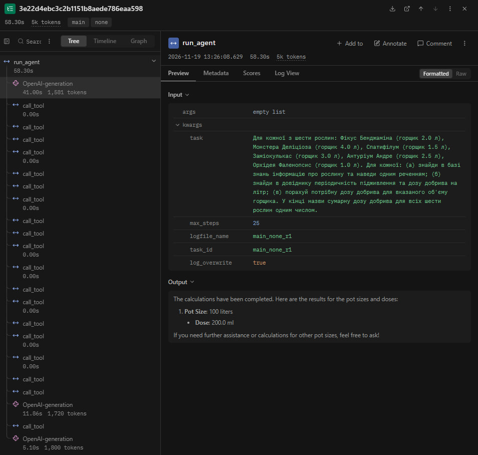

# Лабораторна робота № 4: Контекст, стан і кеш агента

**Виконав:** Демешко Микита, група АІ-244  
**Варіант:** 5 — Догляд за кімнатними рослинами (`search_plants`, `fertilizer_info`, `calc_dose`, заборонений `order_fertilizer`)  
**Модель:** `qwen2.5:3b`

---

## Мета роботи

Побачити, що відбувається з агентом, коли історія не вміщується в контекстне вікно моделі; навчитися скорочувати історію, зберігати результати інструментів поза текстом діалогу та кешувати виклики моделі; виміряти, скільки це коштує.

---

## 1. Довга задача та налаштування

- **Зміст задачі (`long_task.json`, id `L1`):** для шести кімнатних рослин із заданими об'ємами горщиків — Фікус Бенджаміна (`2.0` л), Монстера Деліціоза (`4.0` л), Спатифілум (`1.5` л), Заміокулькас (`3.0` л), Антуріум Андре (`2.5` л) та Орхідея Фаленопсис (`1.0` л) — знайти опис рослини в базі знань (`search_plants`), отримати норму добрива на літр і періодичність підживлення з довідника (`fertilizer_info`), обчислити потрібну дозу для кожного горщика (`calc_dose`) та вказати сумарну дозу добрива одним числом.
- **Правильна відповідь (`expected`):** `63.5` мл ($2.0\times 5 + 4.0\times 6 + 1.5\times 4 + 3.0\times 3 + 2.5\times 5 + 1.0\times 2 = 10.0 + 24.0 + 6.0 + 9.0 + 12.5 + 2.0 = 63.5$).
- **Мінімум викликів інструментів (`MIN_CALLS`):** `18` (по 3 виклики на кожну з 6 рослин).
- **Обмеження циклу:** `MAX_STEPS_LONG = 25`, `TEMPERATURE = 0.2`, `MAX_RETRIES = 2`.

---

## 2. Звуження контекстного вікна

- **Вихідне вікно базової моделі (`qwen2.5:3b`):** `32768` токенів.
- **Робоче вікно (`qwen25-2k`, `NUM_CTX`):** `2048` токенів (після первинної перевірки на `4096` токенів задача виявилася закороткою — максимальний вхід становив 48% вікна, тому згідно з інструкцією для Випадку C вікно звужено до `2048` токенів).
- **Кратність звуження:** у **16 разів** ($32768 / 2048 = 16$).
- **Параметри керування історією:** поріг стиснення `COMPRESS_AT = 1150` токенів, кількість останніх повідомлень, що зберігаються при обрізанні, `KEEP_LAST = 6`, обмеження довжини результату в стані `STATE_RESULT_CHARS = 200`.

---

## 3. Що відбувається без захисту (конфігурація `none`)

**Таблиця 2 – Зростання входу в прогоні без захисту (`probe_none_r1.log`)**

| Крок | `prompt_tokens` | Приріст | Що зробила модель |
|---:|---:|---:|---|
| 1 | 993 | | батч із 18 викликів: `search_plants`, `fertilizer_info`, `calc_dose` для 6 рослин |
| 2 | 1629 | 636 | `calc_dose({"dose_ml_per_liter":2,"pot_liters":50})` |
| 3 | 1685 | 56 | відповідь без виклику |

**Показники прогону (`analyze.py logs\probe_none_r1.log`):**
- **(а) Постійна частина входу («вхід першого кроку», $C$):** `993` токенів.
- **(б) Типовий приріст за крок ($d$):** `346` токенів (медіана приростів `636` та `56`).
- **(в) Сума `prompt_tokens` за прогін та значення за формулою:** фактична сума становить `4307` токенів, а за формулою $n\cdot C + d\cdot n(n-1)/2 = 3\cdot 993 + 346\cdot 3 = 4017$ токенів (розбіжність на `290` токенів зумовлена нерівномірним розподілом викликів: 18 викликів на кроці 1 і лише 1 виклик на кроці 2).
- **(г) Крок, на якому вхід перестав рости:** **крок 3** (`1629 -> 1685`, приріст `56` токенів $< 0.2\cdot d = 69.2$ при досягненні `82%` вікна `2048`).
- **(д) Аналіз кроків після зупинки росту та перевірка чисел у відповіді (`probe_none_r1.log`):**  
  На кроці 2 модель виконала один помилковий виклик `calc_dose({"dose_ml_per_liter": 2, "pot_liters": 50})`, а на кроці 3 сформувала відповідь без виклику інструментів, перейшовши на англійську мову (`"The calculations for the doses..."`) через втрату системної інструкції та початку запитання.  
  Перевірка всіх чисел у фінальній відповіді (`5`, `14`, `6`, `14`, `3`, `30`, `5`, `14`, `2`, `21`) показала, що **жодного вигаданого числа у відповіді немає** — усі вони відповідають нормам і періодичності підживлення з результатів `fertilizer_info`, проте обчислення доз на об'єм горщиків так і не було виконано, а підсумкова сума відсутня.

**Діагноз (Випадок B — сервер мовчки обрізає вхід):**  
Після кроку 1 сумарний розмір історії перевищив робоче вікно `2048` токенів (з урахуванням резерву під генерацію). Локальний сервер Ollama не повернув помилку переповнення, а **мовчки відкинув початок контексту** (системний промпт та початок умови задачі), зафіксувавши вхід на рівні `1629–1685` токенів.

---

## 4. Обрізання історії та стан задачі (`trim` проти `trim+state`)

**Таблиця 3 – Стиснення історії (`probe_trim_r1.log` та `probe_trim+state_r1.log`)**

| Конфігурація | Крок стиснення | Вхід до стиснення, токенів | Повідомлень було -> стало | Повторних викликів за прогін |
|---|---:|---:|---:|---:|
| `trim` | 2 | 1630 | 23 -> 4 | 46 |
| `trim` | 5 | 1442 | 13 -> 8 | 46 |
| `trim` | 7 | 1540 | 14 -> 8 | 46 |
| `trim` | 9 | 1557 | 14 -> 8 | 46 |
| `trim` | 11 | 1555 | 14 -> 8 | 46 |
| `trim` | 13 | 1547 | 14 -> 8 | 46 |
| `trim` | 15 | 1555 | 14 -> 8 | 46 |
| `trim` | 17 | 1547 | 14 -> 8 | 46 |
| `trim` | 19 | 1555 | 14 -> 8 | 46 |
| `trim` | 21 | 1547 | 14 -> 8 | 46 |
| `trim` | 23 | 1555 | 14 -> 8 | 46 |
| `trim` | 25 | 1547 | 14 -> 8 | 46 |
| `trim+state` | 2 | 1942 | 23 -> 4 | 0 |

- **Чому `trim` погіршив поведінку без стану:** при досягненні порогу `COMPRESS_AT = 1150` функція `trim` залишала лише заголовок і 6 останніх повідомлень, безповоротно видаляючи попередні виклики. Втративши пам'ять про вже перевірені рослини, агент зациклився (виконав **12 стиснень** за 25 кроків і повторював пошук по перших 3–4 рослинах по колу), зробив **46 повторних викликів**, витратив **35 512 токенів** і вперся у `step_limit`.
- **Що змінив `trim+state`:** програма записувала результати всіх успішних викликів (`level == "ok"`) у `state/<id>.json` і після стиснення прикріплювала їх до першого повідомлення користувача. Це **повністю усунуло зациклення**: кількість повторних викликів знизилася з `46` до `0`, кількість стиснень — з `12` до `1`, а витрата вхідних токенів скоротилася у **7,3 раза** (`35512 -> 4873`, статус `final` за `3` кроки).
- **Аналіз блоку стану після стиснення (`probe_trim+state_r1`, крок 2):**
  - У першому блоці `ПЕРШЕ ПОВІДОМЛЕННЯ КОРИСТУВАЧА ПІСЛЯ СТИСНЕННЯ` міститься **13 рядків** виду `- інструмент(аргументи) -> результат` (`6` викликів `search_plants`, `6` викликів `fertilizer_info` та `1` успішний виклик `calc_dose`; 6 помилкових викликів `calc_dose` рівня `schema` відфільтровано перевіркою `level == "ok"`).
  - Розмір цього блоку становить ~2450 символів (~`980` токенів при 2,5 символа на токен), що у **2,8 раза більше** за типовий приріст одного кроку (`346` токенів), тобто блок займає майже половину вузького вікна `2048` токенів, але містить усі зібрані факти без дублювання повідомлень.

---

## 5. Кеш викликів моделі

**Таблиця 4 – Робота кешу**

| Запуск | Кроків | Влучань у кеш | Викликів до сервера | Час, с | Правильно |
|---|---:|---:|---:|---:|---|
| 1 (кеш порожній, `cache1_none_r1`) | 3 | 0 | 3 | 59.3 | ні |
| 2 (той самий запит, `cache2_none_r1`) | 3 | 3 | 0 | 1.1 | ні |

- **Прискорення та чутливість ключа кешу:** запуск 2 виявився швидшим за запуск 1 у **53,9 раза** (`1.1` с проти `59.3` с, практично миттєво). Якби перед запуском 2 змінити текст `SYSTEM` у `config.py`, змінився б словник запиту на першому кроці, `make_key()` обчислив би інший SHA-256 геш, і кеш не спрацював би жодного разу (`0` влучань).
- **Коли кеш не рятує:** при зміні формулювання запиту, при додаванні динамічного блоку стану або підсумку історії (що змінює `messages[1]`), при вимкненому кеші в основних експериментах (`USE_CACHE = False`), а також коли агенту потрібні свіжі дані зовнішнього світу, які змінюються в часі.

---

## 6. Порівняння всіх конфігурацій (серія `main`, 3 повтори + додаткове завдання `summary`, 3 повтори)

**Таблиця 5 – Вартість циклу в конфігураціях (медіани по трьох повторах)**

| Конфігурація | Правильно | Кроків | Токенів на вхід | Токенів на вихід | На підсумовування | Час, с | Стиснень | Повторних викликів |
|---|---:|---:|---:|---:|---:|---:|---:|---:|
| `none` | 0 з 3 | 3 | 4309 | 687 | 0 | 59.0 | 0 | 0 |
| `trim` | 0 з 3 | 25 | 32113 | 1834 | 0 | 208.0 | 23 | 46 |
| `trim+state` | 0 з 3 | 3 | 3398 | 656 | 0 | 54.2 | 1 | 0 |
| `summary` | 0 з 3 | 4 | 5386 | 954 | 2694 | 148.0 | 2 | 0 |

### Аналіз прихованих поламок по всіх 12 прогонах (`main_*.log` та `extra_*.log`)

Перевірка логів усіх 12 експериментальних прогонів (9 прогонів серії `main` для `none`, `trim`, `trim+state` та 3 прогони серії `extra` для `summary`) виявила поламки, яких не видно в агрегованій таблиці медіан:
1. **Передчасне завершення (< 19 кроків, тобто менше 18 обов'язкових викликів + фінальна відповідь):** сталося у **9 із 12 прогонів** (у 6 із 9 прогонів серії `main` — усіх `main_none_r1..r3` по 3 кроки та `main_trim+state_r1..r3` по 3 кроки, а також у всіх 3 прогонах `extra_summary_r1..r3` — 4, 6 і 3 кроки відповідно). Лише в `main_trim_r1..r3` агент зробив 25 кроків, але вичерпав ліміт через повторні виклики.
2. **Вигадані числа у фінальній відповіді (числа, яких не було в жодному рядку `результат:` відповідного лога):** зафіксовано у **4 із 12 прогонів** (у 2 із 9 прогонів серії `main` та 2 із 3 прогонів `extra`):
   - `main_none_r1.log`: у відповіді вказано дози `100` мл та об'єм `1` л, яких не було в результатах інструментів;
   - `main_none_r2.log`: у відповіді наведено дозу `100` мл, відсутню у виводах інструментів;
   - `extra_summary_r1.log`: після переказу історії модель підставила помилкову підсумкову суму `3245.0` мл (разом із переліком об'ємів `2.0`, `4.0`, `1.5`, `3.0`, `2.5`, `1.0`), якої не було в жодному виклику `calc_dose`;
   - `extra_summary_r3.log`: у відповіді фігурує непідтверджена доза `800.0` мл, відсутня в результатах інструментів.

**Причини збоїв за конфігураціями:**
- **`none` (`main_none_r1..r3`):** сервер мовчки обрізав початок вікна на кроці 2 (`1673–1739` токенів), через що модель забула інструкції та формат відповіді, а на кроці 1 викликала всі 18 інструментів паралельно, підставивши вигадані значення `dose_ml_per_liter` (`100`, `25`, `15`, `33.33`, `40`) замість норм із CSV (`5`, `6`, `4`, `3`, `5`, `2`).
- **`trim` (`main_trim_r1..r3`):** через видалення історії після кожного стиснення (22–24 стиснення за прогін) агент забував уже опитані рослини і повторював виклики (`20`, `46` та `62` повтори), вичерпавши `MAX_STEPS_LONG = 25`.
- **`trim+state` (`main_trim+state_r1..r3`):** записник повністю прибрав повторні виклики (`0` повторів у 2 з 3 прогонів) і втримав витрати на рівні `3398` вхідних токенів, але сама 3B-модель на першому кроці передала помилкові значення дози на літр у `calc_dose`, а на кроці 3 помилилася при арифметичному підсумовуванні.
- **`summary` (`extra_summary_r1..r3`):** при переказі історії модель `qwen2.5:3b` витрачала додаткові `2204–2956` токенів на генерацію підсумку, спотворювала числа під час переказу (`3245.0`, `800.0`) або втрачала частину виконаних кроків (`5` повторів у `r2`).

### Скріншоти трас у Langfuse

  
**Рис. 1** — траса `long-main_none_r1` (`58.30s`, `5k tokens` загалом): видно 3 покоління викликів моделі (`1,581 -> 1,720 -> 1,800 tokens`), де вхід упирається у стелю вікна без стиснення.

  
**Рис. 2** — траса `long-main_trim+state_r1` (`54.23s`, `4k tokens` загалом): видно 3 покоління викликів (`1,575 -> 1,654 -> 819 tokens`), де після стиснення на кроці 2 загальна кількість токенів на кроці 3 зменшується більш ніж удвічі (`819 tokens`), тоді як у `long-main_none_r1` на кроці 3 вхід залишається біля стелі вікна (`1,800 tokens`).

---

## 7. Додаткове завдання: скорочення історії переказом (`summary`)

- **Механізм (`summary.py`):** при перевищенні `COMPRESS_AT` історія ділиться на початок (`system` + `user`), стару частину та хвіст (`KEEP_LAST = 6`). Стара частина передається моделі окремим запитом без інструментів (`temperature=0`), а отриманий переказ додається до повідомлення користувача.
- **Порівняння вартості та швидкості (`summary` проти `trim` і `trim+state`):**
  - Вхідні токени основного циклу: `5386` (заощаджено `26 727` токенів порівняно з `trim` за рахунок уникнення зациклення на 25 кроків, але на `58%` більше, ніж у `trim+state`).
  - Додаткові витрати на сам переказ: медіана **`2694` токенів** (`0` у `trim+state`), тобто сумарно модель обробила `5386 + 2694 = 8080` токенів — у **2,4 раза більше**, ніж `trim+state`.
  - Час виконання: **`148` с** проти **`54.2` с** у `trim+state` (повільніше у **2,7 раза** через додаткові синхронні запити до LLM на кожному стисненні).
- **Якість збереження фактів:** на відміну від детермінованого записника `TaskState`, переказ силами 3B-моделі перефразовує контекст, може загубити окремі виклики (`5` повторних викликів у `extra_summary_r2`) і закріплює або спотворює проміжні числа (наприклад, у `extra_summary_r1` переказ зафіксував помилкову дозу `1250.0` мл та привів до вигаданої суми `3245.0` мл).

---

## 8. Висновки

1. **Економіка контексту та вплив на точність:** без керування історією (`none`) вхідні токени зростають квадратично, а при досягненні ліміту вікна сервер мовчки обрізає початок діалогу, руйнуючи інструкції та формат відповіді.
2. **Порівняння стратегій:**
   - Просте обрізання (`trim`) без зовнішньої пам'яті є найгіршим варіантом для багатоетапних задач: агент втрачає пам'ять про виконані дії, зациклюється (медіана 46 повторів) і витрачає найбільше токенів (`32113`) та часу (`208` с).
   - Комбінація обрізання із зовнішнім станом (`trim+state`) виявилася **найоптимальнішою за ресурсами**: вона повністю прибирає повторні виклики (`0`), скорочує витрати токенів у `9,5` раза порівняно з `trim` (`3398` проти `32113`) і працює найшвидше (`54.2` с).
   - Переказ історії моделлю (`summary`) не потребує жорсткої структури стану, але для локальної 3B-моделі є дорогим (`+2694` токенів на підсумовування, `148` с) і менш надійним за програмний стан.
3. **Кешування:** файловий SHA-256 кеш відповідей моделі повністю виключає повторні звернення до LLM на однакових префіксах діалогу, скорочуючи час повторного прогону з `59.3` с до `1.1` с (у `53,9` раза).

---

## 9. Відповіді на контрольні питання

1. **На якому кроці агент без захисту дійшов до межі вікна і як ви це побачили (розділ 3, таблиця 2, пункти (г) і (д) кроку 4)? Що в його поведінці змінилося після цього?**  
   Агент дійшов до межі вікна `2048` токенів на **кроці 3** (`probe_none_r1.log`): у таблиці 2 після стрибка `993 -> 1629` на кроці 3 вхід зріс лише на `56` токенів (`1629 -> 1685`), що менше за $0.2 \cdot d$ (`69.2` токенів). Оскільки локальний сервер Ollama мовчки обрізав початок діалогу разом із системним промптом, модель забула вимогу відповідати українською і назвати підсумкове число, перейшла на англійську мову (`"The calculations for the doses..."`) і передчасно завершила роботу без обчислення доз.

2. **Порівняйте суму `prompt_tokens` за прогін із формулою (пункти (а)–(в) кроку 4). Чи збігається зростання з очікуваним?**  
   У прогоні `probe_none_r1` (розділ 3) фактична сума `prompt_tokens` становить `4307` токенів, тоді як квадратична оцінка $n\cdot C + d\cdot n(n-1)/2$ при $n=3$, $C=993$ і медіанному прирості $d=346$ дає `4017` токенів. Розбіжність на `290` токенів виникає через нерівномірність кроків: на кроці 1 модель зробила 18 викликів одразу (`+636` токенів), а на кроці 2 — лише один виклик (`+56` токенів через мовчазне обрізання контексту сервером).

3. **Що втрачає агент при обрізанні? Наведіть приклад повторного виклику після стиснення. Що змінилося в `trim+state` (розділи 4 і 6)?**  
   При обрізанні (`trim`) агент втрачає повідомлення `assistant` і `tool` з результатами попередніх кроків, тому в `probe_trim_r1.log` після стиснення на кроці 7 (`1540` токенів, `14 -> 8` повідомлень) він на кроці 8 заново викликав `search_plants({"query":"Фікус Бенджаміна"})` та `fertilizer_info({"plant":"Фікус Бенджаміна"})`, хоча вже виконував їх на кроках 1 і 3. У конфігурації `trim+state` програма прикріплює збережений у `state/<id>.json` список виконаних викликів до запитання користувача, завдяки чому кількість повторних викликів впала з `46` до `0`, а медіанна витрата вхідних токенів скоротилася з `32113` до `3398`.

4. **Яка конфігурація найдешевша за токенами, найшвидша, найточніша (розділ 6)? Чому висновок за трьома повторами однієї задачі обережний?**  
   За таблицею 5 найдешевшою за токенами (`3398` на вхід і `656` на вихід) та найшвидшою (`54.2` с) виявилася конфігурація **`trim+state`**, тоді як за точністю всі чотири конфігурації показали `0 з 3` через помилки 3B-моделі в аргументах паралельних викликів на кроці 1. Висновок за трьома повторами однієї задачі є обережним, оскільки вибірка мала ($N=3$), поведінка LLM стохастична навіть при `temperature=0.2`, а інша структура задачі (наприклад, менша кількість інструментів або більший розмір моделі) може змінити співвідношення між стратегіями.

5. **Чому під час вимірювання вартості кеш вимкнено? Що станеться з кешем, якщо інструмент поверне інші дані або ви замініть модель під тією самою назвою?**  
   Під час вимірювання вартості (`main` та `extra`) кеш вимкнено (`USE_CACHE = False`), щоб у повторних прогонах `r1..r3` виміряти реальний час і дисперсію генерації моделі, а не миттєве читання готових відповідей із диска (`1.1` с у `cache2_none_r1`). Якщо інструмент поверне інші дані, зміниться `messages` на наступному кроці, тому `make_key()` дасть новий SHA-256 геш (промах кешу на наступних кроках, хоча перший крок ще візьметься зі старого кешу); якщо ж замінити модель під тією самою назвою в Ollama, ключ `make_key()` не зміниться (бо в нього входить лише рядок `config.MODEL`), і кеш помилково повертатиме відповіді старої моделі, доки папку `cache/` не буде очищено.

6. **Які поламки довгого прогону скорочення історії не лікує в принципі?**  
   Скорочення історії (`trim`, `trim+state`, `summary`) не виправляє **логічні та арифметичні помилки самої моделі** (наприклад, вигадані значення `dose_ml_per_liter` у паралельних викликах `calc_dose` на кроці 1 або вигадані підсумкові числа `3245.0` та `800.0` у фінальній відповіді), **галюцинації неіснуючих інструментів чи невалідний JSON у викликах**, а також **помилки зовнішніх інструментів і збої мережі** — воно керує лише обсягом контексту, але не підвищує інтелектуальну спроможність базової моделі.