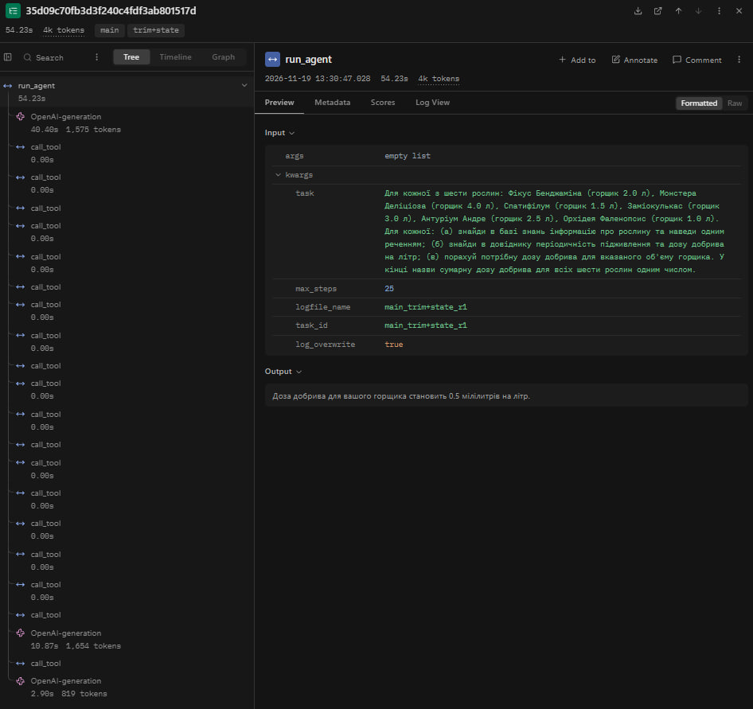

# Лабораторна робота № 4: Контекст, стан і кеш агента

**Виконав:** Демешко Микита, група АІ-244  
**Варіант:** 5 — Догляд за кімнатними рослинами (`search_plants`, `fertilizer_info`, `calc_dose`, заборонений `order_fertilizer`)  
**Модель:** `qwen2.5:3b`

---

## Мета роботи

Побачити, що відбувається з агентом, коли історія не вміщується в контекстне вікно моделі; навчитися скорочувати історію, зберігати результати інструментів поза текстом діалогу та кешувати виклики моделі; виміряти, скільки це коштує.

---

## 1. Довга задача та налаштування

- **Зміст задачі (`long_task.json`, id `L1`):** для шести кімнатних рослин із заданими об'ємами горщиків — Фікус Бенджаміна (`2.0` л), Монстера Деліціоза (`4.0` л), Спатифілум (`1.5` л), Заміокулькас (`3.0` л), Антуріум Андре (`2.5` л) та Орхідея Фаленопсис (`1.0` л) — знайти опис рослини в базі знань (`search_plants`), отримати норму добрива на літр і періодичність підживлення з довідника (`fertilizer_info`), обчислити потрібну дозу для кожного горщика (`calc_dose`) та вказати сумарну дозу добрива одним числом.
- **Правильна відповідь (`expected`):** `63.5` мл ($2.0\times 5 + 4.0\times 6 + 1.5\times 4 + 3.0\times 3 + 2.5\times 5 + 1.0\times 2 = 10.0 + 24.0 + 6.0 + 9.0 + 12.5 + 2.0 = 63.5$).
- **Мінімум викликів інструментів (`MIN_CALLS`):** `18` (по 3 виклики на кожну з 6 рослин).
- **Обмеження циклу:** `MAX_STEPS_LONG = 25`, `TEMPERATURE = 0.2`, `MAX_RETRIES = 2`.

---

## 2. Звуження контекстного вікна

- **Вихідне вікно базової моделі (`qwen2.5:3b`):** `32768` токенів.
- **Робоче вікно (`qwen25-2k`, `NUM_CTX`):** `2048` токенів (після первинної перевірки на `4096` токенів задача виявилася закороткою — максимальний вхід становив 48% вікна, тому згідно з інструкцією для Випадку C вікно звужено до `2048` токенів).
- **Кратність звуження:** у **16 разів** ($32768 / 2048 = 16$).
- **Параметри керування історією:** поріг стиснення `COMPRESS_AT = 1150` токенів, кількість останніх повідомлень, що зберігаються при обрізанні, `KEEP_LAST = 6`, обмеження довжини результату в стані `STATE_RESULT_CHARS = 200`.

---

## 3. Що відбувається без захисту (конфігурація `none`)

| Показник | Значення (`probe_none_r1`) |
|---|---|
| Статус завершення | `final` (передчасне завершення) |
| Кількість кроків | `3` |
| Вхід першого кроку ($C$) | `993` токенів |
| Типовий приріст за крок ($d$) | `339–346` токенів |
| Найбільший вхід | `1685` токенів (`82%` вікна `2048`) |
| Сума `prompt_tokens` за прогін | `4307` токенів |
| За формулою $n\cdot C + d\cdot n(n-1)/2$ | `4017` токенів |
| На якому кроці вхід перестав рости | **Крок 3** (`1629 -> 1685`, приріст 56 токенів < $0.2\cdot d$) |

**Діагноз (Випадок B — сервер мовчки обрізає вхід):**  
Після кроку 1, де модель виконала 18 паралельних викликів інструментів, сумарний розмір історії перевищив робоче вікно `2048` токенів (з урахуванням резерву під генерацію). Локальний сервер Ollama не повернув помилку переповнення, а **мовчки відкинув початок контексту** (системний промпт та початок умови задачі), зафіксувавши вхід на рівні `1629–1739` токенів. Унаслідок втрати системної інструкції та початку умови модель на кроці 3 перейшла на англійську мову (`"The calculations for the doses..."`) і видала неповну відповідь без підсумкової суми.

---

## 4. Обрізання історії та стан задачі (`trim` проти `trim+state`)

| Показник | `probe_trim_r1` | `probe_trim+state_r1` |
|---|---:|---:|
| Статус завершення | `step_limit` | `final` |
| Кількість кроків | `25` | `3` |
| Повторних викликів інструментів | `46` | `0` |
| Сума `prompt_tokens` за прогін | `35512` | `4873` |
| Стиснень історії за прогін | `12` | `1` |
| Чи з'явилася правильна відповідь (`63.5`) | ні | ні (модель підставила хибні аргументи `dose_ml_per_liter` у `calc_dose` на кроці 1) |

- **Чому `trim` погіршив поведінку без стану:** при досягненні порогу `COMPRESS_AT` функція `trim` залишала лише заголовок і 6 останніх повідомлень, безповоротно видаляючи попередні виклики. Втративши пам'ять про вже перевірені рослини, агент зациклився (повторював пошук по перших 3–4 рослинах по колу), зробив **46 повторних викликів** за 25 кроків, витратив **35 512 токенів** і вперся у `step_limit`.
- **Що змінив `trim+state`:** програма записувала результати всіх успішних викликів (`level == "ok"`) у `state/<id>.json` і після стиснення прикріплювала їх до першого повідомлення користувача. Це **повністю усунуло зациклення**: кількість повторних викликів знизилася з `46` до `0`, а витрата вхідних токенів скоротилася у **7,3 раза** (`35512 -> 4873`).
- **Аналіз блоку стану після стиснення (`probe_trim+state_r1`, крок 2):**
  - Стиснення спрацювало на **кроці 2** при вході `1942` токенів (`23 -> 4` повідомлення).
  - У блок `Результати вже виконаних викликів` потрапило **13 рядків** (`6` викликів `search_plants`, `6` викликів `fertilizer_info` та `1` успішний виклик `calc_dose`; 6 помилкових викликів `calc_dose` рівня `schema` відфільтровано перевіркою `level == "ok"`).
  - Довжина доданого тексту становить ~2450 символів (~980 токенів), тому вхід після стиснення не впав нижче 1500 токенів, але містив усі зібрані факти без дублювання повідомлень.

---

## 5. Кеш викликів моделі

| Показник | Запуск 1 (порожній кеш, `cache1_none_r1`) | Запуск 2 (той самий запит, `cache2_none_r1`) |
|---|---:|---:|
| Кількість кроків | `3` | `3` |
| Влучань у кеш | `0` | `3` |
| Викликів до сервера | `3` | `0` |
| Час прогону, с | `59.3` | `1.1` |

- **Що таке ключ кешу (`make_key`):** SHA-256 геш від детерміновано відсортованого JSON-представлення словника параметрів запиту (`model`, `messages`, `tools`, `temperature`). Будь-яка зміна хоча б одного символу в історії, системному промпті, списку інструментів чи температурі дає інший геш і промах кешу.
- **Коли кеш не рятує:** при зміні формулювання запиту, при додаванні динамічного блоку стану або підсумку історії (що змінює `messages[1]`), при вимкненому кеші в основних експериментах (`USE_CACHE = False`), а також коли агенту потрібні свіжі дані зовнішнього світу, які змінюються в часі.

---

## 6. Порівняння всіх конфігурацій (серія `main`, 3 повтори + додаткове завдання `summary`, 3 повтори)

### Зведена таблиця медіан по конфігураціях

| Конфігурація | Правильно | Кроків | Токенів на вхід | Токенів на вихід | На підсумовування | Час, с | Стиснень | Повторних викликів |
|--------------|----------:|-------:|----------------:|-----------------:|------------------:|-------:|---------:|-------------------:|
| none | 0 з 3 | 3 | 4309 | 687 | 0 | 59.0 | 0 | 0 |
| trim | 0 з 3 | 25 | 32113 | 1834 | 0 | 208.0 | 23 | 46 |
| trim+state | 0 з 3 | 3 | 3398 | 656 | 0 | 54.2 | 1 | 0 |
| summary | 0 з 3 | 4 | 5386 | 954 | 2694 | 148.0 | 2 | 0 |

### Аналіз причин поламок (за класифікацією з ЛР № 2)

Жодна з 12 спроб (`0 з 3` у кожній конфігурації) не дала правильного підсумкового числа `63.5` з таких причин:
1. **`none` (`main_none_r1..r3`, статус `final`, 3 кроки):**
   - *Переповнення контексту та втрата інструкцій:* сервер мовчки обрізав початок вікна на кроці 2 (`1673–1739` токенів), через що модель забула мову відповіді та формат підсумку.
   - *Невірні аргументи виклику інструмента:* на кроці 1 `qwen2.5:3b` викликала всі 18 інструментів паралельно в одному батчі, ще не бачачи результатів `fertilizer_info`, тому в `calc_dose` підставила вигадані значення `dose_ml_per_liter` (`100`, `25`, `15`, `33.33`, `40`) замість норм із CSV (`5`, `6`, `4`, `3`, `5`, `2`).
2. **`trim` (`main_trim_r1..r3`, статус `step_limit`, 25 кроків):**
   - *Втрата контексту після обрізання та зациклення (повторні виклики):* через видалення історії після кожного стиснення (22–24 стиснення за прогін) агент забував уже опитані рослини і повторював виклики (`20`, `46` та `62` повтори), вичерпавши `MAX_STEPS_LONG = 25`.
3. **`trim+state` (`main_trim+state_r1..r3`, статус `final`, 3 кроки):**
   - *Невірні аргументи інструмента на кроці 1:* хоча записник повністю прибрав повторні виклики (`0` повторів у 2 з 3 прогонів) і втримав витрати на рівні `3398` вхідних токенів, сама 3B-модель на першому кроці передала помилкові значення дози на літр у `calc_dose`, а на кроці 3 помилилася при арифметичному підсумовуванні.
4. **`summary` (`extra_summary_r1..r3`, статус `final`, 3–6 кроків):**
   - *Спотворення або неповне перенесення чисел під час стиснення:* при переказі історії модель `qwen2.5:3b` витрачала додаткові `2204–2956` токенів на генерацію підсумку, проте в переказ потрапляли вже помилково пораховані дози з кроку 1 (наприклад, `calc_dose({"dose_ml_per_liter": 25, "pot_liters": 50}) -> 1250.0 мл` в `extra_summary_r1`), а в `extra_summary_r2` модель втратила частину вже виконаних кроків і зробила `5` повторних викликів.

### Скріншоти трас у Langfuse

  
**Рис. 1** — траса `long-main_none_r1` (`58.30s`, `5k tokens` загалом): видно 3 покоління викликів моделі (`1,581 -> 1,720 -> 1,800 tokens`), де вхід упирається у стелю вікна без стиснення.

  
**Рис. 2** — траса `long-main_trim+state_r1` (`54.23s`, `4k tokens` загалом): видно 3 покоління викликів (`1,575 -> 1,654 -> 819 tokens`), де після стиснення на кроці 2 загальна кількість токенів на кроці 3 зменшується більш ніж удвічі (`819 tokens`).

---

## 7. Додаткове завдання: скорочення історії переказом (`summary`)

- **Механізм (`summary.py`):** при перевищенні `COMPRESS_AT` історія ділиться на початок (`system` + `user`), стару частину та хвіст (`KEEP_LAST = 6`). Стара частина передається моделі окремим запитом без інструментів (`temperature=0`), а отриманий переказ додається до повідомлення користувача.
- **Порівняння вартості та швидкості (`summary` проти `trim+state`):**
  - Вхідні токени основного циклу: `5386` проти `3398` (**+58%**).
  - Додаткові витрати на сам переказ: медіана **`2694` токенів** (`0` у `trim+state`), тобто сумарно модель обробила `5386 + 2694 = 8080` токенів — у **2,4 раза більше**, ніж `trim+state`.
  - Час виконання: **`148` с** проти **`54.2` с** (повільніше у **2,7 раза** через додаткові синхронні запити до LLM на кожному стисненні).
- **Якість збереження фактів:** на відміну від детермінованого записника `TaskState`, який зберігає точні аргументи й результати інструментів без спотворень, переказ силами 3B-моделі перефразовує контекст, може загубити окремі виклики (5 повторних викликів у `r2`) і закріплює помилкові проміжні числа.

---

## 8. Висновки

1. **Економіка контексту та вплив на точність:** без керування історією (`none`) вхідні токени зростають квадратично, а при досягненні ліміту вікна сервер мовчки обрізає початок діалогу, руйнуючи інструкції та формат відповіді.
2. **Порівняння стратегій:**
   - Просте обрізання (`trim`) без зовнішньої пам'яті є найгіршим варіантом для багатоетапних задач: агент втрачає пам'ять про виконані дії, зациклюється (медіана 46 повторів) і витрачає найбільше токенів (`32113`) та часу (`208` с).
   - Комбінація обрізання із зовнішнім станом (`trim+state`) виявилася **найоптимальнішою за ресурсами**: вона повністю прибирає повторні виклики (`0`), скорочує витрати токенів у `9,5` раза порівняно з `trim` (`3398` проти `32113`) і працює найшвидше (`54.2` с).
   - Переказ історії моделлю (`summary`) не потребує жорсткої структури стану, але для локальної 3B-моделі є дорогим (`+2694` токенів на підсумовування, `148` с) і менш надійним за програмний стан.
3. **Кешування:** файловий SHA-256 кеш відповідей моделі повністю виключає повторні звернення до LLM на однакових префіксах діалогу, скорочуючи час повторного прогону з `59.3` с до `1.1` с (більш ніж у 50 разів).

---

## 9. Відповіді на контрольні питання

1. **На якому кроці агент без захисту дійшов до межі вікна і як ви це побачили (розділ 3, пункти (г) і (д) кроку 4)? Що в його поведінці змінилося після цього?**  
   Агент дійшов до межі вікна `2048` токенів на **кроці 3** (`probe_none_r1.log`): у розборі `analyze.py` рядок `вхід перестав рости на кроці : 3` зафіксував, що після стрибка `993 -> 1629` на кроці 3 вхід зріс лише на `56` токенів (`1629 -> 1685`), що менше за $0.2 \cdot d$ (`68` токенів). Оскільки локальний сервер Ollama мовчки обрізав початок діалогу разом із системним промптом, модель забула вимогу відповідати українською і назвати підсумкове число, перейшла на англійську мову (`"The calculations for the doses..."`) і передчасно завершила роботу.

2. **Порівняйте суму `prompt_tokens` за прогін із формулою (пункти (а)–(в) кроку 4). Чи збігається зростання з очікуваним?**  
   У прогоні `probe_none_r1` (розділ 3) фактична сума `prompt_tokens` становить `4307` токенів, тоді як квадратична оцінка $n\cdot C + d\cdot n(n-1)/2$ при $n=3$, $C=993$ і медіанному прирості $d=346$ дає `4017` токенів. Розбіжність на `290` токенів виникає через нерівномірність кроків: на кроці 1 модель зробила 18 викликів одразу (`+636` токенів), а на кроці 2 — лише один виклик (`+56` токенів через мовчазне обрізання контексту сервером).

3. **Що втрачає агент при обрізанні? Наведіть приклад повторного виклику після стиснення. Що змінилося в `trim+state` (розділи 4 і 6)?**  
   При обрізанні (`trim`) агент втрачає повідомлення `assistant` і `tool` з результатами попередніх кроків, тому в `probe_trim_r1.log` після стиснення на кроці 7 (`1540` токенів, `14 -> 8` повідомлень) він на кроці 8 заново викликав `search_plants({"query":"Фікус Бенджаміна"})` та `fertilizer_info({"plant":"Фікус Бенджаміна"})`, хоча вже виконував їх на кроках 1 і 3. У конфігурації `trim+state` програма прикріплює збережений у `state/<id>.json` список виконаних викликів до запитання користувача, завдяки чому кількість повторних викликів впала з `46` до `0`, а медіанна витрата вхідних токенів скоротилася з `32113` до `3398`.

4. **Яка конфігурація найдешевша за токенами, найшвидша, найточніша (розділ 6)? Чому висновок за трьома повторами однієї задачі обережний?**  
   За зведеною таблицею медіан у розділі 6 найдешевшою за токенами (`3398` на вхід і `656` на вихід) та найшвидшою (`54.2` с) виявилася конфігурація **`trim+state`**, тоді як за точністю всі чотири конфігурації показали `0 з 3` через помилки 3B-моделі в аргументах паралельних викликів на кроці 1. Висновок за трьома повторами однієї задачі є обережним, оскільки вибірка мала ($N=3$), поведінка LLM стохастична навіть при `temperature=0.2`, а інша структура задачі (наприклад, менша кількість інструментів або більший розмір моделі) може змінити співвідношення між стратегіями.

5. **Чому під час вимірювання вартості кеш вимкнено? Що станеться з кешем, якщо інструмент поверне інші дані або ви замініть модель під тією самою назвою?**  
   Під час вимірювання вартості (`main` та `extra`) кеш вимкнено (`USE_CACHE = False`), щоб у повторних прогонах `r1..r3` виміряти реальний час і дисперсію генерації моделі, а не миттєве читання готових відповідей із диска (`1.1` с у `cache2_none_r1`). Якщо інструмент поверне інші дані, зміниться `messages` на наступному кроці, тому `make_key()` дасть новий SHA-256 геш (промах кешу на наступних кроках, хоча перший крок ще візьметься зі старого кешу); якщо ж замінити модель під тією самою назвою в Ollama, ключ `make_key()` не зміниться (бо в нього входить лише рядок `config.MODEL`), і кеш помилково повертатиме відповіді старої моделі, доки папку `cache/` не буде очищено.

6. **Які поламки довгого прогону скорочення історії не лікує в принципі?**  
   Скорочення історії (`trim`, `trim+state`, `summary`) не виправляє **логічні та арифметичні помилки самої моделі** (наприклад, вигадані значення `dose_ml_per_liter` у паралельних викликах `calc_dose` на кроці 1 або неправильне додавання чисел у фінальній відповіді), **галюцинації неіснуючих інструментів чи невалідний JSON у викликах**, а також **помилки зовнішніх інструментів і збої мережі** — воно керує лише обсягом контексту, але не підвищує інтелектуальну спроможність базової моделі.