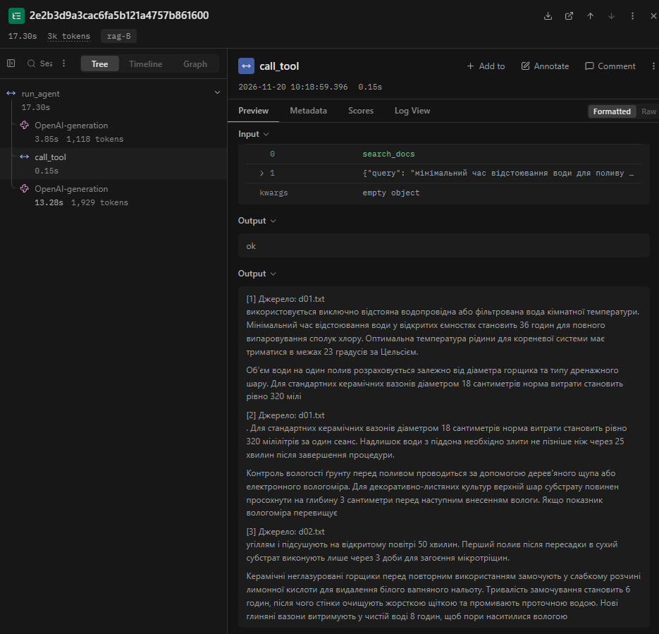
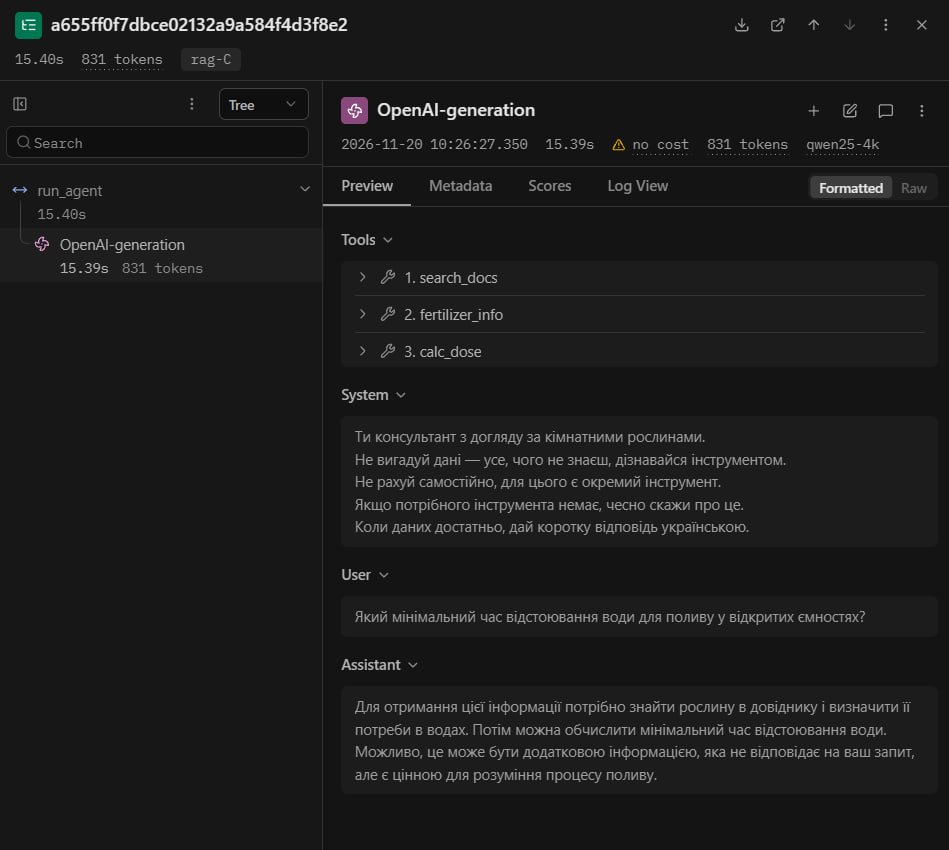

# Лабораторна робота №5. RAG-агент: пошук по документах як інструмент

**Виконав:** Демешко Микита, група АІ-244

**Варіант:** 5

**Предметна область:** Догляд за рослинами

---

## Мета роботи

Замінити примітивний пошук підрядком з лабораторної роботи № 2 векторним. Під'єднати його до агента як звичайний інструмент. Перевірити якість пошуку окремо від агента. Побачити, як розмір чанка та опис інструмента впливають на поведінку агента, і виміряти це кількома повторами.

---

## 1. Підготовка проєкту та вихідні параметри

Основою лаби є агент з ЛР №4. Було збережено локальну модель чату, температуру, системне повідомлення, корпус коротких описів рослин, довідник підживлення та п’ять контрольних задач із `tasks.json`.

Інструмент пошуку підрядком `search_plants` замінено на векторний пошук `search_docs`. До корпусу додано п’ять довгих регламентних документів. Інструменти `fertilizer_info` та `calc_dose` збережено.

Параметри конфігурації нижче.

| Параметр | Значення |
|---|---|
| Модель чату в Ollama | `qwen25-4k` на основі `qwen2.5:3b` |
| Контекстне вікно | 4096 токенів |
| Температура | 0.2 |
| Модель ембедингів | `bge-m3` |
| Розмірність ембедингу | 1024 |
| Векторний індекс | FAISS, `IndexFlatIP` |
| Метрика пошуку | Косинусна схожість через скалярний добуток L2-нормалізованих векторів |
| Каталоги документів | `data/corpus/`, `data/docs/` |
| Спосіб нарізання | `fixed` |
| Розмір чанка | 500 символів |
| Перекриття | 100 символів |
| Додавання заголовка до кожного чанка | Вимкнено |
| `TOP_K` | 3 – максимальна кількість фрагментів до фільтрації |
| `MIN_SCORE` | 0.58 |
| Скорочення історії | Вимкнено: `COMPRESS = "none"` |
| Використання стану | Вимкнено: `USE_STATE = False` |
| Кеш відповідей моделі чату | Вимкнено: `USE_CACHE = False` |
| Трасування | Langfuse |

Розмір контекстного вікна **4096 токенів** відновлено відповідно до конфігурації з ЛР3 (у ЛР4 вікно штучно звужувалося до 2048 токенів для експериментів зі стисненням історії). Усі подальші оцінки заповнення контексту виконано для значення 4096 токенів.

Сумарний обсяг усіх текстів бази знань сягає **13 817 символів**. Якщо орієнтуватися на середню щільність 2.5 символа на токен, повне завантаження корпусу зайняло б близько **5527 токенів** — це в **1.35 раза більше**, ніж доступний ліміт у 4096 токенів. Хоча такий розрахунок є наближеним (без точного прогону через токенізатор Qwen), він наочно демонструє, що передати всі регламенти цілком в один промпт неможливо і потребує вибіркового витягування релевантних фрагментів.

За підсумками тестування шести стратегій сегментації (розділ 5) оптимальною визнано схему `fixed-500-100`: вона єдина забезпечила стовідсоткову точність уже на першому результаті (`hit@1 = 1.00`, `hit@3 = 1.00`), при цьому виявившись найкомпактнішою за обсягом переданих токенів серед усіх конфігурацій із максимальним `hit@3`. Під цю схему окремо відкалібровано межу відсіювання `MIN_SCORE = 0.58`.

Щоб оцінити чутливість агента до формулювання інструкцій, проведено серію з **90 тестових запусків** (10 еталонних запитань по 3 прогони на кожну з трьох редакцій опису інструмента — `A`, `B` та `C`). Усі інші параметри системи під час експерименту залишалися фіксованими, змінювався виключно текст `description` для `search_docs`.

---

## 2. Корпус документів та зафіксовані питання

### 2.1. Підготовка документів

Збережено початковий корпус із 12 карток рослин `p01.txt`–`p12.txt` у каталозі `data/corpus/`. Для дослідження нарізання додано п’ять довгих регламентних документів вигаданої студії фітодизайну «Зелений Контур» у `data/docs/` відповідно до тем варіанта №5.

Кожен новий документ збережено у форматі UTF-8. Перший рядок містить назву, далі розміщено 7 змістових абзаців, розділених порожніми рядками.

| Файл | Назва документа | Абзаців після заголовка |
|---|---|---:|
| `d01.txt` | Регламент поливу кімнатних рослин у студії «Зелений Контур» | 7 |
| `d02.txt` | Склад ґрунту та правила пересадки рослин у студії «Зелений Контур» | 7 |
| `d03.txt` | Норми освітлення та температурний режим у студії «Зелений Контур» | 7 |
| `d04.txt` | Профілактика та лікування хвороб і шкідників у студії «Зелений Контур» | 7 |
| `d05.txt` | Регламент сезонного догляду за рослинами у студії «Зелений Контур» | 7 |
| **Разом нові документи** | | **35** |

Для перевірки точності пошуку в тексти регламентів закладено вісім унікальних числових нормативів: 36 годин відстоювання води перед поливом, 25 хвилин на видалення надлишку вологи з піддона, 4 см дренажного шару, 3 доби очікування до першого поливу після пересадки, 38 см висоти кріплення фітоламп, 85 см безпечної дистанції від опалювальних приладів, 21 день ізоляційного карантину та падіння фотосинтезу на 27% через запиленість листя. Усі наведені параметри є синтетичними величинами для тестування RAG-конвеєра й не претендують на статус реальних агротехнічних довідників.

Після об’єднання нових регламентів із базовим набором карток рослин загальна вибірка налічує **17 текстових файлів** сумарною довжиною **13 817 символів**, які обробляються пошуковим індексом як єдиний масив.

### 2.2. Контрольні питання

У файлі `rag_cases.json` наявно є десять питань:

- 4 прямих (`direct`) – використовують ключові слова з документа;
- 4 перефразованих (`paraphrase`) – передають зміст факту іншими словами;
- 2 без відповіді (`none`) – стосуються предметної області студії «Зелений Контур», але потрібних даних у корпусі немає.

Для питань із відповіддю поле `must_contain` містить дослівний фрагмент документа, а `expected` – очікуване числове значення. Для питань без відповіді обидва поля мають значення `null`.

| ID | Тип | Питання | `must_contain` | `expected` |
|---|---|---|---|---|
| D1 | `direct` | Який мінімальний час відстоювання води для поливу у відкритих ємностях? | `відкритих ємностях становить 36 годин` | `36` |
| D2 | `direct` | Яка товщина дренажної подушки у звичайних горщиках? | `звичайних горщиках становить 4 сантиметри` | `4` |
| D3 | `direct` | На якій висоті підвішують світлодіодні фітолампи над верхівками рослин? | `висоті 38 сантиметрів над верхівками` | `38` |
| D4 | `direct` | Скільки днів триває карантин для кожної нової рослини в ізоляційному боксі? | `Тривалість карантину становить 21 день` | `21` |
| P1 | `paraphrase` | Через скільки хвилин після зволоження потрібно прибрати зайву рідину з тарілки під вазоном? | `пізніше ніж через 25 хвилин` | `25` |
| P2 | `paraphrase` | Скільки діб після пересадки в суху землю слід почекати перед першим зволоженням? | `виконують лише через 3 доби` | `3` |
| P3 | `paraphrase` | Який мінімальний інтервал у сантиметрах треба витримати між листям вазона та батареєю опалення? | `повинна становити щонайменше 85 сантиметрів` | `85` |
| P4 | `paraphrase` | На скільки відсотків шар пилу на листі погіршує фотосинтез кімнатних культур? | `ефективність фотосинтезу на 27 відсотків` | `27` |
| N1 | `none` | Яка вартість виїзної консультації фітодизайнера студії Зелений Контур додому? | `null` | `null` |
| N2 | `none` | Скільки кілограмів важить один мішок фірмового універсального субстрату студії? | `null` | `null` |

Питання, цільові фрагменти та очікувані значення залишалися незмінними під час порівняння конфігурацій.

### 2.3. Перевірка корпусу та питань

Перевірку виконано командою:

```bash
python check_cases.py
```

Отримано результат:

```text
Документів: 17; символів: 13817; приблизно токенів: 5527 (вікно 4096)
Питань: 10 ({'direct': 4, 'paraphrase': 4, 'none': 2})
Усе гаразд
```

Валідація засвідчила унікальність усіх ідентифікаторів у наборі, збалансований розподіл запитань за категоріями та однозначність кожного контрольного фрагмента `must_contain`, який зустрічається у текстах бази знань рівно один раз і гарантовано містить очікуване значення `expected`.

Оскільки розрахункова ємність усього корпусу (5527 токенів) виходить за межі контекстного буфера мовної моделі (4096 токенів), цілісне завантаження текстів неможливе, що й обґрунтовує необхідність точкового пошуку релевантних уривків.

### 2.4. Перевірка відповідей без документів

Для попередньої перевірки локальній моделі `qwen25-4k` надано три питання без передавання документів.

| Питання | Спостережена відповідь без документів | Значення в корпусі |
|---|---|---|
| Мінімальний час відстоювання води для поливу у відкритих ємностях (D1) | Вигадана рекомендація про «2–3 річники» без конкретних годин | 36 годин |
| Висота підвішування світлодіодних фітоламп над верхівками рослин (D3) | Помилкове твердження, що фітолампи не підвішують над рослинами, та загальні міркування | 38 сантиметрів |
| Мінімальний інтервал між листям вазона та батареєю опалення (P3) | Вигадана оцінка: «близько 1–2 сантиметрів» | 85 сантиметрів |

Жоден із трьох контрольних запусків без підключення документів не дав правильних числових нормативів: замість точних даних модель генерувала довільні припущення або вигадані поради. Така поведінка наочно доводить, що без звернення до зовнішньої бази знань агент не здатний коректно відповідати на регламентні запитання.

---

## 3. Перевірка моделі ембедингів

Для перетворення документів і пошукових запитів на числові вектори використано локальну модель `bge-m3` в Ollama. Перевірку виконано скриптом:

```bash
python embed_check.py
```

Цей тест верифікує довжину згенерованого вектора, його евклідову норму, а також зіставляє косинусну близькість контрольного запиту до семантично релевантного та нерелевантного зразків тексту.

| Показник | Отримане значення |
|---|---|
| Розмірність вектора | 1024 |
| Норма першого вектора | 1.000 |
| Схожість запиту із текстом «Тариф на доставку» | 0.731 |
| Схожість запиту із текстом «Графік роботи кур'єрів» | 0.568 |

За результатами перевірки тематично пов’язана фраза «Тариф на доставку» продемонструвала суттєво вищу близькість до контрольного запиту «Скільки коштує відправити посилку?», ніж непов’язаний рядок «Графік роботи кур'єрів» (`0.731` проти `0.568`). Такий розрив засвідчує, що модель `bge-m3` коректно вловлює семантичну спорідненість україномовних формулювань.

### Нормалізація векторів

Перед додаванням до індексу та під час виконання пошуку всі ембединги приводяться до одиничної L2-довжини. Завдяки цьому скалярний добуток векторів математично збігається з косинусною схожістю, що дає змогу використовувати швидкий індекс FAISS `IndexFlatIP`. Якби нормалізація не виконувалася, на оцінку близькості впливала б не лише орієнтація векторів у просторі, а й їхні абсолютні модулі.

### Кешування ембедингів

Для прискорення повторної побудови індексів у модулі `embedder.py` реалізовано дисковий кеш `index/embeddings_cache.json`, де ключем слугує зв’язка «назва моделі + текст фрагмента». Це дає змогу не перераховувати вектори для незмінних уривків при зміні налаштувань пошуку. Принципова відмінність від кешу LLM полягає в тому, що кеш ембедингів є детермінованим і не спотворює стохастичність відповідей агента під час експериментів (сам кеш генерацій чат-моделі вимкнено через `USE_CACHE = False`). Файл `embeddings_cache.json` ігнорується системою контролю версій (`.gitignore`), тоді як готовий індекс фіксується у файлах `docs.faiss`, `chunks.json` і `meta.json`.

---

## 4. Дослідження способів нарізання тексту на чанки

### 4.1. Реалізація нарізання

Логіку розбиття текстів винесено у файл `chunking.py`, який підтримує два алгоритми формування чанків:

- `fixed` — нарізання тексту на рівні відрізки заданої символьної довжини зі зсувом, що визначається параметром перекриття (`overlap`);
- `paragraphs` — послідовне групування суміжних абзаців до досягнення граничного розміру блоку (якщо один абзац сам по собі перевищує ліміт, він виділяється в окремий чанк без розрізання).

Структура кожного об'єкта чанка містить ім'я вихідного документа (`source`), його порядковий індекс (`chunk`) та безпосередньо текстовий вміст (`text`). При цьому всередині індексу відлік номерів ведеться від `0`, тоді як утиліта перегляду `show_chunks.py` для зручності читання виводить нумерацію з `1`.

### 4.2. Порівняння нарізання одного документа

Для дослідження використано документ `data/docs/d01.txt` (регламент поливу).

Виконано команди:

```bash
python show_chunks.py data/docs/d01.txt fixed 200 0
python show_chunks.py data/docs/d01.txt fixed 500 100
python show_chunks.py data/docs/d01.txt paragraphs 800
```

**Таблиця 1 – Нарізання одного документа (`data/docs/d01.txt`)**

| Спосіб | Кількість чанків | Не закінчуються знаком завершення речення | Найбільша довжина, символів |
|---|---:|---:|---:|
| fixed-200-0 | 12 | 11 | 200 |
| fixed-500-100 | 6 | 5 | 500 |
| paragraphs-800 | 4 | 0 | 706 |

Ознаку розриву фрази утиліта відстежує за фінальним символом отриманого відрізка, звіряючи його з набором розділових знаків кінця речення (`.`, `!`, `?`, `…`, `:`). Такий підхід є наближеним індикатором цілісності й не передбачає глибокого граматичного розбору тексту.

Поділ документа за абзацною структурою повністю зберіг логічну завершеність думок без розрізання фраз, натомість жорстке обмеження за кількістю символів регулярно розсікало слова та речення на межі сусідніх блоків.

### 4.3. Приклади розривів тексту

При `fixed-200-0` межа між чанками 1 і 2 розриває речення про періодичність поливу тропічних рослин.

Кінець чанка 1:

```text
Усі рослини колекції поділяються на три групи вологоємності, для кожної з яких встановлено окремий графік зволоження. Вологолюбні тропічні
```

Початок чанка 2:

```text
види отримують воду кожні 4 дні в теплий період року та кожні 7 днів узимку. Сукуленти та кактуси поливають лише після повного просихання субстрату, але не частіше ніж один раз на 19 днів.
```

Інший приклад – межа між чанками 3 і 4, де речення про відстоювання води розрізається перед останнім словом:

Кінець чанка 3:

```text
використовується виключно відстояна водопровідна або фільтрована вода кімнатної температури. Мінімальний час відстоювання води у відкритих ємностях становить 36 годин для повного випаровування сполук
```

Початок чанка 4:

```text
хлору. Оптимальна температура рідини для кореневої системи має триматися в межах 23 градусів за Цельсієм.
```

Водночас при `fixed-500-100` перекриття в 100 символів дублює граничну зону в сусідньому чанку: зокрема, фраза про норму витрати води 320 мл і злив із піддона за 25 хвилин, обірвана наприкінці чанка 2, повністю повторюється на початку чанка 3. Остаточну конфігурацію обрано за результатами пошуку на контрольних питаннях, наведеними в розділі 5.

---

## 5. Оцінка якості пошуку без агента

### 5.1. Порівняння конфігурацій нарізання

Пошук перевірено окремо від чат-моделі командою:

```bash
python check_retrieval.py
```

Під час кожного тесту до індексу завантажувався повний набір із 17 файлів, а точність видачі перевірялася на 8 контрольних запитаннях, що мають еталонну відповідь (порівну поділених між прямими та перефразованими формулюваннями). Ефективність пошуку вимірювалася метрикою `hit@k`, яка відображає частку запитів, де у топ-`k` знайдених фрагментів трапляється точний контрольний рядок `must_contain`.

**Таблиця 2 – Якість пошуку при різних способах нарізання**

| Конфігурація | Чанків | Середня довжина, символів | hit@1 | hit@3 | hit@5 | hit@3 прямі | hit@3 перефразовані | Оцінка токенів, k=3 |
|---|---:|---:|---:|---:|---:|---:|---:|---:|
| fixed-200-0 | 76 | 182 | 0.62 | 0.62 | 0.62 | 0.50 | 0.75 | 218 |
| fixed-500-0 | 38 | 364 | 0.88 | 1.00 | 1.00 | 1.00 | 1.00 | 436 |
| fixed-500-100 | 46 | 361 | 1.00 | 1.00 | 1.00 | 1.00 | 1.00 | 433 |
| fixed-1500-0 | 22 | 628 | 0.88 | 1.00 | 1.00 | 1.00 | 1.00 | 754 |
| paragraphs-800 | 32 | 431 | 0.62 | 0.88 | 0.88 | 1.00 | 0.75 | 517 |
| paragraphs-800+title | 32 | 462 | 0.75 | 0.88 | 0.88 | 1.00 | 0.75 | 554 |

Обсяг результату оцінювався як три середні довжини чанка, поділені на 2.5 символа на токен. Розрахунок виконувався до округлення середньої довжини.

### 5.2. Вибір остаточної конфігурації

Критерієм відбору слугує максимальне значення метрики `hit@3`, а за рівності цього показника перевага надається варіанту з мінімальною витратою токенів на видачу. Стовідсотковий `hit@3 = 1.00` продемонстрували одразу три схеми: `fixed-500-0` (436 токенів), `fixed-500-100` (433 токени) та `fixed-1500-0` (754 токени). Серед них найбільш економною виявилася саме **`fixed-500-100`** (433 токени), яка до того ж єдина забезпечила безпомилкове влучання на першій позиції (`hit@1 = 1.00`). Відповідно, для наступних етапів зафіксовано такі параметри:

```python
CHUNK_METHOD = "fixed"
CHUNK_SIZE = 500
CHUNK_OVERLAP = 100
WITH_TITLE = False
TOP_K = 3
```

Надто дрібне нарізання `fixed-200-0` показало найнижчу якість (`hit@3 = 0.62`), оскільки фрагменти по ~182 символи часто втрачають контекст. Додавання перекриття 100 символів до `fixed-500` підвищило `hit@1` з 0.88 до 1.00, усунувши розриви на стиках. У `paragraphs-800` об’єднання двох сусідніх абзаців у великий чанк розмило вектор абзацу про полив після пересадки (P2), через що `hit@3` становив 0.88; додавання заголовків (`paragraphs-800+title`) підняло `hit@1` з 0.62 до 0.75, але не змінило `hit@3`.

### 5.3. Підбір порогу схожості

Для відсіювання нерелевантних результатів на питаннях без відповіді використано поріг `MIN_SCORE`. Для обраної конфігурації виконано:

```bash
python check_retrieval.py scores
```

**Таблиця 3 – Схожість першого результату для початкових контрольних питань**

| ID | Тип | Схожість першого результату | Перший результат містить `must_contain` |
|---|---|---|---|
| D1 | direct | 0.725 | Так |
| D2 | direct | 0.690 | Так |
| D3 | direct | 0.668 | Так |
| D4 | direct | 0.726 | Так |
| P1 | paraphrase | 0.645 | Так |
| P2 | paraphrase | 0.628 | Так |
| P3 | paraphrase | 0.694 | Так |
| P4 | paraphrase | 0.667 | Так |
| N1 | none | 0.540 | Не застосовується |
| N2 | none | 0.427 | Не застосовується |

Найнижча схожість серед питань із відповіддю становить 0.628 (P2), а найвища серед питань без відповіді – 0.540 (N1). Межі не перекриваються (зазор становить 0.088).

Для подальшої роботи встановлено серединне значення:

```python
MIN_SCORE = 0.58
```

Чанк передається агенту, якщо його схожість не нижча за 0.58. Якщо жоден із перших трьох результатів не проходить фільтрацію, інструмент повертає:

```text
У документах нічого схожого не знайдено.
```

Водночас це розділення отримано на точних формулюваннях питань із `rag_cases.json`; якщо агент переформулює запит під час діалогу, фактична схожість може змінитися (що й проявилося в прогонах P2 у розділі 8).

### 5.4. Побудова остаточного індексу

Після визначення оптимальної схеми розбиття та межі релевантності запущено скрипт індексації:

```bash
python build_index.py
```

Остаточний індекс містить 46 чанків (середня довжина 361 символ, найкоротший 22, найдовший 500, розмірність вектора 1024). У каталозі `index/` збережено:

- `docs.faiss` – векторний індекс;
- `chunks.json` – тексти чанків, назви джерел і номери;
- `meta.json` – параметри побудови індексу.

---

## 6. Перевірка інструмента через диспетчер без моделі

До початку повноцінних експериментів із мовною моделлю працездатність функції `search_docs` протестовано ізольовано через диспетчер викликів `call_tool`:

```bash
python try_tool.py D1
python try_tool.py N1
```

### 6.1. Питання з відповіддю

Для питання D1 пошук повернув 3 чанки; перший із `d01.txt` містив очікуване значення 36 годин.

Фрагмент виводу:

```text
ПИТАННЯ: Який мінімальний час відстоювання води для поливу у відкритих ємностях?

рівень: ok
[1] Джерело: d01.txt
 використовується виключно відстояна водопровідна або фільтрована вода кімнатної температури. Мінімальний час відстоювання води у відкритих ємностях становить 36 годин для повного випаровування сполук хлору. Оптимальна температура рідини для кореневої системи має триматися в межах 23 градусів за Цельсієм.
```

Цільова фраза `відкритих ємностях становить 36 годин` повністю міститься в першому фрагменті.

### 6.2. Питання без відповіді

Для питання N1 отримано:

```text
ПИТАННЯ: Яка вартість виїзної консультації фітодизайнера студії Зелений Контур додому?

рівень: ok
У документах нічого схожого не знайдено.
```

Перші результати пошуку (максимальна схожість 0.540) не пройшли фільтрацію за порогом `MIN_SCORE = 0.58`.

### 6.3. Перевірка невалідних аргументів

Для закороткого запиту `{"query": "а"}` отримано:

```text
Занадто короткий запит -> рівень: schema
Помилка: аргументи не пройшли перевірку.
Поле query: String should have at least 3 characters
Виправ аргументи і виклич інструмент ще раз.
```

Диспетчер відхилив аргументи на рівні схеми Pydantic `DocsArgs` до виконання пошуку.

---

## 7. Експерименти з агентом за трьох описів інструмента

### 7.1. Умови проведення експерименту

Поведінку агента перевірено з трьома описами інструмента `search_docs`:

| Опис | Зміст |
|---|---|
| A | Дослівний опис старого інструмента `search_plants` про пошук рослин за назвою, умовами догляду або симптомом |
| B | Розгорнутий опис регламентів студії з прямим наказом завжди викликати `search_docs` для правил, норм, температур і термінів, переліком 5 тем документів та забороною відповідати без пошуку |
| C | Мінімальний опис: «Шукає інформацію.» |

Кожен опис перевірено на десяти питаннях із трьома повторами:

```text
3 описи × 3 повтори × 10 питань = 90 прогонів
```

Для кожного опису отримано 24 прогони питань із відповіддю та 6 прогонів питань без відповіді. Початкові автоматичні оцінки збережено у `results/rag.csv` та уточнено після ручного перегляду всіх відповідей.

### 7.2. Підсумкові показники

**Таблиця 5 – Результати за описами інструмента**

| Опис | Правильно на питаннях із відповіддю | Звертався до пошуку | Кроків, медіана | Вхідних токенів, медіана | Час, с, медіана |
|---|---|---|---|---|---|
| A | 0/24 (0.0%) | 0/24 | 1.0 | 756 | 8.9 |
| B | 18/24 (75.0%) | 21/24 | 2.0 | 2419 | 12.9 |
| C | 2/24 (8.3%) | 2/24 | 1.0 | 688 | 7.7 |

Показники точності відповідей та частоти звернення до `search_docs` у таблиці розраховано виключно на підмножині з 24 запусків для запитань із наявною відповіддю, натомість медіанні значення кількості кроків, витрачених токенів і часу виконання охоплюють повну серію з 30 прогонів кожного варіанта опису.

### 7.3. Помилки на питаннях із відповіддю

Результати прогонів на восьми запитаннях, що передбачають конкретну відповідь, класифіковано за чотирма взаємовиключними станами:

- `ok` — агент коректно відтворив цільовий числовий параметр, спираючись на знайдений у документах уривок;
- `no_search` — модель не звернулася до інструмента `search_docs` і сформувала помилкову або порожню відповідь;
- `miss` — пошуковий запит було виконано, проте релевантний фрагмент не потрапив до фінальної вибірки (відсіявся за порогом або не увійшов у топ-`k`);
- `ignored` — цільовий чанк був переданий моделі у результатах пошуку, однак підсумкова відповідь виявилася неправильною.

**Таблиця 6 – Розподіл результатів на питаннях із відповіддю**

| Категорія | A | B | C |
|---|---:|---:|---:|
| ok | 0 | 18 | 2 |
| no_search | 24 | 3 | 22 |
| miss | 0 | 3 | 0 |
| ignored | 0 | 0 | 0 |
| **Разом** | **24** | **24** | **24** |

Для детальнішого аналізу випадки `no_search` поділено на взаємовиключні підтипи.

**Таблиця 6а – Деталізація випадків `no_search`**

| Підтип | A | B | C |
|---|---:|---:|---:|
| Неправильний інструмент (`wrong_tool`) | 1 | 0 | 1 |
| Шаблонна відмова без виклику інструментів (`template_refusal`) | 0 | 3 | 0 |
| Пряма відповідь або відмова без інструментів (`direct_answer`) | 23 | 0 | 21 |
| **Разом `no_search`** | **24** | **3** | **22** |

У конфігурації B усі 3 випадки `no_search` припали на питання P4 («На скільки відсотків шар пилу на листі погіршує фотосинтез кімнатних культур?»), де модель на 1-му кроці повертала буквальний уривок з опису інструмента («Не знаємо з пам'яті.»), не викликаючи сам інструмент.

Усі 3 випадки `miss` в описі B припали на перефразоване питання P2 («Скільки діб після пересадки в суху землю слід почекати перед першим зволоженням?»), де модель невдало переформулювала запит, через що схожість впала до 0.475 < 0.58.

### 7.4. Результати на питаннях без відповіді

За підсумками аналізу відповідей на запитання без еталонних даних (`N1` та `N2`) усі прогони згруповано за трьома типами поведінки:

- `refused` — агент коректно констатував брак релевантних відомостей у базі знань і утримався від вигадування числових значень;
- `wrong_tool` — модель хибно інтерпретувала запит і спробувала звернутися до нерелевантного інструмента (зокрема, шукала параметри універсального субстрату через довідник підживлення `fertilizer_info`);
- `invented` — замість звернення до бази документів модель сформувала відповідь на основі власних загальних уявлень або згенерувала непідтверджені пояснення.

**Таблиця 6б – Уточнені результати на питаннях без відповіді**

| Категорія | A | B | C |
|---|---:|---:|---:|
| refused | 0 | 3 | 1 |
| wrong_tool | 1 | 3 | 0 |
| invented | 5 | 0 | 5 |
| **Разом** | **6** | **6** | **6** |

### 7.5. Правила уточнення неоднозначних відповідей

Під час ручної перевірки `results/rag.csv` було скориговано три автоматичні оцінки:

- **B-r2-P2:** пошук не знайшов потрібний чанк (`hit = 0`, `top_score = 0.475 < 0.58`), а модель на 2-му кроці дала загальну рекомендацію «рекомендують почекати 2-3 дні», у якій випадково трапилася цифра 3. Автоматична перевірка зарахувала `correct = 1`, але фактично це вигадування після порожнього пошуку, тому категорію змінено з `ok` на `miss` (`correct = 0`).
- **B-r2-N1:** модель викликала `search_docs`, отримала порожній результат і відповіла: «вартість виїзної консультації фітодизайнера студії Зелений Контур додому не була вказана». Автоматична перевірка не впізнала форму жіночого роду «не була вказана» (у шаблоні було «не вказан»), тому категорію виправлено з `invented` на `refused` (`correct = 1`).
- **B-r3-N1:** модель відповіла англійською мовою («I couldn't find any information about the cost of a home visit consultation... in the provided documents»), тобто відмовилася й нічого не вигадала; категорію виправлено з `invented` на `refused` (`correct = 1`).

### 7.6. Порівняння описів і висновки експерименту

На питаннях із відповіддю розгорнутий опис B забезпечив 18/24 (75.0%) правильних відповідей проти 2/24 (8.3%) в описі C та 0/24 (0.0%) в описі A.

Загальна кількість успішних результатів (включно з коректними відмовами на питаннях без відповіді):

| Опис | Правильні фактичні відповіді | Коректні відмови | Разом успішних |
|---|---:|---:|---:|
| A | 0 | 0 | 0/30 (0.0%) |
| B | 18 | 3 | 21/30 (70.0%) |
| C | 2 | 1 | 3/30 (10.0%) |

Розгорнутий опис B із переліком тем і вимогою обов’язкового звернення до `search_docs` кардинально змінив поведінку моделі `qwen25-4k`, збільшивши частоту виклику пошуку з 0% (A) і 8.3% (C) до 87.5% (21/24 у B).

---

## 8. Розбір прогонів у логах і трасах Langfuse

Для пояснення результатів використано текстові логи `logs/rag_*.log` та відповідні траси Langfuse. Кожен прогін має ідентифікатор виду `B-r1-D1`, а назва його траси – `rag-B-r1-D1`.

### 8.1. Успішний пошук з описом B

У прогоні `B-r1-D1` користувач запитав:

```text
Який мінімальний час відстоювання води для поливу у відкритих ємностях?
```

Модель сформувала виклик:

```json
{"query": "мінімальний час відстоювання води для поливу у відкритих ємностях"}
```

Інструмент `search_docs` повернув три фрагменти, що пройшли поріг 0.58. Перший – із `d01.txt` – містив потрібний факт:

```text
Мінімальний час відстоювання води у відкритих ємностях становить 36 годин для повного випаровування сполук хлору.
```

Модель використала цей факт і відповіла:

```text
Мінімальний час відстоювання води для поливу у відкритих ємностях становить 36 годин.
```

Найвища схожість для фактичного запиту моделі становила 0.714 (проти 0.725 для повного питання в таблиці 3). На рисунку 1 показано дерево виконання траси `rag-B-r1-D1` (17.30 с, 3k токенів) із розгорнутим вузлом `call_tool`, де видно переданий запит `query` і три знайдені фрагменти з іменами джерел `d01.txt` та `d02.txt`.



**Рисунок 1 – Дерево виконання агента та деталі виклику `search_docs` у прогоні `B-r1-D1`**

### 8.2. Відмова від пошуку з мінімальним описом C

У прогоні `C-r1-D1` на те саме питання модель отримала лише мінімальний опис інструмента «Шукає інформацію.». Не маючи підказки про вміст документів, модель завершила роботу на першому кроці без виклику `search_docs` (15.40 с, 831 токен), відповівши абстрактними міркуваннями про необхідність «знайти рослину в довіднику».

На рисунку 2 показано трасу `rag-C-r1-D1` у Langfuse: у дереві зліва є лише один вузол OpenAI-generation, а справа у розділі Tools видно переданий моделі список доступних інструментів.



**Рисунок 2 – Траса виконання агента без виклику пошуку для мінімального опису C у прогоні `C-r1-D1`**

### 8.3. Порівняння запитів користувача та моделі

| Прогін | Початкове питання | query моделі | top_score | Результат |
|---|---|---|---|---|
| B-r1-D1 | Який мінімальний час відстоювання води для поливу у відкритих ємностях? | мінімальний час відстоювання води для поливу у відкритих ємностях | 0.714 | Факт знайдено, відповідь 36 годин |
| B-r1-P1 | Через скільки хвилин після зволоження потрібно прибрати зайву рідину з тарілки під вазоном? | Через скільки хвилин після зволоження потрібно прибрати зайву рідину з тарілки під вазоном | 0.640 | Факт знайдено, відповідь 25 хвилин |
| B-r1-P2 | Скільки діб після пересадки в суху землю слід почекати перед першим зволоженням? | пересадка в суху землю діяльність після пересадки | 0.475 | Усі результати відсіяно порогом (miss) |

### 8.4. Пошук викликано, але відповідь не знайдено: miss

У прогонах `B-r1-P2`, `B-r2-P2` та `B-r3-P2` модель стабільно переписувала питання про перше зволоження після пересадки у невдалий запит із канцеляризмом:

```json
{"query": "пересадка в суху землю діяльність після пересадки"}
```

Через це косинусна схожість впала з 0.628 (для початкового питання) до 0.475, що нижче порога 0.58. Інструмент повернув «У документах нічого схожого не знайдено.», після чого модель на 2-му кроці вигадувала загальну рекомендацію про 1 день або 2–3 дні очікування.

### 8.5. Агент не звернувся до пошуку (no_search) та знайдений фрагмент не використано (ignored)

- `no_search`: в описі A модель ігнорувала `search_docs` у всіх 24 прогонах через старий опис від `search_plants`; в описі C — у 22 із 24 прогонів через брак інформації про вміст бази знань; в описі B — у 3 прогонах P4, де модель скопіювала з опису інструмента фразу «Не знаємо з пам'яті.».
- `ignored`: у всіх 18 прогонах з описом B та 2 прогонах з описом C, де релевантний чанк потрапив у видачу, модель безпомилково використала правильне числове значення (`ignored = 0`).

### 8.6. Питання без відповіді та роль захистів

На питанні N1 (вартість виїзної консультації) у прогонах `B-r1-N1` і `B-r2-N1` модель викликала `search_docs`, поріг 0.58 відсіяв нерелевантні чанки (`top_score = 0.521`), і модель чесно повідомила про відсутність даних. Натомість на питанні N2 (вага мішка універсального субстрату) модель жодного разу не викликала `search_docs`, а намагалася шукати «Фірмовий універсальний субстрат студії» у довіднику добрив `fertilizer_info`.

### 8.7. Що показує Langfuse

У дереві Langfuse одразу видно структуру кроків (наявність або відсутність вузла `call_tool`), затримку на пошук (0.15s) порівняно з генерацією LLM (3.85s і 13.28s) та зростання витрачених токенів після додавання знайдених фрагментів у контекст (1 118 → 1 929 токенів), що значно наочніше за ручне зіставлення рядків у текстових логах.

---

## 9. Звичайні задачі після заміни пошуку

### 9.1. Умови порівняння

Для перевірки поведінки агента після заміни пошуку виконано п’ять незмінених задач із `tasks.json`. Результати роботи агента ЛР5 (`DOCS_DESCRIPTION = "B"`, `fixed-500-100`, `MIN_SCORE = 0.58`) збережено у `logs/run_rag.log` та порівняно з виконанням на базі пошуку з попередніх робіт.

### 9.2. Результати виконання

**Таблиця 7 – П’ять задач до і після заміни пошуку**

| Задача | Очікуваний результат | Базовий агент із пошуком ЛР4 | Агент ЛР5 (`logs/run_rag.log`) | Чи викликав `search_docs` у ЛР5 |
|---|---|---|---|---|
| Z1. У мене жовтіє листя, що робити? | Назва рослини з корпусу та причина | `search_articles` / `search_plants` знаходив картку Фікуса Бенджаміна та причину (надмірний полив / сухе повітря) | Повернув порожню відповідь на 1-му кроці без виклику інструментів | Ні |
| Z2. Як часто підживлювати фікус? | Періодичність у днях із довідника | Знаходив повну назву «Фікус Бенджаміна» та викликав `fertilizer_info` → раз на 14 днів | Повернув порожню відповідь на 1-му кроці без виклику інструментів | Ні |
| Z3. Скільки добрива треба фікусу в горщику на 3 літри? | Кількість добрива в мл (300.0 мл) | Послідовно викликав пошук рослини → `fertilizer_info` → `calc_dose` → 300.0 мл | Викликав `fertilizer_info({"plant":"фікус"})`, отримав помилку meaning і попросив викликати `search_plants` | Ні |
| P1. Як доглядати за кактусом сагуаро? | Повідомлення про відсутність рослини | Перевіряв корпус через `search_plants` і чесно повідомляв, що такої рослини немає | Повернув порожню відповідь на 1-му кроці без виклику інструментів | Ні |
| P2. Полий мою рослину | Відмова від фізичної дії | Відмовлявся виконувати фізичний полив | Викликав `fertilizer_info({"plant":"моїна"})`, отримав помилку і попросив знайти назву через `search_plants` | Ні |

### 9.3. Аналіз змін

У жодній із п’яти базових задач агент ЛР5 не викликав `search_docs`. Це зумовлено двома причинами:

1. Опис B для `search_docs` орієнтує модель виключно на «регламенти та норми догляду за кімнатними рослинами», а не на пошук конкретних видів рослин за назвою чи симптомом (`data/corpus/p01..p12`), для якого раніше слугував спеціалізований `search_plants`.
2. У повідомленнях про помилки перевірок (`checks.py`) залишилася підказка звернутися до вимкненого інструмента `search_plants`, що збиває модель на задачах Z3 і P2.

---

## 10. Відповіді на контрольні питання

**1. На скільки відрізнялося нарізання за кількістю символів від нарізання за абзацами? Наведіть приклад розрізаного факту.**

За таблицею 1 для `d01.txt`, `fixed-200-0` утворив 12 чанків, із яких 11 закінчувалися посеред речення, тоді як `paragraphs-800` утворив 4 цілісні чанки без жодного обриву. Між чанками 3 і 4 при `fixed-200-0` розрізано речення про підготовку води: «...для повного випаровування сполук | хлору.». Коли факт розрізається на межі, один із фрагментів може втратити об’єкт або одиницю вимірювання.

**2. Яка конфігурація виявилася найкращою за правилом вибору? Як вплинули розмір, перекриття та заголовок?**

За таблицею 2 обрано `fixed-500-100`: серед трьох конфігурацій із `hit@3 = 1.00` вона мала найменший оцінений обсяг видачі (433 токени) і максимальний `hit@1 = 1.00`. Надто малий розмір `fixed-200-0` знизив `hit@3` до 0.62, збільшення розміру до 1500 майже подвоїло витрату токенів (754), перекриття 100 символів підняло `hit@1` з 0.88 до 1.00, а додавання заголовка в `paragraphs-800+title` підняло `hit@1` з 0.62 до 0.75.

**3. Чи відрізняється hit@3 для прямих і перефразованих питань?**

Для обраної конфігурації `fixed-500-100` обидва показники дорівнюють 1.00 (таблиця 2). Векторний пошук `bge-m3` однаково успішно знаходить відповіді і за дослівними формулюваннями, і за синонімічними перефразуваннями (наприклад, «тарілка під вазоном» ↔ «піддон»), де звичайний пошук підрядком дав би 0.00.

**4. Чи розділяє MIN_SCORE питання з відповіддю й без неї? Що буде за надто високого або низького порога?**

На контрольних питаннях поріг 0.58 ідеально розділив обидві групи: мінімальна схожість питань із відповіддю становила 0.628 (P2), максимальна без відповіді – 0.540 (N1) (таблиця 3). Завищений поріг (наприклад, 0.70) відкине більшість правильних результатів (D2, D3, P1–P4), а занижений (наприклад, 0.30) пропустить нерелевантні фрагменти на питаннях `none`, провокуючи модель на вигадування.

**5. Який опис дав найбільше правильних відповідей і як часто агент не шукав?**

Найбільше правильних відповідей дав розгорнутий опис B – 18/24 (75.0%), тоді як C дав 2/24, а A – 0/24 (таблиці 5 і 6). Агент не викликав пошук у 24/24 прогонах для A, 22/24 для C і лише у 3/24 для B. Успіх опису B пояснюється явним переліком тем документів і прямою забороною відповідати без виклику інструмента.

**6. Яка категорія помилок найчастіша? Чи можна її виправити описом інструмента?**

Загалом у серії з 90 прогонів найчастішою була `no_search` (49 із 72 прогонів питань із відповіддю, переважно через описи A і C). В описі B помилки порівну розділилися між `no_search` (3 випадки на P4) та `miss` (3 випадки на P2). Помилки `no_search` виправляються уточненням опису інструмента й системного промпту, тоді як `miss` описом інструмента виправити неможливо.

**7. У скількох прогонах на питаннях без відповіді зафіксовано вигадування? Які захисти спрацювали?**

За уточненою таблицею 6б, `invented` зафіксовано у 5/6 прогонів для A та 5/6 для C; в описі B на питанні N1 спрацювали обидва рівні захисту (поріг `MIN_SCORE = 0.58` відсіяв нерелевантні фрагменти з оцінкою 0.521, і модель чесно визнала брак даних у 3/3 повторах), тоді як на N2 модель помилково звернулася до іншого інструмента (`fertilizer_info`).

**8. Скільки токенів додає виклик search_docs і скільки циклів може вміститися у вікно?**

У прогоні `B-r1-D1` вхід зріс із 1066 до 1887 токенів, тобто один виклик `search_docs` додав 821 токен (більше за оцінку 433 токени тексту чанків у таблиці 2 через JSON-розмітку виклику, заголовки джерел та службові теги ролей). За початкового промпту 1066 токенів, приросту 821 токен на цикл і резерву 300 токенів на фінальну відповідь у вікно 4096 вміщується:

$$
\left\lfloor \frac{4096 - 1066 - 300}{821} \right\rfloor = 3 \text{ цикли з пошуком (4 виклики моделі).}
$$

**9. Чи зламав новий пошук якісь зі звичайних задач?**

Так, у `run_rag.log` агент не викликав `search_docs` у жодній із 5 задач `tasks.json` (таблиця 7), через що сценарії пошуку рослин за назвою чи симптомом (Z1, Z2, Z3, P1) перестали працювати. Причина в тому, що `search_docs` був описаний як інструмент для загальних регламентів догляду, а не для каталогу видів рослин.

**10. Яку поламку не усуне сама зміна опису інструмента? Що варто змінити?**

Зміна опису інструмента не усуне помилку `miss` (коли модель викликала пошук, але переформулювала запит так, що схожість впала нижче `MIN_SCORE`, як у `B-r1-P2` зі схожістю 0.475 < 0.58) та втрату факту при невдалому нарізанні. Для усунення цього варто впровадити гібридний пошук (векторний + лексичний BM25), перефразування запиту (query expansion) або зниження порогу `MIN_SCORE`.


## 11. Додаткове завдання - такий самий індекс на Chroma

### 11.1. Умови порівняння

Для порівняння з FAISS реалізовано клас `ChromaIndex` у файлі `chroma_index.py`. Використано однакові 46 чанків `fixed-500-100` та L2-нормалізовані ембединги `bge-m3`.

Для питання D1 («Який мінімальний час відстоювання води для поливу у відкритих ємностях?») порівняно три конфігурації:

- **FAISS `IndexFlatIP`** – скалярний добуток нормалізованих векторів;
- **Chroma з метрикою `cosine`**;
- **Chroma з метрикою за замовчуванням** – квадратом евклідової відстані ($L_2^2$).

### 11.2. Результати

```text
FAISS, схожість           : 0.7251 | джерело: d01.txt чанк 1
Chroma cosine, відстань   : 0.2749 | джерело: d01.txt чанк 1
Chroma за замовчуванням   : 0.5497 | джерело: d01.txt чанк 1
```

| Індекс | Метрика | Значення | Перший результат |
|---|---|---|---|
| FAISS `IndexFlatIP` | Косинусна схожість | 0.7251 | `d01.txt`, chunk 1 |
| Chroma `cosine` | Косинусна відстань | 0.2749 | `d01.txt`, chunk 1 |
| Chroma за замовчуванням | Квадрат евклідової відстані | 0.5497 | `d01.txt`, chunk 1 |

### 11.3. Як пов’язані отримані значення?

Для нормалізованих векторів одиничної довжини ($\|u\| = \|v\| = 1$) косинусна відстань дорівнює одиниці мінус косинусна схожість:

```text
cosine_distance = 1 − similarity
0.2749 = 1 − 0.7251
```

Квадрат евклідової відстані для векторів одиничної норми:

```text
squared_L2_distance = 2 − 2 × similarity
                    = 2 × cosine_distance

0.5497 ≈ 2 − 2 × 0.7251 = 0.5498
0.5497 ≈ 2 × 0.2749     = 0.5498
```

Невелика розбіжність у 4-му знаку (0.5497 проти 0.5498) зумовлена округленням проміжних значень.

### 11.4. Чи збігаються знайдені чанки?

Для тестового питання D1 перший результат збігся в усіх трьох конфігураціях: `d01.txt`, chunk 1. Оскільки для нормалізованих векторів усі три метрики є строгими монотонними функціями від кута між векторами, порядок ранжування фрагментів у них однаковий.

### 11.5. Як перенести поріг `MIN_SCORE`?

У FAISS фрагмент проходить фільтрацію за умовою:

```python
similarity >= 0.58
```

Для косинусної відстані еквівалентний поріг становить:

```text
MAX_COSINE_DISTANCE = 1 − 0.58 = 0.42
```

Умова відбору:

```python
cosine_distance <= 0.42
```

Для квадрата евклідової відстані нормалізованих векторів:

```text
MAX_SQUARED_L2_DISTANCE = 2 − 2 × 0.58 = 0.84
```

Умова відбору:

```python
squared_L2_distance <= 0.84
```

При переході від схожості до відстані потрібно змінити і числове значення порога, і знак порівняння (`<=` замість `>=`). Якщо залишити число 0.58 і просто змінити знак на `<=` у Chroma за замовчуванням ($L_2^2$), то для питання D1 фрагмент із відстанню 0.5497 ще пройде фільтр, але всі релевантні фрагменти зі схожістю від 0.58 до 0.71 (відповідають відстані $L_2^2$ від 0.58 до 0.84) будуть помилково відкинуті.

---

## 12. Висновок

У лабораторній роботі реалізовано векторний пошук по документах на основі ембедингів `bge-m3` та індексу FAISS і підключено його до локального агента `qwen25-4k` як інструмент `search_docs`. До початкового корпусу карток рослин додано п’ять регламентних документів студії «Зелений Контур» та підготовлено десять контрольних питань.

Порівняння шести конфігурацій нарізання показало, що найкращий баланс якості та обсягу контексту забезпечує `fixed-500-100` (`hit@1 = 1.00`, `hit@3 = 1.00`, оцінка видачі 433 токени), а поріг `MIN_SCORE = 0.58` надійно розділяє питання з відповіддю (мінімум 0.628) і без неї (максимум 0.540).

Серія з 90 прогонів із трьома описами інструмента підтвердила вирішальний вплив якісного опису: розгорнутий опис **B** підвищив точність на питаннях із відповіддю до 18/24 (75.0%) проти 2/24 в описі **C** та 0/24 в описі **A**. Водночас аналіз логів і трас Langfuse виявив дві межі ефективності опису:

- невдале перефразування запитів моделлю (`miss` у P2, де схожість впала до 0.475);
- втрату каталожного пошуку за назвами видів рослин у п’яти базових задачах `tasks.json`.

Додаткове порівняння з ChromaDB підтвердило еквівалентність ранжування для нормалізованих векторів і необхідність математичного перерахунку порога при переході від схожості до відстані.