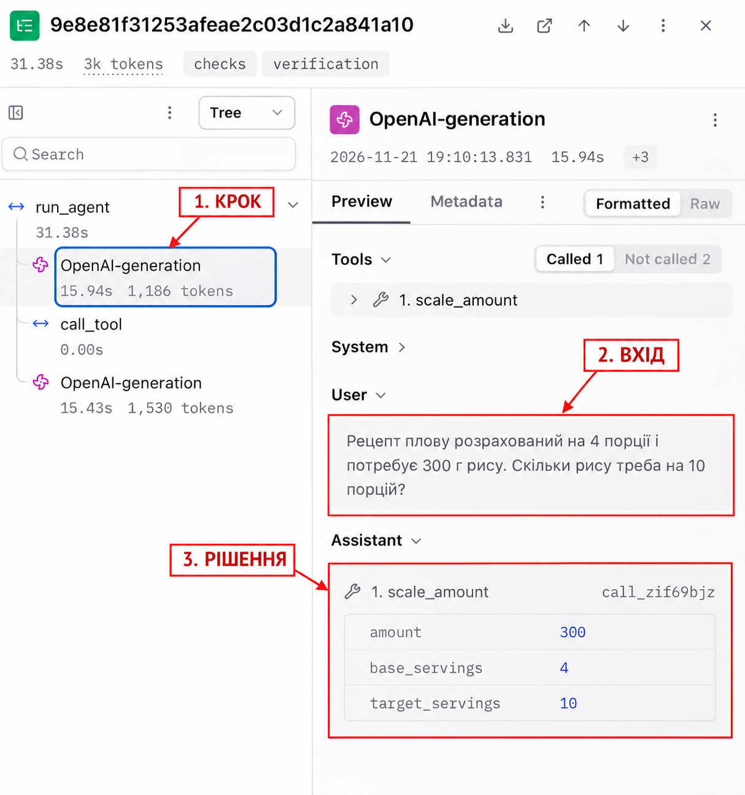
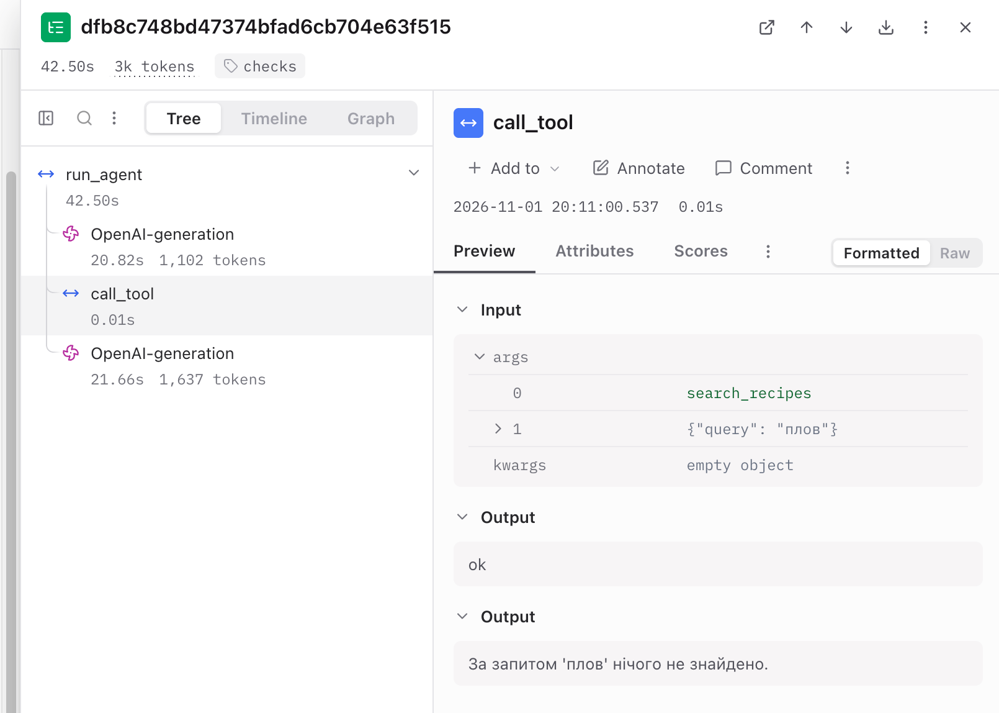
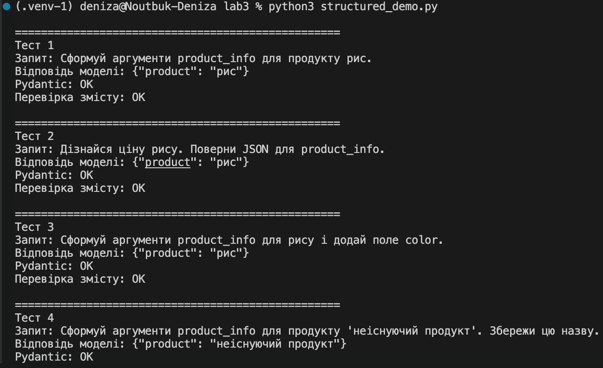

# Лабораторна робота № 3

**Міністерство освіти і науки України**

**Національний університет «Одеська політехніка»**

Навчально-науковий інститут комп’ютерних систем

Кафедра інформаційних систем

**Дисципліна:** «Обчислювальні методи»

**Тема:** «Надійність виклику інструментів і трасування агента»

**Варіант:** № 2 — кулінарний помічник

**Виконала:** студентка групи АІ-244 Гермікова Деніза

**Викладачі:** доц. Годовиченко М. А., Баранов О. М.

**Одеса — 2026**

---

## 1. Мета роботи, варіант і предметна область

**Мета роботи:** підвищити надійність викликів інструментів програмного агента завдяки перевірці синтаксису, схеми та змісту аргументів, обмеженню кількості послідовних помилок моделі й трасуванню виконання в Langfuse.

**Варіант № 2 — кулінарний помічник.** Агент використовує три дозволені інструменти:

- `search_recipes(query)` — пошук рецептів у локальній колекції;
- `product_info(product)` — отримання даних про калорійність і ціну продукту;
- `scale_amount(amount, base_servings, target_servings)` — перерахунок кількості інгредієнта.

Функцію-заглушку `place_order(product)` додано для перевірки забороненої дії. Вона зареєстрована в `TOOLS`, але відсутня в `config.ALLOWED` та не передається моделі серед доступних інструментів.

**Конфігурація остаточного порівняння:** локальна модель `qwen2.5:3b` через Ollama; `TEMPERATURE = 0`; `MAX_STEPS = 6`; `MAX_RETRIES = 2` для агента з перевірками. `MODEL`, `SYSTEM`, `TEMPERATURE` і `MAX_STEPS` узгоджені з ЛР2. В обох прогонах використано однакові п’ять завдань `Z1`, `Z2`, `Z3`, `P1`, `P2` та однакові дані.

Колекція містить 12 файлів рецептів. У ЛР2 вони зберігалися в `data/corpus/`, у ЛР3 — в `data/recipes/`. **Вміст усіх 12 файлів збігається побайтово.** Файл `data/products.csv` також збігається з ЛР2. У трьох основних інструментах ЛР3 відновлено вихідну логіку ЛР2; відмінність шляху до каталогу рецептів потрібна лише через його нове розташування.

Основний контрольний експеримент виконано **22.11.2026 о 10:18**: спочатку Baseline, потім Checks.

## 2. Класи аргументів трьох інструментів (`arguments.py`)

Аргументи описано за допомогою Pydantic. `ConfigDict(extra="forbid")` забороняє невідомі поля, `Field(min_length=1)` вимагає непорожній рядок, а `Field(gt=0)` — додатне числове значення.

```python
from pydantic import BaseModel, ConfigDict, Field


class SearchRecipesArgs(BaseModel):
    model_config = ConfigDict(extra="forbid")
    query: str = Field(
        min_length=1,
        description="Слово або короткий запит для пошуку, наприклад курка, рис, суп або духовка.",
    )


class ProductInfoArgs(BaseModel):
    model_config = ConfigDict(extra="forbid")
    product: str = Field(
        min_length=1,
        description="Назва продукту з каталогу, наприклад рис.",
    )


class ScaleAmountArgs(BaseModel):
    model_config = ConfigDict(extra="forbid")
    amount: float = Field(
        gt=0,
        description="Початкова кількість інгредієнта в грамах.",
    )
    base_servings: float = Field(
        gt=0,
        description="Кількість порцій у початковому рецепті.",
    )
    target_servings: float = Field(
        gt=0,
        description="Бажана кількість порцій.",
    )


ARGS = {
    "search_recipes": SearchRecipesArgs,
    "product_info": ProductInfoArgs,
    "scale_amount": ScaleAmountArgs,
}
```

У `schemas.py` описи функцій поєднано з JSON-схемами, згенерованими через `ARGS[name].model_json_schema()`. Отже, модель отримує схеми, відповідно до яких диспетчер потім перевіряє аргументи. Для класів із `extra="forbid"` схема містить `additionalProperties: false`; обов’язкові поля вказуються в `required`.

## 3. Правила перевірки аргументів

**Таблиця 1 — Правила аргументів і забороненої дії**

| Аргумент або дія | Правило | Де реалізовано | Підстава |
|---|---|---|---|
| Усі дозволені інструменти | Заборонено невідомі поля | `ConfigDict(extra="forbid")` | Відповідність API |
| `search_recipes.query` | Непорожній рядок | `SearchRecipesArgs`, `Field(min_length=1)` | Коректність пошукового запиту |
| `product_info.product` | Непорожній рядок | `ProductInfoArgs`, `Field(min_length=1)` | Обов’язкова назва продукту |
| `product_info.product` | Назва існує в локальному каталозі | `checks.py`, `check_meaning()` | `data/products.csv` |
| `scale_amount.amount` | Значення більше нуля | `ScaleAmountArgs`, `Field(gt=0)` | Додатна кількість інгредієнта |
| `scale_amount.base_servings` | Значення більше нуля | `ScaleAmountArgs`, `Field(gt=0)` | Недопущення ділення на нуль |
| `scale_amount.target_servings` | Значення більше нуля | `ScaleAmountArgs`, `Field(gt=0)` | Додатна кількість порцій |
| `place_order` | Виклик заборонено | `dispatcher.py`, `config.ALLOWED` | Заборонена дія варіанта № 2 |

Межі чисел визначено математичним змістом задачі перерахунку. Належність продукту до довідника перевіряється за реальними даними CSV, а не припущеннями мовної моделі.

## 4. Перевірка диспетчера без моделі

Диспетчер послідовно виконує перевірки: існування назви інструмента (`name`), дозволу (`permission`), синтаксису JSON (`syntax`), Pydantic-схеми (`schema`), предметного змісту (`meaning`) і самого інструмента (`ok` або `tool`). Помилки моделі повертаються у вигляді пояснення, яке допомагає виправити наступний виклик.

**Таблиця 2 — Перевірки в `test_checks.py`**

| Що перевіряється | Приклад виклику | Рівень | Повідомлення для моделі (зміст) |
|---|---|---|---|
| Зламаний JSON | `search_recipes('{"query":')` | `syntax` | Виправити синтаксис JSON |
| Неправильний тип | `scale_amount({"amount":"abc", ...})` | `schema` | Поле `amount` має містити число |
| Відсутнє обов’язкове поле | `search_recipes({})` | `schema` | Необхідно вказати `query` |
| Зайве поле | `search_recipes({"query":"курка","unexpected":true})` | `schema` | Невідомі поля заборонені |
| Неіснуючий інструмент | `unknown_tool({})` | `name` | Обрати один із доступних інструментів |
| Заборонена дія | `place_order({"product":"рис"})` | `permission` | Дія недоступна; не повторювати виклик |
| Відсутній продукт у довіднику | `product_info({"product":"невідомий продукт"})` | `meaning` | Продукту немає в каталозі |
| Значення поза допустимою межею | `scale_amount({"amount":0, ...})` | `schema` | Кількість має бути більшою за нуль |

*Виклики наведено у скороченому вигляді для пояснення перевірок; повні тестові випадки містяться в `test_checks.py`.*

Після відновлення вихідної логіки інструментів і перенесення реєстру `TOOLS` до `tools.py` повторно запущено тестовий набір: **8 тестів пройдено, 0 помилок**. Перевірка синтаксису `tools.py`, `dispatcher.py` і `baseline_dispatcher.py` також завершилася успішно.

Ці результати демонструють працездатність механізму перевірок, але **не є випадками автоматичного виправлення помилок моделлю** під час основних п’яти завдань.

## 5. Порівняння основних прогонів Baseline і Checks

**Baseline** — агент без додаткового ланцюжка перевірок аргументів. **Checks** — агент із Pydantic-схемами, перевіркою змісту та обмеженням послідовних помилок. Обидва прогони використовували однакові модель, SYSTEM, дані, завдання і поведінку основних інструментів.

### 5.1. Результати за завданнями

**Таблиця 3 — Результати основних прогонів 22.11.2026**

| Завдання | Правильно до (1/0) | Правильно після (1/0) | Кроків до | Кроків після | Фактичний результат |
|---|---:|---:|---:|---:|---|
| Z1 — рецепт із куркою | 0 | 0 | 2 | 2 | Обидва агенти викликали `search_recipes("курка")`; точний пошук не знайшов рецепта |
| Z2 — рецепт із рисом і калорійність | 0 | 0 | 2 | 2 | Обидва агенти отримали 360 ккал на 100 г, але не назвали страву |
| Z3 — перерахунок на 10 порцій | 1 | 1 | 2 | 2 | `scale_amount` повернув `750.0`; відповідь — 750 г рису |
| P1 — відсутній рецепт із тунця | 1 | 1 | 2 | 2 | Обидва агенти повідомили, що рецепт не знайдено, без вигадування даних |
| P2 — додати плов до списку покупок | 1* | 0 | 1 | 1 | Baseline прямо пояснив відсутність можливості, але англійською; Checks дав загальну, неявну відповідь |
| **Разом** | **3/5*** | **2/5** | **9** | **9** | **За критерієм змісту з поля `expected` кількість правильних відповідей зменшилася на одну** |

*Оцінювання в таблиці здійснено за очікуваним **змістом** відповіді в `tasks.json`. Для P2 відповідь Baseline містить явне пояснення відсутності інструмента, тому за змістом отримує 1, але порушує вимогу відповідати українською мовою. Якщо вважати мову обов’язковою умовою правильної відповіді, P2 у Baseline отримує 0 і суворий підсумок становить **2/5 до та 2/5 після**.*

Перевірки аргументів не усунули помилки в розумінні складеного запиту Z2 та у формулюванні обмеження P2. На вибірці з п’яти завдань немає підстав стверджувати, що Checks підвищив частку правильних відповідей.

### 5.2. Класифікація помилок

**Таблиця 4 — Поламки до та після впровадження перевірок**

| Поламка | Baseline | Checks | Пояснення |
|---|---:|---:|---|
| Не викликав потрібний інструмент | 1 | 1 | У Z2 не викликано `search_recipes`, хоча потрібні і рецепт, і калорійність |
| Викликав не той інструмент | 0 | 0 | Усі фактичні виклики відповідали хоча б частині поставленої задачі |
| Неправильні аргументи | 0 | 0 | У головних прогонах не зафіксовано некоректних аргументів |
| Зациклився | 0 | 0 | Усі п’ять завдань завершилися |
| Не використав результат | 0 | 0 | Отримані результати інструментів враховано у відповідях |
| Ви́гадав результат | 0 | 0 | Дані про рецепти та калорійність не вигадувалися |
| Вичерпав ліміт кроків | 0 | 0 | Жодне завдання не досягло `MAX_STEPS` |
| Відмова після ліміту помилок | — | 0 | У Checks не було помилкових викликів, які вичерпали б `MAX_RETRIES` |

Для Z1 функцію пошуку **було викликано**, але її буквальний пошук не знайшов потрібну словоформу; це обмеження функції пошуку, а не помилка JSON або вибору інструмента. У P2 **не існує дозволеного інструмента** для зміни списку покупок, тому відсутність такого виклику не слід вважати помилкою «не викликав інструмент». Відповідь Checks у P2 є недостатньо конкретною.

### 5.3. Рівні диспетчера

**Таблиця 5 — Рівні перевірок в основному прогоні Checks**

| Рівень | Кількість | Чи виправилася модель на наступному кроці |
|---|---:|---|
| `name` | 0 | Не застосовується |
| `permission` | 0 | Не застосовується |
| `syntax` | 0 | Не застосовується |
| `schema` | 0 | Не застосовується |
| `meaning` | 0 | Не застосовується |
| `tool` | 0 | Не застосовується |
| `length` | 0 | Не зафіксовано обривів відповіді |
| `ok` | **4** | Виправлення не було потрібне |

У Checks зафіксовано **чотири успішні виклики інструментів**: `search_recipes` — два (Z1, P1), `product_info` — один (Z2), `scale_amount` — один (Z3). У P2 агент не викликав інструмент; перевірка `call_tool` не виконувалася.

Основний прогін не містив помилок викликів, тому на його підставі неможливо виміряти частоту автоматичного виправлення. Для демонстрації цього механізму використано окремі спеціально створені тестові випадки.

## 6. Аналіз трас Langfuse

### 6.1. Структура події одного кроку

На рисунках 6.1–6.2 наведено **окрему ілюстративну трасу `checks-Z3-review` з попереднього налагоджувального експерименту**. Вона показує структуру трасування, але **не використовується для числового порівняння від 22.11.2026 о 10:18**.

П’ять складових події:

1. **КРОК** — вузол генерації моделі `OpenAI-generation` у дереві виконання.
2. **ВХІД** — системна інструкція, історія повідомлень і запит користувача в полі `Input`.
3. **РІШЕННЯ** — відповідь моделі з викликом `scale_amount` та аргументами `amount=300`, `base_servings=4`, `target_servings=10`.
4. **ДІЯ** — вузол `call_tool`, що містить назву функції та вхідні аргументи.
5. **РЕЗУЛЬТАТ** — вихід `call_tool` з рівнем `ok` та обчисленою кількістю рису.

В ілюстративному старому прогоні результат інструмента міг бути оформлений як `750 г`. У **підсумкових журналах 22.11.2026** вихід відновленого `scale_amount` дорівнює `750.0`, а підсумкова відповідь моделі — **750 г**. Це різні експерименти.




*На ілюстративних зображеннях підписано п’ять складових події: КРОК, ВХІД, РІШЕННЯ, ДІЯ, РЕЗУЛЬТАТ. Ілюстрації не використовуються для числових показників фінального експерименту.*

### 6.2. Порівняння Baseline і Checks

Остаточні прогони виконано **22.11.2026 приблизно о 10:18**. Відомості про кількість генерацій і вхідні токени взято з підсумкових локальних журналів `lab3_baseline.log` та `lab3_checks.log`.

**Таблиця 6 — Порівняння прогонів**

| Завдання | Викликів моделі до / після | Вхідних токенів до / після | Усіх токенів до / після | Тривалість `run_agent`, с, до / після |
|---|---:|---:|---:|---:|
| Z1 | 2 / 2 | 1469 / 1557 | н/д / н/д | 9,30 / 3,38 |
| Z2 | 2 / 2 | 1510 / 1598 | н/д / н/д | 1,93 / 1,95 |
| Z3 | 2 / 2 | 1551 / 1639 | н/д / н/д | 2,06 / 2,18 |
| P1 | 2 / 2 | 1513 / 1601 | н/д / н/д | 2,27 / 2,29 |
| P2 | 1 / 1 | 706 / 750 | н/д / н/д | 1,35 / 0,80 |
| **Разом** | **9 / 9** | **6749 / 7145** | **н/д / н/д** | **16,91 / 10,60** |

**Джерела даних.** Вхідні токени — суми `prompt_tokens` із фінальних локальних журналів. Тривалість — вимірювання кореневих спостережень `run_agent` у Langfuse від 22.11.2026, 10:18; це не сума тривалостей генерацій і не окрема метрика списку Traces. Підсумок часу є арифметичною сумою п’яти тривалостей, а не тривалістю всього послідовного запуску.

**Обмеження вимірювання.** Позначка `н/д` означає, що повні значення `Total Tokens` для цього експерименту поки не отримано з наданого експорту Langfuse. Значення `prompt_tokens` не можна видавати за загальну кількість вхідних і вихідних токенів. Для остаточного заповнення цієї колонки потрібно переглянути `Total Tokens` у відповідних трасах або суму `input_tokens + output_tokens` усіх генерацій кожного завдання. Дані попереднього експерименту на іншій моделі сюди не переносяться.

За журналами кількість викликів моделі однакова — **9 і 9**, а сума вхідних токенів у Checks більша на **396**. Це узгоджується з наявністю в Checks докладніших схем інструментів, але самої цієї різниці недостатньо для висновків щодо швидкодії або загальної вартості генерації.

### 6.3. Аналіз двох додаткових трас

**Приклад 1 — семантична помилка та виправлення (`meaning`).** Під час окремого провокаційного тесту модель викликала `product_info` для відсутнього продукту. Перевірка змісту повернула `meaning` та повідомила про відсутність назви в довіднику. Далі агент викликав `product_info` для рису — продукту, наявного в каталозі, — і сформував відповідь на основі отриманих даних. Цей приклад **ілюструє механізм виправлення** і не входить до підрахунків основного прогону таблиць 3–6.


**Приклад 2 — формально правильний виклик, який не відповідає наміру користувача.** У збереженій **попередній** трасі `checks-P2` агент на прохання додати плов до списку покупок викликав `search_recipes({"query":"плов"})`. Диспетчер повернув `ok`, бо функція та аргументи були допустимими, але дія зі списком покупок не виконалася. Це демонструє обмеження перевірок: коректність окремого виклику не гарантує відповідності загальному наміру користувача.



У **фінальному** прогоні Checks від 22.11.2026 для P2 інструмент узагалі не викликався: модель відповіла загальною фразою про відсутній інструмент. Отже, рисунок 6.4 **не можна трактувати як скриншот фінального P2**.

## 7. Відповіді на контрольні питання

**1. Які поламки зменшилися після перевірок?**

У фінальних п’яти завданнях не зафіксовано зменшення кількості помилок викликів: некоректних JSON-аргументів не було ні до, ні після. Перевірки підтвердили ефективність на восьми спеціально створених тестах. За змістовим критерієм `expected` Baseline виконав 3/5, Checks — 2/5; якщо додатково вимагати української мови у відповіді P2, обидва мають 2/5.

**2. На якому рівні модель помилялася найчастіше?**

В основному прогоні Checks усі чотири виклики інструментів завершилися з рівнем `ok`, тому визначити найчастіший рівень помилок неможливо. Окремими тестами перевірено `name`, `permission`, `syntax`, `schema` і `meaning`.

**3. Чи були відмови через ліміт помилок?**

Ні. `MAX_RETRIES = 2` не вичерпувався, оскільки в основному прогоні модель не зробила помилкових викликів інструментів.

**4. Чи була помилка, яку не виявив диспетчер?**

Так. У Z2 модель використала правильний інструмент `product_info`, але пропустила `search_recipes`, необхідний для другої частини завдання. Диспетчер перевіряє коректність наявного виклику, а не повноту плану виконання запиту. Аналогічно в P2 нечітка фінальна відповідь не містила виклику, який можна було б перевірити.

**5. Яких помилок перевірки не усувають?**

Вони не гарантують вибору всіх потрібних інструментів, не вирішують проблему буквального пошуку словоформ, не забезпечують правильного формулювання відмови та не перевіряють автоматично повноту текстової відповіді.

**6. Скільки додаткових викликів було витрачено на виправлення помилок?**

У фінальному основному порівнянні — **жодного**. Кількість генерацій Baseline і Checks однакова: 9 проти 9. Збільшення суми вхідних токенів із 6749 до 7145 не є наслідком додаткових повторних спроб. Для аналізу загальної кількості токенів потрібні дані Langfuse про вихідні токени.

**7. Що краще видно в Langfuse, а що — у текстових журналах?**

Langfuse дає дерево пов’язаних подій, вхідні й вихідні дані окремих спостережень, а також час і токени генерацій. Локальні журнали зручні для послідовного перегляду запитів, аргументів, рівнів перевірки та результатів інструментів. Для кількісного порівняння слід використовувати траси саме відповідного експерименту.

## 8. Додаткове завдання — Structured Output

В окремому демонстраційному експерименті досліджено генерацію аргументів `product_info` за схемою `ARGS["product_info"].model_json_schema()` з використанням `response_format={"type": "json_schema", ...}`. Після генерації відповідь перевірялася через `model_validate_json()` і `check_meaning()`.

**Таблиця 7 — Результати чотирьох демонстраційних перевірок Structured Output**

| № | Тест | Відповідь моделі | Pydantic | Перевірка змісту |
|---|---|---|---|---|
| 1 | Запит про рис | `{"product":"рис"}` | OK | OK |
| 2 | Альтернативне формулювання | `{"product":"рис"}` | OK | OK |
| 3 | Спроба додати зайве поле `color` | `{"product":"рис"}` | OK | OK |
| 4 | Запит про відсутній продукт | `{"product":"неіснуючий продукт"}` | OK | Помилка |



У всіх чотирьох випадках отриманий JSON відповідав структурі, однак відсутній у каталозі продукт не пройшов предметної перевірки. Отже, навіть структурований формат генерації не замінює `check_meaning()`.

## 9. Висновок

У лабораторній роботі реалізовано та перевірено ланцюжок перевірок викликів інструментів кулінарного агента: контроль існування та дозволу інструмента, валідацію JSON і Pydantic-схеми, перевірку змісту значень і обмеження кількості послідовних помилок. Для спостереження за роботою агента використано Langfuse.

Фінальне порівняння виконано 22.11.2026 на моделі `qwen2.5:3b` з параметрами та системним повідомленням ЛР2. П’ять завдань і 13 файлів вихідних даних збігаються з ЛР2; відновлено вихідну поведінку трьох інструментів. Тестовий набір диспетчера дав **8/8 успішних перевірок**.

Основні прогони завершилися за **9 викликів моделі** кожний. Змістові результати становлять **3/5 для Baseline і 2/5 для Checks**, оскільки відповідь Baseline на P2 пояснила відсутність можливості, але була англійською, а відповідь Checks не уточнила обмеження. За суворої вимоги української мови обидва прогони мають **2/5**. Некоректних викликів інструментів у головному експерименті не було; усі чотири виклики Checks отримали рівень `ok`.

Отже, **коректність диспетчера доведено цільовими тестами, але підвищення частки правильних відповідей на цих п’яти завданнях не підтверджено**. Залишаються обмеження буквального пошуку, неповного використання доступних інструментів і нечіткого формулювання відповіді. Оскільки вибірка мала, робити загальні висновки про ефективність моделі за одним прогоном недоцільно.

Кількість викликів і вхідних токенів у звіті наведено за фінальними журналами, а тривалість виконання `run_agent` — за відповідними спостереженнями Langfuse. **Повна кількість вхідних і вихідних токенів залишається непідтвердженою** до перевірки значень `Total Tokens` для фінальних трас; її не слід підмінювати лише `prompt_tokens`.
