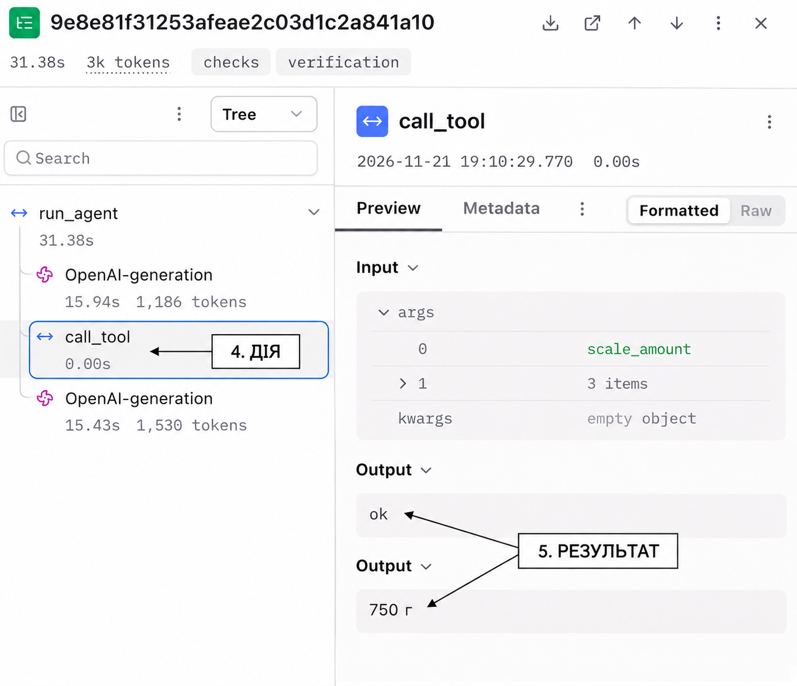
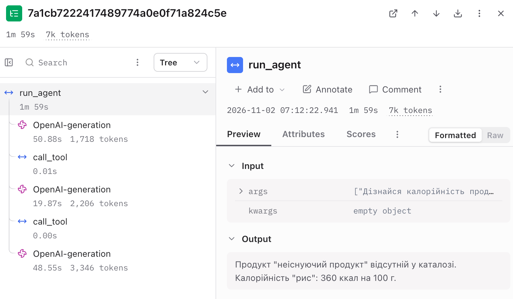

# Лабораторна робота № 3

**Міністерство освіти і науки України**
**Національний університет «Одеська політехніка»**
Навчально-науковий інститут комп'ютерних систем
Кафедра інформаційних систем

**Дисципліна:** «Обчислювальні методи»
**Тема:** «Надійність виклику інструментів і трасування агента»
**Варіант:** № 2 — кулінарний помічник
**Виконала:** студентка групи АІ-244 Гермікова Деніза
**Викладачі:** доц. Годовиченко М. А., Баранов О. М.
**Одеса, 2026**

---

## 1. Мета роботи, номер варіанта, предметна область

**Мета:** забезпечити надійність викликів інструментів кулінарного агента за допомогою перевірок синтаксису, схеми та змісту аргументів, обробки помилок, повторних спроб і трасування у Langfuse.

Варіант № 2 — кулінарний помічник. Агент шукає рецепти, визначає калорійність і ціну продукту з локального каталогу та перераховує кількості інгредієнтів для іншої кількості порцій. Оформлення замовлень (`place_order`) не дозволено.

Використано локальну модель `qwen3:4b` через Ollama, `TEMPERATURE=0`, `MAX_STEPS=6`, `MAX_RETRIES=2`. Для порівняння двох версій агента використано п'ять незмінних завдань Z1, Z2, Z3, P1, P2, а також дані `data/recipes/` і `data/products.csv`.

## 2. Класи аргументів трьох інструментів (`arguments.py`)

Для перевірки аргументів використано Pydantic. `ConfigDict(extra="forbid")` забороняє зайві аргументи; `Field(gt=0)` не дозволяє нульові й від'ємні значення. Описи полів перенесено з лабораторної роботи №2; ці ж класи використовуються для формування JSON-схем, доступних моделі.

```python
from pydantic import BaseModel, ConfigDict, Field

class SearchRecipesArgs(BaseModel):
    model_config = ConfigDict(extra="forbid")
    query: str = Field(min_length=1,
        description="Слово або короткий запит для пошуку, наприклад курка, рис, суп або духовка.")

class ProductInfoArgs(BaseModel):
    model_config = ConfigDict(extra="forbid")
    product: str = Field(min_length=1,
        description="Назва продукту з каталогу, наприклад рис.")

class ScaleAmountArgs(BaseModel):
    model_config = ConfigDict(extra="forbid")
    amount: float = Field(gt=0, description="Початкова кількість інгредієнта в грамах.")
    base_servings: float = Field(gt=0, description="Кількість порцій у початковому рецепті.")
    target_servings: float = Field(gt=0, description="Бажана кількість порцій.")

ARGS = {
    "search_recipes": SearchRecipesArgs,
    "product_info": ProductInfoArgs,
    "scale_amount": ScaleAmountArgs,
}
```

У `schemas.py` для функцій з `config.ALLOWED` беруться оригінальні описи з ЛР2; поле `parameters` генерується через `ARGS[name].model_json_schema()`. Схема містить `required`, а також `additionalProperties: false`, що відповідає `extra="forbid"`.

## 3. Таблиця правил змісту

**Таблиця 1 — Правила аргументів і забороненої дії**

| Аргумент / дія | Правило | Де реалізовано | Підстава |
|---|---|---|---|
| Усі інструменти | Заборонено невідомі поля | `ConfigDict(extra="forbid")` | Відповідність API |
| `search_recipes.query` | Непорожній рядок | `SearchRecipesArgs`, `Field(min_length=1)` | Коректний пошуковий запит |
| `product_info.product` | Непорожній рядок | `ProductInfoArgs` | Потрібна назва продукту |
| `product_info.product` | Назва є в каталозі | `checks.py`, `check_meaning()` | `data/products.csv` |
| `scale_amount.amount` | Більше нуля | `ScaleAmountArgs`, `Field(gt=0)` | Додатна кількість інгредієнта |
| `scale_amount.base_servings` | Більше нуля | `ScaleAmountArgs`, `Field(gt=0)` | Заборона ділення на нуль |
| `scale_amount.target_servings` | Більше нуля | `ScaleAmountArgs`, `Field(gt=0)` | Додатна кількість порцій |
| `place_order` | Заборонено виклик | `dispatcher.py`, `config.ALLOWED` | Варіант № 2 не дозволяє оформляти замовлення |

Числові межі визначені математичним змістом функції перерахунку. Перевірка назви продукту виконується за фактичними рядками локального CSV, а не за припущеннями моделі.

## 4. Перевірка диспетчера без моделі

Диспетчер перевіряє виклик у послідовності: наявність назви інструмента (`name`), дозвіл (`permission`), коректність JSON (`syntax`), відповідність Pydantic-класу (`schema`), зміст значень (`meaning`) та виконання функції (`ok` або `tool`).

**Таблиця 2 — Вісім перевірок `test_checks.py` з попереднього звіту**

| Перевірка | Виклик | Рівень | Пояснення для моделі (скорочено) |
|---|---|---|---|
| Зламаний JSON | `search_recipes('{"query":')` | `syntax` | Некоректний JSON, виправити синтаксис |
| Неправильний тип | `scale_amount({"amount":"abc", ...})` | `schema` | `amount` має бути числом |
| Відсутнє поле | `search_recipes({})` | `schema` | Не вистачає `query` |
| Зайве поле | `search_recipes({"query":"курка","unexpected":true})` | `schema` | Зайві поля заборонено |
| Неіснуючий інструмент | `unknown_tool({})` | `name` | Обрати доступний інструмент |
| Заборонена дія | `place_order({"product":"рис"})` | `permission` | Ця дія недоступна, не повторювати |
| Невідомий продукт | `product_info({"product":"несуществующий продукт"})` | `meaning` | Продукту немає у локальному каталозі |
| Значення поза межами | `scale_amount({"amount":0,...})` | `schema` | `amount` має бути більше нуля |

У попередньому прогоні перевірки диспетчера завершилися успішно. Це результати спеціально підготовлених тестів, а не випадки самостійного виправлення помилки мовною моделлю.

## 5. Порівняння прогонів Baseline і Checks

Обидва прогони виконані з тими самими завданнями, температурою, моделлю і системним промптом. Baseline — початковий агент без перевірок аргументів; Checks — агент із Pydantic, семантичною перевіркою і лімітом помилок.

**Таблиця 3 — Результати за п'ятьма завданнями (з початкового PDF)**

| Завдання | Правильно до | Правильно після | Кроків до / після | Що відбулося |
|---|---:|---:|---|---|
| Z1 — рецепт із куркою | 0 | 0 | 2 / 2 | Обидва агенти не знайшли рецепт через буквальний пошук слова |
| Z2 — рецепт із рисом і калорійність | 1 | 1 | 2 / 2 | Отримано 360 ккал на 100 г рису |
| Z3 — перерахунок рису на 10 порцій | 1 | 1 | 2 / 2 | Обчислено 750 г |
| P1 — стейк із тунця | 1 | 1 | 2 / 2 | Агент не вигадав відсутніх даних |
| P2 — додати плов до списку покупок | 0 | 0 | 2 / 2 | Не повідомлено прямо про відсутній інструмент для списку |
| **Разом** | **3/5** | **3/5** | **10 / 10** | Коректність основних відповідей не змінилася |

**Таблиця 4 — Порівняння помилок**

| Тип помилки | Baseline | Checks | Коментар |
|---|---|---|---|
| Не викликав потрібний інструмент | Не зафіксовано | 0 | Для доступних дій виклики були |
| Не той інструмент | Недостатньо даних для оцінки | 1 | У P2 використано `search_recipes` |
| Неправильні аргументи | Не зафіксовано | 0 | Усі зафіксовані виклики пройшли валідацію |
| Зациклення | 0 | 0 | Задачі завершилися |
| Ігнорування результату | Не зафіксовано | 0 | Дані використано у відповідях |
| Вигадування | 0 | 0 | У P1 агент не вигадав рецепт |
| Вичерпання кроків | 0 | 0 | Завершено за два кроки |
| Вичерпання повторів | Не передбачено | 0 | У основних п'яти задачах не було помилок валідації |

**Таблиця 5 — Рівні диспетчера в основному прогоні Checks**

| Рівень | Кількість | Чи виправилася модель |
|---|---:|---|
| `ok` | 6 | Виправлення не потрібне |
| `name` | 0 | Не застосовується |
| `permission` | 0 | Не застосовується |
| `syntax` | 0 | Не застосовується |
| `schema` | 0 | Не застосовується |
| `meaning` | 0 | Не застосовується |
| `tool` | 0 | Не застосовується |
| `length` | 0 за журналом | Не застосовується |

Загалом зафіксовано шість успішних викликів: `search_recipes` — 4, `product_info` — 1, `scale_amount` — 1. На цих п'яти задачах неможливо оцінити ефективність автоматичного виправлення некоректних аргументів: таких помилок агент не допустив.

## 6. Аналіз трас Langfuse

### 6.1. Структура події одного кроку

Використано трасу **checks-Z3-review**: користувач указав 300 г рису для 4 порцій, агент мав перерахувати на 10 порцій. У збереженій трасі показано два виклики мовної моделі, виклик `scale_amount` і результат 750 г.

На рис. 6.1–6.2 представлено п'ять складових події відповідно до кроку 9 методички:

1. **КРОК** — вузол `OpenAI-generation` у дереві виконання.
2. **ВХІД** — системна інструкція, історія повідомлень та запит користувача в `Input` генерації.
3. **РІШЕННЯ** — відповідь моделі з `scale_amount` і аргументами `amount=300`, `base_servings=4`, `target_servings=10`.
4. **ДІЯ** — вузол `call_tool`, вхід якого містить назву й аргументи функції.
5. **РЕЗУЛЬТАТ** — вихід `call_tool` із рівнем `ok` та обчисленими `750 г`.




### 6.2. Порівняння Baseline і Checks у Langfuse

Порівняння виконано за результатами прогонів 21.11.2026.
Для кожного з п'яти завдань проаналізовано кількість викликів
мовної моделі, суму вхідних токенів та тривалість виконання.

**Таблиця 6 — Порівняння Baseline і Checks**

| Завдання | Генерації Baseline / Checks | Вхідні токени Baseline / Checks | Час Baseline / Checks, с |
|---|---:|---:|---:|
| Z1 | 2 / 2 | 1784 / 1985 | 67 / 68 |
| Z2 | 2 / 2 | 2582 / 3721 | 68 / 142 |
| Z3 | 2 / 2 | 1931 / 2037 | 32,12 / 31,80 |
| P1 | 2 / 2 | 3906 / 3561 | 170 / 107 |
| P2 | 2 / 2 | 2430 / 2369 | 57,32 / 78 |

**Примітка.** Кількість генерацій та вхідні токени
визначено за журналами виконання. Тривалість отримано
з трас Langfuse. Під час початкового прогону Checks Z2
відбулася помилка експорту частини спостережень, хоча
обидва виклики моделі зафіксовано в локальному журналі.
Додатковий прогін `checks-Z2-repeat` підтвердив коректну
роботу інструментів `search_recipes` і `product_info`.

У перевірених прогонах кількість генерацій моделі була
однаковою для Baseline та Checks. Тривалість виконання
залежала від конкретного завдання і не демонструвала
стабільної переваги одного режиму.

Після основного порівняння окремо виправлено пошук
рецептів за різними формами слова «курка» та уточнено
відповідь для недоступної дії зі списком покупок.
Ці додаткові перевірки не включено до початкових
вимірювань таблиці 6.

### 6.3. Аналіз двох трас

**Приклад 1 — модель виправила помилку `meaning`.** У попередньому PDF описано окремий провокаційний експеримент. На запит про «неіснуючий продукт» модель викликала `product_info({"product":"неіснуючий продукт"})`; диспетчер повернув рівень `meaning` і пояснив, що продукт відсутній. На другому кроці модель викликала `product_info({"product":"рис"})` і отримала `360 ккал на 100 г, 55 грн за кг`. На третьому кроці сформовано підсумкову відповідь. Це приклад виправлення після повідомлення про помилку, причому нова назва «рис» була заздалегідь передбачена самим запитом користувача.



**Приклад 2 — правдоподібна помилка, яку не зловив диспетчер.** У `checks-P2` користувач попросив додати плов до списку покупок. Агент викликав `search_recipes({"query":"плов"})`. Перевірка повернула `ok`, тому що назва і аргументи коректні. Але мета користувача не виконана — додавання до списку покупок узагалі не реалізовано. Це демонструє, що валідація аргументів не гарантує правильного розуміння наміру користувача.


## 7. Відповіді на контрольні питання

**1. Які поламки зменшилися?** В основних п'яти завданнях кількість правильних відповідей залишилася 3/5. Диспетчер навчився визначати некоректні аргументи на рівнях `syntax`, `schema`, `meaning`, але Z1 і P2 залишилися невирішеними (табл. 3–5).

**2. На якому рівні модель помилялася найчастіше?** У основному прогоні всі шість викликів завершилися `ok`, тому частоту помилок моделі за рівнями визначити неможливо. В окремих тестах перевірено випадки `schema`; зменшити їх допомагають чіткі описи полів і обмеження Pydantic.

**3. Чи були відмови за лімітом?** Під час основного прогону не було відмов через `MAX_RETRIES=2`. Окремий провокаційний випадок демонструє отримання повідомлення `meaning` та виправлення аргументу.

**4. Чи була помилка, яку не виявив диспетчер?** Так, у P2 функція `search_recipes` виконалася коректно, але не відповідала наміру додати товар до списку. Перевірка окремого виклику не розпізнає загальну мету користувача.

**5. Які помилки перевірки не лікують?** Вони не гарантують правильного вибору інструмента, не усувають буквальний пошук за словоформами і не забезпечують правильного пояснення обмежень функціональності.

**6. Скільки додаткових викликів було витрачено на виправлення?** За збереженим журналом Checks основні п'ять завдань завершено за два кроки кожне; виправляти помилкові аргументи в цьому прогоні не довелося. Точне порівняння числа токенів можливе лише після повторного інструментованого прогону Baseline і оновлення табл. 6.

**7. Що краще видно в Langfuse і в логах?** У найтривалішому за початковими часами завданні Z2 у дереві Langfuse простіше розрізнити виклики моделі й двох інструментів, а також їх тривалість; у текстовому лозі простіше читати конкретні аргументи та результати. На довгих задачах записи логу стають громіздкими, тоді як дерево показує причинно-часову структуру.

## 8. Додаткове завдання — Structured Output

Перевірено генерацію аргументів `product_info` за JSON-схемою, отриманою через `ARGS["product_info"].model_json_schema()`. Використано `response_format` з `type="json_schema"` і подальшу перевірку `model_validate_json()` та `check_meaning()`.

**Таблиця 7 — Чотири початкові тести Structured Output**

| № | Тест | Відповідь моделі | Pydantic | Перевірка змісту |
|---|---|---|---|---|
| 1 | Запит про рис | `{"product":"рис"}` | OK | OK |
| 2 | Альтернативне формулювання | `{"product":"рис"}` | OK | OK |
| 3 | Спроба додати `color` | `{"product":"рис"}` | OK | OK |
| 4 | Неіснуючий продукт | `{"product":"неіснуючий продукт"}` | OK | Помилка |


Усі чотири JSON-відповіді пройшли структурну перевірку, але остання не відповідала локальному каталогу. Тому навіть якщо модель підтримує structured output, прибирати перевірки в коді не можна.

## 9. Висновок

Під час виконання лабораторної роботи реалізовано перевірку викликів інструментів кулінарного агента за допомогою Pydantic, семантичних обмежень, перевірки дозволу та ліміту повторних спроб. Контрольний набір виявив працездатність диспетчера; у п'яти основних завданнях Baseline та Checks правильно виконали по три запити.

Найбільший практичний ефект дала можливість виявляти некоректні аргументи **до виклику інструмента** і повертати моделі пояснення. Водночас потрібно покращити відповідність вибору інструмента меті користувача та пошук різних словоформ. Для завершення коректного порівняння трас слід отримати реальні метрики Baseline після виправлення інструментованого клієнта Langfuse й додати скриншот з п'ятьма підписаними частинами події.
