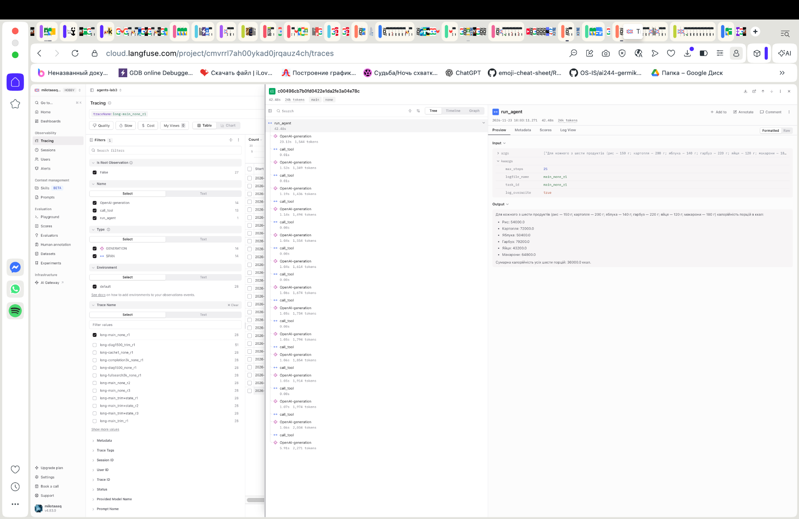
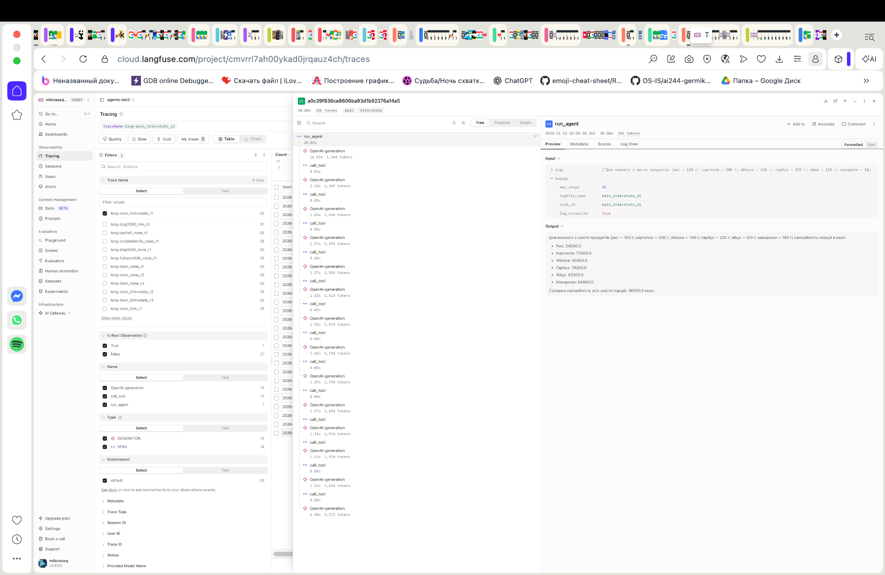
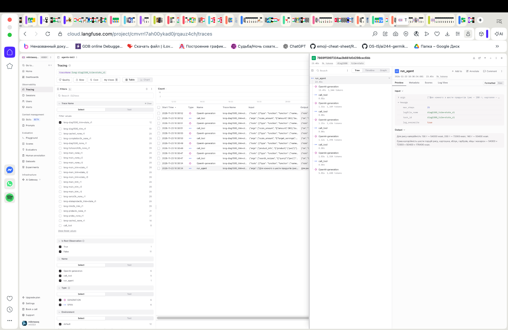
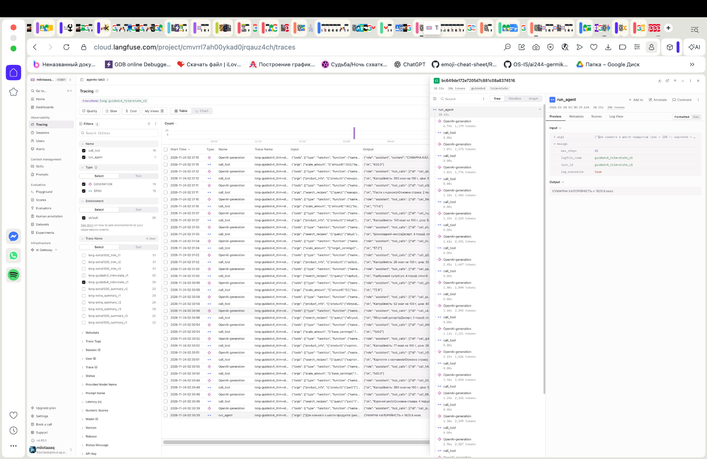

# Національний університет «Одеська політехніка»

**Інститут комп’ютерних систем**  
**Кафедра інформаційних систем**

# Звіт до лабораторної роботи № 4

## «Контекст, стан і кеш агента»

**Дисципліна:** Обчислювальні методи  
**Виконала:** Гермікова Деніза, група АІ-244  
**Варіант:** 2 — «Кулінарія»  
**Місце і рік:** Одеса, 2026

---

## 1. Мета, середовище та налаштування

**Мета:** дослідити поведінку агента, коли історія діалогу наближається до межі контекстного вікна; реалізувати обрізання історії, збереження стану задачі та кешування відповідей моделі; порівняти вартість і результати роботи різних конфігурацій.

У роботі використано локальну модель **`qwen2.5:3b`**, як у ЛР № 3, Ollama, Python, Langfuse, а також інструменти `search_recipes`, `product_info`, `scale_amount`. Для діагностики багатокрокової історії в `agent.py` додано **окремий послідовний режим**: коли модель одночасно пропонує декілька викликів інструментів, виконується лише перший, після чого модель викликається знову. Це **авторська експериментальна адаптація**, а не дослівний код методички; вона зберігалася однаковою для конфігурацій `none`, `trim` та `trim+state` в основній серії. Важливо, що ця адаптація могла змінювати траєкторію роботи моделі порівняно зі стандартним пакетним виконанням.

- Довжина контексту вихідної моделі, показана Ollama: **32768 токенів**.
- Перша обмежена модель: `qwen25-4k`, параметр **`num_ctx = 4096`** — вікно звужено **у 8 разів**.
- Після випадку C («Задача закоротка») створено `qwen25-3k`, параметр **`num_ctx = 3072`** — вікно звужено від вихідного **приблизно у 10,67 раза**.
- Для основних вимірювань: `MAX_STEPS_LONG = 25`, `COMPRESS_AT = 2150`, `KEEP_LAST = 6`, `STATE_RESULT_CHARS = 200`.
- Для запуску з каталогу `lab4/` у локальному середовищі `PYTHONPATH` вказував на корінь репозиторію, де міститься спільний модуль `utils.lab_logger`. Альтернативно цей модуль можна встановити у середовище як пакет (`pip install -e .` із кореня репозиторію). Файли з ключами доступу до Langfuse до архіву не включено.

## 2. Довга задача та еталонна відповідь

**Формулювання довгої задачі з `long_task.json`:**

> Для кожного з шести продуктів (рис — 150 г; картопля — 200 г; яблука — 140 г; гарбуз — 220 г; яйця — 120 г; макарони — 180 г) виконай три окремі дії: (а) через `search_recipes` знайди рецепт із цим продуктом і назви його; (б) через `product_info` знайди калорійність цього продукту на 100 г; (в) через `scale_amount` обчисли калорійність зазначеної порції: `amount` = ккал на 100 г, `base_servings` = 100, `target_servings` = маса порції в грамах. Для кожного продукту наведи результат у ккал. У кінці назви сумарну калорійність усіх шести порцій одним числом у ккал. Не вигадуй дані — використовуй інструменти для кожної позиції.

Для повного виконання потрібно щонайменше **18 викликів інструментів** (три для кожного із шести продуктів); у `long_task.json` задано `min_calls = 18`. Еталонні числа отримано прямими обчисленнями за локальним довідником, а не з відповіді моделі.

| Продукт | Маса | Ккал на 100 г | Калорійність порції |
|---|---:|---:|---:|
| Рис | 150 г | 360 | 540,0 |
| Картопля | 200 г | 77 | 154,0 |
| Яблука | 140 г | 52 | 72,8 |
| Гарбуз | 220 г | 26 | 57,2 |
| Яйця | 120 г | 143 | 171,6 |
| Макарони | 180 г | 350 | 630,0 |

**Еталонна сумарна калорійність: 1625,6 ккал.** Значення `expected` після першого запуску не змінювалося.

## 3. Базовий запуск і зростання входу (таблиця 2)

У початковому прогоні `probe_none_r1` з вікном **4096** токенів агент завершив задачу за **2 кроки за 33,3 с**, найбільший вхід становив **2209 токенів (54 % вікна)**. Модель запропонувала 18 викликів інструментів одним пакетом, але неправильно передала частину аргументів. Її фінальна відповідь **1660 ккал** не збіглася з еталоном **1625,6 ккал**. Це випадок **C — «Задача закоротка»** за класифікацією методички.

Після зменшення вікна до **3072 токенів** пробний прогін `probe3k_none_r1` також завершився за **2 кроки, за 36,6 с**; відповідь залишилася неправильною (**1660 ккал**). Для цих двох пробних запусків послідовне обмеження кількості викликів ще не застосовувалося; надалі його було ввімкнено однаково для всіх порівнюваних режимів, щоб збільшити кількість звернень до моделі.

**Таблиця 2 — зростання входу в пробному прогоні `probe3k_none_r1` без захисту (вікно 3072)**

| Крок | `prompt_tokens` | Приріст | Що зробила модель |
|---:|---:|---:|---|
| 1 | 1020 | — | Запропонувала 18 викликів інструментів одним пакетом |
| 2 | 2209 | 1189 | Сформувала відповідь без виклику |

Постійна частина входу **C = 1020** токенів. Типовий приріст **d = 1189** токенів. Сума вхідних токенів **3229**. Формула `n·C + d·n·(n−1)/2` при `n=2` дає **3229** токенів — повний збіг. Максимальний вхід **2209/3072 ≈ 72 %** вікна. Зупинки зростання входу не виявлено: **пункт (г)** — «не помічено», а **пункт (д)** про три кроки після застою не застосовується, оскільки агент завершив роботу вже на другому кроці. Статус — `final`, помилки довжини від сервера не було. Випадок **C** підтвердився й після зменшення вікна.

Модель часто передавала до `scale_amount` не калорійність на 100 г, а вагу або використовувала неправильний знаменник. Частина назв продуктів не збігалася зі значеннями локального довідника. Це пояснює помилки відповіді, не пов’язані з довжиною контексту.

## 4. Обрізання історії та стан задачі (таблиця 3)

Реалізовано режими:

| Конфігурація | `COMPRESS` | `USE_STATE` | Поведінка |
|---|---|---|---|
| `none` | `none` | `False` | Історія не скорочується |
| `trim` | `trim` | `False` | Залишаються початок і `KEEP_LAST` останніх повідомлень |
| `trim+state` | `trim` | `True` | Додатково збережені результати викликів повертаються у запит |

При основному порозі `COMPRESS_AT=2150` максимальний вхід в усіх основних запусках був **2059** токенів: жодного стискання не відбулося. Окремим локальним тестом доведено обрізання 14 повідомлень до 8, а для `trim+state` підтверджено запис стану в JSON і додавання збереженого результату `product_info` до повідомлення користувача.

**Додаткова діагностика при `COMPRESS_AT=1500` (не змішувати з основною серією)** показала реальне стиснення. Після діагностики значення **2150 було відновлено**.

**Таблиця 3 — стиснення історії (діагностичний поріг 1500, окремі прогони)**

| Конфігурація | Крок стиснення (після) | Вхід до стиснення, токенів | Повідомлень було → стало | Повторних викликів за прогін |
|---|---:|---:|---:|---:|
| `trim` | 5 | 1519 | 12 → 8 | 6 |
| `trim` | 8 | 1579 | 14 → 8 | 6 |
| `trim` | 9 | 1552 | 10 → 8 | 6 |
| `trim` | 10 | 1642 | 10 → 8 | 6 |
| `trim` | 12 | 1561 | 12 → 8 | 6 |
| `trim` | 16 | 1581 | 16 → 8 | 6 |
| `trim` | 19 | 1598 | 14 → 8 | 6 |
| `trim` | 21 | 1572 | 12 → 8 | 6 |
| `trim` | 24 | 1543 | 14 → 8 | 6 |
| `trim+state` | 5 | 1519 | 12 → 8 | 0 |

За журналами зафіксовано **9 реальних подій стиснення для `trim`** і **1 для `trim+state`**. Значення повторних викликів наведено за весь відповідний прогін, а не окремо за кожну подію. Кожного разу після стискання залишалося вісім повідомлень.

У першому блоці відновленого стану `trim+state` містилося **5 рядків** збережених викликів інструментів. Довжина блоку становила **1266 символів**, тобто приблизно **506 токенів** за грубою оцінкою «2,5 символа на токен» з методички. Це близько **43 %** від приросту 1189 токенів у двокроковому пробному запуску з кроку 4; водночас значно більше від типового приросту приблизно 60 токенів у послідовному 14-кроковому прогоні. Отже, відновлений стан може бути надмірно великим щодо звичайного приросту історії. Збільшення запиту через цей блок потрібно враховувати як додаткову вартість.

Відновлений стан **не забезпечив правильного завершення задачі**: у діагностичному прогоні `trim+state` модель закінчила після шести кроків, назвала суму **176400 ккал** замість **1625,6 ккал** і не виконала всі потрібні дії. Це не дає підстав стверджувати, що `trim+state` точніший за `trim`.

Діагностичні результати:

| Режим | Правильно | Кроків | Сума вхідних токенів | Вихідних токенів | Час, с | Стиснень | Повторних викликів |
|---|---|---:|---:|---:|---:|---:|---:|
| `none` | 0/1 | 14 | 23097 | 1143 | 42,4 | 0 | 4 |
| `trim` | 0/1 | 25 | 35765 | 1131 | 45,9 | 9 | 6 |
| `trim+state` | 0/1 | 6 | 8242 | 785 | 23,5 | 1 | 0 |

Важливо: менша вартість `trim+state` у цьому одному діагностичному прогоні частково пояснюється **передчасним завершенням завдання на шостому кроці**, тому не свідчить про кращу якість розв’язання. Усі три відповіді неправильні.

## 5. Кеш моделі (таблиця 4)

Кеш на основі ключа запиту дозволив зберегти відповіді моделі та повторно використати їх у незмінних умовах. Кеш вмикався лише для серій `cache*`; у серії `main` він був вимкнений.

**Таблиця 4 — робота кешу**

| Запуск | Кроків | Влучань у кеш | Викликів до сервера | Час, с | Правильно |
|---|---:|---:|---:|---:|---|
| 1 — кеш порожній | 14 | 0 | 14 | 38,2 | Ні |
| 2 — кеш заповнений | 14 | 14 | 0 | 0,1 | Ні |

За відображеними округленими значеннями повторний запуск прискорився приблизно **у 382 рази**. Кеш відтворив ту саму **неправильну** відповідь, тобто він покращив швидкість, але не точність. Зміна `SYSTEM` змінює запит і робить попередній ключ непридатним для повторного використання.

## 6. Основна серія вимірювань (таблиця 5)

Виконано **по три запуски** `none`, `trim`, `trim+state` (усього дев’ять) з вікном **3072**, порогом **2150**, без кешу. Таблиця містить медіани, крім стовпця «Правильно».

**Таблиця 5 — вартість циклу (три основні конфігурації та додаткова `summary`)**

| Конфігурація | Правильно (з 3) | Кроків | Токенів на вхід | Токенів на вихід | На підсумовування | Час, с | Стиснень | Повторних викликів |
|---|---:|---:|---:|---:|---:|---:|---:|---:|
| `none` | 0 | 14 | 23097 | 1143 | 0 | 34,9 | 0 | 2 |
| `trim` | 0 | 14 | 23097 | 1143 | 0 | 34,4 | 0 | 3 |
| `trim+state` | 0 | 14 | 23097 | 1143 | 0 | 34,4 | 0 | 2 |
| `summary` | 0 | 14 | 23097 | 1143 | 0 | 33,5 | 0 | 1 |

**Аналіз поламок, яких не показує сама таблиця 5.** У всіх **9 із 9** основних прогонів агент відповів після **14 кроків**, виконавши лише **13 викликів інструментів** замість мінімальних 18, тобто **всі дев’ять завершилися передчасно**. Відсутні п’ять із шести потрібних пошуків рецептів; замість коректного `base_servings=100` модель багаторазово передавала `base_servings=1`. Підсумкова відповідь **36000 ккал** замість **1625,6 ккал** неправильна. Саме число `36000` зустрічалося серед результатів `scale_amount`, тож його не можна називати цілком новим числом, відсутнім у результатах інструментів; помилка полягає в тому, що **результат одного некоректного обчислення використано як загальну суму**. Такі поламки не є наслідком переповнення вікна.

У кроці 8 методички є редакційна суперечність: у тексті згадано «дванадцять прогонів», однак обов’язкова команда `python measure.py all 3 main` із трьома конфігураціями утворює **9** основних прогонів. У роботі виконано саме цю команду; додаткові пробні та діагностичні запуски наведено окремо.

Тут `none`, `trim`, `trim+state` майже однакові за витратами, бо механізми скорочення не спрацьовували. Числа не доводять переваги жодної із двох стратегій скорочення на **основному порозі**.

## 7. Траси Langfuse

Наведено справжні знімки дерев трас, зроблені в інтерфейсі Langfuse 23.11.2026. За їх допомогою можна візуально простежити вкладені виклики `OpenAI-generation` і `call_tool` всередині `run_agent`.

**Рисунок 1 — траса `long-main_none_r1`, конфігурація без захисту.** Відображено 14 звернень до моделі, вкладені виклики інструментів та фінальну відповідь агента.

**Рисунок 2 — траса `long-main_trim+state_r1`, основна серія збереження стану.** У цій серії поріг 2150 токенів не досягнуто, тому події стиснення не було. Траса потрібна для зіставлення структури виконання з режимом `none`.

**Рисунок 3 — додатковий діагностичний прогін `long-diag1500_trim+state_r1`.** На дереві видно 6 звернень до моделі та 5 викликів інструментів. Текстовий журнал цього запуску окремо фіксує стиснення після кроку 5 (`1519` вхідних токенів, `12 → 8` повідомлень, стан додано). Саме дерево Langfuse не містить окремого вузла з назвою «СТИСНЕННЯ».

**Додаткове зіставлення шостого кроку в діагностичній серії** (не в основній серії `main`): після стиснення на кроці 5 вхід наступного кроку `diag1500_trim+state_r1` становив **1516** токенів, а в `diag1500_none_r1` на тому самому кроці — **1579** токенів (різниця `none − trim+state` = **+63** токенів). Ці числа взято з локальних журналів; вони ілюструють зміну входу в додатковому тесті з порогом 1500, але не підміняють обов’язкове порівняння для порога 2150.

У основній серії `main` стискання **не було**, отже першого кроку **після стискання** в `main_trim+state_r1` не існує. Через це передбачене методичкою порівняння токенів такого кроку з `main_none_r1` виконати на основних даних неможливо. Натомість додатково наведено діагностичну трасу за іншого порога (`COMPRESS_AT = 1500`); її результати не підміняють основну серію. У дереві трас одразу видно послідовність звернень та тривалість викликів; у текстовому журналі їх потрібно виділяти й підраховувати вручну.

## 8. Відповіді на контрольні запитання

**1. Коли агент досяг межі контексту?** У пробному запуску без захисту агент **не досяг** межі: максимальний вхід 2209 токенів за вікна 3072, а в основній серії — 2059. Стану зупинки зростання входу не виявлено; агент завершував виконання раніше, ніж контекст переповнювався. Це випадок C («Задача закоротка»).

**2. Чи збігається сума токенів із формулою?** Для двокрокового пробного запуску сума `1020+2209=3229` збігається з формулою. Для триваліших запусків приріст за крок змінюється, тому наближена формула з типовим `d` не відтворює суму точно (наприклад, без стиснення в 14-кроковому пробному запуску фактично 23097 токенів, оцінка формули — 19740).

**3. Що втрачає агент під час обрізання?** Зникають старі повідомлення та результати інструментів, тому можливі повторні звернення. Після дев’яти стиснень у діагностичному `trim` зафіксовано 6 повторних викликів (див. таблицю 3 та `logs/diag1500_trim_r1.log`); Приклад конкретного повтору: `product_info({"product":"рис"})` на кроках **2** і **6**; у діагностичному `trim+state` після одного стиснення — 0. Стан повертає в контекст короткий перелік раніше виконаних успішних дій, але не відтворює всі аргументи міркувань агента й не виправляє хибні арифметичні припущення. Оскільки траєкторії запусків різнилися, це не доводить причинної переваги `trim+state` за одним дослідом.

**4. Яка конфігурація дешевша, швидша й точніша?** За основною таблицею 5 витрати токенів однакові; медіана часу `trim` і `trim+state` становить 34,4 с, `none` — 34,9 с. Точність однакова і незадовільна — 0/3. Різниця кількох десятих секунди на трьох повторах однієї задачі не дає надійного висновку про перевагу режиму.

**5. Чому кеш вимикають в основному вимірюванні?** Інакше повторні прогони використовували б готові відповіді і занижували б оцінку обчислювальної вартості. Якщо інструмент поверне нові дані, попередня кешована відповідь може виявитися застарілою; заміна моделі під тією самою назвою також може зробити кеш некоректним, якщо ключ не враховує фактичну версію моделі.

**6. Які помилки не усуває обрізання?** Обрізання не виправляє неправильні аргументи інструментів (наприклад, `base_servings=1` замість `100`), пропущені кроки задачі, помилки сумування або вигадані результати. Такі проблеми потребують додаткової перевірки аргументів, повноти виконання та підсумкової відповіді.

## 9. Додатковий експеримент: керований агент GUIDED V4

Для дослідження причин невдалих відповідей основної серії розроблено **додатковий експериментальний режим `GUIDED V4`** (файли `guided_longrun.py`, `lab4_guided_run_v3.py`). Режим **не входить до обов'язкового порівняння трьох конфігурацій** і не замінює результати таблиці 5. Він додає покрокове планування, перевірку параметрів інструментів, компактний стан та контрольну суму з фактичних результатів `scale_amount`.

У реальному запуску `logs/guidedv4_trim+state_r1.log` з моделлю `qwen25-3k`, вікном 3072 токени та порогом `COMPRESS_AT=2150` агент успішно виконав **18 валідних викликів** інструментів для шести продуктів, по три на продукт. На кроці 19 модель повернула правильний фінал **1625,6 ккал**. Це підтверджено записом `ВІДПОВІДЬ:` у журналі; резервний програмний механізм `ВІДПОВІДЬ ПРОГРАМИ` у цьому запуску **не використовувався**. Проте перед останньою відповіддю модель **отримала перевірену програмою суму**; тому результат не свідчить про здатність моделі самостійно виконати арифметичне підсумовування.

| Показник GUIDED V4 (`trim+state`, один прогін) | Значення |
|---|---:|
| Правильних відповідей | 1 з 1 |
| Кроків (18 інструментів + фінальна відповідь) | 19 |
| Токенів на вхід (сума) | 37879 |
| Токенів на вихід (сума) | 544 |
| Час виконання за виводом `measure.py` | 38,5 с |
| Реальних стиснень | 4 |
| Повторних викликів | 0 |

Спостерігалися події стиснення після кроків 6, 10, 14 і 17. Перше з них скоротило історію з **20 до 8 повідомлень**, і наступний запит продовжив виконання без втрати виконаних дій. На відміну від початкових 9 запусків, додатковий агент використав правильні `base_servings=100` і виконав усю послідовність. Оскільки додатковий режим змінює планування та спосіб формування відповіді, пряме причинне порівняння точності й часу з `none`, `trim` і `trim+state` основної серії **некоректне**. Цей прогін показує, що **перевірка аргументів і стану** усуває помилки, які саме обрізання історії не виправляє.

<!-- LAB4-SUMMARY-EXTRA:BEGIN -->

<!-- LAB4-GUIDED-V4-SCREENSHOT -->
**Рисунок 4 — справжня траса успішного запуску GUIDED V4 у Langfuse.** На знімку видно дерево `run_agent`, послідовність `OpenAI-generation` і `call_tool`, час виконання та підсумок **1625,6 ккал**. Чотири події стиснення підтверджені текстовим журналом `logs/guidedv4_trim+state_r1.log`; вони не позначені окремими вузлами дерева.

## 10. Додаткове завдання: підсумовування старої історії (`summary.py`)

**Мета.** Реалізовано третю стратегію стиснення контексту — підсумовування попередніх повідомлень окремим викликом тієї самої моделі. Файл `summary.py` містить `split_history`, `summarize`, `compress_by_summary`; `compress.py` і `measure.py` підтримують конфігурацію `summary` (без `USE_STATE`). Додаткові токени витрачаються на окремий запит до моделі й враховуються в стовпці «На підсумовування». Для додаткових серій кеш був вимкнений.

**Серія `extra` за основним порогом `COMPRESS_AT=2150`.** Три запуски з командою `python3 lab4_extra_run.py summary 3 extra` (еквівалент `python3 measure.py summary 3 extra`) завершилися до досягнення порога. Медіани: **14 кроків**, **23097 вхідних токенів**, **1143 вихідних токенів**, **0 стиснень**, **0 токенів на підсумовування**; правильних відповідей — **0/3**. Результат внесено окремим рядком `summary` у таблицю 5. Ця серія не показує ефективність переказу, оскільки він фактично не викликався.

**Додаткова порівняльна серія `extra1500`.** Щоб дослідити саме стиснення, для *обох* режимів установлено однаковий поріг **1500** лише на час запусків, без зміни `config.py`. Виконано по три повтори, кожен з відключеним кешем. У таблиці наведені медіани, крім частки правильних відповідей.

| Показник | `trim` (1500) | `summary` (1500) |
|---|---:|---:|
| Правильних відповідей | 0/3 | 0/3 |
| Кроків | 25 | 10 |
| Вхідних токенів агента | 35765 | 15770 |
| Вихідних токенів агента | 1131 | 1261 |
| Додатково на підсумовування (вхід + вихід окремого виклику) | 0 | 1922 |
| Стиснень | 9 | 5 |
| Час, с (за консольними підсумками) | 48,2 | 86,9 |

Вхідні токени агента в режимі `summary` зменшилися на **19995 токенів**, або приблизно **55,9 %** від медіани `trim`. Підсумовування додатково коштувало **1922 токени** (медіана за три повтори), і його не можна вважати безплатним. Незважаючи на менший сумарний вхід агента, `summary` працював повільніше — **86,9 с проти 48,2 с** — через додаткові звернення до моделі. Режими виконали **різну кількість кроків** (10 проти 25), тому економію токенів **не можна приписати лише ефективнішому скороченню**: режим `summary` закінчував роботу раніше. Точність в обох серіях залишилася незадовільною (**0/3**).

**Перевірка збереження чисел.** У `logs/extra1500_summary_r1.log` після третього кроку інструмент `scale_amount` з аргументами `{"amount":360,"base_servings":1,"target_servings":150}` повернув **54000.0**. У пізнішому блоці `ПІДСУМОК ІСТОРІЇ` після кроку 6 модель перерахувала аргументи `target_servings=150`, `amount=360`, `base_servings=1`, але **не включила отриманий результат 54000.0**. Це приклад *втрати точного результату* при переказі. Крім того, у кінцевих відповідях модель використовувала довільні значення для інших продуктів, не отримавши всі потрібні дані з інструментів. Помилка `base_servings=1` виникла **до** підсумовування і не є спричиненою ним. Отже, підсумовування може втратити числові подробиці й не гарантує коректної відповіді.

**Обмеження.** Експеримент `summary` із нижчим порогом — окрема діагностична серія; він не замінює основні дев'ять запусків із порогом 2150. Для збільшення надійності доречно поєднати стислий переказ з перевіреним структурованим станом та валідацією аргументів, як продемонстровано в експерименті GUIDED V4. Логи: `logs/extra_summary_r1.log`—`r3.log`, `logs/extra1500_trim_r1.log`—`r3.log`, `logs/extra1500_summary_r1.log`—`r3.log`.
<!-- LAB4-SUMMARY-EXTRA:END -->

<!-- LAB4-MAIN1500:BEGIN -->
## 11. Додаткова серія `main1500`: порівняння до й після стиснення

**Мета.** Додаткова діагностика для пункту про Langfuse у кроці 8 методички. Первинну серію `main` за порога **2150** збережено без змін: вона завершувалася до першого стиснення. Щоб без підміни історичних даних отримати парні кроки після стиснення, додатково виконано **9 нових запусків** (`3 конфігурації × 3 повтори`) з порогом **1500 для всіх режимів**, тим самим завданням, моделлю та лімітом 25 кроків. Параметр `COMPRESS_AT` змінювався **лише в пам'яті процесу**; у `config.py` лишилося **2150**. Кеш і експериментальний механізм GUIDED V4 були вимкнені.

| Конфігурація | Правильно | Кроків | Токенів на вхід | На вихід | Стиснень | Повторних викликів | Час, с |
|---|---:|---:|---:|---:|---:|---:|---:|
| `none` | 0/3 | 14 | 23097 | 1143 | 0 | 4 | 45,5 |
| `trim` | 0/3 | 25 | 35765 | 1131 | 9 | 6 | 49,7 |
| `trim+state` | 0/3 | 10 | 15397 | 829 | 5 | 0 | 31 |

У прогоні `main1500_trim+state_r1` перше стиснення відбулося **після кроку 5**; на **кроці 6** вхід містив **1516 токенів** проти **1579 токенів** на тому самому кроці `main1500_none_r1` (різниця `none − trim+state = 63` токенів). Ці значення взято з реальних рядків `prompt_tokens` відповідних журналів.

За журналами видно повторне звернення до інструментів і втрату частини старої історії після обрізання. Кількість дострокових завершень (менше 19 кроків) у `main1500`: `none` — **3/3**, `trim` — **0/3**, `trim+state` — **3/3**. Статистика за три повтора є лише оцінкою на одному завданні, а не загальною гарантією правильності агента.

**Обмеження порівняння.** Це **нова діагностична серія `main1500`**, а не вихідна серія `main` при 2150 і не її заміна. Значення першого кроку після стиснення отримані з локальних текстових логів; для демонстрації в Langfuse використовуйте траси `long-main1500_trim+state_r1` та `long-main1500_none_r1`. На раніше наданих скриншотах Langfuse підтверджено наявність дерев для основних та діагностичних трас, а **нові скриншоти `main1500` автоматично не створювалися**. Текстовий журнал не дозволяє побачити всю вкладену послідовність викликів так швидко, як дерево Langfuse.
<!-- LAB4-MAIN1500:END -->

## 12. Висновок
У роботі реалізовано три підходи до керування ресурсами агента: обрізання історії, збереження результатів інструментів у стані та кешування відповідей моделі. Механізми обрізання і стану пройшли контрольні перевірки, а діагностична серія з меншим порогом підтвердила реальне стискання: 9 подій для `trim` і 1 для `trim+state`; в останньому випадку відновлено п’ять рядків раніше збережених викликів. В основній серії з рекомендованим порогом 2150 контекст не переповнився, тому вплив `trim` і `trim+state` на вартість практично не проявився. Найбільший підтверджений ефект продемонстрував кеш: другий ідентичний запуск став майже миттєвим, але відтворив неправильну відповідь. Подальше вдосконалення агента має бути спрямоване на перевірку аргументів інструментів, послідовне виконання всіх необхідних дій і валідацію фінальної суми.

Додаткове підсумовування за порога 1500 зменшило медіанну кількість вхідних токенів агента, але потребувало окремих викликів моделі, працювало повільніше і не зберегло всіх числових результатів. Це підтверджує необхідність перевіреного структурованого стану та контролю аргументів.
