# Національний університет «Одеська політехніка»
Інститут комп’ютерних систем  
Кафедра інформаційних систем

# ЗВІТ
## з лабораторної роботи № 5
**RAG-агент: пошук по документах як інструмент**

Дисципліна: «Обчислювальні методи»  
Виконала: студентка групи АІ-244 Гермікова Деніза  
Варіант № 2 — Кулінарія  
Одеса — 2026

---

## 1. Мета роботи
Замінити пошук підрядком векторним пошуком, підключити його до агента як інструмент `search_docs`, окремо виміряти якість пошуку і дослідити вплив нарізання, порога схожості та опису інструмента на відповіді. Експерименти виконано 25.11.2026 на macOS, Python 3.12.16, Ollama; FAISS CPU 1.15.1, NumPy 2.5.5, Langfuse 5.2.0. Джерела числових результатів — локальні журнали, `results/*.txt` та `results/rag.csv`.

## 2. Конфігурація і дані
Фактична конфігурація вимірювань: llama32-4k, 4096 токенів, температура 0, bge-m3. У фінальній конфігурації ЛР4 використовувалися qwen25-3k та вікно 3072 токени. Для ЛР5 обрано llama32-4k та вікно 4096 токенів, прямо зазначені в методичних вказівках до ЛР5. Це відхилення від одночасної вимоги зберегти модель і вікно попередньої роботи; пряме порівняння історичних показників двох робіт має відповідне обмеження. Для контрольного порівняння старий пошук повторно запущено на llama32-4k з вікном 4096. SYSTEM, tasks.json і початкові дані перенесено без змін. Початковий корпус з ЛР4 під час вимірювань лежав у `data/recipes/`. Під час фінальної перевірки каталог перейменовано на `data/corpus/` відповідно до методички, змінено лише шляхи у config.py, tools.py та index/meta.json. Перевірено побайтову тотожність 12 рецептів, повну тотожність усіх 99 чанків (текст, порядок, джерело та номер) і незмінність бінарного індексу FAISS та експериментальних CSV/логів. Після перейменування повторно перевірено завантаження індексу, роботу диспетчера та відповідь агента на D1. Скорочення, стан і кеш відповідей вимкнено.

Усі нові числові дані вигадані та описують навчальний центр, не реальні правила харчової безпеки.

| Документ | Тема | Символів без кінцевого переведення рядка | Приблизно токенів |
|---|---|---:|---:|
| d01.txt | Техніки приготування у навчальній кухні «М’ята» | 3244 | 1298 |
| d02.txt | Зберігання продуктів і терміни придатності у «М’яті» | 3281 | 1312 |
| d03.txt | Заміна інгредієнтів у навчальних рецептах «М’яти» | 3193 | 1277 |
| d04.txt | Кухонне обладнання й догляд за ним у «М’яті» | 3115 | 1246 |
| d05.txt | Безпека на кухні й алергени у «М’яті» | 3193 | 1277 |

Усі 17 документів: 18444 символи, приблизно 7378 токенів за оцінкою 2,5 символа/токен. Це більше за вікно 4096. Перевірка check_cases.py успішна: 4 direct, 4 paraphrase, 2 none; усі 8 контрольних фраз є рівно в одному місці. Кожен новий документ має 8 абзаців після заголовка і 6 різних числових фактів.

| ID | Вид | Питання | must_contain | expected |
|---|---|---|---|---|
| D1 | direct | Скільки примірників мають картки тушкування? | картки тушкування мають 17 примірників | 17 |
| D2 | direct | Скільки навчальних записів містить журнал приймання продуктів? | містить 53 навчальні записи | 53 |
| D3 | direct | Скільки карток містить картотека альтернатив борошна? | Картотека альтернатив борошна містить 73 картки | 73 |
| D4 | direct | Скільки навчальних позицій містить інвентарний каталог ваг? | каталог ваг містить 103 навчальні позиції | 103 |
| P1 | paraphrase | Скільки світлин із прикладами роботи з тістом можна переглянути на уроці про піч? | альбом містить 23 фотографії | 23 |
| P2 | paraphrase | Як довго чекати, поки розберуть прохання ще раз звірити відомості у формулярі складського обліку? | розглядають протягом 7 робочих днів | 7 |
| P3 | paraphrase | Скільки часу педагог має, щоб оцінити ідею використати інший складник? | щодо заміни відведено 11 робочих днів | 11 |
| P4 | paraphrase | Скільки експонатів на виставці пояснюють попередження про речовини, що можуть спричиняти небажану імунну реакцію? | Стенд прикладів алергенних позначень містить 131 | 131 |
| N1 | none | Яка ціна оренди шафки для відвідувачів навчального центру? | — | — |
| N2 | none | Скільки коштує доставка фартухів кур’єром до навчальної кухні? | — | — |

### Перевірка без документів

| ID | Очікування | Фактична відповідь без документів | Оцінка |
|---|---|---|---|
| D1 | 17 | Я не зміг знайти інформацію про тушкування. | Не вгадано |
| D3 | 73 | Я не зміг знайти жодної інформації про картотеку альтернативного борошна. | Не вгадано |
| P3 | 11 | Висококваліфіровані педагоги не мають необхідності оцінювати ідею використовувати інший складник. | Не вгадано |

0/3: специфічні дані відсутні у пам'яті моделі на цих контрольних питаннях (`results/no_docs.txt`).

## 3. Реалізація та перевірка ембедингів

`chunking.py` читає UTF-8 документи й формує чанки з іменем файла та номером; `embedder.py` обчислює вектори через Ollama (`bge-m3`), кешуючи за SHA-256 від моделі й тексту. `rag.py` нормалізує матрицю та запит, використовує `faiss.IndexFlatIP` і зберігає індекс, чанки та параметри. `tools.search_docs` повертає до TOP_K=3 чанків після фільтрації MIN_SCORE; `dispatcher.py` перевіряє доступність інструмента та Pydantic-схему `DocsArgs`. Старий `search_recipes` збережено в коді для контрольного запуску, але він недоступний у звичайній конфігурації. `product_info`, `scale_amount`, старі дані, SYSTEM і tasks.json залишено без змін; `place_order` не включено до ALLOWED.

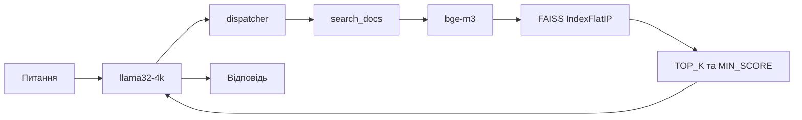

Результати `embed_check.py`:

| Показник | Значення |
|---|---:|
| Розмірність | 1024 |
| Норма першого вектора | 1.000 |
| Схожість: «Альтернативний складник страви» | 0.616 |
| Схожість: «Розклад руху трамваїв» | 0.370 |
| Час перевірки | 37.9 с |

Близький за змістом запит отримав вищу оцінку. Нормалізовані вектори дозволяють обчислювати косинусну схожість скалярним добутком.

## 4. Нарізання документа d01.txt

**Таблиця 1 — Нарізання одного документа**

| Спосіб | Чанків | Закінчуються посеред речення | Довжина найбільшого, символів |
|---|---:|---:|---:|
| fixed 200, перекриття 0 | 17 | 16 | 200 |
| fixed 500, перекриття 100 | 9 | 7 | 500 |
| paragraphs 800 | 5 | 0 | 797 |

Приклад розрізаного контексту числового факту (fixed 200): чанк 5 закінчується «Пояснення випікання починається з розгляду форми виробу, властивостей тіста та відмінностей між», а чанк 6 починається «рецептами. Для цієї теми демонстраційний альбом містить 23 фотографії…». Число і слово «фотографії» тут залишилися разом, але тему випікання відокремлено від числового факту. У P1 це важливо: агент з описом B повернув чанк 5 без числа 23. Розрив слова також видно між чанками 1 і 2 («демонстра» / «ційному»). У цьому документі на межах 200 символів контрольні числові фрази збереглися; саме число 23 не розрізано. У файлах результатів збережено всі межі. Абзацне нарізання зберігає повні речення, але повертає більше тексту. Додатковий приклад буквального розрізання числа в `d04.txt` за тієї ж конфігурації fixed 200/0: чанк 5 (індекс 4) закінчується «Альбом зображень кухонного посуду налічує 10», а чанк 6 (індекс 5) починається «7 ілюстрацій, що дають змогу…». Отже, число 107 розділено на 10 і 7; повернення тільки одного чанка може спричинити неправильну відповідь. Повні тексти обох фрагментів отримано без моделі, у `results/chunks_d04_fixed200_example.txt`.

## 5. Пошук без агента та вибір порога

**Таблиця 2 — Пошук при різному нарізанні**

| Конфігурація | Чанків | Сер. довжина | hit@1 | hit@3 | hit@5 | hit@3 прямі | hit@3 перефр. | Токенів (k=3) |
|---|---:|---:|---:|---:|---:|---:|---:|---:|
| fixed-200-0 | 99 | 186 | 1.00 | 1.00 | 1.00 | 1.00 | 1.00 | 224 |
| fixed-500-0 | 47 | 392 | 0.88 | 0.88 | 0.88 | 0.75 | 1.00 | 471 |
| fixed-500-100 | 54 | 409 | 1.00 | 1.00 | 1.00 | 1.00 | 1.00 | 490 |
| fixed-1500-0 | 27 | 683 | 0.88 | 1.00 | 1.00 | 1.00 | 1.00 | 820 |
| paragraphs-800 | 38 | 484 | 0.88 | 1.00 | 1.00 | 1.00 | 1.00 | 581 |
| paragraphs-800+title | 38 | 510 | 0.88 | 1.00 | 1.00 | 1.00 | 1.00 | 612 |

Обрано fixed-200-0: hit@3=8/8, а також hit@1=8/8; при рівному hit@3 результат найкоротший (224 оцінених токени). Вибірка мала, результат не гарантує такої якості для інших запитів. Додавання overlap 100 до fixed-500 відновило один пропущений прямий факт (7/8 → 8/8); додавання заголовків до абзацного нарізання на цьому наборі hit rate не змінило. Джерело: `results/retrieval.txt`.

**Таблиця 3 — Схожість першого результату**

| ID | Вид | Схожість | Перший результат містить потрібну фразу |
|---|---|---:|---|
| D1 | direct | 0.660 | так |
| D2 | direct | 0.717 | так |
| D3 | direct | 0.748 | так |
| D4 | direct | 0.734 | так |
| P1 | paraphrase | 0.638 | так |
| P2 | paraphrase | 0.645 | так |
| P3 | paraphrase | 0.657 | так |
| P4 | paraphrase | 0.578 | так |
| N1 | none | 0.508 | — |
| N2 | none | 0.441 | — |

Мінімальна схожість питань з відповіддю 0.578, максимальна без відповіді 0.508. Обрано MIN_SCORE=0.55, тобто 0.508 < 0.55 ≤ 0.578. Для вихідних десяти питань розділення повне. Агент може змінити query, тому після перефразування результат не гарантовано. Остаточний індекс: 99 чанків, середня довжина 186, мінімум 10, максимум 200 символів, 1024 виміри. `index/docs.faiss`, `chunks.json`, `meta.json` додано до архіву; кеш ембедингів не додається.

## 6. Перевірка інструмента без моделі

| Перевірка | Фактичний результат |
|---|---|
| `python try_tool.py D1` | ok; два фрагменти d01.txt, перший містить 17 примірників |
| `python try_tool.py N1` | ok; «У документах нічого схожого не знайдено.» |
| Запит коротший за 3 символи | schema; String should have at least 3 characters |
| `python ask.py D1` | два кроки, 17 примірників; search_docs викликано моделлю |

Порожня видача є штатним результатом `ok`, а не помилкою схеми. У перенесеній реалізації `checks.py` (без змін від ЛР4) `check_meaning` повертає пару `(True, "Перевірка пройдена.")` для `search_docs`, а не `None`, як у прикладі методички: диспетчер очікує саме пару, тож це функціонально еквівалентне проходження перевірки без додаткових змістових правил. Початкові запуски мали попередження про відсутні ключі Langfuse; після локального налаштування `.env` трасування запрацювало, що підтверджено скриншотами. Секрети не додаються до архіву.

## 7. Порівняння описів інструмента

**Таблиця 4 — Конфігурації агента**

| Опис | Зміст | Нарізання, TOP_K, MIN_SCORE |
|---|---|---|
| A | Старий опис search_recipes: пошук рецептів за назвою, типом, інгредієнтами та способом; не вигадувати рецепт | fixed 200/0, 3, 0.55 |
| B | Докладний опис: єдине джерело внутрішніх фактів, обов'язковий пошук, розмежування product_info і scale_amount, відповідати лише за знайденим | ті самі |
| C | «Шукає інформацію.» | ті самі |

Повний текст описів — `schemas.py`. Модель, температура 0, корпус, індекс, поріг, питання, інші інструменти однакові. Виконано три повтори, в кожному A, B, C по 10 питань. Основний CSV містить 90 унікальних записів; 10 пробних запусків B збережено окремо та не враховано у таблицях. Вимірюється медіана за 30 прогонами кожного опису, правильність і виклик пошуку — за 24 питаннями з відповіддю. Кеш відповідей моделі вимкнений; кеш векторів дозволений, тому час стосується умов із кешуванням ембедингів, а не холодного індексування.

**Таблиця 5 — Агент з трьома описами інструмента (автоматичне оцінювання)**

| Опис | Правильно (з 24) | Викликав пошук (з 24) | Кроків, медіана | Токенів входу, медіана | Час, с, медіана |
|---|---:|---:|---:|---:|---:|
| A | 0 | 6 | 2.0 | 884 | 3.9 |
| B | 15 | 24 | 2.0 | 1130 | 2.8 |
| C | 9 | 24 | 2.0 | 852 | 3.8 |

**Таблиця 6 — Куди ламається відповідь (автоматичне оцінювання)**

| Категорія | A | B | C |
|---|---:|---:|---:|
| Правильно | 0 | 15 | 9 |
| Не шукав і відповів неправильно | 18 | 0 | 0 |
| Шукав, але потрібного фрагмента в результаті немає | 6 | 9 | 12 |
| Фрагмент був у результаті, відповідь неправильна | 0 | 0 | 3 |
| Питання без відповіді: визнав, що не знає | 6 | 0 | 3 |
| Питання без відповіді: вигадав відповідь | 0 | 6 | 3 |

Джерело: `results/rag_summary_auto.txt`. Автоматична оцінка перевіряє окреме очікуване число та ключові фрази відмови. Вона не встановлює семантичної правильності й може помилятися.

### Ручна перевірка всіх прогонів

Переглянуто всі 90 фінальних відповідей із дев'яти логів, зіставлено з CSV; повні тексти й примітки збережені в `results/rag_manual_review.csv`. У межах кожного опису зміст відповідей для одного ID повторився в усіх трьох повторах. Строгий критерій: правильна коротка відповідь без зайвих нерелевантних фактів; для none — явне визнання відсутності потрібних відомостей без необґрунтованих тверджень. Збережено також м'яку оцінку B-P2 (правильне число наведено).

| Категорія ручної перевірки | A | B | C |
|---|---:|---:|---:|
| Повністю правильно (з 24) | 0 | 12 | 9 |
| Правильне число, але зайва інформація | 0 | 3 | 0 |
| Не шукав (питання з відповіддю) | 18 | 0 | 0 |
| Не знайдено потрібного фрагмента | 6 | 9 | 12 |
| Знайдене не використано | 0 | 0 | 3 |
| None: явна коректна відмова за строгим критерієм | 0 | 0 | 0 |
| None: неявна/неповна відмова без вигаданої ціни | 3 | 3 | 6 |
| None: непідтверджене твердження або обіцянка | 3 | 3 | 0 |

B-P2: 7 днів правильні, але додано 11 днів для іншої процедури; тому 15/24 за числом, 12/24 за строгим критерієм. A-N1/N2 і C-N2 автоматично позначено як refused через слово «відсутній», хоча агент шукав у каталозі продуктів, а не у документах. A-N1 також обіцяє непідтверджену можливість знайти ціну. B-N1 та C-N1 («Погляньте в інших джерелах») не вигадали ціну, але не пояснили відсутність даних. B-N2 зробив непідтверджені припущення про доставку та фартухи. Отже, автоматичні 9 invented не дорівнюють дев'ятьом фактичним вигадкам: ціни не вигадано в жодному з 18 none-прогонів, однак у 6 є необґрунтовані твердження/обіцянки. Цей поділ не змінює первинні результати. B залишається найкращим за обома критеріями для питань з відповіддю.

## 8. Аналіз логів і трас Langfuse

### 8.1. Не шукав — A-r1-D3

```text
виклик   : product_info({"product":"борошно"})
результат: Калорійність: 364 ккал на 100 г, ціна: 32 грн/кг
ВІДПОВІДЬ: Картотека альтернативного борошна містить близько 100-150 карток.
```

Правильне число 73. Агент обрав інструмент довідника, який не містить відомостей про картотеку, і вигадав діапазон. Проблема маршрутизації, а не FAISS. Джерело: `logs/rag_A-r1.log`.

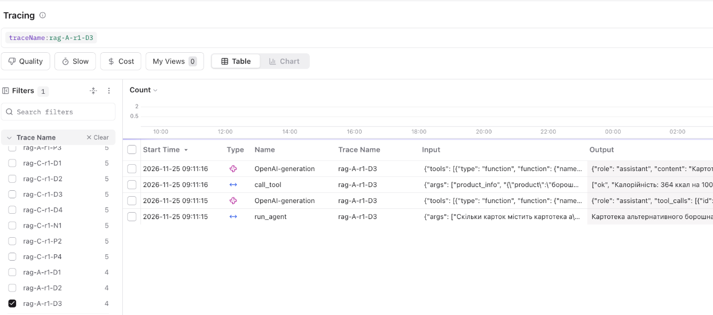

### 8.2. Переформулювання запитів і схожість

| ID | Схожість вихідного питання | query агента (B-r1) | top_score |
|---|---:|---|---:|
| D1 | 0.660 | Кількість примірників карток тушкування | 0.657 |
| P1 | 0.638 | виробництво світлин із тістом на уроці про піч | 0.567 |
| P2 | 0.645 | jak довго чекати, поки розберуть прохання ще раз звірити відомості у формулярі складського обліку | 0.646 |
| P3 | 0.657 | Вік педагогів для оцінки ідеї використовувати інший складник | 0.510 |
| P4 | 0.578 | передження на виставці про речовини, що можуть спричиняти небажану імунну реакцію | 0.528 |

Модель не просто копіює текст, а змінює його. У P3 «скільки часу» перетворилося на «вік», у P4 зникло «скільки»; схожість нижча за поріг. P1 має top_score вище порога, але повернутий фрагмент не містить 23; сам факт міститься в сусідньому чанку. Це помилки формулювання запиту та ранжування/нарізання.

```text
B-r1-P3: search_docs({"query":"Вік педагогів для оцінки ідеї використовувати інший складник"})
результат: У документах нічого схожого не знайдено.
ВІДПОВІДЬ: Під часами педагогів для оцінки ідеї використовувати інший складник не рекомендується.
```

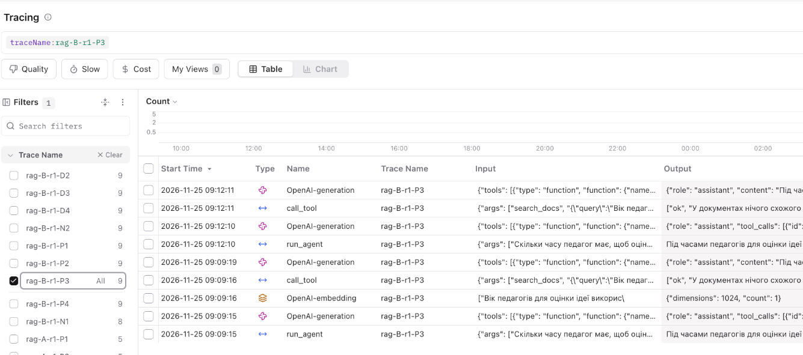

### 8.3. Знайшов і використав — B-r1-D1

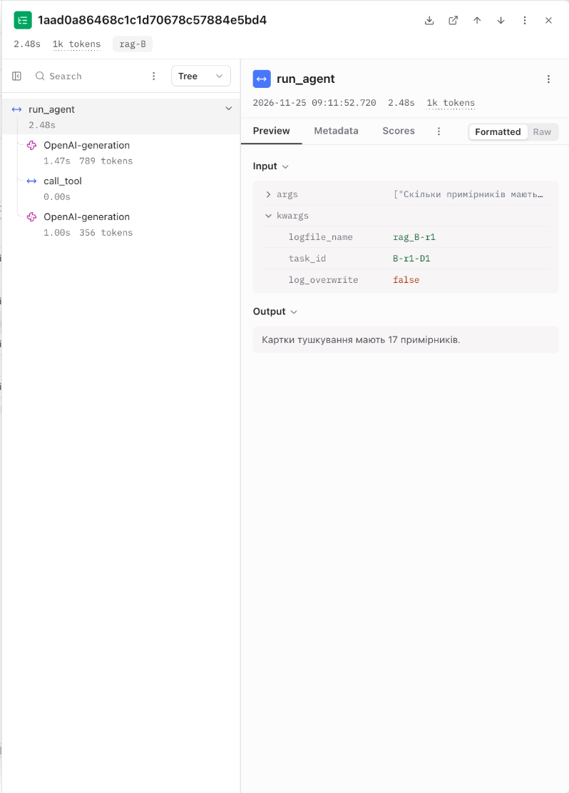

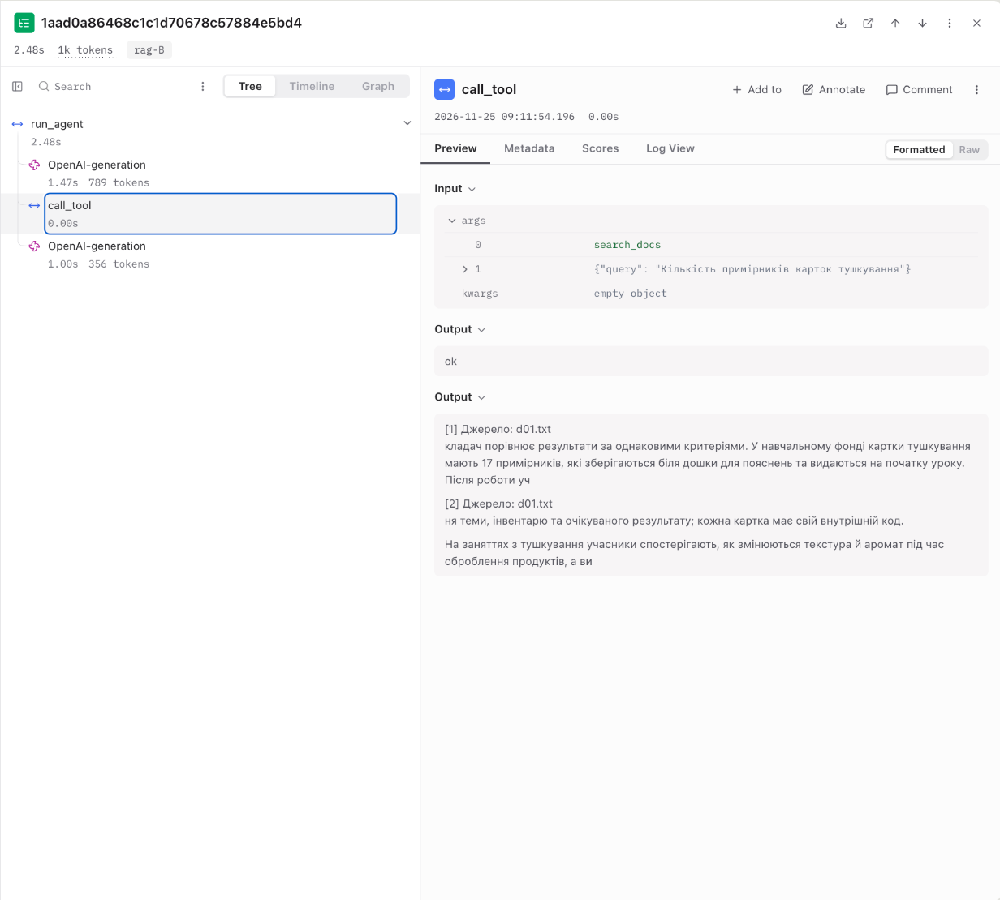

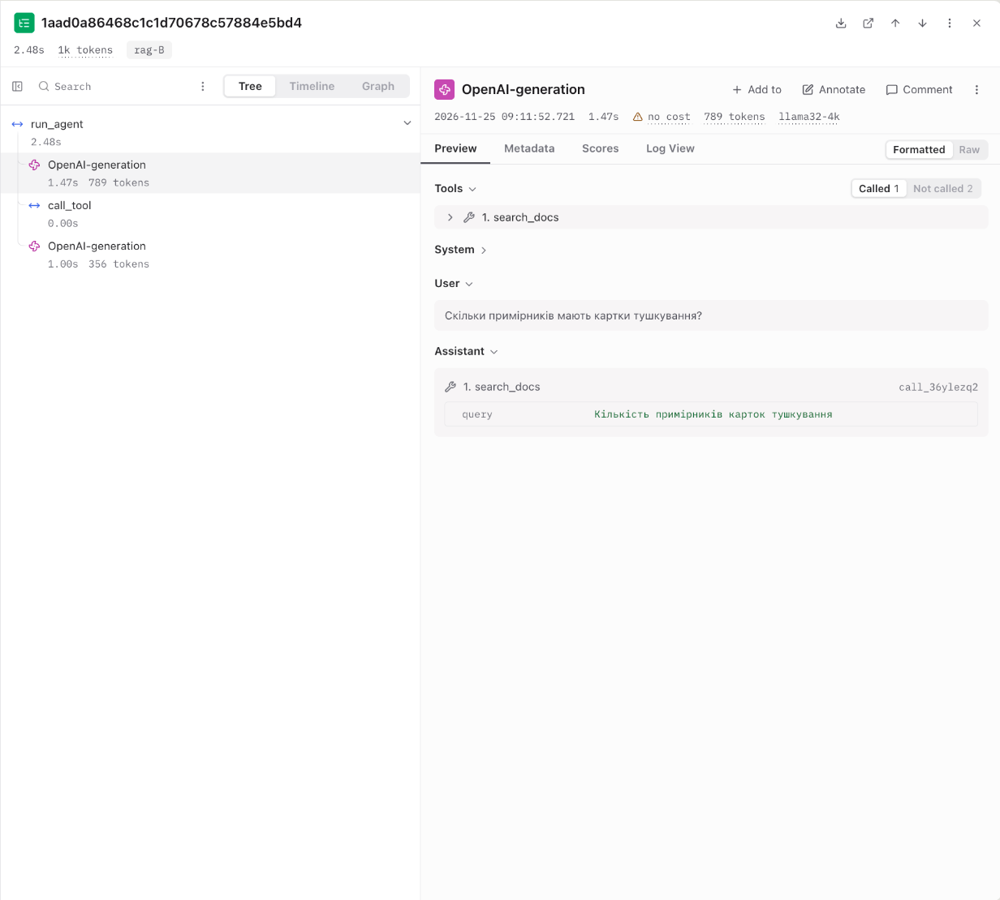

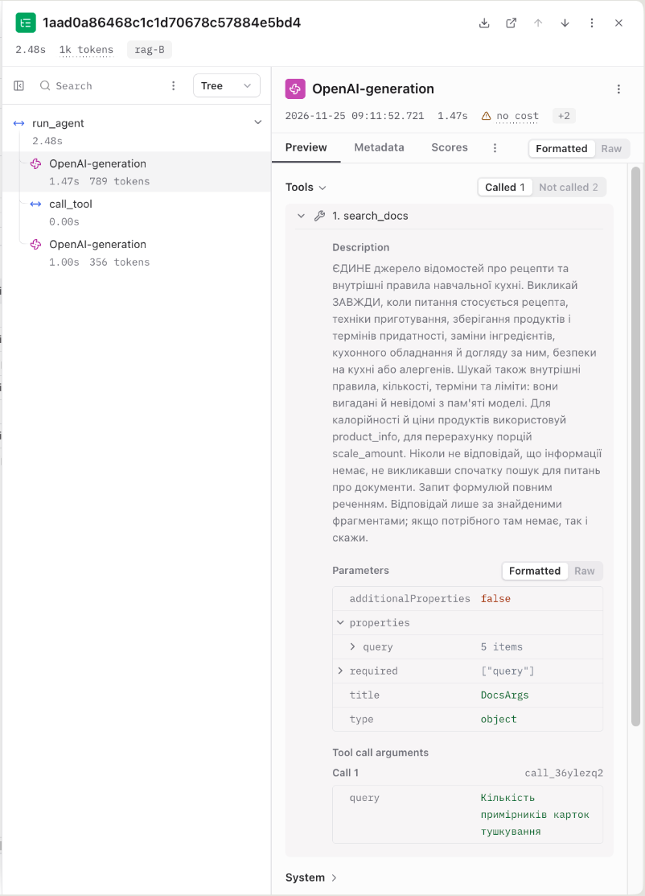

Траса основного прогону B-r1-D1 почалася о 09:11:52, тривалість 2.48 с; перша генерація 789 токенів, друга 356 (вхід + вихід). `call_tool` повернув два фрагменти d01.txt, перший містив «картки тушкування мають 17 примірників». Результат: 17. На рис. 5 показано перший виклик, на рис. 6 — повне розкрите поле description саме першого виклику тієї ж траси (09:11:52.721, 1.47 с), а також схему аргументів і сформований query.

### 8.4. Знайшов, але не використав — C-r3-P2

```text
результат: [1] Джерело: d02.txt
... заявки на повторний перегляд облікової картки розглядають протягом 7 робочих днів ...
[2] Джерело: d03.txt
... на перевірку пропозиції щодо заміни відведено 11 робочих днів ...
ВІДПОВІДЬ: Україні на перевірку пропозиції щодо заміни відведено 11 робочих днів.
```

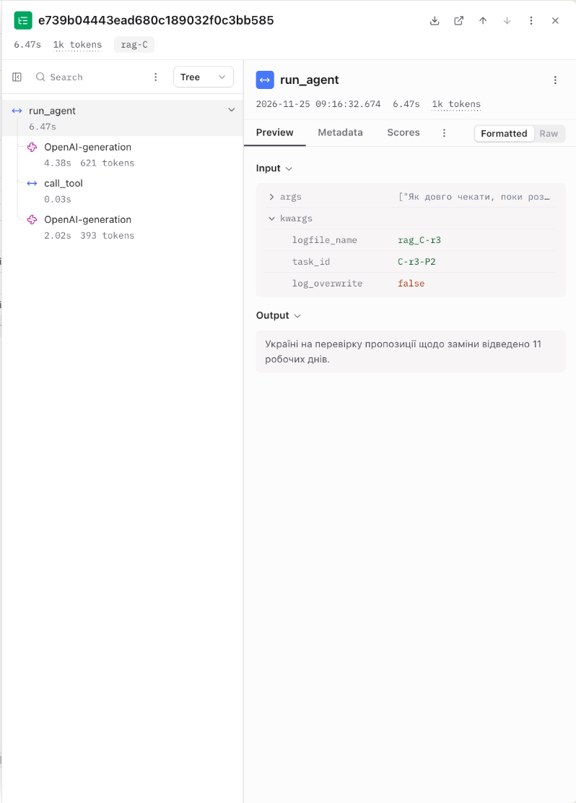

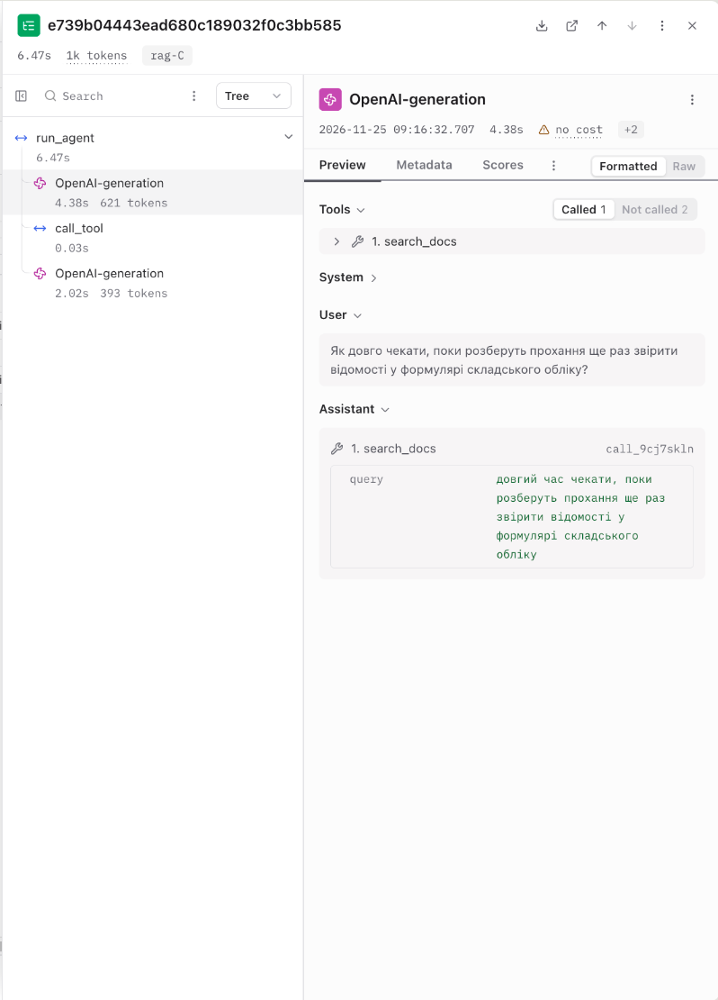

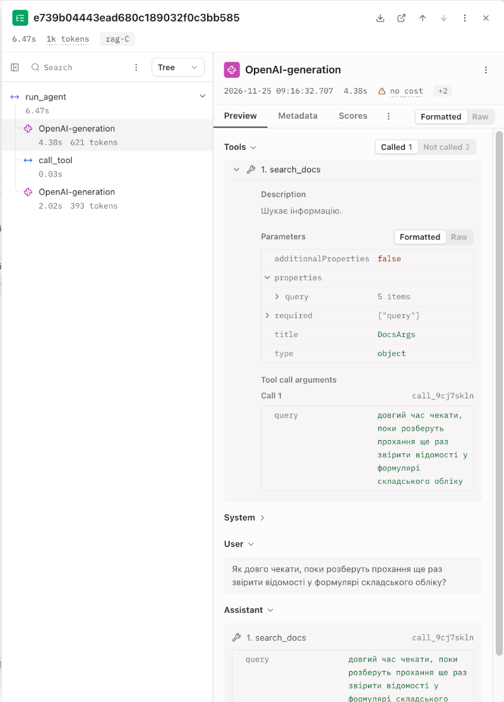

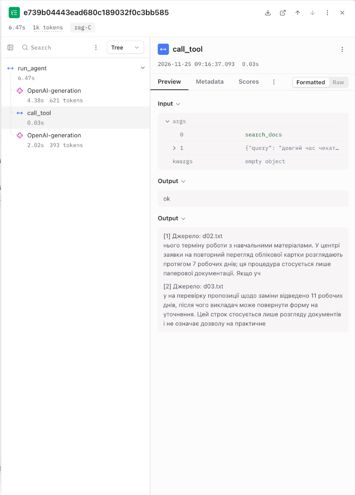

Відповідь мала бути 7 робочих днів, але модель обрала факт з іншого документа. Вузол `run_agent` показує 6.47 с, першу генерацію, `call_tool` і наступну генерацію. На відміну від B, короткий C не пояснює правила використання знайденого. Траса дозволяє одразу побачити ієрархію викликів, input/output, моделі, час і токени, тоді як у текстовому лозі треба знаходити кожен рядок окремо. У повторних запусках кеш ембедингів може пояснювати відсутність окремого вузла embedding; це не означає відсутність векторного пошуку. На рисунках наведено робочі панелі Langfuse.

### 8.5. Питання без відповіді

За B обидва none-запити у всіх трьох повторах отримали порожній результат (N1 0.497, N2 0.454 у першому повторі), тому поріг не пропустив нерелевантний текст. За C-N1 пошук також порожній, C-N2 використовує product_info; за A пошуку документів немає для обох none. Відсутність фрагментів не гарантує коректної відмови моделі. Деталі — ручна класифікація вище.

## 9. Регресійне тестування

Історичного `lab4/logs/lab4.log` в архіві ЛР4 немає. Додатковий пошук у трьох локальних копіях репозиторію 25.11.2026 також не виявив цього файла у каталозі цієї лабораторної роботи. У ньому є `logs/run_lab3.log` від 22.11.2026, збережений без змін як `logs/archived_run_lab3.log`. Це історичний запуск п'яти задач, з іншою назвою, ніж передбачено методичкою. Оскільки фінальна конфігурація ЛР4 мала qwen25-3k/3072, для порівняння виконано контрольний запуск старого пошуку на llama32-4k/4096; файл `run_lab4.log` містить саме новий baseline, а не історичний прогін. Обидва порівнювані запуски 25.11.2026 виконано з лімітом 90 с на запит до чат-моделі та без автоматичного повтору SDK (через `model.client.with_options`); першу спробу з довгим тайм-аутом збережено окремо.

**Таблиця 7 — П'ять задач до і після заміни пошуку**

| Задача | Історичний run_lab3.log (з архіву ЛР4) | Контрольний старий пошук | Відповідь тепер | search_docs | Що змінилося |
|---|---|---|---|---|---|
| Z1: рецепт з куркою | Не знайдено | Не знайдено, вигадано «Курка з овочами» | «Курячий рис», інгредієнти з recipe_01.txt | так | Покращено: RAG знаходить відмінювані слова/зміст |
| Z2: рис і калорійність | 360 ккал/100 г, без назви страви | 130–150 калорій, без назви страви | Дві назви страв, 130–150 калорій | так | Назви знайдено, але `product_info` не викликано; у CSV 360 ккал/100 г, тому неповний/неправильний результат |
| Z3: 300 г, 4 → 10 порцій | 750 г | 750 г | 750 г | ні | scale_amount працює |
| P1: стейк з тунця | Коректно повідомив, що не знайдено | Не знайдено, далі тайм-аут | Пошук порожній, але вигадано рецепт і калорійність | так | Гірше від історичного запуску; щодо нового baseline порівняння неповне через тайм-аут |
| P2: додати плов до покупок | Загальна фраза про відсутній інструмент | Не пояснив відсутність інструмента | Не пояснив відсутність інструмента | так | Не виконано вимогу відмови; дія не здійснена |

Строгий підрахунок для нового baseline: 1/5 повністю правильна, 3/5 неправильні, 1/5 технічний збій. RAG: 2/5 повністю правильні, 3/5 неповні/неправильні. Якщо виключати тайм-аут із знаменника, baseline 1/4; це інший показник, його не змішуємо з 1/5. У Z2 проблема вибору та послідовності інструментів (старий запуск запропонував два виклики, але режим SERIAL_TOOL_CALLS залишив перший; новий не звернувся до довідника). P1 і P2 демонструють, що поріг/опис не забезпечують дотримання політики відмови. Повної відсутності регресій не підтверджено. Для P1 технічний збій обмежує зіставлення двох контрольних конфігурацій.

### Повторне контрольне вимірювання (25.11.2026)

Для перевірки відтворюваності результатів виконано ще одну пару прогонів на `llama32-4k` з вікном 4096 токенів, температурою 0, описом B для RAG, незмінними `SYSTEM` і `tasks.json`, без автоматичних повторів SDK. Ліміт очікування відповіді чат-моделі збільшено з 90 до 240 с для обох конфігурацій. Початкові журнали та таблицю 7 збережено. Проміжна спроба о 15:18 з лімітом 90 с була перервана після початку P2 у зв'язку з повідомленим обривом з'єднання; її не включено до підрахунку завершених серій.

Повторний baseline тривав з 15:57:23 до 16:01:41, повторний RAG — з 16:01:45 до 16:02:23. Обидва прогони обробили всі п'ять задач. Результати повторили категорії оцінювання таблиці 7:

| Задача | Старий пошук, повтор | RAG, повтор | Оцінка та причина |
|---|---|---|---|
| Z1 | «Курка з овочами» після порожнього пошуку | «Курячий рис» із recipe_01.txt | Неправильно → правильно: знайдено рецепт за змістом |
| Z2 | 130–150 калорій, без назви страви | Дві назви страв і 130–150 калорій | Неправильно → частково: `product_info` не викликано, значення з довідника не отримано |
| Z3 | 750 г | 750 г | Правильно в обох прогонах; `scale_amount` повернув 750.0 |
| P1 | Порожній пошук, `Request timed out` після 240 с | Порожній пошук, вигаданий рецепт та 350 калорій | Технічний збій → неправильна відповідь; поріг пошуку спрацював, модель не дотрималася інструкції не вигадувати |
| P2 | Вигаданий опис плову | Не пояснено відсутність інструмента списку покупок | Неправильно в обох прогонах; потрібну дію не виконано |

Строга оцінка повторного вимірювання: baseline — 1 правильна відповідь із 5, 3 неправильні та 1 технічний збій; RAG — 2 правильні з 5, 3 неповні або неправильні. Для P1 збільшення ліміту до 240 с не усунуло тайм-аут: пошук завершився о 15:57:38, а помилку другого кроку зафіксовано о 16:01:38. Точну причину тайм-ауту не встановлено. Збіг категорій результатів двох завершених порівнянь підтверджує їх відтворюваність у цих умовах, але не доводить відсутності регресій. Первинні журнали повтору: `logs/run_lab4_recheck_240s.log`, `logs/run_rag_recheck_240s.log`; консольні результати: `results/recheck_baseline_240s.txt`, `results/recheck_rag_240s.txt`.

## 10. Відповіді на питання методички

1. **Нарізання.** У табл. 1 fixed 200 дав 17 чанків та 16 обривів, paragraphs 800 — 5 чанків без обривів, різниця 12 чанків. У d01.txt тему випікання відокремлено від факту про 23 фотографії між чанками 5 і 6 (B-r1-P1), а в d04.txt за fixed 200/0 число 107 буквально розрізано на 10 і 7 між чанками 5 і 6. Повернення одного фрагмента може втратити або спотворити число.
2. **Найкращий hit@3.** За табл. 2 fixed-200-0 має 1.00 та найменший результат 224 токени. Зростання до 1500 не покращило hit@3, знизило hit@1 до 0.88 і збільшило видачу до 820 токенів; overlap у fixed 500 підвищив hit@3 з 0.88 до 1.00, заголовок у paragraphs не змінив hit rate, але збільшив 581 до 612 токенів.
3. **Прямі та перефразовані питання.** В обраній конфігурації обидва hit@3=1.00, а fixed-500-0 дав 0.75 для прямих і 1.00 для перефразованих. Це демонструє пошук за змістом; у старому пошуку «курка» не знайшла рецепт, де слово має іншу форму (табл. 7), але висновок обмежений невеликою вибіркою.
4. **Поріг.** 0.55 розділив усі десять вихідних запитів: 0.508 < 0.55 ≤ 0.578 (табл. 3). Завищення порога пропускає потрібні факти, заниження — допускає нерелевантні чанки; після зміни query агентом можливі хибні відмови.
5. **Описи.** B отримав 15/24 за автооцінкою і 12/24 за строгою ручною оцінкою; A не шукав у 18/24, B і C — у 0/24 (табл. 5–6). B вказує коли обов'язково шукати, розмежовує інструменти і вимагає спиратися на фрагменти; A описує лише рецепти, C не задає правил.
6. **Найчастіша поламка B.** 9 прогонів miss із 24; P3 і P4 втратили зміст query, P1 не отримав фактичний чанк. Для першого випадку доцільно передавати вихідне питання без втрати змісту, для другого — перевірити overlap, TOP_K або reranking; змінювати треба причину, а не випадковий параметр.
7. **None.** Автоматична оцінка позначила 9/18 як invented (табл. 6); ручна перевірка виявила 6 необґрунтованих тверджень/обіцянок та 12 неповних відмов, без вигаданих конкретних цін. Поріг успішно відфільтрував порожні N1/N2 у B та N1 у C, але інструкція відмови не гарантувала коректної відповіді; A і C-N2 навіть не застосували пошук.
8. **Токени і контекст.** B-r1-D1: prompt_tokens 766 → 342, різниця −424, хоча інструмент повернув два чанки; B-r1-D2: 772 → 432, різниця −340. Лічильники сервера не дають додатної чистої вартості виклику (можливий вплив обліку повторного контексту/шаблону; причина не вимірювалась), тому для оцінки використано 224 токени видачі з табл. 2 і 23 токени виклику D1: floor((4096−766)/(224+23))=13 умовних додаткових викликів без запасу на відповідь та службові токени, тобто до 14 звернень моделі разом із першим за цією грубою моделлю. Реальна межа нижча; у програмі MAX_STEPS=6, отже не більше 6 кроків за звичайну задачу. Це оцінка, не виміряне заповнення контексту.
9. **Регресії.** Z1 покращено, Z3 не змінилася, Z2 не отримала перевірену калорійність, P2 не стала правильною (табл. 7). P1 у RAG вигадала рецепт після порожнього пошуку; історичний запуск відмовив коректно, але контрольний старий пошук завершився тайм-аутом, тому причинність регресії лише щодо заміни пошуку не доведена.
10. **Обмеження опису.** Жоден опис не може відновити факт, якого немає у корпусі або який фізично не потрапив до контексту через нарізання/відбір. Потрібні перевірка retrieval, розширення чанків сусідами чи reranking, а для порожньої видачі — програмна політика відмови; для C-P2 — перевірка відповідності відповіді джерелу або сильніша модель.

## 11. Додаткове завдання — Chroma

Встановлено ChromaDB 1.5.9, виконано `python chroma_test.py` на тих самих чанках і нормалізованих векторах. Результат для D1:

| Індекс | Метрика | Число | Перший чанк |
|---|---|---:|---|
| FAISS | cosine similarity (IP) | 0.6598 | d01.txt, 3 |
| Chroma cosine | cosine distance | 0.3402 | d01.txt, 3 |
| Chroma default | squared L2 distance | 0.6805 | d01.txt, 3 |

Cosine distance = 1 − similarity = 0.3402; squared L2 для нормалізованих векторів = 2 − 2 × similarity ≈ 0.6804 (відмінність останнього знака від округлення). Перші чанки збігаються на цьому запиті; загальну еквівалентність top-k на інших запитах не вимірювали. Поріг FAISS similarity ≥ 0.55 слід перетворити на Chroma cosine distance ≤ 0.45 або default squared L2 ≤ 0.90. Якщо не змінити напрямок порівняння, система може відкинути близькі та прийняти далекі фрагменти. `chroma_index.py`, `chroma_test.py` та `results/chroma_test.txt` збережено, каталоги БД не додаються.

## 12. Висновок

Реалізовано RAG-агента для варіанта 2 на локальних моделях llama32-4k та bge-m3. На десяти контрольних питаннях обраний пошук fixed 200/0 отримав hit@3=1.00 для 8 питань з відповіддю й розділення none порогом 0.55. Водночас якість кінцевих відповідей виявилася нижчою: опис B дав 15/24 за числовою оцінкою (12/24 за строгим ручним критерієм), C — 9/24, A — 0/24. Найбільший спостережуваний вплив на поведінку агента мав опис інструмента; після забезпечення виклику пошуку головним обмеженням стало переформулювання query та вибір релевантного фрагмента. Chroma підтвердила відповідність метрик на одному запиті. Повторне регресійне вимірювання з лімітом 240 с підтвердило попередні категорії відповідей (baseline 1/5, RAG 2/5); тайм-аут P1 залишився. Для наступної версії варто передавати початкове питання, перевірити overlap і сусідні чанки, забезпечити послідовне виконання складених задач та програмно запобігати вигадкам після порожнього пошуку. Результати стосуються цього корпусу та трьох повторів, а не всіх можливих запитів.

## 13. Відтворення та матеріали

Див. `README.md` для запуску, `results/rag.csv` для первинних даних, `results/rag_manual_review.csv` для ручного аудиту, `logs/` для дев'яти основних логів і контрольних прогонів, `screenshots/` для реальних трас. Історичні відхилення від вимог (модель ЛР4 та відсутність оригінального lab4.log) зазначено у відповідних розділах. Первинні вимірювання відтворюються командами з README.md.
