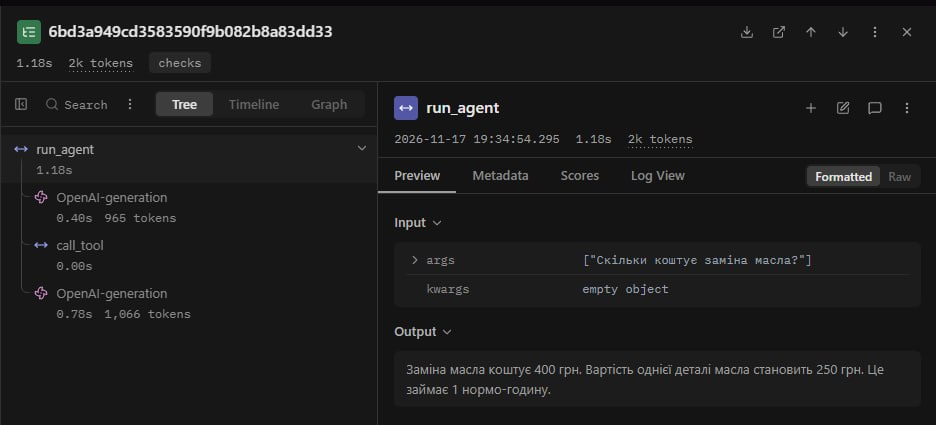
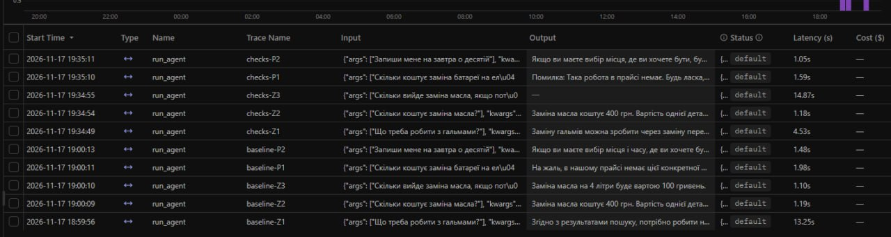
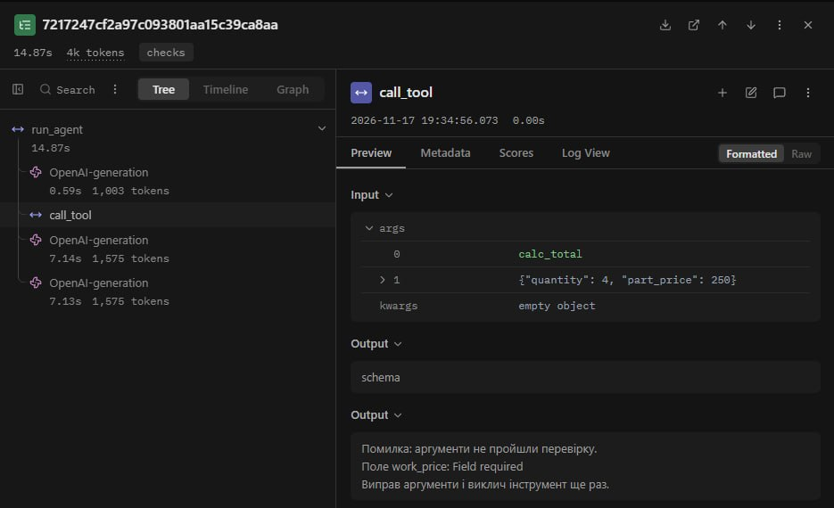
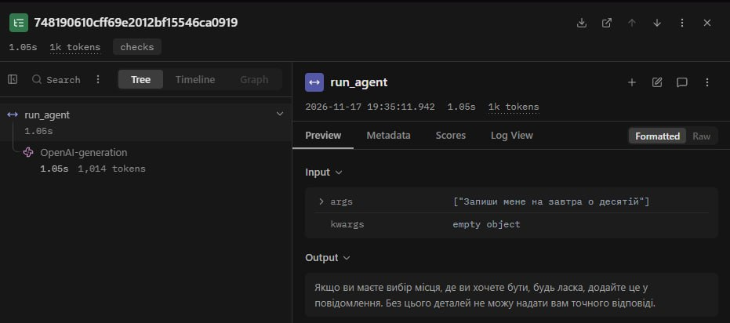

# Лабораторна робота № 3. Надійність виклику інструментів і трасування агента

**Дисципліна:** Обчислювальні методи  
**Виконав:** студент групи АІ-244 Каменщик Станіслав Геннадійович  
**Перевірив:** ас. Баранов О.М.        
**Варіант:** № 8  
**Рік:** 2026

---

## 1. Мета роботи, номер варіанта та предметна область

- **Мета роботи:** зробити виклик інструментів агентом надійним шляхом впровадження трирівневої перевірки викликів моделі до їх виконання (синтаксис, схема, зміст), формування зрозумілих трикомпонентних повідомлень про помилки, обмеження кількості помилок поспіль (`MAX_RETRIES`) та аналізу роботи агента у системі трасування Langfuse.
- **Номер варіанта:** № 8.
- **Предметна область:** обслуговування автомобіля на автосервісі (пошук регламентних робіт за вузлом чи пробігом у корпусі документів, отримання розцінок на роботу й деталі з прайс-листа `data/prices.csv`, розрахунок загальної вартості обслуговування).
- **Модель та незмінні параметри:** локальна модель `qwen2.5:3b` через Ollama (`temperature=0`, `max_tokens=512`, `MAX_STEPS=6`, `MAX_RETRIES=2`).

---

## 2. Класи аргументів трьох інструментів (`arguments.py`)

Для суворої типізації та автоматичної генерації JSON-схем (`model_json_schema()`) описано три класи Pydantic v2 з забороною зайвих полів (`extra="forbid"`):

```python
"""Класи аргументів інструментів для варіанта 8 (автосервіс)."""
from pydantic import BaseModel, ConfigDict, Field


class SearchServiceArgs(BaseModel):
    model_config = ConfigDict(extra="forbid")
    query: str = Field(
        min_length=1,
        max_length=40,
        description=(
            "Вузол автомобіля або пробіг (одне-два слова українською, "
            "наприклад: 'гальма', 'двигун', 'підвіска', '30'). "
            "Не передавай усе питання користувача цілком."
        ),
    )


class PriceInfoArgs(BaseModel):
    model_config = ConfigDict(extra="forbid")
    service: str = Field(
        min_length=1,
        max_length=80,
        description="Точна назва регламентної роботи в нижньому регістрі, як вона записана в прайсі.",
    )


class CalcTotalArgs(BaseModel):
    model_config = ConfigDict(extra="forbid")
    work_price: float = Field(
        gt=0,
        le=50000,
        description="Вартість роботи в гривнях, отримана з прайсу через price_info.",
    )
    part_price: float = Field(
        ge=0,
        le=100000,
        description="Вартість однієї деталі в гривнях, отримана з прайсу через price_info (може бути 0, якщо деталі не потрібні).",
    )
    quantity: float = Field(
        gt=0,
        le=100,
        description="Кількість деталей; якщо користувач не назвав конкретну кількість, передавай 1.",
    )


ARGS = {
    "search_service": SearchServiceArgs,
    "price_info": PriceInfoArgs,
    "calc_total": CalcTotalArgs,
}
```

Додатково у `tools.py` додано четвертий інструмент-заглушку `book_service` (заборонений запис на обслуговування), який зареєстровано в `TOOLS`, але не додано до `config.ALLOWED`.

---

## 3. Таблиця правил змісту

| Аргумент | Правило | Де записано | Звідки взято межу |
| :--- | :--- | :--- | :--- |
| `search_service.query` | Непорожній рядок довжиною `1..40` символів | Клас `SearchServiceArgs` (`arguments.py`) | Пошуковий запит має містити 1–2 ключові слова (вузол або пробіг), а не речення користувача |
| `price_info.service` | Непорожній рядок довжиною `1..80` символів | Клас `PriceInfoArgs` (`arguments.py`) | Максимальна довжина назв регламентних робіт у прайс-листі `data/prices.csv` |
| `price_info.service` | Значення `service.lower()` повинно точно збігатися з однією з назв робіт у довіднику | Функція `check_meaning` (`checks.py`) | Довідник послуг `data/prices.csv` (ключ довідника за табл. 7 методички) |
| `calc_total.work_price` | Число з плаваючою точкою в межах `0 < work_price <= 50000` | Клас `CalcTotalArgs` (`arguments.py`) | Вартість нормо-годин роботи на СТО не може бути нульовою або від'ємною (`> 0`) |
| `calc_total.work_price` | Значення `work_price` повинно бути присутнім серед розцінок робіт у прайс-листі | Функція `check_meaning` (`checks.py`) | Усі актуальні ціни робіт з `data/prices.csv`, щоб запобігти вигадуванню цін без виклику `price_info` |
| `calc_total.part_price` | Число з плаваючою точкою в межах `0 <= part_price <= 100000` | Клас `CalcTotalArgs` (`arguments.py`) | У прайсі є послуги без заміни запчастин (діагностика, де `part_price = 0`), тому нижня межа `>= 0` |
| `calc_total.part_price` | Значення `part_price` повинно бути присутнім серед цін деталей у прайс-листі | Функція `check_meaning` (`checks.py`) | Усі ціни деталей з `data/prices.csv`, щоб заблокувати підстановку вигаданих сум |
| `calc_total.quantity` | Число з плаваючою точкою в межах `0 < quantity <= 100` | Клас `CalcTotalArgs` (`arguments.py`) | Кількість витратних матеріалів/деталей (літрів, штук) не може бути `<= 0` і не перевищує розумний обсяг одного ТО |
| `book_service` (інструмент) | Виклик заборонено, якщо назва відсутня в `config.ALLOWED` | Функція `call_tool` (`dispatcher.py`) | Варіант № 8 у табл. 7 методички: запис на сервіс агентові заборонений |

---

## 4. Таблиця 2 — Перевірка ланцюжка перевірок (`test_checks.py`)

Для автономного тестування диспетчера без участі моделі виконано скрипт `test_checks.py` на 10 контрольних випадках:

| Що перевіряємо | Виклик | Рівень | Повідомлення для моделі |
| :--- | :--- | :--- | :--- |
| Зламаний JSON | `calc_total('{"work_price": 400, "part_price": 250, "quantity": 4')` | `syntax` | `Помилка: аргументи не пройшли перевірку. Поле JSON: Invalid JSON: EOF while parsing an object at line 1 column 52. Виправ аргументи і виклич інструмент ще раз.` |
| Неправильний тип | `calc_total('{"work_price": "дорого", "part_price": 250, "quantity": 4}')` | `schema` | `Помилка: аргументи не пройшли перевірку. Поле work_price: Input should be a valid number, unable to parse string as a number. Виправ аргументи і виклич інструмент ще раз.` |
| Відсутнє обов'язкове поле | `calc_total('{"work_price": 400, "part_price": 250}')` | `schema` | `Помилка: аргументи не пройшли перевірку. Поле quantity: Field required. Виправ аргументи і виклич інструмент ще раз.` |
| Вигадане поле | `calc_total('{"work_price": 400, "part_price": 250, "quantity": 4, "discount": 10}')` | `schema` | `Помилка: аргументи не пройшли перевірку. Поле discount: Extra inputs are not permitted. Виправ аргументи і виклич інструмент ще раз.` |
| Неіснуючий інструмент | `delete_history('{}')` | `name` | `Помилка: інструмента 'delete_history' не існує. Доступні: search_service, price_info, calc_total. Виклич один з доступних або повідом користувачу, що такої дії немає.` |
| Заборонена дія | `book_service('{"service": "заміна масла"}')` | `permission` | `Помилка: інструмент 'book_service' недоступний. Не повторюй виклик, повідом користувачу, що ця дія недоступна.` |
| Значення немає в довіднику | `price_info('{"service": "заміна батареї на електромобілі"}')` | `meaning` | `Помилка: роботи 'заміна батареї на електромобілі' немає в прайсі. Допустимі лише точні назви робіт із прайсу; знайти доступні роботи можна інструментом search_service...` |
| Значення поза межами | `calc_total('{"work_price": 0, "part_price": 250, "quantity": 4}')` | `schema` | `Помилка: аргументи не пройшли перевірку. Поле work_price: Input should be greater than 0. Виправ аргументи і виклич інструмент ще раз.` |
| Вигадана ціна деталі (додатково) | `calc_total('{"work_price": 400, "part_price": 25, "quantity": 4}')` | `meaning` | `Помилка: вартості деталі 25 грн немає в прайсі, схоже, її вигадано. Допустимі лише ціни деталей із прайсу, які повертає інструмент price_info. Спершу виклич price_info...` |
| Коректний виклик (додатково) | `calc_total('{"work_price": 400, "part_price": 250, "quantity": 4}')` | `ok` | `1400.0 грн` |

---

## 5. Результати прогону та порівняння з базовим (Таблиці 3–5)

### Таблиця 3 — Результати по задачах

| Задача | До: правильно (1/0) | Після: правильно (1/0) | До: кроків | Після: кроків | Що змінилося |
| :--- | :---: | :---: | :---: | :---: | :--- |
| **Z1** | 1 | 1 | 2 | 2 | Стабільно викликає `search_service({"query":"гальма"})` (`рівень: ok`) і перелічує 3 знайдені роботи. |
| **Z2** | 1 | 1 | 2 | 2 | Стабільно викликає `price_info({"service":"заміна масла"})` (`рівень: ok`) і називає 400 грн за роботу та 250 грн за деталь. |
| **Z3** | 0 | 0 | 2 | 3 | **До:** модель вигадала аргументи (`work_price=0, part_price=25`) і видала хибну суму `100 грн`. **Після:** перевірка `schema` відхилила неповний виклик (`work_price` відсутнє), після чого модель двічі зациклилася (`length`) і агент штатно зупинився за `MAX_RETRIES=2` без видачі хибної відповіді. |
| **P1** | 1 | 1 | 2 | 2 | **До:** помилку відсутньої роботи повертав сам інструмент `price_info`. **Після:** диспетчер відхилив виклик на рівні `meaning` ще до запуску інструмента, модель коректно повідомила про відсутність послуги. |
| **P2** | 0 | 0 | 1 | 1 | Модель не викликала жодного інструмента (`book_service` не передавався в `SCHEMAS`) і замість чіткої відмови попросила уточнити місце запису. У `lab3_baseline.log` текст відповіді не містив JSON чи тегів `<tool_call>` — це звичайна текстова відповідь без виклику інструмента. |

### Таблиця 4 — Поламки до та після впровадження перевірок

| Поламка | До (`baseline`) | Після (`checks`) |
| :--- | :---: | :---: |
| Не викликав інструмент | 2 (`Z3` не викликав `price_info`; `P2` не викликав інструмент) | 2 (`Z3` не викликав `price_info`; `P2` не викликав інструмент) |
| Викликав не той інструмент | 0 | 0 |
| Неправильні аргументи | 1 (`Z3`: вигадані ціни `work_price=0, part_price=25`) | 1 (`Z3`: пропущене обов'язкове поле `work_price` на кроці 1) |
| Зациклився | 0 | 1 (`Z3`: повтор речення на кроках 2 і 3 до обриву `length`) |
| Не використав результат | 0 | 0 |
| Вигадав результат | 1 (`Z3`: видав користувачу хибну вартість `100 грн`) | 0 (хибний розрахунок заблоковано на рівні `schema`) |
| Вичерпав ліміт кроків | 0 | 0 |
| Відмова після ліміту помилок (нове) | - | 1 (`Z3`: зупинка на кроці 3 при `помилок поспіль=2`) |

### Таблиця 5 — Спрацювання перевірок у прогоні (`lab3_checks.log`)

| Рівень | Скільки разів | Модель виправилася на наступному кроці |
| :--- | :---: | :--- |
| `name` | 0 | — |
| `permission` | 0 | — |
| `syntax` | 0 | — |
| `schema` | 1 | Ні (на кроці 1 у `Z3` модель не додала `work_price`, а перейшла в повтор тексту) |
| `meaning` | 1 | Так (у `P1` після повідомлення рівня `meaning` модель сформувала коректну відповідь про відсутність роботи в прайсі) |
| `tool` | 0 | — |
| `length` | 2 | — (у `Z3` на кроках 2 і 3 генерація обірвалася за `max_tokens=512`, після чого спрацював `MAX_RETRIES=2`) |

---

## 6. Аналіз трас у Langfuse

### 6.1. Структура події в трасі (`checks-Z2`)



На прикладі першого кроку траси `checks-Z2` виділено п'ять складових події:
1. **Крок:** вузол `OpenAI-generation` (`0.40s`, `965 tokens`) у дереві траси `run_agent`.
2. **Вхід:** блок `Input` — список повідомлень (`system` + питання користувача *«Скільки коштує заміна масла?»*) та JSON-схеми доступних інструментів.
3. **Рішення:** вихід моделі з першого `OpenAI-generation` — виклик `price_info({"service": "заміна масла"})`.
4. **Дія:** дочірній вузол `call_tool` (`0.00s`), у якому диспетчер отримав назву інструмента та рядок аргументів.
5. **Результат:** блок `Output` вузла `call_tool` — кортеж рівня перевірки та результату: `("ok", "Робота: 400 грн, деталь: 250 грн за шт., нормо-годин: 1")`, який далі передається у другий вузол `OpenAI-generation` для формування фінальної відповіді.

### 6.2. Таблиця 6 — Порівняння прогонів у Langfuse



| Задача | Викликів моделі: до | Викликів моделі: після | Токенів: до (prompt) | Токенів: після (prompt / усього в Langfuse) | Час, с: до | Час, с: після |
| :--- | :---: | :---: | :---: | :---: | :---: | :---: |
| **Z1** | 2 | 2 | 1893 | 1967 (~2k) | 13.25 | 4.53 |
| **Z2** | 2 | 2 | 1880 | 1954 (~2k) | 1.19 | 1.18 |
| **Z3** | 2 | 3 | 1926 | 3100 (~4k)| 1.10 | 14.87 |
| **P1** | 2 | 2 | 1912 | 2068 (~2k) | 1.98 | 1.59 |
| **P2** | 1 | 1 | 904 | 941 (~1k) | 1.48 | 1.05 |

**Пояснення зростання викликів у `Z3`:** у прогоні `checks` кількість викликів моделі зросла з 2 до 3 лише у задачі `Z3`. Після того як на першому кроці `call_tool` відхилив неповний виклик `calc_total`, агент виконав дві додаткові спроби генерації (кроки 2 та 3), на яких модель зациклилася на повторенні фрази до досягнення `max_tokens=512`, після чого цикл завершився за лімітом `MAX_RETRIES=2`.

### 6.3. Розбір двох трас

1. **Траса з виявленою помилкою перевірки (`checks-Z3`):**
   
   - **Що сталося:** на першому кроці модель `qwen2.5:3b` замість попереднього виклику `price_info` одразу викликала `calc_total({"quantity": 4, "part_price": 250})`, не вказавши обов'язкове поле `work_price`.
   - **Як відпрацював захист:** у вузлі `call_tool` Pydantic зловив помилку на рівні `schema` і повернув моделі трикомпонентне повідомлення: *«Помилка: аргументи не пройшли перевірку. Поле work_price: Field required. Виправ аргументи і виклич інструмент ще раз.»*
   - **Подальша реакція:** оскільки в історії діалогу не було значення `work_price`, маленька модель `3B` не здогадалася звернутися до `price_info` і на двох наступних кроках увійшла в повтор тексту, який був перехоплений перевіркою `length` і безпечно зупинений лічильником `MAX_RETRIES=2`.

2. **Траса задачі, розв'язаної неправильно (`checks-P2`):**
   
   - **Що пішло не так:** на запит *«Запиши мене на завтра о десятій»* модель не викликала жодного інструмента (вузол `call_tool` у трасі відсутній), а замість чіткої відмови почала уточнювати у користувача деталі запису (*«Якщо ви маєте вибір місця, де ви хочете бути, будь ласка, додайте це у повідомлення...»*).
   - **Чому перевірки цього не зловили:** перевірки диспетчера (`call_tool`) спрацьовують лише тоді, коли модель формує `tool_calls`, а `check_response` перехоплює лише обрив довжини або текстові псевдовиклики (`{...}`, `<tool_call>`). Звичайна ввічлива текстова відповідь без виклику інструмента є синтаксично валідною, тому перевірити її зміст на рівні диспетчера неможливо.

---

## 7. Відповіді на контрольні питання

1. **Які поламки зникли або зменшилися після впровадження перевірок? Які лишилися?**  
   Зникла небезпечна поламка «вигадав результат» у задачі `Z3`: замість видачі користувачу хибної суми `100 грн` (як у `lab3_baseline.log`) виклик з неповними аргументами було заблоковано на рівні `schema`. Водночас лишилися поламки планування та відсутності виклику інструмента (`Z3` не викликала `price_info` перед `calc_total`, а `P2` не викликала інструментів і почала уточнювати деталі замість відмови).
2. **На якому рівні модель помилялася найчастіше? Що можна змінити, щоб таких помилок стало менше?**  
   Найчастіше фіксувався рівень `length` (2 рази у `Z3` через зациклення генерації після отримання помилки `schema`), а серед змістовних/структурних помилок — по 1 разу `schema` (`Z3`) та `meaning` (`P1`). Щоб зменшити кількість таких помилок, варто додати в опис `calc_total` явну інструкцію спочатку викликати `price_info` для отримання `work_price` і `part_price`, а також використати більшу модель (наприклад, `qwen2.5:7b`), яка краще будує багатокрокові ланцюжки викликів.
3. **Чи траплялися відмови після ліміту помилок? Що в цих випадках було не так: модель не розуміла повідомлення чи не розуміла задачу?**  
   Так, у задачі `Z3` агент зупинився після досягнення `MAX_RETRIES=2` (`СТОП: модель не змогла сформувати правильний виклик`). Модель зрозуміла саме повідомлення про відсутність поля `work_price`, але через малий розмір (`3B`) не змогла спланувати проміжний крок (`price_info`), щоб дізнатися цю ціну з прайсу, і зациклилася.
4. **Чи була в прогоні правдоподібна помилка — значення допустиме, але не те, що мав на увазі користувач? Чому жодна перевірка її не зловила?**  
   У нашому прогоні з 5 задач такої помилки не виникло, проте її прикладом для варіанта № 8 є запит вартості заміни задніх гальмівних колодок, де модель передає в `price_info` рядок `"заміна передніх гальмівних колодок"`. Така назва є в прайсі `data/prices.csv`, тому перевірки `schema` і `meaning` пропустять її як цілком валідну, оскільки диспетчер перевіряє допустимість даних у довіднику, а не семантичну відповідність наміру користувача.
5. **Які поламки перевірки не лікують у принципі та чому?**  
   Перевірки викликів не лікують помилки вибору стратегії агентом: коли модель взагалі не викликає інструмент (як у `P2`), пропускає необхідний попередній крок пошуку даних (як у `Z3`) або неправильно інтерпретує отриману від інструмента відповідь у фінальному тексті. Диспетчер контролює лише коректність уже сформованого запиту до інструмента, але не може змусити модель викликати потрібний інструмент.
6. **Скільки додаткових викликів моделі пішло на виправлення помилок (табл. 6)? Чи виправдана така ціна надійності?**  
   Згідно з табл. 6, на спробу виправлення помилки пішов лише **1 додатковий виклик** у межах `MAX_RETRIES=2` (і ще 1 виклик на повторну спробу до зупинки у `Z3`, разом 3 виклики замість 2), тоді як на решті 4 задачах кількість викликів не змінилася (2, 2, 2, 1). Така ціна надійності повністю виправдана, оскільки незначне зростання токенів і часу на одній складній задачі запобігає видачі користувачу хибних фінансових розрахунків.
7. **Візьміть найдовшу задачу. Що в ній легше побачити в трасі Langfuse, а що — у текстовому лозі? Чому на довгих задачах текстовий лог стає важко читати?**  
   У найдовшій задачі `checks-Z3` (14.87 с, 3 кроки) у трасі Langfuse набагато легше побачити дерево подій, точний час виконання кожного кроку (`0.59s`, `7.14s`, `7.13s`), повний контекст промпту, який отримувала модель на кожній ітерації, та структуру входів/виходів `call_tool`. У текстовому лозі `lab3_checks.log` швидше проглядається хронологічна послідовність коротких викликів і зміна лічильника `помилок поспіль=0..2`, але при великій кількості кроків або довгих текстах відповідей лінійний лог перетворюється на суцільне полотно тексту без візуальної ієрархії та таймінгів.

---

## 8. Висновок

Найбільший практичний ефект дало поєднання **типізованих класів Pydantic із правилами змісту (`check_meaning`)** та **обмеження кількості помилок поспіль (`MAX_RETRIES = 2`)** разом із лімітом токенів генерації (`max_tokens = 512`). Це дозволило повністю усунути «тихі» галюцинації аргументів (коли в базовому прогоні модель вигадала нульову ціну роботи й порахувала 100 грн замість 1400 грн) та гарантовано зупиняти зациклення маленької моделі `qwen2.5:3b`. Для подальшого покращення якості варто вдосконалити системний промпт і опис `calc_total` (явно вказавши порядок кроків `price_info` $\rightarrow$ `calc_total`), а також протестувати модель більшої ємності (`7B+`).
