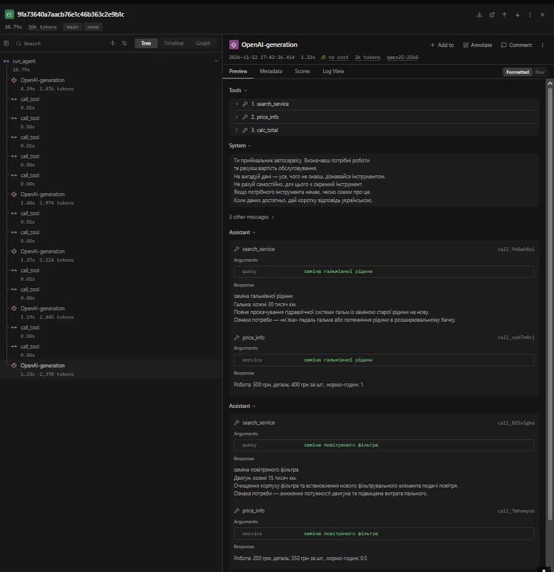
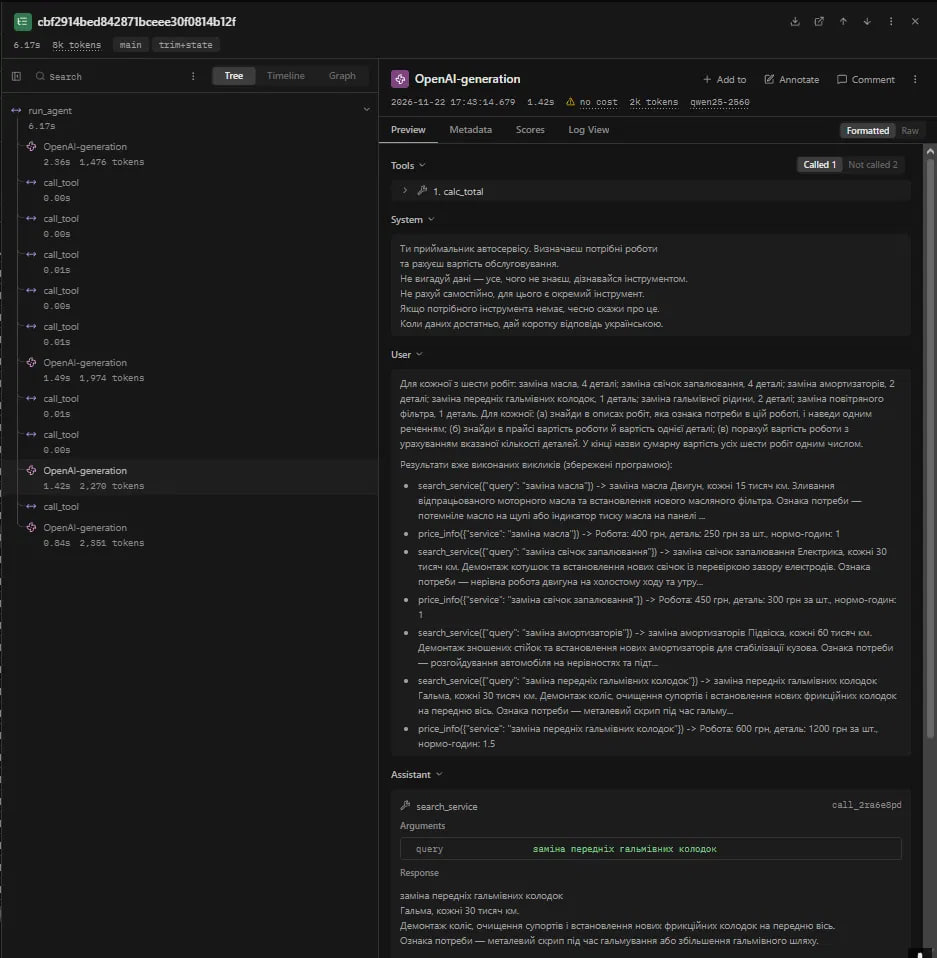

# Лабораторна робота № 4. Контекст, стан і кеш агента

**Дисципліна:** Обчислювальні методи  
**Виконав:** студент групи АІ-244 Каменщик Станіслав  
**Перевірив:** ас. Баранов О.М.  
**Варіант:** № 8  
**Рік:** 2026

---

## 1. Мета роботи, варіант, модель і вікно

- **Мета роботи:** побачити, що відбувається з агентом, коли історія не вміщується в контекстне вікно моделі; навчитися скорочувати історію, зберігати результати інструментів поза текстом діалогу та кешувати виклики моделі; виміряти, скільки це коштує.
- **Варіант:** № 8, обслуговування авто. Інструменти: `search_service` (корпус `data/corpus`), `price_info` (прайс `data/prices.csv`), `calc_total`. Агент і перевірки - з лабораторної роботи № 3.
- **Модель:** `qwen2.5:3b` через Ollama (та сама, що в ЛР3), `temperature = 0`.

| Параметр | Значення |
|---|---|
| `context length` вихідної моделі `qwen2.5:3b` | 32768 |
| `num_ctx` нової моделі `qwen25-4k` | 4096 |
| У скільки разів звузили | 8 |

Вікно довелося звужувати ще двічі (обидва рази випадок C, див. розділ 3):

| Спроба | Модель | `num_ctx` | `COMPRESS_AT` | Найбільший вхід у `none` | Випадок | Логи |
|---|---|---:|---:|---:|---|---|
| 1 | `qwen25-4k` | 4096 | 2800 | 2912 (71%) | C | `logs/case_c_4096/` |
| 2 | `qwen25-3k` | 3072 | 2150 | 2912 (94.8%) | C | `logs/case_c_3072/` |
| 3 | **`qwen25-2560`** | **2560** | **1800** | 2551 (99.6%) | **B** | `logs/` |

Далі всі числа - для вікна **2560** (звужено в 12.8 раза від 32768). `COMPRESS_AT = 1800` ≈ 70% вікна, як 2150 для 3072.

---

## 2. Довга задача (крок 2)

Щоб пункт (а) мав відповідь, `search_service` повертає повний опис роботи з корпусу (назва, вузол і періодичність, що робиться, ознака потреби), а не лише назву (`tools.py`). Опис інструмента в `schemas.py` і поле `query` в `arguments.py` доповнено пошуком за назвою роботи (`max_length` 40 → 50).

Інші зміни відносно ЛР3:

- обмеження довжини відповіді (`max_tokens`) **не використовується**: у `model.py` і `summary.py` виклик моделі такий самий, як в еталоні. Нескінченна генерація, коли модель повторює той самий текст, - одна з поломок, які ця робота і досліджує (див. `main_summary_r1` у розділі 6). Уперше вона з'явилася на вікні 3072: у `extra_summary_r1` модель на кроці 7 згенерувала **30720** токенів (= 10 × 3072), повторюючи рядок «Загальна вартість всіх робіт ... 29000 грн» (`logs/case_c_3072/extra_summary_r1.log`). Прогін на 2560 з тимчасовим обмеженням `MAX_TOKENS = 512` збережено для порівняння в `logs/max_tokens_2560/`.

**Питання:** «Для кожної з шести робіт: заміна масла, 4 деталі; заміна свічок запалювання, 4 деталі; заміна амортизаторів, 2 деталі; заміна передніх гальмівних колодок, 1 деталь; заміна гальмівної рідини, 2 деталі; заміна повітряного фільтра, 1 деталь. Для кожної: (а) знайди в описах робіт, яка ознака потреби в цій роботі, і наведи одним реченням; (б) знайди в прайсі вартість роботи й вартість однієї деталі; (в) порахуй вартість роботи з урахуванням вказаної кількості деталей. У кінці назви сумарну вартість усіх шести робіт одним числом.»

| Робота | Робота, грн | Деталь, грн | К-сть | Вартість, грн |
|---|---:|---:|---:|---:|
| заміна масла | 400 | 250 | 4 | 1400 |
| заміна свічок запалювання | 450 | 300 | 4 | 1650 |
| заміна амортизаторів | 1200 | 2400 | 2 | 6000 |
| заміна передніх гальмівних колодок | 600 | 1200 | 1 | 1800 |
| заміна гальмівної рідини | 500 | 400 | 2 | 1300 |
| заміна повітряного фільтра | 200 | 350 | 1 | 550 |

**Правильна відповідь:** `12700`, `min_calls = 18` (`long_task.json`).

---

## 3. Запуск без захисту (кроки 3-4)

`python agent.py` працює без помилок (`logs/lab4.log`: «Що треба робити з гальмами?» - один виклик `search_service("гальма")`, три роботи у відповіді).

**Вікно 4096 - випадок C.** `python measure.py none 1 probe`: неправильно (відповідь «1650.0 грн»), ≈11 с. Найбільший вхід 2912 токенів (71% вікна), статус `final`, вхід не застиг (`logs/case_c_4096/probe_none_r1.log`).

**Вікно 3072 - знову випадок C.** У серії `main` найбільший вхід `none` - ті самі 2912 токенів (94.8% < 95%), статус `final` (`logs/case_c_3072/`). Тому вікно зменшено до 2560.

**Вікно 2560.** `python measure.py none 1 probe`: **неправильно**, **27.0 с**.

Таблиця 2 - Зростання входу в прогоні без захисту (`logs/probe_none_r1.log`)

| Крок | `prompt_tokens` | Приріст | Що зробила модель |
|-----:|----------------:|--------:|:------------------|
| 1 | 1338 | | `search_service` і `price_info` для масла й свічок, `search_service` для амортизаторів (5 викликів) |
| 2 | 1910 | 572 | `calc_total(450, 300, 1)` |
| 3 | 1968 | 58 | `search_service("заміна передніх гальмівних колодок")` |
| 4 | 2134 | 166 | `calc_total(500, 200, 1)` - відхилено (`meaning`: ціни 200 немає в прайсі) |
| 5 | 2292 | 158 | `price_info("заміна передніх гальмівних колодок")` |
| 6 | 2378 | 86 | `calc_total(600, 1200, 1)` |
| 7 | 2437 | 59 | `search_service("заміна гальмівної рідини")` |
| 8 | 2322 | −115 | `search_service("заміна гальмівної рідини")` - **повтор кроку 7** |
| 9 | 2484 | 162 | `calc_total(700, 1500, 1)` - відхилено (`meaning`: ціни 700 немає в прайсі) |
| 10 | 2521 | 37 | `price_info("заміна гальмівної рідини")` |
| 11 | 2494 | −27 | `calc_total(500, 400, 1)` |
| 12 | 2551 | 57 | відповідь без виклику |

- **(а)** вхід першого кроку - **1338** токенів (інструкція, питання і схеми трьох інструментів);
- **(б)** типовий приріст - **86** токенів (медіана; перший приріст 572 - п'ять результатів, з них три довгі описи з корпусу);
- **(в)** сума `prompt_tokens` - **26829**, за формулою n·C + d·n(n−1)/2 = 12·1338 + 86·66 = **21732**. Сума більша на ≈23%: медіана 86 не враховує стрибок 572 на кроці 2, а після кроку 7 вхід не росте, а тримається біля межі (2322-2551), тож кожен із п'яти останніх кроків коштує майже повне вікно;
- **(г)** вхід перестав рости на **кроці 8**: агент додав повідомлення, а вхід упав з 2437 до 2322. Найбільший вхід 2551 = 99.6% вікна;
- **(д)** після кроку 8 модель: на кроці 8 **повторює той самий виклик**, що й на кроці 7 (результат пошуку вже був, але початок історії обрізано); на кроці 9 викликає `calc_total` з **вигаданими** цінами 700 і 1500, і перевірка `meaning` їх відхиляє; на кроці 10 ще раз бере ціну з прайсу. Відповідь: «Вартість загальної суми робіт вже обраховано. Всі вартості деталей та робіт вже використані в попередніх обрахунках» - чисел у ній немає (отже, й вигаданих), але й відповіді на питання немає. Так само перевірено всі прогони: кожне число з рядка `ВІДПОВІДЬ:` порівняно з числами в рядках `результат:` того самого лога.

**Випадок B**: помилки сервера немає, а вхід перестав рости, хоча історія росла. Ollama мовчки відкидає початок історії, і агент «забуває» вже отримані результати. Те саме в `main_none_r1`: на кроці 5 вхід упав з 2389 до 2331, і модель відповіла англійською, що роботи «заміна повітряного фільтра» немає, - хоча результат пошуку й ціну для неї отримала на кроці 4.

---

## 4. Обрізання і стан (кроки 5-6)

Таблиця 3 - Стиснення історії (`logs/probe_trim_r1.log`, `logs/probe_trim+state_r1.log`)

| Конфігурація | Крок стиснення | Вхід до стиснення, токенів | Повідомлень було -> стало | Повторних викликів за прогін |
|---|---|---:|---|---:|
| `trim` | 2 | 1910 | 10 -> 4 | 72 |
| `trim` | 4 | 2004 | 12 -> 5 | |
| `trim` | 6 | 2009 | 19 -> 2 | |
| `trim` | 8, 14, 20 | 1910 | 10 -> 4 | |
| `trim` | 10, 16, 22 | 2154 | 14 -> 6 | |
| `trim` | 12, 18, 24 | 2215 | 20 -> 2 | |
| `trim+state` | 2 | 1910 | 10 -> 4, стан додано | 0 |

`trim`: 62.1 с, неправильно, статус `step_limit` (25 кроків, 107 викликів). Модель робить по кілька викликів за крок, тому останні `KEEP_LAST = 6` повідомлень - це здебільшого результати без свого виклику, і `drop_orphan_tools` прибирає їх (19 -> 2, 20 -> 2: лишаються лише інструкція й питання). Агент щоразу починає задачу спочатку: стиснення йдуть циклом 1910 → 2154 → 2215 кожні 6 кроків.

`trim+state`: 11.1 с, 0 повторів, відповідь на кроці 3, але неправильна: модель перелічила всі шість робіт і сама «порахувала» суму 6300.0 грн, якої немає в жодному результаті (на той момент зроблено лише 6 викликів).

**Пункт 7.** У першому блоці `ПЕРШЕ ПОВІДОМЛЕННЯ КОРИСТУВАЧА ПІСЛЯ СТИСНЕННЯ` - **6** рядків `- інструмент(аргументи) -> результат` (масло, свічки, амортизатори, `calc_total`). Сам записник - 1127 символів ≈ **451** токен, тобто ≈5 типових приростів (86). Блок великий: вхід після стиснення впав лише з 1910 до 1902 - записник займає майже стільки ж, скільки відкинуті повідомлення. Описи з корпусу обрізано до `STATE_RESULT_CHARS = 200` символів, і кінець «ознаки потреби» (те, що питає пункт (а)) у записник не потрапив. Для шести позицій записник ще вміщується; при 18 записах він займе ≈1350 токенів - більше половини вікна.

---

## 5. Кеш (крок 7)

Таблиця 4 - Робота кешу

| Запуск | Кроків | Влучань у кеш | Викликів до сервера | Час, с | Правильно |
|---|---:|---:|---:|---:|---|
| 1 (кеш порожній) | 7 | 0 | 7 | 11.0 | ні |
| 2 (той самий запит) | 7 | 7 | 0 | 1.5 | ні |

Запуск 2 швидший приблизно в **7 разів**; решта 1.5 с - запуск Python, імпорт бібліотек і виконання інструментів. Відповідь та сама («1800.0 грн»), бо кеш повертає ту саму, навіть неправильну, відповідь. Якби перед запуском 2 змінити `SYSTEM` у `config.py`, змінилося б перше повідомлення, а отже ключ (`sha256`) кожного запиту: жодного влучання, усі 7 викликів пішли б на сервер.

---

## 6. Вимірювання і траси (крок 8)

`python measure.py all 3 main`. У `CONFIGS` є і конфігурація `summary`, тому прогонів 12.

Таблиця 5 - Вартість циклу (медіани по трьох повторах)

| Конфігурація | Правильно (з 3) | Кроків | Токенів на вхід | Токенів на вихід | Час, с | Стиснень | Повторних викликів |
|---|---|---:|---:|---:|---:|---:|---:|
| `none` | 0 | 6 | 12510 | 357 | 7.5 | 0 | 0 |
| `trim` | 0 | 25 | 46357 | 1552 | 33.8 | 14 | 43 |
| `trim+state` | 0 | 4 | 7807 | 264 | 5.6 | 2 | 0 |
| `summary` (main) | 0 | 4 | 7543 | 1113 | 25.9 | 2 | 0 |
| `summary` (extra) | 0 | 4 | 7395 | 807 | 24.0 | 2 | 0 |

«Правильно» перевірено вручну за рядками `відповідь:`: числа 12700 немає в жодній відповіді, у жодній відповіді немає й усіх шести вартостей. На підсумовування в `summary` пішло 1391 (main) і 1484 (extra) токени (медіани) - у колонці «Токенів на вхід» вони не враховані. Медіана ховає найдорожчий прогін: у `main_summary_r1` підсумовування коштувало 30454 токени, а відповідь моделі - 26750 токенів, прогін тривав **755.6 с** замість 10-26 с (див. нижче).

**Поламки, яких таблиця не показує** (12 прогонів `main`):

- відповів менше ніж за 19 кроків: **8 з 12** - усі `none` і `trim+state`, `main_summary_r2` і `main_summary_r3` (4-7 кроків). Навіть з урахуванням кількох викликів за крок жоден не дійшов до 18 викликів: від 8 (`trim+state`, `summary`) до 12 (`main_none_r3`). Це відповіді «з пам'яті»: модель зупиняється, порахувавши одну-дві позиції. Решта 4 не відповіли взагалі: 3 `trim` (`step_limit`) і `main_summary_r1` (`retry_limit`);
- назвав число, якого не було в жодному рядку `результат:`: **1 з 12** - `main_summary_r3`: «750», «650», «4350» (жоден `calc_total` таких значень не повертав, модель рахувала сама). Ще в 6 прогонах у відповіді є лише число з одного `calc_total` («1800.0», «550.0»), видане за загальну суму. Інші вигадані значення модель передавала в аргументи `calc_total`, і їх відхилила перевірка `meaning` (500/200 у `main_none_r2`, 100/100, 200/150, 400/450 у `main_summary_r1`);
- **нескінченна генерація** - `main_summary_r1`: на кроці 4 третій виклик підсумовування не зупинився - модель виписувала JSON-список викликів `calc_total` з номерами `index` аж до 420, і блок `ПІДСУМОК ІСТОРІЇ` розрісся до 68 994 символів (підсумовування коштувало 27840 токенів). Цей «переказ» дописано до питання, і на кроці 5 модель продовжила той самий список уже російською: `completion_tokens = 25600` = 10 × 2560 - на цій межі Ollama обриває генерацію, тому `finish_reason = length`, перевірка `length`, третя помилка поспіль і `СТОП: модель не змогла сформувати правильний виклик`. Без межі Ollama такий прогін не закінчився б зовсім. Жоден спосіб скорочення історії від цього не захищає: зациклилася сама генерація, а не історія.

**Langfuse** (мітка `main`):

*Рис. 1 - Дерево траси `long-main_none_r1`.*

*Рис. 2 - Дерево траси `long-main_trim+state_r1`.*

Перший виклик після стиснення в `trim+state` - крок 3: вхід **2231** токен. Крок 3 у `none` (`long-main_none_r1`): **2154** токени. Після стиснення вхід не менший, а на 77 токенів більший: записник (≈450 токенів) важчий за відкинуті повідомлення. У дереві траси Langfuse біля кожного `OpenAI-generation` показано вхід і вихід разом: у `none` 1476, 1974, 2214, 2445, 2370 = `prompt_tokens` з лога + `completion_tokens` (наприклад, 2214 = 2154 + 60); у `trim+state` третій виклик - 2270 = 2231 + 39. У трасі одразу видно розмір кожного виклику і повну історію, яку отримала модель (після стиснення - інструкція, питання із записником і останні повідомлення); у текстовому лозі це доводиться рахувати вручну за заголовками кроків.

---

## 7. Відповіді на питання

1. Агент без захисту дійшов до межі вікна на кроці 8: вхід упав з 2437 до 2322, хоча історія росла, а найбільший вхід - 2551 з 2560 (таблиця 2 і пункти (г), (д) у розділі 3). Після цього модель забула вже отримані результати: повторила пошук із кроку 7, вигадала ціни 700 і 1500 і відповіла без жодного числа.
2. Сума 26829 проти 21732 за формулою (+23%). Зростання швидше за лінійне, як і очікувалося: вхід кроку виріс у 1.9 раза (1338 → 2551), а сума за 12 кроків - у 20 разів більша за перший крок. Різниця з формулою - через нерівний приріст (572 на кроці 2 проти медіани 86) і п'ять кроків з входом біля межі вікна.
3. Агент втрачає результати інструментів: при кількох викликах за крок обрізання лишає лише інструкцію й питання (19 -> 2, 20 -> 2). Приклад: крок 3 `main_trim_r1` - знову `search_service({"query":"заміна масла"})` і `price_info({"service":"заміна масла"})`, хоча обидва результати отримано на кроці 1; далі агент ходить по колу масло → свічки → амортизатори → колодки → рідина кожні 5 кроків, 43 повтори за прогін. У `trim+state` результати дописані до питання: 0 повторів, 4 кроки замість 25, у 6 разів менше токенів (таблиці 3 і 5). Але правильності стан не додав: 0 з 3.
4. За входом найдешевша - `summary` (7543), але з виходом і підсумовуванням вона дорожча: 7543 + 1113 + 1391 = 10047 проти 7807 + 264 = 8071 у `trim+state`, а в найгіршому прогоні `main_summary_r1` - понад 65 тис. токенів. Отже, найдешевша загалом і найшвидша - `trim+state` (5.6 с). Найточнішої немає: усі конфігурації 0 з 3, тож точність визначає модель `qwen2.5:3b`, а не спосіб скорочення. Висновок обережний: одна задача, одна слабка модель, одне вікно, три повтори; при `TEMPERATURE = 0` повтори `trim` і `trim+state` збіглися повністю, тож розкиду вони не показують, а `summary` дав розкид від 9.6 до 755.6 с.
5. Інакше повтори брали б відповіді з кешу, і час та токени були б майже нульові (1.5 с замість 11.0 с у таблиці 4) - ми б вимірювали кеш, а не агента. Якщо інструмент поверне інші дані, зміниться історія, а з нею ключ - буде промах. Якщо замінити модель під тією самою назвою, ключ не зміниться (у ньому лише назва), і кеш віддаватиме старі відповіді; каталог `cache` треба очищати вручну.
6. Слабка модель, яка відповідає раніше, ніж зробила всі виклики (8 з 12 прогонів), вигадані дані й арифметика моделі (750, 650, 4350 у `main_summary_r3`), переплутані аргументи (ціни свічок для амортизаторів), нескінченна генерація, коли модель повторює той самий текст (25600 токенів у `main_summary_r1`, 30720 на вікні 3072): тут зациклюється вже не історія, а відповідь, записник або переказ, більший за вікно, неправильне розуміння задачі.

---

## 8. Додаткове завдання: підсумовування

`summary.py`, гілка `COMPRESS = "summary"` у `compress.py`, `python measure.py summary 3 extra` (рядок `summary` (extra) у таблиці 5).

- Підсумовування коштувало **1484** токени на прогін (медіана серії `extra`; у серії `main` - 1391). Але ціна нестабільна: у `main_summary_r1` - 30454 токени, бо сам виклик підсумовування зациклився (розділ 6).
- Заощаджено на вході порівняно з `trim`: 46357 − 7395 = **38962** токени (бо `trim` зациклюється). Порівняно з `trim+state` - лише 412 токенів (7395 проти 7807), менше за ціну самого підсумовування.
- Точні числа: переказ їх **не зберіг**. У `extra_summary_r2` блок `ПІДСУМОК ІСТОРІЇ` пише для заміни амортизаторів «Ціна: Підвіска: 600 грн (або 60 тисяч км.), деталь: 400 грн», а в рядку `результат:` - «Робота: 1200 грн, деталь: 2400 грн»: переказ змішав вузол і пробіг з цінами. Модель далі рахувала зі спотворених даних і назвала суму 3100.0 грн, якої немає в жодному результаті; у `extra_summary_r3` - 2700.0 грн. У `main_summary_r1` перший переказ теж пише для амортизаторів «Робота: 400 грн, деталь: 300 грн», а третій взагалі замість переказу видав 68 994 символи повторюваного JSON. Серія `extra`: 0 з 3.

---

## 9. Висновок

Найбільший ефект дав **стан задачі**: `trim+state` - найшвидша конфігурація (5.6 с) без жодного повторного виклику, у 6 разів дешевша за `trim` (≈8.1 тис. токенів проти ≈47.9 тис.). Обрізання без стану при кількох викликах за крок відкидає всі результати й зациклює агента (43 повтори, 25 кроків, майже вчетверо дорожче за `none`: 46357 проти 12510 токенів на вхід). Кеш пришвидшив повторний запуск у 7 разів, але корисний лише для налагодження. Найнебезпечнішим виявилося підсумовування: окремий виклик моделі може сам зациклитися, і тоді «стиснення» роздуває історію замість скоротити (68 994 символи переказу, 755.6 с на прогін). Жодна конфігурація не дала правильної відповіді: `qwen2.5:3b` зупиняється на одній-двох позиціях і вигадує числа, тож для цієї задачі потрібна сильніша модель. Варто змінити: обрізати за токенами і не розривати групу «виклик + результати», зберігати в стані короткі факти (ціни й ознаку потреби), а не перші 200 символів, не кешувати відповіді з `finish_reason = length` і перевіряти перед відповіддю, чи зроблено всі 18 викликів.
