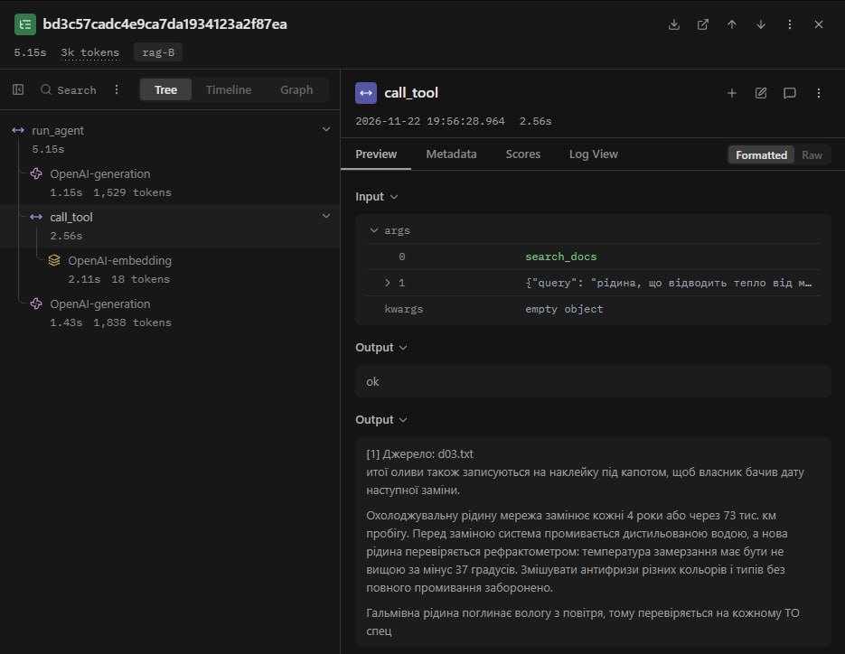
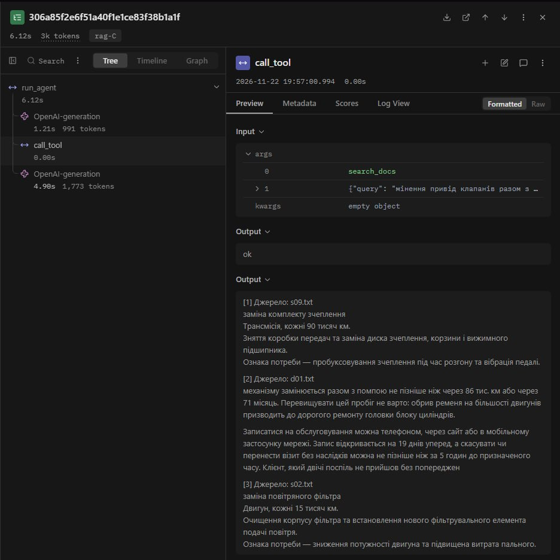

# Лабораторна робота № 5. RAG-агент: пошук по документах як інструмент

**Дисципліна:** Обчислювальні методи  
**Виконав:** студент групи АІ-244 Каменщик Станіслав  
**Перевірив:** ас. Баранов О.М.  
**Варіант:** № 8  
**Рік:** 2026

---

## 1. Мета, варіант, моделі

- **Мета роботи:** замінити пошук підрядком з ЛР2 векторним пошуком, під'єднати його до агента інструментом `search_docs`, перевірити якість пошуку окремо від агента і виміряти, як розмір чанка та опис інструмента впливають на поведінку агента.
- **Варіант:** № 8, обслуговування авто. Інструменти агента: `search_docs` (новий, замість `search_service`), `price_info`, `calc_total`.
- **Модель чату:** `qwen25-4k` (`qwen2.5:3b`, `num_ctx = 4096`, створена в ЛР4), `temperature = 0`, без обмеження довжини відповіді (`max_tokens`): після зауваження викладача до ЛР4 його прибрано і з цієї роботи, а вимірювання агента повторено (`run_part5.py`). Найдовша відповідь моделі в остаточних прогонах - 344 токени, тож у ЛР5 обмеження 512 ні на що не впливало: результати з ним збережено в `logs/max_tokens/` і `results/rag_max_tokens.csv`, вони відрізняються лише одним прогоном (A-r1-P1, див. крок 8).
- **Розмір вікна:** 4096.
- **Модель ембедингів:** `bge-m3` (Ollama).
- **Індекс:** `faiss-cpu` не встановлюється на Python 3.15, тому, як дозволяє методичка, у `rag.py` додано індекс на numpy з тим самим інтерфейсом (`NumpyIndexIP`: `d`, `add`, `search`; нормалізація, повний перебір скалярних добутків, `-1` для відсутніх). Якщо `faiss` встановлено, використовується він. Індекс зберігається в `index/docs.npy` замість `docs.faiss`. На тестових векторах numpy-індекс повертає ті самі номери й оцінки, що й `faiss.IndexFlatIP`.

---

## 2. Дані

### Документи

П'ять документів вигаданої мережі станцій «АвтоПульс Сервіс» (`data/docs/`), теми з табл. 8 для варіанта 8:

| Файл | Назва | Символів | Абзаців |
|---|---|---:|---:|
| `d01.txt` | Регламент технічного обслуговування | 3195 | 9 |
| `d02.txt` | Шини й колеса | 3163 | 9 |
| `d03.txt` | Експлуатаційні рідини | 3205 | 9 |
| `d04.txt` | Діагностика несправностей | 3095 | 9 |
| `d05.txt` | Гарантійні умови сервісу | 3011 | 9 |

Разом зі старим корпусом (`data/corpus`, 12 анотацій): 17 документів, **18422** символи ≈ **7369** токенів, більше за вікно 4096 (`python check_cases.py`: «Усе гаразд»).

### Питання (`rag_cases.json`)

| id | Вид | Питання | `must_contain` | `expected` |
|---|---|---|---|---|
| D1 | direct | Кожні скільки кілометрів пробігу виконується ТО-1? | кожні 11300 км пробігу | 11300 |
| D2 | direct | Скільки коштує зберігання комплекту з чотирьох шин без дисків за сезон? | без дисків коштує 1180 грн | 1180 |
| D3 | direct | Скільки коштує базове зчитування кодів помилок? | кодів помилок коштує 480 грн | 480 |
| D4 | direct | Скільки місяців діє гарантія на роботи з кузовом і фарбуванням? | фарбуванням гарантія діє 27 місяців | 27 |
| P1 | paraphrase | Після скількох тисяч кілометрів пора міняти привід клапанів разом з водяним насосом? | не пізніше ніж через 86 тис. км | 86 |
| P2 | paraphrase | Яку максимальну суму мені повернуть за незалежну оцінку, якщо винним визнають сервіс? | не більше 4200 грн | 4200 |
| P3 | paraphrase | До скількох градусів морозу має не замерзати рідина, що відводить тепло від мотора? | не вищою за мінус 37 градусів | 37 |
| P4 | paraphrase | Наскільки дешевшим у процентах буде наступний візит для того, хто вже скаржився на неякісний ремонт? | знижку 7 відсотків | 7 |
| N1 | none | Скільки коштує евакуація автомобіля до станції? | null | null |
| N2 | none | Скільки коштує полірування фар? | null | null |

У перефразованих питаннях немає ключових слів речення з відповіддю: «привід клапанів» і «водяний насос» замість «ремінь газорозподільного механізму» і «помпа», «рідина, що відводить тепло від мотора» замість «охолоджувальна рідина», «незалежна оцінка» замість «експертиза».

### Чи вгадує модель без документів (`guess_check.py`, `logs/part1_output.txt`)

| id | Правильно | Відповідь моделі без документів |
|---|---|---|
| D1 | 11300 | «у моїх даних немає конкретної інформації про кілометри пробігу… ТО-1 - це абревіатура, яка може відноситися до… авіаційного самолітів» |
| D3 | 480 | «Я не можу точно вказати ціну… Ціни можуть варіюватися» |
| P2 | 4200 | загальні міркування про «кількість часу» і «кваліфікацію», без числа |

Жодного значення модель не вгадала.

---

## 3. Модель ембедингів (`embed_check.py`)

| Показник | Значення |
|---|---|
| Довжина вектора | 1024 |
| Норма першого вектора | 1.000 (bge-m3 повертає вже нормалізовані вектори) |
| Запит - «Тариф на доставку» | **0.732** |
| Запит - «Графік роботи кур'єрів» | 0.568 |

Запит про вартість ближчий до фрази про тариф, як і має бути.

---

## 4. Нарізання одного документа (крок 3)

Таблиця 1 - Нарізання `data/docs/d01.txt`

| Спосіб | Чанків | Закінчуються посеред речення | Довжина найбільшого, символів |
|---|---:|---:|---:|
| `fixed`, 200, перекриття 0 | 16 | 15 | 200 |
| `fixed`, 500, перекриття 100 | 8 | 7 | 500 |
| `paragraphs`, 800 | 5 | 0 | 799 |

**Розрізаний факт** (`fixed 200`): чанк 2 закінчується словами «Базове технічне обслуговування, яке в мережі називають ТО-1», а чанк 3 починається з «, виконується кожні 11300 км пробігу або раз на 15 місяців…». Число 11300 опинилося в чанку, де немає слова «ТО-1» - лише «виконується». За запитом про ТО-1 пошук може повернути чанк 2 (є «ТО-1», немає числа), і модель не отримає відповіді. Так і сталося: у `fixed-200-0` перший результат для D1 - інший чанк d01 без потрібної фрази (`scores_all.py`).

---

## 5. Пошук без агента (крок 5)

Таблиця 2 - Пошук при різному нарізанні (`python check_retrieval.py`, `logs/part1_output.txt`)

| Конфігурація | Чанків | Сер. довжина | hit@1 | hit@3 | hit@5 | hit@3 прямі | hit@3 перефр. | Токенів (k=3) |
|---|---:|---:|---:|---:|---:|---:|---:|---:|
| `fixed-200-0` | 105 | 175 | 0.75 | 0.88 | 0.88 | 0.75 | 1.00 | 211 |
| `fixed-500-0` | 47 | 392 | 0.75 | 0.88 | 1.00 | 1.00 | 0.75 | 470 |
| **`fixed-500-100`** | 53 | 414 | 0.75 | **1.00** | 1.00 | 1.00 | 1.00 | 496 |
| `fixed-1500-0` | 27 | 682 | 0.62 | 0.88 | 0.88 | 1.00 | 0.75 | 819 |
| `paragraphs-800` | 37 | 497 | 0.88 | 0.88 | 0.88 | 1.00 | 0.75 | 596 |
| `paragraphs-800+title` | 37 | 510 | 0.88 | 0.88 | 1.00 | 1.00 | 0.75 | 612 |

**Вибір:** `fixed-500-100` - єдина конфігурація з `hit@3 = 1.00`, тому `CHUNK_METHOD = "fixed"`, `CHUNK_SIZE = 500`, `CHUNK_OVERLAP = 100`, `WITH_TITLE = False`. У ній `hit@3` повний, але `hit@1` - 0.75: для D2 і P1 потрібний чанк лише другий-третій. Приклад того, чому без перекриття гірше: у `fixed-500-0` для D1 перший результат - чанк 1 d01 без фрази «кожні 11300 км пробігу», бо межа чанка припала посеред абзацу про ТО-1; з перекриттям 100 символів ця фраза цілком потрапляє в чанк 1 (`scores_all.py`: `fixed-500-100`, D1 - «так»).

Для перевірки порогу для всіх шести нарізань одним запуском написано `scores_all.py` (та сама логіка, що `check_retrieval.py scores`).

Таблиця 3 - Схожість першого результату (`python check_retrieval.py scores` для `fixed-500-100`, `logs/part2_output.txt`)

| id | Вид | Схожість | Перший результат містить потрібну фразу |
|---|---|---:|---|
| D1 | direct | 0.741 | так |
| D2 | direct | 0.699 | НІ |
| D3 | direct | 0.667 | так |
| D4 | direct | 0.723 | так |
| P1 | paraphrase | 0.658 | НІ |
| P2 | paraphrase | 0.576 | так |
| P3 | paraphrase | 0.601 | так |
| P4 | paraphrase | 0.638 | так |
| N1 | none | 0.483 | - |
| N2 | none | 0.520 | - |

Найнижча схожість з відповіддю - 0.576, найвища без відповіді - 0.520: межі не перекриваються. **`MIN_SCORE = 0.55`** - приблизно посередині. Остаточний індекс: `python build_index.py` - 53 чанки (`index/chunks.json`, `index/docs.npy`, `index/meta.json`).

---

## 6. Інструмент без моделі (крок 6)

`python try_tool.py D1` (`logs/part2_output.txt`):

```
рівень: ok
[1] Джерело: d01.txt
, виконується кожні 11300 км пробігу або раз на 15 місяців, залежно від того, що настане раніше. ...
[2] Джерело: d01.txt
Регламент технічного обслуговування ... Базове технічне обслуговування, яке в мережі називають ТО-1, виконується кожні 11300 км пробігу ...
[3] Джерело: d01.txt
...Такі автомобілі проходять ТО-1 кожні 8200 км ...

Занадто короткий запит -> рівень: schema
Поле query: String should have at least 3 characters
```

`python try_tool.py N1`:

```
рівень: ok
У документах нічого схожого не знайдено.

Занадто короткий запит -> рівень: schema
```

Поріг спрацював: на питання про евакуацію інструмент відповідає «нічого не знайдено». `checks.py` для `search_docs` правил не має, `check_meaning` повертає `None`.

---

## 7. Агент з трьома описами (крок 7)

### Налагодження: чому агент «не шукав»

Перше вимірювання (`results/rag_before_fix.csv`, `logs/before_fix/`) дало з описами A і B **0 викликів пошуку з 24** і 31 порожню відповідь з 90 («ВІДПОВІДЬ: » при `completion_tokens` 25-40). Діагностика:

- `diag.py` (`logs/diag.txt`): через API агента Ollama повертає `content: ""` без `tool_calls`, а сирий текст моделі на той самий запит - правильний виклик `<tool_call>{"name": "search_docs", "arguments": {"query": "ТО-1 пробіг"}}</tool_call>`.
- `diag2.py` (`logs/diag2.txt`, Ollama 0.40.17): якщо до списку інструментів додати «пастку» `search_service`, модель у **18 з 18** запитів кличе саме `search_service`. Без пастки Ollama мовчки відкидає виклик інструмента, якого немає в `tools`, і агент приймає порожній рядок за відповідь.
- Причина знайшлася в нашому коді: назва старого інструмента лишилася в описі `price_info` у `schemas.py` («…або повернув інструмент search_service») і в тексті помилки `checks.py` («знайти доступні роботи можна інструментом search_service»). Модель читала про `search_service` і кликала його.

Виправлення (обидва діють однаково для всіх описів):

1. `dispatcher.check_response`: порожня відповідь без виклику - помилка рівня `syntax` з підказкою «схоже, ти викликав інструмент, якого не існує. Доступні інструменти: search_docs, price_info, calc_total…» (результати - `results/rag_fix1.csv`, `logs/fix1/`);
2. у `schemas.py` і `checks.py` `search_service` замінено на `search_docs`. Після цього в остаточних логах **0** порожніх відповідей.

| Етап | A: правильно / шукав | B: правильно / шукав | C: правильно / шукав |
|---|---|---|---|
| До виправлень | 0/24 / 0/24 | 0/24 / 0/24 | 6/24 / 6/24 |
| + перевірка порожньої відповіді | 3/24 / 6/24 | 3/24 / 12/24 | 6/24 / 6/24 |
| + назва `search_docs` в описах | 6/24 / 9/24 | 9/24 / 12/24 | 9/24 / 9/24 |
| без `max_tokens` (остаточно) | **6/24 / 9/24** | **9/24 / 12/24** | **9/24 / 9/24** |

Перші три етапи вимірювались з `MAX_TOKENS = 512`, останній - без нього.

Нижче - остаточне вимірювання (`results/rag.csv`, `logs/rag_*-r*.log`).

Таблиця 5 - Агент з трьома описами інструмента (питань з відповіддю 8, три повтори - 24 прогони)

| Опис | Правильно (з 24) | Викликав пошук (з 24) | Кроків, медіана | Токенів входу, медіана | Час, с, медіана |
|---|---:|---:|---:|---:|---:|
| `A` | 6 | 9 | 1.5 | 1570 | 2.6 |
| `B` | 9 | 12 | 2.0 | 3085 | 2.2 |
| `C` | 9 | 9 | 2.0 | 1931 | 2.2 |

Таблиця 6 - Куди ламається відповідь (кількість прогонів; з відповіддю 24 на опис, без відповіді 6)

| Категорія | `A` | `B` | `C` |
|---|---:|---:|---:|
| Правильно | 6 | 9 | 9 |
| Не шукав і відповів неправильно | 15 | 12 | 15 |
| Шукав, але потрібного фрагмента в результаті немає | 1 | 3 | 0 |
| Фрагмент був у результаті, відповідь неправильна | 2 | 0 | 0 |
| Питання без відповіді: визнав, що не знає | 3 | 3 | 3 |
| Питання без відповіді: вигадав відповідь | 3 | 3 | 3 |

**Ручна перевірка.** Усі відповіді з `correct = 0` і всі відповіді на `none` переглянуто в `results/rag.csv`. Автоматична оцінка не впізнала відмову у відповідях на N2 у всіх трьох описах («Полірування фар не є доступною послугою в нашому прайсі»): там немає слів зі списку `UNKNOWN`. Ці 9 рядків виправлено на `correct = 1`, `refused`. На N1 відповіді залишено як «вигадав»: A просить «дати точну назву регламентної роботи» (тобто вважає, що така послуга є), B пробує `calc_total` спершу з нулями, потім з вигаданою ціною 1000 грн, потім `price_info` і зупиняється на `retry_limit` (усі три виклики відхилили перевірки ЛР3), C відповідає «Помилка в системі». Числових значень для N1 агент жодного разу не назвав. При `temperature = 0` категорії в трьох повторах збіглися повністю.

За питаннями: D1 і D4 правильні в усіх описах; P1 правильне лише в C, P3 - лише в B; D2, D3, P2, P4 не шукав жоден опис (модель відразу кличе `price_info`/`calc_total` або відповідає текстом).

---

## 8. Розбір у логах і трасах (крок 8)

**1. Агент не шукав.** `logs/rag_B-r1.log`, P4:

```
ЗАДАЧА: Наскільки дешевшим у процентах буде наступний візит для того, хто вже скаржився на неякісний ремонт?
--- крок 1 | prompt_tokens=1474 | completion_tokens=37
  виклик   : calc_total({"part_price":0,"quantity":1,"work_price":5000})
  рівень   : meaning
  результат: Помилка: вартості роботи 5000 грн немає в прайсі, схоже, її вигадано. ...
ВІДПОВІДЬ: Помилка: вартості роботи 5000 грн немає в прайсі, схоже, її вигадано. ...
```

Модель вигадала ціну 5000 грн і замість пошуку пішла рахувати; вигадане значення зупинила перевірка `meaning` з ЛР3, тож користувачеві воно не дійшло як відповідь. Інший тип - `rag_A-r1.log`, P3: «Це питання не пов'язане з автосервісом…» без жодного виклику: модель не впізнала в «рідині, що відводить тепло від мотора» тему сервісу.

**2. Який запит написала модель.** Модель ніколи не копіює питання, а скорочує його до ключових слів:

| Опис, id | Питання | Запит `search_docs` | Схожість 1-го результату (запит) | Схожість 1-го (повне питання) |
|---|---|---|---:|---:|
| A/B D1 | Кожні скільки кілометрів пробігу виконується ТО-1? | ТО-1 пробіг | 0.557 | 0.741 |
| C D1 | те саме | ТО-1 кілометр пробігу | 0.648 | 0.741 |
| B D4 | Скільки місяців діє гарантія на роботи з кузовом і фарбуванням? | гарантійні умови сервісу кузов фарбування | 0.603 | 0.723 |
| B P1 | Після скількох тисяч кілометрів пора міняти привід клапанів… | привід клапанів разом з водяним насосом | 0.460 | 0.658 |
| C P1 | те саме | мінення привід клапанів разом з водяним насосом після 100000 км | 0.616 | 0.658 |
| B P3 | До скількох градусів морозу має не замерзати рідина… | рідина, що відводить тепло від мотора до скільки градусів морозу | 0.580 | 0.601 |

Короткий запит завжди дає нижчу схожість, ніж повне питання. Поріг 0.55 підбирався на повних питаннях, тож запит «ТО-1 пробіг» (0.557) пройшов ледь-ледь, а на проміжному етапі (`logs/fix1/`) запит «ТО-1» (0.547) - ні, і пошук сказав «нічого не знайдено», хоча потрібний чанк стояв першим. В описі B модель ще й переносить у запит слова з самого опису («гарантійні умови сервісу» - назва теми з опису B).

**3. Шукав, але не знайшов** (`miss`, `rag_B-r1.log`, P1): запит «привід клапанів разом з водяним насосом» - схожість усіх трьох результатів 0.459-0.460, нижче порогу, відповідь «нічого схожого не знайдено». Навіть без порогу потрібного чанка в top-3 немає: перефразоване питання, скорочене до двох понять, далеке від «ремінь газорозподільного механізму… разом з помпою». Опис C на тому ж питанні дав довший запит з «після 100000 км» - 0.616, потрібний чанк другий, відповідь правильна.

Ще один промах того ж питання - `rag_A-r1.log`, P1: модель написала в запиті «…після 10000 км» замість «100000», пошук повернув чанк про зчеплення («Трансмісія, кожні 90 тисяч км»), і модель відповіла «після 90 тисяч кілометрів… включає зняття коробки передач та заміну диска зчеплення». У прогоні з `MAX_TOKENS` той самий прогін мав запит «…100000 км» і потрапив у `ignored` (59 замість 86): при `temperature = 0` різниця лише в одній цифрі запиту змінила категорію.

**4. Знайшов, але не використав** (`ignored`, `rag_A-r2.log`, P1): у результаті пошуку другим стоїть потрібний фрагмент («механізму замінюється разом з помпою не пізніше ніж через 86 тис. км»), але першим - чанк d03 про рідину гідропідсилювача («замінюється через 59 тис. км або раніше, якщо вона потемніла чи має запах гару»). Відповідь: «Заміна привід-клапанів та водяного насоса виконується через 59 тисяч кілометрів або раніше, якщо вони потемніли чи мають запах гару» - модель взяла перший фрагмент цілком, разом з чужими «потемніли» і «запах гару».

**5. Питання без відповіді.** Жоден опис не викликав `search_docs` на N1 і N2, тому поріг в агенті не спрацював ні разу (його роботу видно лише в `try_tool.py N1`). N2 в усіх описах: `price_info("полірування фар")` → помилка `meaning` «немає в прайсі» → агент чесно відповідає, що послуги немає; захистила перевірка з ЛР3, а не поріг чи опис. N1: див. п. 7 - числа не вигадано, але й відмови немає.

**Langfuse** (мітки `rag-B` і `rag-C`, останній прогін):



*Рис. 1 - Траса `rag-B-r1-P3`: вузол `call_tool` для `search_docs`, вхід - запит, вихід - чанки.*



*Рис. 2 - Траса `rag-C-r1-P1`.*

У вході першого виклику моделі в розділі `Tools` опис `search_docs` для B - довгий текст про «ЄДИНЕ джерело даних», перелік тем п'яти документів і правило «не відповідай з пам'яті»; для C - лише «Шукає інформацію.». Через довжину опису вхід першого кроку з B на ≈530 токенів більший (≈1450 проти ≈920). У трасі одразу видно, який саме запит модель передала в `search_docs` і які чанки повернулися, а також точний текст описів, що бачила модель; у текстовому лозі запит і чанки є, але опис інструментів - ні, і саме так непомітною лишалася стара назва `search_service` в описі `price_info`.

---

## 9. П'ять звичайних задач (крок 9)

У `logs/lab4.log` з ЛР4 є лише одна задача (запуск `agent.py`, скопійовано в `logs/run_lab4.log`). Тому базу для порівняння прогнано скриптом `baseline_lab4.py`: той самий код агента, модель і вікно 4096, але старий набір інструментів ЛР4 (`search_service`) - `logs/run_lab4_tasks.log`. Нова версія - `logs/run_rag.log` (`DOCS_DESCRIPTION = "B"`).

Таблиця 7 - П'ять задач до і після заміни пошуку

| Задача | Відповідь у ЛР4 | Відповідь тепер | Чи викликав `search_docs` | Що змінилося |
|---|---|---|---|---|
| Z1 «Що треба робити з гальмами?» | `search_service("гальма")` → три гальмівні роботи з корпусу (колодки передні/задні, рідина) | `search_docs("гарантійні умови сервісу гальма")` → про заміну гальмівної рідини і гарантію 7 місяців / 16000 км | так | **гірше**: модель додала до запиту слова з опису B («гарантійні умови сервісу»), пошук повернув чанки про гарантію |
| Z2 «Скільки коштує заміна масла?» | 400 грн робота, 250 грн деталь | те саме | ні (`price_info`) | без змін |
| Z3 «…чотири літри…» | `calc_total(1000, 2500, 4)` → `meaning`, суми немає | `calc_total(0, 2500, 4)` → `schema`, «Помилка в системі» | ні | без змін по суті: модель і раніше, і тепер не бере ціни з `price_info` |
| P1 «заміна батареї на електромобілі» | немає в прайсі | немає в прайсі | ні | без змін |
| P2 «Запиши мене на завтра» | `calc_total` з нулями → просить ціни | `calc_total` з нулями → обіцяє «записати» | ні | без змін по суті (обидва рази не відмовляє) |

На першому етапі (до виправлень, `logs/before_fix/run_rag.log`) Z1 повертала порожню відповідь через виклик неіснуючого `search_service`.

---

## 10. Відповіді на питання

1. За символами d01 ріжеться на 16 (200) або 8 (500/100) чанків, і майже всі обриваються посеред речення (15 і 7); за абзацами - 5 чанків, жоден не обривається (табл. 1). У `fixed 200` факт про ТО-1 розрізано: «…яке в мережі називають ТО-1» | «, виконується кожні 11300 км». Агент може отримати чанк з назвою без числа і відповісти «не знайдено» або вигадати.
2. Найкраща за `hit@3` - `fixed-500-100` (1.00): перекриття зберігає речення на межі чанків. 200 → 1500 символів: `hit@1` 0.75 → 0.62, `hit@3` 0.88 → 0.88, а розмір результату 211 → 819 токенів; великий чанк «розмиває» вектор кількома темами. Перекриття: `fixed-500-0` → `fixed-500-100` - `hit@3` 0.88 → 1.00. Назва документа: `hit@3` не змінився (0.88), `hit@5` 0.88 → 1.00, схожість P2 0.551 → 0.581. Ціна більшого чанка - більше токенів в історії агента.
3. У вибраній конфігурації прямі й перефразовані однакові (1.00 / 1.00), в інших перефразовані гірші (0.75 проти 1.00). Пошук підрядком на перефразованих питаннях безнадійний: слів «привід клапанів» чи «незалежна оцінка» в документах немає взагалі, а векторний пошук знаходить потрібний фрагмент за змістом.
4. Так, поріг 0.55 розділяє питання з відповіддю (≥ 0.576) і без (≤ 0.520) (табл. 3). Надто високий поріг відсікає правильні фрагменти - у п. 8.2 запит моделі «ТО-1» на проміжному етапі мав 0.547 і отримав «нічого не знайдено», хоча потрібний чанк був першим. Надто низький пропускає випадкові фрагменти на питання без відповіді, і модель може «знайти» в них відповідь.
5. Найбільше правильних - B і C (по 9 з 24), A - 6. Не звертався до пошуку: A - у 15 з 24, B - у 12, C - у 15 (табл. 5, 6). B змусив модель шукати найчастіше: «ЄДИНЕ джерело», «Викликай ЗАВЖДИ», «з пам'яті відповідати не можна» і перелік тем. Але правильних відповідей це не додало порівняно з C: модель під впливом опису B пише короткі запити зі словами з самого опису, і схожість падає (п. 8.2). Висновок обережний: 10 питань, одна модель 3B, три повтори з однаковим результатом.
6. У найкращих описах найчастіша поломка - «не шукав» (12 у B, 15 у C). Її лікує не пошук, а опис і модель: модель вибирає `price_info`/`calc_total` для питань «скільки коштує» навіть з описом B. Розрізнення важливе, бо інакше ми б «лікували» нарізання чи поріг, які для цих питань ідеальні (`hit@3 = 1.00`).
7. Вигадав відповідь на N1 у 3 прогонах кожного опису (числа не назвав, але й не відмовив); на N2 - визнав у всіх 9. Захисти: поріг у `search_docs` і текст опису B («якщо потрібного там немає, так і скажи»). У прогонах не спрацював жоден з них - агент не кликав пошук на N1/N2; спрацювала перевірка `meaning` з ЛР3 (`price_info` → «немає в прайсі»).
8. Один виклик `search_docs` з фрагментами додає 299-829 токенів, медіана 559 (різниця `prompt_tokens` між кроками, 27 викликів); 299 - коли поріг пропустив один чанк, ≈ 820 - коли три. Оцінка з табл. 2 - 496: реальність більша через заголовки «[n] Джерело: …» і те, що український текст займає більше токенів, ніж 2.5 символа на токен. Вхід першого кроку з описом B - ≈1450; вільне місце 4096 − 1450 − 512 (відповідь) ≈ 2130 токенів, тобто ≈ 2-3 виклики пошуку з трьома чанками.
9. Новий пошук погіршив Z1: замість трьох гальмівних робіт агент відповів про гарантію, бо в запит потрапили слова з опису B. Решта чотири задачі не змінилися - вони не використовують пошук (табл. 7). До виправлення назви `search_service` Z1 повертала порожню відповідь.
10. Жодна зміна опису `search_docs` не вилікує поломку, через яку модель ігнорує пошук і кличе `price_info`/`calc_total` з вигаданими цінами (D2, D3, P2, P4 - у всіх описах), і ту, коли модель бере не той фрагмент (A P1, 59 замість 86). Тут потрібні інші зміни системи: сильніша модель; передавати в `search_docs` питання користувача без скорочення (або підбирати поріг на запитах, які пише модель); прибрати з системного повідомлення й описів інших інструментів усе, що тягне до прайсу, коли питання про правила; і перевіряти описи всіх інструментів на застарілі назви, бо одна така назва вимкнула пошук повністю.

---

## 11. Додаткове завдання: Chroma

Chroma не встановлюється на Python 3.15, тому для цього кроку використано окреме середовище з Python 3.12 (`python -m uv venv venv --python 3.12`, `chromadb` у ньому). `chroma_test.py` на чанках і векторах остаточної конфігурації, питання D1 (`logs/chroma_test.txt`):

```
FAISS, схожість           : 0.741
Chroma cosine, відстань   : 0.259
Chroma за замовчуванням   : 0.518

FAISS                    : d01.txt, чанк 1
Chroma cosine            : d01.txt, чанк 1
Chroma за замовчуванням  : d01.txt, чанк 1
```

1. **Як пов'язані числа в трьох рядках?** Косинусна відстань = 1 − схожість: 1 − 0.741 = 0.259. За замовчуванням Chroma рахує квадрат евклідової відстані, для нормалізованих векторів він дорівнює 2 − 2·схожість: 2 − 2·0.741 = 0.518. Обидва числа збігаються з точністю до третього знака.
2. **Чи збігаються чанки, які повернули три індекси?** Так, усі три індекси повернули той самий чанк (d01.txt, чанк 1): для нормалізованих векторів усі три міри впорядковують чанки однаково.
3. **Що сталося б з порогом `MIN_SCORE`, якби перенести його на Chroma зі стандартними налаштуваннями?** У Chroma менше = ближче. Якби перенести `MIN_SCORE = 0.55` як «результат ≥ 0.55» на стандартну Chroma, фільтр залишав би лише далекі чанки (відстань ≥ 0.55 означає схожість ≤ 0.725) і викидав би найкращі: перший результат D1 (0.518) було б відкинуто, а питання без відповіді (схожість ≈ 0.5, відстань ≈ 1.0) проходили б. Помилки при цьому не буде - лише тихо зламаний пошук.

---

## 12. Висновок

Найбільше на якість відповідей вплинуло не нарізання й не поріг, а **те, що бачить модель в описах інструментів**. Пошук сам по собі працює добре: `hit@3 = 1.00` для `fixed-500-100`, поріг 0.55 розділяє питання з відповіддю й без. Але одна застаріла назва `search_service` в описі `price_info` повністю вимкнула пошук в описах A і B (0 викликів з 48), а після її виправлення правильних відповідей стало 6 / 9 / 9 з 24 замість 0 / 0 / 6. Опис B змушує шукати частіше, але модель пише короткі запити зі словами з опису, і їх схожість нижча за поріг, підібраний на повних питаннях.

Більшість помилок лежить в агенті, а не в пошуку: 42 з 72 прогонів з відповіддю - «не шукав», 4 - «не знайшов», 2 - «знайшов, але взяв не той фрагмент». Варто змінити: передавати в пошук питання користувача без скорочення або калібрувати поріг на запитах моделі; не згадувати в описах інструментів неіснуючі інструменти й перевіряти це автоматично; обробляти порожні відповіді моделі як помилку (додано в `dispatcher.py`); взяти сильнішу модель, бо 3B-модель часто обирає прайс замість документів.

---

## Додаткові файли

| Файл | Призначення |
|---|---|
| `guess_check.py` | три питання моделі без документів (крок 2) |
| `scores_all.py` | схожість першого результату для всіх шести нарізань |
| `diag.py`, `diag2.py` | діагностика порожніх відповідей (`logs/diag*.txt`) |
| `baseline_lab4.py` | п'ять задач агентом ЛР4 для табл. 7 |
| `run_part1.py` … `run_part5.py` | послідовні етапи запуску, виведення - `logs/part*_output.txt` |
| `logs/max_tokens/`, `results/rag_max_tokens.csv` | етап 3 з `MAX_TOKENS = 512` (до зауваження викладача) |
| `logs/before_fix/`, `results/rag_before_fix.csv` | перше вимірювання (до виправлень) |
| `logs/fix1/`, `results/rag_fix1.csv` | після перевірки порожньої відповіді |
