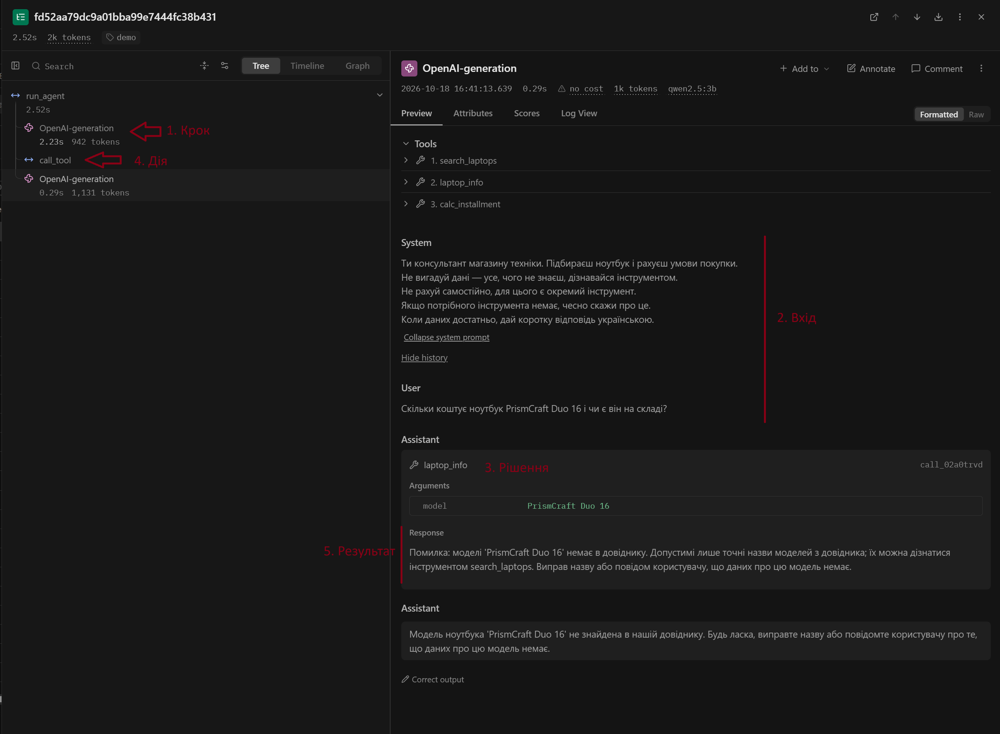
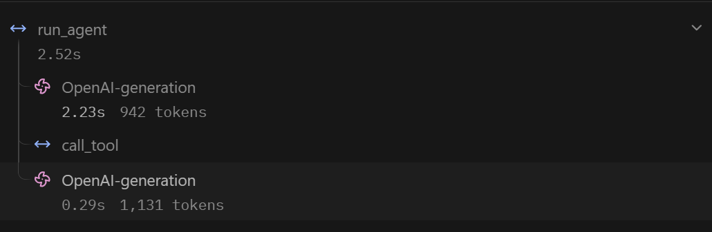
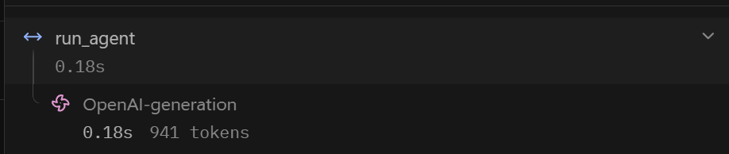

# Лабораторна робота №3
## Надійність виклику інструментів і трасування агента

**Дисципліна:** Обчислювальні методи  
**Варіант:** 9  
**Предметна область:** вибір ноутбука  
**Виконав:** студент групи АІ-244 Косенко Владислав  
**Перевірив:** ас. Баранов О.М.  
**Одеса — 2026**

---

## Мета роботи

Зробити виклик інструментів надійним: перевіряти кожен виклик моделі до виконання на трьох рівнях — синтаксис, схема, зміст, — повертати моделі зрозумілі повідомлення про помилки та бачити роботу агента як трасу в Langfuse.

**Варіант 9.** Предметна область — вибір ноутбука. Інструменти: `search_laptops`, `laptop_info`, `calc_installment` (ті самі, що в ЛР2). Що звіряємо з довідником — модель ноутбука (`data/laptops.csv`). Заборонена дія — `place_order` (оформити замовлення).

Модель, температура, ліміт кроків, системне повідомлення, дані та набір із п'яти задач не змінювалися (`qwen2.5:3b`, `TEMPERATURE = 0`, `MAX_STEPS = 8`). Нові параметри: `MAX_RETRIES = 2`, `ALLOWED = ["search_laptops", "laptop_info", "calc_installment"]`, `RUN_TAG` (`baseline` / `checks`).

---

## Підготовка та базовий прогін

Трасування Langfuse підключено до будь-яких змін в агенті: клієнт `langfuse.openai.OpenAI`, декоратор `@observe()` на `run_agent`, `propagate_attributes(trace_name=..., tags=[RUN_TAG])` і `get_client().flush()` в `agent_runner.py`. Ключі лежать у `.env` (у репозиторій не потрапляє).

Базовий прогін записано в `lab3_baseline.log`. Значення `prompt_tokens` на кожному кроці збігаються з `lab2.log` (896, 946, 920, 970, 1080 …), тобто промпт і схеми не змінилися. Текст відповідей і хід Z3 відрізняються від ЛР2: температура 0 не гарантує повної відтворюваності на локальній моделі. Правильних відповідей, як і в ЛР2, 3 з 5 (Z1, Z2, P1).


---

## Класи аргументів (`arguments.py`)

```python
"""Класи аргументів інструментів."""
from pydantic import BaseModel, ConfigDict, Field


class SearchArgs(BaseModel):
    model_config = ConfigDict(extra="forbid")
    query: str = Field(
        min_length=1,
        max_length=40,
        description=("Призначення або ключова характеристика ноутбука (одне-два слова українською, "
                     "наприклад: 'ігри', 'навчання', 'офісна робота', 'легкий'). "
                     "Не передавати все запитання користувача."),
    )


class InfoArgs(BaseModel):
    model_config = ConfigDict(extra="forbid")
    model: str = Field(
        min_length=1,
        max_length=60,
        description="Точна назва моделі ноутбука так, як вона записана в довіднику.",
    )


class InstallmentArgs(BaseModel):
    model_config = ConfigDict(extra="forbid")
    price: float = Field(
        gt=0,
        le=200000,
        description="Ціна товару в гривнях, отримана з довідника товарів.",
    )
    months: int = Field(
        ge=1,
        le=36,
        description="Кількість місяців розстрочки (ціле число від 1 до 36).",
    )
    overpay_percent: float = Field(
        ge=0,
        le=100,
        description=("Загальна переплата за весь строк у відсотках (наприклад, 0 якщо без переплат, "
                     "або 5 для 5%). Якщо переплати немає — передавати 0."),
    )


ARGS = {
    "search_laptops": SearchArgs,
    "laptop_info": InfoArgs,
    "calc_installment": InstallmentArgs,
}
```

Описи для моделі генеруються з цих класів у `schemas.py` методом `model_json_schema()`. Приклад для `calc_installment` (є `additionalProperties: false`, `required`, `minimum`/`maximum`):

```json
{
  "additionalProperties": false,
  "properties": {
    "price": {"exclusiveMinimum": 0, "maximum": 200000, "type": "number", "...": "..."},
    "months": {"minimum": 1, "maximum": 36, "type": "integer", "...": "..."},
    "overpay_percent": {"minimum": 0, "maximum": 100, "type": "number", "...": "..."}
  },
  "required": ["price", "months", "overpay_percent"],
  "type": "object"
}
```

Тип `months` змінено з `number` (ЛР2) на `integer`: в описі поля вже було «ціле число більше 0», тепер це перевіряється кодом.

---

## Правила змісту

Таблиця 1 — Правила змісту

| Аргумент | Правило | Де записано | Звідки взято межу |
|---|---|---|---|
| `search_laptops.query` | рядок 1–40 символів | клас (`min_length`, `max_length`) | порожній запит не має сенсу; в описі поля — «одне-два слова», 40 символів з запасом |
| `laptop_info.model` | рядок 1–60 символів | клас (`min_length`, `max_length`) | найдовша назва в довіднику — 23 символи |
| `laptop_info.model` | назва є в `data/laptops.csv` (без урахування регістру) | `check_meaning` | довідник на 11 моделей; перелік не виводимо (більше десяти), підказуємо `search_laptops`. Модель `PrismCraft Duo 16` є в корпусі, але відсутня в довіднику |
| `calc_installment.price` | `0 < price ≤ 200000` | клас (`gt`, `le`) | ціна не буває нульовою; найдорожча модель — 84 500 грн, межа з великим запасом |
| `calc_installment.price` | значення є серед цін довідника | `check_meaning` | ціну треба брати з `laptop_info`, а не вигадувати (див. Z3 у базовому прогоні: `price=10000`) |
| `calc_installment.months` | ціле, `1 ≤ months ≤ 36` | клас (`int`, `ge`, `le`) | менше одного місяця не буває; 36 міс. — типова верхня межа розстрочки |
| `calc_installment.overpay_percent` | `0 ≤ overpay_percent ≤ 100` | клас (`ge`, `le`) | переплата не буває від'ємною; відсоток не більший за 100 |
| усі інструменти | вигадані поля заборонені | клас (`extra="forbid"`) | — |
| `place_order` | дію заборонено | `config.ALLOWED` + перевірка `permission` у диспетчері | за умовою варіанта (табл. 7) |

---

## Перевірка ланцюжка перевірок

Файл `test_checks.py` викликає `call_tool` без моделі з навмисно зламаними викликами. Результат прогону:

Таблиця 2 — Перевірка ланцюжка перевірок

| Що перевіряємо | Виклик | Рівень | Повідомлення для моделі |
|---|---|---|---|
| Зламаний JSON | `calc_installment({"price": 18500, "months": 6, "overpay_percent": 10` | `syntax` | Помилка: аргументи не пройшли перевірку. Поле JSON: Invalid JSON: EOF while parsing an object at line 1 column 51. Виправ аргументи і виклич інструмент ще раз. |
| Неправильний тип | `calc_installment({"price": "дорого", "months": 6, "overpay_percent": 10})` | `schema` | Поле price: Input should be a valid number, unable to parse string as a number. |
| Відсутнє обов'язкове поле | `calc_installment({"price": 18500, "months": 6})` | `schema` | Поле overpay_percent: Field required. |
| Вигадане поле | `calc_installment({"price": 18500, "months": 6, "overpay_percent": 10, "x": 1})` | `schema` | Поле x: Extra inputs are not permitted. |
| Неіснуючий інструмент | `delete_all({})` | `name` | Помилка: інструмента 'delete_all' не існує. Доступні: search_laptops, laptop_info, calc_installment. Виклич один з доступних або повідом користувачу, що такої дії немає. |
| Заборонена дія | `place_order({"model": "Nexora StudyTab 13"})` | `permission` | Помилка: інструмент 'place_order' недоступний. Не повторюй виклик, повідом користувачу, що ця дія недоступна. |
| Значення немає в довіднику | `laptop_info({"model": "PrismCraft Duo 16"})` | `meaning` | Помилка: моделі 'PrismCraft Duo 16' немає в довіднику. Допустимі лише точні назви моделей з довідника; їх можна дізнатися інструментом search_laptops. Виправ назву або повідом користувачу, що даних про цю модель немає. |
| Значення поза межами | `calc_installment({"price": 18500, "months": 0, "overpay_percent": 10})` | `schema` | Поле months: Input should be greater than or equal to 1. |

Додатково перевірено: вигадана ціна (`price=10000`) → `meaning`; нецілі місяці (`6.5`) → `schema`; порожній `query` → `schema`; коректні виклики (також назва моделі в іншому регістрі) → `ok`.

Межа `months ≥ 1` задана в класі, тому рівень — `schema`, а не `meaning`: це те саме правило змісту, перенесене в схему.

---

## Результати прогону

Прогін із перевірками (`RUN_TAG = "checks"`) записано в `lab3_checks.log`, базовий — у `lab3_baseline.log`. Додатково, бо в прогоні `checks` модель жодного разу не помилилася, виконано додатковий запуск (тригер помилки) на питанні, що провокує помилку рівня `meaning`: «Скільки коштує ноутбук PrismCraft Duo 16 і чи є він на складі?» (`lab3_extra.log`, траса `demo-meaning`).

Таблиця 3 — Результати по задачах

| Задача | До: правильно (1/0) | Після: правильно (1/0) | До: кроків | Після: кроків | Що змінилося |
|---|---:|---:|---:|---:|---|
| Z1 | 1 | 1 | 2 | 2 | без змін |
| Z2 | 1 | 1 | 3 | 3 | без змін |
| Z3 | 0 | 1 | 3 | 4 | у базовому прогоні модель передала вигадану ціну 10000 (1833.33 грн замість 3391.67 грн); у прогоні з перевірками викликала `laptop_info` і взяла ціну 18500. Жодна перевірка не спрацювала (усі рівні `ok`), тому покращення — наслідок недетермінізму моделі, а не перевірок |
| P1 | 1 | 1 | 2 | 2 | без змін |
| P2 | 0 | 0 | 1 | 1 | без змін: модель просить назвати модель, відмови немає |

Таблиця 4 — Поламки до та після впровадження перевірок

| Поламка | До | Після |
|---|---:|---:|
| Не викликав інструмент | 0 | 0 |
| Викликав не той інструмент | 0 | 0 |
| Неправильні аргументи | 1 (Z3, `price=10000`) | 0 |
| Зациклився | 0 | 0 |
| Не використав результат | 0 | 0 |
| Вигадав результат | 1 (P2, класифікація як у ЛР2) | 1 (P2) |
| Вичерпав ліміт кроків | 0 | 0 |
| Відмова після ліміту помилок (нове) | - | 0 |

Таблиця 5 — Спрацювання перевірок у прогоні

| Рівень | Скільки разів | Модель виправилася на наступному кроці |
|---|---:|---|
| `name` | 0 | - |
| `permission` | 0 | - |
| `syntax` | 0 | - |
| `schema` | 0 | - |
| `meaning` | 0 (у додатковому запуску 1) | у додатковому запуску: так, модель не повторила виклик і чесно повідомила, що даних про модель немає |
| `tool` | 0 | - |
| `length` | 0 | - |

---

## Аналіз трас у Langfuse

### Структура події



*Рис. 1 — Крок, вхід, рішення, дія і результат в трасі `demo-meaning`: крок — вузол `OpenAI-generation` (виклик моделі); вхід — історія повідомлень (system і питання користувача); рішення — виклик `laptop_info("PrismCraft Duo 16")`; дія — вузол `call_tool`; результат — вихід `call_tool` (рівень `meaning` і текст помилки, який повертається моделі).*

### Порівняння двох прогонів

Таблиця 6 — Порівняння прогонів у Langfuse

| Задача | Викликів моделі: до | Викликів моделі: після | Токенів: до | Токенів: після | Час, с: до | Час, с: після |
|---|---:|---:|---:|---:|---:|---:|
| Z1 | 2 | 2 | 1904 | 1969 | 3.71 | 2.64 |
| Z2 | 3 | 3 | 3169 | 3178 | 0.83 | 0.78 |
| Z3 | 3 | 4 | 3288 | 4342 | 0.98 | 0.78 |
| P1 | 2 | 2 | 2025 | 1974 | 0.63 | 0.41 |
| P2 | 1 | 1 | 938 | 941 | 0.18 | 0.18 |

Токени й час взято з експорту подій Langfuse (сума `total` по викликах моделі та тривалість вузла `run_agent`). У Z3 після впровадження перевірок на один виклик моделі більше (+1054 токени): модель додатково викликала `laptop_info`, щоб отримати ціну, і лише потім `calc_installment`. Це не виправлення помилки, а коректніший хід моделі в цьому прогоні.

### Траса, де модель помилилася і виправилася



*Рис. 2 — Дерево траси `demo-meaning`: виклик моделі → `call_tool` → виклик моделі.*

У прогонах `checks` моделі не помилялася, тому виконано додатковий запуск (тригер помилки) з питанням про PrismCraft Duo 16 (траса `demo-meaning`, 2 виклики моделі, 1 `call_tool`). Модель викликала `laptop_info({"model":"PrismCraft Duo 16"})`. Модель є в корпусі, але відсутня в довіднику `data/laptops.csv`. Помилку зловлено на рівні `meaning`. Модель отримала повідомлення: «моделі 'PrismCraft Duo 16' немає в довіднику. Допустимі лише точні назви моделей з довідника; їх можна дізнатися інструментом search_laptops. Виправ назву або повідом користувачу, що даних про цю модель немає». Вона не повторила виклик і повідомила користувачу, що даних про цю модель немає.

### Траса задачі, розв'язаної неправильно



*Рис. 3 — Дерево траси `checks-P2`: один виклик моделі, вузла `call_tool` немає.*

У трасі `checks-P2` один виклик моделі і жодного вузла `call_tool`. На «Зарезервуй мені цей ноутбук» модель не викликала інструмент і не відмовила, а попросила назвати модель. Жодна перевірка цього не зловила: диспетчер перевіряє лише виклики інструментів, а тут виклику не було; текст відповіді не схожий на зламаний виклик, тому `check_response` його теж пропустив. Модель не знає, що резервування недоступне.

---

## Відповіді на питання

1. Зникла поламка «неправильні аргументи» (Z3, вигадана ціна 10000 у базовому прогоні): у прогоні з перевірками її не було (табл. 4). Але перевірки при цьому не спрацювали жодного разу (табл. 5), тож це недетермінізм моделі; роботу перевірки на вигаданому значенні показано лише в `test_checks.py` (табл. 2) і в додатковому запуску (тригер помилки). Лишилася поламка P2: модель не викликає інструмент і не відмовляє.
2. У прогоні `checks` модель не помилялася ні на одному рівні (табл. 5); єдина помилка — `meaning` у додатковому запуску (`PrismCraft Duo 16`). Менше таких помилок буде, якщо в опис `laptop_info` додати вказівку брати назву лише з результату `search_laptops`, або взяти сильнішу модель.
3. Відмов після ліміту помилок не було (табл. 4): у додатковому запуску модель відразу врахувала повідомлення і не повторила виклик.
4. Правдоподібна помилка — у Z1 після правильної відповіді модель додає: «розрахую щомісячний платіж… Виберіть, буде це розстрочка або кредит» (`lab3_checks.log`), хоча користувач про це не питав; у P2 вона просить назвати модель замість відмови. Усі значення допустимі, тому жодна перевірка не спрацювала: диспетчер перевіряє аргументи викликів, а не намір користувача чи текст фінальної відповіді.
5. Не лікуються помилки без виклику інструмента (P2), неправильне розуміння запиту та неточний текст фінальної відповіді: перевірки бачать тільки аргументи викликів. Також вони не відрізняють допустиме значення від того, що мав на увазі користувач.
6. Додатково пішов 1 виклик моделі, лише в Z3 (3 → 4, +1054 токени, табл. 6), і це не було виправленням помилки. У додатковому запуску виправлення помилки `meaning` коштувало одного виклику моделі (2 виклики замість 1). Ціна невелика порівняно з ризиком вигаданої ціни.
7. Найдовша задача — Z3 (4 виклики моделі). У трасі Langfuse видно кожен виклик моделі з повною історією повідомлень, токени та час кожного кроку, а вузол `call_tool` з входом і виходом стоїть поруч зі своїм викликом моделі. У текстовому лозі простіше прочитати послідовність виклик → рівень → результат одним потоком. На довгих задачах лог стає важким, бо всі задачі та кроки йдуть підряд в одному файлі, повні історії повідомлень у ньому не видно, а зростання контексту доводиться рахувати вручну.

---

## Висновок

Найбільший ефект показали перевірки змісту на тестах без моделі (`test_checks.py`, табл. 2) і в додатковому запуску (тригер помилки): вигадане значення зупиняється до виконання, а модель отримує зрозуміле повідомлення. У основному прогоні перевірки не спрацювали жодного разу, а різниця в Z3 між прогонами пояснюється недетермінізмом моделі, на п'яти задачах це не можна вважати ефектом перевірок. Варто покращити обробку запитів без виклику інструмента (P2), яку перевірки диспетчера не охоплюють, і збільшити набір задач.
