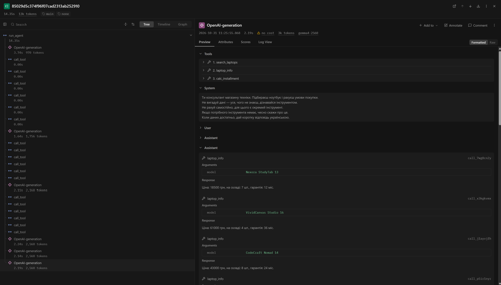
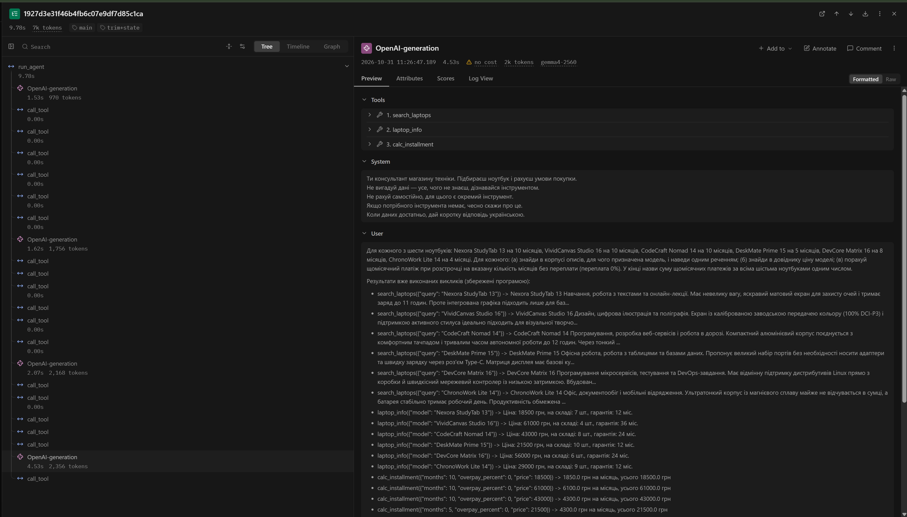

# Лабораторна робота №4
## Контекст, стан і кеш агента

**Дисципліна:** Обчислювальні методи  
**Варіант:** 9  
**Предметна область:** вибір ноутбука  
**Виконав:** студент групи АІ-244 Косенко Владислав  
**Перевірив:** ас. Баранов О.М.  
**Одеса — 2026**

---

## Мета роботи

Побачити, що відбувається з агентом, коли історія не вміщується в контекстне вікно моделі; навчитися скорочувати історію, зберігати результати інструментів поза текстом діалогу та кешувати виклики моделі; виміряти, скільки це коштує.

**Варіант 9.** Вибір ноутбука. Інструменти: `search_laptops` (корпус `data/corpus`), `laptop_info` (довідник `data/laptops.csv`), `calc_installment`. Агент і перевірки - з ЛР3.

**Модель.** Модель ЛР3 `qwen2.5:3b` довгу задачу не виконує: на вікні 4096 вона зробила 7 викликів замість 18 (двічі з вигаданою ціною 4500, рівень `meaning`) і відповіла з вигаданими даними (для VividCanvas Studio 16 «навчання» і ціна 18500 замість 61000), `logs/qwen25_4096/probe_none_r1.log`. Тому роботу виконано на `gemma4:12b-it-qat`. Прихований reasoning цієї моделі вимкнено (`REASONING_EFFORT = "none"` у `config.py`, передається в `model.py` і `summary.py`), щоб вікно займала лише історія.

| Параметр | Значення |
|---|---|
| `context length` вихідної моделі `gemma4:12b-it-qat` | 262144 |
| `num_ctx` нової моделі `gemma4-4k` | 4096 |
| У скільки разів звузили | 64 |

На 4096 і на 3072 (`gemma4-3k`) пробний прогін - випадок C: найбільший вхід 2373 токени (58% і 77% вікна), статус `final`, відповідь правильна (`logs/case_c_4096/`, `logs/case_c_3072/`). Тому вікно зменшено ще раз: **`gemma4-2560`, `num_ctx = 2560`** (у 102 рази). `COMPRESS_AT = 1800` (≈70% вікна, як 2150 для 3072).

## Довга задача (крок 2)

Щоб пункт (а) мав відповідь, `search_laptops` повертає повний опис моделі з корпусу, а не лише назву (`tools.py`; опис у `schemas.py` і поле `query` в `arguments.py` доповнено пошуком за назвою).

**Питання:** «Для кожного з шести ноутбуків: Nexora StudyTab 13 на 10 місяців, VividCanvas Studio 16 на 10 місяців, CodeCraft Nomad 14 на 10 місяців, DeskMate Prime 15 на 5 місяців, DevCore Matrix 16 на 8 місяців, ChronoWork Lite 14 на 4 місяці. Для кожного: (а) знайди в корпусі описів, для чого призначена модель, і наведи одним реченням; (б) знайди в довіднику ціну моделі; (в) порахуй щомісячний платіж при розстрочці на вказану кількість місяців без переплати (переплата 0%). У кінці назви суму щомісячних платежів за всіма шістьма ноутбуками одним числом.»

**Правильна відповідь:** `30800` (1850 + 6100 + 4300 + 4300 + 7000 + 7250), `min_calls = 18`.

## Запуск без захисту (кроки 3-4)

`python agent.py` працює без помилок (`logs/lab4.log`). `python measure.py none 1 probe`: **неправильно** (порожня відповідь), **17.7 с**.

Таблиця 2 - Зростання входу в прогоні без захисту (`logs/probe_none_r1.log`)

| Крок | `prompt_tokens` | Приріст | Що зробила модель |
|-----:|----------------:|--------:|:------------------|
| 1 | 842 | | `search_laptops` × 6 |
| 2 | 1634 | 792 | `laptop_info` × 6 |
| 3 | 1998 | 364 | `calc_installment` × 6 |
| 4 | 2373 | 375 | відхилено перевіркою (`length`) |
| 5 | 2373 | 0 | відхилено перевіркою (`length`) |
| 6 | 2373 | 0 | відхилено перевіркою (`length`), СТОП |

- **(а)** вхід першого кроку - 842 токени;
- **(б)** типовий приріст - 375 токенів;
- **(в)** сума `prompt_tokens` - 11593, за формулою 6·842 + 375·15 = 10677. Різниця ≈9%: приріст нерівний (+792 через довгі описи з корпусу), а на кроках 5-6 його немає;
- **(г)** вхід перестав рости на кроці 5 (2373 = 93% вікна);
- **(д)** на кроках 4-6 модель тричі отримує той самий запит і тричі обривається на тексті «Ось інформація щодо обраних ноутбуків:» (`completion_tokens = 187`, 2373 + 187 = 2560). Після третього обриву - `СТОП: модель не змогла сформувати правильний виклик`. Відповіді немає, тож і вигаданих чисел немає.

**Випадок B**: помилки сервера немає, вхід застиг біля межі вікна. Сервер не відкинув історію, а обрізав генерацію відповіді.

## Обрізання і стан (кроки 5-6)

Таблиця 3 - Стиснення історії (`logs/probe_trim_r1.log`, `logs/probe_trim+state_r1.log`)

| Конфігурація | Крок стиснення | Вхід до стиснення, токенів | Повідомлень було -> стало | Повторних викликів за прогін |
|---|---|---:|---|---:|
| `trim` | 3, 6, 9, 12, 15, 18, 21, 24 | 1998 | 23 -> 2 | 132 |
| `trim+state` | 3 | 1998 | 23 -> 2, стан додано | 0 |

`trim`: 46.8 с, неправильно, `step_limit`. Модель робить по 6 викликів за крок, тому останні 6 повідомлень - результати без свого виклику, і `drop_orphan_tools` прибирає їх усі. Агент щоразу починає задачу спочатку. `trim+state`: 12.4 с, правильно, відповідь на кроці 4.

**Пункт 7.** У першому блоці `ПЕРШЕ ПОВІДОМЛЕННЯ КОРИСТУВАЧА ПІСЛЯ СТИСНЕННЯ` - 18 рядків `- інструмент(аргументи) -> результат`, 2919 символів ≈ 1168 токенів, тобто ≈3 типові прирости (375). Блок великий: вхід після стиснення впав лише з 1998 до 1971. Для цієї задачі він вміщується, для задачі з більшою кількістю позицій - ні.

## Кеш (крок 7)

Таблиця 4 - Робота кешу

| Запуск | Кроків | Влучань у кеш | Викликів до сервера | Час, с | Правильно |
|---|---:|---:|---:|---:|---|
| 1 (кеш порожній) | 6 | 2 | 4 | 10.4 | ні |
| 2 (той самий запит) | 6 | 6 | 0 | 0.4 | ні |

Запуск 2 швидший приблизно в 26 разів. У запуску 1 вже є 2 влучання: після обриву `length` агент надсилає той самий запит, і кеш повертає ту саму обрізану відповідь. Якби перед запуском 2 змінити `SYSTEM`, змінилося б перше повідомлення, а отже, ключ кожного запиту: жодного влучання, усі виклики пішли б на сервер.

## Вимірювання і траси (крок 8)

`python measure.py all 3 main`. У `CONFIGS` уже була конфігурація `summary`, тому прогонів 12.

Таблиця 5 - Вартість циклу (медіани по трьох повторах)

| Конфігурація | Правильно (з 3) | Кроків | Токенів на вхід | Токенів на вихід | Час, с | Стиснень | Повторних викликів |
|---|---|---:|---:|---:|---:|---:|---:|
| `none` | 0 | 6 | 11593 | 981 | 12.1 | 0 | 0 |
| `trim` | 0 | 25 | 36634 | 3488 | 43.9 | 8 | 132 |
| `trim+state` | 3 | 4 | 6445 | 805 | 9.8 | 1 | 0 |
| `summary` (main) | 1 | 4 | 5879 | 781 | 16.7 | 1 | 0 |
| `summary` (extra) | 1 | 4 | 5880 | 777 | 19.3 | 1 | 0 |

«Правильно» перевірено вручну: у `summary` скрипт зарахував 2 з 3 (main) і 3 з 3 (extra), але в частині відповідей вигадано призначення моделей (див. нижче).

**Поламки, яких таблиця не показує** (12 прогонів `main`):

- відповів менше ніж за 19 кроків: **6 з 12** (усі `trim+state` і `summary`, по 4 кроки). Але в кожному з них 18 викликів рівня `ok`: модель робить 6 викликів за крок, тож це не відповідь «з пам'яті»;
- вигадане число: **1 з 12** - `main_summary_r2`, сума `32800` (усі шість платежів правильні, помилка в додаванні без інструмента);
- вигаданий текст: `main_summary_r1` і `main_summary_r2` - призначення не з корпусу (VividCanvas Studio 16: «професійна робота з графікою та відеомонтаж», у корпусі «Дизайн, цифрова ілюстрація та поліграфія»).

**Langfuse** (мітка `main`):

*Рис. 1 - Дерево траси `long-main_none_r1`.*

*Рис. 2 - Дерево траси `long-main_trim+state_r1`.*

Перший виклик після стиснення в `trim+state` - крок 4: вхід **1971** токен. Крок 4 у `none`: **2373** токени. У трасі одразу видно вхід кожного виклику і повну історію, яку отримала модель (після стиснення - лише інструкція і питання із записником). У текстовому лозі це доводиться рахувати вручну за заголовками кроків.

## Відповіді на питання

1. Агент без захисту дійшов до межі на кроці 4: 2373 токени входу + 187 токенів відповіді = 2560 (таблиця 2). Це видно з того, що з кроку 5 вхід не росте, а відповідь щоразу обривається на тому самому місці (`length`). Після цього агент лише повторював той самий запит і зупинився на ліміті помилок.
2. Сума 11593 проти 10677 за формулою (різниця ≈9%). Зростання відповідає очікуваному: вхід кроку виріс у 2,8 раза (842 → 2373), а сума за 6 кроків у 13,8 раза більша за перший крок. Різниця - через нерівний приріст і три кроки з однаковим входом.
3. Агент втрачає результати інструментів: при 6 паралельних викликах обрізання лишає лише інструкцію й питання (23 -> 2). Приклад: крок 4 `main_trim_r1` - знову `search_laptops({"query":"Nexora StudyTab 13"})`, хоча результат отримано на кроці 1; за прогін 132 повтори. У `trim+state` ті самі результати дописані до питання: 0 повторів, 4 кроки, 3 з 3 (таблиці 3 і 5).
4. За вхідними токенами найдешевша `summary` (5879), але з підсумовуванням (2560) вона дорожча за `trim+state` (6445 + 805 = 7250 проти 5879 + 781 + 2560 = 9220). Найшвидша і найточніша - `trim+state` (9.8 с, 3 з 3). Висновок обережний: одна задача, одна модель, одне вікно; при `TEMPERATURE = 0` повтори `none`, `trim` і `trim+state` збіглися повністю, тож вони не показують розкиду.
5. Інакше повтори брали б відповіді з кешу, і час та токени були б майже нульові - ми б вимірювали кеш, а не агента. Якщо інструмент поверне інші дані, зміниться історія і ключ - буде промах. Якщо замінити модель під тією самою назвою, ключ не зміниться, і кеш віддаватиме старі відповіді; каталог `cache` треба очищати вручну.
6. Вигадані дані й арифметику моделі (`32800`), нестачу місця для самої відповіді, записник або переказ, більший за вікно, слабку модель, яка відповідає без інструментів (`qwen2.5:3b`), неправильне розуміння задачі.

## Додаткове завдання: підсумовування

`summary.py`, гілка `COMPRESS = "summary"` у `compress.py`, `python measure.py summary 3 extra` (рядок `summary` (extra) у таблиці 5).

- Підсумовування коштувало **2560** токенів на прогін.
- Заощаджено на вході порівняно з `trim`: 36634 − 5880 = **30754** токени (бо `trim` зациклюється); порівняно з `trim+state` - лише 565, менше за ціну підсумовування.
- Точні числа: 2560 - це весь розмір вікна, тому в усіх 6 прогонах `summary` блок `ПІДСУМОК ІСТОРІЇ` обірваний. Числа, що потрапили в переказ, збігаються з рядками `результат:`, але частина втрачена. Наприклад, у `extra_summary_r3` переказ закінчується на VividCanvas Studio 16, і платежів за чотирма іншими моделями (4300, 4300, 7000, 7250) у ньому немає - модель дорахувала їх сама. У `main_summary_r1` переказ не містить призначень моделей, і модель їх вигадала; так само в `extra_summary_r1` і `extra_summary_r2` (VividCanvas Studio 16 - «професійна робота з графікою та відеомонтаж», DevCore Matrix 16 - «складні обчислення та ігрові процеси»), тому в серії `extra` правильна лише `extra_summary_r3`.

## Висновок

Найбільший ефект дав стан задачі: лише `trim+state` розв'язав задачу в усіх трьох повторах, найдешевше (≈7250 токенів) і найшвидше (9.8 с). Обрізання без стану при паралельних викликах викидає всі результати і зациклює агента (132 повтори, утричі дорожче за `none`). Кеш пришвидшив повторний запуск у 26 разів, але корисний лише для налагодження. Варто змінити: обрізати за токенами і не розривати групу «виклик + результати», зберігати в стані короткі факти, не кешувати відповіді з `finish_reason = length`, обмежувати обсяг тексту для переказу.
