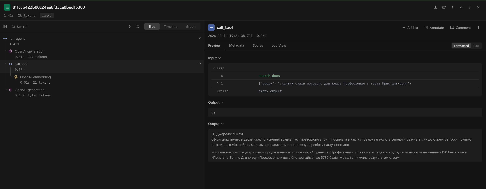
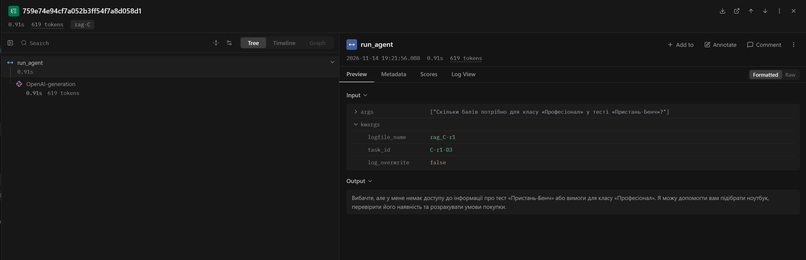
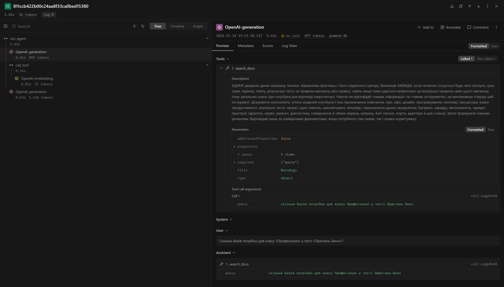
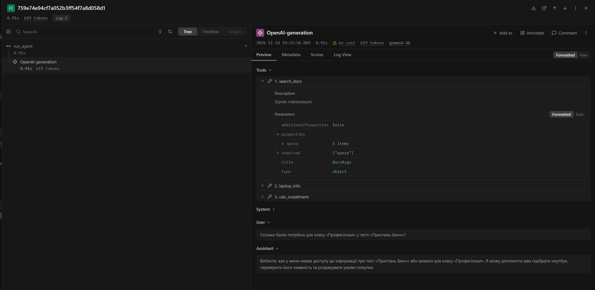

# Лабораторна робота №5
## RAG-агент: пошук по документах як інструмент

**Дисципліна:** Обчислювальні методи  
**Варіант:** 9  
**Предметна область:** вибір ноутбука  
**Виконав:** студент групи АІ-244 Косенко Владислав  
**Перевірив:** ас. Баранов О.М.  
**Одеса — 2026**

---

## 1. Мета роботи

Замінити пошук підрядком з ЛР2 векторним пошуком, підключити його до агента інструментом `search_docs`, перевірити якість пошуку окремо від агента і з'ясувати, як нарізання документів, поріг схожості й опис інструмента впливають на відповіді агента.

## 2. Варіант, моделі, середовище

| Параметр | Значення |
|---|---|
| Варіант | 9, «Вибір ноутбука» |
| Модель чату | `gemma4:12b-it-qat` (модель `gemma4-4k`, `Modelfile`: `num_ctx 4096`), та сама базова модель, що в ЛР4 |
| Розмір вікна | 4096 |
| Thinking | вимкнено (`REASONING_EFFORT = "none"`) |
| Температура | 0 |
| Модель ембедингів | `bge-m3` (довжина вектора 1024) |
| Індекс | FAISS `IndexFlatIP` по нормалізованих векторах |
| Python / Ollama | 3.14.7 / 0.34.2 |

Модель та сама, що в ЛР4. Вікно повернуто до 4096, як вимагає ЛР5: 2560 у ЛР4 було обрано лише для того, щоб показати переповнення вікна. Скорочення історії, стан і кеш вимкнено (`COMPRESS = "none"`, `USE_STATE = False`, `USE_CACHE = False`). Під час прогонів обидві моделі одночасно були в пам'яті GPU (`ollama ps`: `gemma4-4k` 7.7 ГБ, `bge-m3` 664 МБ).

Зміни в коді агента порівняно з ЛР4:

- `tools.py`: функція `search_docs` і запис у `TOOLS`; `search_laptops` лишився в `TOOLS`, але прибраний з `ALLOWED`;
- `arguments.py`: клас `DocsArgs` (`query` від 3 до 300 символів);
- `schemas.py`: словник `RAG_DESCRIPTIONS` (A/B/C) і функція `set_description`;
- `config.py`: `ALLOWED = ["search_docs", "laptop_info", "calc_installment"]` і параметри пошуку;
- `agent.py`: `LAST_RUN` і статуси завершення (`final`, `server_error`, `retry_limit`, `step_limit`);
- у тексті двох підказок (`checks.py`, повідомлення для `laptop_info`, і опис `laptop_info` у `schemas.py`) назву `search_laptops` замінено на `search_docs`, бо старий інструмент модель більше не бачить. Правила перевірок не змінювались.

## 3. Дані

### 3.1 Документи

П'ять документів внутрішньої бази знань вигаданого магазину техніки й сервісного центру «Кремнієва пристань» (`data/docs/`). Усі значення вигадані й нетипові, щоб їх не можна було вгадати з загальних знань про ноутбуки, і жодне не повторюється ні в інших документах, ні в корпусі ЛР2.

| Файл | Тема (табл. 8) | Символів | Значення |
|---|---|---|---|
| `d01.txt` | Процесори й продуктивність | 3092 | 2190, 5730 балів, 47 хв, 83 °C, 39 дБ, 590 грн, 19 днів |
| `d02.txt` | Пам'ять і накопичувачі | 3080 | 1340 грн, 21 %, 28 год, 1870 МБ/с, 418 ГБ, 760 грн, 57 днів |
| `d03.txt` | Акумулятор і зарядка | 3081 | 173 хв, 437 днів, 71 %, 29 хв, 2860 грн, 86 %, 1190 грн, 46 °C |
| `d04.txt` | Гарантія й сервіс | 3073 | 26 роб. днів, 690 грн, 53 дні, 1980 грн, 31 день, 22 год |
| `d05.txt` | Екрани й порти | 3108 | 92 %, 35 днів, 2450 грн, 44 хв, 870 грн, 27 разів, 1615 грн, 33 год |

Разом з корпусом ЛР2 (12 анотацій по 253–336 символів): 17 документів, 18 939 символів, приблизно 7576 токенів. Це майже вдвічі більше за вікно 4096, тож усі документи в контекст не вмістяться й пошук потрібен (`python check_cases.py` → «Усе гаразд»).

### 3.2 Питання (`rag_cases.json`)

| id | Вид | Питання | `must_contain` | `expected` |
|---|---|---|---|---|
| D1 | direct | Протягом скількох днів після покупки діє безкоштовна заміна акумулятора? | безкоштовна заміна акумулятора протягом 437 днів | 437 |
| D2 | direct | Скільки коштує виїзд кур'єра за ноутбуком для ремонту? | виїзд кур'єра за ноутбуком коштує 690 гривень | 690 |
| D3 | direct | Скільки балів потрібно для класу «Професіонал» у тесті «Пристань-Бенч»? | класу «Професіонал» потрібно щонайменше 5730 балів | 5730 |
| D4 | direct | Скільки коштує робота із заміни матриці екрана? | робота із заміни матриці коштує 2450 гривень | 2450 |
| P1 | paraphrase | Як довго у вас перевіряють, скільки ноутбук протримається без розетки? | автономності на стенді триває 173 хвилини | 173 |
| P2 | paraphrase | Скільки я заплачу, якщо попрошу поставити ще одну планку ОЗП у свій лептоп? | оперативної пам'яті коштує 1340 гривень | 1340 |
| P3 | paraphrase | Скільки щонайдовше мені чекати, поки безплатно полагодять зламаний ноут? | становить 26 робочих днів | 26 |
| P4 | paraphrase | Скільки часу є в покупця, щоб повернути лептоп і взяти інший, якщо на дисплеї знайшлися точки, що не світяться? | биті пікселі можна протягом 35 днів | 35 |
| N1 | none | Скільки коштує чищення ноутбука від пилу й заміна термопасти? | `null` | `null` |
| N2 | none | Скільки коштує прокат ноутбука на добу? | `null` | `null` |

У перефразованих питаннях немає жодного значущого слова з речення-відповіді (батарея/розетка замість «акумулятор»/«автономність», «планка ОЗП» замість «модуль оперативної пам'яті», «ноут полагодять» замість «гарантійного ремонту», «точки, що не світяться» замість «битих пікселів»). Слів «пил», «термопаста», «чищення», «прокат», «доба» в документах немає.

### 3.3 Чи вгадує модель без документів

Три питання поставлено `gemma4-4k` напряму, без інструментів (thinking вимкнено, температура 0):

| Питання | Відповідь моделі |
|---|---|
| Протягом скількох днів після покупки діє безкоштовна заміна акумулятора в магазині «Кремнієва пристань»? | «…я не маю доступу до внутрішніх правил конкретних магазинів…», радить перевірити чек або гарантійний талон |
| Скільки балів потрібно для класу «Професіонал» у тесті «Пристань-Бенч»…? | «На жаль, у моїх даних немає конкретної інформації щодо системи балів для класу «Професіонал»…» |
| Скільки коштує встановлення додаткового модуля оперативної пам'яті в сервісі «Кремнієва пристань»? | «Я не маю доступу до актуальних прайсів конкретних сервісних центрів…» |

У жодній відповіді немає числа, тож значення не вгадуються, і правильна відповідь агента означає, що він узяв її з пошуку.

## 4. Перевірка моделі ембедингів (`embed_check.py`)

| Показник | Значення |
|---|---|
| Довжина вектора | 1024 |
| Норма першого вектора | 1.000 |
| Запит — «Тариф на доставку» | 0.732 |
| Запит — «Графік роботи кур'єрів» | 0.568 |

Запит про вартість відправлення ближчий до фрази про тариф, ніж до фрази про графік, тобто модель розрізняє зміст. Норма 1.000 означає, що `bge-m3` уже повертає нормалізовані вектори; `rag.py` однаково нормалізує їх (`faiss.normalize_L2`), щоб скалярний добуток дорівнював косинусу для будь-якої моделі.

## 5. Нарізання одного документа (табл. 1)

Документ `data/docs/d01.txt` (3092 символи).

Таблиця 1 — Нарізання одного документа

| Спосіб | Чанків | Закінчуються посеред речення | Довжина найбільшого, символів |
|---|---|---|---|
| `fixed`, 200, перекриття 0 | 16 | 15 | 200 |
| `fixed`, 500, перекриття 100 | 8 | 7 | 500 |
| `paragraphs`, 800 | 5 | 0 | 739 |

Приклад розрізаного факту (`fixed 200 0`, чанки 11 і 12):

```
--- чанк 11, 200 символів  [закінчується посеред речення]
иконується в присутності покупця й займає не більше години.

Якщо покупець вважає, що ноутбук працює повільніше, ніж обіцяє клас на ціннику, він може попросити повторний тест. Повторний «Пристань-Бенч
--- чанк 12, 200 символів  [закінчується посеред речення]
» у сервісному центрі безкоштовний протягом 19 днів після покупки. Якщо результат виявиться нижчим за межу заявленого класу, магазин обміняє ноутбук на модель того самого класу без доплати.
```

Чанк 11 каже, що є повторний тест, але не має строку; чанк 12 має «19 днів», але не каже, про що це (починається з уламка назви тесту). На запит «скільки днів безкоштовний повторний тест» пошук може повернути лише один з них. Тоді агент або не знайде числа, або візьме його без контексту й припише не тій послузі. Схожі розриви в тому самому виводі: «Стрес-тест триває 47 хвилин … од|ночасно. Якщо температура процесора перевищує 83 градуси» і «Налаштування в|иконується» біля ціни 590 грн.

## 6. Пошук без агента

### 6.1 Нарізання і hit rate (табл. 2)

Таблиця 2 — Пошук при різному нарізанні

| Конфігурація | Чанків | Сер. довжина | hit@1 | hit@3 | hit@5 | hit@3 прямі | hit@3 перефр. | Токенів (k=3) |
|---|---|---|---|---|---|---|---|---|
| `fixed-200-0` | 104 | 182 | 0.75 | 0.75 | 0.88 | 0.75 | 0.75 | 219 |
| `fixed-500-0` | 47 | 403 | 0.88 | **1.00** | 1.00 | 1.00 | 1.00 | **484** |
| `fixed-500-100` | 52 | 432 | 0.75 | 0.88 | 1.00 | 1.00 | 0.75 | 518 |
| `fixed-1500-0` | 27 | 701 | 0.75 | 1.00 | 1.00 | 1.00 | 1.00 | 842 |
| `paragraphs-800` | 37 | 511 | 0.88 | 1.00 | 1.00 | 1.00 | 1.00 | 613 |
| `paragraphs-800+title` | 37 | 545 | 1.00 | 1.00 | 1.00 | 1.00 | 1.00 | 654 |

**Вибір: `fixed-500-0`** (`CHUNK_METHOD = "fixed"`, `CHUNK_SIZE = 500`, `CHUNK_OVERLAP = 0`, `WITH_TITLE = False`). `hit@3 = 1.00` дали чотири конфігурації, і за правилом методички серед них обрано ту, що має найменший результат пошуку (484 токени проти 613–842). Анотації корпусу коротші за 500 символів, тому кожна модель ноутбука лишається одним чанком разом з назвою.

`paragraphs-800+title` єдина дала `hit@1 = 1.00`, але при `TOP_K = 3` для агента важливий саме `hit@3`, а результат на 35 % більший. Для `fixed-200-0` найімовірніша причина промахів — розрізані факти (п. 5): фраза `must_contain` (40–50 символів) легко потрапляє на межу 200-символьних чанків і тоді не міститься цілою в жодному з них. Для `fixed-500-100` промах на одному перефразованому питанні: з перекриттям чанків стало більше (52 проти 47), і сусідні чанки з тим самим текстом могли витіснити потрібний з першої трійки; у `hit@5` він знову знаходиться (1.00).

### 6.2 Поріг схожості (табл. 3)

Таблиця 3 — Схожість першого результату (`fixed-500-0`)

| id | Вид | Схожість | Перший результат містить потрібну фразу |
|---|---|---|---|
| D1 | direct | 0.630 | так |
| D2 | direct | 0.833 | так |
| D3 | direct | 0.703 | так |
| D4 | direct | 0.739 | так |
| P1 | paraphrase | 0.702 | так |
| P2 | paraphrase | 0.608 | так |
| P3 | paraphrase | 0.625 | ні (фраза в другому чи третьому результаті) |
| P4 | paraphrase | 0.618 | так |
| N1 | none | 0.648 | - |
| N2 | none | 0.643 | - |

Найнижча схожість серед питань з відповіддю — 0.608, найвища серед питань без відповіді — 0.648. **Межі перекриваються**, тож жоден поріг не розділяє питання ідеально. Причина в тому, що всі питання про той самий магазин і ноутбуки: N1 і N2 близькі до чанків про ремонт і заміну деталей за загальною темою, хоча потрібного факту там немає.

**Обрано `MIN_SCORE = 0.60`**, тобто пріоритет «не пропустити відповідь». Поріг вище за 0.648 відкинув би N1 і N2, але разом з ними D1, P2, P3 і P4, тобто половину питань з відповіддю. Крім того, звичайні запити агента теж мають схожість 0.62–0.66 (запит «Потрібен ноутбук для навчання» — 0.659 у першого результату), тож високий поріг зламав би й задачі з `tasks.json`. Для консультанта магазину відповісти «у документах нічого немає» на половину питань, де відповідь є, гірше, ніж покластися на те, що модель не вигадає число, якого немає у фрагментах. Захист від вигадування в цьому разі тримає опис інструмента («Відповідай лише за знайденими фрагментами»), що й перевірено в п. 8.

Остаточний індекс: `python build_index.py` → 47 чанків, середня довжина 403, від 72 до 500 символів.

## 7. Перевірка інструмента без моделі (`try_tool.py`)

`python try_tool.py D1`:

```
ПИТАННЯ: Протягом скількох днів після покупки діє безкоштовна заміна акумулятора?
рівень: ok
[1] Джерело: d03.txt
…т автономності на стенді триває 173 хвилини… Для всіх ноутбуків, проданих магазином, діє безкоштовна заміна акумулятора протягом 437 днів після покупки. Підставою для заміни є залишкова ємн
[2] Джерело: d03.txt
ість батареї нижче 71 відсотка… експрес-діагностику. Вона триває 29 хвилин… Після закінчення пільгов
[3] Джерело: d03.txt
ого строку заміна батареї коштує 2860 гривень… зарядка зупиняється на рівні 86 відсотків. Покуп
Занадто короткий запит -> рівень: schema
Помилка: аргументи не пройшли перевірку.
Поле query: String should have at least 3 characters
Виправ аргументи і виклич інструмент ще раз.
```

`python try_tool.py N1`:

```
ПИТАННЯ: Скільки коштує чищення ноутбука від пилу й заміна термопасти?
рівень: ok
[1] Джерело: d05.txt
…Обмін можливий лише на ноутбук тієї самої моделі… Сама робота із заміни матриці коштує 2450 гривень…
[2] Джерело: d03.txt
ого строку заміна батареї коштує 2860 гривень…
[3] Джерело: d04.txt
…підмінний ноутбук на весь час ремонту… виїзд кур'єра за ноутбуком коштує 690 гривень…
Занадто короткий запит -> рівень: schema
```

Для D1 потрібна фраза є в першому фрагменті. Для N1 «нічого не знайдено» не вийшло: це прямий наслідок перекриття меж (п. 6.2), бо схожість N1 (0.648) вища за поріг 0.60. Агент у цьому разі отримує фрагменти про інші послуги з цінами, і правильна відповідь залежить від того, чи модель не візьме з них чуже число. Запит `"а"` відхиляє схема (`min_length=3`), тобто рівень `schema`, до виклику пошуку справа не доходить.

`python ask.py D1`: агент за 2 кроки викликав `search_docs` один раз і відповів «Безкоштовна заміна акумулятора діє протягом 437 днів після покупки…». Перевірка `LAST_RUN` на запиті «Потрібен ноутбук для навчання»: `{'status': 'final', 'steps': 2, 'prompt_tokens': 2158, 'completion_tokens': 232, 'seconds': 9.2}`.

## 8. Агент з трьома описами інструмента

Таблиця 4 — Конфігурації агента

| Назва | Опис `search_docs` | Нарізання, `TOP_K`, `MIN_SCORE` |
|---|---|---|
| `A` | Опис старого `search_laptops` з ЛР2 (у ЛР3–ЛР4 доповнений пошуком за назвою моделі), дослівно: «Шукає ноутбуки в корпусі описів за призначенням, характеристикою або назвою моделі. Повертає повний опис кожної знайденої моделі…» | `fixed-500-0`, 3, 0.60 |
| `B` | Докладний: «ЄДИНЕ джерело даних магазину техніки «Кремнієва пристань» і його сервісного центру. Викликай ЗАВЖДИ…, бо це внутрішні правила саме цього магазину…»; перелік тем (описи моделей і призначення, процесори й тести, пам'ять і накопичувачі, акумулятор і зарядка, гарантія й ремонт, екрани й порти); «Запит формулюй повним реченням. Відповідай лише за знайденими фрагментами…» | ті самі |
| `C` | «Шукає інформацію.» | ті самі |

`python measure_rag.py`: 3 описи × 10 питань × 3 повтори = 90 прогонів, усі зі статусом `final`.

**Ручна перевірка оцінок.** Переглянуто всі рядки з `correct = 0` і всі рядки `none` у `results/rag.csv`. Виправлено 3 рядки: `A-r1-N1`, `A-r2-N1`, `A-r3-N1` (`invented` → `refused`, `correct` 0 → 1). Відповідь «Вибачте, але у мене немає доступу до прайс-листа на послуги технічного обслуговування (чищення та заміни термопасти)…» — це відмова без жодної ціни, але фрази «немає доступу» немає в списку `UNKNOWN`. Решта автоматичних оцінок правильні.

Таблиця 5 — Агент з трьома описами інструмента (дані за всіма повторами; питань з відповіддю 8, у трьох повторах 24 прогони)

| Опис | Правильно (з 24) | Викликав пошук (з 24) | Кроків, медіана | Токенів входу, медіана | Час, с, медіана |
|---|---|---|---|---|---|
| `A` | 0 | 0 | 1.0 | 629 | 0.9 |
| `B` | 18 | 21 | 2.0 | 2102 | 1.3 |
| `C` | 3 | 3 | 1.0 | 545 | 0.9 |

«Токенів входу» — сума `prompt_tokens` за прогін, тому для B, де кроків два, вона більша ніж утричі.

Таблиця 6 — Куди ламається відповідь (кількість прогонів; питань з відповіддю 24 на опис, без відповіді 6)

| Категорія | `A` | `B` | `C` |
|---|---|---|---|
| Правильно | 0 | 18 | 3 |
| Не шукав і відповів неправильно | 24 | 3 | 21 |
| Шукав, але потрібного фрагмента в результаті немає | 0 | 3 | 0 |
| Фрагмент був у результаті, відповідь неправильна | 0 | 0 | 0 |
| Питання без відповіді: визнав, що не знає | 6 | 6 | 6 |
| Питання без відповіді: вигадав відповідь | 0 | 0 | 0 |

**Повтори.** При `TEMPERATURE = 0` у цьому прогоні всі три повтори кожної пари «опис + питання» дали однакову категорію, ту саму кількість пошуків і той самий `top_score`. Різниця лише в окремих словах відповіді (наприклад, A-D2: «виїзів»/«виїзду», C-D4: «заміни матриць»/«запчастин»). Тому кожна клітинка табл. 6 кратна трьом, а три повтори тут фактично є одним вимірюванням, повтореним тричі.

## 9. Розбір прогонів у логах і трасах Langfuse

### 9.1 Агент не шукав

**C-r1-P1** (`logs/rag_C-r1.log`), категорія `no_search`:

```
ЗАДАЧА: Як довго у вас перевіряють, скільки ноутбук протримається без розетки?
--- крок 1 | помилок поспіль=0 | prompt_tokens=543 | completion_tokens=72
ВІДПОВІДЬ: На жаль, у моїх інструментах немає інформації про терміни або процедури тестування тривалості роботи ноутбука без розетки. Я можу допомогти вам підібрати модель, дізнатися її ціну, наявність на складі або розрахувати умови розстрочки.
```

**A-r1-D1** (`logs/rag_A-r1.log`):

```
ЗАДАЧА: Протягом скількох днів після покупки діє безкоштовна заміна акумулятора?
--- крок 1 | помилок поспіль=0 | prompt_tokens=630 | completion_tokens=64
ВІДПОВІДЬ: На жаль, у моїх інструментах немає інформації про терміни безкоштовної заміни акумулятора. Рекомендую уточнити це питання у відділі післяпродажного обслуговування або в гарантійному відділі магазину.
```

Модель не вигадала числа, вона одразу відмовилася. З опису A вона знає, що інструмент шукає ноутбуки за призначенням, тож питання про акумулятор чи ремонт до нього «не підходить». З опису C («Шукає інформацію.») незрозуміло, яку саме інформацію, і модель шукала лише в 3 з 24 прогонів (тільки D1). gemma4 у цьому прогоні поводиться обережно: без пошуку вона не вигадує, а відмовляє, тому всі поломки A і C — «не шукав», а не «вигадав».

**B-r1-P2**, єдиний `no_search` в описі B:

```
ЗАДАЧА: Скільки я заплачу, якщо попрошу поставити ще одну планку ОЗП у свій лептоп?
--- крок 1 | помилок поспіль=0 | prompt_tokens=856 | completion_tokens=72
ВІДПОВІДЬ: Для того щоб я міг точно відповісти на ваше запитання, мені потрібно знати модель вашого ноутбука. Будь ласка, напишіть її назву, щоб я міг перевірити вартість встановлення додаткової планки оперативної пам'яті у нашому магазині.
```

Тут модель вирішила, що бракує даних від користувача (моделі ноутбука), і поставила уточнювальне питання замість пошуку, хоча в документі ціна єдина для всіх моделей.

### 9.2 Який запит пише модель

| id | Питання користувача | `query` у `search_docs` (B-r1) | `top_score` |
|---|---|---|---|
| D1 | Протягом скількох днів після покупки діє безкоштовна заміна акумулятора? | термін безкоштовної заміни акумулятора після покупки | 0.614 |
| D2 | Скільки коштує виїзд кур'єра за ноутбуком для ремонту? | вартість виїзного кур'єра для ремонту ноутбука | 0.806 |
| D3 | Скільки балів потрібно для класу «Професіонал» у тесті «Пристань-Бенч»? | скільки балів потрібно для класу Професіонал у тесті Пристань-Бенч | 0.675 |
| D4 | Скільки коштує робота із заміни матриці екрана? | вартість заміни матриці екрана або ремонт екрана | 0.703 |
| P1 | Як довго у вас перевіряють, скільки ноутбук протримається без розетки? | як довго перевіряють автономність ноутбука або тести акумулятора | 0.749 |
| P3 | Скільки щонайдовше мені чекати, поки безплатно полагодять зламаний ноут? | терміни безкоштовного ремонту ноутбука гарантія сервіс | 0.661 |
| P4 | Скільки часу є в покупця, щоб повернути лептоп і взяти інший, якщо на дисплеї знайшлися точки, що не світяться? | умови повернення або обміну ноутбука при виявленні битих пікселів або точок на дисплеї | 0.683 |
| N1 | Скільки коштує чищення ноутбука від пилу й заміна термопасти? | вартість чищення ноутбука від пилу та заміни термопасти | 0.602 |
| N2 | Скільки коштує прокат ноутбука на добу? | вартість прокату ноутбука на добу | 0.63 |

Модель майже ніколи не копіює питання дослівно (лише D3), а переписує його в «пошуковий» вигляд: прибирає займенники, додає синоніми з опису B («автономність», «тести акумулятора», «битих пікселів», «гарантія сервіс»). Для перефразованих питань це допомогло: схожість P1 зросла з 0.702 (питання як є, табл. 3) до 0.749, P4 — з 0.618 до 0.683, і потрібна фраза потрапила в результат. Для P3 переписування зашкодило (п. 9.3).

### 9.3 Шукав, але не знайшов

**B-r1-P3** (`logs/rag_B-r1.log`), `miss`:

```
ЗАДАЧА: Скільки щонайдовше мені чекати, поки безплатно полагодять зламаний ноут?
--- крок 1 | prompt_tokens=855 | completion_tokens=36
  виклик   : search_docs({"query":"терміни безкоштовного ремонту ноутбука гарантія сервіс"})
  результат: [1] Джерело: d04.txt  …Гаряча лінія сервісного центру працює щодня з восьмої ранку до 22 години…
             [2] Джерело: d04.txt  …підмінний ноутбук на весь час ремонту… виїзд кур'єра за ноутбуком коштує 690 гривень…
             [3] Джерело: d02.txt  …Заміна накопичувача займає до 28 годин…
--- крок 2 | prompt_tokens=1403 | completion_tokens=172
ВІДПОВІДЬ: У документах магазину не вказано конкретний максимальний термін виконання безкоштовного ремонту. …Для заміни накопичувача термін становить до 28 годин…
```

Пошук із самим питанням користувача (крок 5) знаходив потрібний чанк у трійці (`hit@3 = 1.00`, хоча й не першим). Модель замінила питання набором ключових слів «терміни … гарантія сервіс», і вектор цього запиту виявився ближчим до чанків про гарячу лінію й кур'єра, де теж є слова «сервіс», «ремонт», «гарантійний». Чанк з «26 робочих днів» випав з трійки. Причина — вигляд запиту, а не нарізання чи поріг. Агент при цьому не вигадав: чесно сказав, що терміну не знайшов, і перелічив знайдене.

### 9.4 Знайшов, але не використав

Категорії `ignored` у цьому прогоні немає в жодному описі (табл. 6). Коли потрібний фрагмент потрапляв у результат, модель брала саме число з нього, навіть коли воно стояло не першим (D1: «437 днів» у третьому фрагменті, поруч зі «173 хвилини» і «71 відсотка»).

### 9.5 Питання без відповіді

Усі 18 прогонів N1/N2 (по 6 на кожен опис) закінчилися відмовою. В A і C модель не шукала й відмовила з тим самим «немає інформації». У B вона шукала і **поріг не спрацював**: схожість 0.602 (N1) і 0.63 (N2) вища за 0.60, тож агент отримав фрагменти з чужими цінами:

```
ЗАДАЧА: Скільки коштує чищення ноутбука від пилу й заміна термопасти?
  виклик   : search_docs({"query":"вартість чищення ноутбука від пилу та заміни термопасти"})
  результат: [1] Джерело: d05.txt …Сама робота із заміни матриці коштує 2450 гривень…
--- крок 2 | prompt_tokens=1068 | completion_tokens=57
ВІДПОВІДЬ: На жаль, у наданих документах немає інформації про вартість чищення ноутбука від пилу та заміни термопасти. Ви можете уточнити цю інформацію безпосередньо у нашому сервісному центрі.
```

Тобто вигадування в цьому прогоні запобіг не поріг, а модель разом з описом B («Відповідай лише за знайденими фрагментами; якщо потрібного там немає, так і скажи»): у фрагменті була ціна 2450 грн, але модель не приписала її чищенню.

### 9.6 Траси Langfuse

Траси вимірювання мають назви `rag-<опис>-r<повтор>-<id>` і теги `rag-A`, `rag-B`, `rag-C`. Для порівняння взято питання D3 в описах B і C.





1. **Дерево траси.** У `rag-B-r1-D3` під `run_agent` два виклики моделі і між ними вузол `call_tool`. Під `call_tool` вкладено ще вузол `OpenAI-embedding` (ембединг запиту, 21 токен). Вхід `call_tool`: `name = "search_docs"`, аргументи `{"query": "скільки балів потрібно для класу Професіонал у тесті Пристань-Бенч"}`. Вихід — один фрагмент `[1] Джерело: d01.txt …Для класу «Професіонал» потрібно щонайменше 5730 балів…`. У `rag-C-r1-D3` лише один виклик моделі і жодного `call_tool`: модель відповіла без пошуку.





2. **Опис інструмента у вході першого виклику.** У полі `tools` першого виклику моделі опис `search_docs` у B — довгий текст про «ЄДИНЕ джерело даних магазину…» з переліком тем і правилами, у C — лише «Шукає інформацію.». Решта входу (системне повідомлення, питання, два інші інструменти) однакова. Різниця у вході приблизно 300 токенів (перший крок B ≈ 850, C ≈ 545), і саме вона відрізняє 18 правильних відповідей від 3.
3. **Що видно в трасі одразу.** Повний вхід моделі, зокрема опис інструментів, який реально пішов у модель (у текстовому лозі його немає зовсім, бо `measure_rag.py` підміняє опис на льоту); вхід і вихід кожного кроку окремо, без пошуку меж між прогонами за рядками `#####`; токени й час кожного виклику моделі і кожного виклику інструмента окремо; фільтр за тегом, який одразу відбирає 30 прогонів одного опису.

## 10. П'ять звичайних задач до і після (табл. 7)

База — `logs/run_lab4_tasks.log`: ті самі п'ять задач з `tasks.json` на тій самій моделі `gemma4-4k` (вікно 4096), але зі старим `search_laptops`. `logs/lab4.log` з ЛР4 (скопійований як `logs/run_lab4.log`) містить лише одну задачу, тож для порівняння «одна зміна за раз» його недостатньо. Після — `logs/run_rag.log` (`DOCS_DESCRIPTION = "B"`).

Таблиця 7 — П'ять задач до і після заміни пошуку

| Задача | Відповідь зі старим пошуком | Відповідь тепер | Чи викликав `search_docs` | Що змінилося |
|---|---|---|---|---|
| Z1 Потрібен ноутбук для навчання | Nexora StudyTab 13 (`search_laptops("навчання")`) | Nexora StudyTab 13 + порада обирати клас «Студент» | так, 1 раз (`"ноутбуки для навчання"`) | Пошук повернув анотацію n01 третьою, після двох чанків d01 про класи продуктивності. Модель дала ту саму модель і додала інформацію з нових документів |
| Z2 … чи є на складі й скільки коштує | Nexora StudyTab 13, 18 500 грн, 7 шт. (`search_laptops` → `laptop_info`) | Nexora StudyTab 13, але без ціни й наявності: «підтвердіть, чи підходить вам ця модель» | так, 1 раз; `laptop_info` не викликано | **Гірше.** Пошук спрацював правильно (n01 у результаті), але модель зупинилася й попросила підтвердження замість виклику `laptop_info` |
| Z3 … розстрочка на 6 міс., 10 % | Nexora StudyTab 13, 3 391,67 грн/міс., 20 350 грн | те саме | так, 1 раз; далі `laptop_info` і `calc_installment` | Без змін |
| P1 Монтаж відео 8К | Krypton Forge 16 (ігровий): `search_laptops("монтаж відео")` нічого не знайшов, модель шукала «ігри» й підставила ігровий ноутбук | «у нашій базі немає рекомендацій або моделей саме для монтажу відео 8К» | так, 2 рази; обидва «У документах нічого схожого не знайдено» | **Краще.** Схожість запитів нижча за поріг 0.60 (під час підбору порогу текст задачі P1 як є давав лише 0.530 у першого результату, `n04.txt`), тож агент отримав «нічого не знайдено» і не підмінив задачу |
| P2 Зарезервуй мені цей ноутбук | відмова: «не маю технічної можливості здійснювати бронювання» | відмова: «не маю інструменту для бронювання» | ні | Без змін: пошук тут не потрібен |

Погіршення Z2 не пов'язане з якістю пошуку. Змінився вміст результату: старий інструмент повертав лише анотацію моделі, а новий — три фрагменти, з них два про класи продуктивності магазину. Після такого довшого й «консультаційного» результату модель вирішила продовжити діалог з користувачем, а не викликати наступний інструмент.

## 11. Відповіді на питання

1. **Табл. 1.** Нарізання за символами ріже майже кожен чанк посеред речення (15 з 16 при 200, 7 з 8 при 500/100), за абзацами — жодного (0 з 5). Приклад: «Повторний «Пристань-Бенч» | » у сервісному центрі безкоштовний протягом 19 днів» (п. 5): число відокремлено від послуги, до якої воно належить. Агент тоді отримає або чанк без числа, або число без контексту, і може не відповісти чи приписати число не тому факту.
2. **Табл. 2.** `hit@3 = 1.00` дали `fixed-500-0`, `fixed-1500-0`, `paragraphs-800` і `paragraphs-800+title`; обрано `fixed-500-0`, бо в нього найменший результат (484 токени). Від 200 до 500 символів `hit@3` зріс з 0.75 до 1.00, бо факти перестали розрізатися; від 500 до 1500 `hit@3` не змінився, а `hit@1` впав з 0.88 до 0.75, бо в довгому чанку потрібний факт «розмивається» сусіднім текстом. Перекриття 100 у цьому прогоні навіть погіршило `hit@3` (0.88 проти 1.00 без перекриття). Назва документа піднесла `hit@1` до 1.00. Ціна більшого чанка — довший результат в історії агента: 842 токени на виклик для `fixed-1500` проти 484 для `fixed-500`.
3. На зібраних 8 питаннях `hit@3` для прямих і перефразованих однаковий у всіх конфігураціях, крім `fixed-500-100` (1.00 проти 0.75). Пошук за змістом знаходить «точки, що не світяться» в реченні про «биті пікселі», а «планку ОЗП» в реченні про «модуль оперативної пам'яті». Пошук підрядком тут безсилий: жодного слова з перефразованого питання в реченні-відповіді немає. Схожість у перефразованих нижча (0.608–0.702 проти 0.630–0.833 у прямих), тож вони першими страждають від високого порогу.
4. **Табл. 3.** Ні: межі перекриваються (0.608 проти 0.648). Надто високий поріг (вище 0.65) відкидає N1/N2, але й половину питань з відповіддю та звичайні запити на кшталт «ноутбук для навчання» (0.659 у першого результату): агент частіше казав би «нічого не знайдено», коли відповідь є. Надто низький поріг (0) пропускає будь-що, і на питання без відповіді агент отримує фрагменти з чужими числами, з яких може вигадати відповідь. Обрано 0.60, тобто «не пропустити відповідь».
5. **Табл. 5–6.** Найкращий опис B: 18 з 24 правильних, пошук у 21 з 24. A і C майже не шукали (0 і 3 з 24). Поведінку змінили три речі в тексті B: пряма вимога «Викликай ЗАВЖДИ… Ніколи не відповідай «немає інформації», не викликавши спершу цей інструмент»; пояснення, чому з пам'яті не можна (внутрішні правила магазину); перелік тем, з яким модель бачить, що питання про акумулятор чи ремонт стосується саме цього інструмента. Опис A каже, що інструмент шукає ноутбуки, тож модель не пов'язує з ним питання про сервіс; C не каже нічого.
6. **Табл. 6.** У B порівну «не шукав» (3, P2) і «шукав, але немає» (3, P3). «Не шукав» лікується описом (наприклад, «ціни послуг однакові для всіх моделей, не питай модель ноутбука»). «Шукав, але немає» в P3 спричинив запит моделі, тож лікувати треба пошук: назва документа в чанку (`WITH_TITLE`), більший `TOP_K` або гібридний пошук зі словами. Розрізнення важливе, бо інакше міняли б опис там, де винен пошук, і навпаки.
7. Вигадав відповідь у жодному з 18 прогонів (після ручного виправлення 3 хибних оцінок A-N1). Два захисти: поріг у `search_docs` і текст опису («відповідай лише за знайденими фрагментами»). У моїх прогонах поріг не спрацював (схожість N1/N2 вища за 0.60), спрацював опис разом з обережністю самої моделі. В A і C до пошуку справа не дійшла.
8. Один виклик `search_docs` з трьома чанками додав до входу наступного кроку 546–560 токенів (B-r1: D1 853 → 1407, D2 850 → 1410, P1 851 → 1397, P3 855 → 1403), з одним чанком — 217–225 токенів. Оцінка з табл. 2 для `fixed-500-0` — 484 токени; фактично на 13–15 % більше через рядки «[n] Джерело: …», сам виклик інструмента в історії і службові токени ролей. Перший крок з описом B — близько 850 токенів. За формулою з лекції 7, п. 7.5: 850 + 555·n ≤ 4096 → n ≤ 5,8, тобто у вікно вміщується 5 пошуків по 3 чанки (і ще кілька сотень токенів на відповіді моделі), а шостий переповнить вікно.
9. **Табл. 7.** Повністю зламалася лише Z2: агент не викликав `laptop_info` і не дав ціни та наявності, хоча пошук знайшов модель. Z1 і Z3 дали той самий результат, P2 без змін. P1 покращився: поріг дав «нічого не знайдено», і агент не підставив ігровий ноутбук. Причина Z2 — не якість пошуку, а довший і різнорідний результат пошуку, після якого модель продовжила діалог замість наступного виклику.
10. Жодна зміна опису не вилікує поломку P3: модель шукала, але сама переписала запит ключовими словами, і векторний пошук не повернув потрібного чанка. Так само опис не вилікує перекриття схожостей N1/N2 з питаннями, що мають відповідь. Я б змінив саме пошук: шукав одночасно за запитом моделі й за оригінальним питанням користувача і об'єднував результати, додав назву документа в чанки (`WITH_TITLE`, у табл. 2 це дало `hit@1 = 1.00`) і, можливо, гібридний пошук (вектори + збіг слів) або повторне ранжування знайдених чанків.

## 12. Додаткове завдання: той самий індекс на Chroma

`chroma_index.py`, `chroma_test.py`, питання D1, ті самі чанки й вектори (`fixed-500-0`).

| Індекс | Число для першого результату | Перший чанк |
|---|---|---|
| FAISS, схожість | 0.6301 | `d03.txt#1` (містить «437 днів») |
| Chroma `cosine`, відстань | 0.3699 | `d03.txt#1` |
| Chroma за замовчуванням (`l2`), відстань | 0.7398 | `d03.txt#1` |

1. Косинусна відстань = 1 − схожість: 1 − 0.6301 = 0.3699. Відстань за замовчуванням у Chroma — квадрат евклідової, а для нормалізованих векторів ‖a − b‖² = 2 − 2·cos = 2·(1 − 0.6301) = 0.7398. Тобто всі три числа виражають ту саму величину в різних шкалах.
2. Так: усі три індекси повернули ті самі три чанки в тому самому порядку (`d03.txt#1`, `#2`, `#3`), бо всі три величини монотонно залежать від косинуса.
3. Якщо підставити відстань в умову «схожість ≥ `MIN_SCORE`», вона працюватиме навпаки: відкине найближчі чанки (маленька відстань) і пропустить найдальші. Для Chroma умову треба писати як `distance ≤ 1 − MIN_SCORE` (cosine) або `distance ≤ 2·(1 − MIN_SCORE)` (l2).

## 13. Висновок

У цьому прогоні на якість відповідей найбільше вплинув **опис інструмента**: з тим самим пошуком, нарізанням і порогом опис B дав 18 правильних відповідей з 24, а A і C — 0 і 3, бо з ними агент майже не звертався до пошуку. Нарізання вплинуло на якість самого пошуку (`hit@3` від 0.75 при 200 символах до 1.00 при 500) і на ціну виклику (219–842 токени), але при обраних 500 символах пошук на оригінальних питаннях знаходив усі 8 фактів. Поріг на моїх даних не розділив питання з відповіддю й без неї (межі перекриваються), тож від вигадування захистили опис і обережність моделі, а поріг допоміг на звичайній задачі P1.

Помилки розподілилися так: в описах A і C усі 45 помилок — в агенті («не шукав»); у B — 3 в агенті (P2, не шукав) і 3 у пошуку (P3, запит моделі не знайшов потрібний чанк), а «знайшов, але не використав» не трапилося жодного разу. Вибірка мала (10 питань, повтори при температурі 0 збіглися), тож висновки стосуються цього прогону. Наступним кроком варто змінити пошук: шукати також за оригінальним питанням користувача, додати назву документа в чанки й перевірити гібридний пошук. В описі B варто уточнити, що ціни послуг не залежать від моделі ноутбука.
