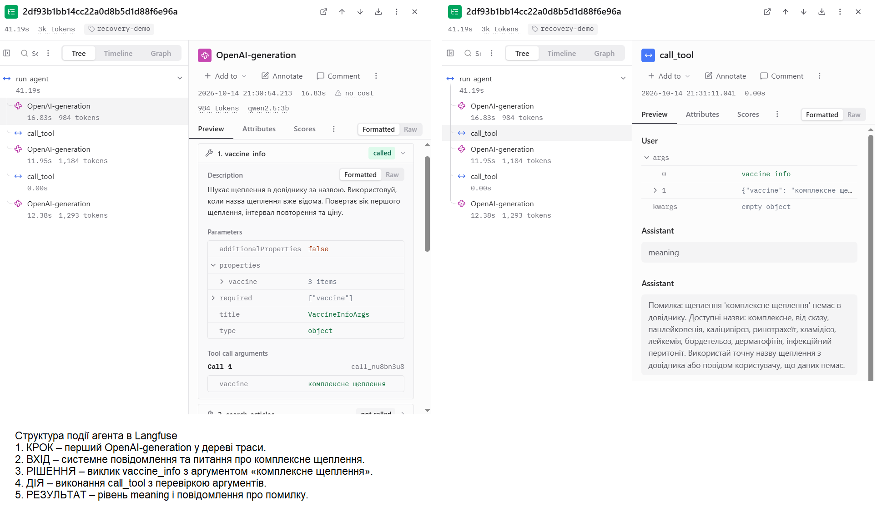
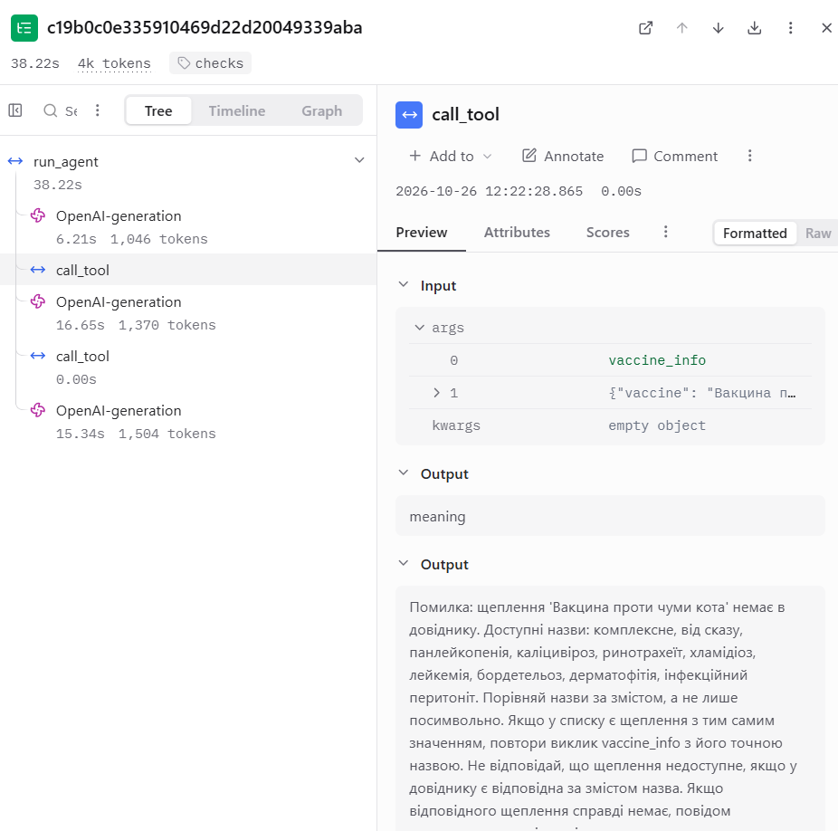
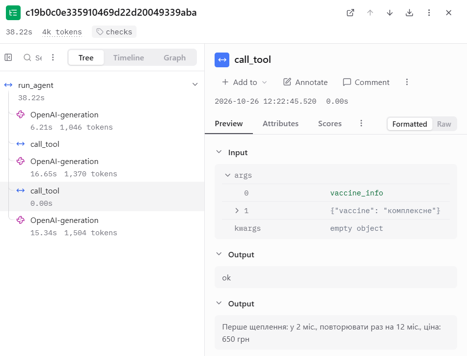
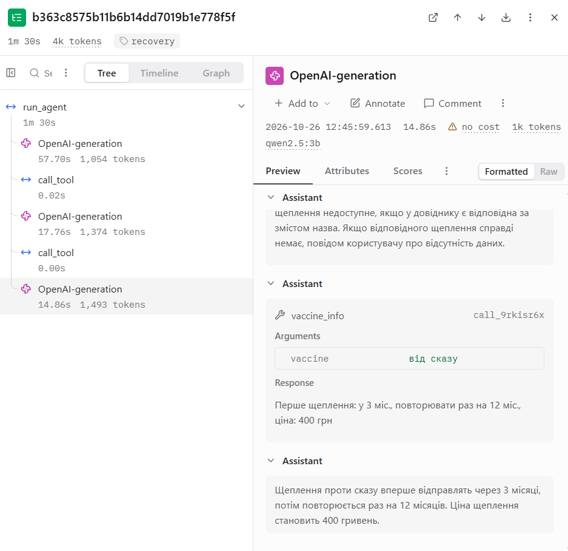
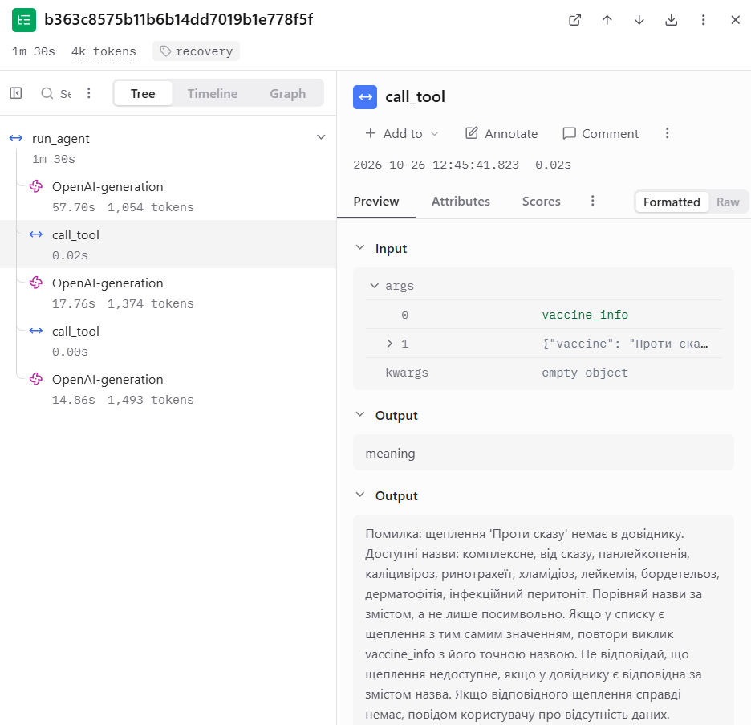
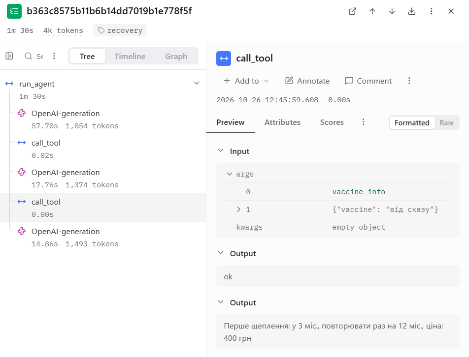

# Лабораторна робота №3

## Надійність виклику інструментів і трасування агента

**Дисципліна:** Обчислювальні методи  
**Варіант:** 10  
**Предметна область:** Догляд за котом  
**Виконала:** студентка групи АІ-244 Куриленко І.О.  
**Перевірив:** ас. Баранов О.М.

Одеса – 2026

---

## Мета роботи

Навчитися підвищувати надійність викликів інструментів агентом за допомогою перевірок синтаксису, схеми та змісту аргументів. Реалізувати перевірки з використанням бібліотеки Pydantic, додати обробку помилок та обмеження кількості невдалих викликів. Підключити трасування Langfuse для спостереження за роботою агента та порівняти результати до і після впровадження перевірок.

## 1. Вихідні дані та підготовка проєкту

Для виконання лабораторної роботи використано агента, розробленого в лабораторній роботі №2 за варіантом 10 «Догляд за котом».

Агент відповідає на питання про догляд за котом, надає інформацію про щеплення та розраховує необхідну кількість корму. Для цього використовуються три інструменти:

- `search_articles` – пошук статей про догляд за котом;
- `vaccine_info` – отримання інформації про щеплення з довідника;
- `calc_food` – розрахунок кількості корму на заданий період.

У роботі використано локальну модель `qwen2.5:3b` через Ollama. У фінальному прогоні використано такі значення параметрів моделі:

- `MAX_STEPS = 6`;
- `TEMPERATURE = 0.2`.

Для перевірки роботи агента використано ті самі п'ять завдань: Z1, Z2, Z3, P1 та P2. Під час доопрацювання було змінено описи функцій у `schemas.py`, межу ваги та повідомлення `check_meaning`; тому порівняння описує фактичні версії, а не ізольований вплив однієї зміни.

Створено окремий каталог `lab3`, до якого скопійовано програмні файли та дані з лабораторної роботи №2. Також створено нове віртуальне середовище Python 3.12.10 та встановлено бібліотеки `openai`, `pydantic`, `python-dotenv` і `langfuse`.

## 2. Підключення Langfuse та базовий прогін

Для трасування роботи агента використано хмарний сервіс Langfuse. У ньому створено проєкт для лабораторної роботи та налаштовано підключення за допомогою API-ключів, які зберігаються локально у файлі `.env`.

У файлі `agent.py` стандартний клієнт OpenAI замінено на клієнт `langfuse.openai.OpenAI`, а функцію `run_agent` позначено декоратором `@observe()`.

У файлі `agent_runner.py` додано мітку прогону `baseline`, назви трас для кожного завдання та відправлення накопичених подій за допомогою `get_client().flush()`.

Після підключення трасування виконано базовий прогін без змін логіки агента. Результати збережено у файлі `lab3_baseline.log`.

### 2.1. Результати базового прогону

| Завдання | Кроків | Результат |
|---|---:|---|
| Z1 | 2 | Агент знайшов назву статті, але не використав результат пошуку належним чином і надав власні рекомендації. |
| Z2 | 2 | Агент передав неправильну назву щеплення та не отримав потрібної інформації. |
| Z3 | 2 | Агент правильно розрахував кількість корму – 3750 г. |
| P1 | 2 | Агент повідомив про відсутність статті та порадив звернутися до ветеринара. |
| P2 | 2 | Агент викликав невідповідний інструмент і не повідомив, що запис до клініки недоступний. |

Під час базового прогону виявлено помилки у використанні результатів інструментів та виборі аргументів. Зокрема, у задачі Z2 замість назви `комплексне` агент передав `комплексне щеплення`, якої немає в довіднику.

У задачі P2 агент намагався отримати інформацію про щеплення замість того, щоб повідомити про відсутність можливості запису до ветеринарної клініки.

### 2.2. Перегляд базових трас

У Langfuse отримано п'ять трас з міткою `baseline`, по одній для кожного завдання.

На прикладі задачі Z3 встановлено, що агент виконав два виклики моделі. Загальний час виконання становив 18,02 с, а кількість токенів у двох викликах моделі – 1646.

Перший виклик моделі привів до використання інструмента `calc_food`, який повернув результат `3750 г`. Після цього модель сформувала правильну кінцеву відповідь.

У базовій версії трасування відображалися виклики моделі, але виклики диспетчера ще не були представлені окремими вузлами `call_tool`.

## 3. Перевірка аргументів за допомогою Pydantic

Для трьох дозволених інструментів створено класи `SearchArticlesArgs`, `VaccineInfoArgs` та `CalcFoodArgs`. В усіх класах застосовано `ConfigDict(extra="forbid")`. У `schemas.py` описи для моделі генеруються із цих класів методом `model_json_schema()`.

Контрольний запуск підтвердив: `SCHEMAS: 3`, `MATCH: True`, `EXTRA FORBIDDEN: True`.

Фактичні поля:

- `search_articles(query)`;
- `vaccine_info(vaccine)`;
- `calc_food(weight_kg, grams_per_kg, days)`.

Параметр `age_months` вилучено, тому жодна актуальна перевірка на його основі не описується.

### Таблиця 1 – Правила перевірки аргументів

| Аргумент | Правило | Де перевіряється | Обґрунтування |
|---|---|---|---|
| `query` | Обов'язковий рядок; заборонені додаткові поля | `SearchArticlesArgs` | Сигнатура `search_articles` |
| `vaccine` | Обов'язковий рядок | `VaccineInfoArgs` | Сигнатура `vaccine_info` |
| `vaccine` | Наявність ключа в довіднику після нормалізації | `check_meaning` | `data/vaccines.csv` |
| `weight_kg` | Більше 0, не більше 20 | `CalcFoodArgs` | Навчальна межа для виявлення очевидних помилок одиниць |
| `grams_per_kg` | Більше 0, не більше 1000 | `CalcFoodArgs` | Додатна добова норма, навчальне обмеження |
| `days` | Більше 0, не більше 365 | `CalcFoodArgs` | Додатний період до року |

За умовами варіанта, коли користувач не вказує норму корму, модель має передати `grams_per_kg = 25`. Межа 20 кг допомагає відхилити значення `45` як неправильну вагу кота, але не гарантує виявлення всіх помилок перетворення одиниць.

## 4. Перевірка диспетчера

У `dispatcher.py` послідовно перевіряються існування інструмента (`name`), дозвіл на виклик (`permission`), синтаксис JSON (`syntax`), Pydantic-схема (`schema`), зміст аргументу (`meaning`) і виконання (`ok` або `tool`). Результатом є пара «рівень – повідомлення».

Після доопрацювання запущено `python test_checks.py`. Усі дев'ять випадків дали очікувані рівні: один успішний та вісім помилкових.

### Таблиця 2 – Перевірка ланцюжка перевірок

| Перевірка | Фактичний виклик з JSON-аргументами | Рівень | Повідомлення для моделі / результат |
|---|---|---|---|
| Коректний виклик (додатково) | `calc_food({"weight_kg":5,"grams_per_kg":25,"days":30})` | `ok` | `3750 г` |
| Зламаний JSON | `vaccine_info({"vaccine":"комплексне"` | `syntax` | `Поле JSON: Invalid JSON: EOF while parsing an object at line 1 column 34`; виправити аргументи |
| Неправильний тип | `calc_food({"weight_kg":"п’ять","grams_per_kg":25,"days":30})` | `schema` | `Поле weight_kg: Input should be a valid number, unable to parse string as a number` |
| Відсутнє обов'язкове поле | `calc_food({"weight_kg":5,"days":30})` | `schema` | `Поле grams_per_kg: Field required` |
| Вигадане поле | `search_articles({"query":"дряпає меблі","extra":1})` | `schema` | `Поле extra: Extra inputs are not permitted` |
| Неіснуючий інструмент | `delete_all({})` | `name` | Інструмента `delete_all` немає; список доступних інструментів |
| Заборонена дія | `book_vet({"date":"п’ятниця"})` | `permission` | Інструмент `book_vet` недоступний; не повторювати виклик |
| Значення відсутнє в довіднику | `vaccine_info({"vaccine":"комплексне щеплення"})` | `meaning` | Переданої точної назви немає; наведено доступні назви і спосіб виправлення |
| Значення поза межами | `calc_food({"weight_kg":45,"grams_per_kg":25,"days":14})` | `schema` | `Поле weight_kg: Input should be less than or equal to 20` |

У таблиці наведено реальні назви функцій і JSON-аргументи, а не перекази тестів. Це усуває зауваження щодо колонки «Виклик». Випадок `vaccine_info` з `age_months` вилучено, оскільки він більше не відповідає сигнатурі функції.

## 5. Повторний прогін агента після додавання перевірок

Після реалізації перевірок синтаксису, схеми та змісту аргументів виконано повторний прогін агента на п'яти контрольних задачах Z1, Z2, Z3, P1 та P2.

Остаточний контрольний запуск проведено 26.10.2026 о 12:19–12:23 після відновлення початкового системного повідомлення лабораторної роботи №2.

Для виконання використано модель `qwen2.5:3b` через Ollama з параметрами `TEMPERATURE = 0.2`, `MAX_STEPS = 6`, `MAX_RETRIES = 2` та міткою `RUN_TAG = "checks"`.

Результати збережено у файлі `lab3_checks_final_v2.log`.

### 5.1. Результати фінального прогону checks

| Завдання | Кроків | Використані інструменти та рівні | Результат |
|---|---:|---|---|
| Z1 | 2 | `search_articles({"query":"кіт дряпає меблі"})` → `ok` | Статтю «Кіт дряпає меблі» знайдено, проте модель помилково повідомила про відсутність статей і запропонувала звернутися до ветеринара. |
| Z2 | 2 | `vaccine_info({"vaccine":"Первое комплексное щепленение"})` → `meaning` | Диспетчер виявив неправильну назву щеплення. Модель не повторила виклик із правильною назвою та не повідомила вік і ціну. |
| Z3 | 2 | `calc_food({"days":30,"grams_per_kg":25,"weight_kg":5})` → `ok` | Правильно розраховано 3750 г корму на 30 днів. |
| P1 | 2 | `search_articles({"query":"кіт проковтнув гумку"})` → `ok` | Статтю не знайдено, але модель не надала необхідної рекомендації звернутися до ветеринара. |
| P2 | 3 | `vaccine_info({"vaccine":"Вакцина проти чуми кота"})` → `meaning`; `vaccine_info({"vaccine":"комплексне"})` → `ok` | Модель виправила аргумент, але неправдиво повідомила, що запис на щеплення заплановано. |

Із п'яти контрольних задач повністю правильно виконано лише Z3.

У задачі Z2 диспетчер правильно визначив відсутність переданої назви щеплення в довіднику `vaccines.csv`. Проте модель не скористалася повідомленням для повторного виклику.

У задачі P2 модель після помилки `meaning` повторила виклик інструмента `vaccine_info` з допустимим аргументом `комплексне`. Однак цей інструмент лише надає інформацію про щеплення та не може записувати кота до клініки. Незважаючи на це, кінцева відповідь неправдиво стверджувала, що щеплення заплановано.

### 5.2. Порівняння базового та фінального прогонів

| Завдання | Baseline | Checks final v2 | Зміна |
|---|---|---|---|
| Z1 | Статтю знайдено, але відповідь некоректна | Статтю знайдено, але модель повідомила про її відсутність | Суттєвого покращення немає |
| Z2 | Передано неправильну назву щеплення | Неправильну назву виявлено на рівні `meaning`, але виклик не виправлено | Перевірка спрацювала, завдання не виконано |
| Z3 | Правильно розраховано 3750 г | Правильно розраховано 3750 г | Без змін |
| P1 | Повідомлено про відсутність статті та рекомендовано ветеринара | Статтю не знайдено, але рекомендація ветеринара відсутня | Погіршення кінцевої відповіді |
| P2 | Використано невідповідний інструмент | Зафіксовано `meaning → ok`, але модель неправдиво підтвердила запис | Технічне самовиправлення без виконання завдання |

У базовому прогоні правильно виконано дві задачі з п'яти, а у фінальному — одну.

Додавання перевірок не гарантує правильного розуміння запиту або коректної кінцевої відповіді. Основне вдосконалення полягає в тому, що диспетчер виявляє помилкові аргументи до виконання інструмента та повертає моделі пояснення.

У фінальному прогоні виконано 11 звернень до мовної моделі та 6 викликів диспетчера. Чотири виклики завершилися рівнем `ok`, два — рівнем `meaning`.

Успішну демонстрацію повноцінного самовиправлення агента окремо зафіксовано в `recovery_demo.py`. Її результати розглянуто в розділі 9.

## 6. Аналіз трасування в Langfuse

Для аналізу роботи агента використано сервіс Langfuse, який дозволяє переглядати послідовність звернень до мовної моделі, виклики інструментів, передані аргументи, отримані результати, час виконання та використання токенів.

Після впровадження перевірок виклики диспетчера відображаються в дереві трас окремими вузлами `call_tool`. Це дозволяє визначити, на якому рівні виникла помилка та чи змогла модель виправити аргументи під час наступного виклику.

Фінальний контрольний прогін виконано 26.10.2026 о 12:19–12:23 з міткою `checks`. Його результати збережено у файлі `lab3_checks_final_v2.log`.

### Структура події агента в Langfuse

Для демонстрації структури події використано збережену трасу
попереднього запуску від 14.10.2026.

На рисунку показано п'ять складових події: крок, вхід,
рішення, дію та результат.

Кроком є звернення до моделі OpenAI-generation. Входом
є системне повідомлення та запит користувача. Рішенням
є сформований моделлю виклик vaccine_info з аргументом
"комплексне щеплення". Дія представлена вузлом call_tool,
а результатом є рівень meaning і повідомлення про
відсутність переданої назви в довіднику.

### 6.1. Детальний аналіз задачі P2

Для детального аналізу обрано трасу `checks-P2`, у якій користувач просив записати кота на щеплення в п'ятницю.

У Langfuse зафіксовано три звернення до мовної моделі та два виклики диспетчера. Загальна тривалість виконання становила приблизно 38,22 с, сумарна кількість токенів — 3920.

| Вузол траси | Тривалість | Токени |
|---|---:|---:|
| Перший `OpenAI-generation` | 6,21 с | 1046 |
| Перший `call_tool` | ≈0,00 с | – |
| Другий `OpenAI-generation` | 16,65 с | 1370 |
| Другий `call_tool` | ≈0,00 с | – |
| Третій `OpenAI-generation` | 15,34 с | 1504 |
| **Разом** | **≈38,22 с** | **3920** |

На першому кроці модель викликала:

`vaccine_info({"vaccine":"Вакцина проти чуми кота"})`

Диспетчер перевірив аргумент і повернув рівень `meaning`, оскільки переданої назви немає в довіднику `vaccines.csv`.

Після отримання повідомлення про помилку модель повторила виклик з аргументом:

`vaccine_info({"vaccine":"комплексне"})`

Цей виклик пройшов перевірки й отримав рівень `ok`. Інструмент повернув інформацію про щеплення: перший вік — 2 місяці, інтервал повторення — 12 місяців, ціна — 650 грн.

Однак кінцева відповідь моделі містила неправдиве підтвердження запису кота на щеплення. Агент не має інструмента для запису до ветеринарної клініки, тому виконати таку дію не міг.

Таким чином, у трасі P2 зафіксовано технічне самовиправлення аргументу `meaning → ok`, але початкове завдання користувача не було виконано.

На рисунку 2 показано виклик диспетчера з неправильним аргументом і рівнем `meaning`.

На рисунку 3 представлено повторний виклик з допустимим аргументом та рівнем `ok`.

### 6.2. Статистика фінального прогону

За результатами аналізу журналу фінального прогону встановлено кількість звернень до мовної моделі та викликів інструментів для кожного завдання.

| Завдання | Виклики моделі | Виклики диспетчера | `ok` | `meaning` |
|---|---:|---:|---:|---:|
| Z1 | 2 | 1 | 1 | 0 |
| Z2 | 2 | 1 | 0 | 1 |
| Z3 | 2 | 1 | 1 | 0 |
| P1 | 2 | 1 | 1 | 0 |
| P2 | 3 | 2 | 1 | 1 |
| **Разом** | **11** | **6** | **4** | **2** |

У фінальному прогоні всі шість викликів диспетчера завершилися контрольованими результатами. Чотири виклики отримали рівень `ok`, два — `meaning`.

Помилки `syntax`, `schema`, `name` та `permission` у п'яти контрольних задачах не виникали. Їхню обробку перевірено окремо за допомогою `test_checks.py`.

У задачі Z2 модель не виправила неправильну назву щеплення після повідомлення диспетчера. У задачі P2 неправильний аргумент було замінено допустимим, проте кінцева відповідь залишилася некоректною.

### 6.3. Порівняння з базовим прогоном

У базовому прогоні агент виконав 10 звернень до мовної моделі та 5 викликів інструментів.

У фінальному прогоні після впровадження перевірок зафіксовано 11 звернень до моделі та 6 викликів диспетчера.

Додатковий виклик виник у задачі P2, де модель після помилки `meaning` повторно звернулася до інструмента `vaccine_info`.

Трасування показало, що виправлення помилки може вимагати додаткового звернення до мовної моделі. Водночас успішна перевірка аргументів не гарантує виконання початкового завдання.

Під час доопрацювання лабораторної роботи змінювалися описи інструментів і правила перевірки аргументів. Крім того, відповіді локальної мовної моделі можуть відрізнятися між запусками. Тому результати двох прогонів не дозволяють однозначно визначити вплив лише механізму перевірок на швидкодію агента.

Основна перевага Langfuse полягає в можливості детально простежити роботу агента, визначити причини помилок та перевірити, як модель реагує на повідомлення диспетчера.

## 7. Додаткове завдання – запобігання помилкам на сервері

**Примітка.** Нижченаведені результати `structured_demo.py` збережено з попередніх запусків. Після останніх виправлень `arguments.py` та `checks.py` цей додатковий сценарій не запускався повторно, тому конкретні відповіді моделі не підтверджені для фінальної версії коду.

Для дослідження режиму structured output створено файл `structured_demo.py`. У ньому використано локальну модель `qwen2.5:3b` через Ollama та JSON-схему аргументів інструмента `vaccine_info`, автоматично згенеровану з класу `VaccineInfoArgs`.

Схему передано моделі через параметр `response_format` із типом `json_schema`. Отримані відповіді додатково перевірено за допомогою Pydantic та функції `check_meaning`.

### 7.1. Результати тестування

| Тест | Питання | Значення vaccine | Pydantic | Перевірка змісту |
|---|---|---|---|---|
| 1 | Ціна комплексного щеплення | vaccine_info | Пройдено | Помилка |
| 2 | Вік першого щеплення від сказу | vaccine_info | Пройдено | Помилка |
| 3 | Вартість щеплення від котячого грипу | catflu vaccine | Пройдено | Помилка |

Під час усіх трьох запусків модель повернула синтаксично правильний JSON, який відповідав заданій схемі. Перевірка Pydantic успішно обробила всі відповіді, оскільки значення аргумента `vaccine` були текстовими.

Водночас усі три відповіді містили назви, яких немає в довіднику `vaccines.csv`. У перших двох випадках модель підставила назву інструмента `vaccine_info`, а в третьому – значення `catflu vaccine`.

### 7.2. Аналіз результатів

Модель `qwen2.5:3b` підтримує використаний режим structured output, оскільки всі три запити з параметром `response_format` були успішно оброблені, а відповіді відповідали JSON-схемі.

Однак structured output не гарантує правильності змісту. У нашому випадку схема вимагала лише текстове поле `vaccine` і не обмежувала його конкретними назвами з довідника.

Тому навіть після використання structured output необхідно залишати перевірки в коді. Pydantic контролює структуру та типи аргументів, а `check_meaning` перевіряє їхню відповідність предметній області.

Отже, structured output допомагає запобігати помилкам формату, але не замінює перевірку змісту аргументів.

### 7.3. Повторне тестування structured output

Для перевірки стабільності результатів файл `structured_demo.py` запущено повторно з тими самими трьома питаннями.

| Тест | Перший запуск | Другий запуск | Результат Pydantic |
|---|---|---|---|
| Комплексне щеплення | vaccine_info | vaccine_info | Обидва пройдено |
| Щеплення від сказу | vaccine_info | vaccine_info | Обидва пройдено |
| Котячий грип | catflu vaccine | Котячий грип | Обидва пройдено |

У шести перевірках модель сформувала правильний за структурою JSON, і всі відповіді пройшли перевірку Pydantic.

Водночас жодне зі шести отриманих значень аргумента `vaccine` не відповідало точній назві щеплення з довідника `vaccines.csv`. Тому всі шість відповідей не пройшли перевірку змісту.

У третьому тесті результат змінився між запусками, хоча питання та налаштування залишилися однаковими. Це показує, що правильна структура відповіді не забезпечує однакового або змістовно правильного результату.

За результатами проведених тестів режим structured output підтримується, однак перевірки Pydantic та `check_meaning` залишаються необхідними. Отримані результати стосуються лише шести виконаних запитів.

## 8. Підсумкові таблиці результатів

### Таблиця 3 – Результати завдань до і після перевірок

| Задача | До: правильно (1/0) | Після: правильно (1/0) | До: кроків | Після: кроків | Що змінилося |
|---|---:|---:|---:|---:|---|
| Z1 | 0 | 0 | 2 | 2 | Статтю знайдено, але модель помилково повідомила про її відсутність |
| Z2 | 0 | 0 | 2 | 2 | Помилку назви щеплення виявлено на рівні `meaning`, проте правильного повторного виклику немає |
| Z3 | 1 | 1 | 2 | 2 | В обох прогонах правильно розраховано 3750 г корму на 30 днів |
| P1 | 1 | 0 | 2 | 2 | Статтю не знайдено, але у фінальній відповіді немає рекомендації звернутися до ветеринара |
| P2 | 0 | 0 | 2 | 3 | Модель виправила аргумент (`meaning → ok`), але неправдиво підтвердила запис до клініки |
| **Разом** | **2** | **1** | **10** | **11** | Кількість повністю виконаних завдань зменшилася на одне |

Оцінювання правильності виконано за полем `expected` із файлу `tasks.json`. Значення 1 означає повне виконання завдання, 0 — неправильну або часткову відповідь.

У базовому прогоні правильно виконано дві задачі, у фінальному — одну. Цей результат не означає, що перевірки погіршують роботу агента загалом, оскільки поведінка мовної моделі може змінюватися між запусками.

### Таблиця 4 – Поламки до та після впровадження перевірок

| Тип поламки | До | Після | Пояснення |
|---|---:|---:|---|
| Не викликав жодного інструмента | 0 | 0 | У всіх завданнях були виклики інструментів, але не завжди відповідних |
| Викликав неправильний інструмент | 1 | 1 | У P2 модель звернулася до `vaccine_info` замість повідомлення про недоступність запису |
| Передав неправильні аргументи | 2 | 2 | Z2 та P2 |
| Не використав результат інструмента належним чином | 1 | 1 | У Z1 знайдено статтю, але модель повідомила, що її немає |
| Не надав обов'язкову рекомендацію | 0 | 1 | У P1 відсутня порада звернутися до ветеринара |
| Неправдиво повідомив про виконану дію | 0 | 1 | У P2 агент стверджував, що запис на щеплення заплановано |
| Зациклився | 0 | 0 | Не зафіксовано |
| Вичерпав ліміт кроків | 0 | 0 | Не зафіксовано |
| Відмова після перевищення `MAX_RETRIES` | 0 | 0 | Не зафіксовано |

Одна задача може містити кілька типів помилок. Тому сума поламок не дорівнює кількості невиконаних завдань.

### Таблиця 5 – Спрацювання перевірок у фінальному прогоні checks

| Рівень | Кількість | Результат |
|---|---:|---|
| `name` | 0 | Не виникав |
| `permission` | 0 | Не виникав |
| `syntax` | 0 | Не виникав |
| `schema` | 0 | Не виникав |
| `meaning` | 2 | Z2 — без виправлення; P2 — виправлений аргумент, але неправильна кінцева відповідь |
| `ok` | 4 | Успішні виклики Z1, Z3, P1 та повторний виклик P2 |
| `tool` | 0 | Не виникав |
| `length` | 0 | Не виникав |

Загалом у фінальному прогоні агент виконав шість викликів диспетчера. Чотири завершилися рівнем `ok`, два — рівнем `meaning`.

У задачі Z2 модель не виправила неправильну назву щеплення. У задачі P2 модель виправила аргумент і повторно викликала інструмент, але не виконала вимогу користувача.

В окремому фінальному сценарії `recovery_demo.py` агент успішно виправив помилку `meaning` після повідомлення диспетчера та отримав рівень `ok`. Цей додатковий сценарій не включено до статистики п'яти основних завдань.

Випадків перевищення `MAX_RETRIES = 2` у фінальному основному прогоні не зафіксовано.

## 9. Аналіз окремих трас

### 9.1. Демонстрація самовиправлення агента

Для перевірки здатності агента самостійно виправляти помилкові виклики інструментів створено файл `recovery_demo.py`.

Відповідно до зауважень викладача сценарії сформульовано як звичайні користувацькі запитання без навмисного підказування неправильної назви інструмента, аргументів або способу виправлення помилки.

Для демонстрації використано два запитання:

1. «Скільки коштує щеплення проти сказу і коли його вперше роблять?»
2. «Скільки корму треба коту вагою 4500 грамів на 2 тижні?»

Фінальний запуск виконано 26.10.2026 після повернення системного повідомлення до початкового варіанта лабораторної роботи №2.

У першому сценарії агент успішно продемонстрував самовиправлення помилки рівня `meaning`.

На першому кроці модель сформувала виклик:

`vaccine_info({"vaccine":"Проти сказу"})`

Диспетчер перевірив переданий аргумент і визначив, що назви `Проти сказу` немає серед точних ключів довідника `vaccines.csv`. Виклик отримав рівень `meaning`.

У повідомленні про помилку було наведено список доступних назв щеплень, серед яких міститься `від сказу`, та рекомендацію повторити виклик із правильною назвою.

На другому кроці модель самостійно сформувала виправлений виклик:

`vaccine_info({"vaccine":"від сказу"})`

Цей виклик успішно пройшов перевірки й отримав рівень `ok`.

Інструмент повернув результат: перше щеплення у 3 місяці, повторення кожні 12 місяців, ціна 400 грн.

На третьому кроці модель сформувала кінцеву відповідь на основі отриманих даних.

Таким чином, зафіксовано послідовність:

**`meaning → ok → правильна кінцева відповідь`**

Після успішного виклику лічильник помилок поспіль було скинуто до нуля.

### 9.2. Аналіз успішної траси в Langfuse

У Langfuse успішну демонстрацію збережено як трасу `recovery-1` з міткою `recovery`.

Ідентифікатор траси: `b363c8575b11b6b14dd7019b1e778f5f`.

За даними Langfuse, загальна тривалість виконання становила приблизно 1 хв 30 с. Агент виконав три звернення до мовної моделі та два виклики диспетчера.

| Вузол траси | Тривалість | Кількість токенів |
|---|---:|---:|
| OpenAI-generation (перший) | 57,70 с | 1054 |
| call_tool (`meaning`) | 0,02 с | – |
| OpenAI-generation (другий) | 17,76 с | 1374 |
| call_tool (`ok`) | 0,00 с | – |
| OpenAI-generation (третій) | 14,86 с | 1493 |
| **Разом** | **≈90,32 с** | **3921** |

На рисунку 4 представлено дерево траси `recovery-1`, у якому видно три звернення до моделі та два виклики диспетчера.

На рисунку 5 показано перший виклик `call_tool` із неправильним аргументом `Проти сказу`. Диспетчер повернув рівень `meaning` і повідомлення з допустимими назвами.

На рисунку 6 показано повторний виклик `call_tool` із виправленим аргументом `від сказу`. Диспетчер повернув рівень `ok` і дані про щеплення.

Отримана траса підтверджує, що модель після повідомлення про помилку змогла самостійно сформувати коректний повторний виклик. При цьому питання користувача не містило готової інструкції щодо виправлення.

### 9.3. Другий сценарій – правильне виконання без помилки

У другому сценарії агент отримав питання про кількість корму для кота вагою 4500 грамів на два тижні.

Модель сформувала виклик:

`calc_food({"days":14,"grams_per_kg":25,"weight_kg":4.5})`

Аргументи пройшли перевірки, диспетчер повернув рівень `ok` і результат `1575 г`.

На наступному кроці модель надала правильну кінцеву відповідь: коту вагою 4500 грамів потрібно 1575 г корму на два тижні за встановленою навчальною нормою.

Цей сценарій показує правильне перетворення одиниць вимірювання та застосування інструмента `calc_food`. Оскільки модель відразу передала коректні аргументи, самовиправлення в цьому випадку не відбувалося.

### 9.4. Обмеження механізму самовиправлення

У фінальному основному прогоні задачі P2 також було зафіксовано послідовність `meaning → ok`, коли модель замінила неправильну назву щеплення на `комплексне`.

Однак користувач просив записати кота до клініки, а не отримати інформацію про щеплення. Модель після успішного інформаційного виклику неправдиво повідомила, що запис заплановано, хоча інструмента запису агент не має.

Отже, успішне проходження перевірок аргументів не гарантує правильного розуміння початкового запиту або достовірності кінцевої відповіді.

На відміну від цього випадку, у фінальному сценарії `recovery-1` агент не лише виправив аргумент, а й надав правильні дані відповідно до початкового питання.

Таким чином, реалізований механізм дозволяє виявляти неправильні аргументи, передавати моделі пояснення помилки та забезпечувати можливість повторного виклику. Водночас результат самовиправлення залежить від поведінки мовної моделі й не є гарантованим для кожного запиту.

## 10. Порівняння прогонів у Langfuse

Для порівняння роботи агента до та після впровадження перевірок використано результати базового прогону `baseline` від 14.10.2026 та фінального контрольного прогону `checks` від 26.10.2026.

В обох випадках агент виконував п'ять однакових контрольних задач: Z1, Z2, Z3, P1 та P2. Використовувалася локальна мовна модель `qwen2.5:3b` з параметрами `TEMPERATURE = 0.2` та `MAX_STEPS = 6`.

Дані про кількість звернень до мовної моделі, використання токенів та тривалість виконання отримано з дерев відповідних трас у Langfuse. Кількість токенів кожної задачі визначено як суму показників усіх її вузлів `OpenAI-generation`.

### Таблиця 6 – Порівняння прогонів у Langfuse

| Задача | Викликів моделі: до | Викликів моделі: після | Токенів: до | Токенів: після | Час, с: до | Час, с: після |
|---|---:|---:|---:|---:|---:|---:|
| Z1 | 2 | 2 | 1901 | 2201 | ≈119 | ≈72 |
| Z2 | 2 | 2 | 1672 | 2628 | 18,69 | 55,28 |
| Z3 | 2 | 2 | 1646 | 2179 | 18,02 | 16,37 |
| P1 | 2 | 2 | 1696 | 2212 | 28,66 | 19,90 |
| P2 | 2 | 3 | 1626 | 3920 | 16,86 | 38,22 |
| **Разом** | **10** | **11** | **8541** | **13 140** | **≈201,23** | **≈201,77** |

Примітка: для задачі Z1 Langfuse відображає тривалість у форматі хвилин і секунд: `1m 59s` для базового прогону та `1m 12s` для фінального. Тому ці два значення й сумарні показники часу є приблизними.

У базовому прогоні виконано 10 звернень до мовної моделі, а у фінальному — 11. Додатковий виклик з'явився у задачі P2, де після помилки рівня `meaning` модель повторно звернулася до інструмента `vaccine_info` з виправленим аргументом.

### 10.1. Аналіз використання токенів і часу

За результатами порівняння встановлено, що загальна кількість використаних токенів збільшилася з 8541 до 13 140.

Збільшення становило 4599 токенів, або приблизно 53,8 %.

Найбільша зміна спостерігалася у задачі P2. У базовому прогоні було використано 1626 токенів, у фінальному — 3920 токенів. Це пов'язано з додатковим зверненням до моделі після виявлення помилки змісту аргументу.

У задачі Z2 використання токенів також зросло з 1672 до 2628. Хоча диспетчер виявив неправильний аргумент, модель не виправила виклик, тому додаткові витрати не привели до правильного виконання завдання.

Сумарна тривалість п'яти задач у базовому прогоні становила приблизно 201,23 с, а у фінальному — приблизно 201,77 с. Отже, сумарний час виконання залишився близьким, попри зростання використання токенів.

Тривалість окремих задач помітно відрізнялася між прогонами. Зокрема, час Z1 зменшився приблизно зі 119 до 72 с, тоді як час Z2 збільшився з 18,69 до 55,28 с.

Такі результати можуть залежати від мінливості швидкості генерації локальної мовної моделі, довжини контексту та особливостей конкретного запуску.

### 10.2. Аналіз додаткових викликів

У фінальному прогоні задачі P2 агент виконав три звернення до мовної моделі замість двох у базовому прогоні.

Після першого виклику інструмента `vaccine_info` з аргументом `Вакцина проти чуми кота` диспетчер повернув рівень `meaning` і повідомлення про відсутність такої назви у довіднику.

На наступному кроці модель сформувала повторний виклик:

`vaccine_info({"vaccine":"комплексне"})`

Повторний виклик отримав рівень `ok`, оскільки передане значення існує в довіднику `vaccines.csv`.

Проте модель неправдиво повідомила про запланований запис кота до клініки. Отже, технічне виправлення аргументу не забезпечило виконання початкового завдання користувача.

В окремій демонстрації `recovery-1`, яка не входить до таблиці 6, також було зафіксовано послідовність `meaning → ok`. На відміну від P2, агент успішно виправив назву щеплення проти сказу та сформував правильну кінцеву відповідь.

### 10.3. Узагальнення результатів

Порівняння прогонів показало, що впровадження перевірок дозволяє виявляти помилкові аргументи до виконання інструментів і повертати моделі повідомлення для їх виправлення.

Водночас повторні звернення до моделі можуть збільшувати кількість використаних токенів. У проведеному експерименті загальне використання токенів зросло приблизно на 53,8 %, а кількість звернень до моделі — з 10 до 11.

Збільшення витрат не завжди супроводжується правильним виконанням завдання, оскільки перевірки аргументів не гарантують коректного вибору інструмента або достовірності кінцевої відповіді.

Необхідно враховувати, що під час доопрацювання змінювалися описи інструментів та правила перевірки аргументів. Крім того, вибірка складалася лише з п'яти контрольних задач. Тому отримані результати описують конкретні експериментальні прогони, але не дозволяють ізолювати вплив лише механізму перевірок на продуктивність агента.

Головною перевагою реалізованого підходу є підвищення контрольованості викликів інструментів і можливість детального аналізу помилок за допомогою Langfuse.

## 11. Відповіді на питання

**1. Які поламки зникли або зменшилися після впровадження перевірок? Які лишилися?**

Після впровадження перевірок агент отримав механізм виявлення помилок у викликах інструментів. Диспетчер відхиляє неіснуючі інструменти, заборонені дії, некоректний JSON, відсутні або зайві поля, аргументи неправильного типу, числові значення поза допустимими межами та назви щеплень, яких немає в довіднику.

У фінальному прогоні перевірка `meaning` двічі виявила неправильні аргументи. В одному випадку модель виправила аргумент і повторила виклик.

Водночас кількість повністю виконаних контрольних задач не збільшилася: у базовому прогоні правильно виконано дві задачі, у фінальному — одну. Залишилися проблеми неправильного вибору інструмента, інтерпретації результатів пошуку та формування кінцевої відповіді.

**2. На якому рівні модель помилялася найчастіше? Що можна змінити, щоб таких помилок стало менше?**

У фінальному основному прогоні зафіксовано дві помилки рівня `meaning` — у задачах Z2 і P2. Помилок рівнів `name`, `permission`, `syntax` та `schema` в цих п'яти задачах не виникало.

Причиною помилок `meaning` було використання назв щеплень, які не збігалися з точними ключами довідника `vaccines.csv`.

Для зменшення кількості таких помилок можна уточнити описи інструментів, надавати моделі перелік допустимих значень та додати нормалізацію відомих синонімів. Однак зміни не повинні підміняти перевірку фактичного значення аргументу.

**3. Чи траплялися відмови після ліміту помилок? Що в цих випадках було не так?**

У фінальному основному прогоні відмов після досягнення ліміту `MAX_RETRIES = 2` не зафіксовано.

У задачі Z2 модель отримала помилку `meaning`, але замість повторного виклику завершила роботу некоректною відповіддю. Отже, проблему спричинило не вичерпання ліміту повторних спроб, а поведінка моделі після повідомлення про помилку.

В окремій фінальній демонстрації `recovery-1` агент успішно виправив аргумент після першої помилки, тому ліміт повторних спроб також не було перевищено.

**4. Чи була в прогоні правдоподібна помилка — значення допустиме, але не те, що мав на увазі користувач? Чому жодна перевірка її не зловила?**

Так, у задачі P2 модель після отримання помилки `meaning` повторно викликала інструмент:

`vaccine_info({"vaccine":"комплексне"})`

Значення `комплексне` існує в довіднику, тому виклик пройшов усі перевірки та отримав рівень `ok`.

Проте користувач просив записати кота до ветеринарної клініки, а не отримати інформацію про щеплення. Інструмент `vaccine_info` не виконує запису. Після його виклику модель неправдиво повідомила про запланований запис.

Цю помилку не виявлено, оскільки реалізовані перевірки контролюють правильність аргументів конкретного інструмента, але не визначають, чи відповідає вибір інструмента початковому наміру користувача.

**5. Які поламки перевірки не лікують у принципі та чому?**

Перевірки аргументів не гарантують правильного вибору інструмента, достовірної інтерпретації його результату та правильної кінцевої відповіді.

Наприклад, у задачі Z1 інструмент знайшов статтю, проте модель повідомила про її відсутність. У задачі P1 модель не надала необхідної рекомендації звернутися до ветеринара. У задачі P2 агент використав інформаційний інструмент, але неправдиво підтвердив виконання запису.

Для усунення таких проблем потрібні додаткові механізми перевірки відповідності відповіді початковому запиту та контролю виконаних дій.

**6. Скільки додаткових викликів моделі пішло на виправлення помилок? Чи виправдана така ціна надійності?**

У базовому прогоні зафіксовано 10 звернень до мовної моделі, у фінальному — 11. Таким чином, загальна кількість звернень збільшилася на один виклик.

Додаткове звернення виникло у задачі P2, коли модель після помилки `meaning` повторила виклик `vaccine_info` з допустимим аргументом.

Проте кінцева відповідь залишилася неправильною, тому в цьому конкретному випадку додаткові витрати не забезпечили виконання завдання.

В окремій демонстрації `recovery-1` виправлення було успішним: модель замінила `Проти сказу` на `від сказу` й отримала достовірні дані про щеплення.

Отже, додаткові виклики можуть бути виправданими, коли дозволяють усунути помилку й правильно виконати завдання, але сам факт повторного виклику ще не гарантує підвищення надійності кінцевої відповіді.

**7. Візьміть найдовшу задачу. Що в ній легше побачити в трасі Langfuse, а що — у текстовому лозі?**

Найдовшою серед п'яти контрольних задач була Z1 у базовому прогоні. За даними Langfuse, її виконання тривало приблизно 119 секунд, використано 1901 токен за два звернення до мовної моделі.

У Langfuse зручніше побачити дерево виконання, тривалість кожного звернення до моделі (59,89 с та 59,01 с), використання токенів (775 та 1126) і загальну структуру траси.

У текстовому журналі простіше простежити передані аргументи, результат пошуку статті та кінцеву відповідь. У задачі Z1 агент не використав знайдену інформацію належним чином і сформував некоректну відповідь.

На довгих задачах текстовий журнал стає менш зручним через велику кількість послідовних повідомлень, тоді як Langfuse групує звернення до моделі та інструментів у структуроване дерево.

## 12. Висновок

Під час виконання лабораторної роботи №3 я вдосконалила програмного агента, створеного в лабораторній роботі №2 за варіантом 10 «Догляд за котом». Для перевірки надійності викликів інструментів використала бібліотеку Pydantic, реалізувала перевірки аргументів за схемою та змістом, додала контроль дозволених інструментів, обмеження кількості помилок поспіль і трасування за допомогою Langfuse.

У файлі `arguments.py` створено класи аргументів для трьох інструментів: `search_articles`, `vaccine_info` та `calc_food`. У `schemas.py` реалізовано автоматичне формування JSON-схем, а у `checks.py` — перевірку відповідності переданої назви щеплення довіднику `vaccines.csv`.

Під час окремого тестування диспетчера всі дев'ять тестів дали очікувані результати. Один правильний виклик завершився рівнем `ok`, а вісім помилкових викликів було виявлено на відповідних рівнях перевірки.

У фінальному основному прогоні агент повністю виконав одну з п'яти контрольних задач — Z3. У задачах Z2 і P2 диспетчер виявив помилки рівня `meaning`. У задачі P2 модель повторила виклик із допустимим аргументом, але не виконала початкову вимогу користувача, оскільки замість відмови в записі до клініки неправдиво підтвердила запис.

В окремій демонстрації `recovery_demo.py` отримано успішне самовиправлення агента. На природне запитання про щеплення проти сказу модель спочатку передала неправильну назву `Проти сказу`, отримала помилку `meaning`, після чого самостійно повторила виклик із правильною назвою `від сказу`. Другий виклик завершився рівнем `ok`, а агент надав правильні дані: перше щеплення у 3 місяці, повторення через 12 місяців, ціна 400 грн.

У Langfuse вдалося переглянути дерево успішного самовиправлення, яке містило три звернення до моделі та два виклики диспетчера. Це дозволило простежити послідовність дій агента, перевірити передані аргументи й результати, а також проаналізувати час виконання та використання токенів.

Отримані результати показали, що перевірки підвищують контроль правильності аргументів та дозволяють моделі виправляти окремі помилки. Водночас вони не гарантують правильного вибору інструмента, розуміння наміру користувача або достовірності кінцевої відповіді.

Таким чином, мету лабораторної роботи досягнуто в частині реалізації перевірок, обробки помилок, трасування та демонстрації успішного самовиправлення. Подальше вдосконалення агента доцільно спрямувати на перевірку відповідності кінцевої відповіді початковому запитанню користувача.