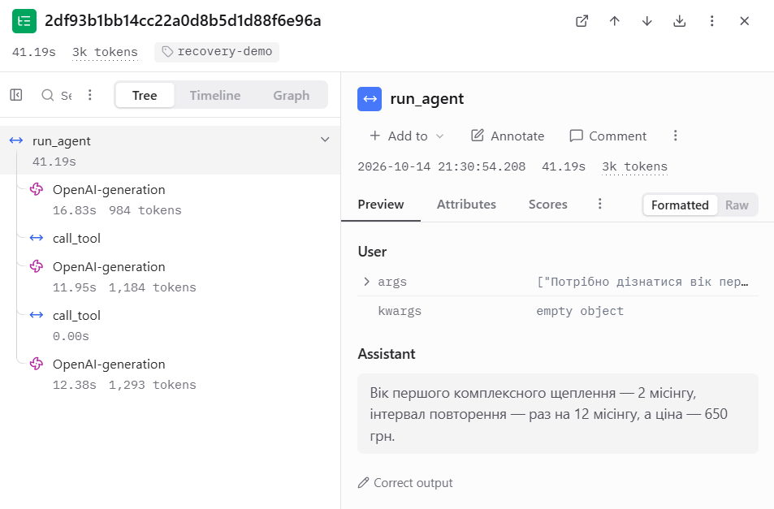
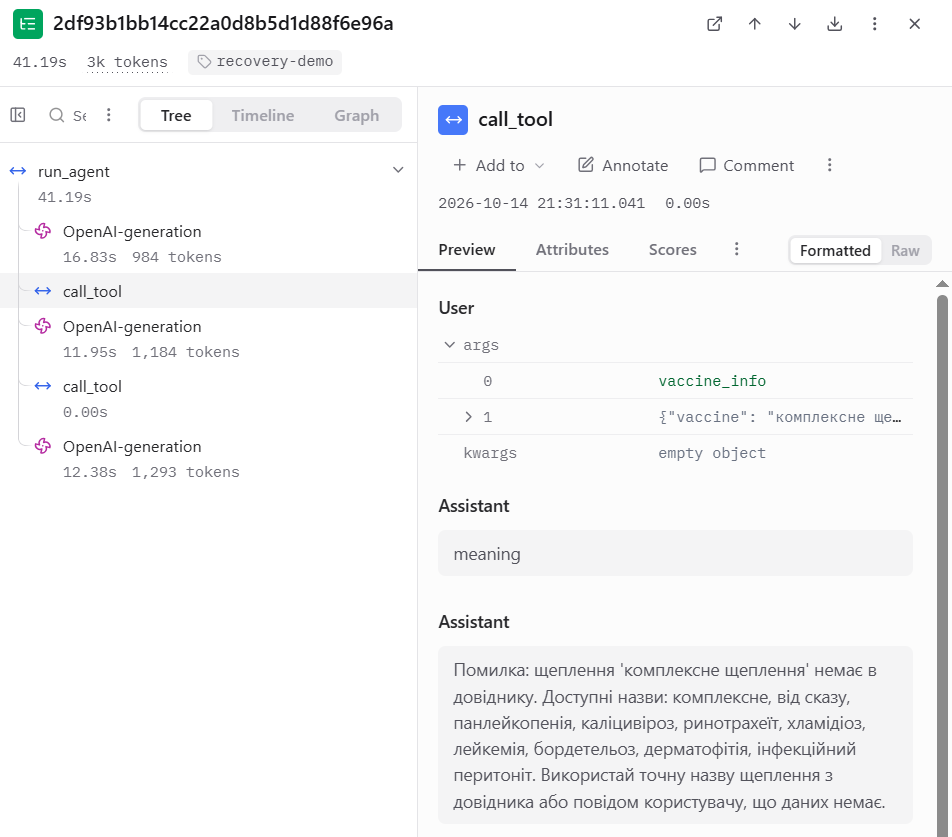
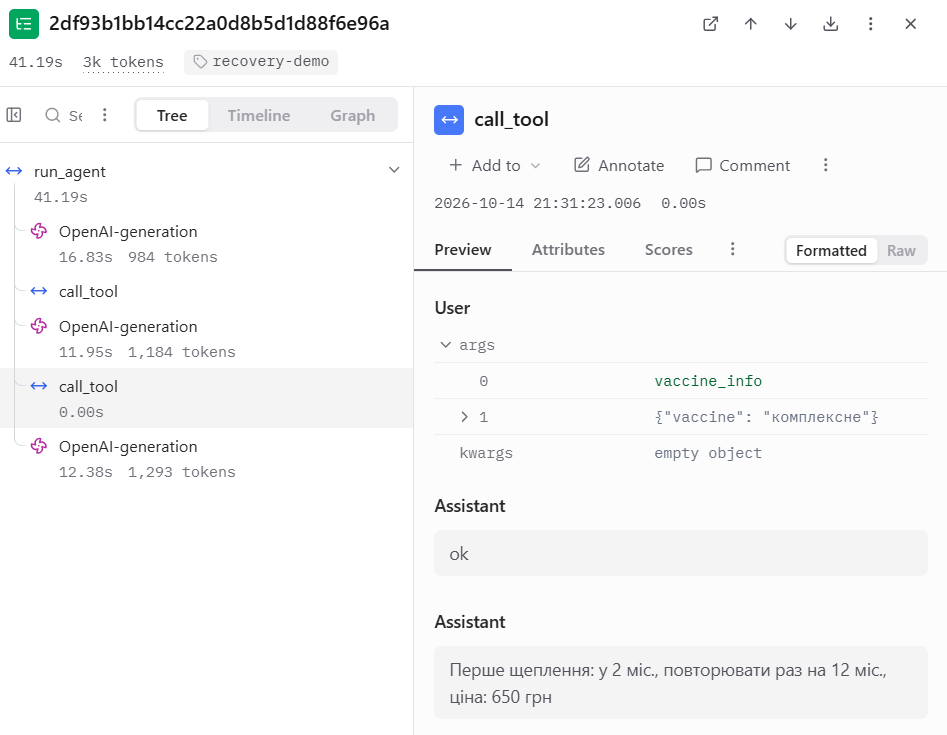
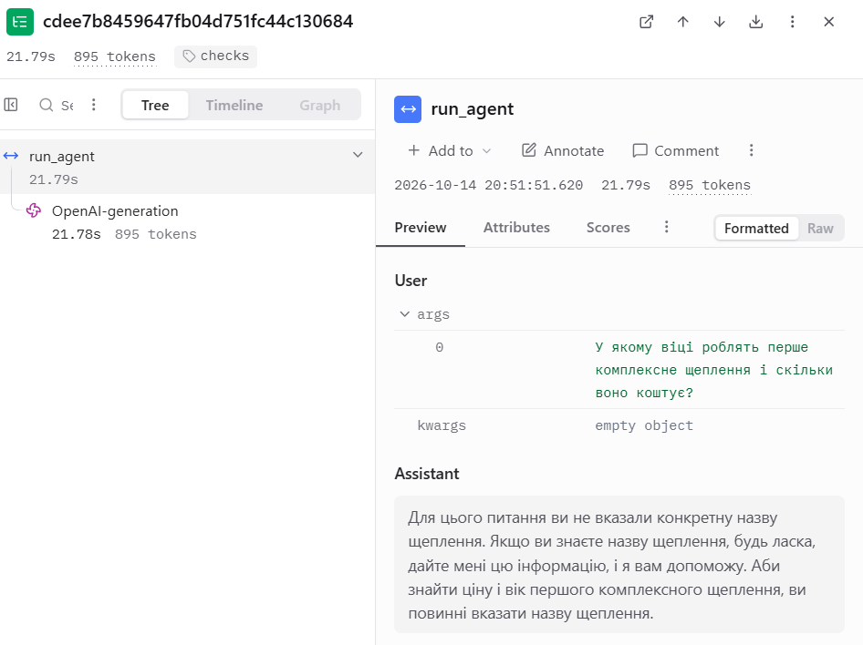

# Лабораторна робота №3

## Надійність виклику інструментів і трасування агента

**Дисципліна:** Обчислювальні методи  
**Варіант:** 10  
**Предметна область:** Догляд за котом  
**Виконала:** студентка групи АІ-244 Куриленко І.О.  
**Перевірив:** ас. Баранов О.М.  

Одеса – 2026

---

## Мета роботи

Навчитися підвищувати надійність викликів інструментів агентом за допомогою перевірок синтаксису, схеми та змісту аргументів. Реалізувати перевірки з використанням бібліотеки Pydantic, додати обробку помилок та обмеження кількості невдалих викликів. Підключити трасування Langfuse для спостереження за роботою агента та порівняти результати до і після впровадження перевірок.

## 1. Вихідні дані та підготовка проєкту

Для виконання лабораторної роботи використано агента, розробленого в лабораторній роботі №2 за варіантом 10 «Догляд за котом».

Агент відповідає на питання про догляд за котом, надає інформацію про щеплення та розраховує необхідну кількість корму. Для цього використовуються три інструменти:

- `search_articles` – пошук статей про догляд за котом;
- `vaccine_info` – отримання інформації про щеплення з довідника;
- `calc_food` – розрахунок кількості корму на заданий період.

У роботі використано локальну модель `qwen2.5:3b` через Ollama. Параметри моделі залишено без змін відносно попередньої лабораторної роботи:

- `MAX_STEPS = 6`;
- `TEMPERATURE = 0.2`.

Для перевірки роботи агента використано ті самі п'ять завдань: Z1, Z2, Z3, P1 та P2.

Створено окремий каталог `lab3`, до якого скопійовано програмні файли та дані з лабораторної роботи №2. Також створено нове віртуальне середовище Python 3.12.10 та встановлено бібліотеки `openai`, `pydantic`, `python-dotenv` і `langfuse`.

## 2. Підключення Langfuse та базовий прогін

Для трасування роботи агента використано хмарний сервіс Langfuse. У ньому створено проєкт для лабораторної роботи та налаштовано підключення за допомогою API-ключів, які зберігаються локально у файлі `.env`.

У файлі `agent.py` стандартний клієнт OpenAI замінено на клієнт `langfuse.openai.OpenAI`, а функцію `run_agent` позначено декоратором `@observe()`.

У файлі `agent_runner.py` додано мітку прогону `baseline`, назви трас для кожного завдання та відправлення накопичених подій за допомогою `get_client().flush()`.

Після підключення трасування виконано базовий прогін без змін логіки агента. Результати збережено у файлі `lab3_baseline.log`.

### 2.1. Результати базового прогону

| Завдання | Кроків | Результат |
|---|---:|---|
| Z1 | 2 | Агент знайшов назву статті, але не використав результат пошуку належним чином і надав власні рекомендації. |
| Z2 | 2 | Агент передав неправильну назву щеплення та не отримав потрібної інформації. |
| Z3 | 2 | Агент правильно розрахував кількість корму – 3750 г. |
| P1 | 2 | Агент повідомив про відсутність статті та порадив звернутися до ветеринара. |
| P2 | 2 | Агент викликав невідповідний інструмент і не повідомив, що запис до клініки недоступний. |

Під час базового прогону виявлено помилки у використанні результатів інструментів та виборі аргументів. Зокрема, у задачі Z2 замість назви `комплексне` агент передав `комплексне щеплення`, якої немає в довіднику.

У задачі P2 агент намагався отримати інформацію про щеплення замість того, щоб повідомити про відсутність можливості запису до ветеринарної клініки.

### 2.2. Перегляд базових трас

У Langfuse отримано п'ять трас з міткою `baseline`, по одній для кожного завдання.

На прикладі задачі Z3 встановлено, що агент виконав два виклики моделі. Загальний час виконання становив 18,02 с, а кількість токенів у двох викликах моделі – 1646.

Перший виклик моделі привів до використання інструмента `calc_food`, який повернув результат `3750 г`. Після цього модель сформувала правильну кінцеву відповідь.

У базовій версії трасування відображалися виклики моделі, але виклики диспетчера ще не були представлені окремими вузлами `call_tool`.


## 3. Перевірка аргументів за допомогою Pydantic

Для перевірки аргументів створено файл `arguments.py`, у якому описано три класи: `SearchArticlesArgs`, `VaccineInfoArgs` та `CalcFoodArgs`.

Кожен клас успадковується від `BaseModel`. За допомогою `ConfigDict(extra="forbid")` заборонено передавати додаткові поля. Описи аргументів задано через `Field`, а для числових параметрів встановлено допустимі межі.

У файлі `schemas.py` реалізовано автоматичне формування JSON-схем за допомогою `model_json_schema()`. Перевірка схеми інструмента `search_articles` підтвердила наявність `additionalProperties: false` та обов'язкового аргумента `query`.

### Класи аргументів інструментів

Для трьох інструментів створено відповідні класи Pydantic. Їхні поля збігаються з параметрами функцій у `tools.py`.

```python
from pydantic import BaseModel, ConfigDict, Field


class SearchArticlesArgs(BaseModel):
    model_config = ConfigDict(extra="forbid")

    query: str = Field(
        description="Тема або проблема догляду за котом, одне-два слова українською, не все питання користувача цілком"
    )


class VaccineInfoArgs(BaseModel):
    model_config = ConfigDict(extra="forbid")

    vaccine: str = Field(
        description="Точна назва щеплення в нижньому регістрі, як вона записана в довіднику vaccines.csv"
    )


class CalcFoodArgs(BaseModel):
    model_config = ConfigDict(extra="forbid")

    weight_kg: float = Field(
        gt=0,
        le=100,
        description="Вага кота в кілограмах, більше 0"
    )
    grams_per_kg: float = Field(
        gt=0,
        le=1000,
        description="Норма корму в грамах на кілограм ваги за день. Якщо користувач не вказав норму, передай 25"
    )
    days: float = Field(
        gt=0,
        le=365,
        description="Кількість днів, на які розраховується корм"
    )


ARGS = {
    "search_articles": SearchArticlesArgs,
    "vaccine_info": VaccineInfoArgs,
    "calc_food": CalcFoodArgs,
}
```

Описані класи використовуються для перевірки аргументів диспетчером та автоматичного формування JSON-схем для мовної моделі.

### 3.1. Правила перевірки аргументів

| Аргумент | Правило | Де реалізовано | Обґрунтування |
|---|---|---|---|
| query | Обов'язковий текстовий аргумент, без зайвих полів | SearchArticlesArgs | Формат інструмента пошуку статей |
| vaccine | Обов'язковий текстовий аргумент | VaccineInfoArgs | Формат інструмента пошуку щеплень |
| vaccine | Назва має бути в довіднику | check_meaning | Дані vaccines.csv |
| first_age_months | Ціле число від 2 до 6 місяців | check_meaning (перевірка даних CSV) | Вимоги до довідника vaccines.csv у варіанті №10 ЛР2 |
| weight_kg | Більше 0, не більше 100 | CalcFoodArgs | Додатна вага, верхня межа прийнята для навчального проєкту |
| grams_per_kg | Більше 0, не більше 1000 | CalcFoodArgs | Додатна добова норма, верхня межа прийнята для навчального проєкту |
| days | Більше 0, не більше 365 | CalcFoodArgs | Додатна тривалість, обмеження одним роком для навчального проєкту |

Для задачі Z3 значення `grams_per_kg = 25` модель повинна передати самостійно, якщо користувач не вказав норму корму. 

Додатково реалізовано перевірку віку першого щеплення за графіком у `vaccines.csv`. Оскільки інструмент `vaccine_info` приймає лише назву щеплення, перевіряється значення `first_age_months` із відповідного запису довідника, а не окремий аргумент моделі.

Під час тестування значення віку 2 місяці пройшло перевірку, а тимчасово підставлене значення 10 місяців викликало повідомлення про вихід за допустимі межі. Оригінальний CSV-файл не змінювався.

## 4. Перевірка диспетчера

У файлі `dispatcher.py` реалізовано послідовну перевірку існування інструмента, дозволу на виклик, синтаксису JSON, відповідності схемі та змісту аргументів.

Для тестування створено файл `test_checks.py`. Виконано дев'ять викликів, із яких один правильний, а вісім містять навмисні помилки.

### Таблиця 2 – Перевірка ланцюжка перевірок

| Що перевіряємо | Виклик | Рівень | Повідомлення для моделі |
|---|---|---|---|
| Зламаний JSON | vaccine_info з незакритим JSON | syntax | Invalid JSON, виправити аргументи |
| Неправильний тип | calc_food, weight_kg = "п’ять" | schema | Поле weight_kg повинно містити число |
| Відсутнє обов'язкове поле | calc_food без grams_per_kg | schema | Поле grams_per_kg обов'язкове |
| Вигадане поле | search_articles з extra = 1 | schema | Додаткове поле extra заборонено |
| Неіснуючий інструмент | delete_all | name | Інструмента не існує, наведено доступні |
| Заборонена дія | book_vet | permission | Інструмент недоступний, не повторювати виклик |
| Значення немає в довіднику | vaccine_info з назвою "комплексне щеплення" | meaning | Назви немає в довіднику, наведено доступні |
| Значення поза межами | calc_food, weight_kg = -5 | schema | Значення weight_kg повинно бути більше 0 |

Додатково перевірено правильний виклик `calc_food` з аргументами `weight_kg = 5`, `grams_per_kg = 25`, `days = 30`. Диспетчер повернув рівень `ok` та результат `3750 г`.

Усі дев'ять тестів дали очікувані результати. Зокрема, перевірка `permission` заблокувала виклик `book_vet`, а перевірка `meaning` виявила назву щеплення, якої немає в довіднику.


## 5. Повторний прогін агента після додавання перевірок

Після реалізації перевірок аргументів і обробки помилок виконано повторний прогін агента з міткою `checks`.

Для порівняння використано ті самі п'ять завдань, модель `qwen2.5:3b`, температуру `0.2` та максимальну кількість кроків `MAX_STEPS = 6`.

Результати збережено у файлі `lab3_checks.log`.

### 5.1. Результати прогону checks

| Завдання | Кроків | Використаний інструмент | Результат |
|---|---:|---|---|
| Z1 | 2 | search_articles | Статтю знайдено, але кінцева порада була неточною та незрозумілою. |
| Z2 | 1 | Інструмент не викликався | Агент попросив уточнити назву щеплення, хоча вона була в запитанні. |
| Z3 | 2 | calc_food | Отримано правильний результат – 3750 г. |
| P1 | 2 | search_articles | Статтю не знайдено, проте агент не сформулював чіткої поради звернутися до ветеринара. |
| P2 | 2 | vaccine_info | Диспетчер виявив помилку meaning, але агент не повідомив, що запис до клініки недоступний. |

У задачі Z3 агент правильно передав аргументи `weight_kg = 5`, `grams_per_kg = 25`, `days = 30`. Інструмент повернув `3750 г`, після чого модель сформувала правильну відповідь.

У задачі P2 агент викликав `vaccine_info` з назвою «Вакцина проти чуми кота», якої немає в довіднику. Перевірка змісту повернула рівень `meaning` і повідомлення з доступними назвами щеплень. Модель отримала повідомлення про помилку, але не виконала основну вимогу – пояснити неможливість запису до клініки.

### 5.2. Порівняння двох прогонів

| Завдання | Baseline | Checks | Зміна |
|---|---|---|---|
| Z1 | Знайдено статтю, але відповідь некоректна | Знайдено статтю, але порада некоректна | Суттєвого покращення немає |
| Z2 | Неправильна назва щеплення | Інструмент не викликано | Завдання залишилося невиконаним |
| Z3 | Правильний результат – 3750 г | Правильний результат – 3750 г | Без змін |
| P1 | Відсутність статті та порада звернутися до ветеринара | Відсутність статті, але немає чіткої поради звернутися до ветеринара | Погіршення |
| P2 | Використано невідповідний інструмент | Виявлено помилку meaning, але немає відмови в записі | Перевірка спрацювала, проте завдання не виконано |

Порівняння показало, що додавання перевірок не гарантує покращення кінцевих відповідей моделі. Водночас диспетчер став надійніше контролювати аргументи та повертати структуровані повідомлення про помилки.

У прогоні `checks` зафіксовано одну помилку рівня `meaning`. Помилок `schema`, `syntax`, `name` та `permission` під час виконання п'яти завдань не було. Їхню обробку окремо перевірено у файлі `test_checks.py`.


## 6. Аналіз трасування в Langfuse

### 6.1. Детальний аналіз задачі P2

Для аналізу обрано трасу `checks-P2`, у якій агент отримав завдання записати кота на щеплення в п'ятницю.

За даними Langfuse, загальна тривалість виконання становила 40,05 с. Агент виконав два звернення до мовної моделі та один виклик диспетчера. Сумарна кількість токенів становила 1931.

Дерево траси містить такі вузли:

| Вузол | Тривалість | Токени |
|---|---:|---:|
| OpenAI-generation (перший) | 6,56 с | 800 |
| call_tool | 0,00 с | – |
| OpenAI-generation (другий) | 33,48 с | 1131 |

Під час першого звернення модель сформувала виклик `vaccine_info` з аргументом `Вакцина проти чуми кота`.

Диспетчер виконав перевірку змісту аргументів і повернув рівень `meaning`, оскільки такої назви щеплення немає у файлі `vaccines.csv`. Разом із повідомленням про помилку модель отримала перелік доступних назв щеплень.

Після цього модель сформувала кінцеву відповідь із проханням уточнити назву щеплення. Проте вона не повідомила користувачу, що функція запису до ветеринарної клініки недоступна.

Отже, перевірка аргументів спрацювала правильно, але не забезпечила коректного розуміння початкового запиту. У Langfuse вдалося окремо переглянути звернення до моделі, виклик диспетчера та результат його перевірки.


### 6.2. Статистика прогону checks

За допомогою Langfuse переглянуто дерева трас усіх п'яти завдань другого прогону. Для кожної траси визначено загальну тривалість виконання, витрати токенів, кількість звернень до мовної моделі та кількість викликів диспетчера.

| Завдання | Час виконання, с | Токени | Виклики моделі | Виклики інструментів |
|---|---:|---:|---:|---:|
| Z1 | ≈77 | 1788 | 2 | 1 |
| Z2 | 21,79 | 895 | 1 | 0 |
| Z3 | 16,97 | 1690 | 2 | 1 |
| P1 | 31,91 | 1794 | 2 | 1 |
| P2 | 40,05 | 1931 | 2 | 1 |
| Разом | ≈187,72 | 8098 | 9 | 4 |

Найбільшу тривалість виконання зафіксовано для задачі Z1 – приблизно 77 секунд. Найменшу – для задачі Z3, якщо не враховувати Z2, у якій модель взагалі не зверталася до інструмента.

У задачі Z2 виконано лише один виклик мовної моделі без викликів диспетчера. У решті чотирьох завдань агент виконав по два звернення до моделі та одному виклику інструмента.

Серед чотирьох викликів диспетчера три завершилися рівнем `ok`, а один – рівнем `meaning`. Помилка `meaning` виникла в задачі P2 через використання назви щеплення, відсутньої в довіднику.

Отримані траси підтверджують, що Langfuse дозволяє окремо переглядати роботу мовної моделі, виклики інструментів, їхні аргументи та результати перевірок.


### 6.3. Порівняння витрат часу і токенів

Для порівняння використано дані десяти трас Langfuse: п'яти з міткою `baseline` та п'яти з міткою `checks`.

| Завдання | Baseline, с | Checks, с | Baseline, токени | Checks, токени |
|---|---:|---:|---:|---:|
| Z1 | ≈119 | ≈77 | 1901 | 1788 |
| Z2 | 18,69 | 21,79 | 1672 | 895 |
| Z3 | 18,02 | 16,97 | 1646 | 1690 |
| P1 | 28,66 | 31,91 | 1696 | 1794 |
| P2 | 16,86 | 40,05 | 1626 | 1931 |
| Разом | ≈201,23 | ≈187,72 | 8541 | 8098 |

У базовому прогоні виконано десять викликів мовної моделі. Після додавання перевірок їх стало дев'ять, оскільки у задачі Z2 модель відразу сформувала кінцеву відповідь без звернення до інструмента.

Сумарна кількість токенів зменшилася з 8541 до 8098. Сума тривалостей окремих трас також зменшилася приблизно з 201,23 до 187,72 секунди.

Однак у деяких завданнях витрати часу та токенів збільшилися. Зокрема, у задачі P2 час зріс через триваліше друге звернення до мовної моделі.

Ці показники описують конкретні прогони, а не гарантоване прискорення роботи агента. Для достовірніших висновків щодо продуктивності необхідно виконати декілька повторних запусків за однакових умов.

Головна перевага версії `checks` полягає в перевірці аргументів, обробці помилок і можливості окремо аналізувати виклики інструментів у Langfuse.


## 7. Додаткове завдання – запобігання помилкам на сервері

Для дослідження режиму structured output створено файл `structured_demo.py`. У ньому використано локальну модель `qwen2.5:3b` через Ollama та JSON-схему аргументів інструмента `vaccine_info`, автоматично згенеровану з класу `VaccineInfoArgs`.

Схему передано моделі через параметр `response_format` із типом `json_schema`. Отримані відповіді додатково перевірено за допомогою Pydantic та функції `check_meaning`.

### 7.1. Результати тестування

| Тест | Питання | Значення vaccine | Pydantic | Перевірка змісту |
|---|---|---|---|---|
| 1 | Ціна комплексного щеплення | vaccine_info | Пройдено | Помилка |
| 2 | Вік першого щеплення від сказу | vaccine_info | Пройдено | Помилка |
| 3 | Вартість щеплення від котячого грипу | catflu vaccine | Пройдено | Помилка |

Під час усіх трьох запусків модель повернула синтаксично правильний JSON, який відповідав заданій схемі. Перевірка Pydantic успішно обробила всі відповіді, оскільки значення аргумента `vaccine` були текстовими.

Водночас усі три відповіді містили назви, яких немає в довіднику `vaccines.csv`. У перших двох випадках модель підставила назву інструмента `vaccine_info`, а в третьому – значення `catflu vaccine`.

### 7.2. Аналіз результатів

Модель `qwen2.5:3b` підтримує використаний режим structured output, оскільки всі три запити з параметром `response_format` були успішно оброблені, а відповіді відповідали JSON-схемі.

Однак structured output не гарантує правильності змісту. У нашому випадку схема вимагала лише текстове поле `vaccine` і не обмежувала його конкретними назвами з довідника.

Тому навіть після використання structured output необхідно залишати перевірки в коді. Pydantic контролює структуру та типи аргументів, а `check_meaning` перевіряє їхню відповідність предметній області.

Отже, structured output допомагає запобігати помилкам формату, але не замінює перевірку змісту аргументів.


### 7.3. Повторне тестування structured output

Для перевірки стабільності результатів файл `structured_demo.py` запущено повторно з тими самими трьома питаннями.

| Тест | Перший запуск | Другий запуск | Результат Pydantic |
|---|---|---|---|
| Комплексне щеплення | vaccine_info | vaccine_info | Обидва пройдено |
| Щеплення від сказу | vaccine_info | vaccine_info | Обидва пройдено |
| Котячий грип | catflu vaccine | Котячий грип | Обидва пройдено |

У шести перевірках модель сформувала правильний за структурою JSON, і всі відповіді пройшли перевірку Pydantic.

Водночас жодне зі шести отриманих значень аргумента `vaccine` не відповідало точній назві щеплення з довідника `vaccines.csv`. Тому всі шість відповідей не пройшли перевірку змісту.

У третьому тесті результат змінився між запусками, хоча питання та налаштування залишилися однаковими. Це показує, що правильна структура відповіді не забезпечує однакового або змістовно правильного результату.

За результатами проведених тестів режим structured output підтримується, однак перевірки Pydantic та `check_meaning` залишаються необхідними. Отримані результати стосуються лише шести виконаних запитів.


## 8. Підсумкові таблиці результатів

### Таблиця 3 – Результати виконання завдань

| Задача | До: правильно (1/0) | Після: правильно (1/0) | До: кроків | Після: кроків | Що змінилося |
|---|---:|---:|---:|---:|---|
| Z1 | 0 | 0 | 2 | 2 | Статтю знайдено в обох прогонах, але відповідь не відповідала очікуванню. |
| Z2 | 0 | 0 | 2 | 1 | Після перевірок агент навіть не викликав інструмент. |
| Z3 | 1 | 1 | 2 | 2 | В обох прогонах правильно обчислено 3750 г корму. |
| P1 | 1 | 0 | 2 | 2 | У базовому прогоні агент порадив звернутися до ветеринара, а в повторному не сформулював цієї рекомендації чітко. |
| P2 | 0 | 0 | 2 | 2 | Перевірка meaning виявила помилку аргумента, але агент так і не повідомив про недоступність запису. |
| Разом | 2 | 1 | 10 | 9 | Кількість повністю виконаних завдань зменшилася на одне. |

Правильність оцінювалася за полем `expected` у файлі `tasks.json`. Оцінка 1 означає повне виконання очікуваного результату, а 0 – невиконання або часткове виконання.

У базовому прогоні правильно виконано дві задачі з п'яти, а після додавання перевірок – одну з п'яти.

Зменшення кількості правильних відповідей не означає, що перевірки погіршують роботу агента в усіх випадках. В експерименті виконано лише по одному основному прогону, а відповіді локальної мовної моделі можуть відрізнятися між запусками.

Водночас результати показують, що перевірка коректності аргументів не гарантує правильного використання результатів інструментів або розуміння наміру користувача.


### Таблиця 4 – Поламки до та після впровадження перевірок

| Поламка | До | Після |
|---|---:|---:|
| Не викликав інструмент | 0 | 1 |
| Викликав не той інструмент | 1 | 1 |
| Неправильні аргументи | 2 | 1 |
| Зациклився | 0 | 0 |
| Не використав результат | 1 | 2 |
| Вигадав результат | 0 | 0 |
| Вичерпав ліміт кроків | 0 | 0 |
| Відмова після ліміту помилок (нове) | – | 0 |

У базовому прогоні неправильні аргументи зафіксовано у задачах Z2 та P2. Після впровадження перевірок така помилка виникла в задачі P2, де диспетчер повернув рівень `meaning`.

У задачі Z2 після перевірок агент не викликав інструмент `vaccine_info`, хоча для відповіді потрібно було отримати дані з довідника.

У задачі Z1 в обох прогонах модель отримала назву статті, але не використала результат належним чином. У задачі P1 після перевірок пошук не знайшов статті, проте кінцева відповідь не містила чіткої рекомендації звернутися до ветеринара.

Помилку вибору інструмента зафіксовано в задачі P2 обох прогонів: замість пояснення неможливості запису до клініки модель звернулася до `vaccine_info`.

Зациклення, вичерпання загального ліміту кроків і відмови після перевищення `MAX_RETRIES` не спостерігалися.

Кількість поламок у таблиці може перевищувати кількість невиконаних завдань, оскільки в одній задачі можуть виникати різні типи помилок.


### Таблиця 5 – Спрацювання перевірок у прогоні checks

| Рівень | Скільки разів | Модель виправилася на наступному кроці |
|---|---:|---|
| name | 0 | Помилок не було |
| permission | 0 | Помилок не було |
| syntax | 0 | Помилок не було |
| schema | 0 | Помилок не було |
| meaning | 1 | Ні |
| tool | 0 | – |
| length | 0 | – |

Додатково зафіксовано три успішні виклики диспетчера з рівнем `ok` у задачах Z1, Z3 та P1.

Єдине спрацювання перевірки з помилкою відбулося в задачі P2. Агент викликав `vaccine_info` з аргументом `Вакцина проти чуми кота`, якого немає в довіднику. Диспетчер повернув рівень `meaning`, перелік доступних назв щеплень та рекомендацію виправити аргумент або повідомити про відсутність даних.

На наступному кроці модель не повторила помилковий виклик, але й не виконала початкове завдання. Замість відмови в записі до клініки вона попросила користувача уточнити назву щеплення. Тому виправлення помилки не зараховано.

У прогоні не було випадків перевищення `MAX_RETRIES = 2`. Інші рівні помилок перевірено окремо за допомогою `test_checks.py`, результати якого наведено в таблиці 2.


## 9. Аналіз окремих трас

### 9.1. Траса з виправленням помилки

Оскільки під час основного прогону `checks` модель не виправила жодної виявленої помилки, для перевірки механізму повторної спроби створено окремий файл `recovery_demo.py`.

У ньому сформульовано спеціальне тестове питання, яке передбачає початковий виклик `vaccine_info` з неправильною назвою `комплексне щеплення`, а після отримання повідомлення про помилку – повторний виклик із правильною назвою.

Під час першого запуску тесту модель не виправила помилку. Після уточнення тестового питання отримано успішний сценарій, збережений у Langfuse як `recovery-demo`.

| Показник | Значення |
|---|---|
| Загальна тривалість | 41,19 с |
| Виклики мовної моделі | 3 |
| Виклики диспетчера | 2 |
| Загальна кількість токенів | 3461 |
| Послідовність рівнів | meaning → ok |

На першому кроці модель викликала `vaccine_info` з аргументом `vaccine="комплексне щеплення"`. Диспетчер повернув рівень `meaning`, оскільки такої назви немає в довіднику, і повідомив перелік допустимих назв.

На другому кроці модель виправила аргумент на `vaccine="комплексне"`. Диспетчер повернув рівень `ok` та результат: перше щеплення у 2 місяці, інтервал повторення 12 місяців, ціна 650 грн.

На третьому кроці агент сформував кінцеву відповідь на основі отриманих даних. Після успішного виклику лічильник помилок поспіль обнулився.

Цей експеримент підтвердив роботу механізму виправлення аргументів після повідомлення про помилку. Оскільки тестове питання навмисно задавало послідовність дій, його результати не включено до статистики п'яти основних завдань.

Для аналізу використано скриншоти дерева траси Langfuse, першого виклику `call_tool` з рівнем `meaning` та другого виклику `call_tool` з рівнем `ok`.


На рисунку 1 показано дерево траси `recovery-demo`, у якому відображено три звернення до моделі та два виклики диспетчера.



На рисунку 2 наведено перший виклик диспетчера з помилковим аргументом та рівнем `meaning`.



На рисунку 3 показано повторний виклик із виправленим аргументом, який завершився рівнем `ok`.



### 9.2. Траса неправильно виконаного завдання

Для аналізу невдалої відповіді обрано трасу `checks-Z2`. Користувач запитував, у якому віці роблять перше комплексне щеплення та скільки воно коштує.

У довіднику `vaccines.csv` є запис `комплексне`, для якого вказано вік першого щеплення 2 місяці та ціну 650 грн.

За даними Langfuse, виконання задачі тривало 21,79 с, а кількість токенів становила 895. У дереві траси відображено лише один виклик `OpenAI-generation` без жодного вузла `call_tool`.

Модель не викликала інструмент `vaccine_info`, а попросила користувача уточнити назву щеплення. Отже, завдання не було виконано, хоча необхідна інформація містилася в довіднику.

Перевірки Pydantic і `check_meaning` не виявили цю помилку, оскільки вони виконуються лише після звернення моделі до інструмента. Якщо модель одразу формує звичайну текстову відповідь, диспетчер не отримує аргументів для перевірки.

Цей випадок демонструє обмеження перевірок викликів інструментів: вони контролюють коректність сформованих викликів, але самі по собі не змушують модель користуватися необхідним інструментом.




### 9.3. Структура події агента

Для аналізу структури події використано перший виклик інструмента у трасі `recovery-demo`.

На рисунку 5 позначено п'ять частин події: крок, вхід, рішення, дія та результат. Кроком є звернення `OpenAI-generation`, входом – системне повідомлення та питання користувача, рішенням – сформований виклик `vaccine_info` з аргументами.

Дією є виконання `call_tool`, а результатом – рівень `meaning` та повідомлення про помилку.


## 10. Порівняння прогонів у Langfuse

### Таблиця 6 – Порівняння прогонів у Langfuse

| Задача | Викликів моделі: до | Викликів моделі: після | Токенів: до | Токенів: після | Час, с: до | Час, с: після |
|---|---:|---:|---:|---:|---:|---:|
| Z1 | 2 | 2 | 1901 | 1788 | ≈119 | ≈77 |
| Z2 | 2 | 1 | 1672 | 895 | 18,69 | 21,79 |
| Z3 | 2 | 2 | 1646 | 1690 | 18,02 | 16,97 |
| P1 | 2 | 2 | 1696 | 1794 | 28,66 | 31,91 |
| P2 | 2 | 2 | 1626 | 1931 | 16,86 | 40,05 |
| Разом | 10 | 9 | 8541 | 8098 | ≈201,23 | ≈187,72 |

За результатами Langfuse у базовому прогоні зафіксовано 10 викликів мовної моделі, а після впровадження перевірок – 9. У задачі Z2 модель після змін сформувала відповідь без звернення до інструмента, тому кількість викликів зменшилася на один.

Сумарна кількість токенів зменшилася з 8541 до 8098. Сума тривалостей окремих трас також зменшилася приблизно з 201,23 до 187,72 секунди. Ці зміни не можна однозначно пояснити лише додаванням перевірок, оскільки виконано по одному основному прогону.

У прогоні `checks` окремі вузли `call_tool` дозволили переглянути аргументи інструментів, рівні перевірок і повідомлення, які отримувала модель. У базовому прогоні такі вузли ще не відображалися.

Для виправлення помилки в окремому тесті `recovery-demo` знадобився додатковий виклик моделі. Цей тест не включено до таблиці 6, оскільки він не входить до п'яти основних завдань.


## 11. Відповіді на питання

**1. Які поламки зникли або зменшилися після впровадження перевірок? Які лишилися?**

За результатами таблиці 4 кількість викликів із неправильними аргументами зменшилася з двох до одного. Водночас залишилися неправильний вибір інструмента, некоректне використання результатів пошуку та проблема відсутнього виклику інструмента у задачі Z2.

**2. На якому рівні модель помилялася найчастіше? Що можна змінити, щоб таких помилок стало менше?**

У прогоні `checks` зафіксовано одну помилку рівня `meaning`, а помилок інших рівнів не було (таблиця 5). Щоб зменшити кількість таких випадків, можна уточнити описи інструментів і допустимих значень, а також перевірити роботу іншої моделі.

**3. Чи траплялися відмови після ліміту помилок? Що в цих випадках було не так?**

У п'яти основних завданнях відмов після перевищення `MAX_RETRIES = 2` не було, що видно з таблиць 4 і 5. Тому за результатами основного прогону неможливо визначити, як модель поводилася б після досягнення цього ліміту.

**4. Чи була в прогоні правдоподібна помилка – значення допустиме, але не те, що мав на увазі користувач? Чому жодна перевірка її не зловила?**

У задачі P2 модель вибрала дозволений інструмент `vaccine_info`, хоча користувач хотів записати кота до клініки. При цьому назва щеплення була недопустимою, тому перевірка `meaning` її виявила. Випадку з повністю допустимими, але змістовно неправильними аргументами в основному прогоні не зафіксовано; перевірка окремих аргументів не гарантує, що модель правильно зрозуміла намір користувача.

**5. Які поламки перевірки не лікують у принципі та чому?**

Перевірки аргументів не можуть змусити модель обов'язково викликати потрібний інструмент або правильно використати його результат. Наприклад, у задачі Z2 агент узагалі не звернувся до `vaccine_info`, тому Pydantic і `check_meaning` не мали аргументів для перевірки.

**6. Скільки додаткових викликів моделі пішло на виправлення помилок? Чи виправдана така ціна надійності?**

У п'яти основних завданнях додаткових викликів для виправлення помилок не зафіксовано: загальна кількість звернень до моделі зменшилася з 10 до 9 (таблиця 6). В окремому тесті `recovery-demo` після помилки `meaning` знадобився ще один виклик, який дозволив отримати правильні дані. На мою думку, така додаткова витрата виправдана, якщо вона допомагає виправити помилку й уникнути неправильної відповіді.

**7. Візьміть найдовшу задачу. Що в ній легше побачити в трасі Langfuse, а що – у текстовому лозі?**

Найдовшою серед основних трас була `baseline-Z1` – приблизно 119 секунд, а після впровадження перевірок найдовшою стала `checks-Z1` – приблизно 77 секунд. У Langfuse зручніше переглядати тривалість і токени кожного виклику моделі, тоді як у текстовому лозі простіше знайти послідовність аргументів і повідомлень; зі збільшенням кількості кроків такий лог стає менш зручним для аналізу.


## 12. Висновок

Під час виконання лабораторної роботи я вдосконалила агента з лабораторної роботи №2 за варіантом 10 «Догляд за котом». Для трьох інструментів створила класи аргументів Pydantic, додала перевірки змісту, заборону недоступних дій та обмеження кількості помилок моделі поспіль.

Під час окремого тестування диспетчера всі дев'ять тестових викликів дали очікувані результати: вісім помилкових викликів було правильно оброблено, а один коректний виклик успішно виконано. Найбільший ефект дало впровадження перевірки змісту аргументів, оскільки вона дозволяє виявляти значення, яких немає в довіднику, і повертати моделі зрозуміле пояснення помилки. В окремому тесті `recovery-demo` агент після помилки `meaning` виправив аргумент, повторно викликав інструмент і отримав правильні дані.

За результатами основних прогонів кількість повністю виконаних завдань змінилася з двох до одного з п'яти. Це показало, що перевірки підвищують контроль за викликами інструментів, але не гарантують правильності кінцевих відповідей. Зокрема, модель іноді не викликала потрібний інструмент або неправильно використовувала його результат.

Завдяки Langfuse вдалося переглянути дерево виконання агента, аргументи інструментів, повідомлення про помилки, тривалість і кількість токенів. У додатковому завданні перевірила structured output: модель формувала правильний JSON, але значення аргументів не завжди відповідали довіднику.

Надалі варто покращити описи інструментів, перевірити роботу іншої моделі та додати контроль відповідності кінцевої відповіді запитанню користувача. Отже, найбільша користь реалізованих змін полягає в можливості виявляти помилки до виконання інструментів, пояснювати їх моделі та детально аналізувати поведінку агента.

