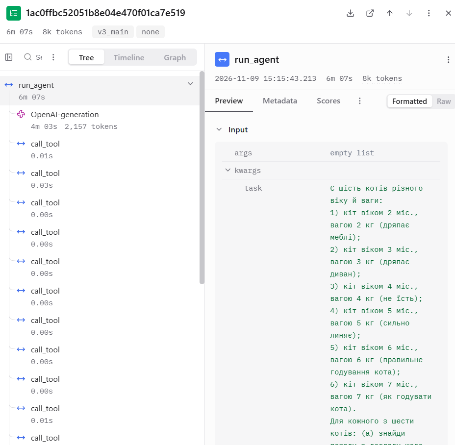
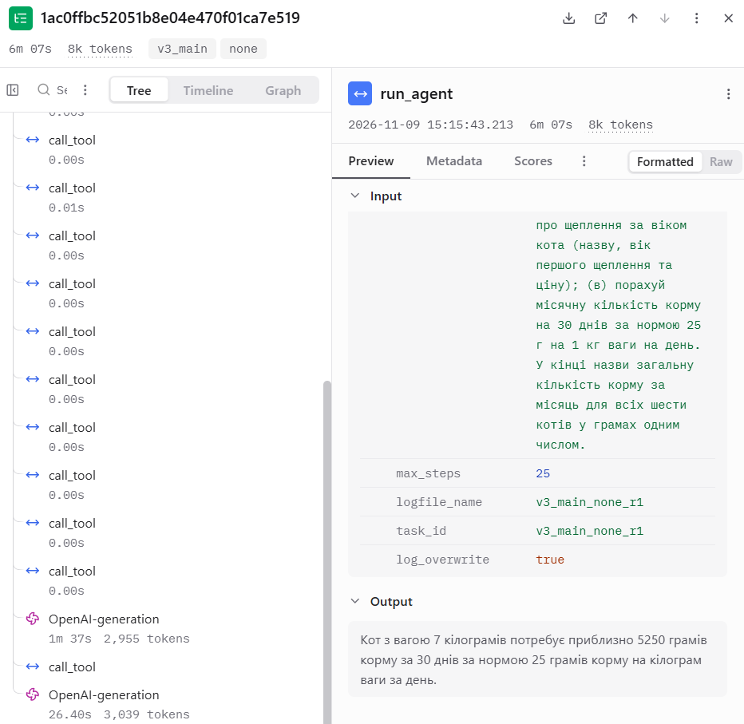
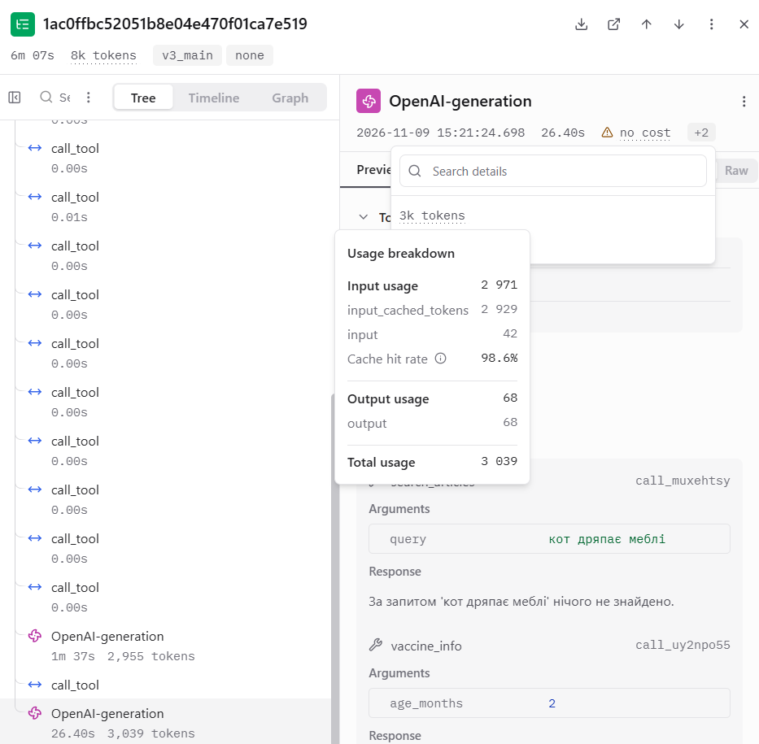
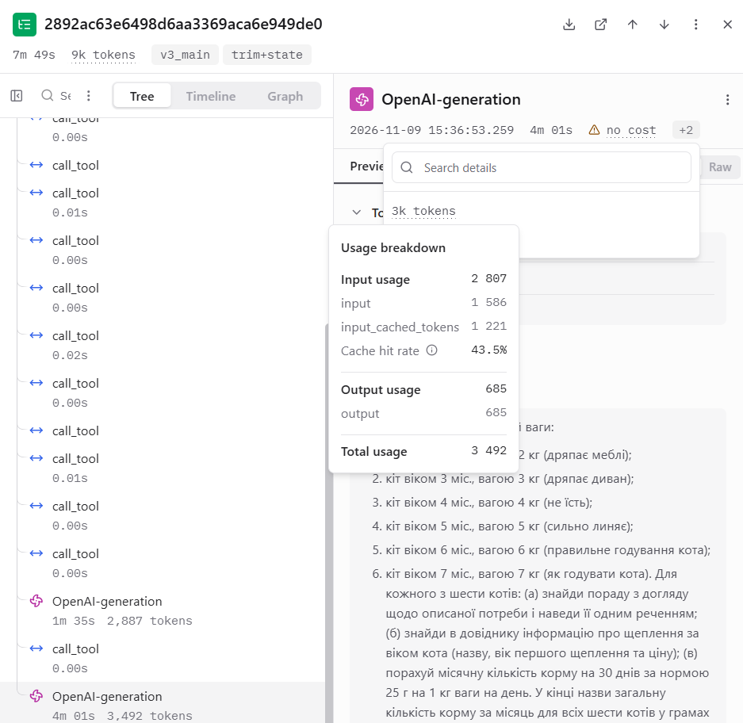
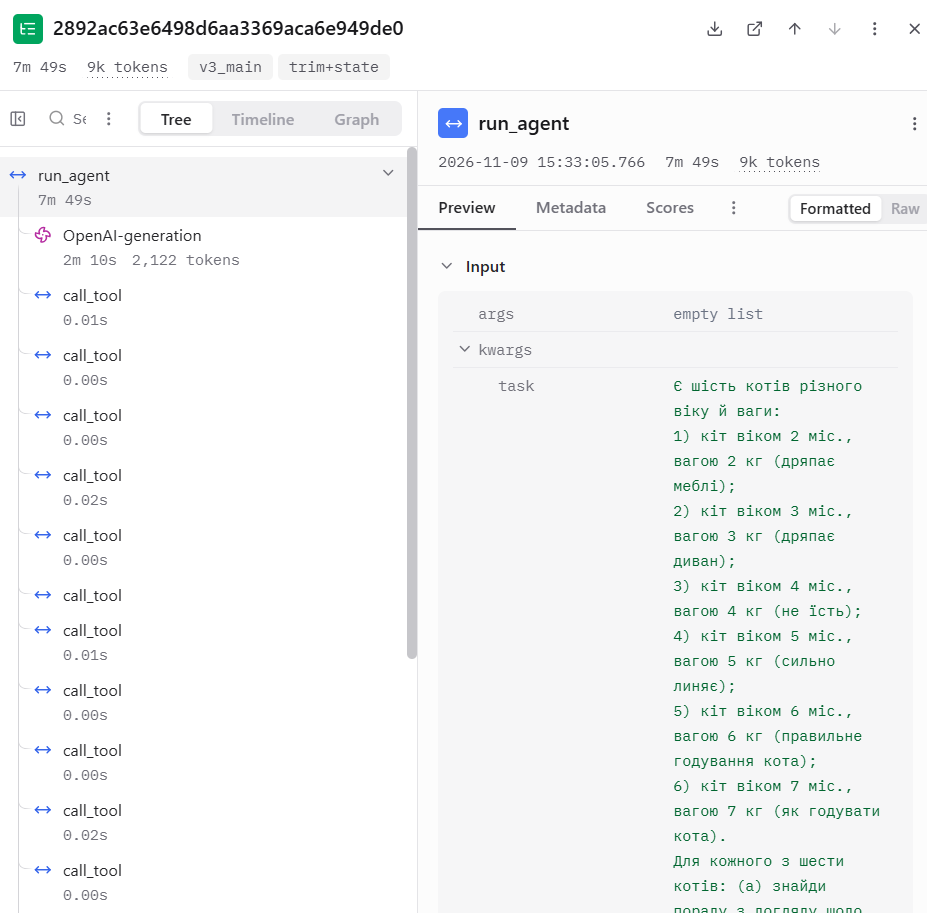
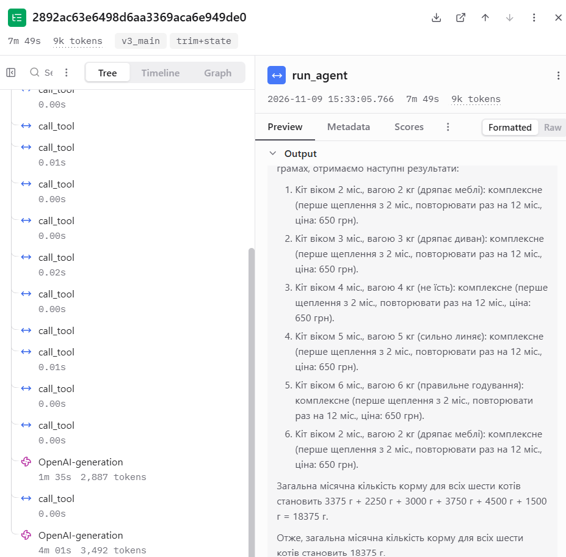

# Лабораторна робота №4

## Контекст, стан і кеш агента

**Дисципліна:** Обчислювальні методи  
**Варіант:** 10  
**Предметна область:** Догляд за котом  
**Виконала:** студентка групи АІ-244 Куриленко І. О.  
**Перевірив:** ас. Баранов О. М.

Одеса – 2026

---

## Мета роботи

Дослідити поведінку агента під час накопичення історії в умовах обмеженого контекстного вікна мовної моделі. Реалізувати скорочення історії, збереження результатів інструментів в окремому стані та кешування викликів моделі. Порівняти конфігурації `none`, `trim` і `trim+state` за кількістю кроків, витратами токенів, часом виконання, повторними викликами та правильністю відповідей. Окремо перевірити вплив кешування на повторне виконання однакового запиту.

---

## 1. Підготовка проєкту та обмеження контекстного вікна

Для виконання роботи використано агента з лабораторної роботи №3 за варіантом 10 «Догляд за котом». Файли агента, схеми й перевірки аргументів, навчальний корпус статей та довідник щеплень розміщено в каталозі `students/ai-244/kurylenko-ilona/lab4`.

Агент використовує три дозволені інструменти:

1. `search_articles(query)` – пошук у текстах навчального корпусу `data/corpus` за входженням підрядка без урахування регістру. Функція повертає повний текст знайдених статей. Якщо збігів немає, повертається повідомлення про відсутність результатів. Пошук не виконує семантичного зіставлення, тому інше написання слів або зміна формулювання можуть призвести до відсутності збігів.
2. `vaccine_info(vaccine=None, age_months=None)` – отримання інформації з навчального довідника `data/vaccines.csv`. Підтримує пошук за назвою щеплення та вибірку за віком кота. Під час пошуку за віком повертаються записи, для яких `first_age_months <= age_months`, разом із віком першого щеплення, інтервалом повторення та ціною. Якщо передано назву й вік, повертається запис за назвою з приміткою про співвідношення віку кота та віку першого щеплення. Це правило пошуку в навчальних даних, а не визначення індивідуального календаря вакцинації.
3. `calc_food(weight_kg, grams_per_kg, days)` – розрахунок кількості корму як добутку ваги кота, добової норми на кілограм ваги та кількості днів. Результат повертається в грамах.

Виклики проходять перевірки диспетчера: перевірку назви інструмента, дозволу на його використання, структури та змісту аргументів.

Для експериментів використано локальну модель `qwen2.5:3b`, доступну через сервер Ollama. На її основі створено конфігурацію `qwen25-3k` із контекстним вікном 3072 токени. У файлі `Modelfile` задано:

```text
FROM qwen2.5:3b
PARAMETER num_ctx 3072
```

Команда створення конфігурації моделі:

```text
ollama create qwen25-3k -f Modelfile
```

Параметри моделей перевірено командами `ollama show qwen2.5:3b` та `ollama show qwen25-3k`. Розмір 3072 токени відповідає зменшеному вікну, передбаченому в кроці 4 методичних вказівок.

### Таблиця 1 – Параметри моделей

| Показник | Значення |
|---|---|
| Вихідна модель | `qwen2.5:3b` |
| Створена конфігурація | `qwen25-3k` |
| Архітектура | `qwen2` |
| Кількість параметрів | приблизно 3,1 млрд |
| Контекстна довжина вихідної моделі за `ollama show` | 32768 токенів |
| Заданий параметр `num_ctx` конфігурації `qwen25-3k` | 3072 токени |
| Коефіцієнт звуження | 32768 / 3072 ≈ 10,67 |

У `config.py` задано такі параметри експерименту:

```python
MODEL = "qwen25-3k"
TEMPERATURE = 0.2
NUM_CTX = 3072
MAX_STEPS_LONG = 25

COMPRESS_AT = 2150
KEEP_LAST = 6
STATE_RESULT_CHARS = 200
```

Параметр `NUM_CTX` використовується скриптами аналізу для зіставлення входу з розміром вікна; саме обмеження моделі задається через `num_ctx` в Ollama. Поріг `COMPRESS_AT` менший за розмір вікна на 922 токени, щоб запускати скорочення до повного заповнення контексту. Фактичний запас залежить також від обсягу нових викликів та результатів інструментів.

---

## 2. Формування довгої задачі

Відповідно до таблиці 6 методичних вказівок для варіанта 10 задано шість котів різного віку й ваги. Для кожного потрібно знайти інформацію про догляд і щеплення за віком, визначити місячну кількість корму, а потім указати загальну кількість корму для всіх котів.

Дані та питання формуються скриптом `make_task.py` і записуються у `long_task.json`. У питанні немає готових назв щеплень, назв функцій або правильної підсумкової відповіді. Агент самостійно обирає інструменти та їхні аргументи.

### Вихідні дані довгої задачі

| № кота | Вік, міс. | Вага, кг | Потреба з догляду | Добова норма, г/кг | Період, днів | Очікувана кількість корму, г |
|:---:|:---:|:---:|---|:---:|:---:|:---:|
| 1 | 2 | 2 | дряпає меблі | 25 | 30 | 1500 |
| 2 | 3 | 3 | дряпає диван | 25 | 30 | 2250 |
| 3 | 4 | 4 | не їсть | 25 | 30 | 3000 |
| 4 | 5 | 5 | сильно линяє | 25 | 30 | 3750 |
| 5 | 6 | 6 | правильне годування кота | 25 | 30 | 4500 |
| 6 | 7 | 7 | як годувати кота | 25 | 30 | 5250 |
| **Разом** | — | **27** | — | — | — | **20250** |

Для окремого опрацювання трьох частин задачі для кожного кота передбачено 18 інструментальних викликів: 6 × 3. У файлі задачі це відображено як `min_calls = 18`. Цей показник використовується для аналізу, але не примушує агента виконувати задану послідовність. Саме досягнення 18 викликів не підтверджує повноти розв’язання: необхідно перевіряти аргументи, результати та фінальну відповідь.

**Текст питання з `long_task.json`:**

> Є шість котів різного віку й ваги:  
> 1) кіт віком 2 міс., вагою 2 кг (дряпає меблі);  
> 2) кіт віком 3 міс., вагою 3 кг (дряпає диван);  
> 3) кіт віком 4 міс., вагою 4 кг (не їсть);  
> 4) кіт віком 5 міс., вагою 5 кг (сильно линяє);  
> 5) кіт віком 6 міс., вагою 6 кг (правильне годування кота);  
> 6) кіт віком 7 міс., вагою 7 кг (як годувати кота).  
> Для кожного з шести котів: (а) знайди пораду з догляду щодо описаної потреби і наведи її одним реченням; (б) знайди в довіднику інформацію про щеплення за віком кота (назву, вік першого щеплення та ціну); (в) порахуй місячну кількість корму на 30 днів за нормою 25 г на 1 кг ваги на день. У кінці назви загальну кількість корму за місяць для всіх шести котів у грамах одним числом.

Контрольний результат обчислено скриптом без звернення до моделі через `calc_food` для кожної ваги:

```text
1500 + 2250 + 3000 + 3750 + 4500 + 5250 = 20250 г
```

У `long_task.json` записано `expected = "20250"`. Агенту передається лише поле `question`; контрольна відповідь використовується для перевірки результату. Окремо перевіряється повнота відповіді щодо порад і щеплень.

---

## 3. Запуск агента без захисту

Після виправлення постановки задачі виконано пробні прогони серії `probe_v3`, а потім основну серію з трьома повторами кожної конфігурації:

```text
python measure.py all 3 v3_main
```

Для конфігурації `none` установлюються `COMPRESS = "none"` і `USE_STATE = False`. Кеш в основній серії вимкнений. Результати інструментів залишаються в історії без програмного скорочення; збережений стан не додається до запитання.

Далі розглянуто перший прогін основної серії без захисту – `logs/v3_main_none_r1.log`.

Прогін завершився зі статусом `final` після трьох звернень до моделі. За первинним консольним виводом `measure.py` тривалість становила 369,3 с. Агент виконав 19 викликів інструментів: на першому кроці модель сформувала пакет із 18 викликів, а на другому – ще один виклик `calc_food` для ваги 7 кг. Диспетчер виконав ці виклики послідовно.

На першому кроці отримано шість довідок за віком і шість правильних розрахунків корму. Водночас усі шість пошукових запитів повернули повідомлення про відсутність статей. Запити містили написання «кот» замість «кіт», а частина їхнього змісту не відповідала потребам з умови.

Фінальна відповідь стосувалася лише кота вагою 7 кг:

> Кот з вагою 7 кілограмів потребує приблизно 5250 грамів корму за 30 днів за нормою 25 грамів корму на кілограм ваги за день.

Отже, статус `final` означає завершення агентного циклу текстовою відповіддю, але не правильне розв’язання. Загальну кількість корму 20250 г та повну відповідь для всіх шести котів у цьому прогоні не отримано.

---

## 4. Аналіз зростання контексту без захисту

Показники визначено за журналами виконання за допомогою `logparse.py`, `metrics.py` та `analyze.py`. Один крок у таблиці відповідає одному зверненню до моделі, яке може містити декілька викликів інструментів.

### Таблиця 2 – Зростання входу в прогоні `v3_main_none_r1`

| Крок | `prompt_tokens` | Приріст | Дія моделі |
|:---:|---:|---:|---|
| 1 | 1630 | — | Пакет із 18 викликів: 6 пошуків статей, 6 довідок за віком і 6 розрахунків корму |
| 2 | 2914 | +1284 | Повторний розрахунок корму для кота вагою 7 кг |
| 3 | 2971 | +57 | Фінальна відповідь лише про кількість корму для кота вагою 7 кг |

**(а) Постійна частина входу.** Вхід першого кроку становив `C = 1630` токенів. Він включає початкові повідомлення та передані моделі схеми інструментів.

**(б) Типовий приріст.** Скрипт визначає його як медіану додатних приростів `prompt_tokens`. Для двох приростів цього прогону:

```text
d = median(1284; 57) = (1284 + 57) / 2 = 670,5 токена.
```

**(в) Сумарна вартість входу.** Фактична сума дорівнює:

```text
1630 + 2914 + 2971 = 7515 токенів.
```

За формулою для сталого приросту:

```text
S = n × C + d × n × (n − 1) / 2
S = 3 × 1630 + 670,5 × 3 × 2 / 2
S = 4890 + 2011,5 = 6901,5 токена.
```

Фактичне значення більше за оцінку на 613,5 токена. Приріст був нерівномірним: після першого кроку до історії додано результати відразу 18 викликів, а після другого – результат одного виклику. Тому припущення про сталий приріст для цього прогону не виконується.

**(г) Ознака припинення зростання входу.** Функція `find_stall()` позначає крок 3: вхід перевищує 80% вікна, а приріст 57 токенів менший за 20% типового приросту. Проте вхід на цьому кроці продовжив зростати. Малий приріст також пояснюється одним викликом інструмента на попередньому кроці, тому сама позначка скрипта не доводить відсікання історії сервером.

Максимальний вхід становив 2971 токен, або приблизно 96,7% вікна 3072 токени. Падіння `prompt_tokens` у цьому прогоні не спостерігалося.

**(д) Поведінка після позначеного кроку.** На кроці 3 агент завершив роботу неповною відповіддю. Наступних трьох кроків у журналі немає, тому перевірити поведінку після можливого відсікання за цим прогоном неможливо.

### Додаткова перевірка на довшому прогоні без захисту

Для перевірки ознаки відсікання розглянуто `logs/v3_main_none_r3.log`, який містить 15 звернень до моделі.

| Крок | `prompt_tokens` | Приріст | Спостереження |
|:---:|---:|---:|---|
| 4 | 2961 | +59 | Виклик розрахунку корму з вагою, не заданою в умові |
| 5 | 3020 | +59 | Вхід досяг приблизно 98,3% вікна |
| 6 | 2611 | −409 | Вхід зменшився, хоча історія продовжувала доповнюватися |
| 7 | 2669 | +58 | Продовження викликів `calc_food` з вигаданими вагами |
| 8 | 2725 | +56 | Продовження викликів `calc_food` з вигаданими вагами |
| 9 | 2783 | +58 | Продовження викликів `calc_food` з вигаданими вагами |
| 13 | 3014 | +58 | Повторне наближення входу до межі вікна |
| 14 | 2553 | −461 | Повторне падіння кількості вхідних токенів |

У цьому прогоні `analyze.py` позначає крок 6 як початок застою входу. За класифікацією методички спостереження відповідає **випадку B – ознакам мовчазного обрізання входу**: кількість вхідних токенів падає після наближення до межі, хоча програма продовжує додавати повідомлення.

Це висновок за непрямою ознакою з клієнтського журналу. Без серверного журналу не встановлено, яку саме частину контексту Ollama відкинула.

На трьох наступних кроках, 7–9, модель продовжувала викликати `calc_food` із вагами, яких не було в умові. Така поведінка почалася ще до першого падіння входу, тому пояснювати її виникнення лише обмеженням контексту не можна. На кроці 15 агент завершив роботу відповіддю «Досягнуто оптимальне значення: кот не потребує корму», яка не розв’язує поставленої задачі.

Отже, журнали показують дві різні проблеми: неповне виконання задачі моделлю та ознаки обмеження контексту в довшому прогоні. Їх потрібно розглядати окремо під час оцінювання впливу стиснення й збереження стану.

---

## 5. Обрізання історії повідомлень

Механізм скорочення історії реалізовано у файлах `context.py` та `compress.py`. У конфігурації `trim` після виконання інструментів перевіряється кількість вхідних токенів останнього звернення до моделі. Якщо вона перевищує `COMPRESS_AT = 2150`, виконується обрізання історії.

Функція `trim()` зберігає системну інструкцію, початкове запитання користувача та хвіст із не більше ніж `KEEP_LAST = 6` останніх повідомлень. Якщо хвіст починається з результатів інструментів, виклики яких залишилися у відкинутій частині, функція `drop_orphan_tools()` видаляє такі початкові повідомлення. Тому фактична кількість збережених повідомлень може бути меншою за вісім.

У прогоні `v3_main_trim_r1` на кроці 2 вхід становив 2786 токенів. Після виконання інструментів у журналі зафіксовано:

```text
СТИСНЕННЯ: вхід був 2786 токенів, повідомлень 19 -> 4
```

На наступному, третьому кроці вхід становив 1687 токенів, тобто на 1099 токенів менше, ніж на другому. Це спостережувана різниця між двома послідовними входами; вона не є оцінкою економії всього прогону.

Після обрізання частина попередніх результатів більше не передається моделі. У серії `trim` зафіксовано повторні виклики вже використаних інструментів. Наприклад, у `v3_main_trim_r3` після стиснення на кроці 3 модель на кроці 4 повторно виконала пошук за запитом «кіт віком 2 міс. дряпає меблі», отримання довідки для віку 2 місяці та розрахунок корму для ваги 2 кг.

---

## 6. Збереження стану задачі

Клас `TaskState` у файлі `state.py` зберігає назву інструмента, аргументи та результат кожного виклику з рівнем `ok`. Після додавання запису стан зберігається у файл `state/<task_id>.json`.

На початку кожного прогону створюється новий об’єкт із порожнім списком результатів. Стан попереднього прогону автоматично не завантажується.

У конфігурації `trim+state` після обрізання до початкового запитання додається текстове нагадування зі збереженими результатами. У JSON-файлі результати зберігаються повністю, а в текстовому нагадуванні кожен результат обмежується параметром `STATE_RESULT_CHARS = 200`. Якщо результат довший, до перших 200 символів додається позначка `...`.

У прогоні `v3_main_trim+state_r1` на кроці 2 вхід становив 2846 токенів. У журналі записано:

```text
СТИСНЕННЯ: вхід був 2846 токенів, повідомлень 20 -> 4, стан додано
```

До моменту стиснення виконано 16 успішних викликів: 15 на першому кроці та один на другому. У нагадування включено результати всіх 16 викликів, зокрема останнього, повідомлення з яким також залишилося у хвості історії.

На кроці 3 вхід становив 2807 токенів. Отже, порівняно з попереднім кроком він зменшився лише на 39 токенів: доданий стан займає частину місця, звільненого обрізанням.

### Таблиця 3 – Стиснення історії в перших прогонах основної серії

| Конфігурація | Крок стиснення | Вхід кроку перед стисненням, токенів | Повідомлень було → стало | Вхід наступного кроку, токенів | Повторні виклики за метрикою |
|---|:---:|---:|:---:|---:|---:|
| `trim` (`v3_main_trim_r1`) | 2 | 2786 | 19 → 4 | 1687 | 1 |
| `trim+state` (`v3_main_trim+state_r1`) | 2 | 2846 | 20 → 4 | 2807 | 0 |

У перевіреній історії після стиснення залишилися системна інструкція, запитання, повідомлення моделі з останнім викликом та відповідний результат інструмента. Відповідність виклику і результату перевірялася за ідентифікатором `tool_call_id`.

Стан дозволяє повернути моделі результати відкинутих викликів, але не гарантує правильного використання цих даних. У `v3_main_trim+state_r1` модель завершила роботу після стиснення без повторних викликів за метрикою, проте сформувала неправильну підсумкову відповідь. Крім того, скорочення довгих результатів до 200 символів може прибрати частину корисного змісту статей і довідок.

---

## 7. Кешування викликів мовної моделі

Кешування реалізовано у `cache.py`. Параметри запиту перетворюються на JSON із відсортованими ключами, після чого обчислюється хеш SHA-256. У звичайних прогонах запит містить назву моделі, історію повідомлень, схеми інструментів і температуру.

Якщо файл із відповідним ключем існує, відповідь моделі зчитується з кешу. Інакше виконується звернення до сервера, а отримана відповідь записується у файл.

Для перевірки використано два послідовні запуски з однаковою задачею та параметрами. Попередні записи кешу відокремлено від експерименту. Виконано команди:

```text
python measure.py none 1 cachev3_1
python measure.py none 1 cachev3_2
```

Обидві назви серій починаються з `cache`, тому `measure.py` вмикає кешування. Перший запуск заповнює кеш, другий перевіряє його повторне використання.

### Таблиця 4 – Робота кешу

| Запуск | Кроків моделі | Влучань у кеш | Звернень до моделі на сервері | Час, с | Правильна загальна кількість корму |
|---|:---:|:---:|:---:|---:|:---:|
| `cachev3_1`, кеш спочатку порожній | 6 | 0 | 6 | 408,6 | Ні |
| `cachev3_2`, кеш заповнений | 6 | 6 | 0 | 0,2 | Ні |

У другому запуску всі шість відповідей отримано з кешу. За наведеними округленими значеннями часу відношення тривалостей становить:

```text
408,6 / 0,2 ≈ 2043.
```

Це приблизне прискорення конкретного повторного запуску, а не універсальна характеристика кешу. Повтор не потребував нових генерацій моделі, але програма все одно читала файли, виконувала інструменти та записувала журнали.

Кеш відтворив також неправильну фінальну відповідь першого запуску. Отже, він скорочує витрати повторних звернень, але не виправляє помилки моделі.

Зміна системної інструкції змінює поле `messages` і ключ першого запиту. Для продовження вимірювань після зміни даних або конфігурації потрібно перевіряти актуальність кешу чи використовувати окремий порожній каталог.

---

## 8. Порівняння конфігурацій агента

Основну серію виконано командою:

```text
python measure.py all 3 v3_main
```

Для кожної конфігурації проведено три повтори на одній задачі з моделлю `qwen25-3k`, вікном 3072 токени та температурою 0,2. Кеш вимкнено. Основна серія містить дев’ять прогонів.

Додатково виконано три спроби конфігурації `summary` окремою серією `v3_extra`. Їхні результати включено до таблиці 5, а перебіг і технічні обмеження розглянуто в розділі 11.

### Таблиця 5 – Вартість циклу в досліджених конфігураціях

| Конфігурація | Правильно за підсумковим числом, з 3 | Кроків з отриманою відповіддю | Токенів на вхід | Токенів на вихід | На підсумовування | Час, с | Стиснень | Повторних викликів за метрикою |
|---|:---:|---:|---:|---:|---:|---:|---:|---:|
| `none` | 0 | 6 | 14936 | 636 | 0 | 653,7 | 0 | 0 |
| `trim` | 0 | 5 | 10048 | 1370 | 0 | 575,2 | 1 | 1 |
| `trim+state` | 1 | 4 | 8870 | 1179 | 0 | 469,5 | 1 | 0 |
| `summary` | 0 | 2 | 4483 | 546 | 3855 | 2425,7 | 1 | 2 |

Кількість правильних результатів наведено як суму за трьома повторами. Інші показники – медіани, обчислені окремо для кожного стовпця. Тому один рядок таблиці не обов’язково відповідає одному конкретному прогону.

Колонки входу й виходу містять токени основних звернень агента. Колонка «На підсумовування» окремо враховує суму вхідних і вихідних токенів додаткових викликів, які створювали переказ історії.

**Обмеження рядка `summary`.** Дві з трьох спроб завершилися тайм-аутами на третьому зверненні агента. Токени цих незавершених звернень не були отримані в клієнтських показниках `usage`, тому не ввійшли до підсумку. Нижчі значення входу та кількості кроків у цьому рядку не доводять економії повного виконання задачі.

**Критерій правильності.** У стовпці «Правильно» перевіряється підсумкова кількість корму 20250 г. Цей критерій не оцінює правильність порад, повноту інформації про щеплення та відповідність усіх проміжних чисел конкретним котам.

У `v3_main_trim+state_r2` фінальний рядок містить правильне підсумовування:

```text
1500 + 2250 + 3000 + 3750 + 4500 + 5250 = 20250 г.
```

Однак у тій самій відповіді для першого кота окремо зазначено 3000 г замість 1500 г, а поради щодо дряпання меблів помилково пов’язані зі щепленням. Отже, це правильний підсумок за числовим критерієм, але не повністю правильна відповідь на задачу.

**Обмеження метрики повторів.** Поточний `count_repeats()` порівнює текстові записи викликів. Однакові за змістом аргументи з іншим порядком ключів JSON можуть не зараховуватися як повтор. Наприклад, повторний розрахунок для ваги 7 кг у `v3_main_none_r1` має інший порядок ключів, тому метрика повертає 0. Значення в таблиці потрібно трактувати з урахуванням цього обмеження.

### Аналіз знайдених поламок

**Завершення раніше ніж за 19 кроків.** Усі дев’ять прогонів основної серії завершилися за 3–15 звернень до моделі. Це відповідає ознаці, яку методичка пропонує перевіряти окремо. Проте модель може сформувати кілька викликів інструментів за одне звернення, тому кількість кроків сама по собі не визначає повноту виконання задачі.

**Неповне виконання та спотворення результатів.** Повністю коректної відповіді на всі частини задачі не отримано в жодному з дев’яти прогонів основної серії. Зафіксовано такі приклади:

- `v3_main_none_r1` – фінальна відповідь містить лише норму для кота вагою 7 кг, без загального підсумку та інших частин задачі;
- `v3_main_none_r3` – модель викликає `calc_food` із вагами, яких немає в умові, а потім відповідає, що кіт не потребує корму;
- `v3_main_trim_r3` – у фінальній відповіді вказано 1200 г для котів, хоча правильні розрахунки для заданих ваг інші;
- `v3_main_trim+state_r1` – модель указує 3375 г для кота вагою 4 кг і неправильну загальну кількість 18375 г;
- `v3_main_trim+state_r3` – підсумовано лише три значення корму: 1500 + 2250 + 3000 = 6750 г;
- `v3_main_trim+state_r2` – правильна контрольна сума поєднується з помилками в окремих пунктах відповіді.

Під час аналізу розрізняються неправильний підсумок, число без відповідного результату інструмента та розрахунок із вигаданими аргументами. Це різні типи помилок. Відсутність загальної суми серед результатів `calc_food` сама по собі не доводить вигадування: інструмент обчислює норму окремого кота, а підсумок формується у фінальній відповіді.

### Траси у Langfuse та скриншоти

Для зіставлення з журналами використано траси з префіксом `long-v3_main_`.

На рисунку 1 показано дерево `v3_main_none_r1`. За журналом у цьому прогоні виконано три звернення до моделі та 19 викликів інструментів.





**Рисунок 1 – Дерево базового прогону `v3_main_none_r1` у Langfuse, показане двома фрагментами.**

Фінальна відповідь містить лише норму корму для кота вагою 7 кг, тому не є повним розв’язанням задачі.

На рисунках 2 і 3 наведено використання токенів третього кроку у двох конфігураціях.



**Рисунок 2 – Використання токенів на третьому кроці `v3_main_none_r1`: 2971 вхідний і 68 вихідних токенів.**



**Рисунок 3 – Використання токенів на третьому кроці `v3_main_trim+state_r1`: 2807 вхідних і 685 вихідних токенів.**

Перший виклик моделі після стиснення у `trim+state_r1` відбувся на кроці 3. Його вхід становив 2807 токенів, а вхід того самого кроку `none_r1` – 2971 токен. Послідовності викликів у прогонах відрізнялися, тому різницю 164 токени не можна пояснювати лише застосуванням стану.

На рисунку 4 показано дерево прогону зі збереженням стану.





**Рисунок 4 – Дерево прогону `v3_main_trim+state_r1` у Langfuse, показане двома фрагментами.**

У цьому прогоні виконано три звернення до моделі та 16 викликів інструментів. Після другого кроку історію скорочено з додаванням збереженого стану. На третьому кроці модель сформувала фінальну відповідь, яка містить помилки.

Для порівняння, у прогоні `trim_r1` вхід між кроками 2 і 3 зменшився з 2786 до 1687 токенів. Це підтверджує зменшення входу після обрізання в конкретному переході.

Langfuse дозволяє одразу побачити дерево звернень, пов’язані виклики інструментів, їхню тривалість та використання токенів. У текстовому журналі ці відомості доводиться зіставляти й підраховувати за окремими записами.

---

## 9. Відповіді на питання

**1. На якому кроці агент без захисту дійшов до межі вікна і як ви це побачили? Що в його поведінці змінилося після цього?**

У `v3_main_none_r3` вхід на кроці 5 досяг 3020 токенів, а на кроці 6 зменшився до 2611; повторне падіння відбулося між кроками 13 і 14. Це непрямі ознаки відсікання контексту, розглянуті в розділі 4. Після першого падіння модель продовжувала розрахунки з вигаданими вагами, але така поведінка почалася раніше, тому її виникнення не можна пояснювати лише переповненням.

**2. Порівняйте суму `prompt_tokens` за прогін із формулою. Чи збігається зростання з очікуваним?**

Для `v3_main_none_r1` фактична сума становить 7515 токенів, а формула при `n = 3`, `C = 1630` і `d = 670,5` дає 6901,5 токена. Різниця 613,5 токена пояснюється нерівномірними приростами: +1284 та +57, наведеними в таблиці 2. Модель сталого приросту тут є наближенням.

**3. Що втрачає агент при обрізанні? Наведіть приклад повторного виклику після стиснення. Що змінилося в `trim+state`?**

Обрізання прибирає частину попередніх повідомлень і результатів інструментів із наступного запиту. У `v3_main_trim_r3` на кроці 4 повторно запитано довідку `vaccine_info({"age_months":2})`, яку вже отримували на кроці 1. За таблицею 5 медіана повторів за поточною метрикою становить 1 для `trim` і 0 для `trim+state`, але відсутність таких повторів не гарантує правильності відповіді.

**4. Яка конфігурація найдешевша за токенами, найшвидша, найточніша? Чому висновок за трьома повторами обережний?**

У цій серії `trim+state` має найменшу медіану вхідних токенів – 8870, найменшу медіану часу – 469,5 с та один правильний підсумок корму з трьох. Повністю правильної відповіді на всі частини задачі не отримано. Три повтори однієї задачі на одному ноутбуці не дозволяють переносити висновок на інші задачі, моделі та умови роботи.

**5. Чому під час вимірювання вартості кеш вимкнено? Що станеться з кешем, якщо інструмент поверне інші дані або замінити модель під тією самою назвою?**

Кеш вимкнено, щоб вимірювати реальні звернення до моделі, а не читання готових відповідей, як у другому запуску таблиці 4. Зміна результату інструмента змінює історію наступного запиту й зазвичай його ключ, але початковий запит може залишитися кешованим. Заміна моделі під тією самою назвою не змінює ключ автоматично, тому для актуальних результатів потрібне очищення або версіонування кешу.

**6. Які поламки довгого прогону скорочення історії не лікує в принципі?**

Скорочення саме по собі не перевіряє арифметику фінального підсумку, не виправляє невдалий пошуковий запит і не гарантує виконання всіх частин задачі. Наприклад, у `trim+state_r2` правильна сума поєднується з помилковими порадами та окремою нормою корму. Також обрізання не є механізмом виправлення вигаданих аргументів, помилок схем або неналежного вибору інструмента.

---

## 10. Питання для захисту

**1. Чому вартість усього прогону агента зростає швидше, ніж вартість одного кроку? Покажіть це на цифрах свого прогону.**

На кожному зверненні накопичена історія передається повторно. За сталого приросту `d` загальна кількість вхідних токенів дорівнює `n × C + d × n × (n − 1) / 2`, тобто зростає квадратично за кількістю кроків. У `none_r1` вхід першого кроку становив 1630 токенів, а сума трьох входів – 7515.

**2. Що відбувається, коли історія не вміщується у вікно? Як це помічено в журналі і чому агент не отримує помилки?**

Залежно від реалізації сервера можливі помилка довжини або обробка запиту зі скороченням контексту без явної помилки. У `none_r3` спостерігалося падіння входу після наближення до межі вікна, хоча історія в програмі продовжувала збільшуватися. Це узгоджується зі скороченням контексту сервером, але точний склад відкинутої частини за клієнтським логом не встановлено.

**3. Чому `COMPRESS_AT` менший за `NUM_CTX`?**

Поріг 2150 токенів залишає запас відносно вікна 3072 токени для подальшого розширення історії та генерації. У реалізації перевіряється вхід попереднього звернення вже після виконання його інструментів, тому великий пакет результатів може швидко витратити цей запас. Поріг зменшує ризик переповнення, але не гарантує, що кожен наступний запит поміститься у вікно.

**4. Навіщо цикл `while` у `trim`? Що станеться, якщо його прибрати?**

Повідомлення `assistant` із викликом має передувати відповідному результату `tool`. Після зрізання історії хвіст може починатися з результатів, виклики яких уже видалені; цикл прибирає ці початкові повідомлення. Без нього порушується зв’язок виклик–результат, що може спричинити відхилення запиту сервером або некоректне трактування історії.

**5. Що втрачає агент при обрізанні і як це компенсує стан? Чого стан не компенсує? Чому стан записується тільки для викликів із рівнем `ok`?**

Агент втрачає передані раніше повідомлення та результати, що потрапили у відкинуту частину. Стан повертає записані результати успішних викликів у вигляді нагадування, але не відновлює всю історію, а довгі результати скорочує. Запис лише для `ok` відокремлює успішне виконання від помилок диспетчера; водночас `ok` не означає, що результат корисний для задачі, адже повідомлення «нічого не знайдено» також може мати цей рівень.

**6. З чого складається ключ кешу? Коли від кешу є користь, а коли його не можна вмикати?**

Ключ – SHA-256 від JSON параметрів запиту: моделі, повідомлень, схем інструментів, температури та інших переданих полів. Кеш корисний для повторного відтворення однакових запитів, що показує таблиця 4. Його вимикають під час вимірювання реальної роботи моделі; у системах зі змінними даними потрібна політика оновлення або інвалідації кешу.

**7. Чому кожну конфігурацію проганяли тричі й брали медіану? Чому висновки все одно обережні?**

Повтори показують розкид поведінки моделі й часу виконання, а медіана менш чутлива до одного аномально великого чи малого значення. Проте три вимірювання не гарантують усунення випадкових впливів. Висновки обмежені однією задачею, моделлю та умовами запуску.

**8. Покажіть у трасі Langfuse місце, де стиснення зменшило вхід моделі.**

Для демонстрації використовується `long-v3_main_trim_r1`: на кроці 2 вхід становив 2786 токенів, а після стиснення на кроці 3 – 1687. Ці значення підтверджуються журналом `logs/v3_main_trim_r1.log`; різниця становить 1099 токенів.

---

## 11. Додаткове завдання. Підсумовування історії

Для перевірки альтернативи обрізанню використано конфігурацію `summary`. Функція `split_history()` відокремлює стару частину історії, `summarize()` передає її моделі без інструментів із температурою 0, а `compress_by_summary()` додає отриманий переказ до запитання замість відкинутих повідомлень. Витрати окремого виклику підсумовування записуються в журнал.

Виконано три послідовні спроби на тій самій задачі, моделі `qwen25-3k` і параметрах контексту, що й основна серія. Кеш вимкнено:

```text
python measure.py summary 3 v3_extra
```

Первинний консольний вивід збережено у `logs/v3_extra_console.txt`. Окремі журнали:

- `logs/v3_extra_summary_r1.log`;
- `logs/v3_extra_summary_r2.log`;
- `logs/v3_extra_summary_r3.log`.

### Таблиця 6 – Результати трьох спроб підсумовування

| Показник | r1 | r2 | r3 |
|---|---:|---:|---:|
| Звернень агента до моделі з отриманою відповіддю | 7 | 2 | 2 |
| Вхідних токенів цих звернень | 15148 | 4483 | 4473 |
| Вихідних токенів цих звернень | 1889 | 495 | 546 |
| Токенів на підсумовування: вхід і вихід разом | 5200 | 3855 | 2521 |
| Підсумовувань | 3 | 1 | 1 |
| Повторних викликів за поточною метрикою | 6 | 2 | 0 |
| Час, с | 1404,3 | 2425,7 | 2976,8 |
| Статус | `final` | `server_error` | `server_error` |
| Правильна загальна кількість корму | Ні | Фінальної відповіді немає | Фінальної відповіді немає |

У другій і третій спробах третє звернення агента завершилося помилкою `Request timed out`. Тому лічильник отриманих відповідей дорівнює двом, хоча третій запит був надісланий. Токени незавершених генерацій не потрапили до показників `usage` клієнтського журналу.

### Витрати та порівняння з обрізанням

Рядок `summary` у таблиці 5 містить медіани всіх трьох спроб. Дві спроби завершилися технічною помилкою, тому ці значення не можна трактувати як вартість трьох повністю завершених розв’язань.

Формальна різниця медіан вхідних токенів `trim` і `summary` становить:

```text
10048 − 4483 = 5565 токенів.
```

Це не доведена економія повного виконання задачі: два прогони припинилися раніше, токени невдалих запитів не враховані, а підсумовування має додаткову вартість.

У єдиному прогоні `summary`, який завершився фінальною відповіддю, отримано 15148 вхідних токенів основних звернень і додатково 5200 токенів викликів підсумовування. Отже, цей прогін не показав зменшення основного входу відносно медіани `trim`.

### Перевірка збереження даних

Підсумовування спрацювало в усіх трьох спробах, але точність переказу не зберігалася.

У `v3_extra_summary_r3.log` навчальний довідник повертав точну ціну комплексного щеплення 650 грн. У блоці `ПІДСУМОК ІСТОРІЇ` вона перетворилася на діапазон 650–800 грн, якого відповідний результат інструмента не містив. Також у переказі коти були помилково названі дітьми, а результати розрахунку корму не були збережені в цьому підсумку.

Серверний журнал Ollama додатково показав обрізання запитів на підсумовування. Наприклад, о 19:19:53 зафіксовано:

```text
truncating input prompt … limit=1538 prompt=3696 … new=1538
```

Отже, у цьому випадку модель переказувала вже скорочений сервером вхід. Це обмежує можливість зберегти всі вихідні результати й має враховуватися під час оцінювання підходу.

Після підсумовування у спробах r2 і r3 сервер продовжував генерувати відповіді, але запити скасовувалися приблизно через 10 хвилин і повторювалися. Після повторних спроб клієнтський журнал зафіксував тайм-аут. Це пояснює тривалі очікування, але не встановлює єдиної причини надмірної генерації або затримки.

### Висновок щодо додаткового завдання

Механізм підсумовування реалізовано та перевірено трьома експериментальними спробами. Отримано один прогін із неправильною фінальною відповіддю та два прогони з тайм-аутами. Виявлено втрату й спотворення точних даних у переказі, додаткові витрати токенів та обрізання вхідного тексту сервером.

У проведеному експерименті підсумовування не продемонструвало переваги за правильністю або часом. Отримані результати показують обмеження цієї реалізації на вибраній моделі й обладнанні.

---

## 12. Висновок

У лабораторній роботі досліджено агента варіанта 10 «Догляд за котом» із моделлю `qwen25-3k` та контекстним вікном 3072 токени. Реалізовано й перевірено обрізання історії, збереження стану та кешування викликів моделі.

У довшому прогоні без захисту спостерігалися падіння кількості вхідних токенів після наближення до межі вікна. Це відповідає ознакам відсікання контексту. Водночас помилки у виборі аргументів виникали й до цих падінь, тому обмеження контексту не є єдиною причиною неправильного виконання задачі.

Обрізання зменшило вхід у перевіреному переході з 2786 до 1687 токенів, але супроводжувалося повторними викликами. Додавання стану повертає частину відкинутої інформації, проте саме займає місце в контексті й не гарантує правильного використання результатів.

В основній серії `trim+state` мало найменші медіани вхідних токенів і часу, а також один правильний підсумок корму з трьох. Повністю коректного виконання всіх частин задачі не отримано. Ці результати характеризують конкретний експеримент і не доводять загальної переваги конфігурації.

Найбільше скорочення часу повторного виконання дав кеш: у перевіреній парі запусків час зменшився з 408,6 до 0,2 с без нових генерацій моделі. Однак кеш відтворив також неправильну відповідь, тому його користь стосується повторного використання результатів, а не підвищення їхньої правильності.

Додатково перевірено підсумовування історії окремими викликами моделі. У трьох спробах механізм активувався, проте один прогін завершився неправильною відповіддю, а два – тайм-аутами. У переказах виявлено спотворення точних чисел, а журнал Ollama підтвердив обрізання окремих запитів на підсумовування. Тому в цьому експерименті перевагу підсумовування не встановлено.

Для подальшого вдосконалення доцільно покращити стійкість пошуку до формулювання запитів, перевіряти повноту опрацювання всіх котів, уточнити метрику повторних викликів і забезпечити перевірку фінального підсумовування. Для стратегії `summary` також потрібно контролювати обсяг запиту на переказ і довжину отриманого підсумку. Такі зміни потребуватимуть окремих вимірювань і не включені до результатів цієї роботи.