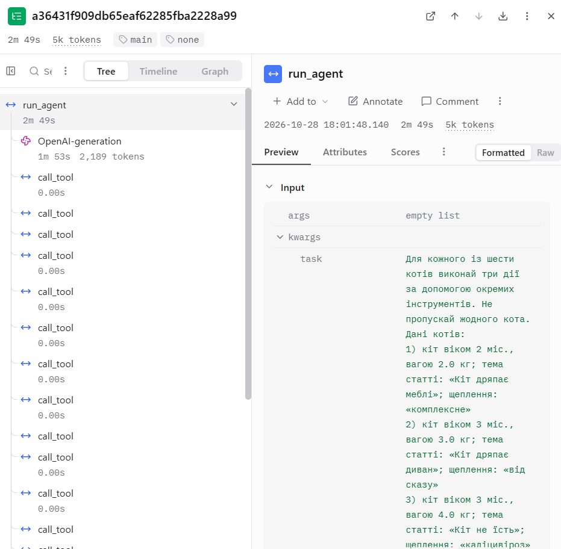
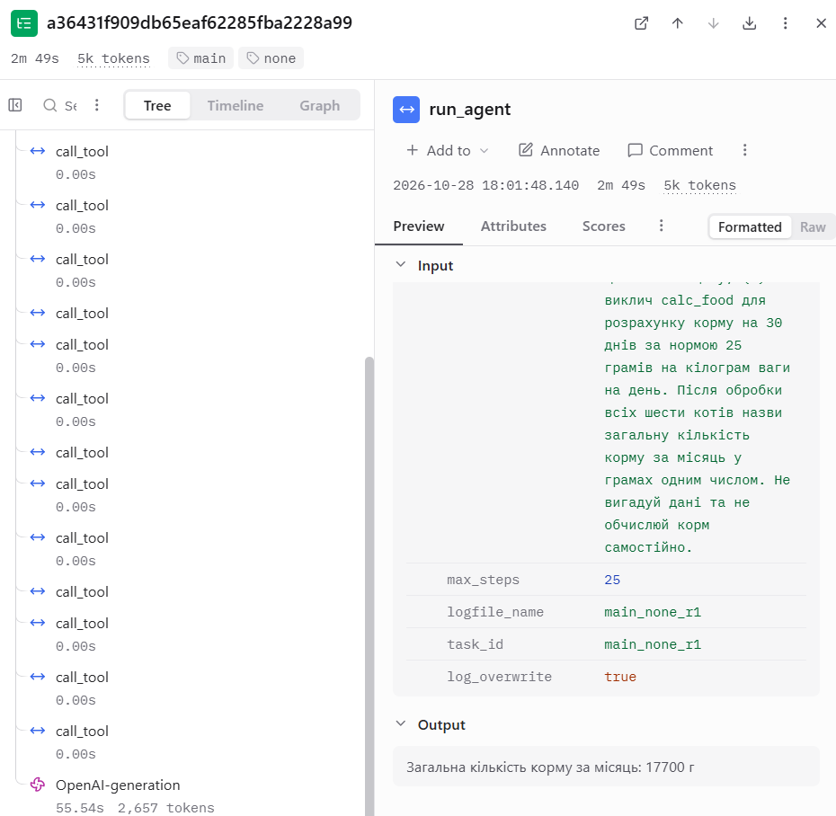
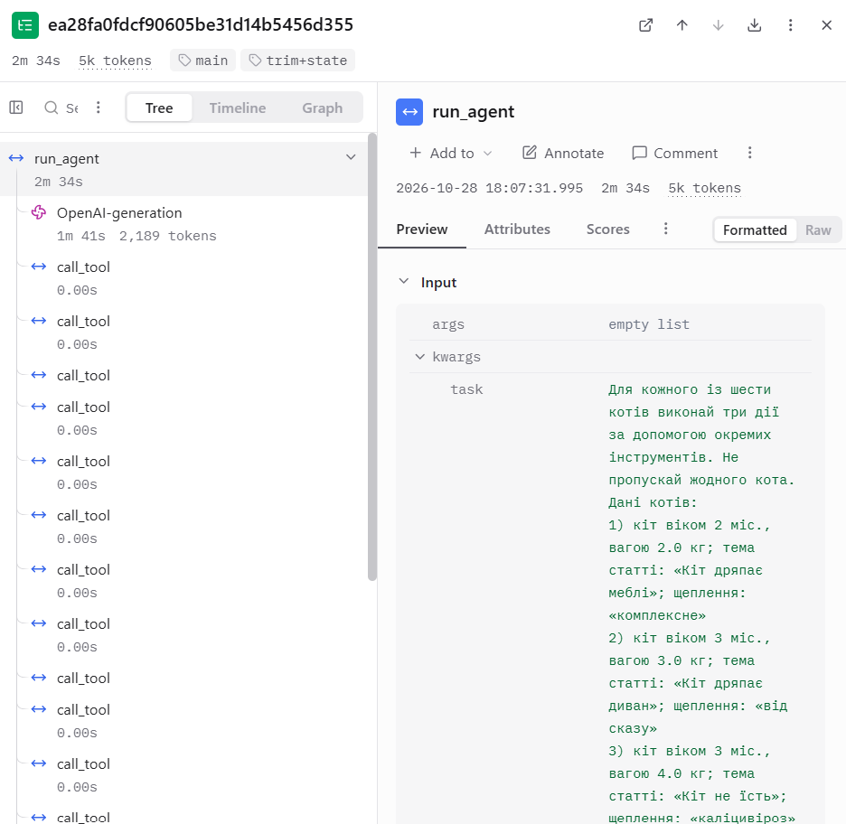
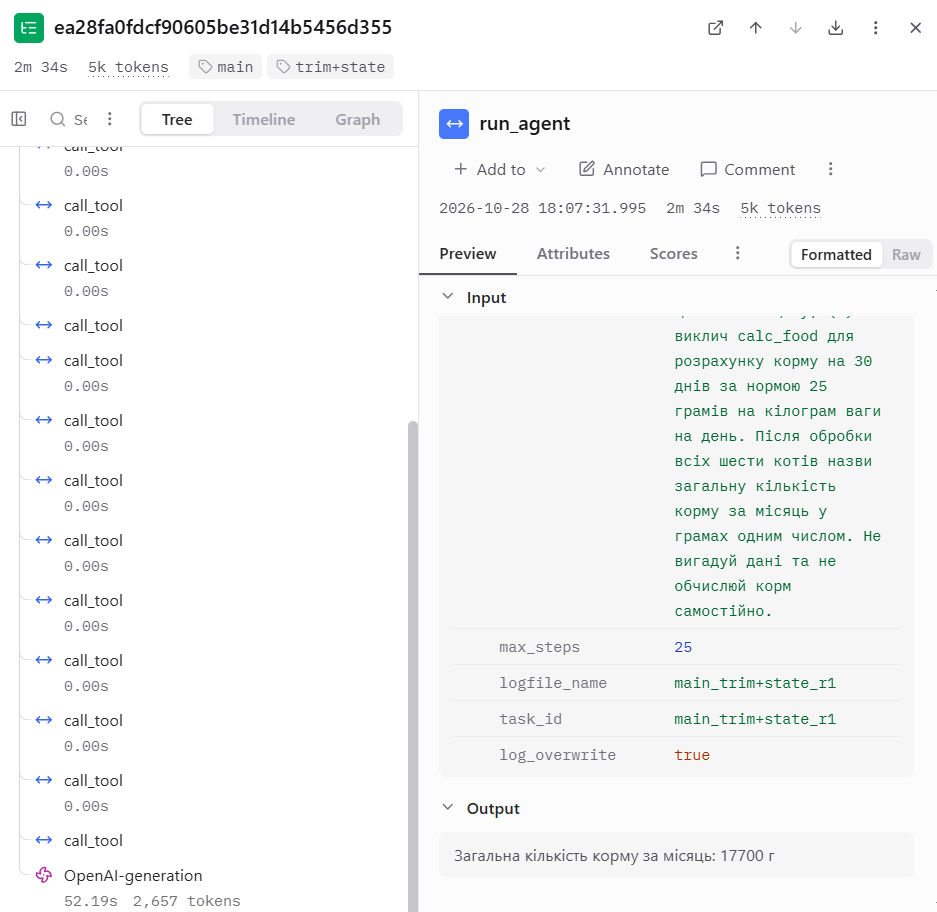

# Лабораторна робота №4

## Контекст, стан і кеш агента

**Дисципліна:** Обчислювальні методи  
**Варіант:** 10  
**Предметна область:** Догляд за котом  
**Виконала:** студентка групи АІ-244 Куриленко І. О.  
**Перевірив:** ас. Баранов О. М.

Одеса – 2026

---

## Мета роботи

Дослідити поведінку програмного агента в умовах обмеженого контекстного вікна мовної моделі. Навчитися скорочувати історію діалогу, зберігати результати викликів інструментів в окремому стані та використовувати кешування відповідей моделі. Порівняти вплив цих механізмів на кількість токенів, тривалість виконання та правильність відповідей.

## 1. Підготовка проєкту та обмеження контекстного вікна

Для виконання лабораторної роботи використано програмного агента з лабораторної роботи №3 за варіантом 10 «Догляд за котом». Створено окремий каталог `lab4`, до якого скопійовано програмні файли, дані та налаштування попередньої роботи.

Агент використовує три основні інструменти: `search_articles` для пошуку статей, `vaccine_info` для отримання інформації про щеплення та `calc_food` для розрахунку кількості корму.

Для дослідження обмеження контекстного вікна використано локальну мовну модель `qwen2.5:3b`, запущену через Ollama.

У каталозі `lab4` створено файл `Modelfile` з такими параметрами:

```text
FROM qwen2.5:3b
PARAMETER num_ctx 4096
```

За допомогою команди `ollama create qwen25-4k -f Modelfile` створено окрему конфігурацію моделі `qwen25-4k`.

Параметри перевірено командами `ollama show qwen25-4k` та `ollama show qwen2.5:3b`.

### Таблиця 1 – Порівняння параметрів моделей

| Показник | Значення |
|---|---|
| Вихідна модель | `qwen2.5:3b` |
| Створена модель | `qwen25-4k` |
| Архітектура | `qwen2` |
| Кількість параметрів | 3,1 млрд |
| Контекстна довжина вихідної моделі | 32768 токенів |
| Заданий параметр `num_ctx` нової моделі | 4096 токенів |
| Коефіцієнт звуження контекстного вікна | 8 |

Коефіцієнт звуження визначено за формулою:

32768 / 4096 = 8.

Отже, контекстне вікно було обмежено у 8 разів відносно максимальної контекстної довжини вихідної моделі. Це дозволить дослідити вплив накопичення історії повідомлень на роботу агента під час виконання довгої задачі.

## 2. Формування довгої задачі

Для дослідження роботи агента в умовах обмеженого контекстного вікна створено файл `make_task.py`, який автоматично формує довгу задачу для варіанта №10 «Догляд за котом».

Відповідно до методичних вказівок обрано шість котів різного віку та ваги. Для кожного передбачено три дії: пошук статті про догляд за допомогою `search_articles`, отримання інформації про щеплення через `vaccine_info` та розрахунок кількості корму за допомогою `calc_food`.

### Вихідні дані довгої задачі (додаткова таблиця)

| № | Вік кота, міс. | Вага, кг | Щеплення | Корм за 30 днів, г |
|---|---:|---:|---|---:|
| 1 | 2 | 2 | комплексне | 1500 |
| 2 | 3 | 3 | від сказу | 2250 |
| 3 | 3 | 4 | каліцивіроз | 3000 |
| 4 | 4 | 5 | хламідіоз | 3750 |
| 5 | 5 | 6 | дерматофітія | 4500 |
| 6 | 6 | 7 | інфекційний перитоніт | 5250 |
| **Разом** | | | | **20250** |

Усі назви щеплень перевіряються за довідником `data/vaccines.csv`, а теми статей беруться з наявного корпусу `data/corpus`.

Оскільки інструмент `calc_food` розраховує кількість корму в грамах, а даних про його вартість у вихідному наборі немає, підсумковим числовим показником обрано загальну кількість корму за місяць.

Для кожного кота необхідно виконати три виклики інструментів, тому мінімальна кількість викликів для шести котів становить:

6 × 3 = 18.

Правильна відповідь розраховується програмно за допомогою функції `calc_food`, без звернення до мовної моделі.

Після запуску команди `python make_task.py` отримано:

```text
Правильна відповідь: 20250
Мінімальна кількість викликів: 18
Файл long_task.json записано
```

У результаті створено файл `long_task.json`, який містить ідентифікатор задачі `L1`, текст питання `question`, правильну відповідь `expected = "20250"` та мінімальну кількість викликів `min_calls = 18`.

**Текст довгої задачі:** для кожного з шести котів (віком 2, 3, 3, 4, 5 та 6 місяців і вагою 2, 3, 4, 5, 6 та 7 кг) знайти статтю за відповідною темою, отримати дані про призначене щеплення та обчислити кількість корму на 30 днів за нормою 25 г/кг на день. Після виконання всіх 18 викликів назвати сумарну кількість корму в грамах. Точний текст запитання наведено у файлі `long_task.json`.

Отримане значення `expected` надалі використовуватиметься без змін для порівняння експериментальних прогонів агента.

## 3. Запуск агента без захисту

### 3.1. Результати пробного прогону без захисту

Для перевірки поведінки агента без механізмів скорочення контексту виконано команду `python measure.py none 1 probe`.

Прогін `probe_none_r1` тривав 181,7 с. Агент виконав два звернення до мовної моделі та 18 успішних викликів інструментів. На першому кроці було використано 1605 вхідних токенів, на другому – 2629. Загальна кількість вхідних токенів становила 4234.

Усі шість котів були опрацьовані за допомогою інструментів `search_articles`, `vaccine_info` та `calc_food`. Проте кінцева відповідь становила 15500 г замість правильних 20250 г. Отже, агент виконав необхідні інструментальні дії, але неправильно підсумував отримані результати.

Найбільший вхід становив приблизно 64,2% контекстного вікна, тому в цьому прогоні не зафіксовано досягнення його межі. Помилка кінцевої відповіді не може бути обґрунтовано пояснена переповненням контексту.

## 4. Аналіз зростання контексту без захисту

Для аналізу першого експериментального прогону створено файли `logparse.py`, `metrics.py` та `analyze.py`. Вони дозволяють визначити кількість звернень до моделі, використання токенів, приріст історії повідомлень та можливі ознаки переповнення контекстного вікна.

Виконано команду `python analyze.py logs\probe_none_r1.log steps`.

### Таблиця 2 – Зростання входу в прогоні без захисту

| Крок | `prompt_tokens` | Приріст | Що зробила модель |
|---|---:|---:|---|
| 1 | 1605 | – | Виконала 18 викликів інструментів для шести котів |
| 2 | 2629 | 1024 | Надала кінцеву відповідь без викликів інструментів |

На першому кроці агент використав 1605 вхідних токенів, на другому – 2629. Типовий приріст становив 1024 токени.

Загальна кількість вхідних токенів за прогін дорівнює 4234. За формулою з методичних вказівок отримано:

2 × 1605 + 1024 × 2 × (2 − 1) / 2 = 4234.

Отже, для цього прогону розрахункове значення збігається з фактичною сумою `prompt_tokens`.

Максимальний вхід становив 2629 токенів, або приблизно 64,2% контекстного вікна на 4096 токенів. Зупинки зростання входу не виявлено, повторних викликів інструментів не було. Пункт (г) аналізу – «не помічено», тому пункт (д), тобто аналіз трьох кроків після застою, не застосовується: агент загалом виконав лише два кроки.

Агент виконав усі 18 необхідних викликів інструментів, але сформував неправильну підсумкову відповідь – 15500 г замість 20250 г.

За класифікацією методичних вказівок цей результат відповідає випадку C – задача закоротка. Агент завершив роботу до досягнення межі контекстного вікна. Тому для подальшого дослідження необхідно зменшити вікно до 3072 токенів і повторити пробний прогін.

### 4.1. Повторний прогін із контекстним вікном 3072 токени

Оскільки перший пробний прогін відповідав випадку C – задача закоротка, розмір контекстного вікна зменшено до 3072 токенів.

Для цього змінено параметр `num_ctx` у файлі `Modelfile` з 4096 на 3072 та створено модель `qwen25-3k`. У наведеному вище блоці `Modelfile` показано початковий експеримент із 4096 токенами, а не параметр фінальної моделі. У файлі `config.py` встановлено `MODEL = "qwen25-3k"` і `NUM_CTX = 3072`.

Повторний прогін `probe_none_r1` виконано з тією самою довгою задачею та незмінною правильною відповіддю `expected = "20250"`.

Агент виконав два звернення до моделі та 18 успішних викликів інструментів. На першому кроці використано 1605 вхідних токенів, на другому – 2629. Загальна кількість вхідних токенів становила 4234, а вихідних – 652.

Тривалість прогону становила 250,5 с. Цього разу агент правильно визначив загальну кількість корму – 20250 г.

Максимальний вхід становив приблизно 85,6% контекстного вікна. Отже, навіть після зменшення вікна до 3072 токенів агент завершив задачу до досягнення його межі. Ознак переповнення контексту в цьому прогоні не зафіксовано.

Порівняння двох запусків показало, що при однаковій кількості викликів інструментів і вхідних токенів модель сформувала різні підсумкові відповіді. Тому різницю в правильності не можна однозначно пояснити зміною розміру контекстного вікна.

## 5. Обрізання історії повідомлень

Для реалізації першого механізму захисту створено файли `context.py` і `compress.py`. Функція `trim()` залишає системну інструкцію, початкове запитання користувача та шість останніх повідомлень. Функція `compress_history()` перевіряє перевищення порога `COMPRESS_AT = 2150` токенів і за потреби скорочує історію.

У файлах `agent.py` і `measure.py` реалізовано можливість запуску агента в режимах `none` та `trim`.

Для перевірки виконано команду `python measure.py trim 1 probe`. Прогін тривав 243,1 с. Агент виконав два звернення до моделі та 18 успішних викликів інструментів. Загальна кількість вхідних токенів становила 4234, максимальний вхід – 2629 токенів. Повторних викликів інструментів не зафіксовано. Кінцева відповідь була правильною – 20250 г.

Під час експерименту скорочення історії не відбулося. На першому кроці вхід становив 1605 токенів і не перевищував установленого порога. На другому кроці вхід збільшився до 2629 токенів, однак модель одразу сформувала кінцеву відповідь, тому функція скорочення історії не викликалася.

Таким чином, у цьому прогоні режим `trim` не змінив обсяг використаних токенів. Різниця у тривалості виконання не свідчить про ефективність обрізання, оскільки фактичного стиснення не було.

## 6. Збереження стану задачі

Для реалізації механізму збереження стану створено файл `state.py` із класом `TaskState`. Він записує результати успішних викликів інструментів у JSON-файл, незалежно від історії повідомлень мовної моделі.

У файлах `agent.py`, `compress.py` та `measure.py` реалізовано конфігурацію `trim+state`. Вона передбачає скорочення історії повідомлень і додавання збережених результатів до початкового запитання після обрізання.

Для перевірки виконано команду `python measure.py trim+state 1 probe`.

Прогін тривав 244,7 с. Агент виконав два звернення до мовної моделі та 18 успішних викликів інструментів. Максимальний вхід становив 2629 токенів, сумарний обсяг вхідних токенів – 4234. Повторних викликів не зафіксовано.

Кінцева відповідь була правильною – 20250 г.

У каталозі `state` автоматично створено файл `probe_trim+state_r1.json` розміром 3324 байти. Це підтверджує збереження результатів інструментів в окремому стані задачі.

Під час прогону обрізання історії не відбулося. Агент виконав усі виклики інструментів на першому кроці, а на другому сформував кінцеву відповідь. Тому механізм додавання стану до скороченої історії не активувався.

Порівняння конфігурацій `none`, `trim` і `trim+state` не виявило відмінностей у кількості вхідних токенів: у всіх трьох випадках використано 4234 токени. Таким чином, ефективність відновлення стану в умовах фактичного обрізання історії потребує окремої перевірки.

### Порівняння результатів скорочення історії

**Таблиця 3 – Стиснення історії**

| Конфігурація | Крок стиснення | Вхід до стиснення, токенів | Повідомлень було → стало | Повторних викликів за прогін |
|---|---|---|---|---:|
| `trim` | Не відбулося | – | – | 0 |
| `trim+state` | Не відбулося | – | – | 0 |

Під час пробних та основних запусків агент виконував усі 18 викликів інструментів на першому кроці, а на другому формував кінцеву відповідь. Тому механізми скорочення історії не активувалися.

Для окремої перевірки реалізованих функцій було проведено діагностичне тестування. Функція обрізання скоротила тестову історію з 18 до 8 повідомлень. Перевірка структури підтвердила, що у збереженій частині історії не залишилося результатів інструментів без відповідних викликів.

Окремий тест `trim+state` також підтвердив можливість додавання збережених результатів інструментів до запитання після скорочення історії. Однак ці результати отримано під час діагностичних перевірок, а не основних прогонів агента.

## 7. Кешування викликів мовної моделі

Для реалізації кешування створено файл `cache.py`. Ключ кешу формується за допомогою алгоритму SHA-256 на основі параметрів запиту: назви моделі, історії повідомлень, описів інструментів і температури генерації.

У файлі `model.py` підключено функцію `ask_model()`, яка перевіряє наявність готової відповіді в кеші. Якщо відповідь уже збережена, вона повертається без повторного звернення до Ollama.

У файлі `measure.py` реалізовано автоматичне ввімкнення кешу для серій, назва яких починається з `cache`. Під час основних вимірювань кеш залишається вимкненим.

Для перевірки виконано команду `python measure.py none 2 cachetest`, яка запускає однакову задачу двічі.

### Таблиця 4 – Робота кешу

| Запуск | Кроків | Влучань у кеш | Викликів до сервера | Час, с | Правильно |
|---|---:|---:|---:|---:|---|
| 1 (кеш порожній) | 2 | 0 | 2 | 243,4 | Так |
| 2 (той самий запит) | 2 | 2 | 0 | 0,3 | Так |

Обидва прогони містять у журналах 4234 `prompt_tokens`, проте в другому випадку це статистика збережених відповідей, а не нові обчислення моделі.

Перший прогін `cachetest_none_r1` тривав 243,4 с. Відповіді мовної моделі були отримані через Ollama та збережені в кеші.

Другий прогін `cachetest_none_r2` тривав лише 0,3 с. Обидва звернення до моделі були обслужені з кешу, що підтверджується позначками `з кешу` в журналі та показником `влучань у кеш: 2`.

Прискорення становило:

243,4 / 0,3 ≈ 811,3 раза.

Зменшення тривалості:

(243,4 − 0,3) / 243,4 × 100% ≈ 99,88%.

Обидва прогони завершилися правильною відповіддю – 20250 г. Якщо змінити `SYSTEM` перед другим запуском, ключ запиту зміниться й наявний кеш не спрацює.

Таким чином, кешування дозволило суттєво скоротити час повторного виконання однакового запиту. Значення `prompt_tokens` другого прогону відображає збережену статистику первинних відповідей, а не фактичне повторне використання обчислювальних ресурсів мовної моделі.

## 8. Порівняння конфігурацій агента

Для порівняння ефективності механізмів керування контекстом проведено по три основні прогони для конфігурацій `none`, `trim` і `trim+state`. Додатково виконано три прогони `summary`; вони наведені окремим рядком таблиці 5.

Усі експерименти виконано на моделі `qwen25-3k` з контекстним вікном 3072 токени. Під час основної серії кешування було вимкнено.

**Таблиця 5 – Вартість циклу в основних конфігураціях та додатковій `summary` (медіани трьох повторів)**

| Конфігурація | Правильно | Кроків | Токенів на вхід | Токенів на вихід | На підсумовування | Час, с | Стиснень | Повторних викликів |
|---|---:|---:|---:|---:|---:|---:|---:|---:|
| `none` | 0 з 3 | 2 | 4234 | 612 | 0 | 155,5 | 0 | 0 |
| `trim` | 0 з 3 | 2 | 4234 | 612 | 0 | 156,4 | 0 | 0 |
| `trim+state` | 0 з 3 | 2 | 4234 | 612 | 0 | 154,3 | 0 | 0 |
| `summary` | 0 з 3 | 2 | 4234 | 612 | 0 | 171,7 | 0 | 0 |

У таблиці наведено кількість правильних відповідей серед трьох повторів, а для інших показників – медіанні значення.

У дев'яти основних і трьох додаткових прогонах агент виконав по 18 необхідних викликів інструментів та завершив роботу за два кроки. Для кожної конфігурації медіанна кількість вхідних токенів становила 4234, вихідних – 612.

У жодному з дванадцяти прогонів стиснення історії не активувалося. Тому показники використання токенів однакові, а відмінності тривалості не можна пов'язувати з перевагою `trim`, `trim+state` або `summary`.

У всіх дванадцяти прогонах чотирьох конфігурацій модель сформувала неправильну підсумкову відповідь. При цьому результати інструментів були правильними. Це свідчить про проблему формування кінцевої відповіді, а не про помилку роботи інструментів.

Отже, основна серія підтвердила коректність виконання інструментальних викликів, але не дозволила кількісно оцінити переваги скорочення історії, оскільки відповідні механізми не активувалися.

### Аналіз помилок основних прогонів

Під час аналізу основної серії встановлено, що всі дев'ять прогонів завершилися зі статусом `final`, однак правильну підсумкову відповідь не отримано в жодному з них.

У кожному прогоні агент виконав 18 необхідних викликів інструментів протягом двох кроків роботи моделі. Повторних викликів не виявлено.

За методичкою потрібно окремо відзначити завершення менш ніж за 19 кроків (18 викликів і фінальна відповідь): це спостерігалося у 9 із 9 основних прогонів, оскільки модель сформувала всі 18 викликів за один крок. За підсумковим числом модель помилилася в усіх дев'яти прогонах. Це не доводить переповнення контексту.

У першому прогоні конфігурації `none` вхід становив 1605 токенів на першому кроці та 2629 токенів на другому. Приріст дорівнював 1024 токенам, а найбільший вхід займав приблизно 86% контекстного вікна розміром 3072 токени.

Переповнення контекстного вікна або припинення зростання входу не зафіксовано. Оскільки агент завершував роботу за два кроки, механізми `trim` і `trim+state` не активувалися.

Основною виявленою помилкою стало неправильне підсумовування результатів інструментів. У журналі отримано шість правильних значень місячної норми корму – 1500, 2250, 3000, 3750, 4500 і 5250 г. Їхня загальна сума становить 20250 г, але модель у першому основному прогоні повернула 17700 г.

Таким чином, застосування механізмів скорочення історії не вплинуло на результати основної серії, оскільки умови для їх активації не виникли. Виявлена помилка пов'язана з формуванням кінцевої відповіді, а не з роботою інструментів.

### Аналіз трас у Langfuse

Для додаткової перевірки результатів основної серії використано систему Langfuse. Було відкрито траси `long-main_none_r1` та `long-main_trim+state_r1`.





**Рисунок 1 – Два фрагменти траси `long-main_none_r1` у Langfuse.**





**Рисунок 2 – Два фрагменти траси `long-main_trim+state_r1` у Langfuse.**

На обох трасах видно два звернення до мовної моделі `OpenAI-generation` та 18 викликів інструментів `call_tool`. Усі виклики інструментів виконані після першого звернення до моделі, а друге звернення сформувало підсумкову відповідь.

У конфігурації `none` тривалість виконання становила приблизно 2 хв 49 с, а в конфігурації `trim+state` – 2 хв 34 с. В обох випадках модель повернула неправильну загальну кількість корму – 17700 г замість 20250 г.

За даними журналів виконання, вхід першого кроку становив 1605 токенів, другого – 2629 токенів. Отже, загальний обсяг вхідних токенів дорівнював 4234. Оскільки стиснення історії не відбулося, порівняти токени першого виклику після стиснення неможливо.

Langfuse дозволяє наочно побачити послідовність звернень до моделі, викликів інструментів та загальну тривалість операцій. У текстових журналах ці події доводиться зіставляти за окремими рядками.

Отримані траси підтверджують, що відсутність стиснення спричинена завершенням задачі за два кроки, а не помилкою виконання інструментів.

## 9. Додаткове завдання. Підсумовування історії агента

Для дослідження альтернативного способу скорочення контексту реалізовано механізм підсумовування історії за допомогою мовної моделі.

На відміну від звичайного обрізання, за якого старі повідомлення видаляються, підсумовування дозволяє замінити їх коротким текстовим переказом. Такий підхід може зберегти важливу інформацію з попередніх кроків, але потребує додаткового звернення до мовної моделі та створює ризик втрати точних числових даних.

### 9.1. Реалізація механізму

Створено файл `summary.py`, який містить функції `split_history()`, `render_messages()`, `summarize()` та `compress_by_summary()`.

Функція `split_history()` розділяє історію на системну інструкцію та початкове запитання, стару частину повідомлень і останні повідомлення, які залишаються без змін.

Функція `summarize()` виконує окремий запит до моделі `qwen25-3k` з вимогою зберегти точні числа, назви та результати інструментів.

Отриманий підсумок додається до початкового запитання користувача замість старої історії. Додаткові витрати токенів записуються в журнал.

У файлах `compress.py` та `measure.py` реалізовано підтримку конфігурації `summary`.

### 9.2. Результати трьох прогонів конфігурації `summary`

Для виконання додаткового завдання проведено три повторні прогони конфігурації `summary` за допомогою команди `python measure.py summary 3 extra`. У всіх експериментах використано однакову довгу задачу, модель `qwen25-3k` з контекстним вікном 3072 токени та вимкнене кешування.

**Таблиця 6 – Результати прогонів конфігурації `summary`**

| Показник | Прогін 1 | Прогін 2 | Прогін 3 |
|---|---:|---:|---:|
| Відповідь моделі, г | 17750 | 15500 | 15500 |
| Правильність відповіді | Ні | Ні | Ні |
| Кроків моделі | 2 | 2 | 2 |
| Вхідних токенів | 4234 | 4234 | 4234 |
| Вихідних токенів | 612 | 612 | 612 |
| Токенів на підсумовування | 0 | 0 | 0 |
| Стиснень історії | 0 | 0 | 0 |
| Повторних викликів | 0 | 0 | 0 |
| Тривалість, с | 1270,8 | 171,7 | 165,3 |

Усі три прогони завершилися після двох звернень до мовної моделі. На першому кроці агент сформував 18 викликів інструментів для шести котів. На другому кроці модель надала остаточну відповідь.

У жодному прогоні підсумовування історії не активувалося. Тому додаткові витрати токенів на підсумовування становили 0.

Перший прогін тривав 1270,8 с, що значно перевищує тривалість наступних запусків. Медіанний час трьох прогонів становив 171,7 с.

Усі результати інструментів були отримані успішно. Проте модель сформувала неправильні підсумкові значення – 17750 г, 15500 г і 15500 г замість правильних 20250 г.

Отже, виконано три прогони, передбачені додатковим завданням, але вони не дозволили оцінити ефективність підсумовування під час реального виконання довгої задачі. Працездатність механізму підтверджено окремими діагностичними тестами.

### 9.3. Окрема перевірка підсумовування

Для перевірки безпосередньої роботи механізму створено файл `test_summary.py`.

Тест формує історію з 16 повідомлень, що містить результати викликів інструментів `calc_food` та `vaccine_info`. Для скорочення використовується функція `compress_by_summary()`.

Виконано два незалежні запуски тесту.

**Таблиця 7 – Результати діагностичної перевірки підсумовування**

| Показник | Тест 1 | Тест 2 |
|---|---:|---:|
| Повідомлень до стиснення | 16 | 16 |
| Повідомлень після стиснення | 8 | 8 |
| Скорочення за кількістю повідомлень | 50% | 50% |
| Витрати на підсумовування, токенів | 450 | 387 |
| Підсумок додано до запитання | Так | Так |
| Збережено точні числа | Так | Так |

У двох запусках модель правильно зберегла результати старої частини історії: 1500 г, 2250 г, 3000 г та 650 грн. Значення 3750 г, 4500 г і 5250 г залишилися в останніх повідомленнях, які не підлягали підсумовуванню.

Після скорочення кількість повідомлень зменшилася з 16 до 8. При цьому витрати на додаткове звернення до моделі становили 450 токенів у першому запуску та 387 токенів у другому.

### 9.4. Аналіз результатів

Діагностична перевірка підтвердила, що механізм підсумовування може скорочувати історію повідомлень зі збереженням числових результатів інструментів.

Водночас зменшення кількості повідомлень на 50% не означає автоматичного зменшення кількості токенів на 50%, оскільки довжина повідомлень може відрізнятися.

У трьох прогонах додаткової серії механізм підсумовування не активувався. Тому виміряна економія вхідних токенів порівняно з конфігурацією `trim` становила 0 токенів, а витрати на підсумовування також дорівнювали 0.

Підсумовування має додаткову вартість у токенах і потенційний ризик спотворення інформації. У двох проведених діагностичних тестах втрати точних числових результатів не зафіксовано, однак це не гарантує їх збереження в кожному наступному запуску.

Отже, додаткова стратегія реалізована та пройшла окрему функціональну перевірку. Для оцінки її ефективності під час виконання довгої задачі потрібні прогони, у яких скорочення історії фактично активується.

## 10. Відповіді на питання для захисту

**1. Чому вартість усього прогону агента зростає швидше, ніж вартість одного кроку? Покажіть це на цифрах свого прогону.**

На кожному зверненні до моделі повторно надсилається накопичена історія, тому її вхід зазвичай збільшується. У дослідженому прогоні перший вхід становив 1605 токенів, другий – 2629. Загальна сума – 4234, тоді як два кроки без приросту коштували б 3210 вхідних токенів. Для двох кроків розрахунок за формулою з методички також дає 4234.

**2. Що відбувається, коли історія не вміщується у вікно? Як ви помітили це у своєму лозі і чому агент не отримує помилки?**

Залежно від сервера, задовгий запит може спричинити помилку або мовчазне відкидання частини історії. У другому випадку явної помилки немає, але модель може забувати попередні дії; одна з ознак – вхід перестає рости, хоча нові повідомлення додаються. У моїх журналах такого явища не було: максимум становив 2629 із 3072 токенів, статус завершення – `final`.

**3. Чому `COMPRESS_AT` менший за `NUM_CTX`?**

Поріг скорочення має залишати запас для нових повідомлень і відповіді моделі. У роботі `COMPRESS_AT = 2150`, `NUM_CTX = 3072`, різниця – 922 токени. Саме по собі встановлення порога не гарантує активації стиснення, якщо модель завершує задачу раніше.

**4. Навіщо цикл `while` у `trim`? Що станеться, якщо його прибрати?**

Цикл `while` у функції `drop_orphan_tools()`, яку викликає `trim()`, прибирає результати інструментів на початку обрізаного хвоста, якщо їхній виклик залишився у видаленій частині історії. Без нього запит може містити результат без попереднього виклику. Перевірка `test_history.py` успішно перевірила один сценарій із окремими парами викликів і результатів, але не всі можливі випадки з кількома викликами в одному повідомленні.

**5. Що втрачає агент при обрізанні і як це компенсує стан? Чого стан не компенсує? Чому стан записується тільки для викликів з рівнем `ok`?**

Обрізання видаляє частину попередніх повідомлень і результатів. `TaskState` окремо зберігає успішні результати інструментів у JSON та може додавати їх до запитання після стиснення. Стан не відновлює всю історію міркувань, а довгі результати в нагадуванні скорочуються. До стану записуються тільки результати з рівнем `ok`, щоб не закріплювати помилки як достовірні дані.

**6. З чого складається ключ кешу? Коли від кешу є користь, а коли його не можна вмикати?**

Ключ формується за SHA-256 від параметрів запиту: моделі, повідомлень, схем інструментів і температури. Кеш вигідний для однакових повторних запитів: тривалість у тесті зменшилася з 243,4 до 0,3 с. Для незалежних вимірювань роботи моделі кеш вимикається. Після зміни даних інструментів або самої моделі під тією самою назвою потрібно інвалідовувати кеш, інакше можна отримати застарілі відповіді.

**7. Чому кожну конфігурацію проганяли тричі й брали медіану? Чому висновки все одно обережні?**

Повтори дають змогу побачити мінливість відповідей і часу, а медіана зменшує вплив одиничних аномально довгих запусків. Для `summary` час становив 1270,8 с, 171,7 с і 165,3 с; медіана – 171,7 с. Водночас три повтори – невелика вибірка, а жоден основний прогін не активував стиснення.

**8. Покажіть у трасі Langfuse місце, де стиснення зменшило вхід моделі.**

У трасах `long-main_none_r1` і `long-main_trim+state_r1` такого місця немає: стиснення не відбулося. У кожному випадку вхід зріс із 1605 до 2629 токенів, а після другого виклику агент завершив роботу. Окремі діагностичні тести підтвердили скорочення кількості повідомлень, але не є доказом зменшення токенів у цих трасах.

## 11. Висновок

Під час виконання лабораторної роботи №4 було досліджено особливості роботи програмного агента в умовах обмеженого контекстного вікна мовної моделі. Для варіанта №10 «Догляд за котом» створено довгу задачу, яка передбачала 18 викликів трьох інструментів для шести котів.

Було реалізовано механізми обрізання історії повідомлень, збереження стану задачі та кешування відповідей мовної моделі. Додатково реалізовано четверту стратегію – підсумовування старої історії за допомогою окремого виклику моделі.

Під час основних експериментів агент виконував усі 18 викликів інструментів на першому кроці та завершував роботу на другому. Через це стиснення історії не активувалося в жодній із конфігурацій. Функціональність механізмів скорочення перевірено окремими діагностичними тестами.

Найбільший практичний ефект продемонструвало кешування. Під час повторного виконання однакового запиту тривалість роботи зменшилася з 243,4 до 0,3 с. Водночас такий результат стосується повторного використання збережених відповідей, а не прискорення самої мовної моделі.

Під час додаткових тестів підсумовування історію було скорочено з 16 до 8 повідомлень. Витрати на створення підсумків становили 450 і 387 токенів. В обох випадках модель зберегла точні числові результати старої частини історії.

Основною виявленою проблемою стала неправильна підсумкова відповідь агента. Попри успішне виконання всіх інструментальних викликів, модель не завжди могла правильно визначити загальну кількість корму – 20250 г. Це підтверджує, що правильність роботи інструментів не гарантує правильності остаточного результату.

Для подальшого вдосконалення агента доцільно реалізувати програмний контроль послідовності викликів інструментів, перевірку підсумкових обчислень та додаткові експерименти, у яких скорочення контексту фактично активуватиметься.

Таким чином, мету лабораторної роботи частково підтверджено експериментально: реалізовано основні механізми керування контекстом, перевірено їхні окремі функції та встановлено обмеження, що виникають під час виконання довгої задачі локальною мовною моделлю.